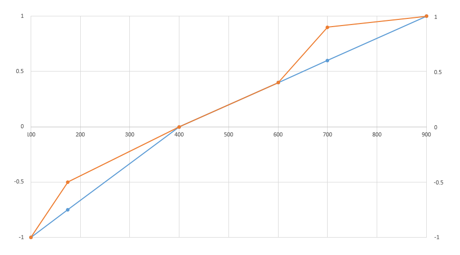

<a id="anchor-avar-avar-axis-variations-table"></a>

# avar — Axis Variations Table

The axis variations table ('avar') is an optional table used in variable fonts. It can be used to modify aspects of how a design varies for different instances along a particular design-variation axis. Specifically, it allows modification of the coordinate normalization that is used when processing variation data for a particular variation instance.

For a general overview of OpenType Font Variations and of coordinates and normalization, see the chapter, [OpenType Font Variations Overview](otvaroverview.md).

The 'avar' table is used in combination with a [font variations ('fvar')](fvar.md) table and other required or optional tables used in variable fonts.

<a id="anchor-avar-overview"></a>

## Overview

The 'fvar' table defines a font’s axes and the numeric range for each axis supported by the font. The numeric range for each axis is defined in terms of a “user” scale appropriate to each axis. When processing a font’s variation data to derive glyph outlines or other values for an instance, the instance coordinate for each axis must be mapped from the user scale to a normalized scale. A default normalization is defined that maps the minimum, default and maximum user values int the 'fvar' table to -1, 0, and 1, respectively. (See [Coordinate scales and normalization](otvaroverview.md#anchor-otvaroverview-coordinate-scales-and-normalization) in the OpenType Font Variations Overview chapter for a detailed specification.)

```
    if (userValue < axisDefaultValue)
    {
        defaultNormalizedValue = -(axisDefault - userValue) / (axisDefault - axisMin);
    }
    else if (userValue > axisDefaultValue)
    {
        defaultNormalizedValue = (userValue - axisDefault) / (axisMax - axisDefault);
    }
    else
    {
        defaultNormalizedValue = 0;
    }
```

If an 'avar' table is present, then the output of the default normalization can be further modified by allowing mappings to be defined for additional positions along each scale, creating multiple segments, with other values within each segment interpolated. The following figure illustrates an example of such a modification—the blue line shows the default mapping, with two segments, and the orange line shows the modified mapping, with additional segments.

<br>*Example of 'avar'-modified normalization — horizontal axis is user scale, vertical axis is normalized scale*

The conceptual effect of these additional scale mappings is to make the variation along an axis less linear. Values change linearly within each segment, but additional segments make the way that values change across the entire axis range less linear overall. The effect might also be described as compressing some portions of the scale while making other portions less compressed.

The visual effects of additional axis-value mappings in the 'avar' table are seen in how glyph outlines or other visual elements change as the user-scale values for an axis change. The same amount of change in the user-scale value may correspond to a subtle visual change in one portion of the axis range, but more dramatic changes in another portion of the axis range.

Note that it may be possible to achieve the same or similar effects by adding variation data for additional regions of the variation space. That approach requires more work and more font data, however, and tedious design iteration may be needed to obtain the desired results. The 'avar' table may provide a simple and lightweight way to achieve a particular effect.

Note also that the variation data created by the font designer will also have a significant effect on whether user-scale values and visual elements change uniformly. When an 'avar' table is used, the 'avar' table and the variation data are both factors in the variation behavior that the user will see.

<a id="anchor-avar-table-formats"></a>

## Table formats

The 'avar' table is comprised of a small header plus segment maps for each axis.

<a id="anchor-avar-avarTable"></a>

*Axis variation table:*

| Type | Name | Description |
| --- | --- | --- |
| uint16 | majorVersion | Major version number of the axis variations table — set to 1. |
| uint16 | minorVersion | Minor version number of the axis variations table — set to 0. |
| uint16 | (reserved) | Permanently reserved; set to 0. |
| uint16 | axisCount | The number of variation axes for this font. This must be the same number as axisCount in the 'fvar' table. |
| SegmentMaps | axisSegmentMaps\[axisCount\] | The segment maps array — one segment map for each axis, in the order of axes specified in the 'fvar' table. |

There must be one segment map for each axis defined in the 'fvar' table, and the segment maps for the different axes must be given in the order of axes specified in the 'fvar' table. The segment map for each axis is comprised of a list of axis-value mapping records.

<a id="anchor-avar-segmentMapsRec"></a>

*SegmentMaps record:*

| Type | Name | Description |
| --- | --- | --- |
| uint16 | positionMapCount | The number of correspondence pairs for this axis. |
| AxisValueMap | axisValueMaps\[positionMapCount\] | The array of axis value map records for this axis. |

Each axis value map record provides a single axis-value mapping correspondence.

<a id="anchor-avar-axisValueMapRec"></a>

*AxisValueMap record:*

| Type | Name | Description |
| --- | --- | --- |
| F2DOT14 | fromCoordinate | A normalized coordinate value obtained using default normalization. |
| F2DOT14 | toCoordinate | The modified, normalized coordinate value. |

Axis value maps can be provided for any axis but are required only if the normalization mapping for an axis is being modified. If the segment map for a given axis has any value maps, then it must include at least three value maps: -1 to -1, 0 to 0, and 1 to 1. These value mappings are essential to the design of the variation mechanisms and are required even if no additional maps are specified for a given axis. If any of these is missing, then *no modification* to axis coordinate values will be made for that axis.

All of the axis value map records for a given axis must have different fromCoordinate values, and axis value map records must be arranged in increasing order of the fromCoordinate value. If the fromCoordinate value of a record is less than or equal to the fromCoordinate value of a previous record in the array, then the given record may be ignored.

Also, for any given record except the first, the toCoordinate value must be greater than or equal to the toCoordinate value of the preceding record. This requirement ensures that there are no retrograde behaviors as the user-scale value range is traversed. If a toCoordinate value of a record is less than that of the previous record, then the given record may be ignored.

<a id="anchor-avar-processing"></a>

## Processing

The complete axis coordinate normalization process, with or without an 'avar' table is described in the [OpenType Font Variations Overview](otvaroverview.md) chapter. The process begins with a default normalization computation. Then if an 'avar' table is present, the normalized value is modified using data in this table.

Each pair of consecutive AxisValueMap records for a given axis defines a segment within the range for that axis, and a mapping from default normalized values for start and end points of the given segment to the final normalized values. Within a segment, intermediate values are interpolated linearly. For complete details of the normalization process, as well as an example using 'avar' data, see [Coordinate scales and normalization](otvaroverview.md#anchor-otvaroverview-coordinate-scales-and-normalization).
