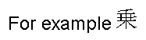
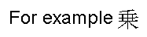
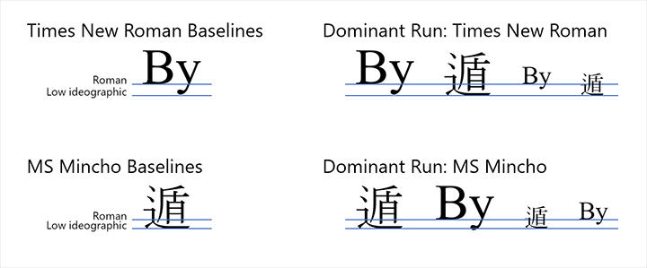
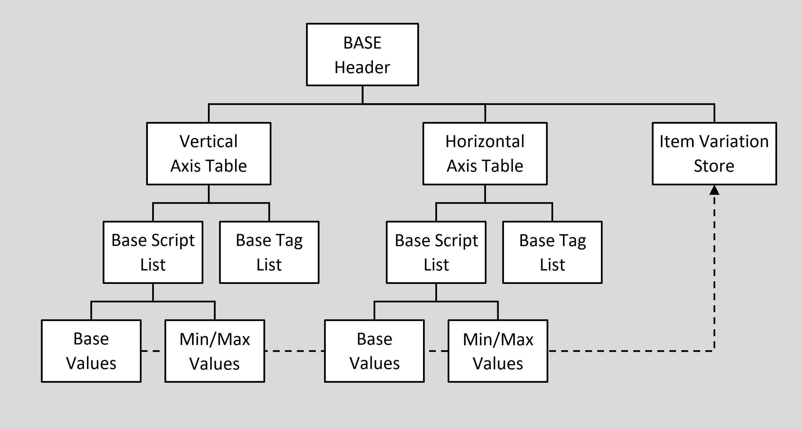

# BASE — Baseline Table

## Overview

The Baseline table (BASE) provides information used to align glyphs of different scripts and sizes in a line of text, whether the glyphs are in the same font or in different fonts. To improve text layout, the Baseline table also provides minimum (min) and maximum (max) glyph extent values for each script, language system, or feature in a font.

Lines of text composed with glyphs of different scripts and point sizes need adjustment to correct interline spacing and alignment. For example, glyphs designed to be the same point size often differ in height and depth from one font to another (see figure 5a). This variation can produce interline spacing that looks too large or too small, and diacritical marks, math symbols, subscripts, and superscripts may be clipped.

 *Figure 5a. Incorrect alignment of glyphs from Latin and Kanji (Latin dominant)*

In addition, different baselines can cause text lines to waver visually as glyphs from different scripts are placed next to one another. For example, ideographic scripts position all glyphs on a low baseline. With Latin scripts, however, the baseline is higher, and some glyphs descend below it. Finally, several Indic scripts use a high “hanging baseline” to align the tops of the glyphs.

To solve these composition problems, the BASE table recommends baseline positions and min/max extents for each script (see figure 5b). Script min/max extents can be modified for particular language systems or features.

 *Figure 5b. Proper alignment of glyphs from Latin and Kanji (Latin dominant)*

### Baseline values

The BASE table uses a model that assumes one script at one size is the “dominant run” during text processing—that is, all other baselines are defined in relation to this the dominant run.

For example, Latin glyphs and the ideographic Kanji glyphs have different baselines. If a Latin script of a particular size is specified as the dominant run, then all Latin glyphs of all sizes will be aligned on the roman baseline, and all Kanji glyphs will be aligned on the lower ideographic baseline defined for use with Latin text. As a result, all glyphs will look aligned within each line of text.

The BASE table supplies recommended baseline positions; a client can specify others. For instance, the client may want to assign baseline positions different from those in the font.

 *Figure 5c. Comparing Latin and Kanji baselines, with characters aligned according to the dominant run*

Within the BASE table, different baseline types are identified using [baseline tags](baselinetags.md), described in the OpenType Layout tag registry. Positioning for each baseline type is specified on a script-by-script basis; the baseline coordinate values to be used are those for the script of the dominant run.

### Min/max extent values

The BASE table gives clients the option of using script, language system, or feature-specific extent values to improve composition (see figure 5c). For example, suppose a font contains glyphs in Latin and Arabic scripts, and the min/max extents defined for the Arabic script are larger than the Latin extents. The font also supports Urdu, a language system that includes specific variants of the Arabic glyphs, and some Urdu variants require larger min/max extents than the default Arabic extents. To accommodate the Urdu glyphs, the BASE table can define language-specific min/max extent values that will override the default Arabic extents-but only when rendering Urdu glyphs.

The BASE table also can define feature-specific min/max values that apply only when a particular feature is enabled. Suppose that the font described earlier also supports the Farsi language system, which has one feature that requires a minor alteration of the Arabic script extents to display properly. The BASE table can specify these extent values and apply them only when that feature is enabled in the Farsi language.

## BASE table and OpenType Font Variations

OpenType Font Variations allow a single font to support many design variations along one or more axes of design variation. For example, a font with weight and width variations might support weights from thin to black, and widths from ultra-condensed to ultra-expanded. For general information on OpenType Font Variations, see the chapter [OpenType Font Variations Overview](otvaroverview.md).

When different variation instances are selected, the design of individual glyphs changes, and the metric characteristics of the font as a whole may also change. As a result, corresponding changes may also be required for metric values in the BASE table.

Metrics in the BASE table are expressed directly in BaseCoord tables using explicit X or Y font-unit values. In a variable font, these X and Y values apply to the default instance and may need to be adjusted for the current variation instance. This is done using variation data with processes similar to those used for glyph outlines and other font data, as described in the [OpenType Font Variations Overview](otvaroverview.md) chapter.

> *Note:* Some BASE metrics can be expressed indirectly by reference to specific glyph outline points. In a variable font, use of glyph points to specify a metric value would require invoking the rasterizer to process the glyph-outline variation data in order to obtain the adjusted position of the point before the BASE metric value can be used. This may have a significant, negative impact on performance of text-layout processing. For this reason, it is recommended that, in a variable font, any BASE metric values that require adjustment for different variation instances should always be expressed directly as X and Y values.

Variation data for adjustment of BASE values is stored within an *ItemVariationStore* table within the BASE table. The item variation store and constituent formats are described in the chapter, [OpenType Font Variations Common Table Formats](otvarcommonformats.md). The item variation store is also used in the [GDEF](gdef.md) table, as well as in the [MVAR](mvar.md) and other tables, but is different from the formats for variation data used in the ['cvar'](cvar.md) or ['gvar'](gvar.md) tables.

The variation data within an item variation store is comprised of a number of adjustment deltas that get applied to the default values of target items for variation instances within particular regions of the font’s variation space. The ItemVariationStore format use *delta-set indices* to reference variation delta data for particular target, font-data items to which they are applied. Data external to the item variation store identifies the delta-set index to be used for each given target item. Within the BASE table, these indices are specified within [*VariationIndex* tables](chapter2.md#anchor-chapter2-device-and-variationindex-tables), with one VariationIndex table referenced for each item that requires variation adjustment.

Note that the VariationIndex table is a variant of a Device table, with a distinct format value. (For full details on the Device and VariationIndex table formats, see the OpenType Layout Common Table Formats chapter.) This is done so that the default instance of a variable font can be compatible with applications that do not support Font Variations. As a result, variable fonts cannot use device tables. A VariationIndex table will be ignored in applications that do not support Font Variations, or if the font is not a variable font.

The ItemVariationStore format uses a two-level organization for variation data: a store can have multiple *ItemVariationData* subtables, and each subtable has multiple delta-set rows. A delta-set index is a two-part index: an outer index that selects a particular item variation data subtable, and an inner index that selects a particular delta-set row within that subtable. A VariationIndex table specifies both the outer and inner portions of the delta-set index.

## BASE table organization

The BASE table begins with offsets to Axis tables that describe layout data for the horizontal and vertical layout directions of text. A font can provide layout data for both text directions or for only one text direction:

- The horizontal Axis table (“HorizAxis”) defines information used to lay out text horizontally. All baseline and min/max values refer to the Y direction.
- The vertical Axis table (“VertAxis”) defines information used to lay out text vertically. All baseline and min/max values refer to the X direction.

In a variable font, the offsets to axis tables may be followed by an offset to an ItemVariationStore table, which is used to provide variation data for adjustment of BASE metric values for different variation instances within the font’s variation space.

Figure 5d shows how the BASE table is organized.

 *Figure 5d. High-level organization of BASE table*

### Text direction

The HorizAxis and VertAxis tables organize layout information by script in BaseScriptList tables. A BaseScriptList enumerates all scripts in the font that are written in a particular direction (horizontal or vertical).

For example, consider a Japanese font that contains Kanji, Kana, and Latin scripts. Because all three scripts are rendered horizontally, all three are defined in the BaseScriptList of the HorizAxis table. Kanji and Kana also are rendered vertically, so those two scripts are defined in the BaseScriptList of the VertAxis table, too.

The same baseline tags may be used for both horizontal and vertical axes. For example, the 'romn' tag description used for the vertical axis would indicate the baseline of rotated Latin text.

### Baseline data

Each Axis table also references a BaseTagList, which identifies all the baselines for all scripts written in the same direction (horizontal or vertical). The BaseTagList may also include baseline tags for scripts supported in other fonts.

Each script in a BaseScriptList is represented by a BaseScriptRecord. This record references a BaseScript table, which contains layout data for the script. In turn, the BaseScript table references a BaseValues table, which contains baseline information, and several MinMax tables that define min/max extent values.

The BaseValues table specifies the coordinate values for all baselines in the BaseTagList. In addition, it identifies one of these baselines as the default baseline for the script. As glyphs in a script are scaled, they grow or shrink from the script’s default baseline position. Each baseline can have unique coordinates. This contrasts with TrueType 1.0, which implies a single, fixed baseline for all scripts in a font. With the OpenType™ Layout tables, each script can be aligned independently, although more than one script may use the same baseline values.

Baseline coordinates for scripts in the same font must be specified in relation to each other for correct alignment of the glyphs. Consider the font, discussed earlier, containing both Latin and Kanji glyphs. If the BaseTagList of the HorizAxis table specifies two baselines, the roman and the ideographic, then the layout data for both the Latin and Kanji scripts will specify coordinate positions for both baselines:

- The BaseValues table for the Latin script will give coordinates for both baselines and specify the roman baseline as the default.
- The BaseValues table for the Kanji script will give coordinates for both baselines and specify the ideographic baseline as the default.

### Min/max extents

The BaseScript table can define minimum and maximum extent values for each script, language system, or feature. These values are distinct from the min/max extent values recorded for the font as a whole in the ['head'](head.md), ['hhea'](hhea.md), ['vhea'](vhea.md), and [OS/2](os2.md) tables. These extent values appear in three tables:

- A default MinMax table defines the default min/max extents for the script.
- A script- and language-specific MinMax table, referenced through a BaseLangSys record, which specifies min/max extents to accommodate the glyphs in a specific language system.
- A FeatMinMax record, within a MinMax table, provides min/max extent values to support feature-specific glyph actions.

> *Note:* Language-system or feature-specific extent values could be essential to define some fonts. However, the default min/max extent values specified for each script should usually be enough to support high-quality text layout.

The actual baseline and min/max extent values used by the BASE table reside in BaseCoord tables. Three formats are defined for BaseCoord table data. All formats define single X or Y coordinate values in design units, but two formats support fine adjustments to these values based on a contour point or a Device table.

The rest of this chapter describes all the tables defined within the BASE table. Sample tables and lists that illustrate typical data for a font are supplied at the end of the chapter.

## BASE table structures

### BASE Header

The BASE table begins with a header that starts with a version number. Two versions are defined. Version 1.0 contains offsets to horizontal and vertical Axis tables (HorizAxis and VertAxis). Version 1.1 also includes an offset to an ItemVariationStore table.

Each Axis table stores all baseline information and min/max extents for one layout direction. The HorizAxis table contains Y values for horizontal text layout; the VertAxis table contains X values for vertical text layout.

A font may supply information for both layout directions. If a font has values for only one text direction, the Axis table offset value for the other direction will be set to NULL.

The optional ItemVariationStore table is used in variable fonts to provide variation data for BASE metric values within the Axis tables.

Example 1 at the end of this chapter shows a sample BASE Header.

*BASE Header, version 1.0*

| Type | Name | Description |
| --- | --- | --- |
| uint16 | majorVersion | Major version of the BASE table, = 1. |
| uint16 | minorVersion | Minor version of the BASE table, = 0. |
| Offset16 | horizAxisOffset | Offset to horizontal Axis table, from beginning of BASE table (may be NULL). |
| Offset16 | vertAxisOffset | Offset to vertical Axis table, from beginning of BASE table (may be NULL). |

*BASE Header, version 1.1*

| Type | Name | Description |
| --- | --- | --- |
| uint16 | majorVersion | Major version of the BASE table, = 1. |
| uint16 | minorVersion | Minor version of the BASE table, = 1. |
| Offset16 | horizAxisOffset | Offset to horizontal Axis table, from beginning of BASE table (may be NULL). |
| Offset16 | vertAxisOffset | Offset to vertical Axis table, from beginning of BASE table (may be NULL). |
| Offset32 | itemVarStoreOffset | Offset to ItemVariationStore table, from beginning of BASE table (may be null). |

### Axis table

An Axis table is used to render scripts either horizontally or vertically. It consists of offsets, measured from the beginning of the Axis table, to a BaseTagList and a BaseScriptList:

- The BaseScriptList enumerates all scripts rendered in the text layout direction.
- The BaseTagList enumerates all baselines used to render the scripts in the text layout direction. If no baseline data is available for a text direction, the offset to the corresponding BaseTagList may be set to NULL.

Example 1 at the end of this chapter shows an example of an Axis table.

*Axis table*

| Type | Name | Description |
| --- | --- | --- |
| Offset16 | baseTagListOffset | Offset to BaseTagList table, from beginning of Axis table (may be NULL). |
| Offset16 | baseScriptListOffset | Offset to BaseScriptList table, from beginning of Axis table. |

### BaseTagList table

The BaseTagList table identifies the baselines for all scripts in the font that are rendered in the same text direction. Each baseline is identified with a 4-byte baseline tag. The [Baseline Tags](baselinetags.md) section of the OpenType Layout Tag Registry lists currently registered baseline tags. The BaseTagList can define any number of baselines, and it may include baseline tags for scripts supported in other fonts.

Each script in the BaseScriptList table must designate one of these BaseTagList baselines as its default, which a layout engine uses to align all glyphs in the script. Even though the BaseScriptList and the BaseTagList are defined independently of one another, the BaseTagList typically includes a tag for each different default baseline needed to render the scripts in the layout direction. If some scripts use the same default baseline, the BaseTagList needs to list the common baseline tag only once.

The BaseTagList table consists of an array of baseline identification tags (baselineTags), listed alphabetically, and a count of the total number of baseline Tags in the array (baseTagCount).

Example 1 at the end of this chapter shows a sample BaseTagList table.

*BaseTagList table*

| Type | Name | Description |
| --- | --- | --- |
| uint16 | baseTagCount | Number of baseline identification tags in this text direction — may be zero (0). |
| Tag | baselineTags\[baseTagCount\] | Array of 4-byte baseline identification tags — must be in alphabetical order. |

### BaseScriptList table

The BaseScriptList table identifies all scripts in the font that are rendered in the same layout direction. If a script is not listed here, then the text-processing client will render the script using the layout information specified for the entire font.

For each script listed in the BaseScriptList table, a BaseScriptRecord must be defined that identifies the script and references its layout data. BaseScriptRecords are stored in the baseScriptRecords array, ordered alphabetically by the baseScriptTag in each record. The baseScriptCount specifies the total number of BaseScriptRecords in the array.

Example 1 at the end of this chapter shows a sample BaseScriptList table.

*BaseScriptList table*

| Type | Name | Description |
| --- | --- | --- |
| uint16 | baseScriptCount | Number of BaseScriptRecords defined. |
| BaseScriptRecord | baseScriptRecords\[baseScriptCount\] | Array of BaseScriptRecords, in alphabetical order by baseScriptTag. |

A BaseScriptRecord contains a script identification tag (baseScriptTag), which must be identical to the ScriptTag used to define the script in the ScriptList of a GSUB or GPOS table. Each record also must include an offset to a BaseScript table that defines the baseline and min/max extent data for the script.

Example 1 at the end of this chapter shows a sample BaseScriptRecord.

*BaseScriptRecord*

| Type | Name | Description |
| --- | --- | --- |
| Tag | baseScriptTag | 4-byte script identification tag. |
| Offset16 | baseScriptOffset | Offset to BaseScript table, from beginning of BaseScriptList. |

### BaseScript table

A BaseScript table organizes and specifies the baseline data and min/max extent data for one script. Within a BaseScript table, the BaseValues table contains baseline information, and one or more MinMax tables contain min/max extent data.

The BaseValues table identifies the default baseline for the script and lists coordinate positions for each baseline named in the corresponding BaseTagList. Each script can assign a different position to each baseline, so each script can be aligned independently in relation to any other script. (For more details, see the BaseValues table description later in this chapter.)

The default MinMax table defines the default min/max extent values for the script. (For details, see the MinMax table description below.) If no language system or feature defined for the script has an effect on the script’s default min/max extents, the layout engine uses the default min/max values for the script.

Sometimes language-specific overrides for min/max extents are needed to properly render the glyphs in a specific language system. For example, a glyph substitution required in a language system can result in a glyph whose extents exceed the script’s default min/max extents. For each language system requiring different min/max extent values, a BaseLangSys record is required. The record should identify the language system (baseLangSysTag) and contain an offset to a MinMax table of language-specific extent coordinates.

Feature-specific overrides for min/max extents also could be needed to accommodate the effects of glyph actions used to implement a specific feature. For example, superscript or subscript features may require changes to the default script or language system extents. Feature-specific extent values not limited to a specific language system may be specified in the default MinMax table. However, extent values used for a specific language system require a BaseLangSys record and a MinMax table. In addition to specifying coordinate data, the MinMax table may contain one or more FeatMinMax records that define the feature-specific min/max data.

A BaseScript table has four components:

- An offset to a BaseValues table (baseValuesOffset). If no baseline data is defined for the script or the corresponding BaseTagList is set to NULL, the offset to the BaseValues table may be set to NULL.
- An offset to the default MinMax table. If no default min/max extent data is defined for the script, this offset may be set to NULL.
- An array of BaseLangSys records (baseLangSysRecords). The individual records stored in the BaseLangSys record array are listed alphabetically by baseLangSysTag.
- A count of the BaseLangSys records is included (baseLangSysCount). If no language system or language-specific feature min/max values are defined, the baseLangSysCount may be set to zero (0).

Example 2 at the end of this chapter shows a sample BaseScript table.

*BaseScript table*

| Type | Name | Description |
| --- | --- | --- |
| Offset16 | baseValuesOffset | Offset to BaseValues table, from beginning of BaseScript table (may be NULL). |
| Offset16 | defaultMinMaxOffset | Offset to MinMax table, from beginning of BaseScript table (may be NULL). |
| uint16 | baseLangSysCount | Number of BaseLangSys records defined — may be zero (0). |
| BaseLangSys | baseLangSysRecords\[baseLangSysCount\] | Array of BaseLangSys records, in alphabetical order by BaseLangSysTag. |

A BaseLangSys record defines min/max extents for a language system or a language-specific feature. Each record contains an identification tag for the language system (baseLangSysTag) and an offset to a MinMax table (MinMax) that defines extent coordinate values for the language system and references feature-specific extent data.

Example 2 at the end of this chapter shows a BaseLangSys record.

*BaseLangSys record*

| Type | Name | Description |
| --- | --- | --- |
| Tag | baseLangSysTag | 4-byte language system identification tag. |
| Offset16 | minMaxOffset | Offset to MinMax table, from beginning of BaseScript table. |

### BaseValues table

For each script, a BaseValues table lists the coordinate positions of all baselines named in the baselineTags array of the corresponding BaseTagList and identifies a default baseline for that script.

When the offset to the corresponding BaseTagList is NULL, a BaseValues table is not needed. However, if the offset is not NULL, then each script must specify coordinate positions for all baselines named in the BaseTagList.

The default baseline of a script is the baseline used to lay out and align the glyphs for that script. The defaultBaselineIndex field in the BaseValues table identifies the default baseline for a script using an index into the baselineTags array of the BaseTagList table for the given text direction.

For example, the Han and Latin scripts use different baselines to align text. If a font supports both of these scripts, the baselineTags array in the BaseTagList of the HorizAxis table will contain two tags, listed alphabetically: 'ideo' in baselineTags\[0\] for the Han ideographic baseline, and 'romn' in baselineTags\[1\] for the Latin baseline. The BaseValues table for the Latin script will specify the roman baseline as the default, so the defaultBaselineIndex in the BaseValues table for Latin will be “1” to indicate the roman baseline tag. In the BaseValues table for the Han script, the defaultBaselineIndex will be “0” to indicate the ideographic baseline tag.

Two or more scripts may share a default baseline. For instance, if the font described above also supports the Cyrillic script, the baselineTags array does not need a distinct baseline tag for Cyrillic because Cyrillic and Latin share the same baseline. The defaultBaselineIndex defined in the BaseValues table for the Cyrillic script will specify “1” to indicate the roman baseline tag, listed in the second position in the baselineTags array.

In addition to identifying the default baseline, the BaseValues table contains offsets to BaseCoord tables that list the coordinate positions for all baselines, including the default baseline, named in the associated baselineTags array. One BaseCoord table is defined for each baseline. The baseCoordCount field defines the total number of BaseCoord tables, which must equal the number of baseline tags in the BaseTagList table.

Each baseline coordinate is defined as a single X or Y value in design units measured from the zero position on the relevant X or Y axis. For example, a BaseCoord table defined in the HorizAxis table will contain a Y value because horizontal baselines are positioned vertically. BaseCoord values may be negative. Each script may assign a different coordinate to each baseline.

Offsets to each BaseCoord table are stored in the baseCoordOffsets array within the BaseValues table. The order of the stored offsets corresponds to the order of the tags listed in the baselineTags array of the BaseTagList. In other words, the first entry in the baseCoordOffsets array will define the offset to the BaseCoord table for the first baseline named in the baselineTags array, the second position will define the offset to the BaseCoord table for the second baseline named in the baselineTags array, and so on.

Example 3 at the end of the chapter has two parts, one that shows a BaseValues table and one that shows a chart with different baseline positions defined for several scripts.

*BaseValues table*

| Type | Name | Description |
| --- | --- | --- |
| uint16 | defaultBaselineIndex | Index number of default baseline for this script — equals index position of baseline tag in baselineTags array of the BaseTagList. |
| uint16 | baseCoordCount | Number of BaseCoord tables defined — should equal baseTagCount in the BaseTagList. |
| Offset16 | baseCoordOffsets\[baseCoordCount\] | Array of offsets to BaseCoord tables, from beginning of BaseValues table — order matches baselineTags array in the BaseTagList. |

### The MinMax table and FeatMinMax record

The MinMax table specifies extents for scripts and language systems. It also contains an array of FeatMinMax records used to define feature-specific extents.

Both the MinMax table and the FeatMinMax record define offsets to two BaseCoord tables: one that defines the mimimum extent value (minCoord), and one that defines the maximum extent value (maxCoord). Each extent value is a single X or Y value, depending upon the text direction, and is specified in design units. Coordinate values may be negative.

Different tables define the min/max extent values for scripts, language systems, and features:

- Min/max extent values for a script are defined in the default MinMax table referenced in a BaseScript table.
- Within the default MinMax table, FeatMinMax records can specify extent values for features that apply to the entire script.
- Min/max extent values for a language system are defined in the MinMax table referenced in a BaseLangSys record.
- FeatMinMax records can be defined within the MinMax table for a language system to specify extent values for features applied within that language system.

The FeatMinMax record contains a tag indicating a feature from the [GSUB](gsub.md) or [GPOS](gpos.md) table it relates to. Each feature that exceeds the default min/max values should have a FeatMinMax record. All FeatMinMax records are listed alphabetically by feature tag in an array (featMinMaxRecords) within the MinMax table. The featMinMaxCount field defines the total number of FeatMinMax records.

Text-processing clients should use the following procedure to access the script, language system, and feature-specific extent data:

1. Determine script extents in relation to the text content.
2. Select language-specific extent values with respect to the language system in use.
3. Have the application or user choose feature-specific extent values.
4. If no extent values are defined for a language system or for language-specific features, use the default min/max extent values for the script.

Example 4 at the end of this chapter has two parts. One shows MinMax tables and a FeatMinMax record for different script, language system, and feature extents. The second part shows how to define these tables when a language system needs feature-specific extent values for an obscure feature, but otherwise the language system and script extent values match.

*MinMax table*

| Type | Name | Description |
| --- | --- | --- |
| Offset16 | minCoordOffset | Offset to BaseCoord table that defines the minimum extent value, from the beginning of MinMax table (may be NULL). |
| Offset16 | maxCoordOffset | Offset to BaseCoord table that defines maximum extent value, from the beginning of MinMax table (may be NULL). |
| uint16 | featMinMaxCount | Number of FeatMinMaxRecords — may be zero (0). |
| FeatMinMax | featMinMaxRecords\[featMinMaxCount\] | Array of FeatMinMax records, in alphabetical order by featureTag. |

*FeatMinMax record*

| Type | Name | Description |
| --- | --- | --- |
| Tag | featureTag | 4-byte feature identification tag — must match feature tag in FeatureList. |
| Offset16 | minCoordOffset | Offset to BaseCoord table that defines the minimum extent value, from beginning of MinMax table (may be NULL). |
| Offset16 | maxCoordOffset | Offset to BaseCoord table that defines the maximum extent value, from beginning of MinMax table (may be NULL). |

### BaseCoord tables

Within the BASE table, a BaseCoord table is used to specify a baseline, a min extent or a max extent. Each BaseCoord table defines one X or Y value:

- If defined within the HorizAxis table, then the BaseCoord table contains a Y value.
- If defined within the VertAxis table, then the BaseCoord table contains an X value.

All values are defined in design units, which typically are scaled and rounded to the nearest integer when scaling the glyphs. Values may be negative.

Three formats available for BaseCoord table data define single X or Y coordinate values in design units. Two of the formats also support fine adjustments to the X or Y values based on a contour point or a Device table. In a variable font, the third format uses a [*VariationIndex* table](chapter2.md#anchor-chapter2-device-and-variationindex-tables) (a variant of a Device table), as needed, to reference variation data for adjustment of the X or Y values for the current variation instance.

#### BaseCoord format 1

The first BaseCoord format (BaseCoordFormat1) consists of a format identifier, followed by a single design unit coordinate that specifies the BaseCoord value. This format has the benefits of small size and simplicity, but the BaseCoord value cannot be hinted for fine adjustments at different sizes or device resolutions.

Example 5 at the end of the chapter shows a sample of a BaseCoordFormat1 table.

*BaseCoordFormat1 table: Design units only*

| Type | Name | Description |
| --- | --- | --- |
| uint16 | format | Format identifier — format = 1. |
| int16 | coordinate | X or Y value, in design units. |

#### BaseCoord format 2

The second BaseCoord format (BaseCoordFormat2) specifies the BaseCoord value in design units, but also supplies a glyph index and a contour point for reference. During font hinting, the contour point on the glyph outline may move. The point’s final position after hinting provides the final value for rendering a given font size.

> *Note:* Glyph positioning operations defined in the GPOS table do not affect the point’s final position.

Example 6 shows a sample of a BaseCoordFormat2 table.

*BaseCoordFormat2 table: Design units plus contour point*

| Type | Name | Description |
| --- | --- | --- |
| uint16 | format | Format identifier — format = 2. |
| int16 | coordinate | X or Y value, in design units. |
| uint16 | referenceGlyph | Glyph ID of control glyph. |
| uint16 | baseCoordPoint | Index of contour point on the reference glyph. |

#### BaseCoord format 3

The third BaseCoord format (BaseCoordFormat3) also specifies the BaseCoord value in design units, but, in a non-variable font, it uses a Device table rather than a contour point to adjust the value. This format offers the advantage of fine-tuning the BaseCoord value for any font size and device resolution. (For more information about Device tables, see the chapter, Common Table Formats.)

In a variable font, BaseCoordFormat3 must be used to reference variation data to adjust the X or Y value for different variation instances, if needed. In this case, BaseCoordFormat3 specifies an offset to a [VariationIndex table](chapter2.md#anchor-chapter2-device-and-variationindex-tables), which is a variant of the Device table that is used for referencing variation data.

> *Note:* While separate VariationIndex table references are required for each Coordinate value that requires variation, two or more values that require the same variation-data values can have offsets that point to the same VariationIndex table, and two or more VariationIndex tables can reference the same variation data entries.

> *Note:* If no VariationIndex table is used for a particular X or Y value (the offset is zero, or a different BaseCoord format is used), then that value is used for all variation instances.

Example 7 at the end of this chapter shows a sample of a BaseCoordFormat3 table.

*BaseCoordFormat3 table: Design units plus Device or VariationIndex table*

| Type | Name | Description |
| --- | --- | --- |
| uint16 | format | Format identifier — format = 3. |
| int16 | coordinate | X or Y value, in design units. |
| Offset16 | deviceOffset | Offset to Device table (non-variable font) / Variation Index table (variable font) for X or Y value, from beginning of BaseCoord table (may be NULL). |

### ItemVariationStore table

The format and processing of the ItemVariationStore table and its constituent formats is described in the chapter, [OpenType Font Variations Common Table Formats](otvarcommonformats.md). Specification of the interpolation algorithm used to derive values for particular variation instances is given in the chapter, [OpenType Font Variations Overview](otvaroverview.md).

The ItemVariationStore contains adjustment-delta values arranged in one or more sets of deltas that are referenced using *delta-set indices*. For values that require variation adjustment, a delta-set index is used to reference the particular variation data needed for that target value. Within the BASE table, delta-set indices are provided in *VariationIndex* tables contained within a BaseCoordFormat3 table. For a description of the VariationIndex table, see the OpenType Layout Common Table Formats chapter. For details on use of VariationIndex tables within BaseCoord tables, see discussion earlier in this chapter.

## BASE table examples

The rest of this chapter describes and illustrates examples of all the BASE tables. All the examples reflect unique parameters described below, but the samples provide a useful reference for building tables specific to other situations.

Most of the examples have three columns showing hex data, source, and comments.

### Example 1: BASE Header, Axis, BaseTagList and BaseScriptList tables, and BaseScriptRecord

Example 1 describes a sample font that contains four scripts: Cyrillic, Devanagari, Han, and Latin. All four scripts are rendered horizontally; only one script, Han, is rendered vertically. As a result, the BASE header gives offsets to two Axis tables: HorizAxis and VertAxis. Example 1 only shows data defined in the HorizAxis table.

In the HorizAxis table, the BaseScriptList enumerates all four scripts. The BaseTagList table names three horizontal baselines for rendering these scripts: hanging, ideographic, and roman. The hanging baseline is the default for Devanagari, the ideographic baseline is the default for Han, and the roman baseline is the default for both Latin and Cyrillic.

The VertAxis table (not shown) would be defined similarly: its BaseScriptList would enumerate one script, Han, and its BaseTagList would specify the vertically centered baseline for rendering the Han script.

*Example 1*

| Hex Data | Source | Comments |
| --- | --- | --- |
|  | **BASEHeader**  TheBASEHeader | BASE table header definition |
| 00010000 | 0x00010000 | Version |
| 0008 | HorizontalAxisTable | Offset to HorizAxis table |
| 010C | VerticalAxisTable | Offset to VertAxis table |
|  | **Axis**  HorizontalAxisTable | Axis table definition |
| 0004 | HorizBaseTagList | Offset to BaseTagList table |
| 0012 | HorizBaseScriptList | Offset to BaseScriptList table |
|  | **BaseTagList**  HorizBaseTagList | BaseTagList table definition |
| 0003 | 3 | baseTagCount |
| 68616E67 | 'hang' | baselineTags\[0\], in alphabetical order |
| 6964656F | 'ideo' | baselineTags\[1\] |
| 726F6D6E | 'romn' | baselineTags\[2\] |
|  | **BaseScriptList**  HorizBaseScriptList | BaseScriptList table definition |
| 0004 | 4 | baseScriptCount |
|  | baseScriptRecords\[0\] | Records in alphabetical order by baseScriptTag |
| 6379726C | 'cyrl' | baseScriptTag: Cyrillic script |
| 001A | HorizCyrillicBaseScriptTable | Offset to BaseScript table for Cyrillic script |
|  | baseScriptRecords\[1\] |  |
| 6465766E | 'devn' | baseScriptTag: Devanagari script |
| 0060 | HorizDevanagariBaseScriptTable | Offset to BaseScript table for Devanagari script |
|  | baseScriptRecords\[2\] |  |
| 68616E69 | 'hani' | baseScriptTag: Han script |
| 008A | HorizHanBaseScriptTable | Offset to BaseScript table for Han script |
|  | baseScriptRecords\[3\] |  |
| 6C61746E | 'latn' | baseScriptTag: Latin script |
| 00B4 | HorizLatinBaseScriptTable | Offset to BaseScript table for Latin script |

### Example 2: BaseScript table and BaseLangSys record

Example 2 shows the BaseScript table and BaseLangSys record for the Cyrillic script, one of the four scripts included in the sample font described in Example 1. The BaseScript table specifies offsets to tables that contain the baseline and min/max extent data for Cyrillic. (The BaseScript tables for the other three scripts in the font would be defined similarly.) Again, the table specifies only the horizontal text-layout information.

The HorizCyrillicBaseValues table contains the baseline information for the script, and the HorizCyrillicDefaultMinMax table contains the default script extents. In addition, a BaseLangSys record defines min/max extent data for the Russian language system.

*Example 2*

| Hex Data | Source | Comments |
| --- | --- | --- |
|  | **BaseScript**  HorizCyrillicBaseScriptTable | BaseScript table definition for Cyrillic script |
| 000C | HorizCyrillicBaseValuesTable | Offset to BaseValues table |
| 0022 | HorizCyrillicDefault  MinMaxTable | Offset to default MinMax table — default script extents |
| 0001 | 1 | baseLangSysCount — BaseLangSys records for language-specific extents |
|  | baseLangSysRecords\[0\] | Records in alphabetical order by baseLangSysTag. |
| 52555320 | “RUS ” | BaseLangSysTag, Russian language system |
| 0030 | HorizRussianMinMaxTable | Offset to MinMax table — language-specific extents |

### Example 3: BaseValues table

Example 3 extends the BASE table definition for the Cyrillic script described in Examples 1 and 2. It contains two parts:

- Example 3A illustrates a fully defined BaseValues table for Cyrillic. The table includes the corresponding BaseCoord table definitions.
- Example 3B shows two different sets of baseline values that can be defined for each of the four scripts in the sample font.

The examples show only horizontal text-layout data, and the font uses 2,048 design units/em.

#### Example 3A: BaseValues table for Cyrillic

The BaseValues table of Example 3A identifies the default baseline for Cyrillic and specifies coordinate positions for each baseline listed in the BaseTagList shown in Example 1:

- The hanging baseline is the default for the Devanagari script, and it has the highest baseline position.
- The ideographic baseline is the default for the Han script, and it has the lowest baseline position.
- The roman baseline is the default for both the Latin and Cyrillic scripts, and its position lies between the hanging and ideographic baselines.

*Example 3A*

| Hex Data | Source | Comments |
| --- | --- | --- |
|  | **BaseValues**  HorizCyrillicBaseValuesTable | BaseValues table definition for Cyrillic script |
| 0002 | 2 | defaultBaselineIndex: BaseTagList index for roman baseline |
| 0003 | 3 | baseCoordCount, equals baseTagCount |
| 000A | HorizHangingBaseCoordForCyrl | baseCoordOffsets\[0\]: offset to BaseCoord table for hanging baseline coordinate — order matches order of baselineTags array in BaseTagList |
| 000E | HorizIdeographicBaseCoordForCyrl | baseCoordOffsets\[1\]: offset to BaseCoord table for ideographic baseline coordinate |
| 0012 | HorizRomanBaseCoordForCyrl | baseCoordOffsets\[2\]: offset to BaseCoord table for roman baseline coordinate |
|  | **BaseCoordFormat1**  HorizHangingBaseCoordForCyrl | BaseCoord table definition |
| 0001 | 1 | format: design units only |
| 05DC | 1500 | coordinate — Y value, in design units |
|  | **BaseCoordFormat1**  HorizIdeographicBaseCoordForCyrl | BaseCoord table definition |
| 0001 | 1 | format: design units only |
| FEE0 | -288 | coordinate — Y value, in design units |
|  | **BaseCoordFormat1**  HorizRomanBaseCoordinateForCyrl | BaseCoord table definition |
| 0001 | 1 | format: design units only |
| 0000 | 0 | coordinate — Y value, in design units |

#### Example 3B: Baseline values for four scripts

Example 3B shows two tables that contain baseline values for each of the four scripts in the sample font described in Example 1:

- The first table shows what might happen if the baseline values in all four scripts are designed consistently. Their respective BaseValues tables list identical baseline values with the roman baseline positioned at a Y value of zero (0), the ideographic baseline at -288, and the hanging baseline at 1500.
- The second table shows what might happen if the baseline values in the scripts are designed differently with the default baseline for each script at the zero (0) coordinate.

Either method of assigning baseline values can be used in the BASE table.

*Example 3B: Identical baseline values*

| Baseline type | Han | Latin | Cyrillic | Devanagari |
| --- | --- | --- | --- | --- |
| hanging | 1500 | 1500 | 1500 | 1500 |
| roman | 0 | 0 | 0 | 0 |
| ideographic | -288 | -288 | -288 | -288 |

*Example 3B: Assigned baseline values with default baselines at 0*

| Baseline type | Han | Latin | Cyrillic | Devanagari |
| --- | --- | --- | --- | --- |
| hanging | 1788 | 1500 | 1500 | 0 |
| roman | 288 | 0 | 0 | -1500 |
| ideographic | 0 | -288 | -288 | -1788 |

### Example 4: MinMax table and FeatMinMax record

Example 4 shows MinMax table and FeatMinMax record definitions for the same Cyrillic script described in the previous example. It contains two parts:

- Example 4A defines tables with different script, language system, and feature extents.
- Example 4B shows these same table definitions written when the language system extents match the script extents, but an obscure feature of the language system requires feature-specific extents if that feature is implemented.

The examples show only horizontal text-layout data, and the font uses 2,048 design units/em.

#### Example 4A: Min/Max extents for Cyrillic script, Russian language, and Russian language feature

Example 4A shows two MinMax tables and a FeatMinMax record for the Cyrillic script, along with sample BaseCoord tables. Only the minCoord extent data is included.

The default MinMax table defines the default minimum and maximum extents for the Cyrillic script. Another MinMax table defines language-specific min/max extents for the Russian language system to accommodate the height and width of certain glyphs used in Russian. Also, a FeatMinMax record is used to specify min/max extents for a single feature in the Russian language system that substitutes a tall integral math symbol when required.

*Example 4A*

| Hex Data | Source | Comments |
| --- | --- | --- |
|  | **MinMax**  HorizCyrillicDefault  MinMaxTable | Default MinMax table definition, Cyrillic script |
| 0006 | HorizCyrillic  MinCoordTable | minCoordOffset — offset to BaseCoord table |
| 000A | HorizCyrillic  MaxCoordTable | maxCoordOffset — offset to BaseCoord table |
| 0000 | 0 | featMinMaxCount: no default feature extents  featMinMaxRecords\[\] — no FeatMinMax records |
|  | **BaseCoordFormat1**  HorizCyrillic  MinCoordTable | BaseCoord table definition, default Cyrillic min extent coordinate |
| 0001 | 1 | format: design units only |
| FF38 | -200 | coordinate — Y value, in design units |
|  | **BaseCoordFormat1**  HorizCyrillic  MaxCoordTable | BaseCoord table definition default Cyrillic max extent coordinate |
| 0001 | 1 | format: design units only |
| 0674 | 1652 | coordinate — Y value, in design units |
|  | **MinMax**  HorizRussianMinMaxTable | MinMax table definition, Russian language extents |
| 000E | HorizRussianLangSys  MinCoordTable | minCoordOffset — offset to BaseCoord table |
| 0012 | HorizRussianLangSys  MaxCoordTable | maxCoordOffset — offset to BaseCoord table |
| 0001 | 1 | featMinMaxCount |
|  | featMinMaxRecords\[0\] | Records in alphabetical order by featureTag. |
| 7469746C | 'titl' | featureTag: Titling  Feature must be same as Tag in FeatureList |
| 0016 | HorizRussianFeature  MinCoordTable | minCoordOffset — offset to BaseCoord table |
| 001A | HorizRussianFeature  MaxCoordTable | maxCoordOffset — offset to BaseCoord table |
|  | **BaseCoordFormat1**  HorizRussianLangSys  MinCoordTable | BaseCoord table definition: Russian language min extent coordinate |
| 0001 | 1 | format: design units only |
| FF08 | -248 | coordinate — Y value, in design units  Increased min extent beyond default Cyrillic min extent |
|  | **BaseCoordFormat1**  HorizRussianLangSys  MaxCoordTable | BaseCoord table definition: Russian language feature max extent coordinate |
| 0001 | 1 | format: design units only |
| 06A4 | 1700 | coordinate — Y value, in design units  Increased max extent beyond default Cyrillic max extent |
|  | **BaseCoordFormat1**  HorizRussianFeature  MinCoordTable | BaseCoord table definition: Russian language min extent coordinate |
| 0001 | 1 | format: design Units Only |
| FED8 | -296 | coordinate — Y value, in design units  Increased min extent beyond default Cyrillic script and Russian language min extents |
|  | **BaseCoordFormat1**  HorizRussianFeature  MaxCoordTable | BaseCoord table definition: Russian language feature Max extent coordinate |
| 0001 | 1 | format: design units only |
| 06D8 | 1752 | coordinate — Y value, in design units  Increased max extent beyond default Cyrillic script and Russian language max extents |

#### Example 4B: Min/Max extents for Cyrillic script and Russian language feature

A particular language system does not need to define min/max extent coordinates if its extents match the default extents defined for the script. However, an obscure or infrequently used feature within the language system may require feature-specific extent values for proper rendering.

Example 4B shows the MinMax table and FeatMinMax record definitions for this situation. The example also includes a BaseScript table, but not a BaseValues table since it is not relevant in this example. The example shows horizontal text layout extents for the Cyrillic script and feature-specific extents for one feature in the Russian language system. Much of the data is repeated from Example 4A and modified here for comparison.

The BaseScript table includes a DefaultMinMax table for the Cyrillic script and a BaseLangSys record that defines a BaseLangSysTag and an offset to a MinMax table for the Russian language. The MinMax table includes a FeatMinMax record and specifies a FeatMinMaxCount, but both the minCoord and maxCoord offsets in the MinMax table are set to NULL since no language-specific extent values are defined for Russian. The FeatMinMax record defines the min/max coordinates for the Russian feature and specifies the correct feature tag.

*Example 4B*

| Hex Data | Source | Comments |
| --- | --- | --- |
|  | **BaseScript**  HorizCyrillicBaseScriptTable | BaseScript table definition: Cyrillic script |
| 0000 | NULL | offset to BaseValues table |
| 000C | HorizCyrillicDefault  MinMaxTable | offset to default MinMax table for default script extents |
| 0001 | 1 | baseLangSysCount |
|  | baseLangSysRecords\[0\] | For Russian language-specific extents. |
| 52555320 | 'RUS ' | baseLangSysTag: Russian |
| 001A | HorizRussian  MinMaxTable | offset to MinMax table for language-specific extents |
|  | **MinMax**  HorizCyrillicDefault  MinMaxTable | Default MinMax table definition: Cyrillic script |
| 0006 | HorizCyrillic  MinCoordTable | minCoordOffset — offset to BaseCoord table |
| 000A | HorizCyrillic  MaxCoordTable | maxCoordOffset — offset to BaseCoord table |
| 0000 | 0 | featMinMaxCount, no default feature extents  featMinMaxRecords\[\], no FeatMinMax records |
|  | **BaseCoordFormat1**  HorizCyrillic  MinCoordTable | BaseCoord table definition: default Cyrillic min extent coordinate |
| 0001 | 1 | format: design units only |
| FF38 | -200 | coordinate — Y value, in design units |
|  | **BaseCoordFormat1**  HorizCyrillic  MaxCoordTable | BaseCoord table definition: default Cyrillic max extent coordinate |
| 0001 | 1 | format: design units only |
| 0674 | 1652 | coordinate — Y value, in design units |
|  | **MinMax**  HorizRussian  MinMaxTable | MinMax table definition for Russian language — no extent differences for Russian language itself |
| 0000 | NULL | minCoordOffset — offset to min BaseCoord table not defined, matches script default |
| 0000 | NULL | maxCoordOffset — offset to max BaseCoord table not defined, matches script default |
| 0001 | 1 | featMinMaxCount |
|  | featMinMaxRecords\[0\] | Records in alphabetical order by featureTag |
| 7469746C | 'titl' | featureTag: Titling  Feature must be same as Tag in FeatureList |
| 000E | HorizRussianFeature  MinCoordTable | minCoordOffset — offset to BaseCoord table |
| 0012 | HorizRussianFeature  MaxCoordTable | maxCoordOffset — offset to BaseCoord table |
|  | **BaseCoordFormat1**  HorizRussianFeature  MinCoordTable | BaseCoord table definition: Russian 'titl' feature min extent coordinate |
| 0001 | 1 | format: design units only |
| FED8 | -296 | coordinate — Y value, in design units  Increased min extent beyond default Cyrillic min extent |
|  | **BaseCoordFormat1**  HorizRussianFeature  MaxCoordTable | BaseCoord table definition: Russian 'titl' feature max extent coordinate |
| 0001 | 1 | format: design units only |
| 06D8 | 1752 | coordinate — Y value, in design units  Increased max extent beyond default Cyrillic max extent |

### Example 5: BaseCoordFormat1 table

Example 5 illustrates BaseCoordFormat1, which specifies single coordinate values in design units only. The font uses 2,048 design units/em. The example defines the default minimum extent coordinate for a math script.

*Example 5*

| Hex Data | Source | Comments |
| --- | --- | --- |
|  | **BaseCoordFormat1**  HorizMathMinCoordTable | Definition of BaseCoord table for Math min coordinate |
| 0001 | 1 | format: design units only |
| FEE8 | -280 | coordinate — Y value, in design units |

### Example 6: BaseCoordFormat2 table

Example 6 illustrates the BaseCoord Format 2. Like Example 5, it specifies the minimum extent coordinate for a math script. With this format, the coordinate value depends on the final position of a specific contour point on one glyph, the integral math symbol, after hinting. Again, the value is in design units (2,048 units/em).

*Example 6*

| Hex Data | Source | Comments |
| --- | --- | --- |
|  | **BaseCoordFormat2**  HorizMathMinCoordTable | BaseCoord table definition for Math min coordinate |
| 0002 | 2 | format: design units plus contour point |
| FEE8 | -280 | coordinate — Y value, in design units |
| 0128 | IntegralSignGlyphID | referenceGlyph: math integral sign |
| 0043 | 67 | baseCoordPoint: glyph contour point index |

### Example 7: BaseCoordFormat3 table

Example 7 illustrates the BaseCoord Format 3. Like Examples 5 and 6, it specifies the minimum extent coordinate for a math script in design units (2,048 units/em). This format, however, uses a Device table to modify the coordinate value for the point size and resolution of the output font. Here, the Device table defines pixel adjustments for font sizes from 11 ppem to 15 ppem. The adjustments add one pixel at each size.

*Example 7*

| Hex Data | Source | Comments |
| --- | --- | --- |
|  | **BaseCoordFormat3**  HorizMathMinCoordTable | BaseCoord table definition for Math min coordinate |
| 0003 | 3 | format: design units plus device table |
|  | -280 | coordinate — Y value, in design units |
| 000C | HorizMathMin  deviceOffset | Offset to Device table |
|  | **DeviceTableFormat1**  HorizMathMin  CoordDeviceTable | Device table definition for MinCoord |
| 000B | 11 | startSize: 11 ppem |
| 000F | 15 | endSize: 15 ppem |
| 0001 | 1 | deltaFormat: signed 2 bit value (8 values per uint16) |
|  | 1 | Increase 11ppem by 1 pixel |
|  | 1 | Increase 12ppem by 1 pixel |
|  | 1 | Increase 13ppem by 1 pixel |
|  | 1 | Increase 14ppem by 1 pixel |
| 5540 | 1 | Increase 15ppem by 1 pixel |
