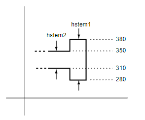
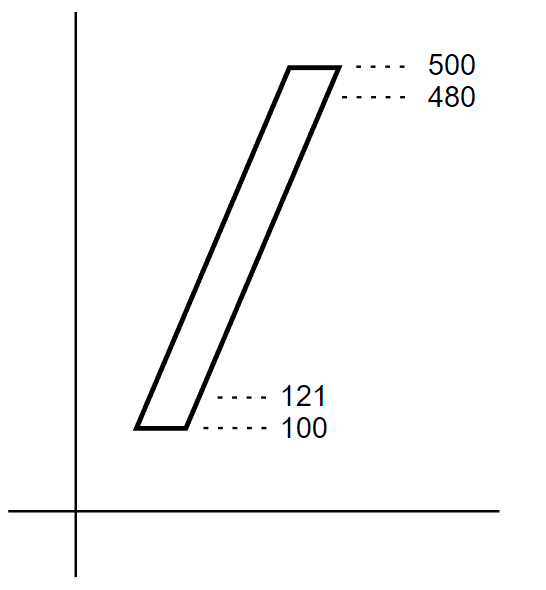
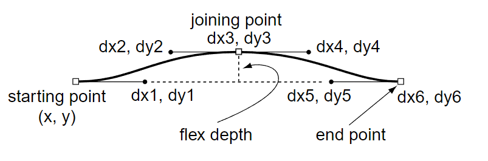
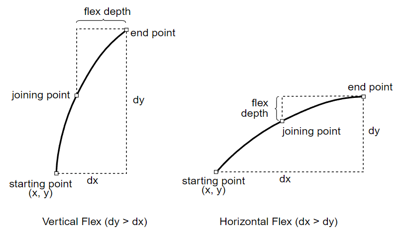
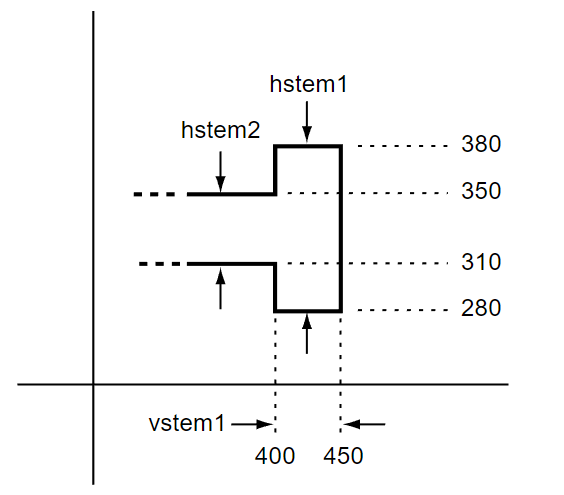
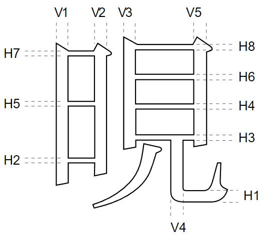

<a id="anchor-cff2-cff2-compact-font-format-cff-version-2"></a>

# CFF2 — Compact Font Format (CFF) Version 2

<a id="anchor-cff2-introduction"></a>

## Introduction

The Compact Font Format table, version 2 (CFF2), is used for describing glyphs in an OpenType font. It is an alternative to the ['glyf'](glyf.md) table using an efficient format to represent glyph outlines that has origins in the Adobe® Postscript® language.

In the CFF2 table, sequences of cubic (3<sup>rd</sup>-order) Bézier curves and straight lines are used to define glyph outlines. CFF2 data can also include “blend” operations, controlled by [OpenType Font Variations](otvaroverview.md) mechanisms to change the shapes of glyphs. A rasterization fill rule is used to provide the opaque, monochrome shape of each glyph. CFF2 data can include “hint” operations that influence this rasterization. When combined with the [COLR](colr.md) and [CPAL](cpal.md) tables, the CFF2 table can be used to represent multi-color glyphs.

CFF2 is a successor to and refinement of the ['CFF '](cff.md) table and glyph format. Because of the origins of CFF in the Postscript language, the data in a complete 'CFF ' table can be used as a stand-alone font. When used within an OpenType font, however, that aspect of CFF results in redundancy. CFF2 avoids redundancy by relying on data in other font tables. CFF2 also adds new operators used in variable fonts and uses a new CFF2 CharString specification.

See [Comparison of 'glyf', 'CFF ' and CFF2 tables](glyphformatcomparison.md) for a summary of significant differences between the 'glyf', 'CFF ' and 'CFF2' tables.

<a id="anchor-cff2-organization-of-the-cff2-table"></a>

## Organization of the CFF2 table

The CFF2 table is comprised of various required and optional subtables. The following description summarizes the overall structure of the CFF2 table.

Two common, generic structures are used for various subtables:

- A *DICT* structure is a binary dictionary format with one or more key-value pairs. This format is used for TopDICT, FontDICT and PrivateDICT subtables.
- An *INDEX* structure contains an array of one or more data objects of various types. This format is used for CharStringINDEX, GlobalSubrINDEX, LocalSubrINDEX and FontDICTINDEX subtables.

> *Note:* the terms *local* and *private* are used in names for different structures or operators with the same meaning: data applicable to a specific scope, as opposed to global scope.

The DICT and INDEX formats and the various subtables that use them are described in subsequent parts of this document.

The CFF2 table begins with a short header. The header is followed by the *TopDICT* subtable, which stores offsets to other subtables. The TopDICT subtable is followed by the *GlobalSubrINDEX* subtable, which stores *CharString* data (see below) that can be re-used in multiple glyph descriptions.

The first three structures—Header, TopDICT and GlobalSubrINDEX—must occur in that order at the start of the CFF2 table. Other subtables may occur in any order at offsets indicated in the TopDICT subtable and elsewhere.

A *CharStringINDEX* subtable stores CharString data. A CharString is an encoded representation of a glyph, including the glyph outline data as well as hinting and variation data specific to the glyph. Within the CharStringINDEX, there is one CharString for each glyph in the font.

CharStrings that have encoded data in common with other CharStrings may use *subroutines* to save space. Subroutines can be stored in the GlobalSubrINDEX subtable or in a *LocalSubrINDEX* subtable within a *PrivateDICT* table. Subroutines stored within the GlobalSubrINDEX can be used by any CharString. Subroutines stored within a PrivateDICT can only be used by CharStrings associated with that PrivateDICT.

Each CharString is dependent on metadata related to hinting that is also stored in a PrivateDICT.

Each PrivateDICT has a corresponding FontDICT that provides the location of the PrivateDICT. A CFF2 table requires only a single FontDICT / PrivateDICT pair, though multiple FontDICT / PrivateDICT pairs may be used. In particular, if some CharStrings require a different set of metadata from other CharStrings, then multiple FontDICT / PrivateDICT pairs may be defined. In such cases, a *FontDICTSelect* subtable is included to specify which FontDICT / PrivateDICT pair is used by each CharString.

Metadata relating to Font Variations is stored in a *VariationStore* subtable. If the font does not support Font Variations, then the VariationStore must be omitted.

The following table illustrates the organization of the various subtables that can occur in a CFF2 table. Required subtables are shown in **bold type**.

<a id="anchor-cff2-Table1"></a>

| Data block | Required | Offset from start of CFF2 table |
| --- | --- | --- |
| **Header** | Yes | 0 |
| **TopDICT** | Yes | 5 |
| **GlobalSubrINDEX** | Yes | 5 + Header.topDICTSize |
| **CharStringINDEX** | Yes | TopDICT: CharStringINDEXOffset |
| FontDICTSelect | No | TopDICT: FontDICTSelectOffset |
| **FontDICTINDEX** | Yes | TopDICT: FontDICTINDEXOffset |
| **FontDICT#0** | Yes | &nbsp;&nbsp; +FontDICTINDEX.offsets\[0\] |
| &nbsp;&nbsp; FontDICT#1 | — | &nbsp;&nbsp; +FontDICTINDEX.offsets\[1\] |
| &nbsp;&nbsp; … |  |  |
| &nbsp;&nbsp; FontDICT#*n* | — | &nbsp;&nbsp; +FontDICTINDEX.offsets\[*n*\] |
| **PrivateDICT#0** | Yes | FontDICT#0: PrivateDICTOffset |
| PrivateDICT#1 | — | FontDICT#1: PrivateDICTOffset |
| … |  |  |
| PrivateDICT#*n* | — | FontDICT#*n*: PrivateDICTOffset |
| VariationStore | No | TopDICT: VariationStoreOffset |

An annotated example of a CFF2 table is shown at the end of this chapter.

Subtables and data types used within a CFF2 table are not subject to any byte-alignment requirements.

DICT and CharString data are structured, binary data that use certain encoded representations for numbers, along with certain *operators* that determine the interpretation of the numeric values. For each operator, there is a defined syntactic sequence for numeric arguments. A *stack* is used by a CFF2 decoder for processing the binary operator/argument data in DICT and CharString data blocks. The various DICT and CharString operators are described in the sections below that describe those two types of structured data. The encoded representations of numbers and the decoding stack are described in separate sections that follow.

<a id="anchor-cff2-encoded-numbers"></a>

## Encoded numbers

<a id="anchor-cff2-encoded-number-formats"></a>

### Encoded number formats

Various CFF2 structures represent numeric values using the standard OpenType data types, such as uint8 and Fixed (see [Data Types](otff.md#anchor-otff-data-types)). DICT and CharString data (including CharString subroutines) use special encoded representations for numbers.

During decoding, byte sequences representing numbers or operators are encountered. Numbers have various encodings that use one or more bytes to represent a numeric value, depending on their magnitude and whether they are integers. The initial bytes used for encoding of numbers do not overlap with the inital bytes used for operators. Hence, for all number encodings, a byte sequence can be identified as being a number by the initial byte of the encoded representation.

Most number encodings may be used in both DICT and Charstring data, though there are exceptions. The following table shows how numbers are encoded based on an initial byte, and also indicates whether each encoding is used in DICT or CharString data only, or both. Each encoding uses an initial byte, **b0**, interpreted as uint8, and possible subsequent bytes **b1**, **b2**, **b3**, etc. In the 2-byte formats, **b1** is also interpreted as uint8.

*Numerical value encoding*

| Initial byte b0 | Value range | Value calculation | Size in bytes | Usage |
| --- | --- | --- | --- | --- |
| 32 to 246 | -107 to 107 | b0 - 139 | 1 | both |
| 247 to 250 | 108 to 1131 | (b0 - 247) \* 256 + b1 + 108 | 2 | both |
| 251 to 254 | -1131 to -108 | -(b0 - 251) \* 256 - b1 - 108 | 2 | both |
| 28 | -32768 to 32767 | interpret b1 and b2 as int16 | 3 | both |
| 255 | -32768 to (32768 - 1/65536) | interpret b1 to b4 as Fixed | 5 | *CharString* only |
| 29 | -(2^31) to (2^31 - 1) | interpret b1 to b4 as int32 | 5 | *DICT* only |
| 30 | any real number | following bytes are *binary coded decimal* (see below) | unlimited | *DICT* only |

> *Note:* For some of these encodings, **b0** serves only to indicate the encoding used. For some, however, **b0** is used both to indicate the encoding used and also in the calculation of the numeric value.

The Usage column indicates whether each encoded format may be used in DICT data, in CharString data, or in both. Numbers encoded as int32 (**b0** = 29) or binary coded decimal (**b0** = 30) are only permitted in DICT data. Numbers encoded as Fixed (**b0** = 255) are only permitted in *CharString* data. It is not possible to represent numbers \>= 32768 or \< -32768 in *CharString* data.

If an initial byte **b0** has a value not in this list, then either the byte encodes an operator, or the data is invalid.

<a id="anchor-cff2-binary-coded-decimal"></a>

### Binary coded decimal

Real numeric values of arbitrary precision can be represented in a binary coded decimal form. This representation uses a binary encoding of a decimal numeric expression, such as “123.456”. The numeric expression can optionally use decimal exponential notation, such as “1.23456E2” (equivalent to “1.23456 × 10²”). Binary coded decimal numbers may only be used in DICT data.

The representation of binary coded decimal numbers begins with a prefix byte (**b0**) value of 30. This is followed by a byte sequence in which each 4-bit nibble represents an element. The two nibbles of each byte are interpreted in big-endian order: the first element is stored in the most significant 4 bits, and the second element is stored in the least significant 4 bits. The sequence is terminated with a nibble value of 0xf (hexadecimal). If the terminating 0xf nibble is the first nibble of a byte, then an additional 0xf nibble must be appended (hence, the byte is 0xff) so that the encoded representation is always a whole number of bytes.

After the prefix byte of 30 is recognized, the value of the binary coded decimal number is obtained by stepping through the nibbles, building up the decimal expression of the number, until the termination nibble is encountered. Each nibble value is interpreted according to the following table. Converted to ASCII, the string can then be converted to a high-precision floating point number using standard functions in most programming languages.

| Nibble value | Nibble value (hex) | Represents in ASCII |
| --- | --- | --- |
| 0 to 9 | 0 to 9 | 0 to 9 |
| 10 | a | . (decimal point) |
| 11 | b | E |
| 12 | c | E- |
| 13 | d | (reserved) |
| 14 | e | - (minus) |
| 15 | f | end of number |

Negative exponents, as in the example “3E-5” (=0.00003), must be represented using the nibble value 0xc, not by the nibble sequence 0xb followed by 0xe.

While the binary encoded decimal format can represent values with arbitrary precision, the maximum degree of effective precision obtainable is implementation dependent.

*Examples:*

- the value -2.25 is encoded by the byte 30 (decimal) followed by the byte sequence 0xe2 0xa2 0x5f (hexadecimal)
- the value 0.140541E-3 is encoded by 30 (decimal) followed by the byte sequence 0x0a 0x14 0x05 0x41 0xc3 0xff (hexadecimal)

The following regular expression (using POSIX ERE or Perl Compatible RE syntax) validates a binary coded decimal value represented as ASCII:

```
 -?([1-9][0-9]*|0)?(\.[0-9]*)?(E-?[1-9][0-9]*)?
```

The following table shows some edge cases (represented as ASCII) and their decoded values:

| Input | Value |
| --- | --- |
| \[empty\] | 0 |
| . | 0 |
| .5 | 0.5 |
| 2. | 2 |
| E5 | *invalid* |
| 05 | *invalid* |
| E05 | *invalid* |

<a id="anchor-cff2-decoding-dict-and-charstring-data-using-a-stack"></a>

## Decoding DICT and CharString data using a stack

Two fundamental encoded data formats in the CFF2 table are the DICT and the CharString. Each is a binary data block that represents a sequence of encoded numbers and operators. In order to interpret those sequences, CFF2 decoders use a *stack*.

A stack is an array conceived as a physical stack of items, which can be manipulated in only two ways:

- place one new item on the top (“push an item onto the stack”)
- remove one item from the top (“pop an item from the stack”)

When an item is popped from the stack, the item removed must be the last item that was added.

<a id="anchor-cff2-stack-based-cff2-decoding"></a>

### Stack-based CFF2 decoding

A CFF2 decoder is expected to implement a stack in a suitable manner. The CFF2 stack stores only numbers.

Starting with an empty stack, a decoder of DICT and CharString data processes bytes sequentially from the start to the end, decoding numbers and operators.

Numbers in DICT and CharString data are represented using an encoding scheme of one or more bytes, as described in the previous section. Decoded numbers are immediately pushed to the stack, ready for use as operands for operators that follow.

Operators are encoded with one or two bytes. The byte ranges used for operators do not overlap with the encodings used for numbers. All two-byte operators begin with 0x0c. A few operators also encode data in succeeding bytes.

Decoded operators pop one or more numbers from the stack, then store or process them, and in some cases push new numbers back onto the stack. The maximum number of operands on the CFF2 stack is 513.

Different operators are defined for use in the different types of DICT table and for use in CharStrings. In any of these contexts, if an unrecognized operator is encountered while decoding, it is ignored and the stack is cleared.

The function of operators in a DICT subtable is to create key-value pairs. During decoding, the DICT key is identified by the operator, and the DICT value is obtained by popping items (one or more numbers) from the stack. In well-formed CFF2 data, the number of operands preceding a DICT key operator must be exactly the number required for that operator; hence, the stack will be empty after the operator is processed. The DICT **blend** operator is exceptional, neither creating a key-value pair nor leaving the stack empty. Instead, its function is to modify operand values before they are assigned to keys. See [OpenType Font Variations in CFF2](#anchor-cff2-opentype-font-variations-in-cff2), below, for details on the **blend** operator.

The function of operators in CharString data is the representation of glyph outlines, hints and variations. During decoding, and assuming valid CharString data, most CharString operators pop all the numbers on the stack and do not push any new numbers to the stack. Thus, in CharString decoding, most operators will leave the stack empty. There are three exceptions:

- **blend**: Pops operands from the stack (but not necessarily all the operands on the stack) and pushes processed numbers back to the stack.
- **callsubr**: Pops a number from the stack and invokes a local subroutine.
- **callgsubr**: Pops a number from the stack and invokes a global subroutine.

[Subroutines](#anchor-cff2-subroutines) are not restricted regarding the state of the stack. When the **callsubr** or **callgsubr** operator is processed, the stack may have one operand or many operands. After the subroutine is processed, the stack may be empty or may contain any number of operands.

These operators are described in detail below (see [CharString](#anchor-cff2-charstring)).

<a id="anchor-cff2-stack-notation"></a>

### Stack notation

In specifications for *DICT* and *CharString* that follow, the following notation is used to describe the state of the stack when particular operators are encountered.

- `[` — represents the bottom of the stack
- `]` — represents the top of the stack
- `x`, `dx`, etc. — values on the stack referred to in the description
- `<number>` — a number, either an integer or real number
- `<integer>` — an integer
- `(` `)` — delimiters for a group of items that is repeated or optional
- `*` — an item or group occurs 0 or more times
- `+` — an item or group occurs 1 or more times
- `…` — items at the bottom of the stack that are not involved in the current operation

The following are some expressions using this notation:

- `[ <number> ]` — the stack contains one number
- `[ <integer> ]` — the stack contains one integer
- `[ <number>+ ]` — the stack contains one or more numbers
- `[ (<number> <number>)+ ]` — the stack contains an even number of numbers (using the regular expression-style parentheses for grouping)
- `[… <number>* <integer> ]` — at the top of the stack are 0 or more numbers, followed by an integer

This notation is similarly used to describe the operands interpreted by operators. For example:

- The stack notation specified for the CharString **hmoveto** operator is `[ dx ]`, indicating that a single operand, *dx*, is expected.
- The stack notation specified for the CharString **rlineto** operator is `[ (dx dy)+ ]`, indicating that one or more pairs of operands, *dx dy*, are expected.

<a id="anchor-cff2-common-formats-dict-and-index"></a>

## Common formats: DICT and INDEX

DICT and INDEX are two common, generic structures that are used for various subtables. This section describes the generic specifications common across various subtables; details specific to particular subtables will follow in later sections.

<a id="anchor-cff2-dict-data"></a>

### DICT data

A DICT subtable defines a dictionary data structure consisting of key-value pairs. DICTs are used in CFF2 to store offsets to other data blocks, and metadata used across multiple glyphs. In each key-value pair:

- The *key* is a string from a predefined vocabulary encoded as an operator of one or two bytes. Each type of DICT subtable has a different set of valid keys. A given key must not be defined more than once in any DICT.
- The *value* is a number or a sequence of numbers.

DICT data is decoded using a stack, as described above. Starting from the beginning of the DICT data, numbers and operators are parsed from the data sequentially until the end of DICT data is reached. Decoded numbers are pushed onto the stack. DICT operators pop numeric operands from the stack and assign those numbers as values for the key identified by the operator itself. The number of operands that are popped is specific to each operator.

With the exception of the **blend** operator, after a DICT operator and its values have been decoded, the stack must be empty. If it is not empty, the subtable is invalid.

While decoding a DICT, if an operator is encountered that is not defined for the current DICT type, the behavior is unspecified.

The DICT format is used for [*TopDICT*](#anchor-cff2-topdict), [*FontDICT*](#anchor-cff2-fontdict) and [*PrivateDICT*](#anchor-cff2-privatedict) subtables. In general, the key-value pairs for a DICT may be specified in any order. However, some ordering rules are specified for the PrivateDICT subtable. For each subtable type, default values are specified for certain keys. For keys that have a specified default value, that default value must be used if the corresponding operator for the key is not present with the DICT. Details for each of these subtables is provided below.

Multiple DICT subtables may share encoded data with overlapping byte ranges within the CFF2 table. In this way, one DICT could represent a subset of the data of another DICT.

<a id="anchor-cff2-index-data"></a>

### INDEX data

An INDEX is an array of data objects of some type. Objects in the array are accessed using a 0-based index. Objects in the array are stored contiguously and in order. An offset array provides the location and size of each object, which may be of arbitrary size.

The INDEX format is used in [*CharStringINDEX*](#anchor-cff2-charstringindex), [*GlobalSubrINDEX* and *LocalSubrINDEX*](#anchor-cff2-subroutines), and [*FontDICTINDEX*](#anchor-cff2-fontdictindex) subtables. These are described below.

The format of an INDEX is as follows.

<a id="anchor-cff2-idxFormat"></a>

*INDEX table*

| Type | Name | Description |
| --- | --- | --- |
| uint32 | count | Number of objects stored in INDEX |
| uint8 | offsetSize | Offset array element size |
| Offset8 *or* Offset16 *or* Offset24 *or* Offset32 | offsets\[count+1\] | Array of offsets — offsets are from byte preceding object data |
| uint8 | data\[*variable*\] | Object data—total length is the last offset - 1 |

The offsetSize field specifies the number of bytes used to store each offset: 1 for Offset8, 2 for Offset16, 3 for Offset24, or 4 for Offset32.

The offsets array specifies the starting location for each data object according to its index. Offsets in the offset array are relative to the byte that precedes the object data. The first element of the offset array must always be 1. Data objects are stored contiguously and in order, therefore each offset must be less than or equal to the following offset.

An object is retrieved by using the object index to look up an offset in the *offsets* array and fetching the binary data at the specified offset. The size for each object is determined by subtracting the offset for a given object from the next offset in the offset array. The offset array has *count* + 1 elements, which provides a length for the last object. Hence, every object has a non-zero offset and a size (which may be zero).

An empty INDEX is represented by a *count* field with a 0 value and no additional fields. Thus, the total size of an empty INDEX is 4 bytes.

The total size of a non-empty INDEX is:

```
4 + 1 + offsetSize × (count + 1) + offsets[count] - 1
```

When creating INDEX data blocks, the smallest possible representation for offsets should be used. For example, if *offsets*\[*count*\] is greater than 255 and less than 65536, then all offsets can be represented as Offset16, and so *offsetSize* should be set to 2.

<a id="anchor-cff2-header"></a>

## Header

The CFF2 table begins with a header having the following format.

<a id="anchor-cff2-cf2header"></a>

*CFF2 Header*

<a id="anchor-cff2-Table8"></a>

| Type | Name | Description |
| --- | --- | --- |
| <a id="anchor-cff2-majorVersion"></a>uint8 | majorVersion | Format major version (set to 2). |
| <a id="anchor-cff2-minorVersion"></a>uint8 | minorVersion | Format minor version (set to 0). |
| <a id="anchor-cff2-headerSize"></a>uint8 | headerSize | Header size (set to 5). |
| <a id="anchor-cff2-topDictLength"></a>uint16 | topDICTSize | Length of TopDICT subtable. |

The TopDICT subtable must always start immediately after the header—for this version, at offset 5 from the start of the CFF2 table. The headerSize field must be used when locating the start of the TopDICT subtable. It is provided so that future versions of the format can introduce additional data between the *topDICTSize* field and the TopDICT subtable in a manner that is compatible with older implementations.

The sum *headerSize + topDICTSize* is the location within the CFF2 table of the required GlobalSubrINDEX subtable.

<a id="anchor-cff2-topdict"></a>

## TopDICT

The TopDICT subtable is a [DICT](#anchor-cff2-dict-data) that provides offsets to various subtables within the CFF2 table. It also provides values relating to the *unitsPerEm* value in the ['head'](head.md) table. The TopDICT subtable immediately follows the CFF2 Header. Every CFF2 table requires one TopDICT subtable.

<a id="anchor-cff2-topdict-operator-summary"></a>

### TopDICT operator summary

The following table lists the five operators allowed in the TopDICT subtable, the bytes by which they are encoded in DICT data (hexadecimal and decimal), and whether or not they are required.

| Hex | Dec | Name | Required | Default |
| --- | --- | --- | --- | --- |
| 0x11 | 17 | **CharStringINDEXOffset** | yes | — |
| 0x18 | 24 | **VariationStoreOffset** | only for fonts with variations | — |
| 0x0c24 | 12,36 | **FontDICTINDEXOffset** | yes | — |
| 0x0c25 | 12,37 | **FontDICTSelectOffset** | no&nbsp; | — |
| 0x0c07 | 12,7 | **FontMatrix** | no | 0.001 0 0 0.001 0 0 |

<a id="anchor-cff2-topdict-operator-specifications"></a>

### TopDICT operator specifications

The following specifies details for the five key operators permitted in a TopDICT.

<a id="anchor-cff2-charstringindexoffset"></a>

**CharStringINDEXOffset**

|  |  |
| --- | --- |
| Encoding | 0x11 (17) |
| Stack | \[\<integer\>\] |
| Operands | \[ offset \] |
| Description | Specifies the offset to the CharStringINDEX subtable, from the start of the CFF2 table. |
| Occurrence | Required |

<a id="anchor-cff2-variationstoreoffset"></a>

**VariationStoreOffset**

|  |  |
| --- | --- |
| Encoding | 0x18 (24) |
| Stack | \[\<integer\>\] |
| Operands | \[ offset \] |
| Description | Specifies the offset to the VariationStore subtable, from the start of the CFF2 table. |
| Occurrence | Required in fonts that have CFF2 glyph variations, otherwise forbidden. |

<a id="anchor-cff2-fonddictindexoffset"></a>

**FontDICTINDEXOffset**

|  |  |
| --- | --- |
| Encoding | 0x0c24 (12, 36) |
| Stack | \[\<integer\>\] |
| Operands | \[ offset \] |
| Description | Specifies the offset to the FontDICTINDEX subtable, from the start of the CFF2 table. |
| Occurrence | Required |

<a id="anchor-cff2-fontdictselectoffset"></a>

**FontDICTSelectOffset**

|  |  |
| --- | --- |
| Encoding | 0x0c25 (12, 37) |
| Stack | \[\<integer\>\] |
| Operands | \[ offset \] |
| Description | Specifies the offset to the FontDICTSelect subtable, from the start of the CFF2 table. |
| Occurrence | Optional. If the CFF2 table has only one FontDICT, there is no need for a FontDICTSelect subtable, and the **FontDICTSelectOffset** operator must not be used. |

<a id="anchor-cff2-fontmatrix"></a>

**FontMatrix**

|  |  |
| --- | --- |
| Encoding | 0x0c07 (12, 7) |
| Stack | \[ \<number\> 0 0 \<number\> 0 0 \] |
| Operands | \[ scale 0 0 scale 0 0 \] |
| Default | 0.001 0 0 0.001 0 0 |
| Description | Numeric operands are encoded as binary coded decimal. Specifies the scale factor for glyph coordinates within the em square, similar to the *unitsPerEm* field in the ['head'](head.md) table. However, a reciprocal value is used (thus 1 / *unitsPerEm*). This value occurs as the first and fourth operands—both scale operands must have the same value. Other operands must be zero. |
| Occurrence | Required if *unitsPerEm* is not equal to 1000. For the common case in which *unitsPerEm* is 1000, the key-value pair is created with the default value and the **FontMatrix** operator should be omitted. |

> *Note:* The origin of the TopDICT **FontMatrix** operator is a 2×3 transformation matrix. In the CFF2 table, however, only matrices with uniform horizontal and vertical scaling without translation are permitted, hence the requirement that the 1st and 4th operands be identical and the remaining operands be zero.

<a id="anchor-cff2-fontdictindex-fontdictselect-and-fontdict"></a>

## FontDICTINDEX, FontDICTSelect and FontDICT

<a id="anchor-cff2-overview"></a>

### Overview

The FontDICTINDEX subtable is used in combination with other data structures for storing metadata related to hinting, variation and subroutines for [CharString](#anchor-cff2-charstring) glyph descriptions. The metadata associated with a given glyph is stored in a [PrivateDICT](#anchor-cff2-privatedict) table. Multiple PrivateDICT tables may be used, each holding the metadata for a subset of CharStrings. For each PrivateDICT, there is a corresponding FontDICT table that provides the location of the given PrivateDICT table. The FontDICTINDEX contains the array of FontDICT tables. When multiple PrivateDICT tables are used, a FontDICTSelect table indicates which FontDICT and corresponding PrivateDICT are used for each glyph.

<a id="anchor-cff2-fontdictindex"></a>

### FontDICTINDEX

The FontDICTINDEX is a required subtable. Its location within the CFF2 table is given by the **FontDICTINDEXOffset** key in the [TopDICT](#anchor-cff2-topdict) subtable. It uses the [INDEX](#anchor-cff2-index-data) format.

The FontDICTINDEX must contain at least one FontDICT, but may contain multiple FontDICTs. No upper limit to the number of FontDICTs is specified. If there is more than one FontDICT, each FontDICT will be associated with some subset of glyphs. In this case, a FontDICTSelect table must be used to assign glyphs to FontDICTs.

<a id="anchor-cff2-fontdictselect"></a>

### FontDICTSelect

The FontDICTSelect table is an optional table used when there are multiple FontDICT tables to assign each [CharString](#anchor-cff2-charstring) to a particular FontDICT. The location of the FontDICTSelect table is given by the **FontDICTSelectOffset** key in the [TopDICT](#anchor-cff2-topdict) subtable. A font may use one FontDICT (and corresponding [PrivateDICT](#anchor-cff2-privatedict)) for all CharStrings. In that case, no FontDICTSelect table is required, and the **FontDICTSelectOffset** entry is omitted from the TopDICT.

There are three formats defined for *FontDICTSelect*: format 0, format 3 and format 4. Each format provides mappings for all glyphs (CharStrings) to a FontDICT. That is, each format provides *numGlyphs* mappings from a glyph index (or *glyph ID*) to a FontDICT index, where *numGlyphs* is the number of CharStrings in the [CharStringINDEX](#anchor-cff2-charstringindex). Formats 3 and 4 map ranges of glyph IDs onto a single FontDICT index, which often makes those formats a better choice for efficiency.

The first field in each format identifies the format.

*FontDICTSelectFormat0 table*

| Type | Name | Description |
| --- | --- | --- |
| uint8 | format | Set to 0 |
| uint8 | fontDICTIDs\[numGlyphs\] | FontDICT index array |

In format 0, each element of the fontDICTIDs array represents the index for a FontDICT in the FontDICTINDEX. This format should be used when the FontDICT indices are in a fairly random order.

*FontDICTSelectFormat3 table*

| Type | Name | Description |
| --- | --- | --- |
| uint8 | format | Set to 3 |
| uint16 | numRanges | Number of ranges |
| Range3 | ranges\[numRanges\] | Array of Range3 records (see below) |
| uint16 | sentinel | Sentinel glyph ID |

*Range3 record*

| Type | Name | Description |
| --- | --- | --- |
| uint16 | first | First glyph ID in range |
| uint8 | fontDICTID | FontDICT index for all glyphs in range |

Each Range3 record describes a group of sequential glyph IDs that have the same FontDICT index. Each range includes glyph IDs from the *first* glyph ID in the range record up to, but not including, the *first* glyph ID of the next range record. Records in the *ranges* array must be in increasing order of *first* glyph IDs. The first range must have a *first* glyph ID of 0. The *sentinel* glyph ID provides a final range in the array, and must be set equal to *numGlyphs*, the number of glyphs in the font. That is, its value is 1 greater than the last glyph ID in the font.

The *fontDICTID* in each Range3 record cannot exceed 255. For this reason, a format 3 FontDICTSelect supports at most 255 FontDICT tables in the FontDICTINDEX.

> *Note:* The *sentinel* glyph ID is encoded as a uint16, hence cannot exceed 65,535. Since it delimits a final range in the *ranges* array, and the ending glyph ID is one less than the start of the following range, the last glyph ID that can be mapped using format 3 cannot exceed 65534.

*FontDICTSelectFormat4 table*

| Type | Name | Description |
| --- | --- | --- |
| uint8 | format | Set to 4 |
| uint32 | numRanges | Number of ranges |
| Range4 | ranges\[numRanges\] | Array of Range4 records (see below) |
| uint32 | sentinel | Sentinel glyph ID |

*Range4 record*

| Type | Name | Description |
| --- | --- | --- |
| uint32 | first | First glyph ID in range |
| uint16 | fontDICTID | FontDICT index for all glyphs in range |

Format 4 is similar to format 3 except that it accommodates more than 65,534 glyphs by using a uint32 type for the *numRanges* and *sentinel* fields, and a Range4 record array, which accommodates up to 65,535 FontDICT tables in the FontDICTINDEX.

> *Note:* While FontDICTSelect format 4 allows for more than 65,535 glyphs, other parts of the OpenType format, such as the *numGlyphs* field of the 'maxp' table, are still constrained to 65,535 glyphs.

<a id="anchor-cff2-fontdict"></a>

### FontDICT

A FontDICT is a [DICT](#anchor-cff2-dict-data) that provides the offset to a corresponding [PrivateDICT](#anchor-cff2-privatedict). Since it exists only to point to a PrivateDICT, it uses only one key operator, **PrivateDICTOffset**.

<a id="anchor-cff2-privatedictoffset"></a>

**PrivateDICTOffset**

|  |  |
| --- | --- |
| Encoding | 0x12 (18) |
| Stack | \[ \<integer\> \<integer\> \] |
| Operands | \[ size offset \] |
| Description | The two operands are the size and offset of the corresponding PrivateDICT table. The offset is from the start of the CFF2 table. If the corresponding PrivateDICT is empty, then the numbers `0 0` must be specified. |
| Occurrence | Required. |

<a id="anchor-cff2-privatedict"></a>

## PrivateDICT

A PrivateDICT is a [DICT](#anchor-cff2-dict-data) subtable providing metadata relating to hinting, subroutines and variations used by one or more CharStrings. Many fonts use only one PrivateDICT, whose metadata applies to all CharStrings. A font may also have multiple PrivateDICTs used for different subsets of CharStrings, each CharString being associated with exactly one PrivateDICT.

The location and size of a PrivateDICT is provided by the **PrivateDICTOffset** key in a FontDICT. To have multiple PrivateDICTs, a FontDICTINDEX needs to have multiple FontDICTs, one for each PrivateDICT. A FontDICTSelect table is also required to associate each CharString with a FontDICT and its corresponding PrivateDICT. See [FontDICTIndex, FontDICTSelect and FontDICT](#anchor-cff2-fontdictindex-fontdictselect-and-fontdict) for more information.

A PrivateDICT may be empty, requiring no storage. In this case, both the size and offset given by the **PrivateDICTOffset** key of the FontDICT must be set to zero. If the PrivateDICT is empty, default values will be used for certain PrivateDICT keys, as set out in the description of PrivateDICT key operators below.

Values for some PrivateDICT keys relating to hinting can undergo interpolation with OpenType variations using the **blend** operator. (This means is that the operand sequence that precedes the key operator may have one or more **blend** operators interspersed along with additional operands used for interpolation.) These are identified as “blendable” in the operator descriptions below.

Some hinting operators—**BlueValues** and others—accept multiple operands. These require values to be supplied on the stack as a *deltaArray*. This is a sequence of numbers for which only the first number is expressed in absolute terms, while the second and subsequent numbers are encoded as differences between successive values. In general, the array *a₀, a₁, a₂, …, a<sub>n</sub>* is encoded as the *deltaArray* *a₀ (a₁ - a₀) (a₂ - a₁) … (a<sub>n</sub> - a<sub>n-1</sub>)*. An example of *deltaArray* encoding is given in the definition for the **BlueValues** operator.

> *Note:* Some PrivateDICT operators, such as **BlueScale** and **ExpansionFactor**, take non-integer operands. These are encoded as [binary coded decimal](#anchor-cff2-binary-coded-decimal) byte sequences.

**When to use multiple PrivateDICTs**

A CFF2 table requires at least one FontDICT / PrivateDICT pair (even if the PrivateDICT is empty), and many fonts only have one pair. However, it may be beneficial to use more than one PrivateDICT (and hence more than one FontDICT) when the glyphs in the font are of multiple distinct styles. For example, if a font contains both Latin and Emoji glyphs, or Latin and Korean Hangul glyphs, the different glyphs sets may use different hint metadata. In such cases, specifying the metadata for each glyph set in separate PrivateDICTs will likely allow more compact and efficient CharString encoding. For example, there could be better use of hinting zones, smaller index values in **callsubr** subroutine calls, or fewer operands in **blend** operations, resulting in less data in total. For similar reasons, the ability to support multiple FontDICT / PrivateDICT pairs can allow for easier merging of multiple fonts whose glyphs already have hints, variation data and subroutines.

<a id="anchor-cff2-privatedict-operator-summary"></a>

### PrivateDICT operator summary

The following table lists all valid PrivateDICT operators, together with their byte encoding (hexadecimal and decimal), default values, their general purpose, and whether they may be blended.

| Hex | Dec | Name | Default | Purpose | Blendable |
| --- | --- | --- | --- | --- | --- |
| 0x13 | 19 | **LocalSubrINDEXOffset** | — | subroutines | no |
| 0x16 | 22 | **vsindex** | 0 | variation | no |
| 0x17 | 23 | **blend** | — | variation | yes |
| 0x06 | 6 | **BlueValues** | — | hinting | yes |
| 0x07 | 7 | **OtherBlues** | — | hinting | yes |
| 0x08 | 8 | **FamilyBlues** | — | hinting | no |
| 0x09 | 9 | **FamilyOtherBlues** | — | hinting | no |
| 0x0c09 | 12,9 | **BlueScale** | 0.039625 | hinting | no |
| 0x0c0a | 12,10 | **BlueShift** | 7 | hinting | no |
| 0x0c0b | 12,11 | **BlueFuzz** | 1 | hinting | no |
| 0x0a | 10 | **StdHW** | — | hinting | yes |
| 0x0b | 11 | **StdVW** | — | hinting | yes |
| 0x0c0c | 12,12 | **StemSnapH** | — | hinting | yes |
| 0x0c0d | 12,13 | **StemSnapV** | — | hinting | yes |
| 0x0c11 | 12,17 | **LanguageGroup** | 0 | hinting | no |
| 0x0c12 | 12,18 | **ExpansionFactor** | 0.06 | hinting | no |

<a id="anchor-cff2-privatedict-subroutine-operator"></a>

### PrivateDICT subroutine operator

There is one PrivateDICT operator used in relation to subroutines.

<a id="anchor-cff2-localsubrindexoffset"></a>

**LocalSubrINDEXOffset**

|  |  |
| --- | --- |
| Encoding | 0x13 (19) |
| Stack | \[ \<integer\> \] |
| Operands | \[ offset \] |
| Description | Specifies the offset from the start of the PrivateDICT to a LocalSubrINDEX table that stores subroutines that can be called by CharStrings associated with the same PrivateDICT. |
| Occurrence | Optional. If there are no local subroutines, then the **LocalSubrINDEXOffset** operator must not be used within the PrivateDICT. |
| Blendable | no |

For more information on subroutines, see [Charstring](#anchor-cff2-charstring).

<a id="anchor-cff2-privatedict-variation-operators"></a>

### PrivateDICT variation operators

There are two PrivateDICT operators used in relation to variations. These depend on other parts of the CFF2 table as other tables in the OpenType font. For full details on their use, see [OpenType Font Variations in CFF2](#anchor-cff2-opentype-font-variations-in-cff2).

<a id="anchor-cff2-pd-op-vsindex"></a>

**vsindex**

|  |  |
| --- | --- |
| Encoding | 0x16 (22) |
| Stack | \[ \<integer\> \] |
| Operands | \[ ivd \] |
| Description | Activates a particular list of variation regions from a VariationStore subtable. |
| Occurrence | Optional. Used only when the CFF2 table includes a VariationStore subtable. |
| Blendable | no |

The **vsindex** operator is used to select a set of active variation regions from the defined set of variation regions. See [OpenType Font Variations in CFF2](#anchor-cff2-opentype-font-variations-in-cff2) for complete details about the effect of this operator.

When used within a PrivateDICT, it has effect not only for variation of values specified by PrivateDICT keys but also for variation in all CharStrings associated with that PrivateDICT. However, a **vsindex** operator can also be used within a CharString, taking precedence over the **vsindex** specified in the PrivateDICT.

> *Note:* The PrivateDICT **vsindex** operator is encoded as 0x16, whereas in CharString data it is encoded as 0x0f.

<a id="anchor-cff2-pd-op-blend"></a>

**blend**

|  |  |
| --- | --- |
| Encoding | 0x17 (23) |
| Stack | \[ … \<number\>+ \<number\>+ \<integer\> \] |
| Operands | \[ … \<*n* default values\> \<*n \* k* deltas\> *n \]* |
| Description | Pops *n + n \* k + 1* operands from the stack, processes them according to the OpenType variations interpolation algorithm, then pushes *n* result numbers back onto the stack. |
| Occurrence | Optional. Used only when the CFF2 table includes a VariationStore subtable, and only in connection with hinting values that are varied. |
| Blendable | yes |

The **blend** operator may be used in a PrivateDICT to make operands of blendable key operators variable. The number of operands that are popped by the **blend** operator is determined by the last operand (*n*) and the number of active variation regions (*k*), with an upper limit determined by the number of operands required by the next operator in the data. See [OpenType Font Variations in CFF2](#anchor-cff2-opentype-font-variations-in-cff2) for complete details about the implementation of this operator and interpretation of its operands.

> *Note:* The PrivateDICT **blend** operator is encoded as 0x17, whereas in CharString data it is encoded as 0x10.

<a id="anchor-cff2-privatedict-hinting-operators"></a>

### PrivateDICT hinting operators

There are 13 PrivateDICT operators used in relation to hinting.

<a id="anchor-cff2-bluevalues"></a>

**BlueValues**

|  |  |
| --- | --- |
| Encoding | 0x06 (6) |
| Stack | \[ (\<integer\> \<integer\>)+ \] (numbers are a deltaArray) |
| Operands | \[ (y1 y2)+ \] |
| Description | Vertical alignment zones—see below. |
| Occurrence | Optional. |
| Blendable | yes |

The value represented by **BlueValues** is an array containing an even number of integers taken in pairs and which, when decoded out of deltaArray format into a list of integers, follow certain rules:

- The first integer in each pair must be less than or equal to the second integer in that pair. In a variable font, if either integer is blended, the first must remain less than or equal to the second for all variation instances.
- The first pair is the baseline overshoot position and the baseline. This is a bottom-zone.
- All subsequent pairs describe top zones, that is, alignment zones for the tops of glyph features. For example: x-height and x-height overshoot position, ascender-height and ascender-height overshoot position, cap-height and cap-height overshoot position, figure-height and figure-height overshoot position.
- Up to seven pairs may be given in the **BlueValues** array; the first pair must be the baseline pair.
- Different pairs must be at least 3 font units apart from each other and from pairs in **OtherBlues**, as described below. (This minimum distance can be modified by the optional **BlueFuzz** entry in the PrivateDICT; see the definition of **BlueFuzz**, below.)
- The maximum difference between values in one pair is constrained as described under the description of **BlueScale**, given below.

Despite the names often given to the various alignment zones described for **BlueValues**, renderers have no built-in notions of which parameters apply to which glyphs. Each zone helps to control the alignment of any or all glyphs with glyph-level hints that fall within the zone.

**Example**

Consider the following array that represents three alignment zones in a typeface, being baseline (at 0 with negative overshoot at -15), cap-height (at 700 with overshoot at 715) and x-height (at 547 with overshoot at 559):

`[-15 0 700 715 547 559]`

This needs to be stored as a *deltaArray*. Hence, the sequence of encoded numbers in the PrivateDICT would, in fact, be:

`[-15 15 700 15 -168 12]`

Use of the deltaArray saves 2 bytes compared with storing the absolute numbers. This is because smaller numbers are encoded using fewer bytes in DICT data.

<a id="anchor-cff2-otherblues"></a>

**OtherBlues**

|  |  |
| --- | --- |
| Encoding | 0x07 (7) |
| Stack | \[ (\<integer\> \<integer\>)+ \] (numbers are a deltaArray) |
| Operands | \[ (y1 y2)+ \] |
| Description | Additional bottom vertical alignment zones. |
| Occurrence | Optional. |
| Blendable | yes |

The optional **OtherBlues** entry in the PrivateDICT is associated with an array of pairs of integers similar to the **BlueValues** array. However, the **OtherBlues** array describes bottom-zones only. For example, these can include descender-depth overshoot position and descender-depth, superior baseline overshoot position and superior baseline, and ordinal baseline overshoot position and ordinal baseline. Up to five pairs (10 integers) may be specified in the **OtherBlues** array. When decoded out of deltaArray format, numbers in a pair must be in ascending order; in a variable font, blended values must remain in ascending order for all instances. Pairs must be at least 3 units apart from all other pairs, including those in the **BlueValues** array. (This minimum distance can be modified by the optional **BlueFuzz** entry in the PrivateDICT.) The restriction for the **BlueValues** array on the maximum difference in a pair also applies to the **OtherBlues** array.

<a id="anchor-cff2-familyblues"></a>

**FamilyBlues**

|  |  |
| --- | --- |
| Encoding | 0x08 (8) |
| Stack | \[ (\<integer\> \<integer\>)+ \] (numbers are a deltaArray) |
| Operands | \[ (y1 y2)+ \] |
| Description | Family-wide vertical alignment zones. |
| Occurrence | Optional. |
| Blendable | no |

When different styles of the same font family are mixed in text, it is often desirable to coordinate their x-heights, cap-heights, and other alignments so that they will be the same at small sizes. For example, at 72 pixels per inch, the x-height of a 10-point roman face might be 5.4 pixels while the boldface x-height might be 5.6 pixels. If the roman face is the regular for the family, the renderer can render both faces with an x-height of 5 pixels instead of letting the boldface jump to 6 while the roman is still at 5. However, at 100 points, the roman x-height will be 54 pixels and the bold x-height will be 56.

A font designer can include information about the dominant alignment zones in a font family so that this consistency can be enforced. When enabled, if the difference between a font’s alignment and its family’s standard alignment is less than 1 pixel, then the renderer will use the standard alignment instead of the normal alignment for that font. Thus at 10 points in the previous example, the difference is 5.6 − 5.4 = 0.2 pixels, so the family x-height is used. At 100 points, the difference is 56 − 54 = 2, so the specific x-height for the font is used. Family alignment values are identical to individual font alignment values; that is, they are things like x-height, x-height overshoot, etc.

Two PrivateDICT entries for family alignment zones can be used:

- The value associated with **FamilyBlues** is an array containing an even number of integers taken in pairs. The rules governing the contents of this array are analogous to those of the **BlueValues** array.
- The value associated with **FamilyOtherBlues** (described next) is an array containing an even number of integers taken in pairs. The rules governing the contents of this array are analogous to those of the **OtherBlues** array.

Typically, the **FamilyBlues** and **FamilyOtherBlues** entries will simply be copied from the **BlueValues** and **OtherBlues** of the regular face in the family. Each font in a family (except the regular) must have these entries if it is to have family alignment properties. Of course, if these entries are not present, then only a font’s own alignment hints will be considered.

<a id="anchor-cff2-familyotherblues"></a>

**FamilyOtherBlues**

|  |  |
| --- | --- |
| Encoding | 0x09 (9) |
| Stack | \[ (\<integer\> \<integer\>)+ \] (numbers are a deltaArray) |
| Operands | \[ (y1 y2)+ \] |
| Description | Family-wide bottom alignment zones. See **FamilyBlues**, above, for more information. |
| Occurrence | Optional. |
| Blendable | no |

<a id="anchor-cff2-bluescale"></a>

**BlueScale**

|  |  |
| --- | --- |
| Encoding | 0x0c09 (12,9) |
| Stack | \[ \<number\> \] |
| Operands | \[ yPix \] |
| Default | 0.039625 |
| Description | Text size at which to deactivate overshoot suppression. |
| Occurrence | Optional. The default value is used if omitted. |
| Blendable | no |

The optional **BlueScale** entry in the PrivateDICT controls the text size (“point size”) at which overshoot suppression ceases. This size varies with the number of device pixels per inch available on the device where the font is being rendered.

- For point sizes that occupy fewer device pixels than the **BlueScale** value results in for a given device, overshoot suppression is performed. All features falling in an alignment zone are rendered at the same pixel height.
- For point sizes that occupy the same or a greater number of device pixels than the **BlueScale** value results in, overshoot suppression is turned off, thus allowing overshoots to occur.

(This behavior may be modified by the optional **BlueShift** setting—see below.)

The **BlueScale** value is a number directly related to the number of pixels tall that one glyph space unit will be before overshoot suppression is turned off. The default value of **BlueScale** is 0.039625, which corresponds to 10 points at 300 dpi. (Thus if that value is acceptable, a PrivateDICT does not need to define **BlueScale**.) A simple formula that relates point size as rendered on a 300-dpi device to the **BlueScale** value is:

> **BlueScale** = (*pointsize* − 0.49) / 240

The formula provides a convenient number that font producers can use to determine at what integer point size overshoot suppression should be off. However, the exact point size at which overshoot suppression ceases is actually 0.49 points less (at 9.51 points using the default value of **BlueScale**) than the value of *pointsize* used in the formula. The adjustment shown in the formula is recommended so that the change in overshoot suppression behavior occurs at an exact point size unlikely to be used in practice.

For example, if you wish overshoot suppression to turn off at 11 points on a 300-dpi device, you should set **BlueScale** to (11 − 0.49) / 240, or 0.04379. With this one setting of **BlueScale**, overshoot suppression will turn off at proportionately smaller point sizes on higher resolution output devices or larger point sizes on lower-resolution devices such as displays.

<a id="anchor-cff2-blueshift"></a>

**BlueShift**

|  |  |
| --- | --- |
| Encoding | 0x0c0a (12,10) |
| Stack | \[ \<integer\> \] |
| Operands | \[ dy \] |
| Default | 7 |
| Description | Overshoot enforcement. |
| Occurrence | Optional, but relevant even if CharString flex operators are not used. |
| Blendable | no |

The optional **BlueShift** entry in the PrivateDICT adds another capability to the treatment of overshoot behavior. The value of **BlueShift** is an integer that indicates a glyph space distance beyond the flat position of alignment zones at which overshoot enforcement for glyph features occurs. The default value of **BlueShift** is 7. The single setting of **BlueShift** applies to all alignment zones, regardless of where their overshoot positions lie.

When a glyph’s size is less than that expressed by **BlueScale**, glyph features that fall within alignment zones have their overshoots suppressed. For glyphs larger than the **BlueScale** size, glyph features that fall beyond the flat position of an alignment zone (above for top zones, below for bottom-zones) by a glyph space distance equal to or greater than the value of **BlueShift** will overshoot, while glyph features closer to the flat position than the **BlueShift** value will overshoot only if their device space distance is at least one-half pixel.

If one or more flex operators occurs in any CharStrings using the current PrivateDICT (that is, any of **flex**, **hflex**, **hflex1**, **flex1**), then the **BlueShift** value must be greater than *flex depth*. Since the default value of **BlueShift** is 7, this entry must be set explicitly if *flex depth* is greater than than 6. For example, if *flex depth* is 8, then set **BlueShift** to 9. If *flex depth* is 6 or less, then **BlueShift** can be omitted.

<a id="anchor-cff2-bluefuzz"></a>

**BlueFuzz**

|  |  |
| --- | --- |
| Encoding | 0x0c0b (12,11) |
| Stack | \[ \<integer\> \] |
| Operands | \[ dy \] |
| Default | 1 |
| Description | Extends the range of alignment zones. |
| Occurrence | Optional. |
| Blendable | no |

The optional **BlueFuzz** entry in the PrivateDICT is an integer value that specifies the number of glyph space units to extend (in both directions) the effect of an alignment zone on a horizontal stem. If the top of a horizontal stem is within **BlueFuzz** units (in glyph space) outside of a top zone, the interpreter will act as if the stem top were actually within the zone; the same holds for the bottoms of horizontal stems in bottom-zones. The default value of **BlueFuzz** is 1.

**BlueFuzz** has been a convenient means for compensating for slightly inaccurate coordinate data. The effect of a non-zero value for **BlueFuzz** can usually be better achieved by adjusting the sizes of the alignment zones. New fonts should not rely on it and disable the feature by explicitly setting **BlueFuzz** to 0 in the PrivateDICT.

Because a non-zero value for **BlueFuzz** extends the range of alignment zones, alignment zones will be declared at least (2 × **BlueFuzz** + 1) units apart from each other. Therefore, a default **BlueFuzz** value of 1 implies that alignment zones should be at least 3 units apart from each other.

<a id="anchor-cff2-stdhw"></a>

**StdHW**

|  |  |
| --- | --- |
| Encoding | 0x0a (10) |
| Stack | \[ \<number\> \] |
| Operands | \[ dx \] |
| Description | Dominant horizontal stem width. |
| Occurrence | Optional. |
| Blendable | yes |

<a id="anchor-cff2-stdvw"></a>

**StdVW**

|  |  |
| --- | --- |
| Encoding | 0x0b (11) |
| Stack | \[ \<number\> \] |
| Operands | \[ dy \] |
| Description | Dominant vertical stem width. |
| Occurrence | Optional. |
| Blendable | yes |

<a id="anchor-cff2-stemsnaph"></a>

**StemSnapH**

|  |  |
| --- | --- |
| Encoding | 0x0c0c (12,12) |
| Stack | \[ \<number\>+ \] (numbers are a deltaArray) |
| Operands | \[ dx+ \] |
| Description | Array of common horizontal stem widths. |
| Occurrence | Optional. |
| Blendable | yes |

<a id="anchor-cff2-stemsnapv"></a>

**StemSnapV**

|  |  |
| --- | --- |
| Encoding | 0x0c0d (12,13) |
| Stack | \[ \<number\>+ \] (numbers are a deltaArray) |
| Operands | \[ dy+ \] |
| Description | Array of common vertical stem widths. |
| Occurrence | Optional. |
| Blendable | yes |

Stem Width Information, controlled by these 4 operators, is a mechanism to tell the renderer about standard stem widths in a font so that the renderer can ensure consistency at small sizes. If a particular stem is slightly wider or narrower than standard, either by design or as a result of a small error in creating the font, then at small sizes where a single pixel difference would be very noticeable, the renderer can render the stem as though it had the standard width. However, at large sizes where a single pixel difference will produce only a subtle visual effect, the stem will be allowed to deviate from the standard.

When the difference between a standard stem width and a particular stem width is small, the standard width is used. For example, if at 10 points a standard stem width corresponds to 1.4 pixels wide and a particular stem is 1.6 pixels wide, both can be rendered as a 1-pixel wide stem. However, at 100 points the standard stem would be rendered as 14 pixels wide and the particular stem would be rendered as 16 pixels wide. The information that the renderer needs appears in the following PrivateDICT entries.

- **StdHW** takes a number expressing the dominant width of horizontal stems (measured vertically in font design units). The operand (including a blended value in a variable font) must be non-negative.
- **StdVW** takes a number expressing the dominant width of vertical stems (measured horizontally in font design units). The operand (including a blended value in a variable font) must be non-negative. Typically, this will be the width of straight stems in lower case letters. (For an italic font, give the width of the vertical stem measured at an angle perpendicular to the stem direction.)
- **StemSnapH** is an array of up to 12 numbers of the most common widths (including the dominant width given in **StdHW**) for horizontal stems (measured vertically). These widths must be sorted in increasing order.
- **StemSnapV** is an array of up to 12 numbers of the most common widths (including the dominant width given in the **StdVW**) for vertical stems (measured horizontally). These widths must be sorted in increasing order. For example, a designer might include widths for straight and curved stems in uppercase and lowercase letters. For an italic font, this array should be empty.

> *Note:* The ordering requirement for **StemSnapH** and **StemSnapV** applies to the values encoded as operands. The order is not semantically significant, but some implementations could expect values to be ordered for searching purposes. In a variable font, if the operand values are blended, blending could potentially result in derived values that are not in increasing order for some variation instances. If an implementation requires stem width values in its memory representation to be sorted, it could be necessary to re-sort the stems after blended values are obtained.

If these Stem Width Information hints are not present in the PrivateDICT, then each stem is rendered according to its own definition in the CharString (as modified by any other CharString hints).

<a id="anchor-cff2-languagegroup"></a>

**LanguageGroup**

|  |  |
| --- | --- |
| Encoding | 0x0c11 (12,17) |
| Stack | \[ \<integer\> \] |
| Operands | \[ group \] |
| Default | 0 |
| Description | Identifies the language group of glyphs. |
| Occurrence | Optional. Default to zero if omitted. |
| Blendable | no |

Certain groups of written languages share broad aesthetic characteristics. Identification of such language groups can prove useful for accurate glyph rendering.

The value of the entry **LanguageGroup** is an integer that indicates the language group of the CharStrings (glyphs) using this PrivateDICT. If the PrivateDICT does not contain this entry, or if the given value is not recognized, then the value of LanguageGroup defaults to zero.

Two language groups are defined:

- Group 0 consists of languages that use Latin, Greek, Cyrillic, and similar scripts. Since the value of the **LanguageGroup** entry defaults to 0, a PrivateDICT containing glyphs corresponding to one of these languages does not need to contain this entry.
- Group 1 consists of Chinese ideographs and similar character sets, including Japanese Kanji and Korean Hangul. A PrivateDICT that contains glyphs corresponding to one of these languages should define **LanguageGroup**.

<a id="anchor-cff2-expansionfactor"></a>

**ExpansionFactor**

|  |  |
| --- | --- |
| Encoding | 0x0c12 (12,18) |
| Stack | \[ \<number\> \] |
| Operands | \[ dSize \] |
| Default | 0.06 |
| Description | Provides control over rendering of counters. |
| Occurrence | Optional. |
| Blendable | no |

The optional **ExpansionFactor** entry is a real number that gives a limit for changing the size of a glyph bounding box during the processing that adjusts the sizes of counters in glyphs of **LanguageGroup** 1. The default value of **ExpansionFactor** is 0.06. At small point sizes or low resolutions, the system may have to accept irregular counters rather than violate this limit. Bar code fonts or logos that need counter control could benefit by setting **LanguageGroup** to 1 and increasing the **ExpansionFactor** limit to a larger amount such as 0.5 or more.

<a id="anchor-cff2-operator-ordering-restrictions"></a>

### Operator ordering restrictions

The **OtherBlues** operator, if used, must occur after the **BlueValues** operator.

The **FamilyOtherBlues** operator, if used, must occur after the **FamilyBlues** operator.

---

<a id="anchor-cff2-charstring"></a>

## CharString

<a id="anchor-cff2-overview-1"></a>

### Overview

The CharString format provides a method for compact encoding of glyphs, including path data, hint data and variation data. The CFF2 CharString specification updates previous definitions of CharString, including that used for the ['CFF ' table](cff.md), and is intended for use only within a CFF2 table in an OpenType font file. See [Comparison of 'glyf', 'CFF ' and CFF2 tables](glyphformatcomparison.md) for a summary of differences between CFF and CFF2 CharStrings.

A CharString is a binary data block, similar to a [DICT](#anchor-cff2-dict-data) in that it consists of a sequence of encoded numbers and operators to be decoded using a stack. (See [Decoding DICT and CharString data using a stack](#anchor-cff2-decoding-dict-and-charstring-data-using-a-stack) for details.) The maximum length of a CharString is 65535 bytes.

There is one CharString for each glyph in a font. The CharStrings for a font are stored in a CharStringINDEX table. Some data used by CharStrings is stored in other parts of the CFF2 table. In particular:

- Hinting metadata is stored in one or more PrivateDICT tables. See [PrivateDICT](#anchor-cff2-privatedict) for more information.
- Encoded data common to multiple CharStrings can be implemented as subroutines. Subroutines are stored either in the GlobalSubrINDEX or in a LocalSubrINDEX within a PrivateDICT. See [Subroutines](#anchor-cff2-subroutines) for more information.

Horizontal and vertical glyph metrics are stored in the ['hmtx'](hmtx.md) and ['vmtx'](vmtx.md) tables. In a variable font, glyph metrics can undergo variations using the [HVAR](hvar.md) and [VVAR](vvar.md) tables.

> *Note:* CFF2 CharStrings are different from the 'CFF ' table in this regard: in the 'CFF ' table, glyph metrics can be specified within each CharString.

<a id="anchor-cff2-charstringindex"></a>

### CharStringINDEX

The CharStringINDEX is an [INDEX](#anchor-cff2-index-data) that contains the CharStrings for all CFF2 glyphs in the font. The location of the CharStringINDEX is specified by the **CharStringINDEXOffset** key in the [TopDICT table](#anchor-cff2-topdict). Each CharString is accessed by glyph ID. The first CharString (glyph ID 0) must be the .notdef glyph. The number of glyphs defined in the CFF2 table can be determined from the CharStringINDEX count field. The value of this field must match the value of the numGlyphs field in the ['maxp'](maxp.md) table.

**Non-printing glyphs**

Non-printing glyphs, such as the space character, require no path, hinting or variation data. Therefore, no CharString data is stored. In the CharStringINDEX, the offset for such an empty CharString is identical to the offset for the subsequent CharString.

<a id="anchor-cff2-charstring-concepts"></a>

### CharString concepts

<a id="anchor-cff2-hints"></a>

#### Hints

CFF2 hints aid the rasterizer in recognizing and controlling stems and counter areas within a glyph to provide a more consistent appearance at different sizes. The effects of hint operators in a CharString are also conditioned by hinting metadata in a PrivateDICT (see [PrivateDICT hinting operators](#anchor-cff2-privatedict-hinting-operators)).

Hint operators in a CharString specify horizontal and vertical regions that require special treatment. Hint stem operators (**hstem**, **vstem**, **hstemhm** and **vstemhm**) define horizontal or vertical hints for stems and edges. A hint counter operator (**cntrmask**) defines gaps between stems, specified in terms of horizontal or vertical stems on opposite sides of the counter.

Hints must be specified at the start of a CharString in the following order:

- horizontal stems and edges using **hstem** or **hstemhm** operators
- vertical stems and edges using **vstem** or **vstemhm** operators
- counters using the **cntrmask** operator

One or more operators of each type may be used, and each type is optional. If a counter is specified, however, it requires two stems of the same orientation to be defined.

**Overlapping stems**

In some glyphs, two or more stems can overlap. This is illustrated in the following figure.

<a id="anchor-cff2-Figure5"></a>

<br>*Overlapping horizontal stems*

If overlapping stems are defined, it could cause problems for a rasterizer as it decides how to control points on the pixel grid. For such cases, the **hintmask** operator is used to specify which stems are active for subsequent path construction operations. If stems overlap but these zones are not controlled using **hintmask**, the results are undefined.

If the **hintmask** operator is used within a CharString, then stems must be defined using the **hstemhm** and **vstemhm** operators, rather than **hstem** and **vstem**.

See [Hint operators](#anchor-cff2-charstring-hint-operators) for more information and examples.

**Stem hint encoding**

Stems are features with two edges. Stem hints are, accordingly, defined by pairs of numbers: the bottom edge followed by the top edge for a horizontal stem, and the left edge followed by the right edge for a vertical stem. When encoding multiple stems, they must be encoded in ascending order as follows:

- Sort the pairs by the position of the first edge in each pair: bottom for horizontal stems, and left for vertical stems.
- Concatenate the pairs into a sequence of numbers.
- Represent the numbers using relative values: the first number is relative to 0, and all subsequence numbers are relative to the previous number.

For example, consider a sans-serif glyph “E” with cap-height of 700 and with three horizontal stems whose y coordinates are: 0 and 80, 310 and 390, 620 and 700. These stems can be defined as:

> 0 80 230 80 230 80 **hstem**

Notice that the second number in each pair represents a stem width greater than zero.

In a variable font, the values that define a stem may be blended, but additional considerations apply. See [Blended stem and edge hints](#anchor-cff2-blended-stem-and-edge-hints) for more information.

**Edge hints**

In some situations, a glyph may have an edge that is not part of a stem but that needs to align with a stem in other glyphs. For example, consider the glyph for a sans-serif “E”, with three horizontal stems as described above. In the same font, we want to control features in other glyphs that align vertically with the stems of the “E” but do not have a suitable horizontal stem. For example, the glyph “L”: it has a lower stem as for “E”, but has a top edge without a stem that should align with the top edge of the top stem of “E”. Likewise, “F” has a bottom edge that would benefit by alignment with the bottom edge of the bottom stem of “E”.

For such cases, an *edge* hint can be used. An edge hint is defined using the stem operators but by specifying a special negative width:

- a width of -21 defines a left edge or a bottom edge;
- a width of -20 defines a right edge or a top edge.

If interpreted as a pair of edges, a negative width would imply that the second edge of the pair is lower or farther left than the first edge of the pair. When deriving the coordinates of an edge, the leftmost or lowest implied edges are used for left and bottom edges, while the rightmost or highest implied edges are used for right and top edge. Thus, for a left or bottom edge, the initial edge value *and* the negative width value are combined to derive the edge hint coordinate, while for a right or top edge, only the initial edge value is used. So, for example, to define a bottom edge at 100, the encoded representation would use the values *121 -21*; to define a top edge at 700, the encoded representation would be *700 -20*.

Because the width value of an edge hint represents *left*, *bottom*, *top* or *right* rather than an actual measurement, edge hints are never considered to overlap other stems.

Edge hints are encoded together with stems, in ascending order. For purposes of sorting, left and bottom edges are sorted based on the actual edge coordinate, not the first value used to encode the edge hint (for instance, *100* in the previous bottom edge example, not *121*).

*Example*

Consider the following figure.

<a id="anchor-cff2-Figure4"></a>

<br>*Encoding of edge hints*

The glyph in this figure has a bottom edge at 100 and top edge at 500. To specify edge hints for these two edges, the encoding would be:

> 121 -21 400 -20 **hstem**

*Example*

Consider the case mentioned earlier with sans-serif “E”, “L” and “F”. The bottom stem and top edge of “L” can be specified as follows:

> 0 80 620 -20 **hstem**

Likewise, the bottom edge and top stem of “F” can be specified as follows:

> 21 -21 620 80 **hstem**

In a variable font, the first value of an edge may be blended, but the special "width" operands must not be blended. See [Blended stem and edge hints](#anchor-cff2-blended-stem-and-edge-hints) for more information.

**Implied vertical stem operators**

The **vstem** and **vstemhm** operators have the unusual property that, in special cases, they may be omitted from a CharString to save one byte of data. These cases (which are in fact relatively common in fonts) require both horizontal and vertical stems to be defined, and for those definitions to be followed immediately by a **cntrmask** or **hintmask** operator.

<a id="anchor-cff2-paths"></a>

#### Paths

Path data in a CharString describes the glyph outline in terms of one or more contours, where each contour has a start point followed by one or more line segments and cubic Bézier curves. The number of contours in a glyph and the number of line and curve segments within each contour are limited only by the maximum CharString length (65535) and the maximum number of operands on the stack (513).

Several path operators are defined and are of three types:

- *moveto* operators start a new contour at a specified point;
- *lineto* operators append a line segment to the current contour from the current point to a specified end point;
- *curveto* operators append a cubic Bézier curve to the current contour from the current point to a specified end point, with two specified off-curve control points.

The number of items on the stack can trigger multiple sequential path operations of the same type; for example, a single lineto operator can produce three line segments if the stack contains operands for three end points. Some operators combine curve and line specifications in a single operation.

The current point is initially at *(0, 0)* and is updated after each path operation.

All moveto, lineto and curveto operators use relative coordinates: each point is defined as a relative coordinate offset from the point before it. This rule also applies to the three points of a curve operation, where the first specified point is relative to the current point, the second is relative to the first, and the third is relative to the second. After any path construction operation, the current point is then set to the last of the given points.

Coordinates for path operations are typically integers. Fixed 16.16 format coordinates are permitted but require significantly more CharString data.

**Closing contours**

All contours must be closed with a lineto operation. If the current contour is open when a moveto operation is encountered, the path will be closed with an implicit lineto operation to draw a line segment to the position specified by the previous moveto operation that started the contour. Similarly, if the last explicit operation is a curveto operation, an implicit lineto operation will be inserted, even if the ending position for the curve was the starting position of the contour. The implicit lineto operation does not change the current position.

> *Note:* In a variable font, care is needed when the start position of a contour is blended (varied using a **blend** operator) and the contour is explicitly closed with a final curveto operator. If the final explicit position does not vary in exactly the same way as the starting position, then a line segment will be inserted into the contour, connecting the last point to the start point.

**Path direction**

A contour that is to be filled must be defined in a counterclockwise orientation. A contour that is to be left unfilled must be defined in a clockwise orientation. If you imagine walking along a contour in the direction it is defined, then the filled area will be on your left.

> *Note:* These orientations are opposite to those used for TrueType outlines in the ['glyf' table](glyf.md).

Unlike CharStrings in the 'CFF ' table, overlapping contours are supported in CFF2 CharStrings. CFF2 renderers must use a non-zero winding rule (see below), not an even-odd rule as used for CFF CharStrings. Thus, for example, a counterclockwise contour completely inside another counterclockwise contour does not introduce any transparency; both contours are filled. This behavior is necessary to support variable font data, where the use of overlapping contours is common. Care is required, therefore, when converting CFF2 CharString data into CFF CharStrings (or any other outline format that uses the even-odd rule), such as by using an overlap removal operation.

The non-zero winding rule is used to determine which areas of the surface are filled as follows: For a given point on the surface, draw a ray from that point toward infinity in any direction. Then follow that ray from the point noting when a glyph contour line is crossed. Starting with a count of zero, add one each time the ray crosses a contour line that goes in a clockwise direction, and subtract one each time it crosses a contour line that goes counterclockwise. If the final count is non-zero, the point is within an area that is filled.

**Flex**

The *flex* mechanism is provided to improve the rendering of shallow curves at small sizes, causing them to appear as line segments rather than resulting in small humps or dents in the glyph shape. The flex mechanism can be used for curved glyph features, in any orientation or depth, that meet the following requirements:

- The curved feature can be represented as exactly two curves, drawn by two **rrcurveto** operators.
- The curves must meet at a common point (the *joining* point).
- The length of the combined curve must exceed its depth.

See the [**flex**](#anchor-cff2-flex), [**flex1**](#anchor-cff2-flex-mechanism-operators), [**hflex**](#anchor-cff2-hflex) and [**hflex1**](#anchor-cff2-hflex1) operator descriptions for more information and examples.

<a id="anchor-cff2-subroutines"></a>

#### Subroutines

A *subroutine* is a portion of CharString data that can be invoked (or “called”) from within other CharString data. Multiple CharStrings can efficiently call the same subroutine, thereby achieving significant data size savings.

An example of a subroutine could be data that describes a diacritic or serif shape that is identical in multiple glyphs. In practice, the identification of portions of CharString data suitable for becoming subroutines is usually automated. There are no restrictions on how CharString data may be split into subroutines; subroutines do not need to represent complete contours, or even a complete set of operands with their operator.

CFF2 compilers use subroutines to minimize file size. Use of subroutines is not mandatory, however. Faster compilation could be possible by avoiding subroutines, and in some situations could even result in a smaller file size in subsequent file compression steps.

There are two types of subroutines:

- Global subroutines are stored in the GlobalSubrINDEX and may be called by any CharString or subroutine.
- Local subroutines are stored in a LocalSubrINDEX within a PrivateDICT and may only be called by CharStrings that have access to that PrivateDICT, or by subroutines within the same LocalSubrINDEX.

Any CharString may use both types of subroutine.

Nesting of subroutines (one subroutine calling another subroutine) is allowed up to a maximum of 10 levels. Recursion (one subroutine calling itself, or being called by any subroutine in its nested subroutine chain) is not allowed.

The GlobalSubrINDEX and LocalSubrINDEX structures use the INDEX format—see [INDEX data](#anchor-cff2-index-data).

Every CFF2 table includes a GlobalSubrINDEX, which is at a fixed location immediately following the TopDICT subtable. (See [Organization of the CFF2 table](#anchor-cff2-organization-of-the-cff2-table).) If there are no global subroutines to be stored, then an empty GlobalSubrINDEX is required (that is, the count of elements is zero).

A LocalSubrINDEX is contained within a PrivateDICT at a location specified by the **LocalSubrINDEXOffset** key—see [PrivateDICT subroutine operator](#anchor-cff2-privatedict-subroutine-operator).

**Calling subroutines and subroutine bias**

Local subroutines are invoked using the **callsubr** operator; global subroutines are invoked using the **callgsubr** operator. Both operators take a single operand that is a *biased* index into the subroutine array of the corresponding INDEX. The operand must be added to a *subroutine bias* value to derive the array index. The *bias* is calculated for each subroutine INDEX based on *nSubrs*—the number of subroutines (the INDEX count) in the given INDEX—as follows:

- If *nSubrs* is in the range \[0,1239\], then *bias* = 107.
- If *nSubrs* is in the range \[1240,33899\], then *bias* = 1131.
- If *nSubrs* is \>= 33900, then *bias* = 32768.

This technique allows subroutine identifiers to be specified using negative as well as positive numbers, efficiently utilizing the available number ranges to reduce the size of data.

**Subroutines and the stack**

Unlike most operators, the **callsubr** and **callgsubr** operators do not clear the stack. For example, a subroutine could be called to push certain operands onto the stack; then, after the subroutine returns, a subsequent path drawing operator could use the operands placed on the stack by the subroutine.

**Implementing subroutines with a “return stack”**

A CFF2 decoder must keep track of the location within CharString data to which a subroutine returns after it is completed. The return location is the byte immediately after the **callsubr** or **callgsubr** operator that called the subroutine. Because of potential nesting, this could be within CharString data in the CharStringINDEX, or within a segment of CharString data in another subroutine. It is recommended to implement a “return stack” so that a chain of multiple return locations can be tracked. Care is required to check whether the return location is beyond the end of the CharString or subroutine data from which the subroutine was called. If so, the decoder must perform one or more extra “return” steps (if the subroutine was called from another subroutine) or terminate decoding (if the subroutine was called from a CharString).

<a id="anchor-cff2-charstring-organization"></a>

### CharString organization

A complete CharString has the following structure:

*hs\* vs\* cm\* hm\* {mt \<path constructing data\>}\**

That is,

- zero or more horizontal stem hints (using **hstem** or **hstemhm** operators), followed by
- zero or more vertical stem hints (using **vstem** or **vstemhm** operators), followed by
- zero or more counter hints (using the **cntrmask** operator), followed by
- zero or more **hintmask** operations, followed by
- path data for zero or more contours.

The data for each contour beings with a moveto operation followed by any number of line or curve operations. Within the path constructing data, there can be any number of **hintmask** operations to control which stems are active.

In a variable font, the **blend** operator may be used in any of the path constructing operations, or in any of the hint operations except **hintmask** or **cntrmask**. Only one set of variation regions (specified using a **vsindex** operator) is used for a given CharString. (See [Variation operators](#anchor-cff2-variation-operators) for other restrictions on the **blend** and **vsindex** operators.)

Any portion of the CharString data may be packaged as a subroutine.

<a id="anchor-cff2-charstring-operators"></a>

### CharString operators

<a id="anchor-cff2-charstring-operator-summary"></a>

#### CharString operator summary

The following table lists all valid CharString operators, together with their byte encoding (hexadecimal and decimal), their general purpose, whether their operands may be blended (variable), and whether they clear the stack.

| Hex | Dec | Name | Purpose | Blendable | Clears stack |
| --- | --- | --- | --- | --- | --- |
| 0x15 | 21 | **rmoveto** | paths | yes | yes |
| 0x16 | 22 | **hmoveto** | paths | yes | yes |
| 0x04 | 4 | **vmoveto** | paths | yes | yes |
| 0x05 | 5 | **rlineto** | paths | yes | yes |
| 0x06 | 6 | **hlineto** | paths | yes | yes |
| 0x07 | 7 | **vlineto** | paths | yes | yes |
| 0x08 | 8 | **rrcurveto** | paths | yes | yes |
| 0x1b | 27 | **hhcurveto** | paths | yes | yes |
| 0x1a | 26 | **vvcurveto** | paths | yes | yes |
| 0x1f | 31 | **hvcurveto** | paths | yes | yes |
| 0x1e | 30 | **vhcurveto** | paths | yes | yes |
| 0x18 | 24 | **rcurveline** | paths | yes | yes |
| 0x19 | 25 | **rlinecurve** | paths | yes | yes |
| 0x0c 0x23 | 12 35 | **flex** | paths | yes | yes |
| 0x0c 0x22 | 12 34 | **hflex** | paths | yes | yes |
| 0x0c 0x24 | 12 36 | **hflex1** | paths | yes | yes |
| 0x0c 0x25 | 12 37 | **flex1** | paths | yes | yes |
| 0x01 | 1 | **hstem** | hinting | yes | yes |
| 0x03 | 3 | **vstem** | hinting | yes | yes |
| 0x12 | 18 | **hstemhm** | hinting | yes | yes |
| 0x17 | 23 | **vstemhm** | hinting | yes | yes |
| 0x13 | 19 | **hintmask** | hinting | **no** | yes |
| 0x14 | 20 | **cntrmask** | hinting | **no** | yes |
| 0x0a | 10 | **callsubr** | subroutines | **no** | **no** |
| 0x1d | 29 | **callgsubr** | subroutines | **no** | **no** |
| 0x0f | 15 | **vsindex** | variation | **no** | yes |
| 0x10 | 16 | **blend** | variation | yes | **no** |

<a id="anchor-cff2-charstring-path-operators"></a>

#### CharString path operators

The operands for all path operators may be integer or real values.

<a id="anchor-cff2-operators-that-move-the-current-point-and-start-a-new-contour"></a>

##### Operators that move the current point and start a new contour

<a id="anchor-cff2-rmoveto"></a>

**rmoveto**

|  |  |
| --- | --- |
| Encoding | 0x15 (21) |
| Stack operands | \[ dx1 dy1 \] |
| Description | Moves the current point to a position at the relative coordinates *(dx1, dy1)* and starts a new contour. |
| Blendable | yes |

<a id="anchor-cff2-hmoveto"></a>

**hmoveto**

|  |  |
| --- | --- |
| Encoding | 0x16 (22) |
| Stack operands | \[ dx \] |
| Description | Moves the current point *dx* units in the horizontal direction and starts a new contour. |
| Blendable | yes |

<a id="anchor-cff2-vmoveto"></a>

**vmoveto**

|  |  |
| --- | --- |
| Encoding | 0x04 (4) |
| Stack operands | \[ dy \] |
| Description | Moves the current point *dy* units in the vertical direction and starts a new contour. |
| Blendable | yes |

<a id="anchor-cff2-path-operators-that-draw-line-segments"></a>

##### Path operators that draw line segments

<a id="anchor-cff2-rlineto"></a>

**rlineto**

|  |  |
| --- | --- |
| Encoding | 0x05 (5) |
| Stack operands | \[ (dx dy)+ \] |
| Description | Appends a line segment from the current point to a position at the relative coordinates *(dx, dy)*. Additional **rlineto** operations are performed for all subsequent argument pairs. The number of arguments must be even, and the number of lines is determined from the number of arguments on the stack. |
| Blendable | yes |

<a id="anchor-cff2-hlineto"></a>

**hlineto**

|  |  |
| --- | --- |
| Encoding | 0x06 (6) |
| Stack operands | \[ d+ \] |
| Description | Appends a horizontal line segment from the current point to a position at the relative coordinates *(d, 0)*. When multiple arguments are used, additional line segments are appended in alternating vertical and horizontal orientations. Thus, the second argument appends a vertical line from the end of the previous line to the relative coordinates *(0, d)*, the third argument appends a horizontal line to the relative coordinates *(d, 0)*, and so on. The number of line segments is determined from the number of arguments on the stack. <br><br>A contour that consists of only horizontal and vertical lines can be constructed using one of the moveto operators and a single **hlineto** operator, with the number of line segments limited only by the size of the stack. |
| Blendable | yes |

<a id="anchor-cff2-vlineto"></a>

**vlineto**

|  |  |
| --- | --- |
| Encoding | 0x07 (7) |
| OperStack operands | \[ d+ \] |
| Description | Appends a vertical line segment from the current point to a position at the relative coordinates *(0, d)*. As with **hlineto**, when multiple arguments are used, the orientation alternates for each additional argument. |
| Blendable | yes |

<a id="anchor-cff2-path-operators-that-draw-curves"></a>

##### Path operators that draw curves

<a id="anchor-cff2-rrcurveto"></a>

**rrcurveto**

|  |  |
| --- | --- |
| Encoding | 0x08 (8) |
| Stack operands | \[ (dxa dya dxb dyb dxc dyc)+ \] |
| Description | Appends a cubic Bézier curve, defined by the points *p0*, *p1*, *p2*, *p3* where *p0* is located at the current point, *p1* is the first off-curve point given by the relative coordinates *(dxa, dya)*, *p2* is the second off-curve point given by the relative coordinates *(dxb, dyb)* and *p3* is the end point given by the relative coordinates *(dxc, dyc)*. The location of each point is defined relative to the preceding one. For each subsequent set of six arguments, an additional curve is appended to the previous curve segment. The number of curve segments is determined from the number of arguments on the stack and is limited only by the size of the stack. |
| Blendable | yes |

<a id="anchor-cff2-hhcurveto"></a>

**hhcurveto**

|  |  |
| --- | --- |
| Encoding | 0x1b (27) |
| Stack | \[ \<number\>+ \] |
| Stack operands | \[ dya? {dxa dxb dyb dxc}+ \] |
| Description | Appends one or more Bézier curves starting from the current point, as described by the *dxa…dxc* set(s) of arguments. If the argument count is a multiple of four, the curve starts and ends with horizontal tangents. For each curve segment, the first off-curve point is given by relative coordinates *(dxa, 0)*, the second off-curve point is given by relative coordinates *(dxb, dyb)*, and the end point is given by relative coordinates *(dxc, 0)* <br><br> If the argument count is one more than a multiple of four, the first curve does not begin with a horizontal tangent and *dya* is given by the first argument; thus the first off-curve point is at *(dxa, dya)* relative to the current point. This option is available only for the first curve segment. |
| Blendable | yes |

<a id="anchor-cff2-vvcurveto"></a>

**vvcurveto**

|  |  |
| --- | --- |
| Encoding | 0x1b (27) |
| Stack operands | \[ dxa? {dya dxb dyb dyc}+ \] |
| Description | Appends one or more Bézier curves starting from the current point, as described by the *dya…dyc* set(s) of arguments. This operator is the vertical counterpart to **hhcurveto**. If the argument count is a multiple of four, the curve starts and ends vertical. If the argument count is one more than a multiple of four, the first curve segement does not begin with a vertical tangent and its *dxa* value is given by the first argument. |
| Blendable | yes |

<a id="anchor-cff2-hvcurveto"></a>

**hvcurveto**

|  |  |
| --- | --- |
| Encoding | 0x1f (31) |
| Stack operands | \[ dx1 dx2 dy2 dy3 dx3? \]<br> \[ (dxa dxb dyb dyc dyd dxe dye dxf)+ dyf? \]<br> \[ dx1 dx2 dy2 dy3 (dya dxb dyb dxc dxd dxe dye dyf)\* dxf? \] |
| Description | Appends one or more Bézier curves starting from the current point with start/end tangents that alternate between horizontal and vertical: in the first curve segment, the starting tangent is horizontal, and the ending tangent is vertical; if a second curve segment is defined, it begins vertical and ends horizontal; if a third segment is defined, it begins horizontal and ends vertical; and so on. If the argument count is a multiple of four, the curve always begins horizontal and ends either vertical or horizontal. If the argument count is one more than a multiple of four, then the tangent of the final segment is overridden, with the optional extra argument defining a non-zero coordinate. |
| Blendable | yes |

<a id="anchor-cff2-vhcurveto"></a>

**vhcurveto**

|  |  |
| --- | --- |
| Encoding | 0x1e (30) |
| Stack operands | \[ dy1 dx2 dy2 dx3 dy3? \]<br> \[ (dya dxb dyb dxc dxd dxe dye dyf)+ dxf? \]<br> \[ dy1 dx2 dy2 dx3 (dxa dxb dyb dyc dyd dxe dye dxf)\* dyf? \] |
| Description | Appends one or more Bézier curves starting from the current point with start/end tangents that alternate between vertical and horizontal. This operator is a vertical counterpart to **hvcurveto**: it always starts vertical and (with a multiple of four arguments) ends either horizontal or vertical. An optional extra argment may be used to override the orientation of the final tangent. |
| Blendable | yes |

<a id="anchor-cff2-rcurveline"></a>

**rcurveline**

|  |  |
| --- | --- |
| Encoding | 0x18 (24) |
| Stack operands | \[ (dxa dya dxb dyb dxc dyc)+ dxd dyd \] |
| Description | Appends a sequence of Bézier curves followed by a line. This is equivalent to one **rrcurveto** for each set of six arguments *dxa…dyc*, followed by exactly one **rlineto** using the *dxd, dyd* arguments. The number of curve segments is determined from the count of arguments on the stack. |
| Blendable | yes |

<a id="anchor-cff2-rlinecurve"></a>

**rlinecurve**

|  |  |
| --- | --- |
| Encoding | 0x19 (25) |
| Stack operands | \[ (dxa dya)+ dxb dyb dxc dyc dxd dyd \] |
| Description | Appends a sequence of lines followed by a Bézier curve. This is equivalent to one **rlineto** for each pair of *dxa, dya* arguments preceding the six arguments *dxb…dyd* needed for one **rrcurveto** operation. The number of line segments is determined from the count of arguments on the stack. |
| Blendable | yes |

<a id="anchor-cff2-flex-mechanism-operators"></a>

**Flex mechanism operators**

Flex operators define two connected Bézier curve segments that will be rendered as a straight line at small sizes when the *flex depth* is below a certain threshold value. The flex depth is the distance from the joining point to a line drawn from the starting point of the first curve to the ending point of the second curve, as shown in the following figure.

<br>*Curves constructed with a flex operator*

If the combined curve is not exactly horizontal or vertical, determination of the flex depth uses a method that depends on whether the curve is more horizontal or more vertical, as illustrated in the following figure.

<br>*Flex depth calculations*

A fully qualified list of operands for flex operations would comprise the 12 coordinates *dx1…dy6* plus a flex depth threshold operand *fd*. Some flex operators omit some of these operands and can be used in cases where some of the points have the same x or y coordinate. The preceding figure can be referenced when reading the descriptions for the operators.

<a id="anchor-cff2-flex"></a>

**flex**

|  |  |
| --- | --- |
| Encoding | 0x0c 0x23 (12,35) |
| Stack operands | \[ dx1 dy1 dx2 dy2 dx3 dy3 dx4 dy4 dx5 dy5 dx6 dy6 fd \] |
| Description | Appends two Bézier curves described by *dx1…dy6*. The operand *fd* specifies a flex depth threshold in 1/100ths of a device pixel. The curves must be rendered as a straight line when the flex depth is less than *fd/100* device pixels, and as curved lines when the flex depth is greater than or equal to *fd/100* device pixels. |
| Blendable | yes |

<a id="anchor-cff2-hflex"></a>

**hflex**

|  |  |
| --- | --- |
| Encoding | 0x0c 0x22 (12,34) |
| Stack operands | \[ dx1 dx2 dy2 dx3 dx4 dx5 dx6 \] |
| Description | Appends two Bézier curves described by *dx1…dx6*. The curves must be rendered as a straight line when the flex depth is less than 0.5 device pixels (threshold *fd = 50* is implicit), and as curves when the flex depth is greater than or equal to 0.5 device pixels. |
| Blendable | yes |

The **hflex** operator assumes a horizontal orientation and omits several coordinates from its operands. It can be used when the following are all true:

- The starting point, ending point, first control point and last control point all have the same y coordinate.
- The joining point and neighboring control points have the same y coordinate.
- The flex depth threshold is 50.

<a id="anchor-cff2-hflex1"></a>

**hflex1**

|  |  |
| --- | --- |
| Encoding | 0x0c 0x24 (12,36) |
| Stack operands | \[ dx1 dy1 dx2 dy2 dx3 dx4 dx5 dy5 dx6 \] |
| Description | Appends two Bézier curves described by *dx1…dx6*. The curves must be rendered as a straight line when the flex depth is less than 0.5 device pixels (threshold *fd = 50* is implicit), and as curves when the flex depth is greater than or equal to 0.5 device pixels. |
| Blendable | yes |

The **hflex1** operator is similar to **hflex** in assuming a horizontal orientation but does not constrain the starting and ending tangents to be horizontal. It can be used when the following are all true:

- The starting and ending points have the same y coordinate.
- The joining point and neighboring control points have the same y coordinate.
- The flex depth threshold is 50.

<a id="anchor-cff2-flex1"></a>

**flex1**

|  |  |
| --- | --- |
| Encoding | 0x0c 0x25 (12,37) |
| Stack operands | \[ dx1 dy1 dx2 dy2 dx3 dy3 dx4 dy4 dx5 dy5 d6 \] |
| Description | Appends two Bézier curves described by *dx1…d6*. The *d6* operand will be interpreted as either a *dx* or *dy* value depending on the combined curve—see details below. The curves must be rendered as a straight line when the flex depth is less than 0.5 device pixels (threshold *fd = 50* is implicit), and as curves when the flex depth is greater than or equal to 0.5 device pixels. |
| Blendable | yes |

The interpretation of *d6* as either *dx6* or *dy6* depends on the overall horizontal or vertical orientation of the combined curve. This is determined by computing the vector from the starting point *(x,y)* to the last control point specified by *(dx5,dy5)*: sum the x arguments *dx1, dx2…dx5* and the y arguments *dy1, dy2…dy5* to obtain the vector *(dx, dy)*. If *abs(dx) \> abs(dy)*, then *d6* is interpreted as *dx6*. Else, *d6* is interpreted as *dy6*.

<a id="anchor-cff2-charstring-hint-operators"></a>

#### CharString hint operators

See CharString concepts: [Hints](#anchor-cff2-hints) for an overview of hints as well as key concepts, including the encoding of stem and edge hints.

<a id="anchor-cff2-hstem"></a>

**hstem**

|  |  |
| --- | --- |
| Encoding | 0x01 (1) |
| Stack | \[ (\<number\> \<number\>)+ \] |
| Operands | \[ (y1 y2)+ \] |
| Description | Defines a sequence of non-overlapping horizontal stems for the CharString using pairs of numbers, *dy1, dy2*, where *dy1* is the bottom edge and *dy2* is the width. |
| Blendable | yes |

<a id="anchor-cff2-vstem"></a>

**vstem**

|  |  |
| --- | --- |
| Encoding | 0x03 (3) |
| Stack | \[ (\<number\> \<number\>)+ \] |
| Operands | \[ (dx1 dx2)+ \] |
| Description | Defines a sequence of non-overlapping vertical stems for the CharString using pairs of numbers, *dx1, dx2*, where *dx1* is the left edge and *dx2* is the width. |
| Blendable | yes |

Stems defined using one or more **hstem** or **vstem** operators must not overlap and cannot be used in conjunction with the **hintmask** operator.

<a id="anchor-cff2-hstemhm"></a>

**hstemhm**

|  |  |
| --- | --- |
| Encoding | 0x012 (18) |
| Stack | \[ (\<number\> \<number\>)+ \] |
| Operands | \[ (dy1 dy2)+ \] |
| Description | Defines a sequence of horizontal stems for the CharString using pairs of numbers, *dy1, dy2*, where *dy1* is the bottom edge and *dy2* is the width. Stems defined using this operator may overlap. |
| Blendable | yes |

<a id="anchor-cff2-vstemhm"></a>

**vstemhm**

|  |  |
| --- | --- |
| Encoding | 0x017 (23) |
| Stack | \[ (\<number\> \<number\>)+ \] |
| Operands | \[ (dx1 dx2)+ \] |
| Description | Defines a sequence of vertical stems for the CharString using pairs of numbers, *dx1, dx2*, where *dx1* is the left edge and *dx2* is the width. Stems defined using this operator may overlap. |
| Blendable | yes |

Stems defined using one or more **hstemhm** or **vstemhm** operators may overlap and should be used in conjunction with the **hintmask** operator.

<a id="anchor-cff2-hintmask"></a>

**hintmask**

|  |  |
| --- | --- |
| Encoding | 0x013 (19) |
| Stack | \[ - \] |
| Operands | See below. |
| Description | Activates and deactivates stem hints within this CharString. |
| Blendable | no |

If any horizontal stems overlap or any vertical stems overlap, the **hintmask** operator must be used to establish a non-overlapping subset of hints for a portion of the CharString data. Rendering for path operators occurring after a hintmask is influenced by the new set of active hints. The hintmask operator may be used any number of times within a CharString.

The **hintmask** operator is exceptional in that it does not pop operands from the stack but consumes bytes that come after it in the CharString data. The byte sequence is interpreted as a bit field that flags each stem as active or inactive. The number of bytes used depends on the total number of horizontal and vertical stem hints, *numStems*, that were defined using the **hstemhm** and **vstemhm** operators. A whole number of bytes is consumed; hence, there can be extra bits at the end of the bitfield that are unused. The number of bytes used is *1 + floor( (numStems - 1) /8 )*. The bytes are treated in big-endian order: the high-order bit is a flag for the first stem hint, and so on. A stem hint is active if the corresponding bit is 1, and inactive if the bit is 0. All unused bits must be 0.

The **hintmask** operator must not be used unless the CharString also defines stems using **hstemhm** or **vstemhm**.

*Example*

Suppose a CharString has 17 hints in total. Three bytes are consumed by each use of **hintmask**. To activate hints 1, 3 and 9 while deactivating other hints, the bit field required is: 01010000 01000000 00000000; thus, the three bytes 0x404000 immediately follow the **hintmask** operator in the data.

*Example*

Consider the following figure that shows part of a glyph with horizontal and vertical stems with the horizontal stems overlapping.

<a id="anchor-cff2-Figure6"></a>

<br>*Stems with overlaps*

The horizontal stems are from 280 to 380 (*hstem1*) and from 310 to 350 (*hstem2*). Because they overlap, they must be defined using **hstemhm**, and use of the **hintmask** operator will be required to select one or the other as active. The glyph also has a vertical stem, from 400 to 450 (*vstem1*). Because **hintmask** will be used, the vertical stem must be defined using **vstemhm**, even though this stem does not overlap another vertical stem.

Suppose only these three stems are defined. They will be defined in the order *hstem1*, *hstem2*, then *vstem1*. The **hintmask** operator will require a bit field of three bits and so will consume one byte that follows it in the data.

Now suppose the outline is being constructed in a counterclockwise direction starting with the horizontal line segment ending at (400, 310). The first group of stem hints that need to be active are those for *hstem2* and *vstem1*. The bit field data required to select those hints will be 01100000 (padded with five extra bits), hence a byte 0x60. The stem hint and hint mask encoding will be as follows.

> 280 100 -70 40 **hstemhm** 400 50 **vstemhm** **hintmask** 0x60

Since both horizontal and vertical stems are defined and the **hintmask** operator is used, the **vstemhm** operator can be invoked implicitly and omitted from the CharString, shortening this portion of the CharString to the following.

> 280 100 -70 40 **hstemhm** 400 50 **hintmask** 0x60

<a id="anchor-cff2-cntrmask"></a>

**cntrmask**

|  |  |
| --- | --- |
| Encoding | 0x014 (20) |
| Stack | \[ - \] |
| Operands | See below. |
| Description | Specifies the counter spaces to be controlled, and their relative priority. |
| Blendable | no |

Counter definitions depend on stem definitions (already defined using **hstem**, **vstem**, **hstemhm** or **vstemhm**). A counter is defined by specifying a group of stems that delimit the counter. Two stems are required to define a counter. When **cntrmask** is used, more than two stems may be specified in order to define multiple counters.

Multiple **cntrmask** operators can be used in a CharString when sets of counters are to be treated with different priority. Counters defined by the first **cntrmask** have top priority; subsequent **cntrmask** operators specify lower priority counters.

As with **hintmask**, the **cntrmask** operator does not pop operands from the stack. Instead, it consumes bytes that come after it in the data that are interpreted as a bit field of flags indicating which stems from the complete list of stems are used. See the \[**hintmask**\] operator description for details on how these bytes are encoded. The set of hints selected must not overlap.

*Example*

Consider the following figure, showing a glyph with multiple stems and counters.

<a id="anchor-cff2-Figure1"></a>

<br>*Horizontal and vertical stems that delimit counters*

Horizontal stems must be defined before vertical stems, and in each case must be defined in increasing upward or rightward order. Thus, the complete list of stems would be:

> H1 H2 H3 H4 H5 H6 H7 H8 V1 V2 V3 V4 V5

With 13 stems defined, the **cntrmask** operator will evaluate a bit field of 13 bits; the data consumed will be extended to two bytes with three additional bits unused.

A designer could wish to assert that the counters in the right half of the glyph should maintain their vertical proportions as far as possible, and that the two principal horizontal counter widths should also maintain their relative proportion. These counters are represented by selecting the following set of stems:

> H1 H3 H4 H6 H8 V1 V2 V3 V5

One could also wish to assert that the counters in the left half of the glyph should maintain their vertical proportions as far as possible, but not at the cost of affecting previously defined counters. That second set of counters would be represented by selecting the following stems:

> H2 H5 H7

Stem V4 in this example does not delimit a useful counter space and, so, is not referenced.

The following **cntrmask** commands would be used to encode these requirements:

> **cntrmask** 0xB5 0xE8<br> **cntrmask** 0x4A 0x00

<a id="anchor-cff2-charstring-subroutine-operators"></a>

#### CharString subroutine operators

**callsubr**

|  |  |
| --- | --- |
| Encoding | 0x0a (10) |
| Stack | \[ … \<integer\> \] |
| Operands | \[ … subr# \] |
| Description | Calls the subroutine in LocalSubrINDEX with the index determined by *subr#*. This operand must be added to the subroutine bias number before being used as the index. See [CharString concepts: Subroutines](#anchor-cff2-subroutines) for details on calculation of the subroutine bias. |
| Blendable | no |

**callgsubr**

|  |  |
| --- | --- |
| Encoding | 0x1d (29) |
| Stack | \[ … \<integer\> \] |
| Operands | \[ … subr# \] |
| Description | Calls the subroutine in GlobalSubrINDEX with the index determined by *subr#*. This operand must be added to the subroutine bias number before being used as the index. See [CharString concepts: Subroutines](#anchor-cff2-subroutines) for details on calculation of the subroutine bias. |
| Blendable | no |

The **callsubr** and **callgsubr** operators pop the *subr#* operand from the stack, and otherwise leave the stack unchanged. The subroutine itself may pop or push operands, leaving fewer or more operands on the stack when the subroutine returns.

<a id="anchor-cff2-charstring-variation-operators"></a>

#### CharString variation operators

**vsindex**

|  |  |
| --- | --- |
| Encoding | 0x0f (15) |
| Stack | \[ \<integer\> \] |
| Operands | \[ ivd \] |
| Description | Activates a particular list of variation regions from a VariationStore subtable. May only be used once in a CharString and must precede the first use of the **blend** operator. |
| Blendable | no |

The **vsindex** operator is used to select a set of active variation regions from the defined set of variation regions. When used in a CharString, it takes precedence over a **vsindex** key set in the associated PrivateDICT. See [OpenType Font Variations in CFF2](#anchor-cff2-opentype-font-variations-in-cff2) for complete details about the effect of this operator.

> *Note:* The CharString **vsindex** operator is encoded as 0x0f, whereas the PrivateDICT key operator is encoded as 0x16.

**blend**

|  |  |
| --- | --- |
| Encoding | 0x010 (16) |
| Stack | \[ … \<number\>+ \<number\>+ \<integer\> \] |
| Operands | \[ … \<*n* default values\> \<*n \* k* deltas\> *n \]* |
| Description | Pops *n + n \* k + 1* operands from the stack, processes them according to the OpenType variations interpolation algorithm, then pushes *n* result numbers back onto the stack. |
| Blendable | yes |

The **blend** operator may be used in CharStrings to make operands of blendable CharString operators variable. The number of operands that are popped by the blend operator is determined by the last operand (*n*) and the number of active variation regions (*k*), with an upper limit determined by the number of operands required by the next operator in the data. See [OpenType Font Variations in CFF2](#anchor-cff2-opentype-font-variations-in-cff2) for complete details about the implementation of this operator and interpretation of its operands.

> *Note:* The CharString **blend** operator is encoded as 0x10, whereas in PrivateDICT data it is encoded as 0x17.

Different ItemVariationData tables can have different numbers of active variation regions. Because the number of active regions (*k*) affects the number of operands popped by the **blend** operator (*n + n \* k + 1*), the list of regions selected by a **vsindex** operator needs to be coordinated with the encoding of **blend** operands in the CharString. This has implications for the use of these operators in subroutines. Because subroutines can be shared by different CharStrings, care is needed to ensure a list of active regions set by **vsindex** in a subroutine is compatible with any subsequent **blend** operations in any CharStrings that call the subroutine. Similarly, if a **blend** operator is used in a subroutine, care is needed to ensure that it is compatible with the count of active regions in any CharStrings that call that subroutine. Within a PrivateDICT, it will not be problematic to ensure that use of **blend** in local subroutines is coordinated with a **vsindex** key set in the PrivateDICT. If the **vsindex** operator is used within a CharString, care will be needed if the number of activated regions is different from the default set in the associated PrivateDICT. Extra care will be needed if either operator is used in a global subroutine.

<a id="anchor-cff2-opentype-font-variations-in-cff2"></a>

## OpenType Font Variations in CFF2

<a id="anchor-cff2-overview-2"></a>

### Overview

The CFF2 table supports font variations as described in the chapter [OpenType Font Variations Overview](otvaroverview.md), and this section assumes familiarity with that chapter. In CFF2 tables, variation data may adjust:

- positions of outline points defined in CharStrings,
- hinting values defined in CharStrings, and
- hinting values defined in PrivateDICTs.

In general, to support variation of glyphs or other font data, font variations require a set of default values for particular data items, a set of delta adjustment values used to modify the default values, and a set of regions within the font’s variation space over which the different delta values apply. In CFF2, interpolation of new values for a particular variation instance—based on default values, delta values, regions and current axis settings—is called *blending*.

Blending is defined only for CharString and PrivateDICT data. In each case, two operators control variation:

- **vsindex** selects an active list of variation regions.
- **blend** performs a blending operation, updating numbers on the stack using delta values also provided on the stack.

CFF2 glyph data in a variable font is structured much the same as in a non-variable font, with the same structures and operators as would be used in the default design. However, wherever a value occurs in the default design, a **blend** operator can be added along with a set of deltas to make that value variable. Different glyphs can use different sets of variation regions for variation operations; the **vsindex** operator can be used to select the appropriate set of regions for a glyph. Other details about the function of these operators is explained below.

A CFF2 table supporting font variations requires a VariationStore structure. This defines a global list of all the variation regions used in the font, and also multiple subsets of that list.

<a id="anchor-cff2-variationstore"></a>

### VariationStore

The VariationStore starts with a length field followed by an *ItemVariationStore* table of that length.

*VariationStore table*

| Type | Name | Description |
| --- | --- | --- |
| uint16 | length | length of the ItemVariationStore |
| uint8 | data\[length\] | ItemVariationStore data |

The location of the VariationStore in the CFF2 table is given by the **VariationStoreOffset** key of the TopDICT. If there is no such key in a CFF2 table, then the VariationStore data block is omitted, no variations can be defined, and the **blend** and **vsindex** operators must not be used.

The Item Variation Store format is specified in the chapter [OpenType Font Variations Common Table Formats](otvarcommonformats.md#anchor-otvarcommonformats-item-variation-store). A brief description of the format as used within the CFF2 table follows.

An ItemVariationStore contains two important components: a *VariationRegionList*, and an array of *ItemVariationData* structures.

The VariationRegionList is an array of *VariationRegion* structures. Each specifies a portion of the design variation space in which particular variation values (deltas) will have effect. In the CFF2 table, the VariationRegionList defines all of the VariationRegions used in the CFF2 table, even if a given region is used only in a single CharString or PrivateDict.

An ItemVariationData structure defines a *regionIndexes* array. Each element in this array is a 0-based index into the VariationRegionList. This is used to associate variation delta values with a region of effect: deltas are organized into sets, and the number of deltas in each set is the length of the associated regionIndexes array. The regionIndexes array does not need to reference every region in the VariationRegionList but can select a subset of active regions. Different ItemVariationData structures can define different sets of active regions.

> *Note:* In the discussion of the **blend** operator, the length of the active regionIndexes array is referred to as *k*.

The ItemVariationStore contains an array of ItemVariationData structures. A CFF2 table can have only one ItemVariationData, in which case the same set of regions is used by all glyphs. Multiple ItemVariationData structures may be used, however, to allow different sets of glyphs to use different sets of regions. When multiple ItemVariationData structures are present, the **vsindex** operator can be used in a CharString or in a PrivateDICT to specify that a different ItemVariationData that the default (index 0) is to be used.

> *Note:* Use of multiple ItemVariationData structures with different sets of regions can be useful in some situations to reduce data size. For example, consider a one-axis font in which most glyphs use only one region, but a special glyph required 20 intermediate regions. If only one ItemVariationData structure were used, it would need to select all 21 regions. This would require 21 delta operands for every blend operation when, for nearly all cases, only one delta would otherwise be needed. By adding a second ItemVariationData structure, glyphs can be divided into two groups according to the number of regions that need to be selected, and the corresponding number of deltas for each variable item in the glyph data.

In general, the ItemVariationData structure allows the specification of delta values within itself, as well as the regionIndexes array. CFF2 does not use this facility. Instead, delta values in a CFF2 table are stored as operands to a **blend** operator within CharStrings or within a PrivateDICT. Only the regionIndexes array of the ItemVariationData structure is used. Therefore, the itemCount and wordDeltaCount fields in each ItemVariationData must be set to 0. Since itemCount is 0, there are no Delta Sets to store, so the deltaSets array is not stored at all.

The CFF2 VariationStore structure does not share data with ItemVariationStore structures in other parts of the font. For example, if the VariationRegionList used in the CFF2 table is identical with that in the MVAR table, it needs to be specified explicitly for both.

An example of a VariationStore structure in a CFF2 table can be seen in [Example CFF2 table](#anchor-cff2-example-cff2-table).

<a id="anchor-cff2-variation-operators"></a>

### Variation operators

The **vsindex** and **blend** operators may be used in PrivateDICTs and in CharStrings. Different encodings are used in PrivateDICTs than in CharStrings, but the operand syntax and interpretation are the same for both. See [PrivateDICT variation operators](#anchor-cff2-privatedict-variation-operators) and [CharString variation operators](#anchor-cff2-charstring-variation-operators) for details on the encoding and operand syntax for these operators. The operand interpretation and implementation are described in detail below.

**vsindex**

When multiple ItemVariationData structures are defined, then PrivateDICTs and CharStrings need to be able to select which ItemVariationData structure and corresponding list of VariationRegions (the regionIndexes array) is used. By default, the first ItemVariationData structure (index 0) will be used. The **vsindex** operator can be used for glyphs that require a different list of regions. The **vsindex** operator takes a single operand, *ivd*, which specifies the index for the ItemVariationData structure to be used.

If only one ItemVariationData structure is defined, there is no need to use the **vsindex** operator.

The **vsindex** key may be used in a PrivateDICT to select a different list of regions for the group of glyphs associated with that PrivateDICT. **vsindex** may also be used in a CharString to select the list of regions for that glyph. When used in a CharString, it overrides a setting in the associated PrivateDICT.

The number of active VariationRegions (*k*) will determine the number of delta values to be applied to a default value and, hence, the number of operands required by the **blend** operator—see details below.

The **vsindex** operator may be used only once in a CharString and must precede the first use of the **blend** operator.

**blend**

The **blend** operator may be used in a PrivateDICT or in CharStrings to make operands of blendable operators variable—this is the mechanism in CFF2 for interpolating default values with delta values. This interpolation is affected by these factors:

- A set of normalized axis settings for a particular variation instance.
- An active ItemVariationData structure that provides a list of *k* VariationRegions (default, or set using **vsindex**).

Based on the axis settings and the configuration of each VariationRegion, the Font Variations system supplies a scalar (a real number in the range \[0,1\]) for each of the *k* VariationRegions, yielding an array of *k* scalars.

The blend operator pops *n + n \* k + 1* arguments from the stack. These are organized in three groups.

- *n* default values (the items to be varied);
- *n \* k* delta values, organized into *n* groups (one for each of the *n* default values), with *k* deltas in each group (one for each region);
- *n* itself.

*n* will be the first argument popped from the stack, after which the number of additional arguments to be popped will be known.

To calculate the blended values, the *n* default values are each treated in turn. The *k* delta values for a particular default value are respectively multiplied by the *k* scalars. These *k* products are then all added to the default value, resulting in its final blended value. Once all *n* default values have been blended, the results are pushed onto the stack for use by subsequent operators.

For a detailed description of the interpolation calculation, see [Algorithm for interpolation of instance values](otvaroverview.md#anchor-otvaroverview-algorithm-for-interpolation-of-instance-values).

*Example*

Consider a value of 120 used as the argument of a **hlineto** operator. Suppose that the glyph uses an ItemVariationData with just one active region (*k = 1*), and suppose that that **hlineto** argument has a delta of 52 design units associated with the one active region. After the single default value (120) we also require *n \* k* delta values, and finally *n* itself. Since *n = 1* and *k = 1*, the number of delta values is *1 \* 1 = 1*. So, the complete sequence of numbers and operators is as follows:

> 120 52 1 **blend** **hlineto**

For an instance where axis settings result in a scalar of 0.75 for the one active region, we can calculate the blended value by multiplying the delta value by that scalar (52 \* 0.75 = 39), and then adding the product to the default value (39 + 120 = 159). So, for this instance, we effectively have a **hlineto** line segment as if a static font had the following sequence of numbers and operators:

> 159 **hlineto**

*Example*

Consider the previous example, with **hlineto** and a default operand value of 120, but after **vsindex** has been used to select two active regions (*k = 2*). Now two delta values are required. Including the default value for the **hlineto** argument and *n*, a total of four operands are required. For instance:

> 120 52 36 1 **blend** **hlineto**

Suppose for a given instance the axis settings result in scalars of 0.75 and 0.50 for the two regions. The blended value is obtained by multiplying each scalar with its corresponding delta (52 & 0.75 = 39, 36 \* 0.50 = 18), then adding these products to the default value (39 + 18 + 120 = 177). Thus, for this instance the **hlineto** line segment is as if a static font had the following sequence of numbers and operators:

> 177 **hlineto**

<a id="anchor-cff2-blended-stem-and-edge-hints"></a>

### Blended stem and edge hints

The stem hint operators, **hstem**, **hstemhm**, **vstem** and **vstemhm**, are blendable, meaning that the geometric regions they define can vary. As a result, stems that do not overlap by default could overlap after blending, or vice versa. Generalizing, a pair of stems could overlap in some regions of the font’s design variation space but not in other regions.

Whenever stems overlap, the **hintmask** operator should always be used to activate only stems that do not overlap. Note that it is not possible to activate different sets of stems for different regions of the variation space: each use of **hintmask** will activate the same set of stems for all variation instances.

Therefore, if any stems defined for a CharString overlap for any variation instance, then all stems should be defined using **hstemhm** or **vstemhm**.

When defining stem hints, either the first or second value in a pair may be blended, but the blended result for the second value must always remain greater than or equal to zero.

When defining edge hints, the first value in a pair may be blended, but the special “width” values used to indicate an edge (-20 and -21) must not be blended.

As described above (see [CharString concepts](#anchor-cff2-charstring-concepts)), when multiple stems are defined, the pairs of values must be sorted in increasing order of the first value for each pair. This applies to the values encoded as operands of stem hint operators. In a variable font, if these operand values are blended, blending could potentially result in derived values such that, for some variation instances, the first values of each pair are not in increasing order. Such derived instance values are valid. The bit flag operands for the **cntrmask** and **hintmask** operators always reference stems in their encoded order, not in sorted order for a particular variation instance.

> *Note:* If a CFF2 rasterizer implementation requires stems in its memory representation to be sorted, it could be necessary to re-sort the stems after blended values are obtained. However, re-sorting would also require maintaining the association between each stem and its corresponding **cntrmask** or **hintmask** bit flag.

<a id="anchor-cff2-advanced-uses-of-blend"></a>

### Advanced uses of blend

The **blend** operator always works in conjunction with a subsequent operator expecting precalculated values (such as **rlineto** or **BlueValues**), and is ultimately required to leave operands on the stack ready for that static operator. It is not required to process all of those operands in a single blend operation, however. Thus, the number *n* in a blend may be less than the number of operands expected by the subsequent static operator, *nStatic*.

When *n \< nStatic*, only a subset of the operands for the static operator are blended. For example, the two operands to **rlineto** would normally be blended in a single blend with *n = 2*, but using two separate **blend** operations, each with *n = 1* and each placed immediately after the relevant operand, is also valid. Also, if only one of the operands has variation deltas, then a **blend** with *n = 1* immediately after that operand can save some data.

For example, the **rrcurveto** operator defines a Bézier curve using six operands. Suppose only the second and sixth operands (*dya* and *dyc*) needed to vary. A single **blend** operator could be used, but its effect would need to span five of the default values, *dya*…*dyc*; this would entail specifying *n = 5*, and requiring 5*k* delta operands, of which 3*k* would be zeros. A more efficient implementation would use two separate **blend** operators, one for *dya* and one for *dyc*, each having *n = 1* and only *k* deltas.

Also, by having multiple blend operators before a static operator and also pushing additional values onto the stack, values already blended once can be blended multiple times. Only in the very last blend operation directly before the static operator are the blended offsets added to the default operands. This technique can be used to provide higher order interpolation using a single variation axis, for example to control the variation of a point along a quadratic, cubic or quartic curve rather than along a straight line.

<a id="anchor-cff2-comparison-of-cff2-variations-with-gvar-variations"></a>

### Comparison of CFF2 variations with 'gvar' variations

**Variation of glyph metrics**

The TrueType rasterizer appends four “phantom” points to the array of glyph points, based on metrics data from the ['hmtx'](hmtx.md) and ['vmtx'](vmtx.md) tables. These phantom points represent glyph metrics, and can be varied using 'gvar' variation data just as if they were regular points on the glyph outline. The CFF2 rasterizer also uses the 'hmtx' and 'vmtx' tables, but it does not create phantom points that can be manipulated in the CharString. Instead, CFF2 depends on the [HVAR](hvar.md) and [VVAR](vvar.md) tables for variation of glyph metrics.

**Variation regions**

In 'gvar', a global array of variation regions is defined in the *sharedTuples* array. A record for each glyph defines a custom array of regions, where each region is either selected from the global array or defined only for that glyph. CFF2, by requiring all regions to be defined globally, and also by predefining the order of regions when referenced in a blend operation, requires less data overall for specifying regions.

**Inferred deltas**

The 'gvar' variations mechanism includes functionality for “inferred deltas”. By moving only certain points on a glyph outline, deltas can be inferred for other points, saving data overall. (See [Inferred deltas for un-referenced point numbers](gvar.md#anchor-gvar-inferred-deltas-for-un-referenced-point-numbers).) Inferred deltas are not supported in the CFF2 table.

**Translating contours**

Although CFF2 lacks functionality for inferred deltas, an entire contour can still be efficiently translated by variable x and y offsets by applying variation deltas to a single point on the contour to be moved. In gvar, any point on the contour may be chosen, the other points moving identically via inferred deltas. In CFF2, since all points of a contour are defined relative to the contour’s initial **rmoveto** operation, it is only the operands of that **rmoveto** that would need to be blended. The locations of subsequent points on the contour, having deltas of zero relative to the initial point, can avoid blend operations entirely. Care is needed to disable unintended variation on *subsequent contours* in the CharString, by means of opposing deltas on the operands of the subsequent **rmoveto**.

<a id="anchor-cff2-cff2-dependencies-on-other-font-tables"></a>

## CFF2 dependencies on other font tables

An important factor in the design of the CFF2 specification was the avoidance of duplicating data already specified elsewhere in an OFF font file, which is a short-coming of fonts that use the ['CFF '](cff.md) table. Consequently, CFF2 is highly dependent on data in other OFF tables. OpenType tables that do not refer to specific glyph formats are intended to function as specified, including:

- the ['cmap'](cmap.md) table;
- the ['hhea'](hhea.md) table;
- the ['name'](name.md) table;
- the ['post'](post.md) table;
- the ['OS/2'](os2.md) table;
- advanced layout tables—[GDEF](gdef.md), [GPOS](gpos.md) and [GSUB](gsub.md);
- color tables—[COLR](colr.md) and [CPAL](cpal.md); and
- variation tables—['fvar'](fvar.md), ['avar'](avar.md), [STAT](stat.md), [MVAR](mvar.md), [HVAR](hvar.md) and [VVAR](vvar.md).

Here follow some requirements and considerations for specific tables.

<a id="anchor-cff2-sfnt-header"></a>

### SFNT header

**sfntVersion** The sfntVersion field, the first four bytes of an OpenType font file, must be 0x4F54544F (“OTTO”) for OpenType fonts with glyphs defined in a CFF2 table.

<a id="anchor-cff2-maxp-table"></a>

### 'maxp' table

**version**

CFF2 fonts must use version 0.5 (encoded as 0x00005000). (This is only 6 bytes long and omits values not required for CFF2.)

**numGlyphs**

This must be identical to the number of CharStrings in the CFF2 table (the number of items in CharStringsINDEX).

<a id="anchor-cff2-head-table"></a>

### 'head' table

The specification should be followed for all fields, with the following notes.

**unitsPerEm**

This is respected and must correspond with the value of the TopDICT **FontMatrix** key in the CFF2 table. **FontMatrix** uses the reciprocal of unitsPerEm in a specific sequence of operands. For example, if unitsPerEm is 2000, having reciprocal 1/2000 = 0.0005, then **FontMatrix** must be set to 0.0005 0 0 0.0005 0 0. If unitsPerEm is equal to 1000, then the **FontMatrix** key may be omitted from the TopDICT.

**indexToLocFormat**

Set to 0.

**glyphDataFormat**

Set to 0.

<a id="anchor-cff2-hmtx-and-hvar-tables"></a>

### 'hmtx' and HVAR tables

Horizontal metrics for each glyph are stored in the ['hmtx'](hmtx.md) table. Variation of horizontal metrics is controlled by the [HVAR](hvar.md) table.

<a id="anchor-cff2-vmtx-and-vvar-tables"></a>

### 'vmtx' and VVAR tables

Vertical metrics for each glyph are stored in the ['vmtx'](vmtx.md) table. Variation of vertical metrics is controlled by the [VVAR](vvar.md) table.

<a id="anchor-cff2-fvar-table"></a>

### 'fvar' table

An ['fvar'](fvar.md) table is required if a CFF2 table uses font variations. In other words, if a [VariationStore](#anchor-cff2-variationstore) structure is defined within the CFF2 table, an 'fvar' table must also be defined. This table specifies the number of axes, axisCount, as well as their order. For each axis it specifies the fields axisTag, nameID, defaultValue, minValue, and maxValue, which are all necessary for any implementation of font variations.

The CFF2 VariationStore data structure and the **blend** operators refer to variation axes according to their ordering in the 'fvar' table.

<a id="anchor-cff2-gvar-table"></a>

### 'gvar' table

The ['gvar'](gvar.md) table is not used in OpenType fonts with CFF2-encoded glyphs. Variation in glyph outlines and glyph hinting are controlled directly in CharString data. Variation of glyph metrics is controlled in the [HVAR](hvar.md) and [VVAR](vvar.md) tables.

<a id="anchor-cff2-example-cff2-table"></a>

## Example CFF2 table

This section illustrates the CFF2 format with an example CFF2 table.

Binary dump (226 bytes):

```
0000: 02 00 05 00 07 CF 0C 24 C3 11 9B 18 00 00 00 00
0010: 00 26 00 01 00 00 00 0C 00 01 00 00 00 1C 00 01
0020: 00 02 C0 00 E0 00 00 00 C0 00 C0 00 E0 00 00 00
0030: 00 00 00 02 00 00 00 01 00 00 00 02 01 01 03 05
0040: 20 0A 20 0A 00 00 00 01 01 01 05 F7 06 DA 12 77
0050: 9F F8 6C 9D AE 9A F4 9A 95 9F B3 9F 8B 8B 8B 8B
0060: 85 9A 8B 8B 97 73 8B 8B 8C 80 8B 8B 8B 8D 8B 8B
0070: 8C 8A 8B 8B 97 17 06 FB 8E 95 86 9D 8B 8B 8D 17
0080: 07 77 9F F8 6D 9D AD 9A F3 9A 95 9F B3 9F 08 FB
0090: 8D 95 09 1E A0 37 5F 0C 09 8B 0C 0B C2 6E 9E 8C
00A0: 17 0A DB 57 F7 02 8C 17 0B B3 9A 77 9F 82 8A 8D
00B0: 17 0C 0C DB 95 57 F7 02 85 8B 8D 17 0C 0D F7 06
00C0: 13 00 00 00 01 01 01 1B BD BD EF 8C 10 8B 15 F8
00D0: 88 27 FB 5C 8C 10 06 F8 88 07 FC 88 EF F7 5C 8C
00E0: 10 06
```

Analysis:

| Hex data | Source | Comments |
| --- | --- | --- |
|  | **Header** | CFF2 offsets: 0000 to 0004 |
| 02 | majorVersion | = 2 |
| 00 | minorVersion | = 0 |
| 05 | headerSize | = 5 |
| 00 07 | topDictSize | = 7 |
|  | **TopDICT** | CFF2 offsets: 0005 to 000B |
| CF 0C 24 | \[ offset \] **FontDICTINDEXOffset** | = 68 **FontDICTINDEXOffset**<br> The bytes 0C 24 represent the **FontDICTINDEXOffset** operator. The operand byte is hex CF = decimal 207, which is decoded using the rule for byte values from 32 to 246 (see [Encoded number formats](#anchor-cff2-encoded-number-formats)): b0 - 139.<br> This gives the offset of the FontDICTINDEX: decimal 68 = hex 44. |
| C3 11 | \[ offset \] **CharStringINDEXOffset** | = 56 **CharStringINDEXOffset**<br> The byte 11 represents the **CharStringINDEXOffset** operator. The operand byte is hex C3, which is the encoded representation of the value 56.<br> This gives the offset of the CharStringINDEX: decimal 56 = hex 38. |
| 9B 18 | \[ offset \] **VariationStoreOffset** | = 16 **VariationStoreOffset**<br> The byte 18 represents the **VariationStoreOffset** operator. The operand byte is hex 9B, which is the encoded representation of the value 16.<br> This gives the offset of the VariationStore: decimal 16 = hex 10. |
|  | **GlobalSubrINDEX** | CFF2 offsets: 000C to 000F |
| 00 00 00 00 | count | = empty INDEX; no additional fields represented. |
|  | **VariationStore** | CFF2 offsets: 0010 to 0037 |
| 00 26 | length | = 38 — length in bytes of the ItemVariationStore structure that follows. |
|  | **ItemVariationStore** | CFF2 offsets: 0012 to 0037 |
| 00 01 | format | = 1 |
| 00 00 00 0C | variationRegionListOffset | = 12 — offset in bytes from the start of the ItemVariationStore. |
| 00 01 | itemVariationDataCount | = 1 — number of ItemVariationData subtables. |
| 00 00 00 1C | itemVariationDataOffsets\[0\] | = 28 — offset in bytes from start of the ItemVariationStore to ItemVariationData subtable 0. |
|  | **VariationRegionList** | CFF2 offsets: 001E to 002D |
| 00 01 | axisCount | = 1 |
| 00 02 | regionCount | = 2 |
|  | **variationRegions\[0\]** | CFF2 offsets: 0022 to 0027 |
|  | **regionAxes\[0\]** | CFF2 offsets: 0022 to 0027 |
| C0 00 | startCoord | = -1.0 (F2DOT14 value) |
| E0 00 | peakCoord | = -0.5 (F2DOT14 value) |
| 00 00 | endCoord | = 0.0 (F2DOT14 value) |
|  | **variationRegions\[1\]** | CFF2 offsets: 0028 to 002D |
|  | **regionAxes\[0\]** | CFF2 offsets: 0028 to 002D |
| C0 00 | startCoord | = -1.0 (F2DOT14 value) |
| C0 00 | peakCoord | = -1.0 (F2DOT14 value) |
| E0 00 | endCoord | = -0.5 (F2DOT14 value) |
|  | **ItemVariationData subtable 0** | CFF2 offsets: 002E to 0037 |
| 00 00 | itemCount | = 0 |
| 00 00 | shortDeltaCount | = 0 |
| 00 02 | regionIndexCount | = 2 |
| 00 00 00 01 | regionIndexes\[\] | = {0, 1} |
|  | **CharStringINDEX** | CFF2 offsets: 0038 to 0043 |
| 00 00 00 02 | count | = 2 |
| 01 | offsetSize | = 1 |
| 01 03 05 | offsets\[\] | = {1, 3, 5} (number of elements is count + 1) |
|  | **CharString 0** | CFF2 offsets: 0040 to 0041 |
| 20 0A | \[ subr# \] **callsubr** | = -107 **callsubr**<br> The byte 0A represents the **callsubr** operator. The operand byte is 20, which is the encoded representation of the value -107. |
|  | **CharString 1** | CFF2 offsets: 0042 to 0043 |
| 20 0A | \[ subr# \] **callsubr** | = -107 **callsubr**<br> The byte 0A represents the **callsubr** operator. The operand byte is 20, which is the encoded representation of the value -107. |
|  | **FontDICTINDEX** | CFF2 offsets: 0044 to 004E |
| 00 00 00 01 | count | = 1 |
| 01 | offsetSize | = 1 |
| 01 05 | offsets\[\] | = {1, 5} (number of elements is count + 1) |
|  | **FontDICT 0** | CFF2 offsets: 004B to 004E |
| F7 06 DA 12 | \[ size offset \] **PrivateDICTOffset** | = 114 79 **PrivateDICTOffset**<br> The byte 12 represents the **PrivateDICTOffset** operator. The operand bytes F7 06 are the encoded representation of the value 114. The operand byte DA is the encoded representation of the value 79.<br> This gives the size and offset of a PrivateDICT: size is 114 bytes, offset (from start of CFF2 table) is 79 bytes (hex 4F). |
|  | **PrivateDICT** | CFF2 offset: 004F to 00C0 |
| 77 9F F8 6C 9D AE 9A F4 9A 95 9F B3 9F 8B 8B 8B 8B 85 9A 8B 8B 97 73 8B 8B 8C 80 8B 8B 8B 8D 8B 8B 8C 8A 8B 8B 97 17 06 | \[ num\* \] **blend** **BlueValues** | = -20 20 472 18 35 15 105 15 10 20 40 20 0 0 0 0 -6 15 0 0 12 -24 0 0 1 -11 0 0 0 2 0 0 1 -1 0 0 12 **blend** **BlueValues**<br> The byte 06 represents the **BlueValues** operator. The byte 17 represents the blend operator. The operand bytes 77… 97 are the encoded representation of the values -20… 12. |
| FB 8E 95 86 9D 8B 8B 8D 17 07 | \[ num\* \] **blend** **OtherBlues** | = -250 10 -5 18 0 0 2 **blend** **OtherBlues**<br> The byte 07 represents the **OtherBlues** operator. The byte 17 represents the **blend** operator. The operand bytes FB… 8D are the encoded representation of the values -250… 2. |
| 77 9F F8 6D 9D AD 9A F3 9A 95 9F B3 9F 08 | \[ num\* \] **FamilyBlues** | = -20 20 473 18 34 15 104 15 10 20 40 20 **FamilyBlues**<br> The byte 08 represents the operator **FamilyBlues**. The operand bytes 77… 9F are the encoded representation of the values -20… 20. |
| FB 8D 95 09 | \[ num\* \] **FamilyOtherBlues** | = -249 10 **FamilyOtherBlues**<br> The byte 09 represents the FamilyOtherBlues operator. The operand bytes FB 8D are the encoded representation of the value -249. The operand byte 95 is the encoded representation of the value 10. |
| 1E A0 37 5F 0C 09 | \[ num \] **BlueScale** | = 0.0375 **BlueScale**<br> The bytes 0C 09 represent the **BlueScale** operator. The operand bytes 1E A0 37 5F are the encoded representation of the value 0.0375. |
| 8B 0C 0B | \[ num \] **BlueFuzz** | = 0 **BlueFuzz**<br> The bytes 0C 0B represents the **BlueFuzz** operator. The operand byte 8B is the encoded representation of the value 0. |
| C2 6E 9E 8C 17 0A | \[ num\* \] **blend** **StdHW** | = 55 -29 19 1 **blend** **StdHW**<br> The byte 0A represents the **StdHW** operator. The byte 17 represents the **blend** operator. The operand bytes C2 6E 9E 8C are the encoded representation of the values 55 -29 19 1. |
| DB 57 F7 02 8C 17 0B | \[ num\* \] **blend** **StdVW** | = 80 -52 110 1 **blend** **StdVW**<br> The byte 0B represents the **StdVW** operator. The byte 17 represents the **blend** operator. The operand bytes DB 57 F7 02 8C are the encoded representation of the values 80 -52 110 1. |
| B3 9A 77 9F 82 8A 8D 17 0C 0C | \[ num\* \] **blend** **StemSnapH** | = 40 15 -20 20 -9 -1 2 **blend** **StemSnapH**<br> The bytes 0C 0C represent the **StemSnapH** operator. The byte 17 represents the **blend** operator. The operand bytes B3 9A 77 9F 82 8A 8D are the encoded representation of the values 40 15 -20 20 -9 -1 2. |
| DB 95 57 F7 02 85 8B 8D 17 0C 0D | \[ num\* \] **blend** **StemSnapV** | = 80 10 -52 110 -6 0 2 **blend** **StemSnapV**<br> The bytes 0C 0D represent the **StemSnapV** operator. The byte 17 represents the **blend** operator. The operand bytes DB 95 57 F7 02 85 8B 8D are the encoded representation of the values 80 10 -52 110 -6 0 2. |
| F7 06 13 | \[ num \] **LocalSubrINDEXOffset** | = 114 **Subrs**<br> The byte 13 represents the **LocalSubrINDEXOffset** operator. The operand bytes F7 06 are the encoded representation of the value 114.<br> This gives the offset (from the start of the PrivateDICT) to the LocalSubrINDEX: 114 bytes (hex 72). |
|  | **LocalSubrINDEX** | CFF2 offsets: 00C1 to 00E1 |
| 00 00 00 01 | count | = 1 |
| 01 | offsetSize | = 1 |
| 01 1B | offsets\[\] | = {1, 27} (number of elements is count + 1) |
|  | **subr 0** | CFF2 offsets: 00C8 to 00E1 |
| BD BD EF 8C 10 8B 15 | \[ num\* \] **blend** num **rmoveto** | = 50 50 100 1 **blend** 0 **rmoveto**<br> The byte 15 represents the **rmoveto** CharString operator. The byte 10 represents the **blend** CharString operator. The operand bytes BD BD EF 8C are the encoded representation of the values 50 50 100 1. The operand byte 8B is the encoded representation of the value 0. |
| F8 88 27 FB 5C 8C 10 06 | \[ num\* \] **blend** **hlineto** | = 500 -100 -200 1 **blend** **hlineto**<br> The byte 06 represents the **hlineto** CharString operator. The byte 10 represents the **blend** CharString operator. The operand bytes F8 88 27 FB 5C 8C are the encoded representation of the values 500 -100 -200 1. |
| F8 88 07 | \[ num \] **vlineto** | = 500 **vlineto**<br> The byte 07 represents the **vlineto** CharString operator. The operand bytes F8 88 are the encoded representation of the value 500. |
| FC 88 EF F7 5C 8C 10 06 | \[ num\* \] **blend** **hlineto** | = -500 100 200 1 **blend** **hlineto** The byte 06 represents the **hlineto** CharString operator. The byte 10 represents the **blend** CharString operator. The operand bytes FC 88 EF F7 5C 8C are the encoded representation of the values -500 100 200 1. |
