<a id="anchor-colr-colr-color-table"></a>

# COLR — Color Table

<a id="anchor-colr-overview"></a>

## Overview

The COLR table adds support for multi-colored glyphs in a manner that integrates with the rasterizers of existing text engines and that is designed to be easy to support with current OpenType font files.

The COLR table defines color presentations for glyphs. The color presentation of a glyph is specified as a graphic composition using other glyphs, such as a layered arrangement of glyphs, each with a different color. The term “color glyph” is used informally to refer to such a graphic composition defined in the COLR table; and the term “base glyph” is used to refer to a glyph for which a color glyph is provided. Processing of the COLR table is done on glyph sequences after text layout processing is completed and prior to final presentation of glyphs. Typically, a base glyph is a glyph that may occur in a sequence that results from the text layout process.

For example, the Unicode character U+1F600 is the grinning face emoji. Suppose in an emoji font the 'cmap' table maps U+1F600 to glyph ID 718. Assuming no glyph substitutions, glyph ID 718 would be considered the base glyph. Suppose the COLR table has data describing a color presentation for this using a layered arrangement of other glyphs with different colors assigned: that description and its presentation result would be considered the corresponding color glyph.

Two versions of the COLR table are defined.

Version 0 allows for a simple composition of colored elements: a linear sequence of glyphs that are stacked vertically as layers in bottom-up z-order. Each layer combines a glyph outline from the 'glyf', 'CFF ' or CFF2 table (referenced by glyph ID) with a solid color fill. These capabilities are sufficient to define color glyphs such as those illustrated in the following figure:


Version 1 supports additional graphic capabilities. In addition to solid colors, gradient fills can be used, as well as more complex fills using other graphic operations, including affine transformations and various blending modes. Version 1 capabilities allow for color glyphs such as those illustrated in the following figure:


Version 1 also extends capabilities in variable fonts. A COLR version 0 table can be used in variable fonts with glyph outlines being variable, but no other aspect of the color composition being variable. In version 1, all of the new constructs for which it could be relevant have been designed to be variable; for example, the placement of color stops in a gradient, or the alpha values applied to colors. The graphic capabilities supported in version 0 and in version 1 are described in more detail below.

The COLR table is used in combination with the [CPAL](cpal.md) table: all color values are specified as entries in color palettes defined in the CPAL table. If the COLR table is present in a font but no CPAL table exists, then the COLR table is ignored.

Some applications can simulate italic/oblique or bold appearance if italic or bold formatting is applied to text that is displayed with a non-italic or non-bold font. If text is displayed using color glyphs, such simulations could badly distort the appearance of the color glyphs. Applications should not apply simulations designed for use in non-color glyph rendering when displaying color glyphs.

<a id="anchor-colr-graphic-compositions"></a>

## Graphic compositions

<a id="anchor-colr-introduction-2d-graphic-concepts"></a>

### Introduction: 2D graphic concepts

The graphic compositions in a color glyph definition use a set of 2D graphic concepts and constructs:

- Shapes (or *geometries*)
- Fills (or *shadings*)
- Layering—a *z-order*—of elements
- Composition and blending modes—different ways that the content of a layer is combined with the content of layers above or below it
- Affine transformations

For both version 0 and version 1, shapes are obtained from glyph outlines in the ['glyf'](glyf.md), ['CFF '](cff.md) or [CFF2](cff2.md) table, referenced by glyph ID. Colors used in fills are obtained from the [CPAL](cpal.md) table.

The simplest color glyphs use just a few of the concepts above: shapes, solid color fills, and layering. This is the set of capabilities provided by version 0 of the COLR table. In version 0, a base glyph record specifies the color glyph for a given base glyph as a sequence of layers. Each layer is specified in a layer record and has a shape (a glyph ID) and a solid color fill (a CPAL palette entry). The filled shapes in the layer stack are composed using only alpha blending.

The following figure illustrates the version 0 capabilities: three shapes are in a layered stack: a blue square in the bottom layer, an opaque green circle in the next layer, and a red triangle with some transparency in the top layer.

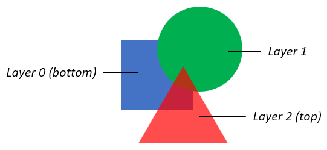

The basic concepts also apply to color glyphs defined using the version 1 formats: shapes have fills and can be arranged in layers. But the additional formats of version 1 support much richer capabilities. In a version 1 color glyph, graphic constructs and capabilities are represented primarily in *Paint* tables, which are linked together in a *directed, acyclic graph*. Several different Paint formats are defined, each describing a particular type of graphic operation:

- A PaintColrLayers table provides a layering structure used for creating a color glyph from layered elements. A PaintColrLayers table can be used at the root of the graph, providing a base layering structure for the entire color glyph definition. A PaintColrLayers table can also be nested within the graph, providing a set of layers to define some graphic sub-component within the color glyph.
- The PaintSolid, PaintVarSolid, PaintLinearGradient, PaintVarLinearGradient, PaintRadialGradient, PaintVarRadialGradient, PaintSweepGradient, and PaintVarSweepGradient tables provide basic fills, using color entries from the [CPAL](cpal.md) table.
- The PaintGlyph table provides glyph outlines as the basic shapes.
- The PaintTransform and PaintVarTransform tables are used to apply an affine transformation matrix to a sub-graph of paint tables, and the graphic operations they represent. Several Paint formats are also provided for specific transformation types: translate, scale, rotate, or skew, with additional variants of these formats for variations and other options.
- The PaintComposite table supports alternate compositing and blending modes for two sub-graphs.
- The PaintColrGlyph table allows a color glyph definition, referenced by a base glyph ID, to be re-used as a sub-graph within multiple color glyphs.

> *Note:* Some paint formats come in *Paint\** and *PaintVar\** pairs. In these cases, the latter format supports variations in variable fonts, while the former provides a more compact representation for the same graphic capability but without variation capability.

In a simple color glyph description, a PaintGlyph table might be linked to a PaintSolid table, for example, representing a glyph outline filled using a basic solid color fill. But the PaintGlyph table could instead be linked to a much more complex sub-graph of Paint tables, representing a shape that gets filled using the more-complex set of operations described by the sub-graph of Paint tables.

The graphic capabilities are described in more detail in the following sections. The formats used for these will be specified later in this chapter—see [COLR table formats](#anchor-colr-colr-table-formats).

<a id="anchor-colr-colors-and-solid-color-fills"></a>

### Colors and solid color fills

All colors are specified as a base zero index into [CPAL](cpal.md) palette entries. A font can define alternate palettes in its CPAL table; it is up to the application to determine which palette is used. A palette entry index value of 0xFFFF is a special case indicating that the text foreground color (defined by the application) should be used, and must not be treated as an actual index into the CPAL ColorRecord array.

The CPAL color data includes alpha information, as well as RGB values. In the COLR version 0 formats, a color reference is made in a LayerRecord as a palette entry index alone. In the formats added for COLR version 1, color references include a palette entry index and a separate alpha value within the COLR structure for a solid color fill or gradient color stop (described below). Separation of alpha from palette entries in version 1 allows use of transparency in a color glyph definition independent of the choice of palette. The alpha value in the COLR structure is multiplied into the alpha value given in the CPAL color entry. If the palette entry index is 0xFFFF, the alpha value in the COLR structure is multiplied into the alpha value of the text foreground color.

In version 1, a solid color fill is specified using a PaintVarSolid or PaintSolid table, with or without variation support, respectively. See [Formats 2 and 3: PaintSolid, PaintVarSolid](#anchor-colr-formats-2-and-3-paintsolid-paintvarsolid) for format details.

See [Filling shapes](#anchor-colr-filling-shapes) for details on how fills are applied to a shape.

<a id="anchor-colr-gradients"></a>

### Gradients

COLR version 1 supports three types of gradients: [linear gradients](#anchor-colr-linear-gradients), [radial gradients](#anchor-colr-radial-gradients), and [sweep gradients](#anchor-colr-sweep-gradients). For each type, non-variable and variable formats are defined. Each type of gradient is specified using a [color line](#anchor-colr-color-lines).

<a id="anchor-colr-color-lines"></a>

#### Color lines

A color line is a function that maps real numbers to color values to define a one-dimensional gradation of colors, to be used in the definition of linear, radial, or sweep gradients. A color line is defined as a set of one or more color stops, each of which maps a particular real number to a specific color.

On its own, a color line has no positioning, orientation or size within a design grid. The definition of a linear, radial, or sweep gradient will reference a color line and map it onto the design grid by specifying positions in the design grid that correspond to the real values 0 and 1 in the color line. The specifications for linear, radial and sweep gradients also include rules for where to draw interpolated colors of the color line, following from the placement of 0 and 1.

A color stop is defined by a real number, the *stop offset*, and a color. Stop offsets are represented using F2DOT14 values, therefore color stops can only be specified within the range \[-2, 2). In a variable font, however, stop offsets can be variable, and with the application of deltas can lie outside that range. (See [Color references, ColorStop and ColorLine](#anchor-colr-color-references-colorstop-and-colorline) for format details.) A color line requires at least one color stop to paint any color values. If the color line does not have any color stops, then transparent black is used for the entire color line. If only one color stop is specified, that color is used for the entire color line. At least two color stops are needed to create color gradation.

Color gradation is defined over the interval from the color stop with the minimum offset, through successive color stops, to the color stop with the maximum offset. Between numerically-adjacent color stops, color values are linearly interpolated. See [Interpolation of Colors](cpal.md#anchor-cpal-interpolation-of-colors) for requirements on how colors are interpolated.

Color stops must be used in their *stop offset* order, which can be different from the order in which they are defined in the font. Also, when processing a selected instance of a variable font, stops must be re-ordered according to offset values after variation deltas are applied. Therefore, the ordering of colors in the color line definition can change between one variation instance and another instance.

Color values outside the defined interval are determined by the color line’s *extend mode*, described below. In this way, colors are defined for all stop offset values, from negative infinity to positive infinity.

For example, a gradient color line could be defined with two color stops at 0.2 and 1.5. Colors for offsets between 0.2 and 1.5 are interpolated. Colors for offsets above 1.5 and below 0.2 are determined by the color line’s extend mode.

If there are multiple color stops defined for the same stop offset, the first one given in the font must be used for computing color values on the color line below that stop offset, and the last one must be used for computing color values at or above that stop offset. All other color stops for that stop offset must be ignored. In a variable font, if two color stops have different default offset values but vary to have the same offset value for a given variation instance, those stops must be applied to the color line in the order in which they are given in the font, as described above.

The color patterns outside the defined interval are determined by the color line’s extend mode. Three extend modes are supported:

- **Pad:** outside the defined interval, the color of the closest color stop is used. Using a sequence of letters as an analogy, given a sequence “ABC”, it is extended to “…*AA* ABC *CC*…”.
- **Repeat:** The color line is repeated over repeated multiples of the defined interval. For example, if color stops are specified for a defined interval of \[0.2, 1.5\], then the pattern is repeated above the defined interval for intervals (1.5, 2.8\], (2.8, 4.1\], etc.; and also repeated below the defined interval for intervals \[-1.1, 0.2), \[-2.4, -1.1), etc. In each repeated interval, the first color is that of the farthest defined color stop. By analogy, given a sequence “ABC”, it is extended to “…*ABC* ABC *ABC*…”.
- **Reflect:** The color line is repeated over repeated intervals, as for the repeat mode. However, in each repeated interval, the ordering of color stops is the reverse of the adjacent interval. By analogy, given a sequence “ABC”, it is extended to “…*ABC CBA* ABC *CBA ABC*…”.

The following figures illustrate the different color line extend modes. The figures show the color line extended over a limited interval, but the extension is unbounded in either direction.

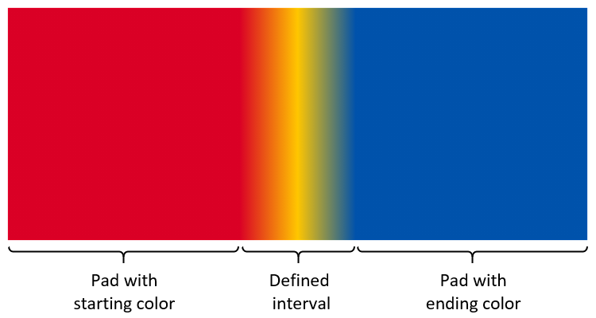<br>*Color gradation extended using pad mode*

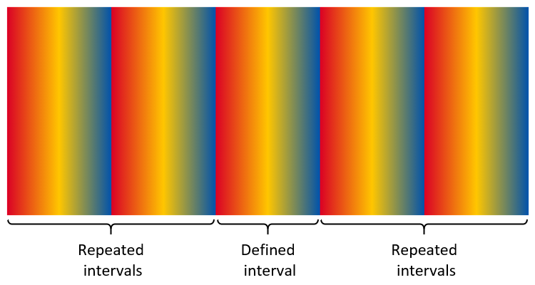<br>*Color gradation extended using repeat mode*

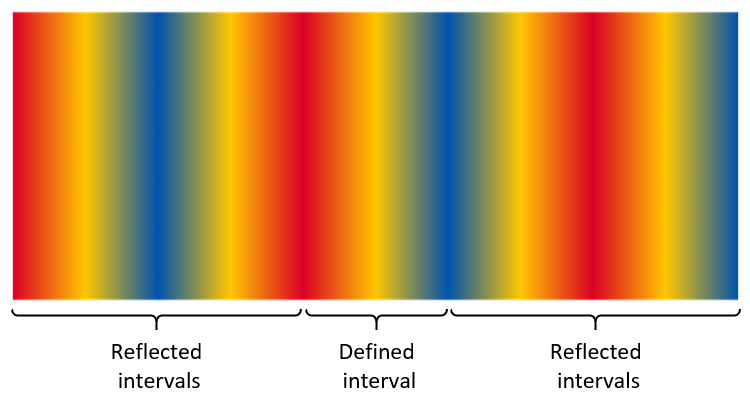<br>*Color gradation extended using reflect mode*

> *Note:* The extend modes are the same as the [spreadMethod](https://www.w3.org/TR/2011/REC-SVG11-20110816/pservers.html#LinearGradientElementSpreadMethodAttribute) attribute used for linear and radial gradients in the [Scalable Vector Graphics (SVG) 1.1 (Second Edition)](https://www.w3.org/TR/SVG11/) specification.

If all color stops have the same offset and the extend mode is pad, the color line has two colors: the first stop is used below that offset, and the last stop is used at and above that offset. However, if the extend mode is repeat or reflect, the color line is ill-formed and nothing must be rendered.

When combining a color line with the geometry of a particular gradient definition, one might want to achieve a certain number of repetitions of the gradient pattern over a particular geometric range. Assuming that geometric range will correspond to placement of stop offsets 0 and 1, the following steps can be used:

- In order to get a certain number of repetitions of the gradient pattern (without reflection), divide 1 by the number of desired repetitions, use the result as the maximum stop offset for specified color stops, and set the extend mode to *repeat*.
- In order to get a certain number of repetitions of the reflected gradient pattern, divide 1 by two times the number of desired repetitions, use the result as the maximum stop offset for specified color stops, and set the extend mode to *reflect*.

> *Note:* Given the above specifications for how color lines are defined, and also allowing for the application of variation deltas, the definition of a color line can span an interval greater than, narrower than, or in other ways different from the interval \[0, 1\]. However, some application platforms that provide an implementation for gradients can require a color line to be defined for exactly the interval \[0, 1\]. Implementations can work around such constraints by *normalizing* the offsets of the defined color stops. For example, if constrained to the range \[0, 1\], map the lowest stop offset to 0, map the largest offset to 1, and linearly interpolate normalized offsets for other stops in between. Then, for correct alignment to the geometry of a gradient definition, interpolate or extrapolate alternate geometric values to align with the normalized 0 and 1 stop offsets. For radial gradients, special geometry considerations can also apply; see [Radial gradients](#anchor-colr-radial-gradients) for more information.

Color lines are specified using color line tables, which contain arrays of color stop records. Two color line table and two color stop record formats are defined:

- ColorLine table and ColorStop record
- VarColorLine table and VarColorStop record

The VarColorLine and VarColorStop formats can be used in variable fonts and allow for stop offsets and color alpha values to be variable. The ColorLine and ColorStop formats provide a more compact representation when variation is not required. See [Color references, ColorStop and ColorLine](#anchor-colr-color-references-colorstop-and-colorline) for format details.

<a id="anchor-colr-linear-gradients"></a>

#### Linear gradients

A linear gradient provides gradation of colors along a straight line. The gradient is defined by three points, p₀, p₁ and p₂, plus a color line. The color line is positioned in the design grid with stop offset 0 aligned to p₀ and stop offset 1.0 aligned to p₁. (The line passing through p₀ and p₁ will be referred to as line p₀p₁.) Colors at each position on line p₀p₁ are interpolated using the color line. For each position along line p₀p₁, the color at that position is projected on either side of the line.

The additional point, p₂, is used to rotate the gradient orientation in the space on either side of the line p₀p₁. The line passing through points p₀ and p₂ (line p₀p₂) determines the direction in which colors are projected on either side of the color line. That is, for each position on line p₀p₁, the line that passes through that position on line p₀p₁ and that is parallel to line p₀p₂ will have the color for that position on line p₀p₁.

> *Note:* For convenience, point p₂ can be referred to as the *rotation point*, and the vector from p₀ to p₂ can be referred to as the *rotation vector*. However, neither the magnitude of the vector nor the direction (from p₀ to p₂, versus from p₂ to p₀) has significance.

If either point p₁ or p₂ is the same as point p₀, the gradient is ill-formed and must not be rendered.

If line p₀p₂ is parallel to line p₀p₁ (or near-parallel for an implementation-determined definition), then the gradient is ill-formed and must not be rendered.

> *Note:* An implementation can derive a single vector, from p₀ to a point p₃, by computing the orthogonal projection of the vector from p₀ to p₁ onto a line perpendicular to line p₀p₂ and passing through p₀ to obtain point p₃. The linear gradient defined using p₀, p₁ and p₂ as described above is functionally equivalent to a linear gradient defined by aligning stop offset 0 to p₀ and aligning stop offset 1.0 to p₃, with each color projecting on either side of that line in a perpendicular direction. This specification uses three points, p₀, p₁ and p₂, as that provides greater flexibility in controlling the placement and rotation of the gradient, as well as variations thereof.

The following figures illustrate linear gradients using the three different color line extend modes. Each figure illustrates linear gradients with two different rotation vectors. In each case, three color stops are specified: red at 0.0, yellow at 0.5, and blue at 1.0.

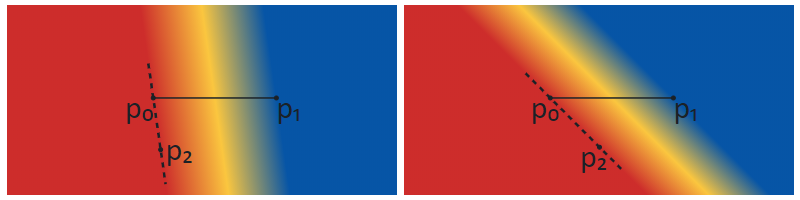<br>*Linear gradients with different rotations using the pad extend mode*

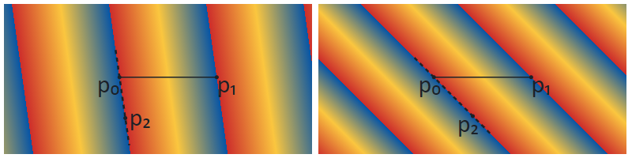<br>*Linear gradients with different rotations using the repeat extend mode*

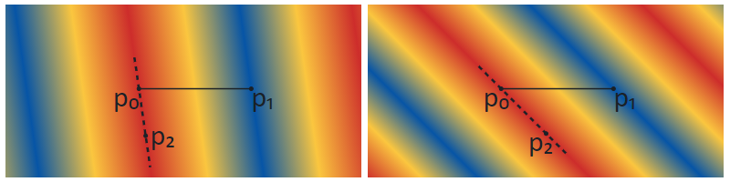<br>*Linear gradients with different rotations using the reflect extend mode*

> *Note:* When a linear gradient is combined with a transformation (see [Transformations](#anchor-colr-transformations)), the appearance will be the same as if the gradient were defined using the transformed positions of points p₀, p₁ and p₂.

Linear gradients are specified using a PaintVarLinearGradient or PaintLinearGradient table, with or without variation support, respectively. See [Formats 4 and 5: PaintLinearGradient, PaintVarLinearGradient](#anchor-colr-formats-4-and-5-paintlineargradient-paintvarlineargradient) for format details.

See [Filling shapes](#anchor-colr-filling-shapes) for details on how fills are applied to a shape.

**Note on implementation of linear gradients**

Some application platforms can provide an implementation for linear gradients that requires a color line to be specified for exactly the interval \[0, 1\]. If an application is using such a platform implementation but the font has a linear gradient with a color line specified over a different interval, the application can work around the platform constraint by normalizing the color line to the interval \[0, 1\]. This would require deriving alternate geometric points for the linear gradient definition. For the defined points p₀, p₁ and p₂, alternate points p₀′, p₁′ and p₂′ can be derived as follows: if o<sub>min</sub> is the minimum stop offset in the defined color line, o<sub>max</sub> is the maximum offset, and vector **v** = p₁ - p₀, then let

- p₀′ = p₀ + o<sub>min</sub>**v**
- p₁′ = p₀ + o<sub>max</sub>**v**
- p₂′ = p₂ + o<sub>min</sub>**v**

If an implementation derives a single vector with point p₃, as described above, then alternate points p₀ and p₃ can be derived as follows: with vector **w** = p₃ - p₀, let

- p₀′ = p₀ + o<sub>min</sub>**w**
- p₃′ = p₀ + o<sub>max</sub>**w**

<a id="anchor-colr-radial-gradients"></a>

#### Radial gradients

A radial gradient provides gradation of colors along a cylinder defined by two circles. The gradient is defined by circles with center c₀ and radius r₀, and with center c₁ and radius r₁, plus a color line. The color line aligns with the two circles by associating stop offset 0 with the first circle (with center c₀) and aligning stop offset 1.0 with the second circle (with center c₁).

> *Note:* The term “radial gradient” is used in some contexts for more limited capabilities. In some contexts, the type of gradient defined here is referred to as a “two point conical” gradient.

The drawing algorithm for radial gradients follows the [HTML WHATWG Canvas specification for createRadialGradient()](https://html.spec.whatwg.org/multipage/canvas.html#dom-context-2d-createradialgradient), but adapted with alternate color line extend modes and more flexibility for color stop offsets. Radial gradients must be rendered with results that match the results produced by the following steps.

With circle center points c₀ and c₁ defined as c₀ = (x₀, y₀) and c₁ = (x₁, y₁):

1. If c₀ = c₁ and r₀ = r₁ then paint nothing and return.
2. For real values of ω:<br> Let x(ω) = (x₁-x₀)ω + x₀<br> Let y(ω) = (y₁-y₀)ω + y₀<br> Let r(ω) = (r₁-r₀)ω + r₀<br> Let the color at ω be the color at position ω on the color line.
3. For all values of ω where r(ω) \> 0, starting with the value of ω nearest to positive infinity and ending with the value of ω nearest to negative infinity, draw the circular line with radius r(ω) centered at position (x(ω), y(ω)), with the color at ω, but only painting on the parts of the bitmap that have not yet been painted on in this step of the algorithm for earlier values of ω.

The algorithm provides results in various cases as follows:

- When the circles are identical, then nothing is painted.
- When both radii are 0 (r₀ = r₁ = 0), then r(ω) is always 0 and nothing is painted.
- If the centers of the circles are distinct, the radii of the circles are different, and neither circle is entirely contained within the radius of the other circle, then the resulting shape resembles a cone that is open to one side. The surface outside the cone is not painted. (See figures below.)
- If the centers of the circles are distinct but the radii are the same, and neither circle is contained within the other, then the result will be a strip, similar to the flattened projection of a circular cylinder. The surface outside the strip is not painted. (See figures below.)
- If the radii of the circles are different but one circle is entirely contained within the radius of the other circle, the gradient will radiate in all directions from the inner circle, and the entire surface will be painted. (See figures below.)

The following figures illustrate radial gradients using the three different color line extend modes. The color line is defined with stops for the interval \[0, 1\]: red at 0.0, yellow at 0.5, and blue at 1.0. Note that the circles that define the gradient are not stroked as part of the gradient itself. Stroked circles have been overlaid in the figure to illustrate the color line and the region that is painted in relation to the two circles.

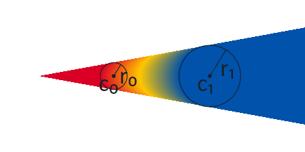<br>*Radial gradient using pad extend mode*

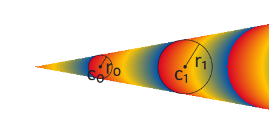<br>*Radial gradient using repeat extend mode*

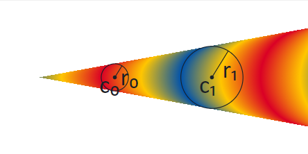<br>*Radial gradient using reflect extend mode*

The following figures illustrate the case in which the circles have distinct centers but the same radii, and neither circle is contained within the other, giving the appearance of a strip. The color stops are as in the previous figures.

<br>*Radial gradient with same-size circles appearing as a strip, using pad extend mode*

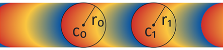<br>*Radial gradient with same-size circles appearing as a strip, using repeat extend mode*

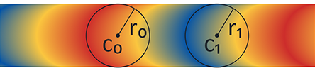<br>*Radial gradient with same-size circles appearing as a strip, using reflect extend mode*

Because the rendering algorithm progresses ω in a particular direction, from positive infinity to negative infinity, and because pixels are not re-painted as ω progresses, the appearance will be affected by which circle is considered circle 0 and which is circle 1. This is illustrated in the following three figures. The gradient in the first figure is the same as was shown above of a radial gradient using the pad extend mode. In this gradient, circle 0 is the small circle, on the left. In the second figure, the start and end circles are reversed: circle 0 is the large circle, on the right. The color line is kept the same, and so the red end starts at circle 0, now on the right. In the third figure, the order of stops in the color line is also reversed to put red on the left. The key difference to notice between the gradients in these figures is the way that colors are painted in the interior: when the two circles are not overlapping, the arcs of constant color bend in the same direction as the near side of circle 1.

> *Note:* This difference does not exist if one circle is entirely contained within the other: in that case, the arcs of constant color are complete circles.

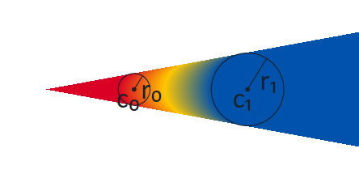<br>*Cone-shaped radial gradient with circle 0 on the left*

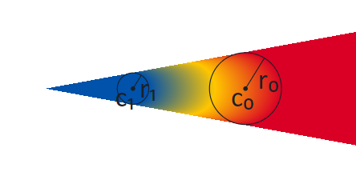<br>*Cone-shaped radial gradient with start and end circles swapped*

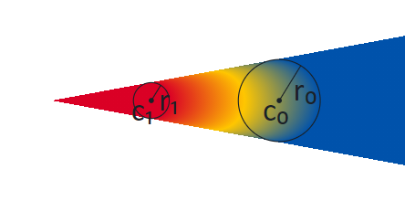<br>*Cone-shaped radial gradient with start and end circles swapped and color line reversed*

When one circle is contained within the other, the extension of the gradient beyond the larger circle will fill the entire surface. Colors in the areas inside the inner circle and outside the outer circle are determined by the extend mode. The following figures illustrate this for the different extend modes.

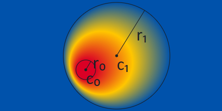<br>*Radial gradient with one circle contained within the other, pad extend mode*

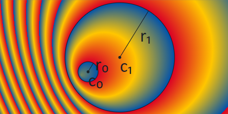<br>*Radial gradient with one circle contained within the other, repeat extend mode*

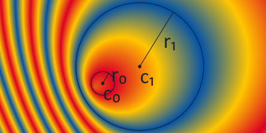<br>*Radial gradient with one circle contained within the other, reflect extend mode*

> *Note:* When a radial gradient is combined with a transformation (see [Transformations](#anchor-colr-transformations)), the appearance will be the same as if the geometry of the two circles were transformed and step 3 of the algorithm were performed by interpolating the shapes derived from the two transformed circles. For the condition r(ω) \> 0, the pre-transformation values of r(ω) can be used.

> *Note:* A scale transformation can flatten shapes to resemble lines. If a radial gradient is nested in the child sub-graph of a transformation that flattens the circles so that they are nearly lines, the centers could still be separated by some distance. In that case, the radial gradient would appear as a strip, or as a cone filled with a linear gradient.

If a radial gradient is nested in the sub-graph of a transformation that flattens the circles so that they form a single line (or nearly a line, for an implementation-determined definition), with both centers on that line, then the resulting gradient is degenerate and must not be rendered.

> *Note:* As seen in the figures above, the gradient fills the space when one circle is contained within the other, but not when neither circle is contained within the other. In a variable font, if the placement or radii of the circles vary, then a sharp transition can occur if the variation results in one circle being contained within the other for some instances but not for other instances. This transition will occur when the inner circle just touches the outer circle (i.e., they have exactly one point in common). In this case, the gradient will fill exactly one half of the space. This is illustrated in the following figure using the pad extend mode.

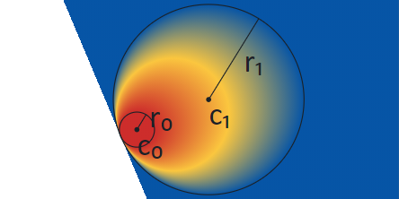<br>*Radial gradient with inner circle just touching the outer circle, pad extend mode*

When the repeat or reflect extend modes are used, having the two circles in very close proximity results in very high spatial-frequency transitions that can lead to Moiré patterns or other display artifacts. This is illustrated in the following figure, which shows the display result, for one particular rendering context, of a radial gradient defined using nearly-identical circles and the reflect extend mode.

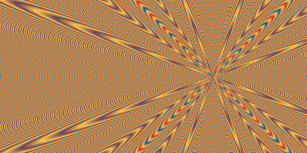<br>*Radial gradient defined using nearly-identical circles, showing interference patterns*

The artifacts seen can be affected by a combination of several factors, such as image scaling, sub-pixel rendering, display technology, and limitations in software implementation or display capabilities. For this reason, the appearance can be very different in different situations. Font designers should exercise caution if the circles are in close proximity (either in a static design or for some variable font instances), and should not rely on these display artifacts to obtain a particular pattern.

While the Paint table formats use unsigned values to define the circle radii, application of deltas in variable fonts can result in negative radii values. While a negative radius does not seem to make sense intuitively, negative radii are not a problem for the rendering algorithm described above: given the formula r(ω) = (r₁-r₀)ω + r₀, r(ω) will have positive and negative values for different values of ω when the values of r₀ and r₁ are both positive, but also if either r₀ or r₁, or both, are negative. For example, if r₀ = -1 and r₁ = -2, then r(ω) = ω - 2, and r(ω) ≥ 0 for ω ≥ 2. There is one notable change, however, in the case of r₀ = r₁ (hence, r(ω) = r₀): if the values are positive, a cylinder is painted (since r₀ \> 0), but if the values are negative, then nothing is painted (since r₀ \< 0).

> *Note:* If r₀ is different from r₁, the geometry defined by the two circles can be understood as a 2D projection of a cone. The cone has a *tip* where r(ω) = 0, and the cone is painted on the side of the tip for which r(ω) ≥ 0. In the general case,
>
> - ω<sub>tip</sub> = r₀/(r₀ - r₁)
> - if r₁ \> r₀, r(ω) \> 0 for all ω \> r₀/(r₀ - r₁)
> - if r₁ \< r₀, r(ω) \> 0 for all ω \< r₀/(r₀ - r₁)

Radial gradients are specified using a PaintVarRadialGradient or PaintRadialGradient table, with or without variation support, respectively. See [Formats 6 and 7: PaintRadialGradient, PaintVarRadialGradient](#anchor-colr-formats-6-and-7-paintradialgradient-paintvarradialgradient) for format details.

See [Filling shapes](#anchor-colr-filling-shapes) for details on how fills are applied to a shape.

**Note on implementation of radial gradients**

Some application platforms can provide an implementation for radial gradients that require the circle radii to be non-negative. If an application is using such a platform implementation but a variable font instance has a radial gradient with a negative circle radius, the application can work around the platform constraint by deriving an alternate gradient definition that uses only circles with non-negative radii and that produces the same visual appearance. This would also require deriving an alternate color line definition that preserves the same color line extend mode behaviors.

Similarly, if the platform provides an implementation for radial gradients that requires color stops to be defined for exactly the interval \[0, 1\] but the font has a radial gradient with a color line specified over a different interval, the application can work around that platform constraint by normalizing the color line to the interval \[0, 1\]. But the normalized color line would require deriving alternate circle specifications, and a simple normalization can result in a circle with a negative radius.

Thus, handling of negative circle radii and normalization of the color line need to be considered together. The following observations will be helpful:

- If r₀ and r₁ are positive and r₀ = r₁, a simple normalization of the color line can be used.
- If the color stops that define the color line all have offsets ω such that r(ω) ≥ 0, then a simple normalization of the color line can be used with alternate circles that have non-negative radii.
- For pad extend mode, if some color stops have offsets ω such that r(ω) \< 0, the same visual result can be obtained by using a truncated color line definition in which all stops with offsets ω such that r(ω) \< 0 are replaced by a single stop for ω<sub>tip</sub> with an interpolated color value. (See [Interpolation of Colors](cpal.md#anchor-cpal-interpolation-of-colors) for requirements on how colors are interpolated.)
- For pad and repeat extend modes, the extended color line has a repeating pattern with offset wavelength λ, and any color line definition that is a slice of the color line of length λ will produce the same visual results. Thus, the application can derive an alternate color line definition in which all stops have offsets ω such that r(ω) ≥ 0, normalize those stop offsets to \[0, 1\], then derive alternate circles that align to the normalized 0 and 1 offsets.

<a id="anchor-colr-sweep-gradients"></a>

#### Sweep gradients

A sweep gradient provides a gradation of colors that sweep around a center point. For a given color on a color line, that color projects as a ray from the center point in a given direction. This is illustrated in the following figure.

> *Note:* The following figures illustrate sweep gradients clipped to a region. Sweep gradients are not bounded, however, and fill the entire space.

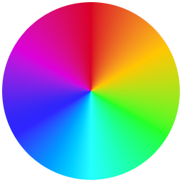<br>*A sweep gradient*

> *Note:* In some contexts, this type of gradient is referred to as a “conic” gradient, or as an “angular” gradient.

A sweep gradient is defined by a center point, start and end angles, and a color line. The angles are expressed in counter-clockwise degrees from the direction of the positive x-axis on the design grid.

For sampling and interpolating colors, the color line is aligned to an infinitely spiraling circular arc around the center point, with arbitrary radius. The position 0° on the arc means the direction of the positive x-axis, and 360° means one full counter-clockwise rotation. The color line’s stop offset 0 is aligned with the start angle and stop offset 1 is aligned with the end angle, independent of which angle is larger.

Outside the defined interval of the color line, the color value of a position on the color line is filled in depending on its extend mode. See [Color Lines](#anchor-colr-color-lines) for more details. In effect, this means that the spiraling circular arc can be sampled for colors outside the defined color line interval.

To draw the sweep gradient, for each position along the circular arc starting from 0° up to but not including 360°, a ray from the center outward is painted with the color of the color line where the ray intersects the circular arc at that particular angle. Angle positions below 0° and equal to or above 360° are not sampled for drawing the rays.

If the color line's extend mode is reflect or repeat and start and end angle are equal, nothing shall be drawn.

When the sweep gradient's color line uses the repeat or reflect extend mode and the angular distance between the start and end angles is small, this results in very high spatial-frequency transitions that can lead to Moiré patterns or other display artifacts. (See above where this effect is shown for a similar case involving radial gradients).

The following figure illustrates a sweep gradient with the drawing direction progressing from 0° to 360°. The gradient is specified with a start angle of 110° and end angle of 230°. The color line is specified with a yellow stop at offset 0 (aligned to the start angle) and a red stop at offset 1 (aligned to the end angle). The pad extend mode is used, hence the color for angles below 110° is yellow, and the color for angles above 150° is red.

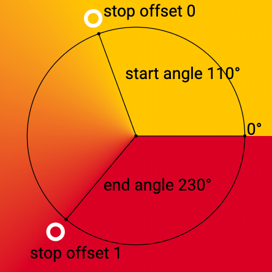<br>*A sweep gradient with start angle of 110° and an end angle of 230°, using a color line with color stops 0 and 1 for yellow and red and pad extend mode.*

> *Note:* If the start angle is less than or equal to the end angle, the color line progresses from smaller to larger offsets in the counter-clockwise direction along the circular arc. If the start angle is larger than the end angle, however, the color line is inverted and progresses in the clockwise direction, as illustrated in the following figure.

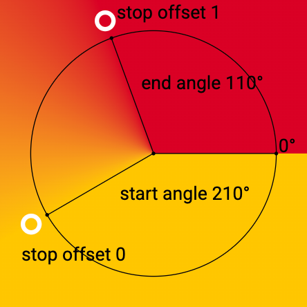<br>*A sweep gradient, from yellow to red, with start angle of 210° and end angle of 110°, showing the inversion of the color line when the start angle is larger than the end angle.*

Not more than one full rotation is drawn and there is no overlap in drawing for angles outside the 0° to 360° range. However, start and end angles may be positioned at angles below 0° or above 360°. Through that, and through how wide the color line interval is defined, color stops can lie outside the 0° to 360° circle. This has an effect on the computation of the gradient colors inside the interval of 0° to 360°, but colors are not sampled from outside this interval. See the following figure for an example: The color line goes from yellow to red with a start angle of 330° and an end angle of 400°. The color for angles lower than 330° is yellow due to the pad extend mode, then the color line transitions from yellow at 330° to red at 400°, but only the color values up until 360° are sampled for drawing.

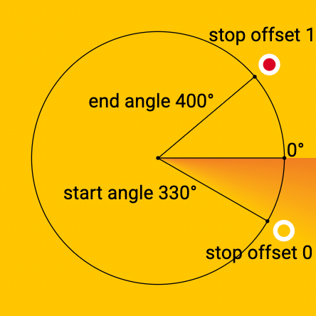<br>*A sweep gradient with a start angle of 330° and an end angle of 400°, using a color line with color stops 0 and 1 for yellow and red and extend mode pad.*

> *Note:* Because the sweep gradient is drawn from 0° to 360° a sharp transition can occur at 0°. This can be mitigated by adjusting the color stops at the 0° and 360° positions on the arc to have the same color. The location of the transition axis can also be shifted by nesting the sweep gradient inside a rotation transformation (see [Transformations](#anchor-colr-transformations)).

> *Note:* When a sweep gradient is combined with a [transformation](#anchor-colr-transformations), the appearance will be the same as if (i) a circle of some non-zero radius was constructed with points on the circle computed from the start and end angles; (ii) the center point, circle and points on the circle were transformed; (iii) the color line was aligned to the transformed circle; and then (iv) a gradient was derived from the result, with rays from the transformed center point passing through the transformed color circle. When aligning the color line to the transformed circle, stop offset 0 would be aligned to the transformed point derived from the start angle, with stop offset 1 aligned to the transformed point derived from the end angle. Thus, a transform can result in the color line progressing in the opposite direction compared to the non-transformed gradient.

Sweep gradients are specified using a PaintVarSweepGradient or PaintSweepGradient table, with or without variation support, respectively. See [Formats 8 and 9: PaintSweepGradient, PaintVarSweepGradient](#anchor-colr-formats-8-and-9-paintsweepgradient-paintvarsweepgradient) for format details.

See [Filling shapes](#anchor-colr-filling-shapes) for details on how fills are applied to a shape.

<a id="anchor-colr-filling-shapes"></a>

### Filling shapes

All basic shapes used in a color glyph are obtained from glyph outlines, referenced using a glyph ID. In a color glyph description, a [PaintGlyph](#anchor-colr-format-10-paintglyph) table is used to represent a basic shape.

> *Note:* Shapes can also be derived using PaintGlyph tables in combination with other tables, such as PaintTransform (see [Transformations](#anchor-colr-transformations)) or PaintComposite (see [Compositing and blending](#anchor-colr-compositing-and-blending)).

The PaintGlyph table has a field for the glyph ID, plus an offset to a child paint table that is used as the fill for the shape. The glyph outline is not rendered; only the fill is rendered.

Any of the basic fill formats (PaintSolid, PaintVarSolid, PaintLinearGradient, PaintVarLinearGradient, PaintRadialGradient, PaintVarRadialGradient, PaintSweepGradient, PaintVarSweepGradient) can be used as the child paint table. This is illustrated in the following figure: a PaintGlyph table has a glyph ID for an outline in the shape of a triangle, and it links to a child PaintLinearGradient table. The combination is used to represent a triangle filled with the linear gradient.

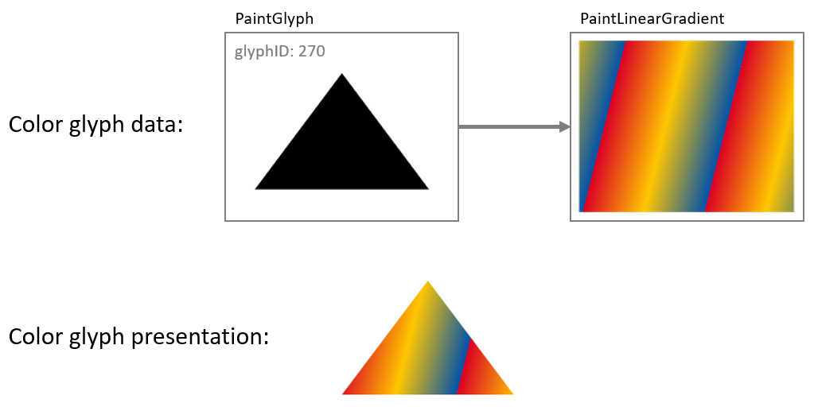<br>*PaintGlyph and PaintLinearGradient tables used to fill a shape with a linear gradient*

The child of a PaintGlyph table is not, however, limited to one of the basic fill formats. Rather, the child can be the root of a sub-graph that describes some graphic composition that is used as a fill. Another way to describe the relationship between a PaintGlyph table and its child sub-graph is that the glyph outline specified by the PaintGlyph table defines a bounds, or *clip region*, that is applied to the fill composition defined by the child sub-graph.

To illustrate this, the example in the previous figure is extended so that a PaintGlyph table links to a second PaintGlyph that links to a PaintLinearGradient: the parent PaintGlyph will clip the filled shape described by the child sub-graph.

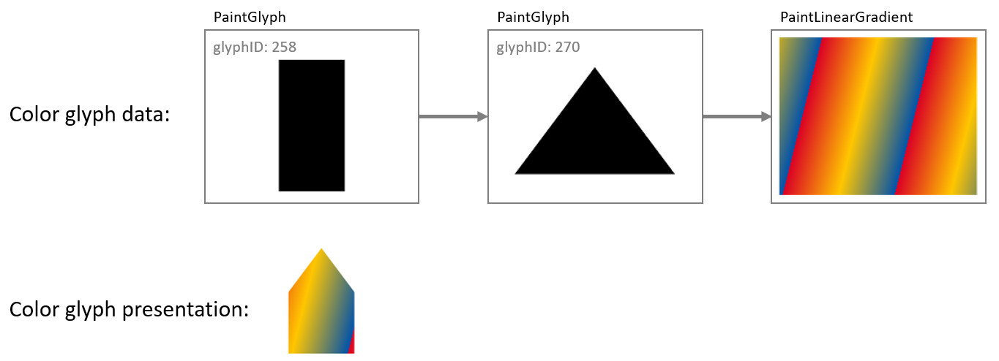<br>*A PaintGlyph table defines a clip region for the composition defined by its child sub-graph*

A PaintGlyph table on its own does not add content: if there is no child paint table, then the graph is not well formed. See [Color glyphs as a directed acyclic graph](#anchor-colr-color-glyphs-as-a-directed-acyclic-graph) for details regarding well-formedness and validity of the graph.

<a id="anchor-colr-layering"></a>

### Layering

Layering of visual elements was introduced above in [Introduction: 2D graphic concepts](#anchor-colr-introduction-2d-graphic-concepts). Both COLR version 0 and version 1 support the use of multiple layers, though in different ways.

For version 0, layers are fundamental: they are the sole way in which separate elements are composed into a color glyph. An array of LayerRecords is created, with each LayerRecord specifying a glyph ID and a CPAL entry (a shape and solid color fill). Each color glyph definition is a slice from that array (that is, a contiguous sub-sequence), specified in a BaseGlyphRecord for a particular base glyph. Within a given slice, the first record specifies the content of the bottom layer, and each subsequent record specifies content that overlays the preceding content (increasing z-order). A single array is used for defining all color glyphs. The LayerRecord slices for two base glyphs may overlap, though often will not overlap.

The following figure illustrates layers using version 0 formats.

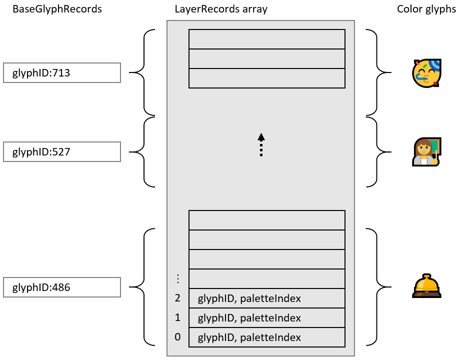<br>*Version 0: Color glyphs are defined by slices of a layer records array*

When using version 1 formats, use of multiple layers is supported but is optional. For example, a simple glyph description need not use any layering, as illustrated in the following figure:

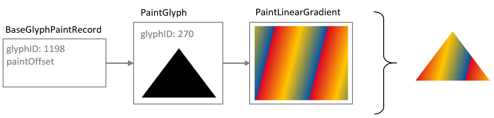<br>*Complete color glyph definition without use of layers*

The version 1 formats define a color glyph as a directed, acyclic graph of paint tables, and the concept of layering corresponds roughly to the number of distinct leaf nodes in the graph. (See [Color glyphs as a directed acyclic graph](#anchor-colr-color-glyphs-as-a-directed-acyclic-graph).) The basic fill formats (PaintSolid, PaintVarSolid, PaintLinearGradient, PaintVarLinearGradient, PaintRadialGradient, PaintVarRadialGradient, PaintSweepGradient, PaintVarSweepGradient) do not have child paint tables and so can only be leaf nodes in the graph. Some paint tables, such as the PaintGlyph table, have only a single child, so can be used within a layer but do not provide any means of adding additional layers. Increasing the number of layers requires paint tables that have two or more children, creating a fork in the graph.

The version 1 formats include two paint formats that have two or more children, and so can increase the number of layers in the graph:

- The [PaintComposite](#anchor-colr-format-32-paintcomposite) table allows two sub-graphs to be composed together using different compositing or blending modes.
- The [PaintColrLayers](#anchor-colr-format-1-paintcolrlayers) table supports defining a sequence of several layers.

> *Note:* The PaintColrGlyph table provides a means of incorporating the graph of one color glyph as a sub-graph in the definition of another color glyph. In this way, PaintColrGlyph provides an indirect means of introducing additional layers into a color glyph definition: forks in the resulting graph do not come from the PaintColrGlyph table itself, but can come from PaintColrLayers or PaintComposite tables that are nested in the incorporated sub-graph. See [Re-use using PaintColrGlyph](#anchor-colr-re-use-using-paintcolrglyph) for a description of the PaintColrGlyph table.

While the PaintComposite table only combines two sub-graphs, other PaintComposite tables can be nested to provide additional layers. The primary purpose of PaintComposite is to support compositing or blending modes other than simple alpha blending. The PaintComposite table is covered in more detail in [Compositing and blending](#anchor-colr-compositing-and-blending). The remainder of this section will focus on the PaintColrLayers table.

The PaintColrLayers table is used to define a bottom-up z-order sequence of layers. Similar to version 0, it defines a layer set as a slice in an array, but in this case the array is an array of offsets to paint tables, contained in a LayerList table. Each referenced paint table is the root of a sub-graph of paint tables that specifies a graphic composition to be used as a layer. Within a given slice, the first offset provides the content for the bottom layer, and each subsequent offset provides content that overlays the preceding content. Definition of a layer set—a slice within the layer list—is given in a PaintColrLayers table.

The following figure illustrates the organizational relationship between PaintColrLayers tables, the LayerList, and referenced paint tables that are roots of sub-graphs.

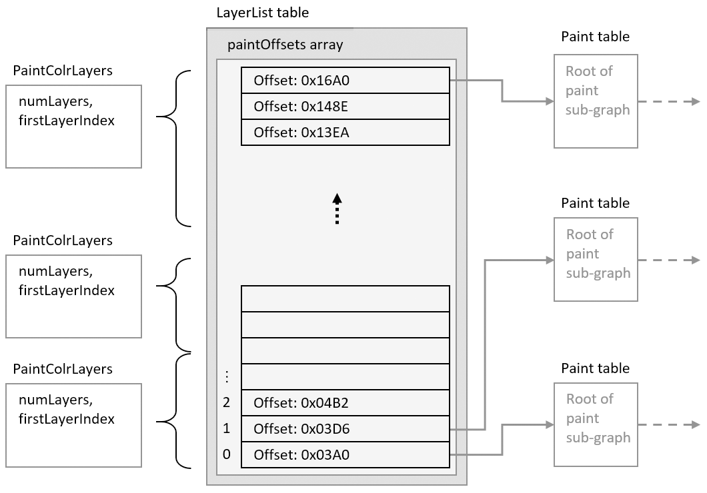<br>*Version 1: PaintColrLayers tables specify slices within the LayerList, providing a layering of content defined in sub-graphs*

> *Note:* Paint table offsets in the LayerList table are only used in conjunction with PaintColrLayers tables. If a paint table does not need to be referenced via a PaintColrLayers table, its offset does not need to be included in the LayerList array.

A PaintColrLayers table can be used as the root of a color glyph definition, providing a base layering structure for the color glyph. In this usage, the PaintColrLayers table is referenced by a BaseGlyphPaintRecord, which specifies the root of the graph of a color glyph definition for a given base glyph. This is illustrated in the following figure.

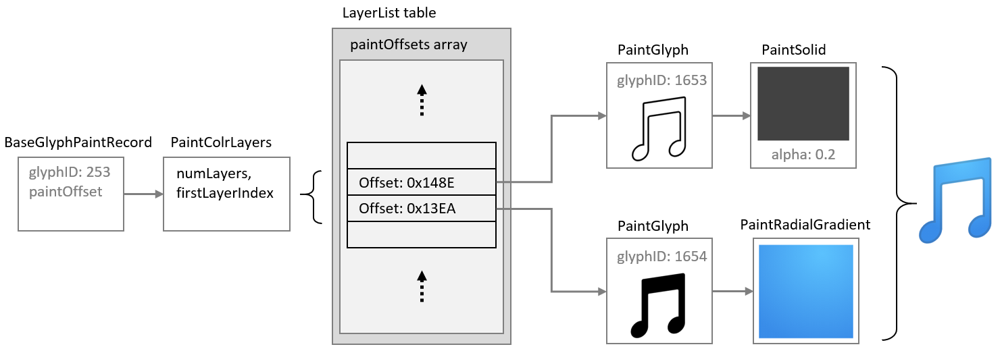<br>*PaintColrLayers table used as the root of a color glyph definition*

A PaintColrLayers table can also be nested more deeply within the graph, providing a layer structure to define some component within a larger color glyph definition. (See [Re-use using PaintColrLayers](#anchor-colr-re-use-using-paintcolrlayers) for more information.) The ability to nest a PaintColrLayers table within a graph creates the potential to introduce a cycle within the graph, which would be invalid (see [Color glyphs as a directed acyclic graph](#anchor-colr-color-glyphs-as-a-directed-acyclic-graph)).

<a id="anchor-colr-transformations"></a>

### Transformations

A 2 × 3 transformation matrix can be used within a color glyph description to apply an affine transformation to a sub-graph. Affine transformations supported by a matrix can be a combination of scale, skew, mirror, rotate, or translate. The transformation is applied to all nested paints in the child sub-graph.

A transformation matrix is specified using a PaintVarTransform or PaintTransform table, with or without variation support, respectively. See [Formats 12 and 13: PaintTransform, PaintVarTransform](#anchor-colr-formats-12-and-13-painttransform-paintvartransform) for format details.

The effect of a transformation is illustrated in the following figure: a PaintTransform is used to specify a rotation, and both the glyph outline and gradient in the sub-graph are rotated.

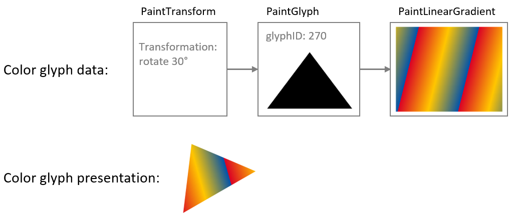<br>*A rotation transformation rotates the fill content defined by the child sub-graph*

If the sub-graph of a transformation table contains another nested transformation table, then the second transformation also applies to its child sub-graph. For the sub-sub-graph, the two transformations are combined. To illustrate this, the example in the previous figure is extended by inserting a mirroring transformation between the PaintGlyph and PaintLinearGradient tables: the glyph outline is rotated as before, but the gradient is mirrored in its (pre-rotation) y-axis as well as being rotated. Notice that both visible elements—the shape and the gradient fill—are affected by the rotation, but only the gradient is affected by the mirroring.

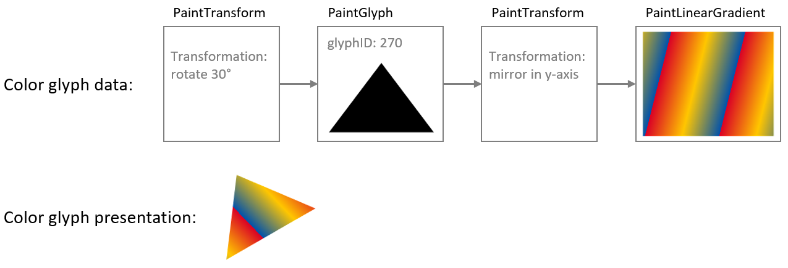<br>*Combined effects of a transformation nested within the child sub-graph of another transformation*

While the PaintTransform and PaintVarTransform tables support several types of transforms, additional paint formats are defined to support specific transformations:

- PaintTranslate and PaintVarTranslate support translation only, without or with variation support. See [Formats 14 and 15: PaintTranslate, PaintVarTranslate](#anchor-colr-formats-14-and-15-painttranslate-paintvartranslate) for format details.
- PaintScale and PaintVarScale support scaling only, without or with variation support. These two formats scale relative to the origin, and allow for different scale factors in X and Y directions. PaintScaleAroundCenter, PaintVarScaleAroundCenter, PaintScaleUniform, PaintVarScaleUniform, PaintScaleUniformAroundCenter, and PaintVarScaleUniformAroundCenter support scaling relative to a different center, scaling uniformly in both X and Y directions, or both. See [Formats 16 to 23: PaintScale and variant scaling formats](#anchor-colr-formats-16-to-23-paintscale-and-variant-scaling-formats) for format details.
- PaintRotate and PaintVarRotate support rotation only, without or with variation support. These two formats rotate around the origin; the PaintRotateAroundCenter and PaintVarRotateAroundCenter formats support rotation around a different center. See [Formats 24 to 27: PaintRotate, PaintVarRotate, PaintRotateAroundCenter, PaintVarRotateAroundCenter](#anchor-colr-formats-24-to-27-paintrotate-paintvarrotate-paintrotate-5f8900c0) for format details.
- PaintSkew and PaintVarSkew support skew only, without or with variation support. These two formats skew using the origin as a center for the skew rotation; the PaintSkewAroundCenter and PaintVarSkewAroundCenter formats support skews using a different center. See [Formats 28 to 31: PaintSkew, PaintVarSkew, PaintSkewAroundCenter, PaintVarSkewAroundCenter](#anchor-colr-formats-28-to-31-paintskew-paintvarskew-paintskewaround-2ff321cc) for format details.

> *Note:* Horizontal mirroring is done by scaling using a scale factor in the x direction of -1. Vertical mirroring is done by scaling with a -1 scale factor in the y direction.

When only one of these specific types of transformation is required, these formats provide a more compact representation than the PaintTransform or PaintVarTransform formats. Another significant difference of the rotation and skew formats is that the rotations and skews are specified as angles, in counter-clockwise degrees.

> *Note:* Specifying the rotation or skew as an angle can have a significant benefit in variable fonts if an angle of skew or rotation needs to vary, since it is easier to implement variation of angles when specified directly rather than as matrix elements. This is because the matrix elements for a rotation or skew are the sine, cosine or tangent of the rotation angle, which do not change in linear proportion to the angle. To achieve a linear variation of rotation using matrix elements would require approximating the variation using multiple delta sets.

The rotations and skews specified using PaintRotate, PaintSkew and their variants can also be representated as a matrix using a PaintTransform or PaintVarTransform table. The behavior for the PaintRotate or PaintSkew formats and their variants must be the same as if the rotation or skew were represented using an equivalent matrix or sequence of matrices. See [Formats 24 to 27: PaintRotate, PaintVarRotate, PaintRotateAroundCenter, PaintVarRotateAroundCenter](#anchor-colr-formats-24-to-27-paintrotate-paintvarrotate-paintrotate-5f8900c0) for details regarding the matrix equivalent for a rotation expressed as an angle; and see [Formats 28 to 31: PaintSkew, PaintVarSkew, PaintSkewAroundCenter, PaintVarSkewAroundCenter](#anchor-colr-formats-28-to-31-paintskew-paintvarskew-paintskewaround-2ff321cc) for similar details in relation to skews.

<a id="anchor-colr-compositing-and-blending"></a>

### Compositing and blending

When a color glyph has overlapping content in two layers, the pixels in the two layers must be combined in some way. If the content in the top layer has full opacity, then normally the pixels from that layer are shown, occluding overlapping pixels from lower layers. If the top layer has some transparency (some portion has alpha less than 1.0), then blending of colors for overlapping pixels occurs by default. The default interaction between layers uses simple alpha compositing, as described in the W3C specification, [Compositing and Blending Level 1](https://www.w3.org/TR/compositing-1/).

A PaintComposite table can be used to get other compositing or blending effects. The PaintComposite table combines content defined by two sub-graphs: a *source* sub-graph; and a destination, or *backdrop*, sub-graph. First, the paint operations for the backdrop sub-graph are executed, then the drawing operations for the source sub-graph are executed and combined with backdrop using a specified compositing or blending mode. Various composition and blending modes are supported. The available modes are given in the CompositionModes enumeration (see [Format 32: PaintComposite](#anchor-colr-format-32-paintcomposite)). The effect and processing rule of each mode are specified in [Compositing and Blending Level 1](https://www.w3.org/TR/compositing-1/).

The available modes fall into two general types: compositing modes, also referred to as “Porter-Duff” modes; and blending modes. In rough terms, the Porter-Duff modes determine how much effect pixels from the source and the backdrop each contribute in the result, while blending modes determine how color values for pixels from the source and backdrop are combined. These are illustrated with examples in the following figures: in each case, red and blue rectangles are the source and backdrop content.

The first figure shows the effect of a Porter-Duff mode, *XOR*, which has the effect that only non-overlapping pixels contribute to the result.

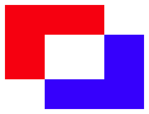<br>*Two content elements combined using the Porter-Duff XOR mode*

The next figure shows the effect of a *lighten* blending mode, which has the effect that the R, G, and B color components for each pixel in the result is the greater of the R, G, and B values from corresponding pixels in the source and backdrop.

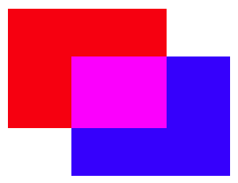<br>*Two content elements combined using the \*lighten\* blending mode*

For complete details on each of the Porter-Duff and blending modes, see the [Compositing and Blending Level 1](https://www.w3.org/TR/compositing-1/) specification.

The following figure illustrates how the PaintComposite table is used in combination with content sub-graphs to implement an alternate compositing effect. The source sub-graph defines a green capital A; the backdrop sub-graph defines a black circle. The compositing mode used is *Source Out*, which has the effect that the source content punches out a hole in the backdrop. (For this mode, the fill color of the source is irrelevant; a black or yellow “A” would have the same effect.) A red rectangle is included as a lower layer to show that the backdrop has been punched out by the source, making that portion of the lower layer visible.

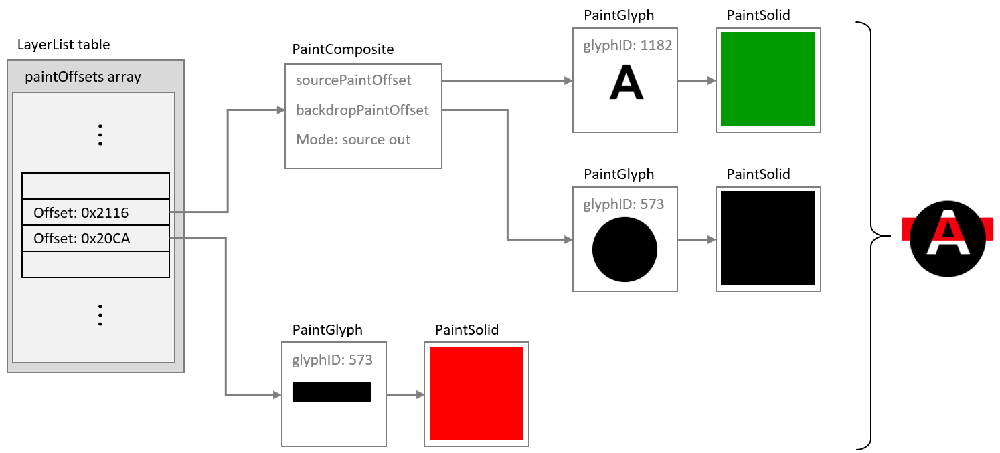<br>*A color glyph using a PaintComposite table to punch out a shape from the fill of a circle*

> *Note:* In the previous figure, the “A” is filled with green to illustrate that the color of the fill has no affect for the *Source Out* composite mode. Because that is the case, the black or red PaintSolid could have been re-used instead of adding a separate PaintSolid table. See [Re-use by referencing shared subtables](#anchor-colr-re-use-by-referencing-shared-subtables) for more information on re-use of paint tables for such situations.

[Scalable Vector Graphics (SVG)](https://www.w3.org/TR/SVG11/) supports alpha channel masking using the \<mask\> element. The same effects can be implemented in COLR version 1 using a PaintComposite table by setting a pattern of alpha values in the source sub-graph and selecting the *Source In* composite mode. This is illustrated in the following figure.

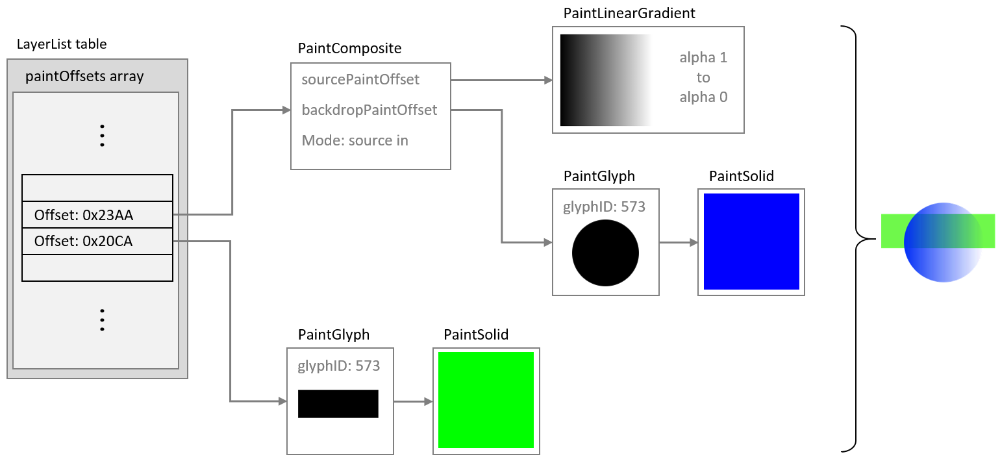<br>*An alpha mask implemented using a PaintComposite table and the \*Source In\* mode*

<a id="anchor-colr-re-usable-components"></a>

### Re-usable components

<a id="anchor-colr-overview-1"></a>

#### Overview

Within a color font, many color glyphs might share components in common. For example, in emoji fonts, many different “smilies” or clock faces share a common background. This can be seen in the following figure, which shows color glyphs for three emoji clock faces.

<br>*Emoji clock faces for 12 o’clock, 1 o’clock and 2 o’clock*

Several components are shared between these color glyphs: the entire face, with a gradient background and dots at the 3, 6, 9 and 12 positions; the minute hand pointing to the 12 position; and the circles in the center. Also, note that the four dots have the same shape and fill, and differ only in their position. In addition, the hour hands have the same shape and fill, and differ only in their orientation.

There are several ways in which elements of a color glyph description can be re-used:

- Reference to shared subtables
- Use of a [PaintColrLayers](#anchor-colr-format-1-paintcolrlayers) table
- Use of a [PaintColrGlyph](#anchor-colr-format-11-paintcolrglyph) table

The PaintColrLayers and PaintColrGlyph table formats create a potential for introducing cycles within the graph of a color glyph, which would be invalid (see [Color glyphs as a directed acyclic graph](#anchor-colr-color-glyphs-as-a-directed-acyclic-graph)).

<a id="anchor-colr-re-use-by-referencing-shared-subtables"></a>

#### Re-use by referencing shared subtables

Several of the paint table formats link to a child paint table using a forward offset within the file:

- PaintGlyph
- PaintComposite
- PaintTransform, PaintVarTransform
- PaintTranslate, PaintVarTranslate
- PaintScale, PaintVarScale, and the other variant scaling paint formats
- PaintRotate, PaintVarRotate, PaintRotateAroundCenter, PaintVarRotateAroundCenter
- PaintSkew, PaintVarSkew, PaintSkewAroundCenter, PaintVarSkewAroundCenter

A child subtable can be shared by several tables of these formats. For example, several PaintGlyph tables might link to the same PaintSolid table, or to the same node for a sub-graph describing a more complex fill. The only limitation is that child paint tables are referenced using a forward offset from the start of the referencing table, so a re-used paint table can only occur later in the file than any of the paint tables that use it.

The clock faces shown in the figure above provide an example of how PaintRotate tables can be combined with re-use of a sub-graph. As noted above, the hour hands have the same shape and fill, but have a different orientation. The glyph outline could point to the 12 position, then in color glyph descriptions for other times, PaintRotate tables could link to the same glyph/fill sub-graph, re-using that component but rotated as needed.

This is illustrated in the following figures. The first shows a sub-graph defining the hour hand, with upright orientation, using a PaintGlyph and a PaintSolid table. Example file offsets for the tables are indicated.

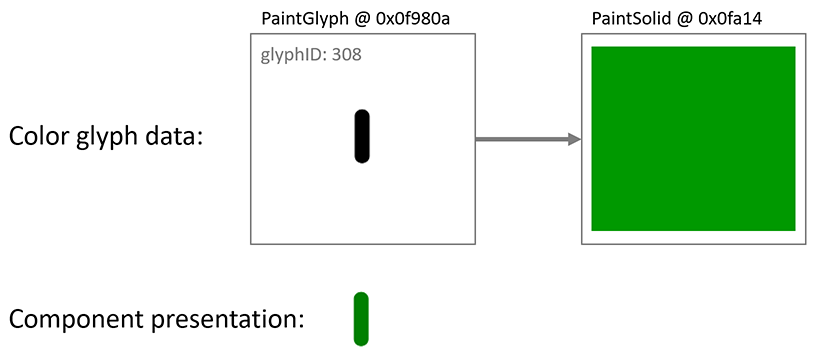<br>*A PaintGlyph and PaintSolid table are used to define the clock hour hand pointing to 12*

The next figure shows this sub-graph of paint tables being re-used, in some cases linked from PaintRotate tables that rotate the hour hand to point to different clock positions as needed. All of the paint tables that reference this sub-graph occur earlier in the file.

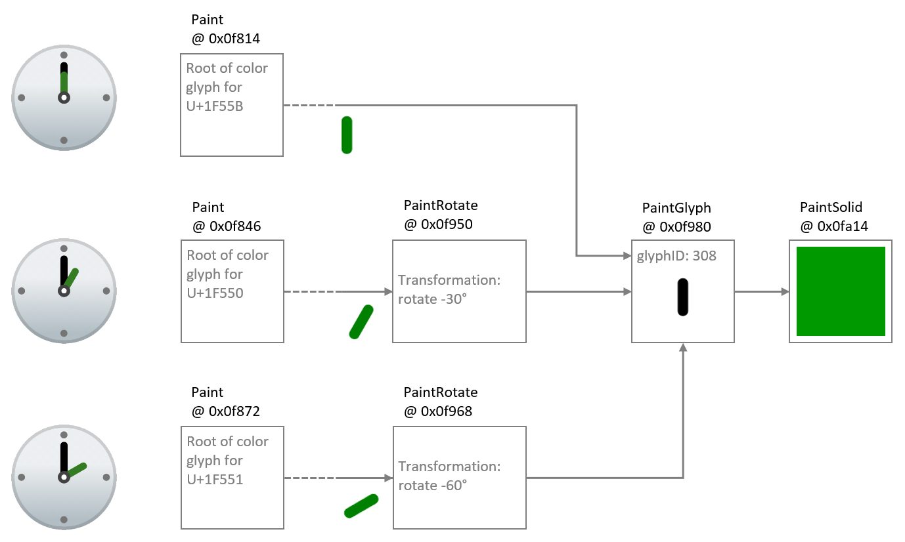<br>*The sub-graph for the hour hand is re-used with PaintRotate tables to point to different hours*

<a id="anchor-colr-re-use-using-paintcolrlayers"></a>

#### Re-use using PaintColrLayers

As described above (see [Layering](#anchor-colr-layering)), a [PaintColrLayers](#anchor-colr-format-1-paintcolrlayers) table defines a set of paint sub-graphs arranged in bottom-up z-order layers, and an example was given of a PaintColrLayers table used as the root of a color glyph definition. A PaintColrLayers table can also be nested more deeply within the graph of a color glyph. One purpose for doing this is to reference a re-usable component defined as a contiguous set of layers in the [LayerList](#anchor-colr-baseglyphlist-layerlist-and-cliplist)) table.

This is readily explained using the clock faces as an example. As described above, each clock face shares several elements in common. Some of these form a contiguous set of layers. Suppose four sub-graphs for shared clock face elements are given in the LayerList as contiguous layers, as shown in the following figure. (For brevity, the visual result for each sub-graph is shown, but not the paint details.)

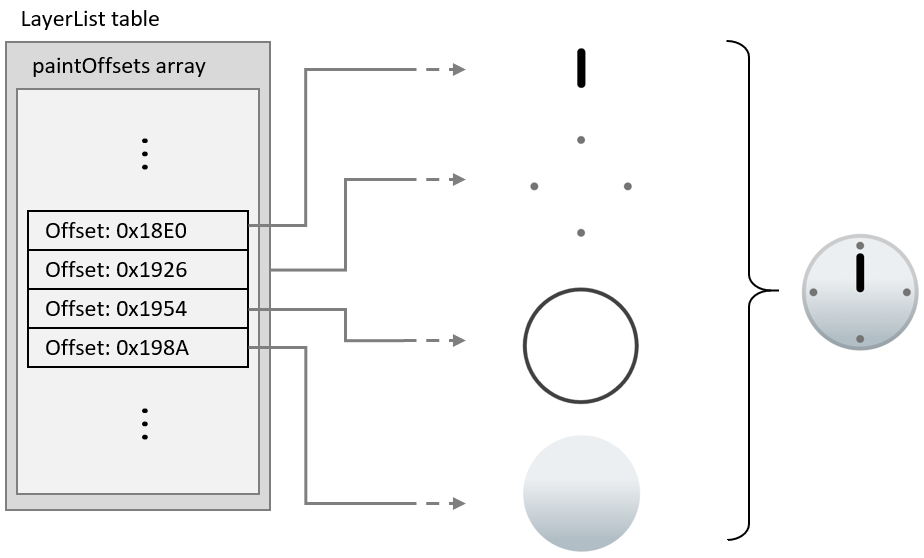<br>*Common clock face elements given as a slice within the LayerList table*

A PaintColrLayers table can reference any contiguous slice of layers in the LayerList table. Thus, the set of layers shown in the previouis figure can be referenced by PaintColrLayers tables anywhere in the graph of any color glyph. In this way, this set of layers can be re-used in multiple clock face color glyph definitions.

This is illustrated in the following figure: The color glyph definition for the one o’clock emoji has a PaintColrLayers table as its root, referencing a slice of three layers in the LayerList table. The upper two layers are the hour hand, which is specific to this color glyph; and the cap over the pivot for the minute and hour hands, which is common to other clock emoji but in a layer that is not contiguous with other common layers. The bottom layer of these three layers is the composition for all the remaining common layers. It is represented using a nested PaintColrLayers table that references the slice within the LayerList for the common clock face elements shown in the previous figure.

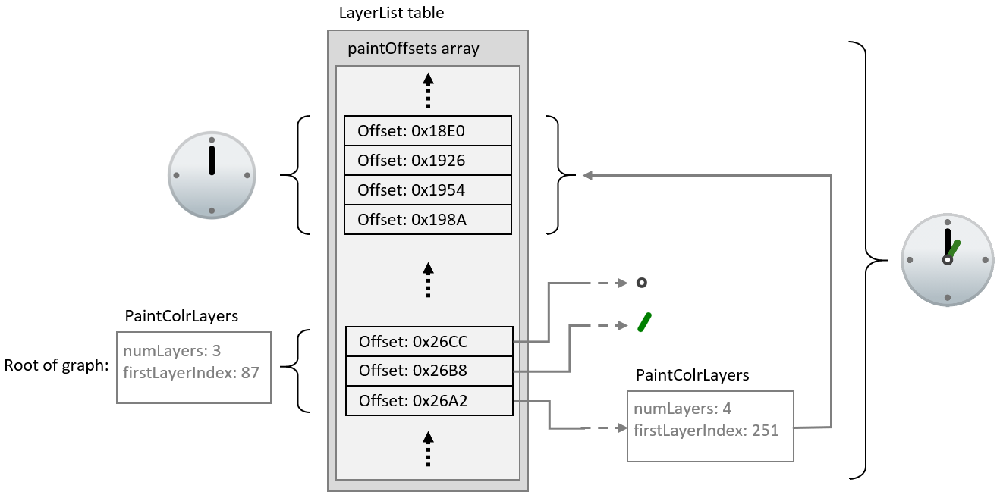<br>*A PaintColrLayers table is used to reference a set of layers that define a shared clock face composition*

The color glyphs for other clock face emoji could be structured in exactly the same way, using a nested PaintColrLayers table to re-use the layer composition of the common clock face elements.

<a id="anchor-colr-re-use-using-paintcolrglyph"></a>

#### Re-use using PaintColrGlyph

A third way to re-use components in color glyph definitions is to use a nested [PaintColrGlyph](#anchor-colr-format-11-paintcolrglyph) table. This format references a base glyph ID, which is used to access a corresponding [BaseGlyphPaintRecord](#anchor-colr-baseglyphlist-layerlist-and-cliplist). That record will provide the offset of a paint table that is the root of a graph for a color glyph definition. That graph can potentially be used as an independent color glyph, but it can also define a shared composition that gets re-used in multiple color glyphs. Each time the shared composition is to be re-used, it is referenced by its base glyph ID using a PaintColrGlyph table. The graph of the referenced color glyph is thereby incorporated into the graph of the PaintColrGlyph table as its child sub-graph.

When a PaintColrGlyph table is used, a BaseGlyphPaintRecord with the specified glyph ID is expected. If no BaseGlyphPaintRecord with that glyph ID is found, the color glyph is not well formed. See [Color glyphs as a directed acyclic graph](#anchor-colr-color-glyphs-as-a-directed-acyclic-graph) for details regarding well-formedness and validity of the graph.

The example from the previous section is modified to illustrate use of a PaintColrGlyph table. In the following figure, a PaintColrLayers table references a slice within the LayerList that defines the shared component. Now, however, this PaintColrLayers table is treated as the root of a color glyph definition for base glyph ID 63163. The color glyph for the one o’clock emoji is defined with three layers, as before, but now the bottom layer uses a PaintColrGlyph table that references the color glyph definition for glyph ID 63163.

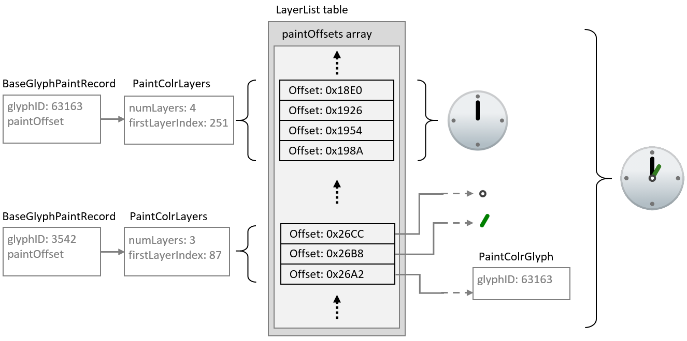<br>*A PaintColrGlyph table is used to reference the shared clock face composition via a glyph ID*

While the PaintColrGlyph and PaintColrLayers tables are similar in being able to reference a layer set as a re-usable component, they could be handled differently in implementations. In particular, an implementation could process and cache the result of the color glyph description for a given base glyph ID. In that case, subsequent references to that base glyph ID using a PaintColrGlyph table would not require the corresponding graph of paint tables to be re-processed. As a result, using a PaintColrGlyph for re-used graphic components could provide performance benefits.

<a id="anchor-colr-glyph-metrics-and-boundedness"></a>

### Glyph metrics and boundedness

<a id="anchor-colr-metrics-for-color-glyphs-using-version-0-formats"></a>

#### Metrics for color glyphs using version 0 formats

For color glyphs using version 0 formats, the advance width of glyphs used for each layer must be the same as the advance width of the base glyph. If the font has vertical metrics, the glyphs used for each layer must also have the same advance height and vertical Y origin as the base glyph.

<a id="anchor-colr-metrics-and-boundedness-of-color-glyphs-using-version-1-formats"></a>

#### Metrics and boundedness of color glyphs using version 1 formats

For color glyphs using version 1 formats, the advance width of the base glyph must be used as the advance width for the color glyph. If the font has vertical metrics, the advance height and vertical Y origin of the base glyph must be used for the color glyph. The advance width and height of glyphs referenced by PaintGlyph tables are not required to be the same as that of the base glyph and are ignored.

A valid color glyph definition must define a bounded region—that is, it must paint within a region for which a finite bounding box could be defined. A clip box can be specified to set overall bounds for a color glyph (see below). Otherwise, boundedness is determined by the graph of paint tables that describe the color glyph content. The different paint formats have different boundedness characteristics:

- PaintGlyph is inherently bounded.
- PaintSolid, PaintVarSolid, PaintLinearGradient, PaintVarLinearGradient, PaintRadialGradient, PaintVarRadialGradient, PaintSweepGradient, and PaintVarSweepGradient are inherently unbounded.
- PaintColrLayers is bounded *if and only if* all referenced sub-graphs are bounded.
- PaintColrGlyph is bounded *if and only if* the color glyph definition for the referenced base glyph ID is bounded.
- Paint formats for transformations (PaintTransform, PaintVarTransform, PaintTranslate, PaintScale, etc.) are bounded *if and only if* the referenced sub-graph is bounded.
- PaintComposite is either bounded or unbounded, according to the composite mode used and the boundedness of the referenced sub-graphs. See [Format 32: PaintComposite](#anchor-colr-format-32-paintcomposite) for details.

A [ClipBox table](#anchor-colr-baseglyphlist-layerlist-and-cliplist) may be associated with a color glyph to define an overall bounds for the color glyph. The clip box may vary in a variable font. If a clip box is provided for a color glyph, the color glyph is bounded, and no inspection of the Paint graph is required to determine boundedness. If no clip box is defined for a color glyph, however, applications must confirm that the color glyph definition is bounded, and must not render the color glyph if the defining graph is not bounded.

> *Note:* If present, the clip box for a color glyph can be used to allocate a drawing surface without needing to traverse the graph of the color glyph definition.

> *Note:* If no ClipBox table is present but a bounding box is required by the implementation, it can be computed for a given color glyph by traversing the graph of Paint tables that defines that color glyph.

To ensure that rendering implementations do not clip any part of a color glyph, the clip box needs to be large enough to encompass the entire color glyph composition. In a variable font, glyph outlines can vary, but transformations in a color glyph description can also vary, affecting the portions of the design grid to be painted. For example, a filled rectangle that is wide but not tall for one variation instance can be variably rotated to be tall but not wide for other instances. The clip box either should be large enough to encompass the color glyph for all instances, or should itself vary such that each instance of the clip box encompasses the instance color glyph.

<a id="anchor-colr-color-glyphs-as-a-directed-acyclic-graph"></a>

### Color glyphs as a directed acyclic graph

When using version 1 formats, a color glyph is defined by a directed, acyclic graph of linked paint tables. For each [BaseGlyphPaintRecord](#anchor-colr-baseglyphlist-layerlist-and-cliplist), the paint table referenced by that record is the root of a graph defining a color glyph composition.

The graph for a given color glyph is made up of all paint tables reachable from the BaseGlyphPaintRecord. The BaseGlyphPaintRecord and several paint table formats use direct links; that is, they include a forward offset to a paint subtable. Two paint formats make indirect links:

- A [PaintColrLayers](#anchor-colr-format-1-paintcolrlayers) table references a slice of offsets within the [LayerList](#anchor-colr-baseglyphlist-layerlist-and-cliplist). The paint tables referenced by those offsets are considered to be linked within the graph as children of the PaintColrLayers table.
- A [PaintColrGlyph](#anchor-colr-format-11-paintcolrglyph) table references a base glyph ID, for which a corresponding BaseGlyphPaintRecord is expected. That record points to the root of a graph that is a complete color glyph definition on its own. But when referenced in this way by a PaintColrGlyph table, that entire graph is considered to be a child sub-graph of the PaintColrGlyph table, and a continuation of the graph of which the PaintColrGlyph table is a part.

The graph for a color glyph is a combination of paint tables using any of the paint table formats. The simplest color glyph definition would consist of a PaintGlyph table linked to a basic fill table (PaintSolid, PaintVarSolid, PaintLinearGradient, PaintVarLinearGradient, PaintRadialGradient, PaintVarRadialGradient, PaintSweepGradient, PaintVarSweepGradient). But the graph can be arbitrarily complex, with an arbitrary depth of paint nodes (to the limits inherent in the formats).

The graph can define a visual element in a single layer, or many elements in many layers. The concept of layers, as distinct visual elements stacked in a z-order, is not precisely defined in relation to the complexity of the graph. Each separate visual element requires a leaf node, but nodes in the graph, including leaf nodes, can be re-used (see [Re-usable components](#anchor-colr-re-usable-components)). Also, each separate visual element requires a fork in the graph, and a separate root-to-leaf path, but not all paths necessarily result in a distinct visual element. For example, a gradient mask effect can be created with a gradient with gradation of alpha values, and then using that as the source of a [PaintComposite](#anchor-colr-format-32-paintcomposite) table with the *Source In* compositing mode. In that case, the leaf has a visual affect but does not result in a distinct visual element. This was illustrated in an earlier figure, repeated here: the PaintLinearGradient is a leaf node in the graph and creates a masking effect but does not add a distinct visual element.

<br>*Graph with a leaf node that isn’t a distinct visual element*

Thus, the generalization that can be made regarding the relationship between the number of layers and the nature of the graph is that the number of distinct root-to-leaf paths will be greater than or equal to the number of layers.

The following are necessary for the graph to be well-formed and valid:

- All subtable links must satisfy the following criteria:

  - Forward offsets are within the COLR table bounds.
  - If a PaintColrLayers table is present, then a LayerList is also present, and the referenced slice is within the length of the LayerList.
  - If a PaintColrGlyph table is present, there is a BaseGlyphPaintRecord for the referenced base glyph ID.

- The graph must be acyclic.

> *Note:* These constraints imply that all leaf nodes will be one of PaintSolid, PaintVarSolid, PaintLinearGradient, PaintVarLinearGradient, PaintRadialGradient, PaintVarRadialGradient, PaintSweepGradient, or PaintVarSweepGradient.

For the graph to be acyclic, no paint table may have any child or descendent paint table that is also its parent or ancestor within the graph. In particular, because the PaintColrLayers and PaintColrGlyph tables use indirect child references rather than forward offsets, they provide a possibility for introducing cycles. Applications should track paint tables within a path in the graph, checking whether any paint table was already encountered within that path. The following pseudo-code algorithm can be used:

```c
    // called initially with the root paint and an empty set pathPaints
    function paintIsAcyclic(paint, pathPaints)
        if paint is in pathPaints
          return false // cycle detected
        add paint to pathPaints
        for each childPaint referenced by paint as a child subtable
          call paintIsAcyclic(childPaint, pathPaints)
        remove paint from pathPaints
```

For the graph to be valid, it must also be visually bounded, as described above (see [Metrics and boundedness of color glyphs using version 1 formats](#anchor-colr-metrics-and-boundedness-of-color-glyphs-using-version-1-formats)).

> *Note:* Implementations can combine testing for cycles and other well-formedness or validity requirements together with other processing for rendering the color glyph.

If the graph contains a cycle or is otherwise not well-formed or valid, the paint table at which the error occurs should be ignored, that sub-graph should not be rendered, and that node in the graph should be considered to be visually bounded. The application should attempt to render the remainder of the graph, if well-formed and valid.

Future minor version updates of the COLR table could introduce new paint formats. If a paint table with an unrecognized format is encountered, it and its sub-graph should similarly be ignored, the node should be considered to be visually bounded, and the application should attempt to render the remainder of the graph.

If an application is not able to recover from errors while traversing the graph, it may ignore the color glyph entirely. If the base glyph ID has an outline, that may be rendered as a non-color glyph instead.

<a id="anchor-colr-colr-table-formats"></a>

## COLR table formats

<a id="anchor-colr-overview-2"></a>

### Overview

Various table and record formats are defined for COLR version 0 and version 1.

Several values contained within the version 1 formats are variable. For items that vary in a variable font, the variation data is contained in an [ItemVariationStore table](otvarcommonformats.md#anchor-otvarcommonformats-item-variation-store). To associate each variable item with the corresponding variation data, a DeltaSetIndexMap table is used. Within a given table that has variable items, a base/sequence scheme is used to index into the mapping data. See [COLR table and OpenType Font Variations](#anchor-colr-colr-table-and-opentype-font-variations) for details.

Future minor version updates of the COLR table could introduce new formats that extend the capabilities for color glyph descriptions using version 1 formats. Unrecognized formats should be ignored. See [Color glyphs as a directed acyclic graph](#anchor-colr-color-glyphs-as-a-directed-acyclic-graph) for more information.

<a id="anchor-colr-colr-header"></a>

### COLR header

<a id="anchor-colr-header"></a>

The COLR table begins with a header. Two versions have been defined.

<a id="anchor-colr-colr_v0"></a>

*COLR version 0:*

| Type | Name | Description |
| --- | --- | --- |
| <a id="anchor-colr-version"></a>uint16 | version | Table version number—set to 0. |
| <a id="anchor-colr-numBaseGlyphRecs"></a>uint16 | numBaseGlyphRecords | Number of BaseGlyph records. |
| <a id="anchor-colr-baseGlyphRecordsOffset"></a>Offset32 | baseGlyphRecordsOffset | Offset to baseGlyphRecords array, from beginning of COLR table. |
| <a id="anchor-colr-layerRecordsOffset"></a>Offset32 | layerRecordsOffset | Offset to layerRecords array, from beginning of COLR table. |
| <a id="anchor-colr-numLayerRecords"></a>uint16 | numLayerRecords | Number of Layer records. |

> *Note:* For fonts that use COLR version 0, some early Windows implementations of the COLR table require glyph ID 1 to be the .null glyph.

<a id="anchor-colr-colr_v1"></a>

*COLR version 1:*

| Type | Name | Description |
| --- | --- | --- |
| uint16 | version | Table version number—set to 1. |
| uint16 | numBaseGlyphRecords | Number of BaseGlyph records; may be 0 in a version 1 table. |
| Offset32 | baseGlyphRecordsOffset | Offset to baseGlyphRecords array, from beginning of COLR table (may be NULL). |
| Offset32 | layerRecordsOffset | Offset to layerRecords array, from beginning of COLR table (may be NULL). |
| uint16 | numLayerRecords | Number of Layer records; may be 0 in a version 1 table. |
| Offset32 | baseGlyphListOffset | Offset to BaseGlyphList table, from beginning of COLR table. |
| Offset32 | layerListOffset | Offset to LayerList table, from beginning of COLR table (may be NULL). |
| Offset32 | clipListOffset | Offset to ClipList table, from beginning of COLR table (may be NULL). |
| Offset32 | varIndexMapOffset | Offset to DeltaSetIndexMap table, from beginning of COLR table (may be NULL). |
| Offset32 | itemVariationStoreOffset | Offset to ItemVariationStore, from beginning of COLR table (may be NULL). |

The BaseGlyphList and its subtables are only used in COLR version 1.

The LayerList is only used in conjunction with the BaseGlyphList and, specifically, with [PaintColrLayers](#anchor-colr-format-1-paintcolrlayers) tables; it is not required if no color glyphs use a PaintColrLayers table. If not used, set layerListOffset to NULL.

The ClipList is only used in conjunction with the BaseGlyphList. If not used, set clipListOffset to NULL.

The [ItemVariationStore](otvarcommonformats.md#anchor-otvarcommonformats-item-variation-store) is used in conjunction with a BaseGlyphList and its subtables, but only in variable fonts. If it is not used, set itemVariationStoreOffset to NULL.

The DeltaSetIndexMap table is described in the OpenType Variations Common Table Formats chapter—see [Associating Target Items to Variation Data](otvarcommonformats.md#anchor-otvarcommonformats-associating-target-items-to-variation-data). Within the COLR table, either format 0 or format 1 of the DeltaSetIndexMap can be used. A DeltaSetIndexMap is used in conjunction with the ItemVariationStore in a variable font. The DeltaSetIndexMap is optional: if an ItemVariationStore is present but a DeltaSetIndexMap is not included (varIndexMapOffset is NULL), then an implicit mapping is used. See [COLR table and OpenType Font Variations](#anchor-colr-colr-table-and-opentype-font-variations) for details.

<a id="anchor-colr-mixing-version-0-and-version-1-formats"></a>

#### Mixing version 0 and version 1 formats

A font that uses COLR version 1 and that includes a BaseGlyphList can also include BaseGlyph and Layer records for compatibility with applications that only support COLR version 0.

Color glyphs that can be implemented in COLR version 0 using BaseGlyph and Layer records can also be implemented using the version 1 BaseGlyphList and subtables. Thus, a font that uses the version 1 formats does not need to use the version 0 BaseGlyph and Layer records. However, a font may use the version 1 structures for some base glyphs and the version 0 structures for other base glyphs. A font may also include a version 1 color glyph definition for a given base glyph ID that is equivalent to a version 0 definition, though this should never be needed.

A font may define a color glyph for a given base glyph ID using version 0 formats, and also define a different color glyph for the same base glyph ID using version 1 formats. Applications that support COLR version 1 should give preference to the version 1 color glyph.

For applications that support COLR version 1, the application should search for a base glyph ID first in the BaseGlyphList. Then, if not found, search in the baseGlyphRecords array, if present.

<a id="anchor-colr-baseglyph-and-layer-records"></a>

### BaseGlyph and Layer records

BaseGlyph and Layer records are required for COLR version 0, but optional for version 1. (See [Mixing version 0 and version 1 formats](#anchor-colr-mixing-version-0-and-version-1-formats).)

A BaseGlyph record is used to map a base glyph to a sequence of layer records that define the corresponding color glyph. The BaseGlyph record includes a base glyph index, an index into the layerRecords array, and the number of layers.

*BaseGlyph record:*

| Type | Name | Description |
| --- | --- | --- |
| <a id="anchor-colr-gID_bgr"></a>uint16 | glyphID | Glyph ID of the base glyph. |
| <a id="anchor-colr-firstLayerIndex"></a>uint16 | firstLayerIndex | Index (base 0) into the layerRecords array. |
| <a id="anchor-colr-numLayers"></a>uint16 | numLayers | Number of color layers associated with this glyph. |

The glyph ID must be less than the numGlyphs value in the ['maxp'](maxp.md) table.

The BaseGlyph records must be sorted in increasing glyphID order. It is assumed that a binary search can be used to find a matching BaseGlyph record for a specific glyphID.

The color glyph for a given base glyph is defined by the consecutive records in the layerRecords array for the specified number of layers, starting with the record indicated by firstLayerIndex. The first record in this sequence is the bottom layer in the z-order, and each subsequent layer is stacked on top of the previous layer.

The layer record sequences for two different base glyphs may overlap, with some layer records used in multiple color glyph definitions.

<a id="anchor-colr-layerRecord"></a>

The Layer record specifies the glyph used as the graphic element for a layer and the solid color fill.

*Layer record:*

| Type | Name | Description |
| --- | --- | --- |
| <a id="anchor-colr-gID_lr"></a>uint16 | glyphID | Glyph ID of the glyph used for a given layer. |
| <a id="anchor-colr-paletteIndex"></a>uint16 | paletteIndex | Index (base 0) for a palette entry in the CPAL table. |

The glyphID in a Layer record must be less than the numGlyphs value in the ['maxp'](maxp.md) table. That is, it must be a valid glyph with outline data in the ['glyf'](glyf.md), ['CFF '](cff.md) or [CFF2](cff2.md) table. See [Metrics and boundedness of color glyphs using version 1 formats](#anchor-colr-metrics-and-boundedness-of-color-glyphs-using-version-1-formats) for requirements regarding glyph metrics of referenced glyphs.

The paletteIndex value must be less than the numPaletteEntries value in the [CPAL](cpal.md) table. A paletteIndex value of 0xFFFF is a special case, indicating that the text foreground color (as determined by the application) is to be used.

<a id="anchor-colr-baseglyphlist-layerlist-and-cliplist"></a>

### BaseGlyphList, LayerList and ClipList

The BaseGlyphList table is, conceptually, similar to the baseGlyphRecords array in COLR version 0, providing records that map a base glyph to a color glyph definition. The color glyph definitions that each refer to are significantly different, however—see [Graphic Compositions](#anchor-colr-graphic-compositions).

*BaseGlyphList table:*

| Type | Name | Description |
| --- | --- | --- |
| uint32 | numBaseGlyphPaintRecords |  |
| BaseGlyphPaintRecord | baseGlyphPaintRecords\[numBaseGlyphPaintRecords\] |  |

*BaseGlyphPaintRecord:*

| Type | Name | Description |
| --- | --- | --- |
| uint16 | glyphID | Glyph ID of the base glyph. |
| Offset32 | paintOffset | Offset to a Paint table, from beginning of BaseGlyphList table. |

The glyphID value must be less than the numGlyphs value in the ['maxp'](maxp.md) table.

The records in the baseGlyphPaintRecords array must be sorted in increasing glyphID order. It is intended that a binary search can be used to find a matching BaseGlyphPaintRecord for a specific glyphID.

The paint table referenced by the BaseGlyphPaintRecord is the root of the graph for a color glyph definition.

> *Note:* Often the paint table that is the root of the graph for the color glyph definition will be a [PaintColrLayers](#anchor-colr-format-1-paintcolrlayers) table, though this is not required. See [Color glyphs as a directed acyclic graph](#anchor-colr-color-glyphs-as-a-directed-acyclic-graph) for more information regarding the graph of a color glyph, and [Layering](#anchor-colr-layering) for background information regarding the PaintColrLayers table.

A LayerList table is used in conjunction with PaintColrLayers tables to represent layer structures. A single LayerList is defined and can be used by multiple PaintColrLayer tables, each of which references a slice of the layer list.

*LayerList table:*

| Type | Name | Description |
| --- | --- | --- |
| uint32 | numLayers |  |
| Offset32 | paintOffsets\[numLayers\] | Offsets to Paint tables, from beginning of LayerList table. |

The sequence of offsets to paint tables corresponds to a bottom-up z-order layering of the graphic compositions defined by the sub-graph of each referenced paint table graph. For a given slice of the list, the sub-graph of the first paint table defines the element at the bottom of the z-order, and the sub-graph of each subsequent paint table defines an element that is layered on top of the previous element. As each element is a composition defined in a sub-graph, one of these elements may itself be multi-layered. In that case, the layers of this element are stacked above all previous layers, and layers of following elements are stacked above the top layer of this element.

Offsets for paint tables not referenced by any PaintColrLayers table should not be included in the paintOffsets array.

A ClipList table is used to provide precomputed clip boxes for color glyphs. It contains an array of Clip records, each of which associates a range of base glyph IDs with a ClipBox table. The ClipBox table provides a precomputed clip box for the associated color glyphs. Clip boxes are optional: a font may provide clip boxes for some color glyphs but not others.

*ClipList table:*

| Type | Name | Description |
| --- | --- | --- |
| uint8 | format | Set to 1. |
| uint32 | numClips | Number of Clip records. |
| Clip | clips\[numClips\] | Clip records. Sorted by startGlyphID. |

*Clip record:*

| Type | Name | Description |
| --- | --- | --- |
| uint16 | startGlyphID | First glyph ID in the range. |
| uint16 | endGlyphID | Last glyph ID in the range. |
| Offset24 | clipBoxOffset | Offset to a ClipBox table, from beginning of ClipList table. |

Within a ClipList table, the glyph ID ranges of Clip records must not overlap.

Two Clipbox table formats are defined: format 1 for clip boxes without variation, and format 2 allowing for clip boxes that can vary in a variable font.

*ClipBoxFormat1 table, static clip box:*

| Type | Name | Description |
| --- | --- | --- |
| uint8 | format | Set to 1. |
| FWORD | xMin | Minimum x of clip box. |
| FWORD | yMin | Minimum y of clip box. |
| FWORD | xMax | Maximum x of clip box. |
| FWORD | yMax | Maximum y of clip box. |

*ClipBoxFormat2 table, variable clip box:*

| Type | Name | Description |
| --- | --- | --- |
| uint8 | format | Set to 2. |
| FWORD | xMin | Minimum x of clip box. For variation, use varIndexBase + 0. |
| FWORD | yMin | Minimum y of clip box. For variation, use varIndexBase + 1. |
| FWORD | xMax | Maximum x of clip box. For variation, use varIndexBase + 2. |
| FWORD | yMax | Maximum y of clip box. For variation, use varIndexBase + 3. |
| uint32 | varIndexBase | Base index into DeltaSetIndexMap. |

Any content drawn outside the clip box must not render.

The clip box is not required to be a tight bounding box around the content. As it may be used by implementations to allocate resources, however, it should not be unnecessarily large.

> *Note:* At runtime, when computing a variable ClipBox, compute the min/max coordinates using floating-point values and then round to integer values such that the clip box expands. That is, round xMin and yMin towards negative infinity and round xMax and yMax towards positive infinity.

For variable data, a base/sequence scheme is used to index into variation mapping data. See [COLR table and OpenType Font Variations](#anchor-colr-colr-table-and-opentype-font-variations) for details.

<a id="anchor-colr-color-references-colorstop-and-colorline"></a>

### Color references, ColorStop and ColorLine

Colors are used in solid color fills for graphic elements, or as *stops* in a color line used to define a gradient. Colors are defined by reference to palette entries in the [CPAL](cpal.md) table. While CPAL entries include an alpha component, formats for COLR version 1 that reference palette entries also includes a separate alpha specification to allow different graphic elements to use the same color but with different alpha values, and to allow for variation of the alpha in variable fonts.

A paletteIndex value of 0xFFFF is a special case, indicating that the text foreground color (as determined by the application) is to be used.

The alpha value is always set explicitly. Values for alpha outside the range \[0., 1.\] (inclusive) are reserved; values outside this range must be clamped. A value of zero means no opacity (fully transparent); 1.0 means fully opaque (no transparency). The alpha indicated in this record is multiplied with the alpha component of the CPAL entry (converted to float—divide by 255). Note that the resulting alpha value can be combined with and does not supersede alpha or opacity attributes set in higher-level, application-defined contexts.

See [Colors and solid color fills](#anchor-colr-colors-and-solid-color-fills) for more information regarding color references and solid color fills. Solid color fills are defined using a PaintSolid or PaintVarSolid table, described below—see [Formats 2 and 3: PaintSolid, PaintVarSolid](#anchor-colr-formats-2-and-3-paintsolid-paintvarsolid).

Gradients are defined using a color line. A color line is a mapping of real numbers to color values, defined using color stops. See [Color line](#anchor-colr-color-lines), above, for an overview and additional details.

Two color-stop record formats are defined: one that allows for variation of stop offset position or of alpha, and one that does not.

*ColorStop record:*

| Type | Name | Description |
| --- | --- | --- |
| F2DOT14 | stopOffset | Position on a color line. |
| uint16 | paletteIndex | Index for a CPAL palette entry. |
| F2DOT14 | alpha | Alpha value. |

*VarColorStop record:*

| Type | Name | Description |
| --- | --- | --- |
| F2DOT14 | stopOffset | Position on a color line. For variation, use varIndexBase + 0. |
| uint16 | paletteIndex | Index for a CPAL palette entry. |
| F2DOT14 | alpha | Alpha value. For variation, use varIndexBase + 1. |
| uint32 | varIndexBase | Base index into DeltaSetIndexMap. |

The VarColorStop format uses a base/sequence scheme to index into mapping data. Also, applying variation deltas to an F2DOT14 value requires special handling. See [COLR table and OpenType Font Variations](#anchor-colr-colr-table-and-opentype-font-variations) for details.

A color line is defined by an array of color stop records plus an extend mode.

Two color-line table formats are defined: one that allows for variation of color stop offsets positions or of alpha values, and one that does not. Different paint table formats for gradients use one or the other of the color line formats.

*ColorLine table:*

| Type | Name | Description |
| --- | --- | --- |
| uint8 | extend | An Extend enum value. |
| uint16 | numStops | Number of ColorStop records. |
| ColorStop | colorStops\[numStops\] |  |

*VarColorLine table:*

| Type | Name | Description |
| --- | --- | --- |
| uint8 | extend | An Extend enum value. |
| uint16 | numStops | Number of ColorStop records. |
| VarColorStop | colorStops\[numStops\] | Allows for variations. |

Applications must apply the colorStops entries in increasing stopOffset order. Within a variable font, the stopOffset values can vary, and the relative orderings of color stop records along the color line can change as a result of variation. With a variable font, the colorStops entries must be ordered after the instance values for the stop offsets have been derived.

A color line defines stops for only certain positions along the line, but the color line extends infinitely in either direction. The extend field is used to indicate how the color line is extended. The same behavior is used for extension in both directions. The extend field uses the following enumeration:

*Extend enumeration:*

| Value | Name | Description |
| --- | --- | --- |
| 0 | EXTEND\_PAD | Use nearest color stop. |
| 1 | EXTEND\_REPEAT | Repeat from farthest color stop. |
| 2 | EXTEND\_REFLECT | Mirror color line from nearest end. |

The extend mode behaviors are described in detail above—see [Color lines](#anchor-colr-color-lines). If a ColorLine in a font has an unrecognized extend value, applications should use EXTEND\_PAD by default.

<a id="anchor-colr-paint-tables"></a>

### Paint tables

Paint tables are used for COLR version 1 color glyph definitions. Thirty-two paint table formats are defined (formats 1 to 32). Some formats come in non-variable and variable pairs, but otherwise, each provides different graphic capability for defining the composition for a color glyph. The graphic capability of each format and the manner in which they are combined to represent a color glyph has been described above—see [Graphic Compositions](#anchor-colr-graphic-compositions).

Each paint table format has a one-byte format field as the first field. When parsing font data, the format field can be read first to determine the format of the table.

<a id="anchor-colr-format-1-paintcolrlayers"></a>

#### Format 1: PaintColrLayers

Format 1 is used to define a vector of layers. The layers are a slice of layers from the LayerList table. The first layer is the bottom of the z-order, and subsequent layers are composited on top using the COMPOSITE\_SRC\_OVER composition mode (see [Format 32: PaintComposite](#anchor-colr-format-32-paintcomposite)).

For general information on the PaintColrLayers table, see [Layering](#anchor-colr-layering). For information about its use for shared, re-usable components, see [Re-use using PaintColrLayers](#anchor-colr-re-use-using-paintcolrlayers).

*PaintColrLayers table (format 1):*

| Type | Name | Description |
| --- | --- | --- |
| uint8 | format | Set to 1. |
| uint8 | numLayers | Number of offsets to paint tables to read from LayerList. |
| uint32 | firstLayerIndex | Index (base 0) into the LayerList. |

> *Note:* An 8-bit value is used for numLayers to minimize size for common scenarios. If more than 256 layers are needed, then two or more PaintColrLayers tables can be combined in a tree using a PaintComposite table or another PaintColrLayers table to combine them.

<a id="anchor-colr-formats-2-and-3-paintsolid-paintvarsolid"></a>

#### Formats 2 and 3: PaintSolid, PaintVarSolid

Formats 2 and 3 are used to specify a solid color fill. Format 3 allows for variation of alpha in a variable font; format 2 provides a more compact representation when variation is not required. Format 3 must not be used in non-variable fonts or if the COLR table does not have an ItemVariationStore subtable.

For general information about specifying color values, see [Colors and solid color fills](#anchor-colr-colors-and-solid-color-fills). For information about applying a fill to a shape, see [Filling shapes](#anchor-colr-filling-shapes).

*PaintSolid table (format 2):*

| Type | Name | Description |
| --- | --- | --- |
| uint8 | format | Set to 2. |
| uint16 | paletteIndex | Index for a CPAL palette entry. |
| F2DOT14 | alpha | Alpha value. |

*PaintVarSolid table (format 3):*

| Type | Name | Description |
| --- | --- | --- |
| uint8 | format | Set to 3. |
| uint16 | paletteIndex | Index for a CPAL palette entry. |
| F2DOT14 | alpha | Alpha value. For variation, use varIndexBase + 0. |
| uint32 | varIndexBase | Base index into DeltaSetIndexMap. |

The PaintVarSolid format uses a base/sequence scheme to index into mapping data. Also, applying variation deltas to an F2DOT14 value requires special handling. See [COLR table and OpenType Font Variations](#anchor-colr-colr-table-and-opentype-font-variations) for details.

<a id="anchor-colr-formats-4-and-5-paintlineargradient-paintvarlineargradient"></a>

#### Formats 4 and 5: PaintLinearGradient, PaintVarLinearGradient

Formats 4 and 5 are used to specify a linear gradient fill. Format 5 allows for variation of color stop positions or of alpha in a variable font; format 4 provides a more compact representation when variation is not required. Format 5 must not be used in non-variable fonts or if the COLR table does not have an ItemVariationStore subtable.

For general information about linear gradients, see [Linear gradients](#anchor-colr-linear-gradients). For information about applying a fill to a shape, see [Filling shapes](#anchor-colr-filling-shapes).

The PaintLinearGradient and PaintVarLinearGradient tables have a ColorLine and VarColorLine subtable, respectively. For the ColorLine and VarColorLine table formats, see [Color references, ColorStop and ColorLine](#anchor-colr-color-references-colorstop-and-colorline). For background information on the color line, see [Color lines](#anchor-colr-color-lines).

*PaintLinearGradient table (format 4):*

| Type | Name | Description |
| --- | --- | --- |
| uint8 | format | Set to 4. |
| Offset24 | colorLineOffset | Offset to ColorLine table, from beginning of PaintLinearGradient table. |
| FWORD | x0 | Start point (p₀) x coordinate. |
| FWORD | y0 | Start point (p₀) y coordinate. |
| FWORD | x1 | End point (p₁) x coordinate. |
| FWORD | y1 | End point (p₁) y coordinate. |
| FWORD | x2 | Rotation point (p₂) x coordinate. |
| FWORD | y2 | Rotation point (p₂) y coordinate. |

*PaintVarLinearGradient table (format 5):*

| Type | Name | Description |
| --- | --- | --- |
| uint8 | format | Set to 5. |
| Offset24 | colorLineOffset | Offset to VarColorLine table, from beginning of PaintVarLinearGradient table. |
| FWORD | x0 | Start point (p₀) x coordinate. For variation, use varIndexBase + 0. |
| FWORD | y0 | Start point (p₀) y coordinate. For variation, use varIndexBase + 1. |
| FWORD | x1 | End point (p₁) x coordinate. For variation, use varIndexBase + 2. |
| FWORD | y1 | End point (p₁) y coordinate. For variation, use varIndexBase + 3. |
| FWORD | x2 | Rotation point (p₂) x coordinate. For variation, use varIndexBase + 4. |
| FWORD | y2 | Rotation point (p₂) y coordinate. For variation, use varIndexBase + 5. |
| uint32 | varIndexBase | Base index into DeltaSetIndexMap. |

The PaintVarLinearGradient format uses a base/sequence scheme to index into mapping data. See [COLR table and OpenType Font Variations](#anchor-colr-colr-table-and-opentype-font-variations) for details.

<a id="anchor-colr-formats-6-and-7-paintradialgradient-paintvarradialgradient"></a>

#### Formats 6 and 7: PaintRadialGradient, PaintVarRadialGradient

Formats 6 and 7 are used to specify a radial gradient fill. Format 7 allows for variation of color stop positions or of alpha in a variable font; format 6 provides a more compact representation when variation is not required. Format 7 must not be used in non-variable fonts or if the COLR table does not have an ItemVariationStore subtable.

For general information about radial gradients supported in COLR version 1, see [Radial gradients](#anchor-colr-radial-gradients). For information about applying a fill to a shape, see [Filling shapes](#anchor-colr-filling-shapes).

The PaintRadialGradient and PaintVarRadialGradient tables have a ColorLine and VarColorLine subtable, respectively. For the ColorLine and VarColorLine table formats, see [Color references, ColorStop and ColorLine](#anchor-colr-color-references-colorstop-and-colorline). For background information on the color line, see [Color lines](#anchor-colr-color-lines).

*PaintRadialGradient table (format 6):*

| Type | Name | Description |
| --- | --- | --- |
| uint8 | format | Set to 6. |
| Offset24 | colorLineOffset | Offset to ColorLine table, from beginning of PaintRadialGradient table. |
| FWORD | x0 | Start circle center x coordinate. |
| FWORD | y0 | Start circle center y coordinate. |
| UFWORD | radius0 | Start circle radius. |
| FWORD | x1 | End circle center x coordinate. |
| FWORD | y1 | End circle center y coordinate. |
| UFWORD | radius1 | End circle radius. |

*PaintVarRadialGradient table (format 7):*

| Type | Name | Description |
| --- | --- | --- |
| uint8 | format | Set to 7. |
| Offset24 | colorLineOffset | Offset to VarColorLine table, from beginning of PaintVarRadialGradient table. |
| FWORD | x0 | Start circle center x coordinate. For variation, use varIndexBase + 0. |
| FWORD | y0 | Start circle center y coordinate. For variation, use varIndexBase + 1. |
| UFWORD | radius0 | Start circle radius. For variation, use varIndexBase + 2. |
| FWORD | x1 | End circle center x coordinate. For variation, use varIndexBase + 3. |
| FWORD | y1 | End circle center y coordinate. For variation, use varIndexBase + 4. |
| UFWORD | radius1 | End circle radius. For variation, use varIndexBase + 5. |
| uint32 | varIndexBase | Base index into DeltaSetIndexMap. |

The PaintVarRadialGradient format uses a base/sequence scheme to index into mapping data. See [COLR table and OpenType Font Variations](#anchor-colr-colr-table-and-opentype-font-variations) for details.

<a id="anchor-colr-formats-8-and-9-paintsweepgradient-paintvarsweepgradient"></a>

### Formats 8 and 9: PaintSweepGradient, PaintVarSweepGradient

Formats 8 and 9 are used to specify a sweep gradient fill. Format 9 allows for variation of color stop positions or of alpha in a variable font; format 8 provides a more compact representation when variation is not required. Format 9 must not be used in non-variable fonts or if the COLR table does not have an ItemVariationStore subtable.

For general information about sweep gradients, see [Sweep gradients](#anchor-colr-sweep-gradients). For information about applying a fill to a shape, see [Filling shapes](#anchor-colr-filling-shapes).

The PaintSweepGradient and PaintVarSweepGradient table have a ColorLine and VarColorLine subtable, respectively. For the ColorLine and VarColorLine table formats, see [Color references, ColorStop and ColorLine](#anchor-colr-color-references-colorstop-and-colorline). For background information on the color line, see [Color lines](#anchor-colr-color-lines).

*PaintSweepGradient table (format 8):*

| Type | Name | Description |
| --- | --- | --- |
| uint8 | format | Set to 8. |
| Offset24 | colorLineOffset | Offset to ColorLine table, from beginning of PaintSweepGradient table. |
| FWORD | centerX | Center x coordinate. |
| FWORD | centerY | Center y coordinate. |
| F2DOT14 | startAngle | Start of the angular range of the gradient: add 1.0 and multiply by 180° to retrieve counter-clockwise degrees. |
| F2DOT14 | endAngle | End of the angular range of the gradient: add 1.0 and multiply by 180° to retrieve counter-clockwise degrees. |

*PaintVarSweepGradient table (format 9):*

| Type | Name | Description |
| --- | --- | --- |
| uint8 | format | Set to 9. |
| Offset24 | colorLineOffset | Offset to VarColorLine table, from beginning of PaintVarSweepGradient table. |
| FWORD | centerX | Center x coordinate. For variation, use varIndexBase + 0. |
| FWORD | centerY | Center y coordinate. For variation, use varIndexBase + 1. |
| F2DOT14 | startAngle | Start of the angular range of the gradient: add 1.0 and multiply by 180° to retrieve counter-clockwise degrees. For variation, use varIndexBase + 2. |
| F2DOT14 | endAngle | End of the angular range of the gradient: add 1.0 and multiply by 180° to retrieve counter-clockwise degrees. For variation, use varIndexBase + 3. |
| uint32 | varIndexBase | Base index into DeltaSetIndexMap. |

The PaintVarSweepGradient format uses a base/sequence scheme to index into mapping data. Also, applying variation deltas to an F2DOT14 value requires special handling. See [COLR table and OpenType Font Variations](#anchor-colr-colr-table-and-opentype-font-variations) for details.

Angles are expressed in counter-clockwise degrees from the direction of the positive x-axis in the design grid.

> *Note:* To allow for a representation of +360°, a bias of 1.0 is used in the representation of start and end angles of sweep gradients. For example, an F2DOT14 value of -2.0 (0x8000) represents -180°; an F2DOT14 value of 0.0 (0x0000) represents +180°; an F2DOT14 value of 0.25 (0x1000) represents +225°; an F2DOT14 value of 1.0 (0x4000) represents +360°. However, a bias is not used for representation of angles in [rotate](#anchor-colr-formats-24-to-27-paintrotate-paintvarrotate-paintrotate-5f8900c0) or [skew](#anchor-colr-formats-28-to-31-paintskew-paintvarskew-paintskewaround-2ff321cc) transforms.

<a id="anchor-colr-format-10-paintglyph"></a>

#### Format 10: PaintGlyph

Format 10 is used to specify a glyph outline to use as a shape to be filled or, equivalently, a clip region. The outline sets a clip region that constrains the content of a separate paint subtable and the sub-graph linked from that subtable.

For information about applying a fill to a shape, see [Filling shapes](#anchor-colr-filling-shapes).

*PaintGlyph table (format 10):*

| Type | Name | Description |
| --- | --- | --- |
| uint8 | format | Set to 10. |
| Offset24 | paintOffset | Offset to a Paint table, from beginning of PaintGlyph table. |
| uint16 | glyphID | Glyph ID for the source outline. |

The glyphID value must be less than the numGlyphs value in the ['maxp'](maxp.md) table. That is, it must be a valid glyph with outline data in the ['glyf'](glyf.md), ['CFF '](cff.md) or [CFF2](cff2.md) table. Only that outline data is used. In particular, if this glyph ID has a description in the COLR table (glyphID appears in a COLR BaseGlyph record or the BaseGlyphList), that COLR data is not relevant for purposes of the PaintGlyph table.

<a id="anchor-colr-format-11-paintcolrglyph"></a>

#### Format 11: PaintColrGlyph

Format 11 is used to allow a color glyph definition from the BaseGlyphList to be a re-usable component that can be incorporated into multiple color glyph definitions. See [Re-use using PaintColrGlyph](#anchor-colr-re-use-using-paintcolrglyph) for more information.

*PaintColrGlyph table (format 11):*

| Type | Name | Description |
| --- | --- | --- |
| uint8 | format | Set to 11. |
| uint16 | glyphID | Glyph ID for a BaseGlyphList base glyph. |

The glyphID value must be a glyphID found in a BaseGlyphPaintRecord within the BaseGlyphList. The BaseGlyphPaintRecord provides an offset to a paint table; that paint table and the graph linked from it are incorporated as a child sub-graph of the PaintColrGlyph table within the current color glyph definition.

<a id="anchor-colr-formats-12-and-13-painttransform-paintvartransform"></a>

#### Formats 12 and 13: PaintTransform, PaintVarTransform

Formats 12 and 13 are used to apply an affine transformation to a sub-graph. The paint table that is the root of the sub-graph is linked as a child.

Format 13 allows for variation of the transformation in a variable font; format 12 provides a more compact representation when variation is not required. Format 13 must not be used in non-variable fonts or if the COLR table does not have an ItemVariationStore subtable.

For general information regarding transformations in a color glyph definition, see [Transformations](#anchor-colr-transformations).

*PaintTransform table (format 12):*

| Type | Name | Description |
| --- | --- | --- |
| uint8 | format | Set to 12. |
| Offset24 | paintOffset | Offset to a Paint subtable, from beginning of PaintTransform table. |
| Offset24 | transformOffset | Offset to an Affine2x3 table, from beginning of PaintTransform table. |

*PaintVarTransform table (format 13):*

| Type | Name | Description |
| --- | --- | --- |
| uint8 | format | Set to 13. |
| Offset24 | paintOffset | Offset to a Paint subtable, from beginning of PaintVarTransform table. |
| Offset24 | transformOffset | Offset to a VarAffine2x3 table, from beginning of PaintVarTransform table. |

The affine transformation is defined by a 2×3 matrix, specified in an Affine2x3 or VarAffine2x3 table. The 2×3 matrix supports scale, skew, reflection, rotation, and translation transformations. The VarAffine2x3 table supports mapping into variation data, allowing the transform definition to be variable in a variable font.

*Affine2x3 table:*

| Type | Name | Description |
| --- | --- | --- |
| Fixed | xx | x-component of transformed x-basis vector. |
| Fixed | yx | y-component of transformed x-basis vector. |
| Fixed | xy | x-component of transformed y-basis vector. |
| Fixed | yy | y-component of transformed y-basis vector. |
| Fixed | dx | Translation in x direction. |
| Fixed | dy | Translation in y direction. |

*VarAffine2x3 table:*

| Type | Name | Description |
| --- | --- | --- |
| Fixed | xx | x-component of transformed x-basis vector. For variation, use varIndexBase + 0. |
| Fixed | yx | y-component of transformed x-basis vector. For variation, use varIndexBase + 1. |
| Fixed | xy | x-component of transformed y-basis vector. For variation, use varIndexBase + 2. |
| Fixed | yy | y-component of transformed y-basis vector. For variation, use varIndexBase + 3. |
| Fixed | dx | Translation in x direction. For variation, use varIndexBase + 4. |
| Fixed | dy | Translation in y direction. For variation, use varIndexBase + 5. |
| uint32 | varIndexBase | Base index into DeltaSetIndexMap. |

The VarAffine2x3 format uses a base/sequence scheme to index into mapping data. Also, applying variation deltas to a Fixed value requires special handling. See [COLR table and OpenType Font Variations](#anchor-colr-colr-table-and-opentype-font-variations) for details.

For a pre-transformation position *(x, y)*, the post-transformation position *(x′, y′)* is calculated as follows:

*x′* = *xx \* x + xy \* y + dx*<br> *y′* = *yx \* x + yy \* y + dy*

> *Note:* It is helpful to understand linear transformations by their effect on *x-* and *y-basis* vectors *î = (1, 0)* and *ĵ = (0, 1)*. The transform described by the Affine2x3 or VarAffine2x3 table maps the basis vectors to *î′ = (xx, yx)* and *ĵ′ = (xy, yy)*, and translates the origin to *(dx, dy)*.

When the transformed composition from the referenced paint table (and its sub-graph) is composed into the destination (represented by the parent of this table), the source design grid origin is aligned to the destination design grid origin. The transform can translate the source such that a pre-transform position (0,0) is moved elsewhere. The *post-transform* origin, (0,0), is aligned to the destination origin.

<a id="anchor-colr-formats-14-and-15-painttranslate-paintvartranslate"></a>

#### Formats 14 and 15: PaintTranslate, PaintVarTranslate

Formats 14 and 15 are used to apply a translation to a sub-graph. The paint table that is the root of the sub-graph is linked as a child.

Format 15 allows for variation of the translation in a variable font; format 14 provides a more compact representation when variation is not required. Format 15 must not be used in non-variable fonts or if the COLR table does not have an ItemVariationStore subtable.

These tables use reduced precision for compactness. Where higher precision is required use PaintTransform/PaintVarTransform.

For general information regarding transformations in a color glyph definition, see [Transformations](#anchor-colr-transformations).

*PaintTranslate table (format 14):*

| Type | Name | Description |
| --- | --- | --- |
| uint8 | format | Set to 14. |
| Offset24 | paintOffset | Offset to a Paint subtable, from beginning of PaintTranslate table. |
| FWORD | dx | Translation in x direction. |
| FWORD | dy | Translation in y direction. |

*PaintVarTranslate table (format 15):*

| Type | Name | Description |
| --- | --- | --- |
| uint8 | format | Set to 15. |
| Offset24 | paintOffset | Offset to a Paint subtable, from beginning of PaintVarTranslate table. |
| FWORD | dx | Translation in x direction. For variation, use varIndexBase + 0. |
| FWORD | dy | Translation in y direction. For variation, use varIndexBase + 1. |
| uint32 | varIndexBase | Base index into DeltaSetIndexMap. |

The PaintVarTranslate format uses a base/sequence scheme to index into mapping data. See [COLR table and OpenType Font Variations](#anchor-colr-colr-table-and-opentype-font-variations) for details.

> *Note:* Pure translation can also be represented using the PaintTransform or PaintVarTransform table by setting *xx* = 1, *yy* = 1, *xy* and *yx* = 0, and setting *dx* and *dy* to the translation values. The PaintTranslate or PaintVarTranslate table provides a more compact representation when only translation is required.

The translation will result in the pre-transform position (0,0) being moved elsewhere. See [Formats 12 and 13: PaintTransform, PaintVarTransform](#anchor-colr-formats-12-and-13-painttransform-paintvartransform) regarding alignment of the transformed content with the destination.

<a id="anchor-colr-formats-16-to-23-paintscale-and-variant-scaling-formats"></a>

#### Formats 16 to 23: PaintScale and variant scaling formats

Formats 16 to 23 are used to scale a sub-graph. The paint table that is the root of the sub-graph is linked as a child. Several variant formats are provided:

- Formats 16 and 17: scale in x or y directions relative to the origin. Format 17 allows for variation of the x and y scale factors in a variable font; format 16 provides a more compact representation when variation is not required.
- Formats 18 and 19: scale in x or y directions relative to a specified center. Format 19 allows for variation of the x and y scale factors or of the center position; format 18 provides a more compact representation when variation is not required.
- Formats 20 and 21: scale uniformly in x and y directions relative to the origin. Format 21 allows for variation of the scale factor in a variable font; format 20 provides a more compact representation when variation is not required.
- Formats 22 and 23: scale uniformly in x and y directions relative to a specified center. Format 23 allows for variation of the scale factor or of the center position; format 22 provides a more compact representation when variation is not required.

Formats 17, 19, 21 and 23 must not be used in non-variable fonts or if the COLR table does not have an ItemVariationStore subtable.

These tables use reduced precision for compactness. Where higher precision is required use PaintTransform/PaintVarTransform.

For general information regarding transformations in a color glyph definition, see [Transformations](#anchor-colr-transformations).

*PaintScale table (format 16):*

| Type | Name | Description |
| --- | --- | --- |
| uint8 | format | Set to 16. |
| Offset24 | paintOffset | Offset to a Paint subtable, from beginning of PaintScale table. |
| F2DOT14 | scaleX | Scale factor in x direction. |
| F2DOT14 | scaleY | Scale factor in y direction. |

*PaintVarScale table (format 17):*

| Type | Name | Description |
| --- | --- | --- |
| uint8 | format | Set to 17. |
| Offset24 | paintOffset | Offset to a Paint subtable, from beginning of PaintVarScale table. |
| F2DOT14 | scaleX | Scale factor in x direction. For variation, use varIndexBase + 0. |
| F2DOT14 | scaleY | Scale factor in y direction. For variation, use varIndexBase + 1. |
| uint32 | varIndexBase | Base index into DeltaSetIndexMap. |

*PaintScaleAroundCenter table (format 18):*

| Type | Name | Description |
| --- | --- | --- |
| uint8 | format | Set to 18. |
| Offset24 | paintOffset | Offset to a Paint subtable, from beginning of PaintScaleAroundCenter table. |
| F2DOT14 | scaleX | Scale factor in x direction. |
| F2DOT14 | scaleY | Scale factor in y direction. |
| FWORD | centerX | x coordinate for the center of scaling. |
| FWORD | centerY | y coordinate for the center of scaling. |

*PaintVarScaleAroundCenter table (format 19):*

| Type | Name | Description |
| --- | --- | --- |
| uint8 | format | Set to 19. |
| Offset24 | paintOffset | Offset to a Paint subtable, from beginning of PaintVarScaleAroundCenter table. |
| F2DOT14 | scaleX | Scale factor in x direction. For variation, use varIndexBase + 0. |
| F2DOT14 | scaleY | Scale factor in y direction. For variation, use varIndexBase + 1. |
| FWORD | centerX | x coordinate for the center of scaling. For variation, use varIndexBase + 2. |
| FWORD | centerY | y coordinate for the center of scaling. For variation, use varIndexBase + 3. |
| uint32 | varIndexBase | Base index into DeltaSetIndexMap. |

*PaintScaleUniform table (format 20):*

| Type | Name | Description |
| --- | --- | --- |
| uint8 | format | Set to 20. |
| Offset24 | paintOffset | Offset to a Paint subtable, from beginning of PaintScaleUniform table. |
| F2DOT14 | scale | Scale factor in x and y directions. |

*PaintVarScaleUniform table (format 21):*

| Type | Name | Description |
| --- | --- | --- |
| uint8 | format | Set to 21. |
| Offset24 | paintOffset | Offset to a Paint subtable, from beginning of PaintVarScaleUniform table. |
| F2DOT14 | scale | Scale factor in x and y directions. For variation, use varIndexBase + 0. |
| uint32 | varIndexBase | Base index into DeltaSetIndexMap. |

*PaintScaleUniformAroundCenter table (format 22):*

| Type | Name | Description |
| --- | --- | --- |
| uint8 | format | Set to 22. |
| Offset24 | paintOffset | Offset to a Paint subtable, from beginning of PaintScaleUniformAroundCenter table. |
| F2DOT14 | scale | Scale factor in x and y directions. |
| FWORD | centerX | x coordinate for the center of scaling. |
| FWORD | centerY | y coordinate for the center of scaling. |

*PaintVarScaleUniformAroundCenter table (format 23):*

| Type | Name | Description |
| --- | --- | --- |
| uint8 | format | Set to 23. |
| Offset24 | paintOffset | Offset to a Paint subtable, from beginning of PaintVarScaleUniformAroundCenter table. |
| F2DOT14 | scale | Scale factor in x and y directions. For variation, use varIndexBase + 0. |
| FWORD | centerX | x coordinate for the center of scaling. For variation, use varIndexBase + 1. |
| FWORD | centerY | y coordinate for the center of scaling. For variation, use varIndexBase + 2. |
| uint32 | varIndexBase | Base index into DeltaSetIndexMap. |

The PaintVarScale, PaintVarScaleAroundCenter, PaintVarScaleUniform, and PaintVarScaleUniformAroundCenter formats use a base/sequence scheme to index into mapping data. Also, applying variation deltas to an F2DOT14 value requires special handling. See [COLR table and OpenType Font Variations](#anchor-colr-colr-table-and-opentype-font-variations) for details.

> *Note:* Pure scaling can also be represented using the PaintTransform or PaintVarTransform table. For scaling about the origin, this could be done by setting xx and yy to x and y scale factors, and setting xy, yx, dx and dy = 0. The PaintScale table and variants provide more compact representation when only scaling is required.

<a id="anchor-colr-formats-24-to-27-paintrotate-paintvarrotate-paintrotate-5f8900c0"></a>

#### Formats 24 to 27: PaintRotate, PaintVarRotate, PaintRotateAroundCenter, PaintVarRotateAroundCenter

Formats 24 to 27 are used to apply a rotation to a sub-graph. The paint table that is the root of the sub-graph is linked as a child. The amount of rotation is expressed directly as an angle, using a floating-point value where 1.0 represents an angle of 180°.

Formats 24 and 25 apply rotations using the origin as the center of rotation. Format 25 allows for variation of the rotation in a variable font; format 24 provides a more compact representation when variation is not required.

Formats 26 and 27 apply rotations around a specified center of rotation. Format 27 allows for variation of the rotation or of the position of the center of rotation in a variable font; format 26 provides a more compact representation when variation is not required.

Formats 25 and 27 must not be used in non-variable fonts or if the COLR table does not have an ItemVariationStore subtable.

These tables use reduced precision for compactness. Where higher precision is required use PaintTransform/PaintVarTransform.

For general information regarding transformations in a color glyph definition, see [Transformations](#anchor-colr-transformations).

*PaintRotate table (format 24):*

| Type | Name | Description |
| --- | --- | --- |
| uint8 | format | Set to 24. |
| Offset24 | paintOffset | Offset to a Paint subtable, from beginning of PaintRotate table. |
| F2DOT14 | angle | Rotation angle, 180° in counter-clockwise degrees per 1.0 of value. |

*PaintVarRotate table (format 25):*

| Type | Name | Description |
| --- | --- | --- |
| uint8 | format | Set to 25. |
| Offset24 | paintOffset | Offset to a Paint subtable, from beginning of PaintVarRotate table. |
| F2DOT14 | angle | Rotation angle, 180° in counter-clockwise degrees per 1.0 of value. For variation, use varIndexBase + 0. |
| uint32 | varIndexBase | Base index into DeltaSetIndexMap. |

*PaintRotateAroundCenter table (format 26):*

| Type | Name | Description |
| --- | --- | --- |
| uint8 | format | Set to 26. |
| Offset24 | paintOffset | Offset to a Paint subtable, from beginning of PaintRotateAroundCenter table. |
| F2DOT14 | angle | Rotation angle, 180° in counter-clockwise degrees per 1.0 of value. |
| FWORD | centerX | x coordinate for the center of rotation. |
| FWORD | centerY | y coordinate for the center of rotation. |

*PaintVarRotateAroundCenter table (format 27):*

| Type | Name | Description |
| --- | --- | --- |
| uint8 | format | Set to 27. |
| Offset24 | paintOffset | Offset to a Paint subtable, from beginning of PaintVarRotateAroundCenter table. |
| F2DOT14 | angle | Rotation angle, 180° in counter-clockwise degrees per 1.0 of value. For variation, use varIndexBase + 0. |
| FWORD | centerX | x coordinate for the center of rotation. For variation, use varIndexBase + 1. |
| FWORD | centerY | y coordinate for the center of rotation. For variation, use varIndexBase + 2. |
| uint32 | varIndexBase | Base index into DeltaSetIndexMap. |

The PaintVarRotate and PaintVarRotateAroundCenter formats use a base/sequence scheme to index into mapping data. Also, applying variation deltas to an F2DOT14 value requires special handling. See [COLR table and OpenType Font Variations](#anchor-colr-colr-table-and-opentype-font-variations) for details.

> *Note:* Pure rotation about a point can also be represented using the PaintTransform or PaintVarTransform table. For rotation about the origin, this could be done by setting matrix values as follows for angle θ:
>
> - *xx* = cos(θ)
> - *yx* = sin(θ)
> - *xy* = -sin(θ)
> - *yy* = cos(θ)
> - *dx* = *dy* = 0

The important distinction of the PaintRotate table and its variants is in allowing an angle to be specified directly in degrees, rather than as changes to basis vectors. In variable fonts, if a rotation angle needs to vary, it is easier to get smooth variation if an angle is specified directly than when using trigonometric functions to derive matrix elements.

> *Note:* The rotation angle is represented using an F2DOT14 value, which supports values in the range \[-2, 2). Since each 1.0 unit represents a change of 180°, rotation angles of \[-360, 360) can be represented directly. Variations of the rotation angle are not limited to that range, however.

> *Note:* If representation of rotation directly as an angle is preferred but higher precision is required to specify a center of rotation, a chained sequence of transforms can be used. For example, a PaintTransform can be used to align the origin to the desired center of rotation, then PaintRotate can be used for the desired rotation, and a second PaintTransform can be used to reset the origin.

When combining the transform effect of a PaintRotate table (or variants) with other transforms, the result must be the same as if the rotation were represented using an equivalent matrix or sequence of matrices.

A rotation can result in the pre-transform position (0, 0) being moved elsewhere. See [Formats 12 and 13: PaintTransform, PaintVarTransform](#anchor-colr-formats-12-and-13-painttransform-paintvartransform) regarding alignment of the transformed content with the destination.

<a id="anchor-colr-formats-28-to-31-paintskew-paintvarskew-paintskewaround-2ff321cc"></a>

#### Formats 28 to 31: PaintSkew, PaintVarSkew, PaintSkewAroundCenter, PaintVarSkewAroundCenter

Formats 28 to 31 are used to apply a skew to a sub-graph. The paint table that is the root of the sub-graph is linked as a child. The amounts of skew in the x or y direction are expressed directly as angles, using floating-point values where 1.0 represents an angle of 180°.

Formats 28 and 29 apply skews using the origin as the center of rotation for the skew. Format 29 allows for variation of the rotation in a variable font; format 28 provides a more compact representation when variation is not required.

Formats 30 and 31 apply skews around a specified center of rotation. Format 31 allows for variation of the rotation or of the position of the center of rotation in a variable font; format 30 provides a more compact representation when variation is not required.

Formats 29 and 31 must not be used in non-variable fonts or if the COLR table does not have an ItemVariationStore subtable.

These tables use reduced precision for compactness. Where higher precision is required use PaintTransform/PaintVarTransform.

For general information regarding transformations in a color glyph definition, see [Transformations](#anchor-colr-transformations).

*PaintSkew table (format 28):*

| Type | Name | Description |
| --- | --- | --- |
| uint8 | format | Set to 28. |
| Offset24 | paintOffset | Offset to a Paint subtable, from beginning of PaintSkew table. |
| F2DOT14 | xSkewAngle | Angle of skew in the direction of the x-axis, 180° in counter-clockwise degrees per 1.0 of value. |
| F2DOT14 | ySkewAngle | Angle of skew in the direction of the y-axis, 180° in counter-clockwise degrees per 1.0 of value. |

*PaintVarSkew table (format 29):*

| Type | Name | Description |
| --- | --- | --- |
| uint8 | format | Set to 29. |
| Offset24 | paintOffset | Offset to a Paint subtable, from beginning of PaintVarSkew table. |
| F2DOT14 | xSkewAngle | Angle of skew in the direction of the x-axis, 180° in counter-clockwise degrees per 1.0 of value. For variation, use varIndexBase + 0. |
| F2DOT14 | ySkewAngle | Angle of skew in the direction of the y-axis, 180° in counter-clockwise degrees per 1.0 of value. For variation, use varIndexBase + 1. |
| uint32 | varIndexBase | Base index into DeltaSetIndexMap. |

*PaintSkewAroundCenter table (format 30):*

| Type | Name | Description |
| --- | --- | --- |
| uint8 | format | Set to 30. |
| Offset24 | paintOffset | Offset to a Paint subtable, from beginning of PaintSkewAroundCenter table. |
| F2DOT14 | xSkewAngle | Angle of skew in the direction of the x-axis, 180° in counter-clockwise degrees per 1.0 of value. |
| F2DOT14 | ySkewAngle | Angle of skew in the direction of the y-axis, 180° in counter-clockwise degrees per 1.0 of value. |
| FWORD | centerX | x coordinate for the center of rotation. |
| FWORD | centerY | y coordinate for the center of rotation. |

*PaintVarSkewAroundCenter table (format 31):*

| Type | Name | Description |
| --- | --- | --- |
| uint8 | format | Set to 31. |
| Offset24 | paintOffset | Offset to a Paint subtable, from beginning of PaintVarSkewAroundCenter table. |
| F2DOT14 | xSkewAngle | Angle of skew in the direction of the x-axis, 180° in counter-clockwise degrees per 1.0 of value. For variation, use varIndexBase + 0. |
| F2DOT14 | ySkewAngle | Angle of skew in the direction of the y-axis, 180° in counter-clockwise degrees per 1.0 of value. For variation, use varIndexBase + 1. |
| FWORD | centerX | x coordinate for the center of rotation. For variation, use varIndexBase + 2. |
| FWORD | centerY | y coordinate for the center of rotation. For variation, use varIndexBase + 3. |
| uint32 | varIndexBase | Base index into DeltaSetIndexMap. |

The PaintVarSkew and PaintVarSkewAroundCenter formats use a base/sequence scheme to index into mapping data. Also, applying variation deltas to an F2DOT14 value requires special handling. See [COLR table and OpenType Font Variations](#anchor-colr-colr-table-and-opentype-font-variations) for details.

> *Note:* Pure skews about a point can also be represented using the PaintTransform or PaintVarTransform table. For skews about the origin, this could be done by setting matrix values as follows for *x* skew angle φ and *y* skew angle ψ:
>
> - *xx* = *yy* = 1
> - *yx* = tan(ψ)
> - *xy* = -tan(φ)
> - *dx* = *dy* = 0

The important distinction of the PaintSkew table and its variants is in being able to specify skew as an angle, rather than as changes to basis vectors. In variable fonts, if a skew angle needs to vary, it is easier to get smooth variation if an angle is specified directly than when using trigonometric functions to derive matrix elements.

> *Note:* The skew angles are represented using F2DOT14 values, which support values in the range \[-2, 2). Since each 1.0 unit represents a change of 180°, skew angles of \[-360, 360) can be represented directly. Variations of the skew angle are not limited to that range, however.

> *Note:* If representation of skew directly as an angle is preferred but higher precision is required to specify a center of rotation, a chained sequence of transforms can be used. For example, a PaintTransform can be used to align the origin to the desired center of rotation, then PaintSkew can be used for the desired skew rotation, and a second PaintTransform can be used to reset the origin.

When combining the transform effect of a PaintSkew table (or variants) with other transforms, the result must be the same as if the skew were represented using an equivalent matrix or sequence of matrices.

A skew can result in the pre-transform position (0, 0) being moved elsewhere. See [Formats 12 and 13: PaintTransform, PaintVarTransform](#anchor-colr-formats-12-and-13-painttransform-paintvartransform) regarding alignment of the transformed content with the destination.

<a id="anchor-colr-format-32-paintcomposite"></a>

#### Format 32: PaintComposite

Format 32 is used to combine two layered compositions, referred to as *source* and *backdrop*, using different compositing or blending modes. The available compositing and blending modes are defined in an enumeration. For general information and examples, see [Compositing and blending](#anchor-colr-compositing-and-blending).

> *Note:* The backdrop is also referred to as the “destination”.

*PaintComposite table (format 32):*

| Type | Name | Description |
| --- | --- | --- |
| uint8 | format | Set to 32. |
| Offset24 | sourcePaintOffset | Offset to a source Paint table, from beginning of PaintComposite table. |
| uint8 | compositeMode | A CompositeMode enumeration value. |
| Offset24 | backdropPaintOffset | Offset to a backdrop Paint table, from beginning of PaintComposite table. |

The compositeMode value must be one of the values defined in the CompositeMode enumeration, which are taken from the W3C [Compositing and Blending Level 1](https://www.w3.org/TR/compositing-1/) specification. Details on each mode, including specifications of the required calculations using pixel color and alpha values, are provided in that specification. If an unrecognized value is encountered, COMPOSITE\_CLEAR must be used.

*CompositeMode enumeration:*

| Value | Name | Description |
| --- | --- | --- |
|  | *Porter-Duff modes* |  |
| 0 | COMPOSITE\_CLEAR | Clear |
| 1 | COMPOSITE\_SRC | Source (“Copy” in Composition & Blending Level 1) |
| 2 | COMPOSITE\_DEST | Destination |
| 3 | COMPOSITE\_SRC\_OVER | Source Over |
| 4 | COMPOSITE\_DEST\_OVER | Destination Over |
| 5 | COMPOSITE\_SRC\_IN | Source In |
| 6 | COMPOSITE\_DEST\_IN | Destination In |
| 7 | COMPOSITE\_SRC\_OUT | Source Out |
| 8 | COMPOSITE\_DEST\_OUT | Destination Out |
| 9 | COMPOSITE\_SRC\_ATOP | Source Atop |
| 10 | COMPOSITE\_DEST\_ATOP | Destination Atop |
| 11 | COMPOSITE\_XOR | XOR |
| 12 | COMPOSITE\_PLUS | Plus (“Lighter” in Composition & Blending Level 1) |
|  | *Separable color blend modes:* |  |
| 13 | COMPOSITE\_SCREEN | screen |
| 14 | COMPOSITE\_OVERLAY | overlay |
| 15 | COMPOSITE\_DARKEN | darken |
| 16 | COMPOSITE\_LIGHTEN | lighten |
| 17 | COMPOSITE\_COLOR\_DODGE | color-dodge |
| 18 | COMPOSITE\_COLOR\_BURN | color-burn |
| 19 | COMPOSITE\_HARD\_LIGHT | hard-light |
| 20 | COMPOSITE\_SOFT\_LIGHT | soft-light |
| 21 | COMPOSITE\_DIFFERENCE | difference |
| 22 | COMPOSITE\_EXCLUSION | exclusion |
| 23 | COMPOSITE\_MULTIPLY | multiply |
|  | *Non-separable color blend modes:* |  |
| 24 | COMPOSITE\_HSL\_HUE | hue |
| 25 | COMPOSITE\_HSL\_SATURATION | saturation |
| 26 | COMPOSITE\_HSL\_COLOR | color |
| 27 | COMPOSITE\_HSL\_LUMINOSITY | luminosity |

The graphic compositions are defined by the source and backdrop paint tables and their respective sub-graphs. Conceptually, they are rendered into bitmaps, and the source is composited or blended into the backdrop using the specified composite mode.

While color values obtained from the CPAL table are represented in sRGB using the non-linear transfer function defined in the sRGB specification, the compositing and blending calculations are done after applying the inverse transfer function to derive linear-light RGB values. For more information regarding the non-linear and linear-light representations for sRGB, see [Interpolation of Colors](cpal.md#anchor-cpal-interpolation-of-colors) in the CPAL table chapter.

As mentioned above (see [Metrics and boundedness of color glyphs using version 1 formats](#anchor-colr-metrics-and-boundedness-of-color-glyphs-using-version-1-formats)), a color glyph definition must be bounded. A sub-graph that has PaintComposite as its root is either bounded or unbounded, depending on the mode used and the boundedness of the source and backdrop sub-graphs. For each mode, boundedness is determined by the boundedness of the source and backdrop as follows:

- Always bounded:

  - COMPOSITE\_CLEAR

- Bounded *if and only if* the source is bounded:

  - COMPOSITE\_SRC
  - COMPOSITE\_SRC\_OUT

- Bounded *if and only if* the backdrop is bounded:

  - COMPOSITE\_DEST
  - COMPOSITE\_DEST\_OUT

- Bounded *if and only if* either the source *or* backdrop is bounded:

  - COMPOSITE\_SRC\_IN
  - COMPOSITE\_DEST\_IN

- Bounded *if and only if* both the source *and* backdrop are bounded:

  - All other modes

<a id="anchor-colr-colr-version-1-rendering-algorithm"></a>

## COLR version 1 rendering algorithm

The various graphic concepts represented by COLR version 1 formats were individually described in the [Graphic Compositions](#anchor-colr-graphic-compositions) section, and the various formats were described in the [COLR table formats](#anchor-colr-colr-table-formats) section. Together, these provide most of the necessary details regarding how a color glyph is rendered. The following provides a comprehensive description of the rendering process, considering the graph as a whole.

The following algorithm can be used to render color glyphs defined using version 1 formats. Applications are not required to implement rendering using this algorithm, but must produce equivalent results.

> *Note:* Checks for well-formedness and validity, as described in the [Color glyphs as a directed acyclic graph](#anchor-colr-color-glyphs-as-a-directed-acyclic-graph) section, are not repeated here. Actual implementations can integrate such checks with rendering processing.

1. Start with an initial drawing surface. As mentioned above (see [Metrics and boundedness of color glyphs using version 1 formats](#anchor-colr-metrics-and-boundedness-of-color-glyphs-using-version-1-formats)), if a clip box is provided, it can be used to determine the size. Otherwise, the graph can be traversed to compute a required size.
2. Traverse the graph of a color glyph definition, starting with the root paint table referenced by a BaseGlyphPaintRecord, using the following pseudo-code function.

```
// render a paint table and its sub-graph
function renderPaint(paint)

    if format 1: // PaintColrLayers
        for each referenced child paint table, in bottom-up z-order:
            // for ordering, see Layering; Format 1: PaintColrLayers
            call renderPaint() passing the child paint table

            compose the returned graphic onto the surface using simple
            alpha blending

    if format 2 or 3: // PaintSolid, PaintVarSolid
        paint the specified color onto the surface

    if format 4, 5, 6, 7, 8 or 9:
        // PaintLinearGradient, PaintVarLinearGradient
        // PaintRadialGradient, PaintVarRadialGradient
        // PaintSweepGradient, PaintVarSweepGradient
        paint the gradient onto the surface following the gradient
        algorithm

    if format 10: // PaintGlyph
        apply the outline of the referenced glyph to the clip region
            // take the intersection of clip regions—see Filling shapes

        call renderPaint() passing the child paint table

        restore the previous clip region

    if format 11: // PaintColrGlyph
        call renderPaint() passing the paint table referenced by the base
        glyph ID

    if format 12 to 31:
        // PaintTransform, PaintVarTransform
        // PaintTranslate, PaintVarTranslate
        // PaintScale*, PaintVarScale*
        // PaintRotate*, PaintVarRotate*
        // PaintSkew*, PaintVarSkew*
        apply the specified transform
            // compose the transform with the current transform state—see
            // Transformations
        
        call renderPaint() passing the child paint table
        
        restore the previous transform state

    if format 32: // PaintComposite

        // render backdrop sub-graph
        call renderPaint() passing the backdrop child paint table and save
        the result

        // render source sub-graph
        call renderPaint() passing the source child paint table and save
        the result

        // compose source and backdrop
        compose the source and backdrop using the specified composite mode

        // compose final result
        compose the result of the above composition onto the surface using
        simple alpha blending
```

<a id="anchor-colr-colr-table-and-opentype-font-variations"></a>

## COLR table and OpenType Font Variations

The COLR table can be used in variable fonts. For color glyphs defined using version 0 formats, the glyph outlines can be variable, but no other aspect of the color glyph is variable. For color glyphs defined using version 1 formats, items that can be variable include the glyph outlines plus other aspects of the color glyph definition:

- Alpha values
- Color stop offsets in gradient color lines
- Placement of gradients onto the design grid
- The arguments of transformations (matrix elements, angles, etc.)

Variation data is provided in an [ItemVariationStore](otvarcommonformats.md#anchor-otvarcommonformats-item-variation-store) table contained within the COLR table.

In a variable font, each value within the COLR version 1 formats that is variable needs to be associated with corresponding variation data (delta sets) in the item variation store. This is done using a DeltaSetIndexMap table (see [Associating target items to variation data](otvarcommonformats.md#anchor-otvarcommonformats-associating-target-items-to-variation-data)). The delta-set index mapping table contains an array of entries that provide indices mapping into sets of delta data in the item variation store. Each variable item in the COLR table is given an index (base 0) into the mapping data. For example, if a variable item in the COLR table is given an index value of 5, the sixth entry in the mapping data is used to index into the item variation store.

The indices for variable items in the COLR table are indicated using a base/sequence scheme. Each table or record that contains variable items will use a contiguous sequence of entries in the mapping array, and will include a *varIndexBase* field that indicates the first entry in the mapping array to be used. The variable fields within that table or record use entries in the mapping array, starting with the *varIndexBase* entry, in the order the fields occur in the table or record.

For example, the [VarAffine2x3 table](#anchor-colr-formats-12-and-13-painttransform-paintvartransform) has six variable fields followed by the varIndexBase field. For the first variable field (*xx*), *varIndexBase + 0* is used as the index into the mapping array; for the second variable field (*yx*), *varIndexBase + 1* is used as the index into the mapping array; and so on.

If the index for a variable item is greater than or equal to the number of entries in the mapping array, the last mapping array entry must be used.

The sequence of indices derived from a *varIndexBase* value do not wrap on overflow and must not exceed 0xFFFFFFFF. A *varIndexBase* value of 0xFFFFFFFF is assigned a special meaning indicating that the variable fields in the given table or record do not have variation data.

Similarly, a delta-set index mapping entry with values 0xFFFF/0xFFFF can be used to indicate that an item has no variation data. (See the [Variation Data](otvarcommonformats.md#anchor-otvarcommonformats-variation-data) section of the OpenType Font Variations Common Table Formats chapter.)

If the COLR table does not contain an ItemVariationStore subtable, the *varIndexBase* field of variation tables or records must be ignored by applications and should be set to zero.

If the COLR table contains an item variation store but does not contain a mapping table (varIndexMapOffset in the COLR header is NULL), then an implicit identity mapping is used: the sequence of values beginning with *varIndexBase* are treated directly as delta-set indices with 16-bit sub-fields for *outer* (high word) and *inner* (low word) index values. (See the [Variation Data](otvarcommonformats.md#anchor-otvarcommonformats-variation-data) section of the OpenType Font Variations Common Table Formats chapter for more information regarding delta set indices.)

For variable fonts that use COLR version 1 formats, special considerations apply to the effect of variation on the bounding box. See [Metrics and boundedness of color glyphs using version 1 formats](#anchor-colr-metrics-and-boundedness-of-color-glyphs-using-version-1-formats) for details. Also, special considerations apply for color lines and for radial gradients. See [Color lines](#anchor-colr-color-lines) and [Radial gradients](#anchor-colr-radial-gradients) for details.

Some COLR version 1 formats allow for variation deltas to be applied to F2DOT14 or Fixed values. While the F2DOT14 and Fixed types have fractional components, variation deltas are integer values. Applying deltas to F2DOT14 or Fixed values requires special handling in which these values are treated like integers. See the [Item Variation Store Header and Item Variation Data Subtables](otvarcommonformats.md#anchor-otvarcommonformats-item-variation-store-header-and-item-variation-data-subtables) section of the OpenType Font Variations Common Table Formats chapter for details.

For general information on OpenType font variations, see [OpenType Font Variations Overview](otvaroverview.md).
