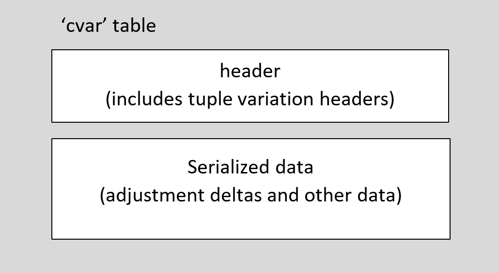

# cvar — CVT Variations Table

The control value table (CVT) variations table is used in variable fonts to provide variation data for CVT values. For a general overview of OpenType Font Variations, see the chapter, [OpenType Font Variations Overview](otvaroverview.md).

Fonts that use the Truetype outline format for glyphs and that have hinting instructions will typically also have a CVT (the ['cvt '](cvt.md) table). The CVT table provides an indexed list of control values that can be referenced by instructions. Example values are the height of a serif, x-height, or the width of uppercase stems. When glyph outline points are adjusted by instructions to improve rasterization at a particular PPEM size, the control values may be used by the instructions to provide design-distance values for those adjustments — typically, values that need to be kept constant across all glyphs in the font for a given PPEM size.

Within a variable font, the numeric value of particular control values may need to be adjusted for different variation instances, to match the changes to outlines for different instances. The CVT variations table provides variation data for that purpose. By using interpolation to derive adjusted CVT values for a particular instance, instructions can obtain instance-appropriate values, and the same instructions can be used for all variations.

The CVT variations table must be used in combination with TrueType outlines and a 'cvt ' table, and also in combination with a [font variations ('fvar')](fvar.md) table and other required or optional tables used in variable fonts.

## Table Format

The 'cvar' table uses a variant of the tuple variation store format, described in the chapter, [OpenType Font Variations Common Table Formats](otvarcommonformats.md). The 'gvar' table uses a very-slightly different variant of this format for each glyph.

In terms of overall structure, the 'cvar' table begins with a header, which is followed by serialized variation data.

 *Figure: High-level organization of the 'cvar' table*

The variation data includes logical groupings of data that apply to different regions of the variation space — *tuple-variation data* tables. These logical groupings are stored in two parts: a header, and serialized data. The 'cvar' header includes an array of tuple-variation data headers, each of which is associated with a particular portion of the serialized data.

The serialized data includes adjustment delta values and also packed “point number” data that identify the CVT entries to which the deltas apply. The serialized data for a given region can include point number data that applies to that specific tuple-variation data, but there can also be a shared set of point number data, stored at the start of the serialized data, that can be used in relation to multiple tuple-variation data tables.

The format of the 'cvar' header is as follows.

*'cvar' table header:*

| Type | Name | Description |
| --- | --- | --- |
| uint16 | majorVersion | Major version number of the CVT variations table — set to 1. |
| uint16 | minorVersion | Minor version number of the CVT variations table — set to 0. |
| uint16 | tupleVariationCount | A packed field. The high 4 bits are flags, and the low 12 bits are the number of tuple-variation data tables. The count can be any number between 1 and 4095. |
| Offset16 | dataOffset | Offset from the start of the 'cvar' table to the serialized data. |
| TupleVariationHeader | tupleVariationHeaders\[tupleVariationCount\] | Array of tuple variation headers. |

Complete details regarding the tupleVariationCount field, the flags used in the tupleVariationCount, the TupleVariationHeader format and the format of the serialized data are provided in the chapter, [OpenType Font Variations Common Table Formats](otvarcommonformats.md). Details regarding how the data are processed to derive interpolated CVT values for particular instances are provided in that chapter and in the chapter, [OpenType Font Variations Overview](otvaroverview.md).

As noted above, the format of the 'cvar' table is closely related to formats used in the 'gvar' table. The following are key differences to note:

- The TupleVariationHeader structure includes a particular field, tupleIndex. This is a packed field that includes flag bits, one of which indicates whether the structure includes an embedded peak tuple record. In the 'gvar' table, this is optional, and the flag does not always need to be set. In the 'cvar' table, however, the embedded peak tuple record is mandatory, and this flag must always be set.
- The serialized data includes packed “point” numbers. In the context of the 'gvar' table, these are indices for the outline points of a particular glyph. In the 'cvar' table, these are indices for CVT values within the 'cvt ' table.
- In the 'gvar' table, there are two logical deltas for each enumerated outline point: one for the X coordinate, and one for the Y coordinate. Hence, the total number of logical deltas is twice the count of point numbers. In the 'cvar' table, there is exactly one logical delta for each point number.

Note that the CVT values are all FWORDs, and that the total number of CVT values is determined by the length of the 'cvt ' table. Hence, CVT index values range from 0 to floor(cvtLength / sizeof(FWORD)) - 1.
