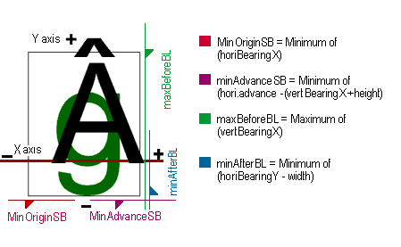
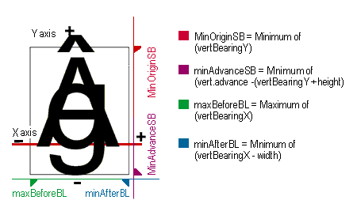
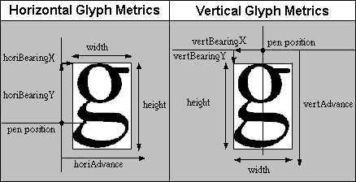

# EBLC — Embedded Bitmap Location Table

The EBLC provides embedded bitmap locators. It is used together with the [EBDT](ebdt.md) table, which provides embedded, monochrome or grayscale bitmap glyph data, and the [EBSC](ebsc.md) table, which provided embedded bitmap scaling information.

OpenType embedded bitmaps are called “sbits” (for “scaler bitmaps”). A set of bitmaps for a face at a given size is called a strike.

The EBLC table identifies the sizes and glyph ranges of the sbits, and has offsets to glyph bitmap data within the EBDT table. The EBDT table then stores the glyph bitmap data, using a number of different possible formats. Glyph metrics information may be stored in either the EBLC or EBDT table, depending upon the formats used in each table. The EBSC table identifies sizes that will be handled by scaling up or scaling down other sbit sizes.

## Table structure

The EBLC table begins with a header containing the table version and number of strikes. An OpenType font may have one or more strikes embedded in the EBDT table.

*EBLC Header*

| Type | Name | Description |
| --- | --- | --- |
| uint16 | majorVersion | Major version of the EBLC table, = 2. |
| uint16 | minorVersion | Minor version of the EBLC table, = 0. |
| uint32 | numSizes | Number of BitmapSize records. |
| BitmapSize | bitmapSizes\[numSizes\] | BitmapSize records array. |

> *Note:* The first version of the EBLC table is 2.0.

Each strike is defined by one BitmapSize record.

*BitmapSize record*

| Type | Name | Description |
| --- | --- | --- |
| Offset32 | indexSubtableListOffset | Offset to IndexSubtableList, from beginning of EBLC. |
| uint32 | indexSubtableListSize | Total size in bytes of the IndexSubtableList including its array of IndexSubtables. |
| uint32 | numberOfIndexSubtables | Number of IndexSubtables in the IndexSubtableList. |
| uint32 | colorRef | Not used; set to 0. |
| SbitLineMetrics | hori | Line metrics for text rendered horizontally. |
| SbitLineMetrics | vert | Line metrics for text rendered vertically. |
| uint16 | startGlyphIndex | Lowest glyph index for this size. |
| uint16 | endGlyphIndex | Highest glyph index for this size. |
| uint8 | ppemX | Horizontal pixels per em. |
| uint8 | ppemY | Vertical pixels per em. |
| uint8 | bitDepth | bit depth: 1, 2, 4, or 8. |
| int8 | flags | Vertical or horizontal (see [Bitmap Flags](#anchor-eblc-bitmapFlags), below). |

The indexSubtableListOffset is the offset from the beginning of the EBLC table to an IndexSubtableList. The indexSubtableListSize is the total size in bytes of the IndexSubtableList data, including the array of IndexSubtables. Each strike has an IndexSubtableList to support various formats and discontiguous ranges of bitmaps. Each IndexSubtable provides the locations of the bitmap data for one or more glyphs within the EBDT table, and may optionally provide glyph metrics to use for that set of glyphs.

The horizontal and vertical line metrics contain the ascender, descender, linegap, and advance information for the strike. The line metrics format is as follows:

*SbitLineMetrics record*

| Type | Name |
| --- | --- |
| int8 | ascender |
| int8 | descender |
| uint8 | widthMax |
| int8 | caretSlopeNumerator |
| int8 | caretSlopeDenominator |
| int8 | caretOffset |
| int8 | minOriginSB |
| int8 | minAdvanceSB |
| int8 | maxBeforeBL |
| int8 | minAfterBL |
| int8 | pad1 |
| int8 | pad2 |

The caret slope determines the angle at which the caret is drawn, and the offset is the number of pixels (+ or -) to move the caret. This is a signed integer since we are dealing with integer metrics. The minOriginSB, minAdvanceSB , maxBeforeBL, and minAfterBL are described in the diagrams below. The main need for these numbers is for scalers that may need to pre-allocate memory and/or need more metric information to position glyphs. All of the line metrics are one byte in length. The line metrics are not used directly by the rasterizer, but are available to applications that want to parse the EBLC table.

The startGlyphIndex and endGlyphIndex describe the minimum and maximum glyph IDs in the strike, but a strike does not necessarily contain bitmaps for all glyph IDs in this range. The IndexSubtables determine which glyphs are actually present in the EBDT table.

The ppemX and ppemY fields describe the size of the strike in pixels per Em. The ppem measurement is equivalent to point size on a 72 dots per inch device. Typically, ppemX will be equal to ppemY for devices with “square” pixels. To accommodate devices with rectangular pixels, and to allow for bitmaps with other aspect ratios, ppemX and ppemY may differ.

**Bit depth**

The bitDepth field of the BitmapSize record is used to specify the number of levels of gray used in the embedded bitmaps. The following bit depths are supported:

| Value | Description |
| --- | --- |
| 1 | black/white |
| 2 | 4 levels of gray |
| 4 | 16 levels of gray |
| 8 | 256 levels of gray |

**Bitmap flags**

The flags field of the BitmapSize record uses the following flags to indicate the direction of small glyph metrics: horizontal or vertical. The remaining bits are reserved.

*Bitmap flags enumeration*

| Mask | Name | Description |
| --- | --- | --- |
| 0x01 | HORIZONTAL\_METRICS | Horizontal |
| 0x02 | VERTICAL\_METRICS | Vertical |
| 0xFC | Reserved | For future use — set to 0. |

The colorRef and bitDepth fields are reserved for future enhancements. For monochrome bitmaps they should have the values colorRef=0 and bitDepth=1.

Associated with the image data for every glyph in a strike is a set of glyph metrics. These glyph metrics describe bounding box height and width, as well as side bearing and advance width information. The following figures illustrate different metric values used for horizontal or vertical layout.

 *Metrics in horizontal text*

 *Metrics in vertical text*

Glyph metrics can be found in one of two places. For ranges of glyphs (not necessarily the whole strike) whose metrics may be different for each glyph, the glyph metrics are stored along with the glyph image data in the EBDT table. Details of how this is done are described in the [EBDT](ebdt.md) table chapter. For ranges of glyphs whose metrics are identical for every glyph, significant space can be saved by storing a single copy of the glyph metrics in the IndexSubTable in the EBLC.

There are also two different formats for glyph metrics: big glyph metrics and small glyph metrics. Big glyph metrics define metrics information for both horizontal and vertical layouts. This is important in fonts (such as Kanji) where both types of layout may be used. Small glyph metrics define metrics information for one layout direction only. Which direction applies, horizontal or vertical, is determined by the flags field in the BitmapSize record.

*BigGlyphMetrics record*

| Type | Name | Description |
| --- | --- | --- |
| uint8 | height | Number of rows in the bitmap. |
| uint8 | width | Number of columns in the bitmap. |
| int8 | horiBearingX | Distance in pixels from the horizontal origin to the left edge of the bitmap. |
| int8 | horiBearingY | Distance in pixels from the horizontal origin to the top edge of the bitmap. |
| uint8 | horiAdvance | Horizontal advance width in pixels. |
| int8 | vertBearingX | Distance in pixels from the vertical origin to the left edge of the bitmap. |
| int8 | vertBearingY | Distance in pixels from the vertical origin to the top edge of the bitmap. |
| uint8 | vertAdvance | Vertical advance width in pixels. |

*SmallGlyphMetrics record*

| Type | Name | Description |
| --- | --- | --- |
| uint8 | height | Number of rows in the bitmap. |
| uint8 | width | Number of columns in the bitmap. |
| int8 | bearingX | Distance in pixels from the horizontal origin to the left edge of the bitmap (for horizontal text); or distance in pixels from the vertical origin to the top edge of the bitmap (for vertical text). |
| int8 | bearingY | Distance in pixels from the horizontal origin to the top edge of the bitmap (for horizontal text); or distance in pixels from the vertical origin to the left edge of the bitmap (for vertical text). |
| uint8 | advance | Horizontal or vertical advance width in pixels. |

The following figure illustrates the meaning of the glyph metrics.

  

## IndexSubtableList

The BitmapSize record for each strike contains the offset to an IndexSubtableList. This contains records that specify a glyph ID range and an offset to an IndexSubTable for that range. This allows a strike to contain multiple glyph ID ranges and to be represented in multiple index formats if desirable.

*IndexSubtableList table*

| Type | Name | Description |
| --- | --- | --- |
| IndexSubtableRecord | indexSubtableRecords\[*numberOfIndexSubtables* \] | Array of IndexSubtableRecords. |

The number of IndexSubtableRecord elements is specified by the numberOfIndexSubtables field in the BitmapSize record.

*IndexSubtableRecord*

| Type | Name | Description |
| --- | --- | --- |
| uint16 | firstGlyphIndex | First glyph ID of this range. |
| uint16 | lastGlyphIndex | Last glyph ID of this range (inclusive). |
| Offset32 | indexSubtableOffset | Offset to an IndexSubtable from the start of the IndexSubtableList. |

Records must be sorted by firstGlyphIndex, and records should not have overlapping glyph ID ranges.

After determining the strike, the rasterizer searches this array for the range containing the given glyph ID. When the range is found, the indexSubtableOffset provides the location of the IndexSubtable. This can be added to the indexSubtableListOffset from the BitmapSize record to obtain the offset of the IndexSubtable within the EBLC table.

The IndexSubtableList for the first strike is located after the bitmapSizes records array. The IndexSubtables for that strike follow the IndexSubtableList header. Another IndexSubtableList (if more than one strike) and its IndexSubtables are next. The EBLC continues with an IndexSubtableList and associate IndexSubtables for each strike.

## IndexSubtable formats

There are different formats for IndexSubtables. All formats begin with an *IndexSubHeader* which identifies the IndexSubtable format, the format of the EBDT image data, and the offset from the beginning of the EBDT table to the beginning of the image data for the specified glyph range.

*IndexSubHeader record*

| Type | Name | Description |
| --- | --- | --- |
| uint16 | indexFormat | Format of the IndexSubtable. |
| uint16 | imageFormat | Format of EBDT image data. |
| Offset32 | imageDataOffset | Offset to image data in EBDT table. |

There are five different formats used for the IndexSubtable, depending upon the size and type of bitmap data used for a given glyph ID range. The choice of format that is used should be made with the aim of minimizing the size of the font file. Ranges of glyphs with variable metrics — that is, where glyphs may differ from each other in bounding box height, width, side bearings or advance — require the use of formats 1, 3 or 4, which require glyph metrics information to be included along with the bitmap data in the EBDT table. Ranges of glyphs with constant metrics can save space by using format 2 or 5, which keep a single copy of the metrics information in the IndexSubtable rather than a copy per glyph in the EBDT table. In some monospaced fonts it makes sense to store extra white space around some of the glyphs to keep all metrics identical, thus permitting the use of format 2 or 5.

Structures for each IndexSubtable format are listed below.

*IndexSubtableFormat1 table*

| Type | Name | Description |
| --- | --- | --- |
| IndexSubHeader | header | Header info. |
| Offset32 | sbitOffsets\[numOffsets\] | Offsets to bitmap data for each glyph in the range. |

Format 1 can be used when glyphs have variable metrics. Offsets for the bitmap data are 4-byte aligned. The number of offsets required is determined from the lastGlyphIndex and firstGlyphIndex fields in the IndexSubtableRecord. One extra entry is required to provide the size of data for the last glyph. Thus, *numOffsets = lastGlyphIndex – firstGlyphIndex + 2*.

*IndexSubtableFormat2 table*

| Type | Name | Description |
| --- | --- | --- |
| IndexSubHeader | header | Header info. |
| uint32 | imageSize | All the glyphs are of the same size. |
| BigGlyphMetrics | bigMetrics | All glyphs have the same metrics; glyph data may be compressed, byte-aligned, or bit-aligned. |

Format 2 can be used when glyphs have identical metrics. The bitmap data for all glyphs will be the same size, so an array of offsets is not required.

*IndexSubtableFormat3 table*

| Type | Name | Description |
| --- | --- | --- |
| IndexSubHeader | header | Header info. |
| Offset16 | sbitOffsets\[numOffsets\] | Offsets to bitmap data for each glyph in the range. |

Format 3 can be used when glyphs have variable metrics. Offsets for the bitmap data are 2-byte aligned. The number of offsets required is determined from the lastGlyphIndex and firstGlyphIndex fields in the IndexSubtableRecord. One extra entry is required to provide the size of data for the last glyph. Thus, *numOffsets = lastGlyphIndex – firstGlyphIndex + 2*.

*IndexSubtableFormat4 table*

| Type | Name | Description |
| --- | --- | --- |
| IndexSubHeader | header | Header info. |
| uint32 | numGlyphs | Array length. |
| GlyphIdOffsetPair | glyphArray\[numGlyphs + 1\] | One per glyph. |

Format 4 can be used when glyphs have variable metrics and when the glyph IDs are sparse, not in a contiguous range. Format 4 uses an array of GlyphIdOffsetPair records. One extra record is stored to represent the size of the image data for the last glyph.

*GlyphIdOffsetPair record*

| Type | Name | Description |
| --- | --- | --- |
| uint16 | glyphID | Glyph ID of glyph present. |
| Offset16 | sbitOffset | Location in EBDT. |

*IndexSubtableFormat5 table*

| Type | Name | Description |
| --- | --- | --- |
| IndexSubHeader | header | Header info. |
| uint32 | imageSize | All glyphs have the same data size. |
| BigGlyphMetrics | bigMetrics | All glyphs have the same metrics. |
| uint32 | numGlyphs | Array length. |
| uint16 | glyphIdArray\[numGlyphs\] | One per glyph, sorted by glyph ID. |

Format 5 can be used when glyphs have identical metrics, but the glyph IDs are sparse, not in a contiguous range.

The size of the EBDT image data can be calculated from the IndexSubtable information. For the constant-metrics formats (2 and 5) the image data size is constant, and is given in the imageSize field. For the variable metrics formats (1, 3, and 4) image data must be stored contiguously and in glyph ID order, so the image data size may be calculated by subtracting the offset for the current glyph from the offset of the next glyph. Because of this, it is necessary to store one extra element in the sbitOffsets array pointing just past the end of the range’s image data. This will allow the correct calculation of the image data size for the last glyph in the range.

Contiguous, or nearly contiguous, ranges of glyph IDs are handled best by formats 1, 2, and 3 which store an offset for every glyph ID in the range. Very sparse ranges of glyph IDs should use format 4 or 5 which explicitly call out the glyph IDs represented in the range. A small number of missing glyphs can be efficiently represented in formats 1 or 3 by having the offset for the missing glyph be followed by the same offset for the next glyph, thus indicating a data size of zero.

The only difference between formats 1 and 3 is the size of the sbitOffsets array elements: format 1 uses uint32s while format 3 uses uint16s. Therefore format 1 can cover a greater range (\> 64k bytes) while format 3 saves more space in the EBLC table. Since the sbitOffsets elements are added to the imageDataOffset base address in the IndexSubHeader, a very large set of glyph bitmap data could be addressed by splitting it into multiple ranges, each less than 64k bytes in size, allowing the use of the more efficient format 3.

The EBLC table specification requires 32-bit alignment for all subtables. This occurs naturally for IndexSubTable formats 1, 2, and 4, but might not for formats 3 and 5, since they include arrays of type uint16. When there is an odd number of elements in these arrays it is necessary to add an extra padding element to maintain proper alignment.
