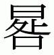

# Registered Features: Descriptions and Implementations (f – j)

[a - e](features_ae.md) | f - j | [k - o](features_ko.md) | [p - t](features_pt.md) | [u - z](features_uz.md)

## Tag: 'falt'

*Friendly name:* Final Glyph on Line Alternates

*Registered by:* Microsoft

*Function:* Replaces line final glyphs with alternate forms specifically designed for this purpose (they would have less or more advance width as might be needed), to help justification of text.

*Example:* In the Arabic script, providing alternate forms for line final glyphs would result in better justification. E.g., replacing a long tailed Yeh-with-tail with one that has a slightly longer or shorter tail.

*Recommended implementation:* A lookup table for the 'falt' feature maps line final glyphs (in isolated or final forms) to their corresponding alternate forms (GSUB lookup type 1).

This feature can be implemented in conjunction with justification extension or shrinkage modifications in a [JSTF](jstf.md) table.

*Application interface:* In recommended usage, this feature is applied to final glyphs of lines when text is justified, as determined by a justification algorithm or direct user control. The feature can affect the length of lines, which should be taken into consideration by line-breaking and justification algorithms.

*UI suggestion:* This feature could be made active or inactive by default, at the user’s preference.

*Script/language sensitivity:* Can be used in any cursive script.

*Feature interaction:* Would need to be applied last, only after all other features have been applied to the run.

## Tag: 'fin2'

*Friendly name:* Terminal Forms #2

*Registered by:* Microsoft

*Function:* Used to replace the Alaph glyph at the end of Syriac words with its appropriate form, when the preceding base character cannot be joined to, and that preceding base character is not a Dalath, Rish, or dotless Dalath-Rish.

This feature is used only for the Syriac script alaph character.

*Example:* When an Alaph is preceded by a He, the Alaph would be replaced by an appropriate form.

*Recommended implementation:* A lookup table for the 'fin2' feature maps default alphabetic forms to corresponding final forms (GSUB lookup type 1).

*Application interface:* In recommended usage, this feature triggers substitutions required for correct layout of Syriac text. The application should always apply the feature to the Alaph glyph when the preceding base character is non-joining and is a character other than Dalath, Rish, or dotless Dalath-Rish.

*UI suggestion:* Control of the feature should not generally be exposed to the user.

*Script/language sensitivity:* Used only with the Syriac script.

*Feature interaction:* This feature may be used in combination with other substitution (GSUB) features, whose results it may override. See also ['init'](#anchor-features_fj-tag-init) and ['fina'](#anchor-features_fj-tag-fina).

## Tag: 'fin3'

*Friendly name:* Terminal Forms #3

*Registered by:* Microsoft

*Function:* Used to replace Alaph glyphs at the end of Syriac words when the preceding base character is a Dalath, Rish, or dotless Dalath-Rish.

This feature is used only for the Syriac script alaph character.

*Example:* When an Alaph is preceded by a Dalath, the Alaph would be replaced by an appropriate form.

*Recommended implementation:* A lookup table for the 'fin3' feature maps default alphabetic forms to corresponding final forms (GSUB lookup type 5).

*Application interface:* In recommended usage, this feature triggers substitutions required for correct layout of Syriac text. The application should always apply the feature to the Alaph glyph when at the end of Syriac words if the preceding base character is Dalath, Rish, or dotless Dalath-Rish.

*UI suggestion:* Control of the feature should not generally be exposed to the user.

*Script/language sensitivity:* Used only with the Syriac script.

*Feature interaction:* This feature may be used in combination with other substitution (GSUB) features, whose results it may override. See also ['init'](#anchor-features_fj-tag-init) and ['fina'](#anchor-features_fj-tag-fina).

## Tag: 'fina'

*Note:* This feature description was significantly revised in 2016.

*Friendly name:* Terminal Forms

*Registered by:* Microsoft/Adobe

*Function:* Replaces glyphs for characters that have applicable joining properties with an alternate form when occurring in a final context. This applies to characters that have one of the following Unicode Joining\_Type property values:

- Right\_Joining, if the characters are from a right-to-left script.
- Left\_Joining, if the characters are from a left-to-right script.
- Dual\_Joining.

Unicode Joining\_Type property values are obtained from the [Unicode Character Database](http://www.unicode.org/reports/tr44/tr44-18.html) (UCD). Specifically, Joining\_Type property values are documented in the UCD file, ArabicShaping.txt, the current version of which is available at [http://www.unicode.org/Public/UCD/latest/ucd/ArabicShaping.txt](http://www.unicode.org/Public/UCD/latest/ucd/ArabicShaping.txt) .

*Example:* In an Arabic-script font, the application would apply the 'fina' feature to the letter ARABIC LETTER WAW (U+0648 “و”) when it follows a left-joining character, thereby replacing the default “و” glyph with its right-joining, final form.

*Recommended implementation:* The 'fina' feature is used to map default forms to corresponding single-joining, final forms. This will usually be implemented using a single substitution (type 1) GSUB lookup, though contextual substitution GSUB lookups (types 5, 6 or 8) could also be appropriate.

*Application interface:* In recommended usage, this feature triggers substitutions that are required for correct display of cursively-connecting scripts. It should be applied in the appropriate contexts, as determined by script-specific processing requirements. The application is responsible for parsing character strings and identifying which of the joining-related features — initial forms ('init'), medial forms ('medi'), terminal forms ('fina'), and isolated forms ('isol') — to apply to which glyphs, based on character Joining\_Type properties. Additional factors, such as the presence of control characters, should also be considered.

*UI suggestion:* Control of the feature should not generally be exposed to the user.

*Script/language sensitivity:* Can be used in any script with joining behavior — that is, the scripts for which Joining\_Type properties are given explicitly in ArabicShaping.txt.

*Feature interaction:* This feature may be used in combination with other substitution (GSUB) features, whose results it may override. See also ['init'](#anchor-features_fj-tag-init), ['isol'](#anchor-features_fj-tag-isol) and ['medi'](features_ko.md#anchor-features_ko-tag-medi).

## Tag: 'flac'

*Friendly name:* Flattened Accent Forms

*Registered by:* Microsoft

*Function:* This feature provides flattened forms of accents to be used in math formulas over high-rise bases such as capitals. This feature should only change the shape of the accent and should not move it in the vertical or horizontal direction. Moving of the accents is done by the math layout engine. Accents are flattened by the Math engine if their base is higher than the flattenedAccentBaseHeight value in the MATH.MathConstants table.

*Example:* Depending on the font parameters, a lowercase a with tilde may used in default form and an uppercase A with tilde may use the flattened form

*Recommended implementation:* Single substitution, replacing ascent glyph with its flattened form. See the [MATH](math.md) table specification for details.

*Application interface:* In recommended usage, this feature is used to trigger substitutions that are required for correct display of math formulas. It should be applied to individual glyphs in the appropriate contexts, as determined by math layout handler. See the ['MATH' table](math.md#anchor-math-opentype-layout-tags-used-with-the-math-table) chapter for additional information.

*UI suggestion:* Control of the feature should not generally be exposed to the user.

*Script/language sensitivity:* Used for math formula layout.

*Feature interaction:* None.

## Tag: 'frac'

*Friendly name:* Fractions

*Registered by:* Microsoft/Adobe

*Function:* Replaces figures (digits) separated by a slash (U+002F or U+2044) with “common” (diagonal) fractions.

*Example:* The user enters 3/4 and gets the three-quarters fraction.

*Recommended implementation:* Glyphs for figures (digits) separated by a slash are mapped to variant forms (GSUB lookup type 1, or contextual substitutions that reference type 1 lookups), or sequences of such glyphs are mapped to ligature fraction glyphs (GSUB lookup type 4).

*Application interface:* Discretionary feature: can be applied to glyph runs based on document markup, user control or other application criteria.

An application may automatically apply the feature over certain text sequences, such as sequences of one or more digits followed by fraction slash (U+2044) followed by one or more digits. An application may also automatically apply the ['numr'](features_ko.md#anchor-features_ko-tag-numr) feature to a sequence preceding a slash, and the ['dnom'](features_ae.md#anchor-features_ae-tag-dnom) feature to a sequence following a slash, either based on analysis of the text sequence or as a corollary to application of the 'frac' feature over a sequence.

*UI suggestion:* This feature should be off by default.

*Script/language sensitivity:* None.

*Feature interaction:* Applications may use this feature in conjunction with the ['numr'](features_ko.md#anchor-features_ko-tag-numr) and ['dnom'](features_ae.md#anchor-features_ae-tag-dnom) features. It may be used in combination with other substitution (GSUB) features, whose results it may override.

## Tag: 'fwid'

*Friendly name:* Full Widths

*Registered by:* Adobe

*Function:* Replaces glyphs set on other widths with glyphs set on full (usually em) widths. In a CJKV font, this may include “lower ASCII” Latin characters and various symbols. In a European font, this feature replaces proportionally-spaced glyphs with fixed-width glyphs, which are generally set on widths of 0.6 em.

*Example:* The user may invoke this feature in a Japanese font to get full, fixed-width Latin glyphs instead of the corresponding proportionally-spaced versions.

*Recommended implementation:* The font may substitute alternate glyphs with full advance widths (GSUB lookup type 1), or it may specify alternate, full-width metrics for the proportional glyphs (GPOS lookup type 1, xPlacement and xAdvance).

*Application interface:* Discretionary feature: can be applied to glyph runs based on document markup, user control or other application criteria.

*UI suggestion:* This feature should be off by default. See below for details on important feature interactions.

*Script/language sensitivity:* Can be used for any script which can use fixed-width forms.

*Feature interaction:* This feature is mutually exclusive to all other horizontal glyph-width features (['chws'](features_ae.md#anchor-features_ae-tag-chws), ['halt'](#anchor-features_fj-tag-halt), ['hwid'](#anchor-features_fj-tag-hwid), ['palt'](features_pt.md#anchor-features_pt-tag-palt), ['pkna'](features_pt.md#anchor-features_pt-tag-pkna), ['pwid'](features_pt.md#anchor-features_pt-tag-pwid), ['qwid'](features_pt.md#anchor-features_pt-tag-qwid), ['twid'](features_pt.md#anchor-features_pt-tag-twid), ['pnum'](features_pt.md#anchor-features_pt-tag-pnum), ['tnum'](features_pt.md#anchor-features_pt-tag-tnum)), which should be turned off when it’s applied. When applied to a text run, the ['apkn'](features_ae.md#anchor-features_ae-tag-apkn) and ['kern'](features_ko.md#anchor-features_ko-tag-kern) features should be disabled for that run.

## Tag: 'half'

*Friendly name:* Half Forms

*Registered by:* Microsoft

*Function:* Produces the half forms of consonants in Indic scripts.

*Example:* In Hindi (Devanagari script), the conjunct KKa is denoted with a half form of Ka followed by the full form of Ka.

*Recommended implementation:* A lookup table for the 'half' feature maps the sequence of a consonant followed by a virama (halant) to its half form (GSUB lookup type 4).

*Application interface:* In recommended usage, this feature triggers substitutions required for correct display of certain scripts. It should be applied in the appropriate contexts, as determined by script-specific processing requirements.

*UI suggestion:* Control of the feature should not generally be exposed to the user.

*Script/language sensitivity:* Used for Devanagari and other Indic or Brahmi-derived scripts that have pre-base consonant half forms.

*Feature interaction:* This feature is used in conjunction with certain other features to derive required forms of Indic scripts. The application is expected to process this feature and certain other features in an appropriate order to obtain the correct set of basic forms: ['nukt'](features_ko.md#anchor-features_ko-tag-nukt), ['akhn'](features_ae.md#anchor-features_ae-tag-akhn), ['rphf'](features_pt.md#anchor-features_pt-tag-rphf), ['rkrf'](features_pt.md#anchor-features_pt-tag-rkrf), ['pref'](features_pt.md#anchor-features_pt-tag-pref), ['blwf'](features_ae.md#anchor-features_ae-tag-blwf), ['half'](#anchor-features_fj-tag-half), ['pstf'](features_pt.md#anchor-features_pt-tag-pstf), ['cjct'](features_ae.md#anchor-features_ae-tag-cjct). Other discretionary features for optional typographic effects may also be applied. Lookups for such discretionary features should be processed after lookups for this feature have been processed.

## Tag: 'haln'

*Friendly name:* Halant Forms

*Registered by:* Microsoft

*Function:* Produces the halant forms of consonants in Indic scripts (that is, precomposed glyphs for consonant with the overt halant).

*Example:* In Sanskrit (Devanagari script), syllable final consonants are frequently required in their halant form.

*Recommended implementation:* A lookup table for the 'haln' feature maps the sequence of a consonant followed by a virama (halant) to its halant form (GSUB lookup type 4).

*Application interface:* In recommended usage, this feature triggers substitutions required for correct display of certain scripts. It should be applied in the appropriate contexts, as determined by script-specific processing requirements.

*UI suggestion:* Control of the feature should not generally be exposed to the user.

*Script/language sensitivity:* Used for Indic or other Brahmi-derived scripts.

*Feature interaction:* This feature overrides the results of all other features.

## Tag: 'halt'

*Friendly name:* Alternate Half Widths

*Registered by:* Adobe

*Function:* Re-spaces glyphs that have full-width metrics by default, fitting them onto fixed, half-em widths to approximate more sophisticated text layout, such as what is described in [Requirements for Japanese Text Layout (JLREQ)](https://www.w3.org/TR/jlreq/) or similar CJKV text-layout specifications that expect half-width forms of characters whose default glyphs are full-width. This feature differs from 'hwid' in that it is not used to substitute new glyphs. It also differs from ['chws'](features_ae.md#anchor-features_ae-tag-chws) in that adjustments are not contextual.

(In JLREQ, see, in particular, [3.1.4 Positioning of Consecutive Opening Brackets, Closing Brackets, Commas, Full Stops and Middle Dots](https://www.w3.org/TR/jlreq/?lang=en#positioning_of_consecutive_opening_brackets_closing_brackets_comma_full_stops_and_middle_dots), and [B. Spacing between Characters](https://www.w3.org/TR/jlreq/?lang=en#spacing_between_characters). See also [Requirements for Chinese Text Layout (CLREQ)](https://www.w3.org/TR/clreq/), [Requirements for Hangul Text Layout (KLREQ)](https://www.w3.org/TR/klreq/).)

*Example:* The user invokes this feature in a CJKV font to get better fit for punctuation or symbol glyphs without disrupting the fixed-width alignment.

*Recommended implementation:* The font specifies alternate, half-width metrics for full-width glyphs (GPOS lookup type 1, xPlacement, xAdvance, yPlacement and yAdvance).

*Application interface:* If a layout engine supports advanced layout for CJKV text as described in [CLREQ](https://www.w3.org/TR/clreq/), [JLREQ](https://www.w3.org/TR/jlreq/) or [KLREQ](https://www.w3.org/TR/klreq/), this feature should not be used. Otherwise, this feature should be enabled in horizontal layout to all CJKV text or selectively to particular characters that require special treatment in CJKV text layout, such as brackets, punctuation, and quotation marks.

*UI suggestion:* This feature should not be used in combination with a layout engine that independently provides advanced layout as described in [CLREQ](https://www.w3.org/TR/clreq/), [JLREQ](https://www.w3.org/TR/jlreq/) or [KLREQ](https://www.w3.org/TR/klreq/). For applications that provide such advanced layout, it could be appropriate not to expose control of this feature to users. In applications that do not support such advanced layout, this feature should be enabled by default for horizontal layout of CJK text. See below for details on important feature interactions.

*Script/language sensitivity:* Used only in CJKV fonts.

*Feature interaction:* This feature is mutually exclusive to all other horizontal glyph-width features (['chws'](features_ae.md#anchor-features_ae-tag-chws), ['fwid'](#anchor-features_fj-tag-fwid), ['hwid'](#anchor-features_fj-tag-hwid), ['palt'](features_pt.md#anchor-features_pt-tag-palt), ['pkna'](features_pt.md#anchor-features_pt-tag-pkna), ['pwid'](features_pt.md#anchor-features_pt-tag-pwid), ['qwid'](features_pt.md#anchor-features_pt-tag-qwid), ['twid'](features_pt.md#anchor-features_pt-tag-twid), ['pnum'](features_pt.md#anchor-features_pt-tag-pnum), ['tnum'](features_pt.md#anchor-features_pt-tag-tnum)), which should be turned off when this feature is applied. When applied to a text run, the ['apkn'](features_ae.md#anchor-features_ae-tag-apkn) and ['kern'](features_ko.md#anchor-features_ko-tag-kern) features should be disabled. See also ['vhal'](features_uz.md#anchor-features_uz-tag-vhal).

## Tag: 'hist'

*Friendly name:* Historical Forms

*Registered by:* Microsoft/Adobe

*Function:* Some letterforms were in common use in the past, but appear anachronistic today. The best-known example is the long form of s; others would include the old Fraktur k. Some fonts include the historical forms as alternates, so they can be used for a “period” effect. This feature replaces the default (current) forms with the historical alternates. While some ligatures are also used for historical effect, this feature deals only with single characters. (For historic ligatures, see the ['hlig'](#anchor-features_fj-tag-hlig) feature.)

*Example:* The user applies this feature in Adobe Jenson to get the archaic forms of M, Q and Z.

*Recommended implementation:* A lookup table for the 'hist' feature maps default forms to corresponding historical forms (GSUB lookup type 1).

*Application interface:* Discretionary feature: can be applied to glyph runs based on document markup, user control or other application criteria.

*UI suggestion:* This feature should be off by default.

*Script/language sensitivity:* None.

*Feature interaction:* This feature may be used in combination with other substitution (GSUB) features, whose results it may override.

## Tag: 'hkna'

*Friendly name:* Horizontal Kana Alternates

*Registered by:* Adobe

*Function:* Replaces standard kana with forms that have been specially designed for only horizontal writing. This is a typographic optimization for improved fit and more even color. Also see ['vkna'](features_uz.md#anchor-features_uz-tag-vkna).

The 'hkna' and 'vkna' features are intended for use in fonts designed for both horizontal and vertical layout. The font can have alternate glyphs for kana characters designed specifically for horizontal layout, or specifically for vertical layout. These two features can be used to select the variant glyphs for each layout direction. These features do not affect glyph advance widths.

*Example:* Standard full-width kana (hiragana and katakana) are replaced by forms that are designed for horizontal use.

*Recommended implementation:* A lookup table for the 'hkna' feature maps the standard full-width forms to the corresponding special horizontal forms (GSUB lookup type 1).

*Application interface:* Discretionary feature: can be applied to glyph runs based on document markup, user control or other application criteria.

*UI suggestion:* This feature should be off by default.

*Script/language sensitivity:* Used only in fonts that support kana (hiragana and katakana).

*Feature interaction:* This feature may be used with the ['kern'](features_ko.md#anchor-features_ko-tag-kern) feature. Since it is for horizontal use, features applying to vertical behaviors (e.g. ['vkna'](features_uz.md#anchor-features_uz-tag-vkna), ['vert'](features_uz.md#anchor-features_uz-tag-vert), ['vrt2'](features_uz.md#anchor-features_uz-tag-vrt2) or ['vkrn'](features_uz.md#anchor-features_uz-tag-vkrn)) do not apply.

## Tag: 'hlig'

*Friendly name:* Historical Ligatures

*Registered by:* Microsoft

*Function:* Some ligatures were in common use in the past, but appear anachronistic today. Some fonts include the historical forms as alternates, so they can be used for a “period” effect. This feature replaces the default (current) forms with the historical alternates.

*Example:* The user applies this feature using Palatino Linotype, and historic ligatures are formed for all long s forms, including: long s+t, long s+b, long s+h, long s+k, and several others.

*Recommended implementation:* Sequences of glyphs for certain character combinations are mapped to corresponding historical ligature glyphs (GSUB lookup type 4).

*Application interface:* Discretionary feature: can be applied to glyph runs based on document markup, user control or other application criteria.

*UI suggestion:* This feature should be off by default.

*Script/language sensitivity:* None.

*Feature interaction:* This feature overrides the results of all other features.

## Tag: 'hngl' (DEPRECATED)

*Friendly name:* Hangul

*Registered by:* Adobe

*Function:* Replaces hanja (Chinese-style) Korean characters with the corresponding hangul (syllabic) characters. This effectively reverses the standard input method, in which hangul are entered and replaced by hanja. Many of these substitutions are one-to-one (GSUB lookup type 1), but hanja substitution often requires the user to choose from several possible hangul characters (GSUB lookup type 3).

*Example:* The user may activate this feature to get the glyph for U+AC00 from U+4F3D.

*Recommended implementation:* Glyphs for hanja characters are mapped to corresponding glyphs for Hangul syllables (GSUB lookup type 1); or default glyphs for hanja characters are mapped to two or more corresponding alternate glyphs for Hangul syllables (GSUB lookup type 3). As in any one-from-many substitution, alternates should be ordered consistently across a family, so that those alternates can work correctly when switching between family members.

*Application interface:* Discretionary feature: can be applied to glyph runs based on document markup, user control or other application criteria. If the font is implemented using an alternate substitution lookup, the application should provide a means for the user to select the one desired. Note that the effect of this feature is effectively equivalent to a change of character codes. Besides the original character codes (when entered as hanja), the application should store the character codes for the new glyphs.

*UI suggestion:* This feature should be inactive by default. The application can note the user’s choice when selecting from multiple hangul glyphs and offer it as a default the next time the source hanja character is encountered. In the absence of such prior information, the application may assume that the first hangul in a set is the preferred form, so the font developer should order them accordingly.

*Script/language sensitivity:* Korean only.

*Feature interaction:* This feature is mutually exclusive to most other features, which should be turned off when it’s applied. Exceptions include the ['palt'](features_pt.md#anchor-features_pt-tag-palt), ['vert'](features_uz.md#anchor-features_uz-tag-vert) and ['vrt2'](features_uz.md#anchor-features_uz-tag-vrt2) features, which may be used in addition.

## Tag: 'hojo'

*Friendly name:* Hojo Kanji Forms (JIS X 0212-1990 Kanji Forms)

*Registered by:* Adobe

*Function:* The JIS X 0212-1990 (aka, “Hojo Kanji”) and JIS X 0213:2004 character sets overlap significantly. In some cases their prototypical glyphs differ. When building fonts that support both JIS X 0212-1990 and JIS X 0213:2004 (such as those supporting the Adobe-Japan 1-6 character collection), it is recommended that JIS X 0213:2004 forms be preferred as the encoded form. The 'hojo' feature is used to access the JIS X 0212-1990 glyphs for the cases when the JIS X 0213:2004 form is encoded.

*Example:* The glyph  is replaced by the glyph .

*Recommended implementation:* One-for-one substitution of JIS X 0213:2004 glyphs by the corresponding JIS X 0212-1990 glyph (GSUB lookup type 1).

*Application interface:* Discretionary feature: can be applied to glyph runs based on document markup, user control or other application criteria.

*UI suggestion:* This feature should be off by default.

*Script/language sensitivity:* Used only with Kanji characters in Japanese.

*Feature interaction:* This feature is mutually exclusive to ['jp78'](#anchor-features_fj-tag-jp78), ['jp83'](#anchor-features_fj-tag-jp83), ['jp90'](#anchor-features_fj-tag-jp90), ['nlck'](features_ko.md#anchor-features_ko-tag-nlck) and similar features. It can be combined with the ['palt'](features_pt.md#anchor-features_pt-tag-palt), ['vpal'](features_uz.md#anchor-features_uz-tag-vpal), ['vert'](features_uz.md#anchor-features_uz-tag-vert) and ['vrt2'](features_uz.md#anchor-features_uz-tag-vrt2) features.

## Tag: 'hwid'

*Friendly name:* Half Widths

*Registered by:* Adobe

*Function:* Replaces glyphs with proportional widths, or with fixed widths other than half an em, with glyphs on half-em (en) widths. Many CJKV fonts have alternate glyphs set on multiple widths; this feature selects the half-em variants. There are various contexts in which this is the preferred behavior, including compatibility with older desktop documents.

*Example:* The user may replace a proportional Latin glyph with the same character set on a half-em width.

*Recommended implementation:* The font substitutes alternate glyphs designed to be set on half-em widths (GSUB lookup type 1), or it specifies alternate metrics for the original glyphs (GPOS lookup type 1, xPlacement and xAdvance), adjusting their spacing to fit in half-em widths.

*Application interface:* Discretionary feature: can be applied to glyph runs based on document markup, user control or other application criteria.

*UI suggestion:* This feature should be off by default. See below for details on important feature interactions.

*Script/language sensitivity:* Generally used only in CJKV fonts.

*Feature interaction:* This feature is mutually exclusive to all other horizontal glyph-width features (['chws'](features_ae.md#anchor-features_ae-tag-chws), ['fwid'](#anchor-features_fj-tag-fwid), ['halt'](#anchor-features_fj-tag-halt), ['palt'](features_pt.md#anchor-features_pt-tag-palt), ['pkna'](features_pt.md#anchor-features_pt-tag-pkna), ['pwid'](features_pt.md#anchor-features_pt-tag-pwid), ['qwid'](features_pt.md#anchor-features_pt-tag-qwid), ['twid'](features_pt.md#anchor-features_pt-tag-twid), ['pnum'](features_pt.md#anchor-features_pt-tag-pnum), ['tnum'](features_pt.md#anchor-features_pt-tag-tnum)), which should be turned off when it’s applied. When applied to a text run, the ['apkn'](features_ae.md#anchor-features_ae-tag-apkn) and ['kern'](features_ko.md#anchor-features_ko-tag-kern) features should be disabled for that run.

## Tag: 'init'

*Note:* This feature description was significantly revised in 2016.

*Friendly name:* Initial Forms

*Registered by:* Microsoft/Adobe

*Function:* Replaces glyphs for characters that have applicable joining properties with an alternate form when occurring in an initial context. This applies to characters that have one of the following Unicode Joining\_Type property values:

- Right\_Joining, if the characters are from a left-to-right script.
- Left\_Joining, if the characters are from a right-to-left script.
- Dual\_Joining.

Unicode Joining\_Type property values are obtained from the [Unicode Character Database](http://www.unicode.org/reports/tr44/tr44-18.html) (UCD). Specifically, Joining\_Type property values are documented in the UCD file, ArabicShaping.txt, the current version of which is available at [http://www.unicode.org/Public/UCD/latest/ucd/ArabicShaping.txt](http://www.unicode.org/Public/UCD/latest/ucd/ArabicShaping.txt).

*Example:* In an Arabic-script font, the application would apply the 'init' feature to the letter ARABIC LETTER SEEN (U+0633 “س”) when it precedes a right-joining character, thereby replacing the default “س” glyph with its left-joining, initial form.

*Recommended implementation:* The 'init' feature is used to map default forms to corresponding single-joining, inital forms. This will usually be implemented using a single substitution (type 1) GSUB lookup, though contextual substitution GSUB lookups (types 5, 6 or 8) could also be appropriate.

*Application interface:* In recommended usage, this feature triggers substitutions that are required for correct display of cursively-connecting scripts. It should be applied in the appropriate contexts, as determined by script-specific processing requirements. The application is responsible for parsing character strings and identifying which of the joining-related features — initial forms ('init'), medial forms ('medi'), terminal forms ('fina'), and isolated forms ('isol') — to apply to which glyphs, based on character Joining\_Type properties. Additional factors, such as the presence of control characters, should also be considered.

*UI suggestion:* Control of the feature should not generally be exposed to the user.

*Script/language sensitivity:* Can be used in any script with joining behavior — that is, the scripts for which Joining\_Type properties are given explicitly in ArabicShaping.txt.

*Feature interaction:* This feature may be used in combination with other substitution (GSUB) features, whose results it may override. See also ['fina'](#anchor-features_fj-tag-fina), ['isol'](#anchor-features_fj-tag-isol) and ['medi'](features_ko.md#anchor-features_ko-tag-medi).

## Tag: 'isol'

*Note:* This feature description was significantly revised in 2016.

*Friendly name:* Isolated Forms

*Registered by:* Microsoft

*Function:* Replaces glyphs for characters that have applicable joining properties with an alternate form when occurring in a isolate (non-joining) context. This applies to characters that have one of the following Unicode Joining\_Type property values:

- Right\_Joining.
- Left\_Joining.
- Dual\_Joining.
- Non\_Joining, if the characters are from a script with joining behavior.

Unicode Joining\_Type property values are obtained from the [Unicode Character Database](http://www.unicode.org/reports/tr44/tr44-18.html) (UCD). Specifically, Joining\_Type property values are documented in the UCD file, ArabicShaping.txt, the current version of which is available at [http://www.unicode.org/Public/UCD/latest/ucd/ArabicShaping.txt](http://www.unicode.org/Public/UCD/latest/ucd/ArabicShaping.txt). Scripts that have joining behavior are those scripts with character properties given explicitly in ArabicShaping.txt.

Note that, in many fonts that support the relevant scripts, this feature might not be implemented since the default forms of the relevant characters are the isolated forms. In some fonts, this feature may involve contextual substitution based on the specific, isolated context.

*Example:* In an Arabic-script font, the application would apply the 'isol' feature to the letter ARABIC LETTER HEH (U+0647 “ه”) when not adjacent to any joining character, thereby potentially replacing the default “ه” glyph with a special, isolated form (likely, a contextual and language-specific substitution, substituting one isolated form for another).

*Recommended implementation:* The 'isol' feature is used to map default forms to alternate non-joining, isolate forms. This will usually be implemented using a single substitution (type 1) GSUB lookup or, often, a contextual substitution GSUB lookup (types 5, 6 or 8).

*Application interface:* In recommended usage, this feature triggers substitutions that are required for correct display of cursively-connecting scripts. It should be applied in the appropriate contexts, as determined by script-specific processing requirements. The application is responsible for parsing character strings and identifying which of the joining-related features — initial forms ('init'), medial forms ('medi'), terminal forms ('fina'), and isolated forms ('isol') — to apply to which glyphs, based on character Joining\_Type properties. Additional factors, such as the presence of control characters, should also be considered.

*UI suggestion:* Control of the feature should not generally be exposed to the user.

*Script/language sensitivity:* Can be used in any script with joining behavior — that is, the scripts for which Joining\_Type properties are given explicitly in ArabicShaping.txt.

*Feature interaction:* This feature may be used in combination with other substitution (GSUB) features, whose results it may override. See also ['fina'](#anchor-features_fj-tag-fina), ['init'](#anchor-features_fj-tag-init) and ['medi'](features_ko.md#anchor-features_ko-tag-medi).

## Tag: 'ital'

*Friendly name:* Italics

*Registered by:* Adobe

*Function:* Some fonts (such as Adobe’s Pro Japanese fonts) will have both Roman and Italic forms of some characters in a single font. This feature replaces the Roman glyphs with the corresponding Italic glyphs.

*Example:* The user would apply this feature to replace B with *B*.

*Recommended implementation:* A lookup table for the 'ital' feature maps the Roman forms in a font to the corresponding Italic forms (GSUB lookup type 1).

*Application interface:* This feature is applied automatically by the application based on italic formatting indicated in document markup, user control or other means.

*UI suggestion:* When a user selects text and applies an Italic style, an application should check for this feature and use it if present.

*Script/language sensitivity:* Used mostly for Latin, particularly in fonts designed primarily for CJKV or other scripts that do not normally use italics.

*Feature interaction:* This feature may be used in combination with other substitution (GSUB) features, whose results it may override. In CJKV fonts it should activate the ['kern'](features_ko.md#anchor-features_ko-tag-kern) feature (which would typically be on in other scripts).

## Tag: 'jalt'

*Friendly name:* Justification Alternates

*Registered by:* Microsoft

*Function:* Improves justification of text by replacing glyphs with alternate forms specifically designed for this purpose (they would have less or more advance width as need may be).

*Example:* In the Arabic script, providing alternate forms for line final glyphs would result in better justification and reduce the use of tatweels (Kashidas). eg. replacing a Swash Kaf with an alternate form.

*Recommended implementation:* A lookup table for the 'jalt' feature maps the initial, medial, final or isolated forms to their corresponding alternate forms (GSUB lookup type 1).

This feature can be implemented in conjunction with justification extension or shrinkage modifications in a [JSTF](jstf.md) table.

*Application interface:* In recommended usage, this feature is applied to glyphs in justified text, as determined by a justification algorithm or direct user control. The feature may affect the length of lines, which should be taken into consideration by line-breaking and justification algorithms.

*UI suggestion:* This feature could be made active or inactive by default, at the user’s preference.

*Script/language sensitivity:* Can be used in any cursive script.

*Feature interaction:* If the font contains ['init'](#anchor-features_fj-tag-init), ['medi'](features_ko.md#anchor-features_ko-tag-medi), ['fina'](#anchor-features_fj-tag-fina), ['isol'](#anchor-features_fj-tag-isol) features, these need to be called prior to calling this feature.

## Tag: 'jp78'

*Friendly name:* JIS78 Forms

*Registered by:* Adobe

*Function:* This feature replaces default (JIS90) Japanese glyphs with the corresponding forms from the JIS C 6226-1978 (JIS78) specification.

*Example:* The user would invoke this feature to replace the default glyph for kanji character U+5516 with the glyph for U+555E.

*Recommended implementation:* When JIS90 glyphs correspond to JIS78 forms, a lookup table for the 'jp78' feature maps each of those glyphs to their alternates. While many of these substitutions are one-to-one (GSUB lookup type 1), others require a selection from a set (GSUB lookup type 3). The manufacturer may choose to build two tables (one for each lookup type) or only one which uses lookup type 3 for all substitutions.

*Application interface:* Discretionary feature: can be applied to glyph runs based on document markup, user control or other application criteria. If the font is implemented using an alternate substitution lookup, the application should provide a means for the user to select the one desired. The application may assume that the first glyph in a set is the preferred form, so the font developer should order them accordingly. Note that the effect of this feature is effectively equivalent to a change of character code. Besides the original character code, the application should store the character code for the new glyph.

*UI suggestion:* This feature should be off by default.

*Script/language sensitivity:* Used only for Japanese.

*Feature interaction:* This feature is mutually exclusive to most other features, which should be turned off when it’s applied. Exceptions include the ['palt'](features_pt.md#anchor-features_pt-tag-palt), ['vpal'](features_uz.md#anchor-features_uz-tag-vpal), ['vert'](features_uz.md#anchor-features_uz-tag-vert) and ['vrt2'](features_uz.md#anchor-features_uz-tag-vrt2) features, which may be used in addition.

## Tag: 'jp83'

*Friendly name:* JIS83 Forms

*Registered by:* Adobe

*Function:* This feature replaces default (JIS90) Japanese glyphs with the corresponding forms from the JIS X 0208-1983 (JIS83) specification.

*Example:* Because of the Han unification in Unicode, there are no JIS83 glyphs which have distinct Unicode values, so the substitution cannot be described specifically.

*Recommended implementation:* When JIS90 glyphs correspond to JIS83 forms, a lookup table for the 'jp83' feature maps each of those glyphs to their alternates (GSUB lookup type 1).

*Application interface:* Discretionary feature: can be applied to glyph runs based on document markup, user control or other application criteria. If the font is implemented using an alternate substitution lookup, the application should provide a means for the user to select the one desired.

*UI suggestion:* This feature should be off by default.

*Script/language sensitivity:* Used only for Japanese.

*Feature interaction:* This feature is mutually exclusive to most other features, which should be turned off when it’s applied. Exceptions include the ['palt'](features_pt.md#anchor-features_pt-tag-palt), ['vpal'](features_uz.md#anchor-features_uz-tag-vpal), ['vert'](features_uz.md#anchor-features_uz-tag-vert) and ['vrt2'](features_uz.md#anchor-features_uz-tag-vrt2) features, which may be used in addition.

## Tag: 'jp90'

*Friendly name:* JIS90 Forms

*Registered by:* Adobe

*Function:* This feature replaces Japanese glyphs from the JIS78 or JIS83 specifications with the corresponding forms from the JIS X 0208-1990 (JIS90) specification.

*Example:* The user would invoke this feature to replace the glyph for kanji character U+555E with the glyph for U+5516.

*Recommended implementation:* A lookup table for 'jp90' feature maps each JIS78 and JIS83 form in a font to JIS90 forms (GSUB lookup type 1). The application stores a record of any simplified forms which resulted from substitutions (the 'jp78' or 'jp83' features); for such forms, applying the 'jp90' feature undoes the previous substitution. When there is no record of a substitution, the application uses the 'jp90' table to get back to the default form.

*Application interface:* Discretionary feature: can be applied to glyph runs based on document markup, user control or other application criteria. Note that the effect of this feature is effectively equivalent to a change of character code. Besides the original character code, the application should store the character code for the new glyph.

*UI suggestion:* This feature should be off by default.

*Script/language sensitivity:* Used only for Japanese.

*Feature interaction:* This feature is mutually exclusive to most other features, which should be turned off when it’s applied. Exceptions include the ['palt'](features_pt.md#anchor-features_pt-tag-palt), ['vpal'](features_uz.md#anchor-features_uz-tag-vpal), ['vert'](features_uz.md#anchor-features_uz-tag-vert) and ['vrt2'](features_uz.md#anchor-features_uz-tag-vrt2) features, which may be used in addition.

## Tag: 'jp04'

*Friendly name:* JIS2004 Forms

*Registered by:* Adobe

*Function:* The National Language Council (NLC) of Japan has defined new glyph shapes for a number of JIS characters, which were incorporated into JIS X 0213:2004 as new prototypical forms. The 'jp04' feature is a subset of the ['nlck'](features_ko.md#anchor-features_ko-tag-nlck) feature, and is used to access these prototypical glyphs in a manner that maintains the integrity of JIS X 0213:2004.

*Example:* The glyph  is replaced by the glyph .

*Recommended implementation:* One-for-one substitution of non-JIS X 0213:2004 glyphs by the corresponding JIS X 0213:2004 glyph (GSUB lookup type 1).

*Application interface:* Discretionary feature: can be applied to glyph runs based on document markup, user control or other application criteria.

*UI suggestion:* This feature should be off by default.

*Script/language sensitivity:* Used only for Japanese.

*Feature interaction:* This feature is mutually exclusive to ['jp78'](#anchor-features_fj-tag-jp78), ['jp83'](#anchor-features_fj-tag-jp83), ['jp90'](#anchor-features_fj-tag-jp90), ['nlck'](features_ko.md#anchor-features_ko-tag-nlck) and similar features. It can be combined with the ['palt'](features_pt.md#anchor-features_pt-tag-palt), ['vpal'](features_uz.md#anchor-features_uz-tag-vpal), ['vert'](features_uz.md#anchor-features_uz-tag-vert) and ['vrt2'](features_uz.md#anchor-features_uz-tag-vrt2) features.
