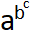

# Registered Features: Descriptions and Implementations (p – t)

[a - e](features_ae.md) | [f - j](features_fj.md) | [k - o](features_ko.md) | p - t | [u - z](features_uz.md)

## Tag: 'palt'

*Friendly name:* Proportional Alternate Widths

*Registered by:* Adobe

*Function:* Re-spaces glyphs designed to be set on full-em widths, fitting them onto individual (more or less proportional) horizontal widths. This differs from 'pwid' in that it does not substitute new glyphs (GPOS, not GSUB). The user might prefer the fixed-width form, or could simply want to ensure that the glyph is well-fit and not rotated in vertical setting (Latin forms designed for proportional spacing would be rotated).

*Example:* The user invokes this feature in a Japanese font to get Latin, Kanji, Kana or Symbol glyphs with the full-width design but individual metrics.

*Recommended implementation:* The font specifies alternate metrics for the full-width glyphs (GPOS lookup type 1).

If a font supports this feature and also supports kerning, it is recommended that kerning for glyphs affected by this feature be implemented using the 'apkn' feature and not the ['kern'](features_ko.md#anchor-features_ko-tag-kern) feature. (The 'kern' feature should still be used for glyphs that have proportional widths by default.) See the ['apkn'](features_ae.md#anchor-features_ae-tag-apkn) feature for more information.

*Application interface:* Discretionary feature: can be applied to glyph runs based on document markup, user control or other application criteria.

*UI suggestion:* This feature should be off by default. See below for details regarding important interactions with other features.

*Script/language sensitivity:* Used mostly in CJKV fonts.

*Feature interaction:* This feature is mutually exclusive to other horizontal glyph-width features (['chws'](features_ae.md#anchor-features_ae-tag-chws), ['fwid'](features_fj.md#anchor-features_fj-tag-fwid), ['halt'](features_fj.md#anchor-features_fj-tag-halt), ['hwid'](features_fj.md#anchor-features_fj-tag-hwid), ['pwid'](#anchor-features_pt-tag-pwid), ['qwid'](#anchor-features_pt-tag-qwid) and ['twid'](#anchor-features_pt-tag-twid)), which should be turned off when it’s applied.

This feature may be used in combination with the ['apkn'](features_ae.md#anchor-features_ae-tag-apkn) or ['kern'](features_ko.md#anchor-features_ko-tag-kern) features. If this feature is activated for a text run, then kerning features can be activated for that run, either by default or by user preference. However, if this feature is not activated, then the 'apkn' and 'kern' features should not be activated for glyphs covered by the lookups for this feature, as the kerning adjustments applied by those features would be inappropriate for glyphs with fixed-width metrics.

See also ['vpal'](features_uz.md#anchor-features_uz-tag-vpal).

## Tag: 'pcap'

*Friendly name:* Petite Capitals

*Registered by:* Tiro Typeworks / Emigre

*Function:* Some fonts contain an additional size of capital letters, shorter than the regular smallcaps and whimsically referred to as petite caps. Such forms are most likely to be found in designs with a small lowercase x-height, where they better harmonize with lowercase text than the taller smallcaps (for examples of petite caps, see the Emigre type families Mrs Eaves and Filosofia). This feature turns glyphs for lowercase characters into petite capitals. Forms related to petite capitals, such as specially designed figures, may be included.

> *Note:* Some languages written with bicameral scripts have special case-mapping behaviors for certain characters. Care is needed by font and application developers to handle these cases correctly. See the ['smcp'](#anchor-features_pt-tag-smcp) feature for more information.

*Example:* The user applies the feature to lowercase or mixed case text and gets petite cap text or text with regular uppercase and petite caps. Note that some designers might extend the petite cap lookups to include uppercase-to-smallcap substitutions, creating a shifting hierarchy of uppercase forms.

*Recommended implementation:* A lookup table for the 'pcap' feature maps lowercase glyphs to the corresponding petite cap forms (GSUB lookup type 1).

Correct handling of case mapping for some languages could require exceptions to be handled using separate language systems. Also, some applications could handle language-specific case mappings by mapping the lowercase characters to appropriate uppercase characters in a temporary buffer and then applying the ['c2pc'](features_ae.md#anchor-features_ae-tag-c2pc) feature. Fonts that implement 'pcap' should also implement the 'c2pc' feature. See the ['smcp'](#anchor-features_pt-tag-smcp) feature for more information.

*Application interface:* Discretionary feature: can be applied to glyph runs based on document markup, user control or other application criteria.

For best handling of language-specific case mapping behaviors, applications can implement petite-cap formatting by mapping lowercase characters to uppercase in a temporary buffer and then applying the ['c2pc'](features_ae.md#anchor-features_ae-tag-c2pc) feature. See the ['smcp'](#anchor-features_pt-tag-smcp) feature for more information.

*UI suggestion:* This feature should be off by default.

*Script/language sensitivity:* Applies only to scripts with both upper- and lowercase forms (e.g. Latin, Cyrillic, Greek).

*Feature interaction:* This feature may be used in combination with other substitution (GSUB) features, whose results it may override.

## Tag: 'pkna'

*Friendly name:* Proportional Kana

*Registered by:* Adobe

*Function:* Replaces kana and kana-related glyphs set on uniform widths (half or full-width) with proportional glyphs.

*Example:* The user invokes this feature in a Japanese font to get a proportional kana glyph instead of a corresponding half-width or full-width kana glyph.

*Recommended implementation:* The font contains alternate kana and kana-related glyphs designed to be set on proportional widths (GSUB lookup type 1).

If a kerning feature is also implemented, the fixed-width glyphs covered by this feature should not be kerned; only the proportional glyphs substituted by this feature should be kerned.

*Application interface:* Discretionary feature: can be applied to glyph runs based on document markup, user control or other application criteria.

*UI suggestion:* This feature should be off by default. See below for details on important feature interactions.

*Script/language sensitivity:* Generally used only in Japanese fonts.

*Feature interaction:* This feature is mutually exclusive to all other horizontal glyph-width features (['chws'](features_ae.md#anchor-features_ae-tag-chws), ['fwid'](features_fj.md#anchor-features_fj-tag-fwid), ['halt'](features_fj.md#anchor-features_fj-tag-halt), ['hwid'](features_fj.md#anchor-features_fj-tag-hwid), ['palt'](#anchor-features_pt-tag-palt), ['pwid'](#anchor-features_pt-tag-pwid), ['qwid'](#anchor-features_pt-tag-qwid), ['twid'](#anchor-features_pt-tag-twid)), which should be turned off when it’s applied.

This feature may be used in combination with the ['kern'](features_ko.md#anchor-features_ko-tag-kern) feature. When this feature is activated on a text run, the 'kern' feature can be activated for that run, either by default or by user preference. (If kerning is activated by default, users should still have the option to disable it while this feature is still active.) With the recommended implementation for this feature (using GSUB, not GPOS), the default, fixed-width glyphs are not kerned. Therefore, if this feature is not activated for a text run but the 'kern' is activated, there should not be any unintended kerning effects for those characters. An application could still deactivate the 'kern' feature when this feature is not activated, however.

## Tag: 'pnum'

*Friendly name:* Proportional Figures

*Registered by:* Microsoft/Adobe

*Function:* Replaces figure glyphs set on uniform (tabular) widths with corresponding glyphs set on glyph-specific (proportional) widths. Tabular widths will generally, but not always, be the default. This feature would not be used in monospaced designs.

*Example:* The user applies this feature to get even spacing for lining figures used as dates in an all-cap headline.

*Recommended implementation:* In order to simplify associated kerning and get the best glyph design for a given width, this feature should use new glyphs for the figures, rather than only adjusting the fit of the tabular glyphs (although some might be simple copies); i.e., not a GPOS feature. A lookup table for the 'pnum' feature maps tabular versions of lining and/or oldstyle figures to corresponding proportional glyphs (GSUB lookup type 1).

*Application interface:* Discretionary feature: can be applied to glyph runs based on document markup, user control or other application criteria.

*UI suggestion:* This feature should be off by default. The application could query the user about this feature when the user changes figure style (['onum'](features_ko.md#anchor-features_ko-tag-onum) or ['lnum'](features_ko.md#anchor-features_ko-tag-lnum)).

*Script/language sensitivity:* None.

*Feature interaction:* This feature overrides the results of the Tabular Figures feature (['tnum'](#anchor-features_pt-tag-tnum)).

## Tag: 'pref'

*Friendly name:* Pre-base Forms

*Registered by:* Microsoft

*Function:* Substitutes the pre-base form of a consonant.

In some scripts of south or southeast Asia, such as Khmer, the conjoined form of certain consonants is always denoted as a pre-base form. In the case of some scripts of south India, variations in writing conventions exist such that a conjoined Ra consonant can be written as a pre-base form, or as a below-base or post-base form. Fonts can be designed to support one or another convention. If a font is designed to support a writing convention in which conjoined Ra is a pre-base form, the Pre-Base Forms feature would be used.

*Example:* In the Khmer script, the consonant Ra has a pre-base subscript form called Coeng Ra. When the sequence of Coeng followed by Ra occurs, its pre-base form is substituted.

*Recommended implementation:* A lookup table for the 'pref' feature maps the sequence required to convert a consonant into its pre-base form (GSUB lookup type 4).

*Application interface:* In recommended usage, this feature triggers substitutions required for correct layout of certain scripts. It should be applied in the appropriate contexts, as determined by script-specific processing requirements. The effect of lookups associated with this feature may be used by the application to control subsequent reordering of conjoined consonant glyphs, as determined by script-specific processing requirements.

*UI suggestion:* Control of the feature should not generally be exposed to the user.

*Script/language sensitivity:* Used for Khmer, Myanmar (Burmese) and other Brahmi-derived scripts that could display a pre-base form of Ra.

*Feature interaction:* This feature is used in conjunction with certain other features to derive required forms of certain Indic and southeast Asian scripts. The application is expected to process this feature and certain other features in an appropriate order to obtain the correct set of basic forms for the given script. For Indic scripts, the following features should be applied in order: ['nukt'](features_ko.md#anchor-features_ko-tag-nukt), ['akhn'](features_ae.md#anchor-features_ae-tag-akhn), ['rphf'](#anchor-features_pt-tag-rphf), ['rkrf'](#anchor-features_pt-tag-rkrf), ['pref'](#anchor-features_pt-tag-pref), ['blwf'](features_ae.md#anchor-features_ae-tag-blwf), ['half'](features_fj.md#anchor-features_fj-tag-half), ['pstf'](#anchor-features_pt-tag-pstf), ['cjct'](features_ae.md#anchor-features_ae-tag-cjct). Other discretionary features for optional typographic effects may also be applied. Lookups for such discretionary features should be processed after lookups for this feature have been processed.

## Tag: 'pres'

*Friendly name:* Pre-base Substitutions

*Registered by:* Microsoft

*Function:* Produces the pre-base forms of conjuncts in Indic scripts. It can also be used to substitute the appropriate glyph variant for pre-base vowel signs.

*Example:* In the Gujarati (Indic) script, the doubling of consonant Ka requires the first Ka to be substituted by its pre-base form. This in turn ligates with the second Ka. Applying this feature would result in the ligature version of the doubled Ka.

*Recommended implementation:* A lookup table for the 'pres' feature maps a sequence of consonants separated by the virama (halant), to the ligated conjunct form (GSUB lookup type 4). In the case of pre-base matra substitution, the appropriate matra can be substituted using contextual substitution (GSUB lookup type 5).

*Application interface:* In recommended usage, this feature triggers substitutions required for correct display of certain scripts. It should be applied in the appropriate contexts, as determined by script-specific processing requirements.

*UI suggestion:* Control of the feature should not generally be exposed to the user.

*Script/language sensitivity:* Used for Indic or other Brahmi-derived scripts.

*Feature interaction:* This feature overrides the results of all other features.

## Tag: 'pstf'

*Friendly name:* Post-base Forms

*Registered by:* Microsoft

*Function:* Substitutes the post-base form of a consonant.

*Example:* In the Gurmukhi (Indic) script, the consonant Ya has a post base form. When the Ya is used as the second consonant in conjunct formation, its post-base form is substituted.

*Recommended implementation:* A lookup table for the 'pstf' feature maps the sequence required to convert a consonant into its post-base form (GSUB lookup type 4).

*Application interface:* In recommended usage, this feature triggers substitutions required for correct display of certain scripts. It should be applied in the appropriate contexts, as determined by script-specific processing requirements.

*UI suggestion:* Control of the feature should not generally be exposed to the user.

*Script/language sensitivity:* Used for scripts of south and southeast Asia that have post-base forms for consonants; e.g., Gurmukhi, Malayalam, Khmer.

*Feature interaction:* This feature is used in conjunction with certain other features to derive required forms of Indic and other related scripts. The application is expected to process this feature and certain other features in an appropriate order to obtain the correct set of basic forms for the given script. For Indic scripts, the following features should be applied in order: ['nukt'](features_ko.md#anchor-features_ko-tag-nukt), ['akhn'](features_ae.md#anchor-features_ae-tag-akhn), ['rphf'](#anchor-features_pt-tag-rphf), ['rkrf'](#anchor-features_pt-tag-rkrf), ['pref'](#anchor-features_pt-tag-pref), ['blwf'](features_ae.md#anchor-features_ae-tag-blwf), ['half'](features_fj.md#anchor-features_fj-tag-half), ['pstf'](#anchor-features_pt-tag-pstf), ['cjct'](features_ae.md#anchor-features_ae-tag-cjct). Other discretionary features for optional typographic effects may also be applied. Lookups for such discretionary features should be processed after lookups for this feature have been processed.

## Tag: 'psts'

*Friendly name:* Post-base Substitutions

*Registered by:* Microsoft

*Function:* Substitutes a sequence of a base glyph and post-base glyph, with its ligature form.

*Example:* In the Malayalam (Indic) script, the consonant Va has a post base form. When the Va is doubled to form a conjunct VVa; the first Va (the base) and the post base form that follows it are substituted with a ligature.

*Recommended implementation:* A lookup table for the 'psts' feature maps identified conjunct formation sequences to corresponding ligatures (GSUB lookup type 4).

*Application interface:* In recommended usage, this feature triggers substitutions required for correct display of certain scripts. It should be applied in the appropriate contexts, as determined by script-specific processing requirements.

*UI suggestion:* Control of the feature should not generally be exposed to the user.

*Script/language sensitivity:* Used for Indic or other Brahmi-derived scripts.

*Feature interaction:* This feature overrides the results of all other features.

## Tag: 'pwid'

*Friendly name:* Proportional Widths

*Registered by:* Adobe

*Function:* Replaces glyphs set on uniform widths (typically full or half-em) with proportionally spaced glyphs. The proportional variants are often used for the Latin characters in CJKV fonts, but may also be used for Kana in Japanese fonts.

*Example:* The user invokes this feature in a Japanese font to get a proportionally spaced glyph instead of a corresponding half-width Roman glyph or a full-width Kana glyph.

*Recommended implementation:* The font substitutes alternate glyphs designed to be set on proportional widths (GSUB lookup type 1).

If a kerning feature is also implemented, the fixed-width glyphs covered by this feature should not be kerned; only the proportional glyphs substituted by this feature should be kerned.

*Application interface:* Discretionary feature: can be applied to glyph runs based on document markup, user control or other application criteria.

*UI suggestion:* Applications may have this feature active or inactive by default depending on their markets. See below for details on important feature interactions.

*Script/language sensitivity:* Although used mostly in CJKV fonts, this feature could be applied in European scripts.

*Feature interaction:* This feature is mutually exclusive to all other horizontal glyph-width features (['chws'](features_ae.md#anchor-features_ae-tag-chws), ['fwid'](features_fj.md#anchor-features_fj-tag-fwid), ['halt'](features_fj.md#anchor-features_fj-tag-halt), ['hwid'](features_fj.md#anchor-features_fj-tag-hwid), ['palt'](#anchor-features_pt-tag-palt), ['pkna'](#anchor-features_pt-tag-pkna), ['qwid'](#anchor-features_pt-tag-qwid), ['twid'](#anchor-features_pt-tag-twid), ['pnum'](#anchor-features_pt-tag-pnum), ['tnum'](#anchor-features_pt-tag-tnum)), which should be turned off when it’s applied.

This feature may be used in combination with the ['kern'](features_ko.md#anchor-features_ko-tag-kern) feature. When this feature is activated on a text run, the 'kern' feature can be activated for that run, either by default or by user preference. (If kerning is activated by default, users should still have the option to disable it while this feature is still active.) With the recommended implementation for this feature (using GSUB, not GPOS), the default, fixed-width glyphs are not kerned. Therefore, if this feature is not activated for a text run but the 'kern' is activated, there should not be any unintended kerning effects for those characters. An application could still deactivate the 'kern' feature when this feature is not activated, however.

## Tag: 'qwid'

*Friendly name:* Quarter Widths

*Registered by:* Adobe

*Function:* Replaces glyphs on other widths with glyphs set on widths of one quarter of an em (half an en). The characters involved are normally figures and some forms of punctuation.

*Example:* The user applies 'qwid' to place a four-digit figure in a single slot in a column of vertical text.

*Recommended implementation:* The font substitutes alternate glyphs designed to be set on quarter-em widths (GSUB lookup type 1), or it specifies alternate metrics for the original glyphs (GPOS lookup type 1), adjusting their spacing to fit in quarter-em widths.

*Application interface:* Discretionary feature: can be applied to glyph runs based on document markup, user control or other application criteria.

*UI suggestion:* This feature should be off by default. See below for details on important feature interactions.

*Script/language sensitivity:* Generally used only in CJKV fonts.

*Feature interaction:* This feature is mutually exclusive to all other horizontal glyph-width features (['chws'](features_ae.md#anchor-features_ae-tag-chws), ['fwid'](features_fj.md#anchor-features_fj-tag-fwid), ['halt'](features_fj.md#anchor-features_fj-tag-halt), ['hwid'](features_fj.md#anchor-features_fj-tag-hwid), ['palt'](#anchor-features_pt-tag-palt), ['pkna'](#anchor-features_pt-tag-pkna), ['pwid'](#anchor-features_pt-tag-pwid), ['twid'](#anchor-features_pt-tag-twid)['pnum'](#anchor-features_pt-tag-pnum), ['tnum'](#anchor-features_pt-tag-tnum)), which should be turned off when it’s applied. When applied to a text run, the ['apkn'](features_ae.md#anchor-features_ae-tag-apkn) and ['kern'](features_ko.md#anchor-features_ko-tag-kern) features should be disabled for that run.

## Tag: 'rand'

*Friendly name:* Randomize

*Registered by:* Adobe

*Function:* In order to emulate the irregularity and variety of handwritten text, this feature allows multiple alternate forms to be used.

*Example:* The user applies this feature in FF Kosmic to get three forms of f in one word.

*Recommended implementation:* A lookup table for the 'rand' feature maps GIDs for default glyphs to one or more GIDs for corresponding alternates (GSUB lookup type 3).

*Application interface:* Discretionary feature: can be applied to glyph runs based on document markup, user control or other application criteria. The feature is designed to be used with an alternate substitution lookup that provides a selection of alternate glyphs for a given character. The application selects one of these either by a pseudo-random algorithm, or by noting the sequence of IDs returned, storing that sequence, and stepping through that set as the corresponding character code is invoked.

*UI suggestion:* When supported by the font, the feature should be enabled by default. In recommended usage, the application selects a glyph alternate automatically and does not need to present the alternates for the user to make a selection.

*Script/language sensitivity:* None.

*Feature interaction:* This feature may be used in combination with other substitution (GSUB) features, whose results it may override.

## Tag: 'rclt'

*Friendly name:* Required Contextual Alternates

*Registered by:* Microsoft

*Function:* In specified situations, replaces default glyphs with alternate forms which provide for better joining behavior or other glyph relationships. Especially important in script typefaces which are designed to have some or all of their glyphs join, but applicable also to other glyph variants to improve spacing. This feature is similar to 'calt', but with the difference that it should not be possible to turn off 'rclt' substitutions: they are considered essential to correct layout of the font.

*Example:* In an Arabic calligraphic font, the 'rclt' feature is used to contextually substitute variant forms of letters sin and yeh providing for a correct join between these two letters that differs from the default join of either letter to other letters.

*Recommended implementation:* A lookup table for the 'rclt' feature specifies the context in which each substitution occurs, and maps one or more default glyphs to replacement glyphs (GSUB lookup type 6).

*Application interface:* In recommended usage, this feature triggers substitutions required for correct display of certain scripts. It should be applied in the appropriate contexts, as determined by script-specific processing requirements. When processing lookups, context before or after the glyph sequence to which the feature is applied should be considered.

*UI suggestion:* Control of this feature should not generally be exposed to the user.

*Script/language sensitivity:* May be used for any script, but is especially important for many styles of Arabic.

*Feature interaction:* This feature may be used in combination with other substitution (GSUB) features, whose results it may override. For complex scripts, lookups for this feature should be ordered and processed after basic script and language shaping features.

## Tag: 'rkrf'

*Friendly name:* Rakar Forms

*Registered by:* Microsoft

*Function:* Produces conjoined forms for consonants with rakar in Devanagari and Gujarati scripts.

In Devanagari and Gujarati scripts, consonant clusters involving Ra following another consonant are denoted by conjoining an alternate form of Ra to the preceding consonant. Depending on the particular syllable, the preceding consonant could be denoted in its full form or as a half form. Because of interactions involving other behaviors of these scripts, a font implementation might need to process substitution lookups for rakar forms and half forms in a particular order to derive the appropriate display for various sequences.

*Example:* In Hindi (Devanagari script), the conjunct KRa is denoted with a conjunct ligature form.

*Recommended implementation:* A lookup table for the 'rkrf' feature maps the sequence of a consonant (the nominal form only) followed by a virama (halant) followed by Ra (the nominal form) to the corresponding conjoined form (GSUB lookup type 4).

*Application interface:* In recommended usage, this feature triggers substitutions required for correct display of certain scripts. It should be applied in the appropriate contexts, as determined by script-specific processing requirements. This feature should be processed before the Half Forms feature; a half form for a given consonant-Ra combination can be derived by subsequent application of the Half Forms feature. This sequential ordering allows for correct display results.

*UI suggestion:* Control of the feature should not generally be exposed to the user.

*Script/language sensitivity:* Used for Devanagari, Gujarati, and other Brahmi-derived scripts.

*Feature interaction:* This feature is used in conjunction with certain other features to derive required forms of Indic scripts. The application is expected to process this feature and certain other features in an appropriate order to obtain the correct set of basic forms: ['nukt'](features_ko.md#anchor-features_ko-tag-nukt), ['akhn'](features_ae.md#anchor-features_ae-tag-akhn), ['rphf'](#anchor-features_pt-tag-rphf), ['rkrf'](#anchor-features_pt-tag-rkrf), ['pref'](#anchor-features_pt-tag-pref), ['blwf'](features_ae.md#anchor-features_ae-tag-blwf), ['half'](features_fj.md#anchor-features_fj-tag-half), ['pstf'](#anchor-features_pt-tag-pstf), ['cjct'](features_ae.md#anchor-features_ae-tag-cjct). Other discretionary features for optional typographic effects may also be applied. Lookups for such discretionary features should be processed after lookups for this feature have been processed.

## Tag: 'rlig'

*Friendly name:* Required Ligatures

*Registered by:* Microsoft

*Function:* Replaces a sequence of glyphs with a single glyph which is preferred for typographic purposes. This feature is used for ligatures that are required for correct display of a script.

*Example:* The Arabic character lam followed by alef will always form a ligated lam-alef form. This ligated form is a requirement of the script’s shaping. The same happens with the Syriac script.

*Recommended implementation:* Glyph sequences are mapped to a single, ligature glyph (GSUB lookup type 4). Note that, if multiple sequences have the same initial sub-sequence, substitutions for longer sequences should be stored ahead of those for shorter sequences.

*Application interface:* In recommended usage, this feature triggers substitutions required for correct display of certain scripts. It should be applied in the appropriate contexts, as determined by script-specific processing requirements.

*UI suggestion:* Control of this feature should not generally be exposed to the user.

*Script/language sensitivity:* Used for Arabic and Syriac. May also be used for other scripts.

*Feature interaction:* This feature may be used in combination with other substitution (GSUB) features, whose results it may override. See also ['liga'](features_ko.md#anchor-features_ko-tag-liga).

## Tag: 'rphf'

*Friendly name:* Reph Form

*Registered by:* Microsoft

*Function:* Substitutes the reph form for a consonant and halant sequence.

*Example:* In the Devanagari (Indic) script, the consonant Ra possesses a reph form. When the Ra is a syllable initial consonant and is followed by the virama, it is repositioned after the post base vowel sign within the syllable, and also substituted with a mark that sits above the base glyph.

*Recommended implementation:* A 'rphf' lookup table maps the sequence of default form of Ra and virama to the reph glyph (GSUB lookup type 4).

*Application interface:* In recommended usage, this feature triggers substitutions required for correct display of certain scripts. It should be applied in the appropriate contexts, as determined by script-specific processing requirements.

*UI suggestion:* Control of the feature should not generally be exposed to the user.

*Script/language sensitivity:* Used for Indic or other Brahmi-derived scripts.

*Feature interaction:* This feature is used in conjunction with certain other features to derive required forms of Indic scripts. The application is expected to process this feature and certain other features in an appropriate order to obtain the correct set of basic forms: ['nukt'](features_ko.md#anchor-features_ko-tag-nukt), ['akhn'](features_ae.md#anchor-features_ae-tag-akhn), ['rphf'](#anchor-features_pt-tag-rphf), ['rkrf'](#anchor-features_pt-tag-rkrf), ['pref'](#anchor-features_pt-tag-pref), ['blwf'](features_ae.md#anchor-features_ae-tag-blwf), ['half'](features_fj.md#anchor-features_fj-tag-half), ['pstf'](#anchor-features_pt-tag-pstf), ['cjct'](features_ae.md#anchor-features_ae-tag-cjct). Other discretionary features for optional typographic effects may also be applied. Lookups for such discretionary features should be processed after lookups for this feature have been processed.

## Tag: 'rtbd'

*Friendly name:* Right Bounds

*Registered by:* Adobe

*Function:* Aligns glyphs by their apparent right extents at the right ends of horizontal lines of text, replacing the default behavior of aligning glyphs by their origins.

*Example:* Succeeding lines ending with r, h and y would shift to the right by differing degrees when the text is right-justified and this feature is applied.

*Recommended implementation:* Values for affected glyphs describe the amount by which the placement and advance width should be altered (GPOS lookup type 1).

*Application interface:* Discretionary feature: can be applied to glyph runs based on document markup, user control or other application criteria. In recommended usage, the application applies this feature to characters at the right end of a horizontal line when paragraphs are right or left and right justified.

*UI suggestion:* This feature should be inactive by default. Applications may expose to users direct control of this feature and also the Left Bounds feature (['lfbd'](features_ko.md#anchor-features_ko-tag-lfbd)), or may automatically activate the feature based on other paragraph layout settings.

*Script/language sensitivity:* None.

*Feature interaction:* Should not be applied to text runs to which fixed-width features (e.g., ['fwid'](features_fj.md#anchor-features_fj-tag-fwid), ['halt'](features_fj.md#anchor-features_fj-tag-halt), ['hwid'](features_fj.md#anchor-features_fj-tag-hwid), ['qwid'](#anchor-features_pt-tag-qwid) and ['twid'](#anchor-features_pt-tag-twid)) or vertical features (e.g., ['vert'](features_uz.md#anchor-features_uz-tag-vert), ['vrt2'](features_uz.md#anchor-features_uz-tag-vrt2), ['vpal'](features_uz.md#anchor-features_uz-tag-vpal), ['valt'](features_uz.md#anchor-features_uz-tag-valt) and ['vhal'](features_uz.md#anchor-features_uz-tag-vhal)) have been applied.

## Tag: 'rtla'

*Friendly name:* Right-to-left Alternates

*Registered by:* Adobe

*Function:* This feature applies glyphic variants (other than mirrored forms) appropriate for right-to-left text. (For mirrored forms, see ['rtlm'](#anchor-features_pt-tag-rtlm).)

*Recommended implementation:* These are required to be glyph substitutions, and it is recommended that they be one-to-one (GSUB lookup type 1).

*Application interface:* See section “Left-to-right and right-to-left text” on the [Advanced Typographic Extensions](ttochap1.md#anchor-ttochap1-left-to-right-and-right-to-left-text) page.

*UI suggestion:* Control of this feature should not generally be exposed to the user.

*Script/language sensitivity:* Right-to-left runs of text.

*Feature interaction:* This feature is to be applied simultaneously with other pre-shaping features such as ['ccmp'](features_ae.md#anchor-features_ae-tag-ccmp) and ['locl'](features_ko.md#anchor-features_ko-tag-locl).

## Tag: 'rtlm'

*Friendly name:* Right-to-left Mirrored Forms

*Registered by:* Adobe

*Function:* This feature applies mirrored forms appropriate for right-to-left text *other* than for those characters that would be covered by the character-level mirroring step performed by an OpenType layout engine. (For right-to-left glyph alternates, see ['rtla'](#anchor-features_pt-tag-rtla).)

*Example:* The 'rtlm' feature replaces the glyph for U+2232, CLOCKWISE CONTOUR INTEGRAL, with one in which the integral sign is mirrored but the circular arrow has retained its direction.

*Recommended implementation:* These are required to be glyph substitutions, and it is recommended that they be one-to-one (GSUB lookup type 1).

*Application interface:* See section “Left-to-right and right-to-left text” on the [Advanced Typographic Extensions](ttochap1.md#anchor-ttochap1-left-to-right-and-right-to-left-text) page.

*UI suggestion:* Control of this feature should not generally be exposed to the user.

*Script/language sensitivity:* Right-to-left runs of text.

*Feature interaction:* This feature is to be applied simultaneously with other pre-shaping features such as ['ccmp'](features_ae.md#anchor-features_ae-tag-ccmp) and ['locl'](features_ko.md#anchor-features_ko-tag-locl).

## Tag: 'ruby'

*Friendly name:* Ruby Notation Forms

*Registered by:* Adobe

*Function:* Japanese typesetting often uses smaller kana glyphs, generally in superscripted form, to clarify the meaning of kanji that might be unfamiliar to the reader. These are called “ruby”, from the old typesetting term for four-point-sized type. This feature identifies glyphs in the font which have been designed for this use, substituting them for the default designs.

*Example:* The user applies this feature to the kana character U+3042, to get the ruby form for annotation.

*Recommended implementation:* The font contains alternate glyphs for all kana characters which are enabled for ruby notation. A lookup table for the 'ruby' feature maps GIDs for default forms to GIDs for corresponding ruby alternates. These are one-to-one substitutions (GSUB lookup type 1).

*Application interface:* Discretionary feature: can be applied to glyph runs based on document markup, user control or other application criteria. After associated lookups are applied, applications may re-size or scale glyphs or perform other positioning or layout adjustments based on other parameters.

*UI suggestion:* This feature should be inactive by default. Applications may offer the user an opportunity to specify the degree of scaling and baseline shift.

*Script/language sensitivity:* Used for Japanese.

*Feature interaction:* This feature overrides the results of any other feature for the affected characters.

## Tag: 'rvrn'

*Friendly name:* Required Variation Alternates

*Registered by:* Microsoft

*Function:* This feature is used in fonts that support OpenType Font Variations in order to select alternate glyphs for particular variation instances. (For background on OpenType Font Variations, see [OpenType Font Variations Overview](otvaroverview.md).)

When a variable font is used, all of the interpolated variants of a given glyph ID have exactly the same contours and points. It is possible to use glyph variation mechanisms to make significant outline changes, such as reducing strokes in heavy-weight or narrow-width variants, but this approach can be difficult to implement and might not produce desired results for all variation instances. Instead, better results for these scenarios might be achieved by substitution to a different glyph ID. The specific substitutions applied would be conditioned by the particular variation instance that is selected by the user. This conditional behavior is implemented using the required variation alternates feature in conjunction with a FeatureVariations table within the GSUB table.

*Example:* A variable font supports weight variations ranging from thin to black. The default glyph for the dollar sign has two vertical strokes running through the full extent of the glyph. In the bold variation instance, the default glyph is substituted to an alternate glyph that has only one vertical stroke. In the black variation instance, the default glyph is substituted to an alternate glyph that has only single vertical bars at the top and bottom extremities, with no vertical bars in the two counters in between.

*Recommended implementation:* The feature is used to activate single substitution (GSUB type 1) lookups, and is always used in conjunction with a FeatureVariations table. Typically, a Feature table referenced in a FeatureRecord with the 'rvrn' tag will have LookupCount set to 0; in this way, the default variation instance does not have any glyph substitution applied but, rather, uses default glyphs. Alternate glyphs for particular variation instances are obtained by adding a substitution of the feature table to an alternate feature table within a FeatureVariations table. Different alternate feature tables can be selected using condition sets that specify particular variation-axis value ranges.

One or more Condition tables are used to determine variation-axis value ranges for which an alternate feature table (and associated lookups) is selected. The axis values used to trigger a condition should normally be midway between values used for named instances. This will avoid any possibility of inconsistent behavior in different applications when using named instances that might arise due to small discrepancies in processing the numeric values.

The default language system for the DFLT script can reference a feature record for this feature with a feature table that will be substituted for particular variation instances to use lookups that apply default, language-independent glyph substitutions; this feature record should be the first feature record for this feature. Some applications may choose to process this feature without processing other features or the script/language system hierarchy; for this purpose, they should choose the first feature record for this feature to obtain the most suitable substitutions for language-independent results.

*Application interface:* Application of the 'rvrn' feature is mandatory in implementations that support OpenType Font Variations whenever a variable font is in use. The feature should be processed in any layout process that supports use of variations, even if other OpenType Layout processing is not supported.

The feature is applied only during the process of deriving final glyph IDs (GSUB); it is not used for glyph positioning (GPOS). It should be processed early in GSUB processing, before application of the localized forms feature or features related to shaping of complex scripts or discretionary typographic effects.

Processing of the 'rvrn' feature also requires processing of the FeatureVariations table. ConditionSet tables are scanned for a ConditionSet matching the current variation instance, and then a corresponding FeatureTableSubstitution table is used to locate an alternate feature table. For complete details on processing a FeatureVariations table, see [OpenType Layout Common Table Formats](chapter2.md).

When an applicable feature table is located, only single substitution (GSUB type 1) lookups are processed; any other lookup types are ignored. For any glyph IDs in the coverage table, the application passes the glyph ID to the lookup, and gets back the new glyph ID.

*UI suggestion:* The 'rvrn' feature is mandatory: it should be active by default and not directly exposed to user control.

*Script/language sensitivity:* None.

*Feature interaction:* The feature should be processed early after initial character-to-glyph mapping, before application of the localized forms ('locl') feature, any features related to shaping of complex scripts, or any discretionary features.

## Tag: 'salt'

*Friendly name:* Stylistic Alternates

*Registered by:* Adobe

*Function:* Many fonts contain alternate glyph designs for a purely esthetic effect; these don’t always fit into a clear category like swash or historical. As in the case of swash glyphs, there could be more than one alternate form. This feature replaces the default forms with the stylistic alternates.

*Example:* The user applies this feature to Industria to get the alternate form of g.

*Recommended implementation:* A lookup table for the 'salt' feature maps GIDs for default forms to one or more GIDs for corresponding stylistic alternatives. While many of these substitutions are one-to-one (GSUB lookup type 1), others require a selection from a set (GSUB lookup type 3). A font developer can choose to build two tables (one for each lookup type) or only one which uses lookup type 3 for all substitutions. As in any one-from-many substitution, alternates present in more than one face should be ordered consistently across a family, so that those alternates can work correctly when switching between family members.

*Application interface:* Discretionary feature: can be applied to glyph runs based on document markup, user control or other application criteria. If implemented in a font using an alternate substitution lookup, the application selects one of the alternative glyphs based on user choice or other criteria.

*UI suggestion:* This feature should be inactive by default. When implemented in the font using an alternate substitution lookup, an application could display the forms sequentially in context, or present a palette showing all the forms at once, or give the user a choice between these approaches. The application may assume that the first glyph in a set is the preferred form, so the font developer should order them accordingly.

*Script/language sensitivity:* None.

*Feature interaction:* This feature may be used in combination with other substitution (GSUB) features, whose results it may override.

## Tag: 'sinf'

*Friendly name:* Scientific Inferiors

*Registered by:* Microsoft/Adobe

*Function:* Replaces lining or oldstyle figures (digits) with inferior figures (smaller glyphs which sit lower than the standard baseline, primarily for chemical or mathematical notation). May also replace glyphs for lowercase characters with alphabetic inferiors.

*Example:* The application can use this feature to automatically access the inferior figures (more legible than scaled figures).

*Recommended implementation:* Glyphs for figures (digits) are mapped to corresponding inferior forms (GSUB lookup type 1).

*Application interface:* Discretionary feature: can be applied to glyph runs based on document markup, user control or other application criteria.

*UI suggestion:* This feature should be off by default.

*Script/language sensitivity:* None.

*Feature interaction:* This feature may be used in combination with other substitution (GSUB) features, whose results it may override.

## Tag: 'size'

> *Note:* Use of this feature has been superseded by the STAT table. See “Families with Optical Size Variants” in the [Recommendations](recom.md#anchor-recom-families-with-optical-size-variants) section for more information.

*Friendly name:* Optical size

*Registered by:* Adobe

*Function:* This feature stores two kinds of information about the optical size of the font: design size (the point size for which the font is optimized) and size range (the range of point sizes which the font can serve well), as well as other information which helps applications use the size range. The design size is useful for determining proper tracking behavior. The size range is useful in families which have fonts covering several ranges. Additional values serve to identify the set of fonts which share related size ranges, and to identify their shared name. Note that sizes refer to nominal final output size and are independent of viewing magnification or resolution.

*Example:* The 'size' information in Bell Centennial is \[60 0 0 0 0\]. This tells an application that the font’s design size is six points, so larger sizes might need proportionate reduction in default inter-glyph spacing. The 'size' information in Minion Pro Semibold Condensed Subhead is \[180 3 257 139 240\]. These values tell an application that:

- The font’s design size is 18 points;
- This font is part of a subfamily of fonts that differ only by the size range which each covers, and which share the arbitrary identifier number 3;
- ID 257 in the 'name' table is the suggested menu name for this subfamily. In this case, the string at name ID 257 is Semibold Condensed;
- This font is the recommended choice from sizes greater than 13.9-point up through 24-points.

*Required implementation:*

The Feature table of this GPOS feature must not reference any lookups; its featureParamsOffset field records an offset from the beginning of the Feature table to an array of five uint16 values. The size feature must be implemented in all fonts in any family which uses the feature. In this usage, a family is a set of fonts which share a Typographic Family name (name ID 16), or Font Family name (name ID 1) if the Typographic Family name is absent.

- The first value represents the design size in 720/inch units (decipoints). The design size entry must be non-zero. When there is a design size but no recommended size range, the rest of the array must consist of zeros.
- The second value has no independent meaning but serves as an identifier that associates fonts in a subfamily. All fonts which share a Typographic or Font Family name and which differ only by size range shall have the same subfamily value, and no fonts which differ in weight or style shall have the same subfamily value. If this value is zero, the remaining fields in the array shall be ignored.
- The third value enables applications to use a single name for the subfamily identified by the second value. If the preceding value is non-zero, this value must be set in the range 256 – 32767 (inclusive). It records the value of a field in the 'name' table, which must contain English-language strings encoded in Windows Unicode and Macintosh Roman, and may contain additional strings localized to other scripts and languages. Each of these strings is the name an application should use, in combination with the family name, to represent the subfamily in a menu. Applications will choose the appropriate version based on their selection criteria.
- The fourth and fifth values represent the small end of the recommended usage range (exclusive) and the large end of the recommended usage range (inclusive), stored in 720/inch units (decipoints). Ranges must not overlap and should generally be contiguous.

*Application interface:* When the user specifies a size, the application checks for a 'size' feature in the active font. If none is found, the application follows its default behavior. If one is found, the application follows the specified offset to retrieve the five values.

- *Design size:* Applications which offer size-based tracking have a pre-defined curve which they can apply. By default, this curve should be set to produce no adjustment at the font’s design size (first value in the array, in decipoints).
- *Size ranges:* If the second value in the 'size' array is non-zero, the font has a recommended size range. When any such font is selected by the user, the application builds a list of all fonts with this subfamily value and the same Typographic Family name, and notes the size range in the current font. Applications might want to cache the subfamily list at this point. If the specified size falls in the current font’s range, the application uses the current font. If not, the application checks the other ranges in the subfamily, and if the specified size falls in one of them, uses that font. If the specified size is not in any range present, the font with the range closest to the specified value is used. If the specified size falls exactly between two ranges, the range with the larger values is used. Since adding or removing fonts from a subfamily could cause reflow, applications should note which fonts are used for which text.

*UI suggestion:* This feature should be active by default. Applications can present the tracking curve to the user for adjustments via a GUI. At start-up, and when fonts are added or removed, applications might want to build a list of fonts with such ranges and display the filtered subfamily names in their font selection UI, with each filtered name representing the full set of related sizes. Applications could also present a setting which allows the user to select non-default sizes (for example, in the case where final output is intended for on-screen viewing, a smaller optical size will produce better results). In such a case, the font-selection UI should present the unfiltered names. Applications should notify the user if fonts are removed or added from a subfamily with size ranges, and query about desired behavior.

*Script/language sensitivity:* None.

*Feature interaction:* None.

## Tag: 'smcp'

*Friendly name:* Small Capitals

*Registered by:* Microsoft/Adobe

*Function:* This feature turns glyphs for lowercase characters into small capitals. It is generally used for display lines set in Large & small caps, such as titles. Forms related to small capitals, such as oldstyle figures, may be included.

> *Note:* Some languages written with bicameral scripts have special case-mapping behaviors for certain characters. Care is needed by font and application developers to handle these cases correctly. See section “5.18 Case Mappings” of [*The Unicode Standard*](https://www.unicode.org/versions/latest/) for more information.

*Example:* The user applies this feature to text with mixed capitals and lowercase and gets mixed capitals and small cap glyphs.

*Recommended implementation:* Glyphs for lowercase characters are mapped to the corresponding small-cap forms (GSUB lookup type 1).

Correct handling of case mapping for some languages could require exceptions to be handled using separate language systems. For example, correct handling of Turkish dotted and undotted i could be implemented using a 'TRK ' language system, with appropriate mappings directly in a lookup for the 'smcp' feature or in concert with the 'locl' feature. Also, some applications might handle language-specific case mappings by mapping the lowercase characters to appropriate uppercase characters in a temporary buffer and then applying the ['c2sc'](features_ae.md#anchor-features_ae-tag-c2sc) feature. Fonts that implement 'smcp' should also implement the 'c2sc' feature.

*Application interface:* Discretionary feature: can be applied to glyph runs based on document markup, user control or other application criteria.

For best handling of language-specific case mapping behaviors, applications can implement small-cap formatting by mapping lowercase characters to uppercase in a temporary buffer and then applying the ['c2sc'](features_ae.md#anchor-features_ae-tag-c2sc) feature. The uppercase mapping can make use of Unicode special-casing data in the Unicode Character Database ([SpecialCasing.txt](https://unicode.org/Public/UNIDATA/SpecialCasing.txt)). Lookups for 'smcp' should still be applied to characters that do not have an uppercase mapping, or if a font does not support some uppercased characters using the 'c2sc' feature.

*UI suggestion:* This feature should be off by default.

*Script/language sensitivity:* Used for bicameral scripts (i.e. those with case differences), such as Latin, Greek, Cyrillic, and Armenian.

*Feature interaction:* This feature may be used in combination with other substitution (GSUB) features, whose results it may override. Also see ['c2sc'](features_ae.md#anchor-features_ae-tag-c2sc).

## Tag: 'smpl'

*Friendly name:* Simplified Forms

*Registered by:* Adobe

*Function:* Replaces “traditional” Chinese or Japanese forms with the corresponding “simplified” forms.

*Example:* The user gets the glyph for U+53F0 when this feature is applied to U+6AAF, U+81FA, or U+98B1.

*Recommended implementation:* A lookup table for the 'smpl' feature maps each traditional form in a font to a corresponding simplified form (GSUB lookup type 1). Note that more than one traditional form could map to a single simplified form.

*Application interface:* Discretionary feature: can be applied to glyph runs based on document markup, user control or other application criteria. Note that the effect of this feature is effectively equivalent to a change of character codes. Besides the original character codes, the application should store the character codes for the new glyphs.

*UI suggestion:* This feature should be off by default, but could be made the default by a user preference setting.

*Script/language sensitivity:* Used only for Chinese and Japanese.

*Feature interaction:* This feature is mutually exclusive to most other features, which should be turned off when it’s applied. Exceptions include the ['palt'](#anchor-features_pt-tag-palt), ['vert'](features_uz.md#anchor-features_uz-tag-vert) and ['vrt2'](features_uz.md#anchor-features_uz-tag-vrt2) features, which may be used in addition. The ['trad'](#anchor-features_pt-tag-trad) and ['tnam'](#anchor-features_pt-tag-tnam) features are mutually exclusive to and override the results of 'smpl'.

## Tag: 'ss01' - 'ss20'

*Friendly name:* Stylistic Set 1 - Stylistic Set 20

*Registered by:* Tiro Typeworks

*Function:* Selects typographic alternatives for a set of glyphs.

Instead of, or in addition to, stylistic alternatives of individual glyphs (see the ['salt'](#anchor-features_pt-tag-salt) feature), some fonts can contain sets of stylistic variant glyphs corresponding to portions of the character set, e.g., multiple variants for lowercase letters in a Latin font. Glyphs in stylistic sets could be designed to harmonize visually, to interact in particular ways, or otherwise work together. Examples of fonts including stylistic sets are Zapfino Linotype and Adobe’s Poetica. Individual features numbered sequentially with the tag name convention 'ss01', 'ss02', 'ss03'… 'ss20' provide a mechanism for glyphs in these sets to be associated via GSUB lookup indices to default forms and to each other, and for users to select from available stylistic sets.

Use of the stylistic set features is not limited to substitutions in the GSUB table. For example, a stylistic set feature could be used to provide alternate mark positioning or alternate kerning for certain glyphs.

*Recommended implementation:* An 'ss*XX*' lookup table maps GIDs for default forms to GIDs for corresponding stylistic alternatives in each set. Each 'ss*XX*' feature uses one-to-one (GSUB lookup type 1) substitutions. Font developers can choose to map only from default forms to variants for each stylistic set, or could choose to map between all stylistic sets in each feature, depending on intended user experience. For example, feature 'ss03' might contain lookups mapping variant glyphs from 'ss01' and 'ss02' to corresponding variants in 'ss03', in addition to mapping from default forms.

The featureParamsOffset field of the Feature Table of these features may be set to 0, or to an offset to a Feature Parameters table comprising two successive uint16 values, as follows:

- *Version (set to 0):* This corresponds to a “minor” version number. Additional data may be added to the end of this Feature Parameters table in the future.
- *uiLabelNameID:* The ['name'](name.md) table name ID that specifies a string (or strings, for multiple languages) for a user-interface label for this feature. The value of uiLabelNameId is expected to be in the font-specific name ID range (256 – 32767), though that is not a requirement in this Feature Parameters specification. The user-interface label for the feature can be provided in multiple languages. An English string should be included as a fallback. The string should be kept to a minimal length to fit comfortably with different application interfaces.

*Application interface:* Discretionary features: can be applied to glyph runs based on document markup, user control or other application criteria.

*UI suggestion:* These features should be off by default. This set of features are not mutually exclusive, hence it should be possible to activate any combination of them. Note that the application is responsible for counting and enumerating the number of features in the font with tag names of the format 'ss01' to 'ss20', and for presenting the user with an appropriate selection mechanism.

*Script/language sensitivity:* None.

*Feature interaction:* These features may be used in combination with other substitution (GSUB) or positioning (GPOS) features, whose results they may override. Also, this set of features are not mutually exclusive. For instance, different stylistic set features could affect different subsets of glyphs. Also, they could have complementary effects that combine (for example, deep descenders and swash terminals). Note that after an 'ss*XX*' feature has been applied, the user might wish to apply glyph-specific features, e.g. ['salt'](#anchor-features_pt-tag-salt), to individual glyphs in the resulting layout; font developers are responsible for ordering substitution lookups to obtain desired user experience.

## Tag: 'ssty'

*Friendly name:* Math Script-style Alternates

*Registered by:* Microsoft

*Function:* This feature provides glyph variants adjusted to be more suitable for use in subscripts and superscripts within math formulas. The script style forms should not be scaled or moved in the font; scaling and moving them is done by the math layout engine. Instead, the 'ssty' feature should provide glyph forms that result in shapes that look good as superscripts and subscripts when scaled and positioned by the Math engine. When designing the script forms, the font developer may assume that the scriptPercentScaleDown and scriptScriptPercentScaleDown values in the MATH.MathConstants table will be the scaling factors used by the Math engine.

This feature can have a parameter indicating the script level: 1 for simple subscripts and superscripts, 2 for second level subscripts and superscripts (that is, scripts on scripts), and so on. (Currently, only the first two alternates are used). For glyphs that are not covered by this feature, the original glyph is used in subscripts and superscripts.

*Example:* In the formula , the glyph for the letter b will be substituted with a script level 1 variant, and the glyph for the letter c will be substituted with a script level 2 variant.

*Recommended implementation:* Alternate substitution (GSUB lookup type 3), with parameter 1 or 2 corresponding to subscript or superscript level, as described above. If there are no second-level alternates defined in the font, single substitution can also be used. Glyphs that don’t have script alternates can be omitted from lookups for this feature. See the [MATH](math.md) table specification for details.

*Application interface:* In recommended usage, this feature is used to trigger substitutions that are required for correct display of math formula. It should be applied to individual glyphs in appropriate contexts under the control of a math layout handler. If implemented in a font using an alternate substitution lookup, the first or second alternate glyph should be selected depending on the nesting level within the math formula. See the ['MATH' table](math.md#anchor-math-opentype-layout-tags-used-with-the-math-table) chapter for additional information.

*UI suggestion:* Control of the feature should not generally be exposed to the user.

*Script/language sensitivity:* Used for math formula layout.

*Feature interaction:* None.

## Tag: 'stch'

*Friendly name:* Stretching Glyph Decomposition

*Registered by:* Microsoft

*Function:* Unicode characters that enclose other characters, such as the Syriac Abbreviation Mark (U+070F), need to be able to stretch in order to dynamically adapt to the width of the enclosed text. This feature defines a decomposition set consisting of an odd number of glyphs that can be used to dynamically generate the stretching glyph. The odd numbered glyphs in the decomposition are fixed reference points that are distributed evenly from the start to the end of the enclosed text. The even numbered glyphs may be repeated as necessary in the text presentation to fill the space between the fixed glyphs. The first and last glyphs may either be simple glyphs with width at the baseline, or mark glyphs. All other decomposition glyphs should have width but must be defined as mark glyphs.

*Example:* In Syriac, the character 0x070F is a control character that is rendered as a line above an abbreviation in Syriac script. The line should have a circle at each end and at the mid point. The decomposition sequence for this character should consist of a circle at the start of a line, a connecting line, a circle on a line for the mid point, a second connecting line, and a circle at the end of the line. The connecting lines will repeat in order to fill the space between the circle glyphs.

*Recommended implementation:* The default glyph for a character that requires stretching is mapped to a sequence comprised of an odd number of corresponding glyphs (GSUB lookup type 2).

*Application interface:* For characters that require stretching, such as Syriac abbreviation mark (U+070F), the 'stch' feature is applied. If the default glyph for the character is in the coverage of an associated lookup subtable, the mapped glyph sequence is retrieved. The last glyph of the substitute sequence is reordered to the end of the sequence of glyphs to be enclosed or encompassed. The remaining glyphs from the substitution sequence are inserted before the sequence of glyphs to be enclosed. Odd-numbered glyphs in the substitution sequence are positioned so as to be distributed evenly over the width of text being enclosed. Even-numbered glyphs are repeated so that the spaces between the odd-numbered glyphs are filled.

*UI suggestion:* Control of this feature should not generally be exposed to the user.

*Script/language sensitivity:* None

*Feature interaction:* None

## Tag: 'subs'

*Friendly name:* Subscript

*Registered by:* Microsoft/Adobe

*Function:* The 'subs' feature is used to present subscript forms.

*Recommended implementation:* First, a single or contextual substitution lookup implements the subscript glyph (GSUB lookup type 1). Then, if the glyph needs repositioning, a single adjustment, pair adjustment, or contextual adjustment positioning lookup is used to modify its position (GPOS lookup type 1 or type 2, or a contextual lookup that references a type 1 or type 2 lookup).

*Application interface:* Discretionary feature: can be applied to glyph runs based on document markup, user control or other application criteria. Note that, for some Unicode characters, the effect of this feature is effectively equivalent to a change of character codes. In such cases, besides the original character codes, the application should store the character code for the new glyph.

*UI suggestion:* This feature should be off by default.

*Script/language sensitivity:* None.

*Feature interaction:* This feature may be used in combination with other substitution (GSUB) features, whose results it may override.

## Tag: 'sups'

*Friendly name:* Superscript

*Registered by:* Microsoft/Adobe

*Function:* Replaces lining or oldstyle figures with superior figures (primarily for footnote indication), and replaces lowercase letters with superior letters (primarily for abbreviated French titles).

*Example:* The application can use this feature to automatically access the superior figures (more legible than scaled figures) for footnotes, or the user can apply it to “Mssr” to get the classic form.

*Recommended implementation:* A lookup table for the 'sups' feature maps figures and lowercase letters to the corresponding superior forms (GSUB lookup type 1).

*Application interface:* Discretionary feature: can be applied to glyph runs based on document markup, user control or other application criteria. Note that, for some Unicode characters, the effect of this feature is effectively equivalent to a change of character codes. In such cases, besides the original character codes, the application should store the character code for the new glyph.

*UI suggestion:* This feature should be off by default.

*Script/language sensitivity:* None.

*Feature interaction:* This feature may be used in combination with other substitution (GSUB) features, whose results it may override.

## Tag: 'swsh'

*Friendly name:* Swash

*Registered by:* Microsoft/Adobe

*Function:* This feature replaces default character glyphs with corresponding swash glyphs. More than one swash alternate may be provided for a given character.

*Example:* The user inputs the ampersand character when setting text with Poetica with this feature active and is presented with a choice of the 63 ampersand forms in that face.

*Recommended implementation:* A lookup table for the 'swsh' feature maps GIDs for default forms to those for one or more corresponding swash forms. While many of these substitutions are one-to-one (GSUB lookup type 1), others require a selection from a set (GSUB lookup type 3). A font developer can choose to build two tables (one for each lookup type) or only one which uses lookup type 3 for all substitutions. If several styles of swash are present across the font, the set of forms for each character should be ordered consistently.

*Application interface:* Discretionary feature: can be applied to glyph runs based on document markup, user control or other application criteria. If implemented in a font using an alternate substitution lookup, the application selects one of the alternative glyphs based on user choice or other criteria.

*UI suggestion:* This feature should be inactive by default. When implemented in the font using an alternate substitution lookup, an application could display the alternate forms sequentially in context, or present a palette showing all the forms at once, or give the user a choice between these approaches. The application may assume that the first glyph in a set is the preferred form, so the font developer should order them accordingly.

*Script/language sensitivity:* Not used for ideographic scripts.

*Feature interaction:* This feature may be used in combination with other substitution (GSUB) features, whose results it may override.

## Tag: 'titl'

*Friendly name:* Titling

*Registered by:* Adobe

*Function:* This feature replaces the default glyphs with corresponding forms designed specifically for titling. These may be all-capital or larger on the body and adjusted for viewing at larger sizes.

*Example:* The user applies this feature in Adobe Garamond to get the titling caps.

*Recommended implementation:* A lookup table for the 'titl' feature maps default forms to corresponding titling forms (GSUB lookup type 1).

*Application interface:* Discretionary feature: can be applied to glyph runs based on document markup, user control or other application criteria.

*UI suggestion:* This feature should be off by default.

*Script/language sensitivity:* None.

*Feature interaction:* This feature may be used in combination with other substitution (GSUB) features, whose results it may override.

## Tag: 'tjmo'

*Friendly name:* Trailing Jamo Forms

*Registered by:* Microsoft

*Function:* Substitutes the form for a Hangul trailing consonant jamo used in a jamo cluster.

*Example:* In Hangul script, the jamo cluster is composed of three parts: leading consonant, vowel, and trailing consonant. When a trailing jamo is found, an alternate trailing jamo form is substituted as required for that cluster.

*Recommended implementation:* The default glyph for a trailing jamo is mapped into an alternate form required for conjoining in a syllable (GSUB lookup type 1, or a contextual substitution referencing a type 1 lookup).

*Application interface:* In recommended usage, this feature triggers substitutions required for correct layout of Hangul script. It should be applied in the appropriate contexts, as determined by script-specific processing requirements.

*UI suggestion:* Control of this feature should not generally be exposed to the user.

*Script/language sensitivity:* Used for Hangul script, particularly when Unicode conjoining jamo characters are used.

*Feature interaction:* This feature overrides the results of all other features.

## Tag: 'tnam'

*Friendly name:* Traditional Name Forms

*Registered by:* Adobe

*Function:* Replaces “simplified” Japanese kanji forms with the corresponding “traditional” forms. This is equivalent to the Traditional Forms feature, but explicitly limited to the traditional forms considered proper for use in personal names (as many as 205 glyphs in some fonts).

*Example:* The user applies this feature to U+4E9C and gets the glyph for U+4E9E.

*Recommended implementation:* A lookup table for the 'tnam' feature maps simplified forms in a font to corresponding traditional forms which can be used in personal names (GSUB lookup type 1). The application stores a record of any simplified forms which resulted from substitutions (the ['smpl'](#anchor-features_pt-tag-smpl) feature); for such forms, applying the 'tnam' feature undoes the previous substitution.

*Application interface:* Discretionary feature: can be applied to glyph runs based on document markup, user control or other application criteria. Note that the effect of this feature is effectively equivalent to a change of character codes. Besides the original character code, the application should store the character code for the new glyph.

*UI suggestion:* This feature should be off by default.

*Script/language sensitivity:* Used only for Japanese.

*Feature interaction:* Characters affected by this feature could include some characters also affected by the Proportional Alternate Widths feature (['palt'](#anchor-features_pt-tag-palt)). The ['trad'](#anchor-features_pt-tag-trad) and 'tnam' features are mutually exclusive to and override the results of ['smpl'](#anchor-features_pt-tag-smpl).

## Tag: 'tnum'

*Friendly name:* Tabular Figures

*Registered by:* Adobe

*Function:* Replaces figure glyphs set on proportional widths with corresponding glyphs set on uniform (tabular) widths. Tabular widths will generally, but not always, be the default. This feature would not be used in monospaced designs.

*Example:* The user applies this feature to get oldstyle figures that align vertically in a column.

*Recommended implementation:* In order to simplify associated kerning and get the best glyph design for a given width, this feature should use new glyphs for the figures, rather than only adjusting the fit of the proportional glyphs (although some might be simple copies); i.e., not a GPOS feature. A lookup table for the 'tnum' feature maps proportional versions of lining or oldstyle figures to corresponding tabular glyphs (GSUB lookup type 1).

*Application interface:* Discretionary feature: can be applied to glyph runs based on document markup, user control or other application criteria.

*UI suggestion:* This feature should be off by default. The application could query the user about this feature when the user changes figure style (['onum'](features_ko.md#anchor-features_ko-tag-onum) or ['lnum'](features_ko.md#anchor-features_ko-tag-lnum)).

*Script/language sensitivity:* None.

*Feature interaction:* This feature overrides the results of the Proportional Figures feature (['pnum'](#anchor-features_pt-tag-pnum)).

## Tag: 'trad'

*Friendly name:* Traditional Forms

*Registered by:* Adobe

*Function:* Replaces 'simplified' Chinese hanzi or Japanese kanji forms with the corresponding 'traditional' forms.

*Example:* The user inputs U+53F0 and is offered a choice of glyphs corresponding to characters U+6AAF, U+81FA, or U+98B1.

*Recommended implementation:* A lookup table for the 'trad' feature maps each simplified form in a font to one or more traditional forms. While many of these substitutions are one-to-one (GSUB lookup type 1), others require a selection from a set (GSUB lookup type 3). A font developer can choose to build two tables (one for each lookup type) or only one which uses lookup type 3 for all substitutions. As in any one-from-many substitution, alternates present in more than one face should be ordered consistently across a family, so that those alternates can work correctly when switching between family members.

*Application interface:* Discretionary feature: can be applied to glyph runs based on document markup, user control or other application criteria. If implemented in a font using an alternate substitution lookup, the application selects one of the alternative glyphs based on user choice or other criteria. The application stores a record of any simplified forms which resulted from substitutions (the ['smpl'](#anchor-features_pt-tag-smpl) feature); for such forms, applying the 'trad' feature undoes the previous substitution. Note that the effect of this feature is effectively equivalent to a change of character codes. Besides the original character code, the application should store the character code for the new glyph.

*UI suggestion:* This feature should be inactive by default. If there’s no record of a conversion from traditional to simplified, the user should be offered a set of possibilities from which to select. The application can note the user’s choice and offer it as a default the next time the source simplified character is encountered. In the absence of such prior information, the application may assume that the first glyph in a set is the preferred form, so the font developer should order them accordingly.

*Script/language sensitivity:* Used only for Chinese and Japanese.

*Feature interaction:* Characters affected by this feature could include some characters also affected by the Proportional Alternate Widths feature (['palt'](#anchor-features_pt-tag-palt)). The 'trad' and ['tnam'](#anchor-features_pt-tag-tnam) features are mutually exclusive to and override the results of ['smpl'](#anchor-features_pt-tag-smpl).

## Tag: 'twid'

*Friendly name:* Third Widths

*Registered by:* Adobe

*Function:* Replaces glyphs on other widths with glyphs set on widths of one third of an em. The characters involved are normally figures and some forms of punctuation.

*Example:* The user applies 'twid' to place a three-digit figure in a single slot in a column of vertical text.

*Recommended implementation:* The font substitutes alternate glyphs designed to be set on third-em widths (GSUB lookup type 1), or it specifies alternate metrics for the original glyphs (GPOS lookup type 1), adjusting their spacing to fit in third-em widths.

*Application interface:* Discretionary feature: can be applied to glyph runs based on document markup, user control or other application criteria.

*UI suggestion:* This feature should be off by default. See below for details on important feature interactions.

*Script/language sensitivity:* Generally used only in CJKV fonts.

*Feature interaction:* This feature is mutually exclusive to all other horizontal glyph-width features (['chws](features_ae.md#anchor-features_ae-tag-chws), ['fwid'](features_fj.md#anchor-features_fj-tag-fwid), ['halt'](features_fj.md#anchor-features_fj-tag-halt), ['hwid'](features_fj.md#anchor-features_fj-tag-hwid), ['palt'](#anchor-features_pt-tag-palt), ['pkna'](#anchor-features_pt-tag-pkna), ['pwid'](#anchor-features_pt-tag-pwid), ['qwid'](#anchor-features_pt-tag-qwid), ['pnum'](#anchor-features_pt-tag-pnum), ['tnum'](#anchor-features_pt-tag-tnum)), which should be turned off when it’s applied. When applied to a text run, the ['apkn'](features_ae.md#anchor-features_ae-tag-apkn) ['kern'](features_ko.md#anchor-features_ko-tag-kern) features should be disabled for that run.
