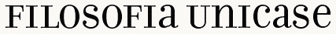

# Registered Features: Descriptions and Implementations (u – z)

[a - e](features_ae.md) | [f - j](features_fj.md) | [k - o](features_ko.md) | [p - t](features_pt.md) | u - z

## Tag: 'unic'

*Friendly name:* Unicase

*Registered by:* Tiro Typeworks / Emigre

*Function:* This feature maps uppercase and lowercase letters to a mixed set of lowercase and small capital forms, resulting in a single case alphabet. (For an example of unicase, see the Emigre type family Filosofia.) The letters substituted can vary from font to font, as appropriate to the design. If aligning to the x-height, smallcap glyphs can be substituted, or specially designed unicase forms might be used. Substitutions might also include specially designed figures.

*Example:* The user enters text as uppercase, lowercase or mixed case, and gets unicase text.

*Recommended implementation:* Uppercase and lowercase glyphs are mapped to corresponding unicase forms (GSUB lookup type 1).

*Application interface:* Discretionary feature: can be applied to glyph runs based on document markup, user control or other application criteria.

*UI suggestion:* This feature should be off by default.

*Script/language sensitivity:* Used for bicameral scripts (i.e. those with case differences), such as Latin, Greek, Cyrillic, and Armenian.

*Feature interaction:* This feature may be used in combination with other substitution (GSUB) features, whose results it may override.

## Tag: 'valt'

*Friendly name:* Alternate Vertical Metrics

*Registered by:* Adobe

*Function:* Repositions glyphs to visually center them within full-height metrics, for use in vertical setting. Applies to full-width Latin, Greek, or Cyrillic glyphs, which are typically included in East Asian fonts, and whose glyphs are aligned on a common horizontal baseline and not rotated relative to the page or text frame.

*Example:* Applying this feature would shift a Roman h down, or y up, from their default full-width positions.

*Recommended implementation:* The font specifies alternate metrics for the original glyphs (GPOS lookup type 1, yPlacement).

Note that same functionality can be accomplished by setting glyph vertical origins through the use of appropriate topSideBearing values in the ['vmtx'](vmtx.md) table and (only for fonts with CFF or CFF2 outlines) corresponding vertOriginY values in the [VORG](vorg.md) table. This method is recommended as it provides the desired spacing for vertical layout by default. Fonts that include 'vmtx' or VORG tables should not implement this feature.

*Application interface:* Should be applied to runs of characters for applicable scripts in vertical text layout.

*UI suggestion:* This feature should be active by default in vertical-setting contexts.

*Script/language sensitivity:* Used for scripts with vertical writing modes.

*Feature interaction:* This feature is mutually exclusive to all other glyph-height features (e.g., ['vhal'](#anchor-features_uz-tag-vhal) and ['vpal'](#anchor-features_uz-tag-vpal)), which should be turned off when it’s applied. When applied to a run of text, the ['vapk'](#anchor-features_uz-tag-vapk) and ['vkrn'](#anchor-features_uz-tag-vkrn) features should be disabled for that run.

## Tag: 'vapk'

*Friendly name:* Kerning for Alternate Proportional Vertical Metrics

*Registered by:* Adobe/Microsoft

*Function:* In vertical text layout, applies kerning adjustments to glyphs that have fixed advance heights by default but have been adjusted to proportional heights by application of the ['vpal'](#anchor-features_uz-tag-vpal) feature.

*Example:* A user activates proportional vertical metrics ('vpal') in Japanese text, which results in some glyphs that have fixed advance heights by default now having proportional heights. By activating the 'vapk' feature as well, those glyphs are then vertically kerned with other glyphs.

*Recommended implementation:* The font vertically kerns Kanji, Kana, Latin, punctuation, or other glyphs that have fixed-height metrics by default if those glyphs are also adjusted to proportional heights by the 'vpal' feature.

Primarily intended for use in the GPOS table. Positioning adjustments can be implemented using GPOS pair-adjustment (type 2) lookups. Single-adjustment and pair-adjustment lookups have simple additive effect, therefore relative ordering of lookups for this feature and type 1 or type 2 lookups for 'vpal' or other similar features implemented using GPOS type 1 or type 2 lookups is not crucial.

For glyphs that have fixed heights by default but that can have metrics adjusted by the 'vpal' feature, it is strongly recommended that those glyphs not be kerned with other glyphs using the 'vkrn' feature; these should only be kerned by application of this feature.

*UI suggestion:* This feature should be off by default. If the font used for a text run implements the 'vpal' feature, activation on that text run should be possible only if the 'vpal' feature has been activated on that run. If 'vpal' has been activated for a run, then this feature may be automatically activated, but the UI should also provide a way for a user optionally to deactivate the feature while 'vpal' is still activated.

*Script/language sensitivity:* Intended primarily for CJK fonts.

*Feature interaction:* Should only be implemented in fonts that also implement the 'vpal' feature, which this feature is intended to complement. This feature should only be activated on a text run if 'vpal' has been activated, but activation when that feature has been applied is optional, and may be under user control. If activated on a run and later the 'vpal' feature is deactivated for that run, then this feature should also be deactivated, as the kerning adjustments applied by this feature would not be appropriate for glyphs with fixed-height metrics.

In the recommended implementation for this feature, it acts only on characters that have fixed-height glyphs by default but that acquire proportional heights by application of the 'vpal' feature. As a result, it can be deactivated on any text run that does not 'vpal' activated without any need to scan lookup tables to determine which glyphs do or do not require deactivation.

## Tag: 'vatu'

*Friendly name:* Vattu Variants

*Registered by:* Microsoft

*Function:* In an Indic consonant conjunct, substitutes a ligature glyph for a base consonant and a following vattu (below-base) form of a conjoining consonant, or for a half form of a consonant and a following vattu form.

*Example:* In the Devanagari script, the consonant Ra takes a vattu form, when it is not the syllable initial consonant in a conjunct. This vattu form ligates with the base consonant as well as half forms of consonants.

*Recommended implementation:* A lookup table for the 'vatu' feature maps consonant and vattu form combinations to their respective ligatures (GSUB lookup type 4).

Lookups associated with the Vattu Variants feature apply to glyphs derived using the Below-base Forms feature and (for half-form plus vattu ligatures) the Half Forms features. The Below-base Forms feature should be used to derive the nominal vattu form of a consonant; the Vattu Variants feature should only be used to substitute the nominal vattu form and a base consonant or half form with a ligature glyph. If the Rakar Forms feature is used, the Vattu Variants feature is not required.

*Application interface:* In recommended usage, this feature triggers substitutions required for correct layout of certain scripts. It should be applied in the appropriate contexts, as determined by script-specific processing requirements.

*UI suggestion:* Control of the feature should not generally be exposed to the user.

*Script/language sensitivity:* Used for Devanagari and other Indic or Brahmi-derived scripts.

*Feature interaction:* This feature may be used in conjunction with certain other features — ['nukt'](features_ko.md#anchor-features_ko-tag-nukt), ['akhn'](features_ae.md#anchor-features_ae-tag-akhn), ['rphf'](features_pt.md#anchor-features_pt-tag-rphf), ['rkrf'](features_pt.md#anchor-features_pt-tag-rkrf), ['pref'](features_pt.md#anchor-features_pt-tag-pref), ['blwf'](features_ae.md#anchor-features_ae-tag-blwf), ['half'](features_fj.md#anchor-features_fj-tag-half), ['pstf'](features_pt.md#anchor-features_pt-tag-pstf), ['cjct'](features_ae.md#anchor-features_ae-tag-cjct) — to derive required forms of Indic scripts. For Indic script implementations that use the Vattu Variants feature, the application is expected to process this and the other features in an appropriate order to obtain the correct basic forms. Other discretionary features for optional typographic effects may also be applied. Lookups for such discretionary features should be processed after lookups for this feature have been processed.

## Tag: 'vchw'

*Friendly name:* Vertical Contextual Half-width Spacing

*Registered by:* Adobe/W3C

*Function:* Contextually re-spaces glyphs that have full-em heights by default, fitting them onto half-width vertical heights to approximate more sophisticated text layout, such as what is described in [Requirements for Japanese Text Layout (JLREQ)](https://www.w3.org/TR/jlreq/) or similar CJK text-layout specifications that expect half-width forms of characters whose default glyphs are full-width. This differs from 'vhal' in that the re-spacing is contextual. This feature can be invoked to get better fit for punctuation or symbol glyphs without disrupting the monospaced alignment.

(In JLREQ, see, in particular, [3.1.4 Positioning of Consecutive Opening Brackets, Closing Brackets, Commas, Full Stops and Middle Dots](https://www.w3.org/TR/jlreq/?lang=en#positioning_of_consecutive_opening_brackets_closing_brackets_comma_full_stops_and_middle_dots), and [B. Spacing between Characters](https://www.w3.org/TR/jlreq/?lang=en#spacing_between_characters). See also [Requirements for Chinese Text Layout (CLREQ)](https://www.w3.org/TR/clreq/), [Requirements for Hangul Text Layout (KLREQ)](https://www.w3.org/TR/klreq/).)

*Example:* When PRESENTATION FORM FOR VERTICAL RIGHT PARENTHESIS (U+FE36; “︶”, vertical form of FULLWIDTH RIGHT PARENTHESIS U+FF09; “)” is followed by PRESENTATION FORM FOR VERTICAL IDEOGRAPHIC COMMA (U+FE11; “︑”, vertical form of IDEOGRAPHIC COMMA U+3001; “、”), the former is re-spaced to remove half-em of height between them.

*Recommended implementation:* The font specifies positioning adjustments for pairs of glyphs (GPOS lookup type 2 or 8, xPlacement, xAdvance, yPlacement, and yAdvance). These can be stored as one or more tables matching left and right classes, or as individual pairs. Additional adjustments may be provided for longer sequences of glyphs (e.g., triplets, quadruplets, etc.) and ordered to take precedence over pair kern adjustments of particular combinations.

When using a GPOS type 2 lookup for this feature, it is recommended that no positioning adjustment be applied to the second glyph in a pair. (That is, that valueFormat2 be set to 0.) As a result, the next glyph pair to be processed after the lookup has been applied to this pair will start at the second glyph. In this way, every glyph in a sequence can undergo positioning adjustment as the first glyph in a pair. Otherwise, if positioning of the second glyph is adjusted, then the next glyph pair to be processed will begin with the glyph following the second glyph. That will result in spacing adjustment happening only for every *other* pair of glyphs.

*Application interface:* If a layout engine supports advanced layout for CJK text as described in [CLREQ](https://www.w3.org/TR/clreq/), [JLREQ](https://www.w3.org/TR/jlreq/) or [KLREQ](https://www.w3.org/TR/klreq/), this feature should not be used. Otherwise, this feature should always be applied in vertical layout of CJK text.

*UI suggestion:* This feature should not be used in combination with a layout engine that independently provides advanced layout as described in [CLREQ](https://www.w3.org/TR/clreq/), [JLREQ](https://www.w3.org/TR/jlreq/) or [KLREQ](https://www.w3.org/TR/klreq/). For applications that provide such advanced layout, it might be appropriate not to expose control of this feature to users. In applications that do not support such advanced layout, this feature should be enabled by default for vertical layout of CJK text.

*Script/language sensitivity:* Used mostly in CJKV fonts.

*Feature interaction:* This feature is mutually exclusive to all other glyph-height features (e.g., ['valt'](#anchor-features_uz-tag-valt), ['vhal'](#anchor-features_uz-tag-vhal), ['vpal'](#anchor-features_uz-tag-vpal)), which should be turned off when this feature is applied. When applied to a run of text, the ['vapk'](#anchor-features_uz-tag-vapk) and ['vkrn'](#anchor-features_uz-tag-vkrn) features should be disabled for that run. See also ['chws'](features_ae.md#anchor-features_ae-tag-chws).

## Tag: 'vert'

*Friendly name:* Vertical Alternates

*Registered by:* Microsoft/Adobe

*Function:* Transforms default glyphs into glyphs that are appropriate for upright presentation in vertical writing mode. While the glyphs for most characters in East Asian writing systems remain upright when set in vertical writing mode, some must be transformed — usually by rotation, shifting, or different component ordering — for vertical writing mode.

*Example:* In vertical writing mode, the opening parenthesis (U+FF08) is replaced by the rotated form (U+FE35).

In vertical writing mode, the glyph for HIRAGANA LETTER SMALL A (U+3041 “ぁ”) is transformed into a glyph that is shifted up and to the right, which is properly positioned for upright presentation in vertical writing mode.

In vertical writing mode, the glyph for SQUARE MAIKURO (U+3343 “㍃”), whose component katakana characters are ordered from left to right, then top to bottom (like horizontal writing mode), is transformed into a glyph whose component katakana characters are ordered from top to bottom then right to left (like vertical writing mode line progression).

*Recommended implementation:* The font includes versions of the glyphs covered by this feature that differ in some visual way from the default glyphs, such as by rotation, shifting, or different component ordering. The 'vert' feature maps the default glyphs to the corresponding, alternate glyphs for vertical writing mode using a single substitution (GSUB type 1) lookup.

*Application interface:* Should be applied to runs of characters for applicable scripts in vertical text layout.

*UI suggestion:* This feature should be active by default in vertical writing mode.

*Script/language sensitivity:* Used for scripts with vertical writing modes.

*Feature interaction:* The 'vert' and ['vrtr'](#anchor-features_uz-tag-vrtr) features are intended to be used in conjunction: 'vert' for glyphs to be presented upright in vertical writing, and 'vrtr' for glyphs intended to be presented sideways. Since they should never be activated simultaneously for a given glyph, there should be no interaction between the two features. These features are intended for layout engines that graphically rotate glyphs for sideways runs in vertical writing mode, such as those conforming to [Unicode Technical Report #50: Unicode Vertical Text Layout](http://www.unicode.org/reports/tr50/).

Note that layout engines that instead depend on the font to supply pre-rotated glyphs for all sideways glyphs should use the ['vrt2'](#anchor-features_uz-tag-vrt2) feature in lieu of 'vert' and 'vrtr'. Because 'vrt2' supplies pre-rotated glyphs, the 'vert' feature should never be used with 'vrt2', but it may be used in addition to any other feature.

## Tag: 'vhal'

*Friendly name:* Alternate Vertical Half Metrics

*Registered by:* Adobe

*Function:* Re-spaces glyphs that have full-em heights by default, fitting them onto half-em heights. This differs from ['valt'](#anchor-features_uz-tag-valt), which repositions a glyph but does not affect its advance.

*Example:* The user invokes this feature in a CJKV font to get better fit for punctuation or symbol glyphs without disrupting the monospaced alignment.

*Recommended implementation:* The font specifies alternate metrics for the full-height glyphs (GPOS lookup type 1, xPlacement, xAdvance, yPlacement and yAdvance).

*Application interface:* Discretionary feature: can be applied to glyph runs based on document markup, user control or other application criteria.

*UI suggestion:* In general, this feature should be off by default. Different behavior should be used, however, in applications that conform to Requirements for [Japanese Text Layout (JLREQ)](https://www.w3.org/TR/jlreq/) or similar CJK text-layout specifications that expect half-width forms of characters whose default glyphs are full-width. Such implementations should turn this feature on by default, or should selectively apply this feature to particular characters that require special treatment for CJK text-layout purposes, such as brackets, punctuation, and quotation marks.

*Script/language sensitivity:* Used only in CJKV fonts.

*Feature interaction:* This feature is mutually exclusive to all other glyph-height features (e.g., ['valt'](#anchor-features_uz-tag-valt) and ['vpal'](#anchor-features_uz-tag-vpal)), which should be turned off when this feature is applied. When applied to a run of text, the ['vapk'](#anchor-features_uz-tag-vapk) and ['vkrn'](#anchor-features_uz-tag-vkrn) features should be deactivated for that run. See also ['halt'](features_fj.md#anchor-features_fj-tag-halt).

## Tag: 'vjmo'

*Friendly name:* Vowel Jamo Forms

*Registered by:* Microsoft

*Function:* Substitutes the form for a Hangul vowel jamo used in a jamo cluster.

*Example:* In Hangul script, the jamo cluster is composed of three parts: leading consonant, vowel, and trailing consonant. When a vowel jamo is found, an alternate vowel jamo form is substituted.

*Recommended implementation:* The default glyph for a vowel jamo is mapped into an alternate form required for conjoining in a syllable (GSUB lookup type 1, or a contextual substitution that references a type 1 lookup).

*Application interface:* In recommended usage, this feature triggers substitutions required for correct layout of certain scripts. It should be applied in the appropriate contexts, as determined by script-specific processing requirements.

*UI suggestion:* Control of the feature should not generally be exposed to the user.

*Script/language sensitivity:* Used for Hangul script, particularly when Unicode conjoining jamo characters are used.

*Feature interaction:* This feature overrides the results of all other features.

## Tag: 'vkna'

*Friendly name:* Vertical Kana Alternates

*Registered by:* Adobe

*Function:* Replaces standard kana with forms that have been specially designed for only vertical writing. This is a typographic optimization for improved fit and more even color. Also see ['hkna'](features_fj.md#anchor-features_fj-tag-hkna).

The 'hkna' and 'vkna' features are intended for use in fonts designed for both horizontal and vertical layout. The font can have alternate glyphs for kana characters designed specifically for horizontal layout, or specifically for vertical layout. These two features can be used to select the variant glyphs for each layout direction. These features do not affect glyph advance widths.

*Example:* Standard full-width kana (hiragana and katakana) are replaced by forms that are designed for vertical use.

*Recommended implementation:* A lookup table for the 'vkna' feature maps the standard full-width kana forms to the corresponding special vertical forms (GSUB lookup type 1).

*Application interface:* Discretionary feature: can be applied to glyph runs based on document markup, user control or other application criteria.

*UI suggestion:* This feature should be off by default.

*Script/language sensitivity:* Used only for Hiragana and Katakana.

*Feature interaction:* Since this feature is only for vertical use, features applying to horizontal behaviors (e.g. ['kern'](features_ko.md#anchor-features_ko-tag-kern)) do not apply.

## Tag: 'vkrn'

*Friendly name:* Vertical Kerning

*Registered by:* Adobe

*Function:* In vertical text layout, used to adjust the amount of space between specific glyph combinations to provide optically consistent spacing between glyphs.

Although a well-designed typeface has consistent inter-glyph spacing overall, some glyph combinations require adjustment for improved legibility. Besides standard adjustment in the vertical direction, this feature can provide “cross-stream” kerning in the X text direction, make adjustments to glyph placement independent of the advance adjustment, and can supply size-dependent kerning data via device tables. Note that lookups for this feature can apply to runs of more than two glyphs.

This feature should only be used for spacing adjustments that can be overridden by the user. It is not intended for use in horizontal text layout. See the ['kern'](features_ko.md#anchor-features_ko-tag-kern) feature for horizontal kerning.

*Example:* When the katakana character U+30B9 or U+30D8 is followed by U+30C8 in a vertical setting, U+30C8 is shifted up to fit more evenly.

*Recommended implementation:* The font stores adjustments for pairs of glyphs (GPOS lookup type 2 or 8). These can be stored as one or more tables matching left and right classes, or as individual pairs. Additional adjustments may be provided for longer sequences of glyphs (e.g., triplets, quadruplets, etc.) and ordered to take precedence over pair kern adjustments of particular combinations.

A font should not apply kerning adjustments to fixed-height glyphs unless other features can be applied that adjust vertical glyph metrics to be proportional. In new fonts, kerning of glyphs with default fixed-height metrics that have been adjusted to have proportional widths should be implemented using the ['vapk'](#anchor-features_uz-tag-vapk) feature rather than this feature. See below for more details.

When using a GPOS type 2 lookup for this feature, it is recommended that no positioning adjustment be applied to the second glyph in a pair. (That is, that valueFormat2 should be set to 0.) As a result, the next glyph pair to be processed after the lookup has been applied to this pair will start at the second glyph. In this way, every glyph in a sequence can undergo positioning adjustment as the first glyph in a pair. Otherwise, if positioning of the second glyph is adjusted, then the next glyph pair to be processed will begin with the glyph following the second glyph. That will result in kerning adjustment happening only for every *other* pair of glyphs.

*Application interface:* Discretionary feature: can be applied to glyph runs based on document markup, user control or other application criteria.

*UI suggestion:* In most vertical text layout, this feature should be active by default—see below for important exceptions. Applications may allow users to add further manually-specified adjustments to suit specific needs and tastes. This feature should be optional: when activated by default for a text run, it should be possible for users to disable it for that run.

An exception to default activation can apply for CJK text. If a text run is formatted with a font that implements the 'vpal' feature, this feature should not be activated by default to glyphs covered by 'vpal' lookups unless the 'vpal' feature has been activated. (Glyphs covered by 'vpal' lookups will have fixed-height metrics by default, and the kerning adjustments applied by this feature would be inappropriate for glyphs with fixed-height metrics.) An application can scan the coverage tables of 'vpal' lookups to determine glyphs to be excluded from default activation. Alternately, an application can use the East Asian Width property, defined in [Unicode Standard Annex #11, East Asian Width](https://www.unicode.org/reports/tr11/), to determine characters likely to have glyphs with fixed widths and heights by default. Specifically, Unicode characters with East\_Asian\_Width property values *Wide* or *Fullwidth* may be assumed to have default fixed-height metrics in fonts that implement 'vpal', and therefore excluded from default activation of the 'vkrn' feature.

In new fonts, however, glyphs that are fixed height by default but are made proportional by application of 'vpal' should have their kerning implemented using the ['vapk'](#anchor-features_uz-tag-vapk) feature rather than the 'vkrn' feature. If a font implements both the 'vpal' and 'vapk' features, then the 'vkrn' feature can be applied by default to all vertical text. But if a font implements 'vpal' but not 'vapk', then one of the techniques described in the previous paragraph should be used to condition default application of 'vkrn'.

If a font implements 'vkrn' but does not implement 'vpal', then 'vkrn' should be applied by default to all vertical text using that font. See below for other important feature interactions.

*Script/language sensitivity:* None

*Feature interaction:* The 'vkrn' feature should not be used in combination with features that result in fixed-height metrics (['valt'](#anchor-features_uz-tag-valt), ['vchw'](#anchor-features_uz-tag-vchw), ['vhal'](#anchor-features_uz-tag-vhal)). If any of those features are activated on a text run, this feature should be disabled for that run.

This feature may be used in combination with the 'vpal' feature, which adjusts vertical glyph metrics to be proportional. See details above regarding interaction betwen this feature and 'vpal'. Also see recommendations above regarding use of the 'vapk' feature in fonts.

If vertical kerning is activated by default as a result of activation of any features that result in proportional widths, users should still have the option to disable this while the proportional-width feature is still active.

## Tag: 'vpal'

*Friendly name:* Proportional Alternate Vertical Metrics

*Registered by:* Adobe

*Function:* Re-spaces glyphs that have full-em heights by default, fitting them onto individual (more or less proportional) vertical heights. This differs from ['valt'](#anchor-features_uz-tag-valt), which repositions a glyph but does not affect its advance.

*Example:* The user invokes this feature in a Japanese font to get Latin, Kanji, Kana or Symbol glyphs with the full-height design but individual metrics.

*Recommended implementation:* The font specifies alternate heights for the full-height glyphs (GPOS lookup type 1, xPlacement, xAdvance, yPlacement and yAdvance).

If a font supports this feature and also supports kerning, it is recommended that kerning for glyphs affected by this feature be implemented using the 'vapk' feature and not the 'vkrn' feature. (The 'vkrn' feature should still be used for glyphs that have proportional widths by default.) See the ['vapk'](#anchor-features_uz-tag-vapk) feature for more information.

*Application interface:* Discretionary feature: can be applied to glyph runs based on document markup, user control or other application criteria.

*UI suggestion:* This feature should be off by default. See below for details regarding important interactions with other features.

*Script/language sensitivity:* Used mostly in CJKV fonts.

*Feature interaction:* This feature is mutually exclusive to all other glyph-height features (['valt'](#anchor-features_uz-tag-valt), ['vchw'](#anchor-features_uz-tag-vchw), ['vhal'](#anchor-features_uz-tag-vhal)), which should be turned off when it’s applied.

This feature may be used in combination with the ['vapk'](#anchor-features_uz-tag-vapk) or ['vkrn'](#anchor-features_uz-tag-vkrn) features. If this feature is activated for a text run, then kerning features may be activated for that run, either by default or by user preference. However, if this feature is not activated, then the 'vapk' and 'vkrn' features should not be activated for glyphs covered by the lookups for this feature, as the kerning adjustments applied by those features would be inappropriate for glyphs with fixed-width metrics.

See also ['palt'](features_pt.md#anchor-features_pt-tag-palt).

## Tag: 'vrt2'

*Friendly name:* Vertical Alternates and Rotation

*Registered by:* Adobe

*Function:* Replaces some fixed-width (half-width, third-width or quarter-width) or proportional-width glyphs (mostly Latin or katakana) with forms suitable for vertical writing (that is, rotated 90 degrees clockwise). Note that these are a superset of the glyphs covered by the 'vert' feature.

*Example:* Proportional-width or half-width Latin and half-width katakana characters are rotated 90 degrees clockwise for vertical writing.

*Recommended implementation:* The font includes rotated versions of the glyphs covered by this feature. The 'vrt2' table maps the standard (horizontal) forms to the corresponding vertical (rotated) forms (GSUB lookup type 1). This feature should be the last substitution in the font.

Note that some implementations impose the following requirements for an OpenType font with CFF outlines to be used for vertical writing: the 'vrt2' feature must be present in the GSUB table, it must comprise a single type 1 (single substitution) lookup with lookupFlag set to 0, and the lookup must have a single subtable. The predecessor feature, ['vert'](#anchor-features_uz-tag-vert), is ignored.

A rotated glyph must be designed such that its top side bearing and vertical advance as recorded in the [Vertical Metrics ('vmtx') table](vmtx.md) are identical to the left side bearing and horizontal advance, respectively, of the corresponding upright glyph as recorded in the [Horizontal Metrics ('hmtx') table](hmtx.md). The horizontal advance of the rotated glyph may be set to any value, since the glyph is intended only for vertical writing use. The vendor can, however, set it to head.unitsPerEm, to prevent overlap during font proofing tests, for example.

Thus, proportional-width characters with rotated forms substituted by the 'vrt2' feature will appear identically spaced in both vertical and horizontal writing. In order for kerning to produce identical results as well, developers must ensure that lookups for the Vertical Kerning (['vkrn'](#anchor-features_uz-tag-vkrn)) feature have kern values between the rotated glyphs that are the same as kern values between their corresponding upright glyphs in lookups for the Kerning (['kern'](features_ko.md#anchor-features_ko-tag-kern)) feature.

*Application interface:* Discretionary feature: can be applied to glyph runs in vertical text layout based on document markup, user control or other application criteria.

*UI suggestion:* This feature should be active by default when vertical writing mode is on, although the user should be able to override it.

*Script/language sensitivity:* Used for scripts with vertical writing modes.

*Feature interaction:* Overrides the ['vert'](#anchor-features_uz-tag-vert) (Vertical Writing) feature, which is a subset of this one. May be used in addition to any other feature.

## Tag: 'vrtr'

*Friendly name:* Vertical Alternates for Rotation

*Registered by:* Adobe/Microsoft/W3C

*Function:* Transforms default glyphs into glyphs that are appropriate for sideways presentation in vertical writing mode. While the glyphs for most characters in East Asian writing systems remain upright when set in vertical writing mode, glyphs for other characters — such as those of other scripts or for particular Western-style punctuation — are expected to be presented sideways in vertical writing.

*Example:* As a first example, the glyphs for FULLWIDTH LESS-THAN SIGN (U+FF1C “＜”) and FULLWIDTH GREATER-THAN SIGN (U+FF1E “＞”) in a font with a non-square em-box are transformed into glyphs whose aspect ratio differs from the default glyphs, which are properly sized for sideways presentation in vertical writing mode. As a second example, the glyph for LEFT SQUARE BRACKET (U+005B, “\[”) in a brush-script font that exhibits slightly rising horizontal strokes might use an obtuse angle for its upper-left corner when in horizontal writing mode, but an alternate glyph with an acute angle for that corner is supplied for vertical writing mode.

*Recommended implementation:* The font includes versions of the glyphs covered by this feature that, when rotated 90 degrees clockwise by the layout engine for sideways presentation in vertical writing, differ in some visual way from rotated versions of the default glyphs, such as by shifting or shape. The 'vrtr' feature maps the default glyphs to the corresponding to-be-rotated glyphs (GSUB lookup type 1).

*Application interface:* Should be applied to applicable characters in vertical text layout.

*UI suggestion:* This feature should always be active by default for sideways runs in vertical writing mode.

*Script/language sensitivity:* Applies to any script when set in vertical writing mode.

*Feature interaction:* The 'vrtr' and ['vert'](#anchor-features_uz-tag-vert) features are intended to be used in conjunction: 'vrtr' for glyphs intended to be presented sideways in vertical writing, and 'vert' for glyphs to be presented upright. Since they should never be activated simultaneously for a given glyph, there should be no interaction between the two features. These features are intended for layout engines that graphically rotate glyphs for sideways runs in vertical writing mode, such as those conforming to [Unicode Technical Report #50: Unicode Vertical Text Layout](http://www.unicode.org/reports/tr50/).

Note that layout engines that instead depend on the font to supply pre-rotated glyphs for all sideways glyphs should use the ['vrt2'](#anchor-features_uz-tag-vrt2) feature in lieu of 'vrtr' and ['vert'](#anchor-features_uz-tag-vert). Because 'vrt2' supplies pre-rotated glyphs, the 'vrtr' feature should never be used with 'vrt2', but it may be used in addition to any other feature.

## Tag: 'zero'

*Friendly name:* Slashed Zero

*Registered by:* Adobe

*Function:* Some fonts contain both a default form of zero, and an alternative form which uses a diagonal slash through the counter. Especially in condensed designs, it can be difficult to distinguish between 0 and O (zero and capital O) in any situation where capitals and lining figures might be arbitrarily mixed. This feature allows the user to change from the default 0 to a slashed form.

*Example:* When setting labels, the user applies this feature to get the slashed 0.

*Recommended implementation:* A lookup table for the 'zero' feature maps the GIDs for the lining forms of zero to corresponding slashed forms (GSUB lookup type 1).

*Application interface:* Discretionary feature: can be applied to glyph runs based on document markup, user control or other application criteria.

*UI suggestion:* Optimally, the application would store this as a preference setting, and the user could use the feature to toggle back and forth between the two forms. Most applications will want the default setting to disable this feature.

*Script/language sensitivity:* Used only for 0.

*Feature interaction:* Applies only to lining figures, so is mutually exclusive to oldstyle figure features (e.g. ['onum'](features_ko.md#anchor-features_ko-tag-onum)).
