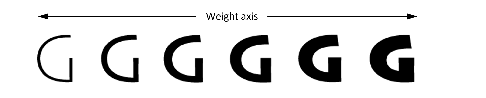
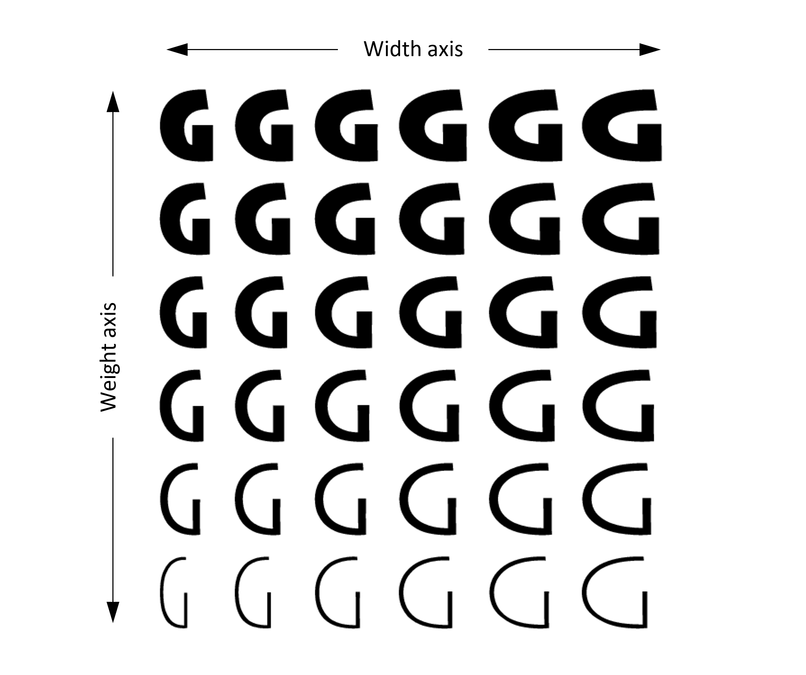
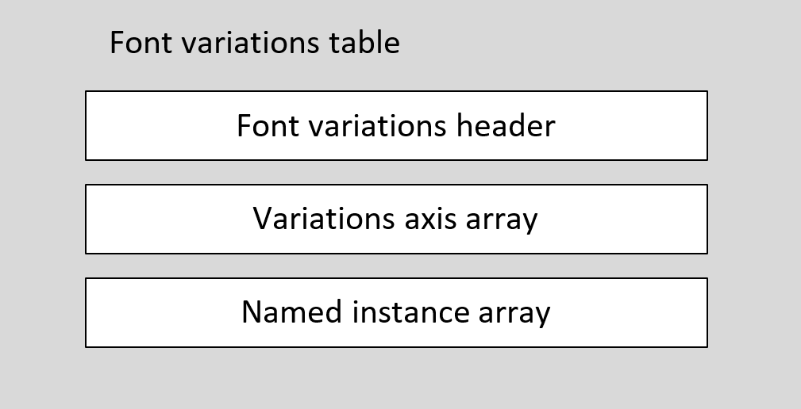

# fvar — Font Variations Table

OpenType Font Variations allow a font designer to incorporate multiple faces within a font family into a single font resource. Variable fonts can provide great flexibility for content authors and designers while also allowing the font data to be represented in an efficient format.

A variable font allows for continuous variation along some given design axis, such as weight:

 *Figure: Continuous variation along a design axis*

Conceptually, variable fonts define one or more axes over which design characteristics can vary. Weight is one possible axis of variation, but many different kinds of variation are possible. Variable fonts are not limited to a single axis of variation, but can combine two or more different axes of variation. For example, the following illustrates a combination of weight and width variation:

 *Figure: Continuous variation along multiple design axes*

The set of axes supported by a font define a variation space for that font, supporting a potentially-vast number of design-variation instances at positions across that space.

The font variations table ('fvar') provides the global definition of variations supported within the font. It specifies the axes of variation that are used and the ranges of variation for each axis. It also allows the font designer to specify certain coordinate positions within the font’s variation space as named instances. Named instances have designer-provided names, effectively equivalent to sub-family names, that applications can use as a short list of “pre-chosen” design variants they can offer to users.

For a general introduction to OpenType Font Variations, see [OpenType Font Variations Overview](otvaroverview.md).

All variable fonts must include a font variations table, as well as other required or optional tables used in variable fonts.

Note that some of the information in the font variations table also needs to be reflected in the [style attributes (STAT)](stat.md) table, which is also required in all variable fonts. In particular, each axis and each named instance specified in the font variations table must have matching axis records and axis value tables in the style attributes table.

## Table Formats

The font variations table consists of a table header, followed by an array of variation axis records, followed by an array of named-instance records:

 *Figure: High-level organization of the font variations table*

### 'fvar' Header

The format of the font variations table header is as follows.

*Font variations header:*

| Type | Name | Description |
| --- | --- | --- |
| uint16 | majorVersion | Major version number of the font variations table — set to 1. |
| uint16 | minorVersion | Minor version number of the font variations table — set to 0. |
| Offset16 | axesArrayOffset | Offset in bytes from the beginning of the table to the start of the VariationAxisRecord array. |
| uint16 | (reserved) | This field is permanently reserved. Set to 2. |
| uint16 | axisCount | The number of variation axes in the font (the number of records in the axes array). |
| uint16 | axisSize | The size in bytes of each VariationAxisRecord — set to 20 (0x0014) for this version. |
| uint16 | instanceCount | The number of named instances defined in the font (the number of records in the instances array). |
| uint16 | instanceSize | The size in bytes of each InstanceRecord — set to either *axisCount \* sizeof(Fixed) + 4*, or *axisCount \* sizeof(Fixed) + 6*. |

The header is followed by axes and instances arrays. The location of the axes array is specified in the axesArrayOffset field; the instances array directly follows the axes array.

| Type | Name | Description |
| --- | --- | --- |
| VariationAxisRecord | axes\[axisCount\] | The variation axis array. |
| InstanceRecord | instances\[instanceCount\] | The named instance array. |

> *Note:* The axisSize and instanceSize fields indicate the size of the VariationAxisRecord and InstanceRecord structures. In this version of the 'fvar' table, the InstanceRecord structure has an optional field, and so two different size formulations are possible. Future minor-version updates of the 'fvar' table may define compatible extensions to either format. Implementations must use the axisSize and instanceSize fields to determine the start of each record.

The set of axes that make up the font’s variation space are defined by an array of variation axis records. The number of records, and the number of axes, is determined by the axisCount field. A functional variable font must have an axisCount value that is greater than zero. If axisCount is zero, then the font is not functional as a variable font, and must be treated as a non-variable font; any variation-specific tables or data is ignored.

### VariationAxisRecord

The format of the variation axis record is as follows:

*VariationAxisRecord*

| Type | Name | Description |
| --- | --- | --- |
| Tag | axisTag | Tag identifying the design variation for the axis. |
| Fixed | minValue | The minimum coordinate value for the axis. |
| Fixed | defaultValue | The default coordinate value for the axis. |
| Fixed | maxValue | The maximum coordinate value for the axis. |
| uint16 | flags | Axis qualifiers — see details below. |
| uint16 | axisNameID | The name ID for entries in the 'name' table that provide a display name for this axis. |

Each axis has a tag that identifies the design variation for the axis. For example, the tag 'wght' designates a weight variation. Tags are registered for commonly-used design axes, but foundry-defined tags may also be used. Registered tags define valid ranges of coordinate values for the axis across all fonts. The variation axis record defines minimum and maximum values supported by the font, which may be more limited that the valid ranges defined for a registered tag.

> *Note:* Axis values given in the variation axis record use *user scale* coordinates that are specific to each axis tag. The user scale for each registered tag is described with the definition of each tag. In most other font tables that contain variation-related data, axis coordinate values are expressed using *normalized* coordinate scales. For more information regarding user scales and normalized scales, and a specification of the normalization process, see the [Coordinate Scales and Normalization](otvaroverview.md#anchor-otvaroverview-coordinate-scales-and-normalization) section in the OpenType Font Variations Overview chapter.

To be valid, axis tags must conform to general requirements for the Tag type (see [Data Types](otff.md#anchor-otff-data-types)) as well as certain additional requirements. Also, the valid patterns for registered tags and for foundry-defined tags are mutually exclusive. This is required to ensure there is never a future conflict between foundry-defined tags in existing fonts and newly-registered tags.

For more details on axis tags, their validity requirements, and definitions for registered design-variation axes, see [OpenType Design-Variation Axis Tag Registry](dvaraxisreg.md).

The default value interacts with the glyph and glyph variations tables in a particular way: the variation instance that has the default coordinate value for each axis will use glyph outlines as defined in the glyph table, without any variations from the glyph variations table applied. This instance is referred to as the default instance.

Flags can be assigned to indicate certain uses or behaviors for a given axis, independent of the specific axis tag and its definition. If no flags are set, then no assumptions are to be made beyond the definition for a registered axis. The following flags are defined.

| Mask | Name | Description |
| --- | --- | --- |
| 0x0001 | HIDDEN\_AXIS | The axis should not be exposed directly in user interfaces. |
| 0xFFFE | Reserved | Reserved for future use — set to 0. |

The HIDDEN\_AXIS flag is provided to indicate a recommendation by the font developer that the axis not be exposed directly to end users in application user interfaces. Reasons for setting this flag might include that the axis is intended only for programmatic interaction, or is intended for font-internal use by the font developer. If this flag is set, the axis should not be exposed to users in application user interfaces except in specialized scenarios, such as a font inspection utility. The flag should not affect handling of named instances, which should always be exposed in text-formatting user interfaces. If this flag is not set, then applications may expose the given axis in a default user interface or, based on the nature of the axis, may choose to expose it in an advanced-user interface.

The axisNameID field provides a name ID that can be used to obtain strings from the 'name' table that can be used to refer to the axis in application user interfaces. The name ID must be greater than 255 and less than 32768. For registered axis tags, a conventional US English axis name is provided; it is recommended that that name, or localized derivative names, be used in application user interfaces to provide greater consistency in user experience between different fonts.

### InstanceRecord

The instance record format includes a UserTuple record that specifies a position within the font’s variation space. The UserTuple record has an array of user scale coordinates:

*UserTuple record:*

| Type | Name | Description |
| --- | --- | --- |
| Fixed | coordinates\[axisCount\] | Coordinate array specifying a position within the font’s variation space. |

> *Note:* The UserTuple record and [Tuple record](otvarcommonformats.md#anchor-otvarcommonformats-tuple-records) both describe a position in the variation space but are distinct: UserTuple uses Fixed values to represent user scale coordinates, while the Tuple record uses F2DOT14 values to represent normalized coordinates.

The format of the instance record is as follows.

*InstanceRecord:*

| Type | Name | Description |
| --- | --- | --- |
| uint16 | subfamilyNameID | The name ID for entries in the 'name' table that provide subfamily names for this instance. |
| uint16 | flags | Reserved for future use — set to 0. |
| UserTuple | coordinates | The coordinate array for this instance. |
| uint16 | postScriptNameID | Optional. The name ID for entries in the 'name' table that provide PostScript names for this instance. |

The postScriptNameID field is optional. All of the instance records in a given font must be the same size, with all either including or omitting the postScriptNameID field.

The subfamilyNameID field provides a name ID that can be used to obtain strings from the 'name' table that can be treated as equivalent to name ID 17 (typographic subfamily) strings for the given instance. Values of 2 or 17 can be used; otherwise, values must be greater than 255 and less than 32768. The values 2 or 17 should only be used if the named instance corresponds to the font’s default instance.

The postScriptNameID field provides a name ID that can be used to obtain strings from the 'name' table that can be treated as equivalent to name ID 6 (PostScript name) strings for the given instance. Values of 6 and 0xFFFF can be used; otherwise, values must be greater than 255 and less than 32768. If the value is 0xFFFF, then the value is ignored, and no PostScript name equivalent is provided for the instance. The value 6 should only be used if the named instance corresponds to the font’s default instance.

All of the instance records in a font should have distinct coordinates and distinct subfamilyNameID and postScriptName ID values. If two or more records share the same coordinates, the same nameID values or the same postScriptNameID values, then all but the first can be ignored.

The default instance of a font is that instance for which the coordinate value of each axis is the defaultValue specified in the corresponding variation axis record. An instance record is not required for the default instance, though an instance record can be provided. When enumerating named instances, the default instance should be enumerated even if there is no corresponding instance record. If an instance record is included for the default instance (that is, an instance record has coordinates set to default values), then the nameID value should be set to 2 or 17 or to a name ID with the same value as name ID 2 or 17. Also, if a postScriptNameID is included in instance records, the value should be set to 6 or to a name ID with the same value as name ID 6.

> *Note:* Since an instance record for the default instance is not required, a variable font that has no instance records defined in the 'fvar' table (instanceCount is zero) still has one named instance.

## Variation Instance Selection

When formatting text using a variable font, applications must select a particular variation instance; that is, specific, in-range values must be specified for each of the axes defined in the font variation table. An instance may be selected by reference to a named instanced defined in an instance record, or by using a set of arbitrary axis values for the various axes. If a value is not specified for any particular axis, the default value for that axis defined in the font is used. If an application specifies a value for an axis that is less than the minValue defined in the font, then minValue must be used. Similarly, if an application specifies a value greater than the maxValue defined in the font, then maxValue must be used.

## Example

This example is for a hypothetical font with family name “SelawikV” that has two axes of variation, for weight and width. This table summarizes the description of the axes for the font:

| Axis tag | Minimum value | Default value | Maximum value | Axis name ID |
| --- | --- | --- | --- | --- |
| 'wght' | 300 | 400 | 700 | 256 |
| 'wdth' | 62.5 | 100 | 150 | 257 |

This font also has the following named instances:

| Instance subfamily name | Subfamily name ID | PostScript name | PostScript name ID | 'wght' value | 'wdth' value |
| --- | --- | --- | --- | --- | --- |
| Regular | 258 | SelawikV-Regular | 262 | 400 | 100 |
| Bold | 259 | SelawikV-Bold | 263 | 700 | 100 |
| Condensed | 260 | SelawikV-Condensed | 264 | 400 | 75 |
| Condensed Bold | 261 | SelawikV-CondensedBold | 265 | 700 | 75 |

The 'fvar' table is constructed as follows:

| Hex data | Field | Comment |
| --- | --- | --- |
|  | **Header** |  |
| 0001 | majorVersion |  |
| 0000 | minorVersion |  |
| 0010 | axesArrayOffset | 16 bytes — combined size of fields before the axes array. |
| 0002 | countSizePairs | 2 count/size pairs: axis, instance |
| 0002 | axisCount | 2 axes ('wght', 'wdth') |
| 0014 | axisSize | Size of each variation axis record is 20 bytes. |
| 0004 | instanceCount | 4 named instances |
| 000E | instanceSize | Size of instance records is 14 bytes. |
|  | **First variation axis record** |  |
| 77676874 | axisTag | Axis tag 'wght'. |
| 012C0000 | minValue | Minimum 'wght' value is 300 (Fixed format). |
| 01900000 | defaultValue | Default 'wght' value is 400. |
| 02BC0000 | maxValue | Maximum 'wght' value is 700. |
| 0000 | flags |  |
| 0100 | axisNameID | Display name “Weight” uses name ID 256. |
|  | **Second variation axis record** |  |
| 77647468 | axisTag | Axis tag 'wdth'. |
| 003E8000 | minValue | Minimum 'wdth' value is 62.5 (Fixed format). |
| 00640000 | defaultValue | Default 'wdth' value is 100. |
| 00960000 | maxValue | Maximum 'wdth' value is 150. |
| 0000 | flags |  |
| 0101 | axisNameID | Display name “Width” uses name ID 257. |
|  | **First instance record** |  |
| 0102 | subfamilyNameID | Instance subfamily name “Regular” uses name ID 258. |
| 0000 | flags |  |
| 01900000 | coordinates\[0\] | 'wght' coordinate is 400. |
| 00640000 | coordinates\[1\] | 'wdth' coordinate is 100. |
| 0106 | postScriptNameID | Instance PostScript name “SelawikV-Regular” uses name ID 262. |
|  | **Second instance record** |  |
| 0103 | subfamilyNameID | Instance subfamily name “Bold” uses name ID 259. |
| 0000 | flags |  |
| 02BC0000 | coordinates\[0\] | 'wght' coordinate is 700. |
| 00640000 | coordinates\[1\] | 'wdth' coordinate is 100. |
| 0107 | postScriptNameID | Instance PostScript name “SelawikV-Bold” uses name ID 263. |
|  | **Third instance record** |  |
| 0104 | subfamilyNameID | Instance subfamily name “Condensed” uses name ID 260. |
| 0000 | flags |  |
| 01900000 | coordinates\[0\] | 'wght' coordinate is 400. |
| 004B0000 | coordinates\[1\] | 'wdth' coordinate is 75. |
| 0108 | postScriptNameID | Instance PostScript name “SelawikV-Condensed” uses name ID 264. |
|  | **Fourth instance record** |  |
| 0105 | subfamilyNameID | Instance subfamily name “Condensed Bold” uses name ID 261. |
| 0000 | flags |  |
| 02BC0000 | coordinates\[0\] | 'wght' coordinate is 700. |
| 004B0000 | coordinates\[1\] | 'wdth' coordinate is 75. |
| 0109 | postScriptNameID | Instance PostScript name “SelawikV-CondensedBold” uses name ID 265. |

The total size of the table is 112 bytes.
