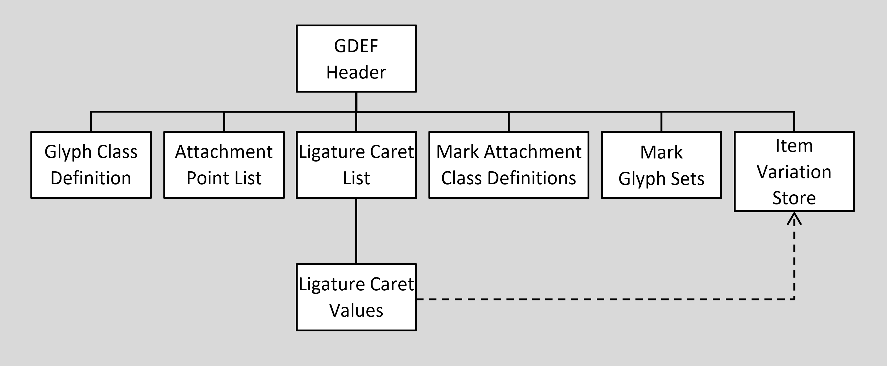
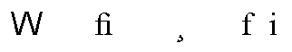
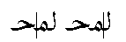

# GDEF — Glyph Definition Table

## Overview

The Glyph Definition (GDEF) table provides various glyph properties used in OpenType Layout processing. It contains six types of information in six independent subtables:

- The *glyph class definition* table classifies the different types of glyphs in the font.
- The *attachment list* table identifies all attachment points on the glyphs, which streamlines data access and bitmap caching.
- The *ligature caret list* table contains positioning data for ligature carets, which the text-processing client uses on screen to select and highlight the individual components of a ligature glyph.
- The *mark attachment class definition* table classifies mark glyphs, to help group together marks that are positioned similarly.
- The *mark glyph sets* table allows the enumeration of an arbitrary number of glyph sets that can be used as an extension of the mark attachment class definition to allow lookups to filter mark glyphs by arbitrary sets of marks.
- The *item variation store* table is used in variable fonts to contain variation data used for adjustment of values in the GDEF, GPOS or JSTF tables.

The [GSUB](gsub.md), [GPOS](gpos.md) or [JSTF](jstf.md) tables may reference certain GDEF table information used for processing of lookup tables. See, for example, the LookupFlag bit enumeration in [OpenType Layout Common Table Formats](chapter2.md). In variable fonts, the GDEF, GPOS and JSTF tables may all reference variation data within the item variation store table contained within the GDEF table. See below for further discussion of variable fonts and the item variation store table.

A client may use any one or more of the six GDEF tables during text processing. This overview explains how each of the six tables are organized and used (see Figure 7a). The rest of this chapter describes the individual GDEF tables and the formats that they reference.

 *Figure 7a. High-level organization of GDEF table*

**Glyph class definition table**

The glyph class definition table (GlyphClassDef) identifies four types of glyphs in a font: base glyphs, ligature glyphs, combining mark glyphs, and glyph components (see Figure 7b). GSUB and GPOS lookups define and use these glyph classes to differentiate the types of glyphs in a string. For example, GPOS uses the glyph classes to distinguish between a simple base glyph and the mark glyph that follows it.

 *Figure 7b. A base glyph, ligature glyph, mark glyph, and glyph components*

In addition, a client uses class definitions to apply GSUB and GPOS LookupFlag data correctly. For example, a LookupFlag may specify ignoring ligatures and marks during a glyph operation. If the font does not include a GlyphClassDef table, the client will need to define and maintain this information when processing the GSUB and GPOS tables.

**Attachment point list table**

The attachment point list table (AttachList) identifies all the attachment points defined in the GPOS table and their associated glyphs so a client can quickly access coordinates for each glyph’s attachment points. As a result, the client can cache coordinates for attachment points along with glyph bitmaps and avoid recalculating the attachment points each time it displays a glyph. Without this table, processing speed would be slower because the client would have to decode the GPOS lookups that define attachment points and compile the points in a list.

**Ligature caret list table**

The ligature caret list table (LigCaretList) specifies coordinates for positioning carets within ligatures in a font. The client uses this data to select and highlight ligature components in displayed text (see Figure 7c).

 *Figure 7c. Proper ligature caret postioning*

Each ligature may have more than one caret position, with each position defined as an X or Y value on the baseline according to the writing direction of the script or language system. The font developer can use any of three formats to represent a caret coordinate value. One format represents values in design units only, another fine-tunes a value based on a designated contour point, and the third uses a Device table (in non-variable fonts only) to adjust values at specific font sizes.

In a variable font, the caret positions may need to be adjusted for different variation instances. This is done using data in an item variation store table. See below for more regarding variable fonts and the item variation store table.

Without a ligature caret list table, the client would have to define caret positions without knowing the positions of the ligature components. The resulting highlighting or hit-testing might be ambiguous. For example, suppose a client places a caret at the midpoint position along the width of a hypothetical “wi” ligature. Because the “w” is wider than the “i,” that position would not clearly indicate which component is selected. Instead, for accurate selection, the caret should be moved to the right so that either the “w” or “i” could be clearly highlighted.

**Mark attachment class definition table**

A mark attachment class definition table is used to assign mark glyphs into different classes. These classes can be used in lookup tables within the GSUB or GPOS table to control how mark glyphs within a glyph sequence are treated by lookups. For more information on the use of mark attachment classes, see the description of lookup flags in the “Lookup Table” section of the chapter, [OpenType Layout Common Table Formats](chapter2.md#anchor-chapter2-lookup-table).

**Mark glyph sets table**

A mark glyph sets table (MarkGlyphSets) is used to define sets of mark glyphs that can be used in lookup tables within the GSUB or GPOS table to control how mark glyphs within a glyph sequence are treated by lookups. For more information on the use of mark glyph sets, see the description of lookup flags in the “Lookup Table” section of the chapter, [OpenType Layout Common Table Formats](chapter2.md#anchor-chapter2-lookup-table).

**Item variation store**

An item variation store table (ItemVariationStore) is used in variable fonts. For general information on OpenType Font Variations, see the chapter, [OpenType Font Variations Overview](otvaroverview.md). When different variation instances are selected, the shape and metrics of glyphs can change. When the shapes of ligature glyphs change in this way, corresponding changes could also be required for caret X or Y positions.

Variation data for caret positions is stored in the ItemVariationStore table. This same table, within the GDEF table, can also hold variation data used for X or Y values in the GPOS or JSTF tables. The item variation store and constituent formats are described in the chapter, [OpenType Font Variations Common Table Formats](otvarcommonformats.md).

The variation data within an item variation store is comprised of a number of adjustment deltas that get applied to the default values of target items for variation instances within particular regions of the font’s variation space. The item variation store format uses *delta-set indices* to reference variation delta data for particular target, font-data items to which they are applied. Data external to the item variation store identifies the delta-set index to be used for each given target item. Within the GDEF, GPOS or JSTF tables, these indices are specified within [*VariationIndex* tables](chapter2.md#anchor-chapter2-device-and-variationindex-tables), with one VariationIndex table referenced for each item that requires variation adjustment.

The VariationIndex table is a variant of a Device table, with a distinct format value. As a result, variable fonts cannot use device tables. A VariationIndex table will be ignored in applications that do not support Font Variations, or if the font is not a variable font.

## GDEF table structures

### GDEF Header

The GDEF table begins with a header that starts with a version number. Three versions are defined. Version 1.0 contains offsets to glyph class definition, attachment point list, ligature caret list and mark attachment class definition tables. Version 1.2 also includes an offset to a mark glyph sets table. Version 1.3 also includes an offset to an item variation store table.

Example 1 at the end of this chapter shows a GDEF Header table.

*GDEF Header, version 1.0*

| Type | Name | Description |
| --- | --- | --- |
| uint16 | majorVersion | Major version of the GDEF table, = 1. |
| uint16 | minorVersion | Minor version of the GDEF table, = 0. |
| Offset16 | glyphClassDefOffset | Offset to class definition table for glyph type, from beginning of GDEF header (may be NULL). |
| Offset16 | attachListOffset | Offset to attachment point list table, from beginning of GDEF header (may be NULL). |
| Offset16 | ligCaretListOffset | Offset to ligature caret list table, from beginning of GDEF header (may be NULL). |
| Offset16 | markAttachClassDefOffset | Offset to class definition table for mark attachment type, from beginning of GDEF header (may be NULL). |

*GDEF Header, version 1.2*

| Type | Name | Description |
| --- | --- | --- |
| uint16 | majorVersion | Major version of the GDEF table, = 1. |
| uint16 | minorVersion | Minor version of the GDEF table, = 2. |
| Offset16 | glyphClassDefOffset | Offset to class definition table for glyph type, from beginning of GDEF header (may be NULL). |
| Offset16 | attachListOffset | Offset to attachment point list table, from beginning of GDEF header (may be NULL). |
| Offset16 | ligCaretListOffset | Offset to ligature caret list table, from beginning of GDEF header (may be NULL). |
| Offset16 | markAttachClassDefOffset | Offset to class definition table for mark attachment type, from beginning of GDEF header (may be NULL). |
| Offset16 | markGlyphSetsDefOffset | Offset to the table of mark glyph set definitions, from beginning of GDEF header (may be NULL). |

*GDEF Header, version 1.3*

| Type | Name | Description |
| --- | --- | --- |
| uint16 | majorVersion | Major version of the GDEF table, = 1. |
| uint16 | minorVersion | Minor version of the GDEF table, = 3. |
| Offset16 | glyphClassDefOffset | Offset to class definition table for glyph type, from beginning of GDEF header (may be NULL). |
| Offset16 | attachListOffset | Offset to attachment point list table, from beginning of GDEF header (may be NULL). |
| Offset16 | ligCaretListOffset | Offset to ligature caret list table, from beginning of GDEF header (may be NULL). |
| Offset16 | markAttachClassDefOffset | Offset to class definition table for mark attachment type, from beginning of GDEF header (may be NULL). |
| Offset16 | markGlyphSetsDefOffset | Offset to the table of mark glyph set definitions, from beginning of GDEF header (may be NULL). |
| Offset32 | itemVarStoreOffset | Offset to the item variation store table, from beginning of GDEF header (may be NULL). |

### Glyph class definition table

The GSUB and GPOS tables use the glyph class definition table (GlyphClassDef) to identify which glyph classes to adjust with lookups. This table uses the [class definition table](chapter2.md#anchor-chapter2-class-definition-table) format (defined in the OpenType Layout Common Table Formats chapter), but with classes assigned to indicate specific glyph types, as follows:

*GlyphClassDef enumeration*

| Class | Description |
| --- | --- |
| 1 | Base glyph (single character, spacing glyph) |
| 2 | Ligature glyph (multiple character, spacing glyph) |
| 3 | Mark glyph (non-spacing combining glyph) |
| 4 | Component glyph (part of single character, spacing glyph) |

The font developer does not have to classify every glyph in the font, but any glyph not assigned a class value falls into Class zero (0). For instance, class values might be useful for the Arabic glyphs in a font, but not for the Latin glyphs. Then the GlyphClassDef table will list only Arabic glyphs, and-by default-the Latin glyphs will be assigned to Class 0. Component glyphs can be put together to generate ligatures. A ligature can be generated by creating a glyph in the font that references the component glyphs, or outputting the component glyphs in the desired sequence. Component glyphs are not used in defining any GSUB or GPOS formats.

Example 2 at the end of this chapter defines a GlyphClassDef table with a sample glyph for each of the assigned classes.

### Attachment point list table

The attachment point list table (AttachList) may be used to cache attachment point coordinates along with glyph bitmaps.

The table consists of an offset to a [Coverage](chapter2.md#anchor-chapter2-coverage-table) table listing all glyphs that define attachment points in the GPOS table, a count of the glyphs with attachment points, and an array of offsets to AttachPoint tables. The array lists the AttachPoint tables, one for each glyph in the Coverage table, in the same order as the Coverage Index.

*AttachList table*

| Type | Name | Description |
| --- | --- | --- |
| Offset16 | coverageOffset | Offset to Coverage table, from beginning of AttachList table. |
| uint16 | glyphCount | Number of glyphs with attachment points. |
| Offset16 | attachPointOffsets\[glyphCount\] | Array of offsets to AttachPoint tables, from beginning of AttachList table, in Coverage Index order. |

An AttachPoint table consists of a count of the attachment points on a single glyph and an array of contour indices of those points, listed in increasing numerical order.

Example 3 at the end of the chapter demonstrates an AttachList table that defines attachment points for two glyphs.

*AttachPoint table*

| Type | Name | Description |
| --- | --- | --- |
| uint16 | pointCount | Number of attachment points on this glyph. |
| uint16 | pointIndices\[pointCount\] | Array of contour point indices, in increasing numerical order. |

### Ligature caret list table

The ligature caret list table (LigCaretList) defines caret positions for ligature glyphs in a font. The table consists of an offset to a Coverage table that lists all the ligature glyphs, a count of the defined ligatures, and an array of offsets to LigGlyph tables. The array lists the LigGlyph tables, one for each ligature in the Coverage table, in the same order as the Coverage Index.

Example 4 at the end of this chapter shows a LigCaretList table.

*LigCaretList table*

| Type | Name | Description |
| --- | --- | --- |
| Offset16 | coverageOffset | Offset to Coverage table, from beginning of LigCaretList table. |
| uint16 | ligGlyphCount | Number of ligature glyphs. |
| Offset16 | ligGlyphOffsets\[ligGlyphCount\] | Array of offsets to LigGlyph tables, from beginning of LigCaretList table, in Coverage index order. |

A ligature glyph table (LigGlyph) contains the caret coordinates for a single ligature glyph. The number of coordinate values, each defined in a separate table, equals the number of components in the ligature minus one.

The LigGlyph table consists of a count of the number of caret value tables defined for the ligature and an array of offsets to caret value tables.

Example 4 at the end of the chapter shows a LigGlyph table.

*LigGlyph table*

| Type | Name | Description |
| --- | --- | --- |
| uint16 | caretCount | Number of caret value tables for this ligature (components - 1). |
| Offset16 | caretValueOffsets\[caretCount\] | Array of offsets to caret value tables, from beginning of LigGlyph table, in increasing coordinate order. |

Three caret value table formats are defined. One format uses design units to define the caret position. The other two formats use a contour point or (in non-variable fonts) a Device table to fine-tune a caret’s position at specific font sizes and device resolutions. In a variable font, the third format uses a [VariationIndex table](chapter2.md#anchor-chapter2-device-and-variationindex-tables) (a variant of a Device table) to reference variation data for adjustment of the caret position for the current variation instance, as needed. Caret coordinates are either X or Y values, depending upon the text direction.

The first format (CaretValueFormat1) consists of a format identifier followed by a single coordinate for the caret position, given in design units. This format has the benefits of small size and simplicity, but the coordinate value cannot be hinted for fine adjustments at different device resolutions.

Example 4 at the end of this chapter shows a CaretValueFormat1 table.

*CaretValueFormat1 table: Design units only*

| Type | Name | Description |
| --- | --- | --- |
| uint16 | format | Format identifier — format = 1. |
| int16 | coordinate | X or Y value, in design units. |

The second format (CaretValueFormat2) specifies the caret coordinate in terms of a contour point index on a specific glyph. During font hinting, the contour point on the glyph outline could move. The point’s final position after hinting provides the final value for rendering a given font size.

The table contains a format identifier and a contour point index.

Example 5 at the end of this chapter demonstrates a CaretValueFormat2 table.

*CaretValueFormat2 table: Contour point*

| Type | Name | Description |
| --- | --- | --- |
| uint16 | format | Format identifier — format = 2. |
| uint16 | caretValuePointIndex | Contour point index on glyph. |

The third format (CaretValueFormat3) also specifies the value in design units but, in non-variable fonts, it uses a Device table rather than a contour point to adjust the value. This format offers the advantage of fine-tuning the coordinate value for any device resolution. (For more information about Device tables, see [OpenType Layout Common Table Formats](chapter2.md#anchor-chapter2-device-and-variationindex-tables).)

In variable fonts, CaretValueFormat3 is required to reference variation data to adjust caret positions for different variation instances, if needed. In this case, CaretValueFormat3 specifies an offset to a VariationIndex table, which is a variant of the Device table used for variations. If no VariationIndex table is used for a particular caret position value, then that value is used for all variation instances.

> *Note:* While separate VariationIndex table references are required for each value that requires variation, two or more values that require the same variation-data values can have offsets that point to the same VariationIndex table, and two or more VariationIndex tables can reference the same variation data entries.

The format consists of a format identifier, an X or Y value, and an offset to a Device or VariationIndex table.

Example 6 at the end of this chapter shows a CaretValueFormat3 table.

*CaretValueFormat3 table: Design units plus Device or VariationIndex table*

| Type | Name | Description |
| --- | --- | --- |
| uint16 | format | Format identifier — format = 3. |
| int16 | coordinate | X or Y value, in design units. |
| Offset16 | deviceOffset | Offset to Device table (non-variable font) / VariationIndex table (variable font) for X or Y value-from beginning of CaretValue table. |

### Mark attachment class definition table

A mark attachment class definition table is a [class definition table](chapter2.md#anchor-chapter2-class-definition-table) (defined in the OpenType Layout Common Table Formats chapter) used to assign marks into different classes that can be used to control the effect of GSUB or GPOS lookups.

Example 7 in this document shows a mark attachment class definition table.

### Mark glyph sets table

Mark glyph sets are used in GSUB and GPOS lookups to filter which marks in a glyph sequence are considered or ignored. Mark glyph sets are defined in a MarkGlyphSets table, which contains offsets to individual sets each represented by a standard [Coverage](chapter2.md#anchor-chapter2-coverage-table) table.

*MarkGlyphSets table*

| Type | Name | Description |
| --- | --- | --- |
| uint16 | format | Format identifier — format = 1. |
| uint16 | markGlyphSetCount | Number of mark glyph sets defined. |
| Offset32 | coverageOffsets\[markGlyphSetCount\] | Array of offsets to mark glyph set coverage tables, from the start of the MarkGlyphSets table. |

Mark glyph sets are used for the same purpose as mark attachment classes, which is as filters for GSUB and GPOS lookups. Mark glyph sets differ from mark attachment classes, however, in that mark glyph sets may intersect as needed by the font developer. As for mark attachment classes, only one mark glyph set can be referenced in any given lookup.

> *Note:* The array of offsets for the Coverage tables uses Offset32, not Offset16.

### Item variation store table

The format and processing of the ItemVariationStore table and its constituent formats is described in the chapter, [OpenType Font Variations Common Table Formats](otvarcommonformats.md). Specification of the interpolation algorithm used to derive values for particular variation instances is given in the chapter, [OpenType Font Variations Overview](otvaroverview.md).

The item variation store contains adjustment-delta values arranged in one or more sets of deltas that are referenced using *delta-set indices*. For values that require variation adjustment, a delta-set index is used to reference the particular variation data needed for that target value. Within the GDEF table, delta-set indices can be provided in [VariationIndex tables](chapter2.md#anchor-chapter2-device-and-variationindex-tables) within caret value format 3 tables. For details on use of VariationIndex tables within the GDEF table, see discussion earlier in this chapter.

As needed, an item variation store within the GDEF table is used to store variation data not only for GDEF caret positions but also for values in the GPOS or JSTF tables that vary. Delta values used for the different layout tables may be interleaved and organized together within the one item variation store in any manner.

## GDEF table examples

The rest of this chapter describes examples of all the GDEF table formats. All the examples reflect unique parameters described below, but the samples provide a useful reference for building tables specific to other situations.

The examples have three columns showing hex data, source, and comments.

### Example 1: GDEF Header

Example 1 shows a GDEF Header definition with offsets to each of the main tables in GDEF.

| Hex Data | Source | Comments |
| --- | --- | --- |
|  | **GDEFHeader**  TheGDEFHeader | GDEFHeader table definition |
| 00010000 | 0x00010000 | major/minor version |
| 000C | GlyphClassDefTable | offset to GlyphClassDef table |
| 0026 | AttachListTable | offset to AttachList table |
| 0040 | LigCaretListTable | offset to LigCaretList table |
| 005A | MarkAttachClassDefTable | offset to Mark Attachment Class Definition Table |

### Example 2: GlyphClassDef table

The GlyphClassDef table in Example 2 specifies glyphs for each of the glyph classes defined in the GlyphClassDef enumeration.

| Hex Data | Source | Comments |
| --- | --- | --- |
|  | **ClassDefFormat2**  GlyphClassDefTable | ClassDef table definition |
| 0002 | 2 | classFormat |
| 0004 | 4 | classRangeCount |
|  | classRangeRecords\[0\] |  |
| 0024 | iGlyphID | startGlyphID |
| 0024 | iGlyphID | endGlyphID |
| 0001 | 1 | class: base glyphs |
|  | classRangeRecords\[1\] |  |
| 009F | ffiLigGlyphID | startGlyphID |
| 009F | ffiLigGlyphID | endGlyphID |
| 0002 | 2 | class: ligature glyphs |
|  | classRangeRecords\[2\] |  |
| 0058 | umlautAccentGlyphID | startGlyphID |
| 0058 | umlautAccentGlyphID | endGlyphID |
| 0003 | 3 | class: mark glyphs |
|  | classRangeRecords\[3\] |  |
| 018F | CurvedTailComponentGlyphID | startGlyphID |
| 018F | CurvedTailComponentGlyphID | endGlyphID |
| 0004 | 4 | class: component glyphs |

### Example 3: AttachList table

In Example 3, the AttachList table enumerates the attachment points defined for two glyphs. A Coverage table identifies the glyphs: “a” and “e.” For each covered glyph, an AttachPoint table specifies the attachment point count and point indices: one point for the “a” glyph and two for the “e” glyph.

| Hex Data | Source | Comments |
| --- | --- | --- |
|  | **AttachList**  AttachListTable | AttachList table definition |
| 0012 | GlyphCoverage | offset to Coverage table |
| 0002 | 2 | glyphCount |
| 0008 | aAttachPoint | attachPointOffsets\[0\] |
| 000C | eAttachPoint | attachPointOffsets\[1\] |
|  | **AttachPoint**  aAttachPoint | AttachPoint table definition |
| 0001 | 1 | pointCount |
| 0012 | 18 | pointIndices\[0\] |
|  | **AttachPoint**  eAttachPoint | AttachPoint table definition |
| 0002 | 2 | pointCount |
| 000E | 14 | pointIndices\[0\] |
| 0017 | 23 | pointIndices\[1\] |
|  | **CoverageFormat1**  GlyphCoverage | Coverage table definition |
| 0001 | 1 | coverageFormat |
| 0002 | 2 | glyphCount |
| 001C | aGlyphID | glyphArray\[0\] |
| 0020 | eGlyphID | glyphArray\[1\] |

### Example 4: LigCaretList, LigGlyph and CaretValueFormat1 tables

Example 4 defines a list of ligature carets. A Coverage table lists all the ligature glyphs that define caret positions. In this example, two ligatures are covered, “ffi” and “fi.” For each covered glyph, a LigGlyph table specifies the number of carets for the ligature and their coordinate values. The “fi” ligature defines one caret, positioned between the “f” and “i” components; the “ffi” ligature defines two, one positioned between the two “f” components and the other positioned between the “f” and “i.” The caret value tables shown here use format 1, in which values are specified in design units only.

| Hex Data | Source | Comments |
| --- | --- | --- |
|  | **LigCaretList**  LigCaretListTable | LigCaretList table definition |
| 0008 | LigCoverage | offset to Coverage table |
| 0002 | 2 | ligGlyphCount |
| 0010 | fiLigGlyph | ligGlyphOffsets\[0\] |
| 0014 | ffiLigGlyph | ligGlyphOffsets\[1\] |
|  | **CoverageFormat1**  LigCoverage | Coverage table definition |
| 0001 | 1 | coverageFormat |
| 0002 | 2 | glyphCount |
| 009F | ffiLigGlyphID | glyphArray\[0\] |
| 00A5 | fiLigGlyphID | glyphArray\[1\] |
|  | **LigGlyph**  fiLigGlyph | LigGlyph table definition |
| 0001 | 1 | caretCount, equals the number of components - 1 |
| 000E | CaretFI | caretValueOffsets\[0\] |
|  | **LigGlyph**  ffiLigGlyph | LigGlyph table definition |
| 0002 | 2 | caretCount, equals the number of components - 1 |
| 0006 | CaretFFI1 | caretValueOffsets\[0\] |
| 000E | CaretFFI2 | caretValueOffsets\[1\] |
|  | **CaretValueFormat1**  CaretFI | CaretValue table definition |
| 0001 | 1 | format: design units only |
| 025B | 603 | coordinate (X or Y value) |
|  | **CaretValueFormat1**  CaretFFI1 | CaretValue table definition |
| 0001 | 1 | format: design units only |
| 025B | 603 | coordinate (X or Y value) |
|  | **CaretValueFormat1**  CaretFFI2 | CaretValue table definition |
| 0001 | 1 | format: design units only |
| 04B6 | 1206 | coordinate (X or Y value) |

### Example 5: CaretValueFormat2 table

Example 5 shows a CaretValueFormat2 table that specifies a ligature caret coordinate in terms of a contour point index on a specific glyph. The final position of the caret depends on the location of the contour point on the glyph after hinting.

| Hex Data | Source | Comments |
| --- | --- | --- |
|  | **CaretValueFormat2**  Caret1 | CaretValue table definition |
| 0002 | 2 | format: contour point |
| 000D | 13 | caretValuePointIndex |

### Example 6: CaretValueFormat3 table

In Example 6, the CaretValueFormat3 table defines a caret position in design units, but includes a Device table to adjust the X or Y coordinate for the point size and resolution of the output font. Here, the Device table specifies pixel adjustments for font sizes from 12 ppem to 17 ppem.

| Hex Data | Source | Comments |
| --- | --- | --- |
|  | **CaretValueFormat3**  Caret3 | CaretValue table definition |
| 0003 | 3 | format: design units plus Device table |
| 04B6 | 1206 | coordinate (X or Y value, design units) |
| 0006 | CaretDevice | offset to Device table |
|  | **DeviceTableFormat2**  CaretDevice | Device Table definition |
| 000C | 12 | startSize |
| 0011 | 17 | endSize |
| 0002 | 2 | deltaFormat |
|  | 1 | increase 12ppm by 1 pixel |
|  | 1 | increase 13ppm by 1 pixel |
|  | 1 | increase 14ppm by 1 pixel |
| 1111 | 1 | increase 15ppm by 1 pixel |
|  | 2 | increase 16ppm by 2 pixels |
| 2200 | 2 | increase 17ppm by 2 pixels |

### Example 7: Mark attachment class definition table

In Example 7, a class definition table specifies an attachment class for the each of the glyph ranges predefined in the GlyphClassDef table as marks.

| Hex Data | Source | Comments |
| --- | --- | --- |
|  | **ClassDefFormat2**  theMarkAttachClassDefTable | ClassDef table definition |
| 0002 | 2 | classFormat: glyph ranges |
| 0004 | 4 | classRangeCount |
|  | classRangeRecords\[0\] |  |
| 0268 | graveAccentGlyphID | startGlyphID |
| 026A | circumflexAccentGlyphID | endGlyphID |
| 0001 | 1 | class: top marks  ClassRangeRecord\[1\] |
|  | classRangeRecords\[1\] |  |
| 0270 | diaeresisAccentGlyphID | startGlyphID |
| 0272 | acuteAccentGlyphID | endGlyphID |
| 0001 | 1 | class: top marks |
|  | classRangeRecords\[2\] |  |
| 028C | diaeresisBelowGlyphID | startGlyphID |
| 028F | cedillaGlyphID | endGlyphID |
| 0002 | 2 | class: bottom marks  ClassRangeRecord\[3\] |
|  | classRangeRecords\[3\] |  |
| 0295 | circumflexBelowGlyphID | startGlyphID |
| 0295 | circumflexBelowGlyphID | endGlyphID |
| 0002 | 2 | class: bottom marks |
