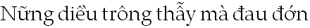
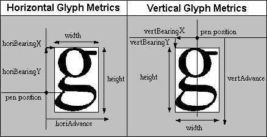
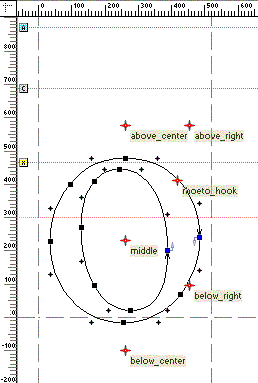
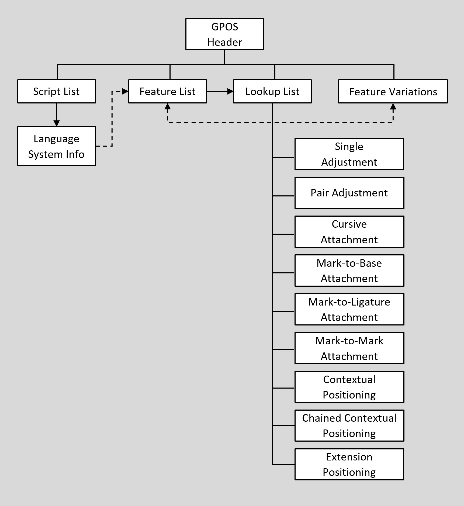

# GPOS — Glyph Positioning Table

## Overview

The Glyph Positioning table (GPOS) provides precise control over glyph placement for sophisticated text layout and rendering in each script and language system that a font supports.

Complex glyph positioning becomes an issue in many writing systems, such as Vietnamese, that use diacritical and other marks to modify the sound or meaning of characters. These writing systems require controlled placement of all marks in relation to one another for legibility and linguistic accuracy.

 *Figure 4a. Vietnamese words with marks.*

Other writing systems require sophisticated glyph positioning for correct typographic composition. For instance, Urdu glyphs are calligraphic and connect to one another along a descending, diagonal text line that proceeds from right to left. To properly render Urdu, a text-processing client must modify both the horizontal (X) and vertical (Y) positions of each glyph (see Figure 4b).

 *Figure 4b. Urdu layout requires glyph positioning control, as well as contextual substitution*

With the GPOS table, a font developer can define a complete set of positioning adjustment features. GPOS data, organized by script and language system, is easy for a text-processing client to use to position glyphs.

**Basic glyph positioning**

Basic text layout implementations that do not make use of the GPOS table rely on two values to determine a glyph’s position: placement, and advance. If glyphs are positioned with respect to a virtual “pen point” that moves along a line of text, placement describes the glyph’s position with respect to the current pen point, and advance describes where to move the pen point to position the next glyph (see Figure 4c). For horizontal text, placement corresponds to the left side bearing, and advance corresponds to the advance width.

 *Figure 4c. Basic glyph positioning*

Apart from the GPOS tables, other font tables specify placement and advance only in the X direction for horizontal layout and only in the Y direction for vertical layout. For simple layout of some writing systems, these two values could provide for adequate glyph positioning. For more sophisticated layout, however, the values need to cover a richer range. Placement and advance may need adjustment vertically, as well as horizontally.

The only positioning adjustment defined in other font tables is pair kerning, supported by the legacy ['kern'](kern.md) table, which modifies the horizontal spacing between two glyphs. A typical kerning table lists pairs of glyphs and specifies how much space a text-processing client should add or remove between the glyphs to properly display each pair. It does not provide specific information about how to adjust the glyphs in each pair and cannot adjust contexts of more than two glyphs.

**Advanced glyph positioning**

The GPOS table provides excellent control and flexibility for positioning a single glyph and for positioning multiple glyphs in relation to one another. By using both X and Y values that the GPOS table defines for placement and advance and by using glyph attachment points, a client can more precisely adjust the position of a glyph.

In addition, the GPOS table can reference a Device table to define subtle, device-dependent adjustments to any placement or advance value at any font size and device resolution. For example, a Device table can specify adjustments at 51 pixels per em (ppem) that do not occur at 50 ppem.

X and Y values specified for placement operations are always within the typical Cartesian coordinate system (origin at the baseline of the left side), regardless of the writing direction. Additionally, all values specified are done so in font unit measurements. This is especially convenient for font designers, since glyphs are drawn in the same coordinate system. However, it’s important to note that the meaning of “advance width” changes, depending on the writing direction.

For example, in left-to-right scripts, if the first glyph has an advance width of 100, then the second glyph begins at 100,0. In right-to-left scripts, if the first glyph has an advance width of 100, then the second glyph begins at -100,0. For a top-to-bottom feature, to increase the advance height of a glyph by 100, the YAdvance = 100. For any feature, regardless of writing direction, to lower the dieresis over an “o” by 10 units, set the YPlacement = -10.

Other GPOS features can define attachment points to combine glyphs and position them with respect to one another. A glyph might have multiple attachment points. The point used will depend on the glyph to be attached. For instance, a base glyph could have attachment points for different diacritical marks.

 *Figure 4d. Base glyph with multiple attachment points.*

To reduce the size of the font file, a base glyph may use the same attachment point for all mark glyphs assigned to a particular class. For example, a base glyph could have two attachment points, one above and one below the glyph. Then all marks that attach above glyphs would be attached at the high point, and all marks that attach below glyphs would be attached at the low point. Attachment points are useful in scripts such as Arabic that combine numerous glyphs with vowel marks.

Attachment points also are useful for connecting cursive-style glyphs. Glyphs in cursive fonts can be designed to attach or overlap when rendered. Alternatively, the font developer can use the GPOS table to create a cursive attachment feature and define explicit exit and entry attachment points for each glyph (see Figure 4e).

 *Figure 4e. Entry and exit points marked on contextual Urdu glyph variants*

The GPOS table supports eight types of actions for positioning and attaching glyphs:

- A *single adjustment* positions one glyph, such as a superscript or subscript.
- A *pair adjustment* positions two glyphs with respect to one another. Kerning is an example of pair adjustment.
- A *cursive attachment* describes cursive scripts and other glyphs that are connected with attachment points when rendered.
- A *mark-to-base attachment* positions combining marks with respect to base glyphs, as when positioning vowels, diacritical marks, or tone marks in Arabic, Hebrew, and Vietnamese.
- A *mark-to-ligature attachment* positions combining marks with respect to ligature glyphs. Because ligatures may have multiple points for attaching marks, the font developer needs to associate each mark with one of the ligature glyph’s components.
- A *mark-to-mark attachment* positions one mark relative to another, as when positioning tone marks with respect to vowel diacritical marks in Vietnamese.
- *Contextual positioning* describes how to position one or more glyphs in context, within an identifiable sequence of specific glyphs, glyph classes, or varied sets of glyphs. One or more positioning operations may be performed on “input” context sequences. Figure 4f illustrates a context for positioning adjustments.
- *Chained contexts positioning* describes how to position one or more glyphs in a chained context, within an identifiable sequence of specific glyphs, glyph classes, or varied sets of glyphs. One or more positioning operations may be performed on “input” context sequences.

 *Figure 4f. Contextual positioning lowered the accent over a vowel glyph that followed an overhanging uppercase glyph*

The GPOS data formats used to implement the different types of positioning and attaching actions include a ninth type, *positioning extension*. This provides a format extension mechanism, allowing reference to subtables using 32-bit offsets rather than 16-bit offsets. It does not provide an additional type of positioning action, however.

## GPOS table and OpenType Font Variations

OpenType Font Variations allow a single font to support many design variations along one or more axes of design variation. For example, a font with weight and width variations might support weights from thin to black, and widths from ultra-condensed to ultra-expanded. For general information on OpenType Font Variations, see the chapter, [OpenType Font Variations Overview.](otvaroverview.md)

When different variation instances are selected, the design of individual glyphs changes. The same contours and points are used, but the position in the design grid of each point can change, as can the default horizontal or vertical advance and side bearings. As a result, corresponding changes may also be required for positioning and advance adjustments in the GPOS table.

Positioning actions in the GPOS table can be expressed directly using explicit X or Y font-unit values. In a variable font, these X and Y values apply to the default instance and may need to be adjusted for the current variation instance. This is done using variation data with processes similar to those used for glyph outlines and other font data, as described in the OpenType Font Variations Overview chapter.

For certain GPOS actions, positions can be expressed indirectly by reference to specific glyph outline points. In a variable font, use of glyph points to specify a positioning action would require invoking the rasterizer to process the glyph-outline variation data in order to obtain the adjusted position of the point before the glyph positioning operation can be completed. This could have a significant, negative impact on performance of text-layout processing. For this reason, in a variable font, positions that require adjustment for different variation instances should always be expressed directly as X and Y values.

Variation data for adjustment of GPOS X or Y values is stored within an *ItemVariationStore* table located within the [GDEF](gdef.md) table. The same item variation store is also used for adjustment of values in the GDEF and JSTF tables. The item variation store and constituent formats are described in the chapter, [OpenType Font Variations Common Table Formats](otvarcommonformats.md).

The variation data within an item variation store is comprised of a number of adjustment deltas that get applied to the default values of target items for variation instances within particular regions of the font’s variation space. The item variation store format uses *delta-set indices* to reference variation delta data for particular target, font-data items to which they are applied. Data external to the item variation store identifies the delta-set index to be used for each given target item. Within the GPOS table, these indices are specified within *VariationIndex* tables, with one VariationIndex table referenced for each item that requires variation adjustment.

Note that the VariationIndex table is a variant of a Device table, with a distinct format value. (For full details on the [Device and VariationIndex](chapter2.md#anchor-chapter2-device-and-variationindex-tables) table formats, see the chapter, [OpenType Layout Common Table Formats](chapter2.md).) As a result, variable fonts cannot use device tables. A VariationIndex table will be ignored in applications that do not support Font Variations, or if the font is not a variable font.

## GPOS table organization

The GPOS table begins with a header that defines offsets to a ScriptList, a FeatureList, a LookupList, and an optional FeatureVariations table (see Figure 4g):

- The [ScriptList](chapter2.md#anchor-chapter2-scriptlist-table) identifies all the scripts and language systems in the font that use glyph positioning.
- The [FeatureList](chapter2.md#anchor-chapter2-featurelist-table) defines all the glyph positioning features required to render these scripts and language systems.
- The [LookupList](chapter2.md#anchor-chapter2-lookuplist-table) contains all the lookup data needed to implement each glyph positioning feature.
- The [FeatureVariations](chapter2.md#anchor-chapter2-feature-variations) table can be used to substitute an alternate set of lookup tables to use for any given feature under specified conditions. This is currently used only in variable fonts.

For a detailed discussion of ScriptLists, FeatureLists, LookupLists, and FeatureVariation tables, see the chapter, [OpenType Layout Common Table Formats](chapter2.md) .

 *Figure 4g. High-level organization of GPOS table*

The GPOS table is organized so text processing clients can easily locate the features and lookups that apply to a particular script or language system. To access GPOS information, clients should use the following procedure:

1. Locate the current script in the GPOS ScriptList table.
2. If the language system is known, search the script for the correct LangSys table; otherwise, use the script’s default LangSys table.
3. The LangSys table provides index numbers into the GPOS FeatureList table to access a required feature and a number of additional features.
4. Inspect the featureTag of each feature, and select the feature tables to apply to an input glyph string.
5. If a Feature Variation table is present, evaluate conditions in the Feature Variation table to determine if any of the initially-selected feature tables should be substituted by an alternate feature table.
6. Each feature table provides an array of index numbers into the GPOS LookupList table. Assemble all lookups from the set of chosen feature tables, and apply the lookups in the order given in the LookupList table.

For a detailed description of the Feature Variation table and how it is processed, see the chapter, [OpenType Layout Common Table Formats](chapter2.md).

Lookup data is defined in [Lookup tables](chapter2.md#anchor-chapter2-lookup-table), which are defined in the OpenType Layout Common Table Formats chapter. A Lookup table contains one or more subtables that define the specific conditions, type, and results of a positioning action used to implement a feature. Specific Lookup subtable types are used for glyph positioning actions, and are defined in this chapter. All subtables within a Lookup table must be of the same lookup type, as listed in the following table for the GposLookupType enumeration:

*GposLookupType enumeration*

| Value | Type | Description |
| --- | --- | --- |
| 1 | [Single adjustment](#anchor-gpos-lookup-type-1-subtable-single-adjustment-positioning) | Adjust position of a single glyph |
| 2 | [Pair adjustment](#anchor-gpos-lookup-type-2-subtable-pair-adjustment-positioning) | Adjust position of a pair of glyphs |
| 3 | [Cursive attachment](#anchor-gpos-lookup-type-3-subtable-cursive-attachment-positioning) | Attach cursive glyphs |
| 4 | [Mark-to-base attachment](#anchor-gpos-lookup-type-4-subtable-mark-to-base-attachment-positioning) | Attach a combining mark to a base glyph |
| 5 | [Mark-to-ligature attachment](#anchor-gpos-lookup-type-5-subtable-mark-to-ligature-attachment-positioning) | Attach a combining mark to a ligature |
| 6 | [Mark-to-mark attachment](#anchor-gpos-lookup-type-6-subtable-mark-to-mark-attachment-positioning) | Attach a combining mark to another mark |
| 7 | [Contextual positioning](#anchor-gpos-lookup-type-7-subtable-contextual-positioning) | Position one or more glyphs in context |
| 8 | [Chained contexts positioning](#anchor-gpos-lookup-type-8-subtable-chained-contexts-positioning) | Position one or more glyphs in chained context |
| 9 | [Positioning extension](#anchor-gpos-lookup-type-9-subtable-positioning-subtable-extension) | Extension mechanism for other positionings |

Each lookup type has one or more subtable formats. The “best” format depends on the type of positioning operation and the resulting storage efficiency. When glyph information is best presented in more than one format, a single lookup may define more than one subtable, as long as all the subtables are of the same lookup type. For example, within a given lookup, a glyph index array format could best represent one set of target glyphs, whereas a glyph index range format could be better for another set.

Certain structures are used across multiple GPOS lookup subtable types and formats. All lookup subtables use the [Coverage table](chapter2.md), which is defined in the OpenType Layout Common Table Formats chapter. Single and pair adjustments (lookup types 1 and 2) use a [*ValueRecord*](#anchor-gpos-value-record) structure and associated *ValueFormat* enumeration; attachment subtables (lookup types 3, 4, 5 and 6) use [*Anchor*](#anchor-gpos-anchor-table) and [*MarkArray*](#anchor-gpos-mark-array-table) tables. These shared formats are defined later in this chapter.

A series of positioning operations on the same glyph or string requires multiple lookups, one for each separate action. Each lookup has a different array index in the LookupList table and is applied in the LookupList order. The positioning adjustment of each lookup is applied to the result of previous lookups. When the adjustments are expressed as absolute placement or advance adjustments in the X or Y direction, these adjustments are accumulated as each lookup is processed. For adjustments expressed using attachment points, however, attachment point positioning can override the effect of preceding lookups.

During text processing, a client applies a lookup to each glyph in the string before moving to the next lookup. A lookup is finished for a glyph after the client locates the target glyph or glyph context and performs a positioning action, if specified. To move to the “next” glyph, the client will skip all the glyphs that participated in the lookup operation: glyphs that were positioned as well as any other glyphs that formed an input sequence context for the operation. Only glyphs in the input sequence are skipped; in the case of chained contexts positioning, the glyphs in the lookahead sequence are not skipped.

There is just one exception: the “next” glyph in a sequence may be one of those that formed a context for the operation just performed. Specifically, in the case of pair positioning operations (i.e., kerning), if the ValueRecord for the second glyph is null, that glyph is treated as the “next” glyph in the sequence.

The next section of this chapter describes the GPOS header and the subtables defined for each GposLookupType. [Examples](#anchor-gpos-gpos-structure-examples) at the end of this chapter illustrate the GPOS header and seven of the nine lookup types, as well as the ValueRecord and Anchor and MarkArray tables.

## GPOS table structures

### GPOS Header

The GPOS table begins with a header that contains a version number for the table. Two versions are defined. Version 1.0 contains offsets to three tables: ScriptList, FeatureList, and LookupList. Version 1.1 also includes an offset to a FeatureVariations table. For descriptions of these tables, see the chapter, [OpenType Layout Common Table Formats](chapter2.md) . Example 1 at the end of this chapter shows a GPOS Header version 1.0 table definition.

*GPOS Header, version 1.0*

| Type | Name | Description |
| --- | --- | --- |
| uint16 | majorVersion | Major version of the GPOS table, = 1. |
| uint16 | minorVersion | Minor version of the GPOS table, = 0. |
| Offset16 | scriptListOffset | Offset to ScriptList table, from beginning of GPOS table. |
| Offset16 | featureListOffset | Offset to FeatureList table, from beginning of GPOS table. |
| Offset16 | lookupListOffset | Offset to LookupList table, from beginning of GPOS table. |

*GPOS Header, version 1.1*

| Type | Name | Description |
| --- | --- | --- |
| uint16 | majorVersion | Major version of the GPOS table, = 1. |
| uint16 | minorVersion | Minor version of the GPOS table, = 1. |
| Offset16 | scriptListOffset | Offset to ScriptList table, from beginning of GPOS table. |
| Offset16 | featureListOffset | Offset to FeatureList table, from beginning of GPOS table. |
| Offset16 | lookupListOffset | Offset to LookupList table, from beginning of GPOS table. |
| Offset32 | featureVariationsOffset | Offset to FeatureVariations table, from beginning of GPOS table (may be NULL). |

### Lookup type 1 subtable: single adjustment positioning

A single adjustment positioning subtable (SinglePos) is used to adjust the placement or advance of a single glyph, such as a subscript or superscript. In addition, a SinglePos subtable is commonly used to implement lookup data for contextual positioning.

A SinglePos subtable will have one of two formats: one that applies the same adjustment to a series of glyphs (format 1), and one that applies a different adjustment for each unique glyph (format 2).

**Single adjustment positioning format 1: single positioning value**

A SinglePosFormat1 subtable applies the same positioning value or values to each glyph listed in its Coverage table. For instance, when a font uses old-style numerals, this format could be applied to uniformly lower the position of all math operator glyphs.

The format 1 subtable consists of a format identifier, an offset to a Coverage table that defines the glyphs to be adjusted by the positioning values, a ValueRecord, and a ValueFormat identifier that describes the amount and kinds of data in the ValueRecord.

The ValueRecord specifies one or more positioning values to be applied to all covered glyphs. For example, if all glyphs in the Coverage table require both horizontal and vertical adjustments, the ValueRecord will specify values for both xPlacement and yPlacement.

Example 2 at the end of this chapter shows a SinglePosFormat1 subtable used to adjust the placement of subscript glyphs.

*SinglePosFormat1 subtable*

| Type | Name | Description |
| --- | --- | --- |
| uint16 | format | Format identifier — format = 1. |
| Offset16 | coverageOffset | Offset to Coverage table, from beginning of SinglePos subtable. |
| uint16 | valueFormat | Defines the types of data in the ValueRecord. |
| ValueRecord | valueRecord | Defines positioning value(s) — applied to all glyphs in the Coverage table. |

**Single adjustment positioning format 2: array of positioning values**

A SinglePosFormat2 subtable provides an array of ValueRecords that contains one positioning value for each glyph in the Coverage table. This format is more flexible than format 1, but it requires more space in the font file.

For example, assume that the Cyrillic script will be used in left-justified text. For all glyphs, format 2 could define position adjustments for left side bearings to align the left edges of the paragraphs. To achieve this, the Coverage table would list every glyph in the script, and the SinglePosFormat2 subtable would define a ValueRecord for each covered glyph. Correspondingly, each ValueRecord would specify an xPlacement adjustment value for the left side bearing.

> *Note:* A single ValueFormat applies to all ValueRecords defined in a SinglePos subtable. In this example, if xPlacement is the only value that a ValueRecord needs to optically align the glyphs, then the X\_PLACEMENT flag will be the only flag set in the valueFormat field of the subtable.

As in format 1, the format 2 subtable consists of a format identifier, an offset to a Coverage table that defines the glyphs to be adjusted by the positioning values, and the ValueFormat flags field that describes the amount and kinds of data in the ValueRecords. In addition, the format 2 subtable includes:

- A count of the ValueRecords. One ValueRecord is defined for each glyph in the Coverage table.
- An array of ValueRecords that specify positioning values. Because the array follows the Coverage Index order, the first ValueRecord applies to the first glyph listed in the Coverage table, and so on.

Example 3 at the end of this chapter shows how to adjust the spacing of three dash glyphs with a SinglePosFormat2 subtable.

*SinglePosFormat2 subtable*

| Type | Name | Description |
| --- | --- | --- |
| uint16 | format | Format identifier — format = 2. |
| Offset16 | coverageOffset | Offset to Coverage table, from beginning of SinglePos subtable. |
| uint16 | valueFormat | Defines the types of data in the ValueRecords. |
| uint16 | valueCount | Number of ValueRecords — must equal glyphCount in the Coverage table. |
| ValueRecord | valueRecords\[valueCount\] | Array of ValueRecords — positioning values applied to glyphs. |

### Lookup type 2 subtable: pair adjustment positioning

A pair adjustment positioning subtable (PairPos) is used to adjust the placement or advances of two glyphs in relation to one another — for instance, to specify kerning data for pairs of glyphs. Compared to a typical kerning table, however, a PairPos subtable offers more flexibility and precise control over glyph positioning. The PairPos subtable can adjust each glyph in a pair independently in both the X and Y directions, and it can explicitly describe the particular type of adjustment applied to each glyph.

PairPos subtables can be either of two formats: one that identifies glyphs individually by index (format 1), and one that identifies glyphs by class (format 2).

**Pair adjustment positioning format 1: adjustments for glyph pairs**

Format 1 uses glyph indices to access positioning data for one or more specific pairs of glyphs. All pairs are specified in the order determined by the layout direction of the text.

> *Note:* For text written from right to left, the right-most glyph will be the first glyph in a pair; conversely, for text written from left to right, the left-most glyph will be first.

A PairPosFormat1 subtable contains a format identifier and two ValueFormat fields:

- valueFormat1 applies to the ValueRecords for the first glyph in each pair. The single ValueFormat field applies to ValueRecords for all first glyphs. If valueFormat1 is set to zero (0), the corresponding glyph has no ValueRecord and, therefore, should not be repositioned.
- valueFormat2 applies to the ValueRecords for the second glyph in each pair. The single ValueFormat field applies to ValueRecords for all second glyphs. If valueFormat2 is set to 0, then the second glyph of the pair is the “next” glyph for which a lookup should be performed.

A PairPos subtable also defines an offset to a Coverage table that lists the indices of the first glyphs in each pair. More than one pair can have the same first glyph, but the Coverage table will list that glyph only once.

The subtable also contains an array of offsets to PairSet tables (pairSetOffsets) and a count of the defined tables. The pairSetOffsets array contains one offset for each glyph listed in the Coverage table and uses the same order as the Coverage Index.

*PairPosFormat1 subtable*

| Type | Name | Description |
| --- | --- | --- |
| uint16 | format | Format identifier — format = 1. |
| Offset16 | coverageOffset | Offset to Coverage table, from beginning of PairPos subtable. |
| uint16 | valueFormat1 | Defines the types of data in valueRecord1 — for the first glyph in the pair (may be zero). |
| uint16 | valueFormat2 | Defines the types of data in valueRecord2 — for the second glyph in the pair (may be zero). |
| uint16 | pairSetCount | Number of PairSet tables. |
| Offset16 | pairSetOffsets\[pairSetCount\] | Array of offsets to PairSet tables. Offsets are from beginning of PairPos subtable, ordered by Coverage Index. |

A PairSet table enumerates all the glyph pairs that begin with a covered glyph. An array of PairValue records contains one record for each pair and lists the records sorted by the glyph ID of the second glyph in each pair. The pairValueCount field specifies the number of PairValue records in the set.

*PairSet table*

| Type | Name | Description |
| --- | --- | --- |
| uint16 | pairValueCount | Number of PairValue records. |
| PairValue | pairValueRecords\[pairValueCount\] | Array of PairValue records, ordered by glyph ID of the second glyph. |

A PairValue record specifies the second glyph in a pair and defines a ValueRecord for each glyph (valueRecord1 and valueRecord2). If valueFormat1 in the PairPos subtable is set to zero (0), valueRecord1 will be empty; similarly, if valueFormat2 is 0, valueRecord2 will be empty.

Example 4 at the end of this chapter shows a PairPosFormat1 subtable that defines two cases of pair kerning.

*PairValue record*

| Type | Name | Description |
| --- | --- | --- |
| uint16 | secondGlyph | Glyph ID of second glyph in the pair (first glyph is listed in the Coverage table). |
| ValueRecord | valueRecord1 | Positioning data for the first glyph in the pair. |
| ValueRecord | valueRecord2 | Positioning data for the second glyph in the pair. |

**Pair adjustment positioning format 2: class pair adjustment**

Format 2 defines a pair as a set of two glyph classes and modifies the positions of all the glyphs in a class. For example, this format is useful in Japanese scripts that apply specific kerning operations to all glyph pairs that contain punctuation glyphs. One class would be defined as all glyphs that may be coupled with punctuation marks, and the other classes would be groups of similar punctuation glyphs.

In a PairPosFormat2 subtable, glyph classes are defined using a [Class Definition](chapter2.md#anchor-chapter2-class-definition-table) table, defined in the OpenType Layout Common Table Formats chapter.

The PairPosFormat2 subtable begins with a format identifier and an offset to a Coverage table, measured from the beginning of the PairPos subtable. The Coverage table lists the indices of the first glyphs that may appear in each glyph pair. More than one pair may begin with the same glyph, but the Coverage table lists the glyph index only once.

A PairPosFormat2 subtable also includes two ValueFormat fields:

- valueFormat1 applies to the ValueRecords for the first glyph in each pair. The single ValueFormat field applies to ValueRecords for all first glyphs. If valueFormat1 is set to zero (0), then the ValueRecords for the first glyph will be empty and, therefore, the first glyph is not repositioned.
- valueFormat2 applies to the ValueRecords for the second glyph in each pair. The single ValueFormat field applies to ValueRecords for all second glyphs. If valueFormat2 is set to 0, then the ValueRecords for the second glyph of the pair will be empty, the second glyph is not repositioned, and it becomes the “next” glyph for which a lookup is performed.

PairPosFormat2 requires that each glyph in all pairs be assigned to a class, which is identified by an integer called a class value. Pairs are then represented in a two-dimensional array as sequences of two class values. Multiple pairs can be represented in one format 2 subtable.

A PairPosFormat2 subtable contains offsets to two class definition tables: one that assigns class values to all the first glyphs in all pairs (classDef1), and one that assigns class values to all the second glyphs in all pairs (classDef2). If both glyphs in a pair use the same class definition, the offset value can be the same for classDef1 as for classDef2, but they are not required to be the same. The subtable also specifies the number of glyph classes defined in classDef1 and in classDef2, including class 0.

For each class identified in the classDef1 table, a Class1 record enumerates all pairs that contain a particular class as a first component. The class1Records array stores all Class1 records according to class value.

> *Note:* Class1 records are not tagged with a class value identifier. Instead, the index value of a Class1 record in the array defines the class value represented by the record. For example, the first Class1 record enumerates pairs that begin with a class 0 glyph, the second Class1 record enumerates pairs that begin with a class 1 glyph, and so on.

*PairPosFormat2 subtable*

| Type | Name | Description |
| --- | --- | --- |
| uint16 | format | Format identifier — format = 2. |
| Offset16 | coverageOffset | Offset to Coverage table, from beginning of PairPos subtable. |
| uint16 | valueFormat1 | ValueRecord definition — for the first glyph of the pair (may be zero). |
| uint16 | valueFormat2 | ValueRecord definition — for the second glyph of the pair (may be zero). |
| Offset16 | classDef1Offset | Offset to ClassDef table, from beginning of PairPos subtable — for the first glyph of the pair. |
| Offset16 | classDef2Offset | Offset to ClassDef table, from beginning of PairPos subtable — for the second glyph of the pair. |
| uint16 | class1Count | Number of classes in classDef1 table — includes class 0. |
| uint16 | class2Count | Number of classes in classDef2 table — includes class 0. |
| Class1 | class1Records\[class1Count\] | Array of Class1 records, ordered by classes in classDef1. |

Each Class1 record contains an array of Class2 records, which also are ordered by class value. One Class2 record must be declared for each class in the classDef2 table, including class 0.

*Class1 record*

| Type | Name | Description |
| --- | --- | --- |
| Class2 | class2Records\[class2Count\] | Array of Class2 records, ordered by classes in classDef2. |

A Class2 record consists of two ValueRecords, one for the first glyph in a class pair (valueRecord1) and one for the second glyph (valueRecord2). Note that both fields of a Class2 record are optional: If the PairPos subtable has a value of zero (0) for valueFormat1 or valueFormat2, then the corresponding record (valueRecord1 or valueRecord2) will be empty — that is, not present. For example, if valueFormat1 is zero, then the Class2 record will begin with and consist solely of valueRecord2. The text-processing client must be aware of the variable nature of the Class2 record and use the valueFormat1 and valueFormat2 fields to determine the size and content of the Class2 record.

Example 5 at the end of this chapter demonstrates pair kerning with glyph classes in a PairPosFormat2 subtable.

*Class2 record*

| Type | Name | Description |
| --- | --- | --- |
| ValueRecord | valueRecord1 | Positioning for first glyph — empty if valueFormat1 = 0. |
| ValueRecord | valueRecord2 | Positioning for second glyph — empty if valueFormat2 = 0. |

### Lookup type 3 subtable: cursive attachment positioning

Some cursive fonts are designed so that adjacent glyphs join when rendered with their default positioning. However, if positioning adjustments are needed to join the glyphs, a cursive attachment positioning (CursivePos) subtable can describe how to connect the glyphs by aligning two anchor points: the designated exit point of a glyph, and the designated entry point of the following glyph.

Anchor alignment can result in horizontal or vertical positioning adjustments, or both. Note that the positioning effects in the text-layout direction (horizontal, for horizontal layout) work differently than for the *cross-stream* direction (vertical, in horizontal layout):

- For adjustments in the line-layout direction, the layout engine adjusts the advance of the first glyph (in logical order). This effectively moves the second glyph relative to the first so that the anchors are aligned in that direction.
- For the cross-stream direction, placement of one glyph is adjusted to make the anchors align. Which glyph is adjusted is determined by the [RIGHT\_TO\_LEFT flag](chapter2.md#anchor-chapter2-lookupFlags_1) in the parent lookup table: if the RIGHT\_TO\_LEFT flag is clear, the second glyph is adjusted to align anchors with the first glyph; if the RIGHT\_TO\_LEFT flag is set, the first glyph is adjusted to align anchors with the second glyph.

Note that, if the RIGHT\_TO\_LEFT lookup flag is set, then the *last* glyph in the connected sequence keeps its initial position in the cross-stream direction relative to the baseline, and the cross-stream positions of the preceding, connected glyphs are adjusted.

The subtable has one format: CursivePosFormat1.

**Cursive attachment positioning format 1**

The CursivePosFormat1 subtable begins with a format identifier and an offset to a Coverage table, which lists all the glyphs that define cursive attachment data. In addition, the subtable contains an array of EntryExit records: one for each glyph listed in the Coverage table, sorted in Coverage index order.

*CursivePosFormat1 subtable*

| Type | Name | Description |
| --- | --- | --- |
| uint16 | format | Format identifier — format = 1. |
| Offset16 | coverageOffset | Offset to Coverage table, from beginning of CursivePos subtable. |
| uint16 | entryExitCount | Number of EntryExit records. |
| EntryExit | entryExitRecords\[entryExitCount\] | Array of EntryExit records, in Coverage index order. |

Each EntryExit record consists of two offsets: one to an Anchor table that identifies the entry point on the glyph, and an offset to an Anchor table that identifies the exit point on the glyph. See later in this chapter for a description of the Anchor table.

To position glyphs using the CursivePosFormat1 subtable, a text-processing client aligns the exit anchor point of a glyph with the entry anchor point of the following glyph. If no corresponding anchor point exists, the offset for either the entry or exit Anchor table may be NULL, in which case no positioning adjustment is applied.

At the end of this chapter, Example 6 describes cursive glyph attachment in the Urdu language.

*EntryExit record*

| Type | Name | Description |
| --- | --- | --- |
| Offset16 | entryAnchorOffset | Offset to entryAnchor table, from beginning of CursivePos subtable (may be NULL). |
| Offset16 | exitAnchorOffset | Offset to exitAnchor table, from beginning of CursivePos subtable (may be NULL). |

### Lookup type 4 subtable: mark-to-base attachment positioning

The mark-to-base attachment (MarkBasePos) subtable is used to position combining mark glyphs with respect to base glyphs. For example, the Arabic, Hebrew, and Thai scripts combine vowels, diacritical marks, and tone marks with base glyphs.

In the MarkBasePos subtable, every mark glyph has an anchor point and is also assigned to a mark class. Each base glyph then defines an anchor point for each class of marks it uses. When a mark is combined with a given base, the mark placement is adjusted so that the mark anchor is aligned with the base anchor for the applicable mark class. Placement of the base glyph and advances of both glyphs are not affected.

For example, assume two mark classes: all marks positioned above base glyphs (class 0), and all marks positioned below base glyphs (class 1). In this case, each base glyph that uses these marks would define two anchor points, one for attaching the mark glyphs listed in class 0, and one for attaching the mark glyphs listed in class 1.

To identify the base glyph that combines with a mark, the text-processing client must look backward in the glyph string from the mark to the preceding base glyph. To combine the mark and base glyph, the client aligns their attachment points, positioning the mark with respect to the final pen point (advance) position of the base glyph.

A mark class is identified by a specific integer. Within the MarkBasePos subtable, the anchor definition of each mark, and the assignment of each mark to a mark class, is provided using a MarkArray table in combination with a mark Coverage table. First, a mark Coverage table specifies all of the mark glyphs covered by the subtable. Then, for every mark in the Coverage table, the MarkArray table has a corresponding MarkRecord that defines the anchor and class assignment for the mark. The [MarkArray](#anchor-gpos-mark-array-table) table and MarkRecord are defined later in this chapter.

The MarkToBase Attachment subtable has one format: MarkBasePosFormat1.

**Mark-to-base attachment positioning format 1**

The MarkBasePosFormat1 subtable begins with a format identifier and offsets to two Coverage tables: one that lists all the mark glyphs referenced in the subtable, and one that lists all the base glyphs referenced in the subtable.

The MarkBasePosFormat1 subtable also contains an offset to a MarkArray table. For each mark glyph in the mark Coverage table, a MarkRecord in the MarkArray table specifies its class and an offset to the Anchor table that describes the mark’s attachment point. The classCount field specifies the total number of distinct mark classes defined in all the MarkRecords.

The MarkBasePosFormat1 subtable also contains an offset to a BaseArray table, which defines for each base glyph an array of anchors, one for each mark class.

*MarkBasePosFormat1 subtable*

| Type | Name | Description |
| --- | --- | --- |
| uint16 | format | Format identifier — format = 1. |
| Offset16 | markCoverageOffset | Offset to markCoverage table, from beginning of MarkBasePos subtable. |
| Offset16 | baseCoverageOffset | Offset to baseCoverage table, from beginning of MarkBasePos subtable. |
| uint16 | markClassCount | Number of classes defined for marks. |
| Offset16 | markArrayOffset | Offset to MarkArray table, from beginning of MarkBasePos subtable. |
| Offset16 | baseArrayOffset | Offset to BaseArray table, from beginning of MarkBasePos subtable. |

The BaseArray table consists of an array of BaseRecords. The array stores the BaseRecords in the same order as the baseCoverage index. Each base glyph in the baseCoverage table has a BaseRecord.

*BaseArray table*

| Type | Name | Description |
| --- | --- | --- |
| uint16 | baseCount | Number of BaseRecords. |
| BaseRecord | baseRecords\[baseCount\] | Array of BaseRecords, in order of baseCoverage Index. |

A BaseRecord declares one Anchor table for each mark class (including class 0) identified in the MarkRecords of the MarkArray table. Each Anchor table specifies one attachment point used to attach all the marks in a particular class to the base glyph. A BaseRecord contains an array of offsets to Anchor tables. The zero-based array of offsets defines the entire set of attachment points each base glyph uses to attach marks. The offsets to Anchor tables are ordered by mark class.

> *Note:* Anchor tables are not tagged with class value identifiers. Instead, the index value of an Anchor table in the array defines the class value represented by the Anchor table.

Example 7 at the end of this chapter defines mark positioning above and below base glyphs with a MarkBasePosFormat1 subtable.

*BaseRecord*

| Type | Name | Description |
| --- | --- | --- |
| Offset16 | baseAnchorOffsets\[markClassCount\] | Array of offsets (one per mark class) to Anchor tables. Offsets are from beginning of BaseArray table, ordered by class (offsets may be NULL). |

### Lookup type 5 subtable: mark-to-ligature attachment positioning

The mark-to-ligature attachment (MarkLigPos) subtable is used to position combining mark glyphs with respect to ligature base glyphs. With mark-to-base attachment, described previously, each base glyph has an attachment point defined for each class of marks. Mark-to-ligature attachment is similar, except that each ligature glyph is defined to have multiple components (in a virtual sense — not actual glyphs), and each component has a separate set of attachment points defined for the different mark classes.

As a result, a ligature glyph may have multiple base attachment points for one class of marks. For a given mark assigned to a particular class, the appropriate base attachment point is determined by which ligature component the mark is associated with. This is dependent on the original character string and subsequent character- or glyph-sequence processing, not the font data alone. While a text-layout client is performing any character-based preprocessing or any glyph-substitution operations using the [GSUB](gsub.md) table, the text-layout client must keep track of associations of marks to particular ligature-glyph components.

The MarkLigPos subtable can be used to define multiple mark-to-ligature attachments. In the subtable, every mark glyph has an anchor point and is associated with a class of marks. As with MarkToBase attachment, mark anchors and class assignments are defined using a MarkArray table in combination with a mark Coverage table. Every ligature glyph specifies a two-dimensional array of data: for each component in a ligature, an array of anchor points is defined, one for each class of marks.

For example, assume two mark classes: all marks positioned above base glyphs (class 0), and all marks positioned below base glyphs (class 1). In this case, each component of a base ligature glyph may define two anchor points, one for attaching the mark glyphs listed in class 0, and one for attaching the mark glyphs listed in class 1. Alternatively, if the language system does not allow marks on the second component, the first ligature component may define two anchor points, one for each class of marks, and the second ligature component may define no anchor points.

To position a combining mark using a MarkLigPos subtable, the text-processing client must work backward from the mark to the preceding ligature glyph. To correctly access the subtables, the client must keep track of the component associated with the mark. Aligning the attachment points combines the mark and ligature.

As with mark-to-base attachment, when a mark is combined with a given ligature base, the mark placement is adjusted so that the mark anchor is aligned with the applicable base anchor. Placement of the base glyph and advances of both glyphs are not affected.

The MarkToLigature attachment subtable has one format: MarkLigPosFormat1.

**Mark-to-ligature attachment positioning format 1**

The MarkLigPosFormat1 subtable begins with a format identifier and two offsets to Coverage tables that list all the mark glyphs and ligature glyphs referenced in the subtable.

The MarkLigPosFormat1 subtable also contains an offset to a MarkArray table. For each mark glyph in the mark Coverage table, a MarkRecord in the MarkArray table specifies its class and an offset to the Anchor table that describes the mark’s attachment point. The markClassCount field specifies the total number of distinct mark classes defined in all the MarkRecords.

The MarkLigPosFormat1 subtable also contains an offset to a LigatureArray table, which defines for each ligature glyph the two-dimensional array of anchor data: one anchor per ligature component per mark class.

*MarkLigPosFormat1 subtable*

| Type | Name | Description |
| --- | --- | --- |
| uint16 | format | Format identifier — format = 1. |
| Offset16 | markCoverageOffset | Offset to markCoverage table, from beginning of MarkLigPos subtable. |
| Offset16 | ligatureCoverageOffset | Offset to ligatureCoverage table, from beginning of MarkLigPos subtable. |
| uint16 | markClassCount | Number of defined mark classes. |
| Offset16 | markArrayOffset | Offset to MarkArray table, from beginning of MarkLigPos subtable. |
| Offset16 | ligatureArrayOffset | Offset to LigatureArray table, from beginning of MarkLigPos subtable. |

The LigatureArray table contains an array of offsets to LigatureAttach tables. The ligatureAttachOffsets array lists the offsets to LigatureAttach tables, one for each ligature glyph listed in the ligatureCoverage table, in the same order as the ligatureCoverage index.

*LigatureArray table*

| Type | Name | Description |
| --- | --- | --- |
| uint16 | ligatureCount | Number of LigatureAttach table offsets. |
| Offset16 | ligatureAttachOffsets\[ligatureCount\] | Array of offsets to LigatureAttach tables. Offsets are from beginning of LigatureArray table, ordered by ligatureCoverage index. |

Each LigatureAttach table consists of an array of ComponentRecords, which describe the component glyphs in a ligature. The array stores the ComponentRecords in the same order as the components in the ligature. The order of the records also corresponds to the writing direction — that is, the logical direction — of the text. For text written left to right, the first component is on the left; for text written right to left, the first component is on the right.

*LigatureAttach table*

| Type | Name | Description |
| --- | --- | --- |
| uint16 | componentCount | Number of ComponentRecords in this ligature. |
| ComponentRecord | componentRecords\[componentCount\] | Array of Component records, ordered in writing direction. |

A ComponentRecord, one for each component in the ligature, contains an array of offsets to the Anchor tables that define all the attachment points used to attach marks to the component. For each mark class (including class 0) identified in the MarkArray records, an Anchor table specifies the point used to attach all the marks in a particular class to the ligature base glyph, relative to the component.

In a ComponentRecord, the zero-based ligatureAnchorOffsets array lists offsets to Anchor tables by mark class. If a component does not define an attachment point for a particular class of marks, then the offset to the corresponding Anchor table will be NULL.

Example 8 at the end of this chapter shows a MarkLigPosFormat1 subtable used to attach mark accents to a ligature glyph in the Arabic script.

*ComponentRecord*

| Type | Name | Description |
| --- | --- | --- |
| Offset16 | ligatureAnchorOffsets\[markClassCount\] | Array of offsets (one per class) to Anchor tables. Offsets are from beginning of LigatureAttach table, ordered by class (offsets may be NULL). |

### Lookup type 6 subtable: mark-to-mark attachment positioning

The mark-to-mark attachment (MarkMarkPos) subtable is identical in form to the mark-to-base attachment subtable, although its function is different. Mark-to-mark attachment defines the position of one mark relative to another mark as when, for example, positioning tone marks with respect to vowel diacritical marks in Vietnamese.

The attaching mark is mark1, and the base mark being attached to is mark2. In the MarkMarkPos subtable, every mark1 glyph has an anchor attachment point and is assigned to a class of marks. As for mark glyphs in a mark-to-base attachment, the anchor point and class assignment of mark1 glyphs is defined using a MarkArray table in combination with a mark1 Coverage table. Each mark2 glyph defines an anchor point for each class of mark1 marks.

For example, assume two mark1 classes: all marks positioned to the left of mark2 glyphs (class 0), and all marks positioned to the right of mark2 glyphs (class 1). Each mark2 glyph that uses these marks defines two anchor points: one for attaching the mark1 glyphs listed in class 0, and one for attaching the mark1 glyphs listed in class 1.

The mark2 glyph that combines with a mark1 glyph is the glyph preceding the mark1 glyph in glyph string order (skipping glyphs according to LookupFlags). The subtable applies precisely when that mark2 glyph is covered by the mark2 Coverage. To combine the mark glyphs, the placement of the mark1 glyph is adjusted such that the relevant attachment points coincide. Advance widths are not affected. The input context for mark-to-base, mark-to-ligature and mark-to-mark positioning tables is the mark that is being positioned. If a sequence contains several marks, a lookup may act on it several times, to position them.

The mark-to-mark attachment subtable has one format: MarkMarkPosFormat1.

**Mark-to-mark attachment positioning format 1**

The MarkMarkPosFormat1 subtable begins with a format identifier and two offsets to Coverage tables: one that lists all the mark1 glyphs referenced in the subtable (mark1Coverage), and one that lists all the mark2 glyphs referenced in the subtable (mark2Coverage).

The subtable also has an offset to a MarkArray table for the mark1 glyphs. For each mark glyph in the mark1Coverage table, a MarkRecord in the MarkArray table specifies its class and an offset to the Anchor table that describes the mark’s attachment point. The markClassCount field specifies the total number of distinct mark classes defined in all the MarkRecords.

The MarkMarkPosFormat1 subtable also has an offset to a *Mark2Array* table, which defines for each mark2 glyph an array of anchors, one for each mark1 mark class.

*MarkMarkPosFormat1 subtable*

| Type | Name | Description |
| --- | --- | --- |
| uint16 | format | Format identifier — format = 1. |
| Offset16 | mark1CoverageOffset | Offset to Combining Mark Coverage table, from beginning of MarkMarkPos subtable. |
| Offset16 | mark2CoverageOffset | Offset to Base Mark Coverage table, from beginning of MarkMarkPos subtable. |
| uint16 | markClassCount | Number of Combining Mark classes defined. |
| Offset16 | mark1ArrayOffset | Offset to MarkArray table for mark1, from beginning of MarkMarkPos subtable. |
| Offset16 | mark2ArrayOffset | Offset to Mark2Array table for mark2, from beginning of MarkMarkPos subtable. |

The Mark2Array table contains one Mark2 record for each mark2 glyph listed in the mark2Coverage table. It stores the records in the same order as the mark2Coverage index.

*Mark2Array table*

| Type | Name | Description |
| --- | --- | --- |
| uint16 | mark2Count | Number of Mark2 records. |
| Mark2 | mark2Records\[mark2Count\] | Array of Mark2 records, in Coverage order. |

Each Mark2 record contains an array of offsets to Anchor tables (mark2AnchorOffsets). The zero-based array of offsets, measured from the beginning of the Mark2Array table, defines the entire set of mark2 attachment points used to attach mark1 glyphs to a specific mark2 glyph. The Anchor tables referenced in the mark2AnchorOffsets array are ordered by mark1 class value.

A Mark2 record declares one Anchor table for each mark class (including class 0) identified in the MarkRecords of the MarkArray. Each Anchor table specifies one mark2 attachment point used to attach all the mark1 glyphs in a particular class to the mark2 glyph.

Example 9 at the end of the chapter shows a MarkMarkPosFormat1 subtable for attaching one mark to another in the Arabic script.

*Mark2 record*

| Type | Name | Description |
| --- | --- | --- |
| Offset16 | mark2AnchorOffsets\[markClassCount\] | Array of offsets (one per class) to Anchor tables. Offsets are from beginning of Mark2Array table, in class order (offsets may be NULL). |

### Lookup type 7 subtable: contextual positioning

A contextual positioning subtable describes glyph positioning in context so a text-processing client can adjust the position of one or more glyphs within a certain pattern of glyphs.

Contextual positioning subtables can use any of three formats that are common to the GSUB and GPOS tables. These define input sequence patterns to be matched against the text glyph sequence, and then actions to be applied to glyphs within the input sequence. The actions are specified as “nested” lookups, and each is applied to a particular sequence position within the input sequence.

Each sequence position + nested lookup combination is specified in a [SequenceLookupRecord](chapter2.md#anchor-chapter2-sequence-lookup-record). Examples [10](#anchor-gpos-example-10-contextual-positioning-format-1), [11](#anchor-gpos-example-11-contextual-positioning-format-2), [12](#anchor-gpos-example-12-contextual-positioning-format-3), and [13](#anchor-gpos-example-13-sequencelookup-record) at the end of this chapter illustrate the use of sequence lookup records within the GPOS table.

While the subtable formats are common between the GSUB and GPOS tables, the lookups referenced by sequence lookup records within the GPOS table are referenced by index into the GPOS LookupList table. In this way, actions specified by a GPOS contextual lookup can only be positioning adjustments.

**Contextual positioning format 1: simple glyph contexts**

Format 1 defines the context for a glyph positioning operation as a particular sequence of glyphs. For example, a context could be \<To\>, \<xyzabc\>, \<!?\*#@\>, or any other glyph sequence.

For example, suppose that accent mark glyphs above lowercase x-height vowel glyphs need to be lowered when an overhanging capital letter glyph precedes the vowel. When the client locates this context in the text, the subtable identifies the position of the accent mark and a lookup index. A lookup specifies a positioning action that lowers the accent mark over the vowel so that it does not collide with the overhanging capital.

Format 1 contextual positioning is implemented using a SequenceContextFormat1 table. See [Sequence Context Format 1: simple glyph contexts](chapter2.md#anchor-chapter2-sequence-context-format-1-simple-glyph-contexts) in the OpenType Layout Common Table Formats chapter for complete details.

[Example 10](#anchor-gpos-example-10-contextual-positioning-format-1) at the end of this chapter demonstrates glyph kerning in context with a SequenceContextFormat1 subtable.

**Contextual positioning format 2: class-based glyph contexts**

Format 2 defines contexts for glyph positioning as input sequence patterns, with patterns expressed in terms of glyph classes. The glyph classes are defined using a [Class Definition table](chapter2.md#anchor-chapter2-class-definition-table). Several sequence patterns may be specified, with each pattern specifying a class of glyphs for each input sequence position.

To clarify the notion of class-based context rules, suppose that certain sequences of three glyphs need special kerning. The glyph sequences consist of an uppercase glyph that overhangs on the right side, a punctuation mark glyph, and then a quote glyph. In this case, the set of uppercase glyphs would constitute one glyph class (class 1), the set of punctuation mark glyphs would constitute a second glyph class (class 2), and the set of quote mark glyphs would constitute a third glyph class (class 3). The input context might be specified as a pattern of one glyph from class 1, followed by one glyph from class 2, followed by one glyph from class 3.

Format 2 contextual positioning is implemented using a SequenceContextFormat2 table. See [Sequence Context Format 2: class-based glyph contexts](chapter2.md#anchor-chapter2-sequence-context-format-2-class-based-glyph-contexts) in the OpenType Layout Common Table Formats chapter for complete details.

[Example 11](#anchor-gpos-example-11-contextual-positioning-format-2) at the end of this chapter demonstrates a SequenceContextFormat2 subtable that uses glyph classes to modify accent positions in glyph strings.

**Contextual positioning format 3: coverage-based glyph contexts**

Format 3 defines a context for glyph positioning as an input sequence pattern expressed in terms of Coverage tables. A different Coverage table is defined for each sequence position.

Format 3 is like format 2 in that patterns are defined using sets of glyphs. However, with the glyph classes used in format 2, each glyph is in exactly one class. With format 3, any glyph can occur in multiple Coverage tables.

Unlike Formats 1 and 2, however, this format can define only one context.

For example, consider an input context that contains an uppercase glyph (position 0), followed by any narrow uppercase glyph (position 1), and then another uppercase glyph (position 2). This context requires three Coverage tables, one for each position:

- For position 0, the first position, the Coverage table lists the set of all uppercase glyphs.
- For position 1, the second position, the Coverage table lists the set of all narrow uppercase glyphs, which is a subset of the glyphs listed in the Coverage table for position 0.
- For position 2, the Coverage table lists the set of all uppercase glyphs again.

> *Note:* Both position 0 and position 2 can use the same Coverage table.

Format 3 contextual positioning is implemented using a SequenceContextFormat3 table. See [Sequence Context Format 3: coverage-based glyph contexts](chapter2.md#anchor-chapter2-sequence-context-format-3-coverage-based-glyph-contexts) in the OpenType Layout Common Table Formats chapter for complete details.

[Example 12](#anchor-gpos-example-12-contextual-positioning-format-3) at the end of this chapter illustrates the use of a SequenceContextFormat3 subtable to change the positions of sign glyphs in math equations.

### Lookup type 8 subtable: chained contexts positioning

A *chained contexts* positioning subtable describes glyph positioning in context with an ability to look back and/or look ahead in the sequence of glyphs. The design of the chained contexts positioning subtable is parallel to that of the contextual positioning subtable, including the availability of three formats. Each format can describe one or more chained backtrack, input, and lookahead sequence combinations, and one or more positioning adjustments for glyphs in each input sequence.

Positioning adjustments may be specified only for the input sequence context, not for backtrack and lookahead sequences.

Note that backtrack sequences are specified in reverse logical order. See the [Chained Sequence Context Format 1](chapter2.md#anchor-chapter2-chained-sequence-context-format-1-simple-glyph-contexts) section in the OpenType Layout Common Table Formats chapter for details regarding chained backtrack, input, and lookahead sequences.

**Chained contexts positioning format 1: simple glyph contexts**

Format 1 defines the context for a glyph substitution as a particular sequence of glyphs. For example, a context could be \<xyz\>, \<holiday\>, \<!?\*#@\>, or any other glyph sequence. Specific glyph sequences are used for input, backtrack or lookahead contexts.

Format 1 chained context substitutions are implemented using a ChainedSequenceContextFormat1 table. See [Chained Sequence Context Format 1: simple glyph contexts](chapter2.md#anchor-chapter2-chained-sequence-context-format-1-simple-glyph-contexts) in the OpenType Layout Common Table Formats chapter for complete details.

**Chained contexts positioning format 2: class-based glyph contexts**

Format 2 defines contexts for glyph positioning as patterns expressed in terms of glyph classes. The glyph classes are defined using a [Class Definition table](chapter2.md#anchor-chapter2-class-definition-table). Several sequence patterns may be specified, with each pattern specifying a class of glyphs for each sequence position.

To chain contexts, three separate Class Definition tables are used for the backtrack sequence, input sequence, and lookahead sequence.

Format 2 contextual substitutions are implemented using a ChainedSequenceContextFormat2 table. See [Chained Sequence Context Format 2: class-based glyph contexts](chapter2.md#anchor-chapter2-chained-sequence-context-format-2-class-based-glyph-contexts) in the OpenType Layout Common Table Formats chapter for complete details.

**Chained contexts positioning format 3: coverage-based glyph contexts**

Format 3 defines contexts for glyph positioning as patterns expressed in terms of Coverage tables. A different Coverage table is defined for each position in a sequence. To chain contexts, three separate sets of Coverage tables are used for the backtrack sequence, input sequence, and lookahead sequence.

Format 3 is like format 2 in that patterns are defined using sets of glyphs. However, with the glyph classes used in format 2, each glyph is in exactly one class. With format 3, any glyph can occur in multiple Coverage tables.

Format 3 contextual substitutions are implemented using a ChainedSequenceContextFormat3 table. See [Chained Sequence Context Format 3: coverage-based glyph contexts](chapter2.md#anchor-chapter2-chained-sequence-context-format-3-coverage-based-glyph-contexts) in the OpenType Layout Common Table Formats chapter for complete details.

### Lookup type 9 subtable: positioning subtable extension

This lookup type provides a way to access lookup subtables within the GPOS table using 32-bit offsets. This is needed if the total size of the subtables exceeds the 16-bit limits of the various other offsets in the GPOS table. In this specification, the subtable stored at the 32-bit offset location is termed the “extension” subtable.

This subtable type uses one format: PosExtensionFormat1.

**Positioning extension format 1**

*PosExtensionFormat1 subtable*

| Type | Name | Description |
| --- | --- | --- |
| uint16 | format | Format identifier — format = 1. |
| uint16 | extensionLookupType | Lookup type of subtable referenced by extensionOffset (i.e. the extension subtable). |
| Offset32 | extensionOffset | Offset to the extension subtable, of lookup type extensionLookupType, relative to the start of the PosExtensionFormat1 subtable. |

The extensionLookupType field must be set to any lookup type other than 9. If a lookup table uses extension subtables, then all of the extension subtables must have the same extensionLookupType. All offsets to extension subtables are set in the usual way—that is, relative to the start of the PosExtensionFormat1 subtable.

When a layout engine encounters a GPOS type 9 Lookup table, it shall:

- Proceed as though the Lookup table’s lookupType field were set to the extensionLookupType of the subtables.
- Proceed as though each extension subtable referenced by extensionOffset replaced the type 9 subtable that referenced it.

### Shared formats: value record, anchor table, mark array table

Several lookup subtables described earlier in this chapter refer to one or more of the same formats for positioning data: ValueRecord, Anchor table, and MarkArray table. These shared formats are described here.

#### Value record

GPOS subtables use the ValueRecord format to describe all the variables and values used to adjust the position of a glyph or set of glyphs. A ValueRecord may define any combination of X and Y values (in design units) to add to (positive values) or subtract from (negative values) the placement and advance values provided in the font. In non-variable fonts, a ValueRecord may also contain an offset to a Device table for each of the specified values. In a variable font, it may also contain an offset to a VariationIndex table for each of the specified values.

Note that all fields of a ValueRecord are optional: to save space, only the fields that are required need be included in a given instance. Because the GPOS table uses ValueRecords for many purposes, the sizes and contents of ValueRecords may vary from subtable to subtable. A ValueRecord is always accompanied by a ValueFormat flags field that specifies which of the ValueRecord fields is present. If a ValueRecord specifies more than one value, the values must be listed in the order shown in the ValueRecord definition. If the associated ValueFormat flags indicate that a field is not present, then the next present field follows immediately after the last preceding, present field. The text-processing client must be aware of the flexible and variable nature of ValueRecords in the GPOS table.

Example 14 at the end of the chapter uses ValueFormat and a ValueRecord to specify positioning values in GPOS.

*ValueRecord*

| Type | Name | Description |
| --- | --- | --- |
| int16 | xPlacement | Horizontal adjustment for placement, in design units. |
| int16 | yPlacement | Vertical adjustment for placement, in design units. |
| int16 | xAdvance | Horizontal adjustment for advance, in design units — only used for horizontal layout. |
| int16 | yAdvance | Vertical adjustment for advance, in design units — only used for vertical layout. |
| Offset16 | xPlaDeviceOffset | Offset to Device table (non-variable font) / VariationIndex table (variable font) for horizontal placement, from beginning of the immediate parent table (SinglePos or PairPosFormat2 lookup subtable, PairSet table within a PairPosFormat1 lookup subtable) — may be NULL. |
| Offset16 | yPlaDeviceOffset | Offset to Device table (non-variable font) / VariationIndex table (variable font) for vertical placement, from beginning of the immediate parent table (SinglePos or PairPosFormat2 lookup subtable, PairSet table within a PairPosFormat1 lookup subtable) — may be NULL. |
| Offset16 | xAdvDeviceOffset | Offset to Device table (non-variable font) / VariationIndex table (variable font) for horizontal advance, from beginning of the immediate parent table (SinglePos or PairPosFormat2 lookup subtable, PairSet table within a PairPosFormat1 lookup subtable) — may be NULL. |
| Offset16 | yAdvDeviceOffset | Offset to Device table (non-variable font) / VariationIndex table (variable font) for vertical advance, from beginning of the immediate parent table (SinglePos or PairPosFormat2 lookup subtable, PairSet table within a PairPosFormat1 lookup subtable) — may be NULL. |

> *Note:* Device tables are used only in non-variable fonts, while VariationIndex tables are used only in variable fonts.

In variable fonts, VariationIndex tables are needed to reference variation data for any placement or advance value that requires adjustment for different variation instances.

> *Note:* While a separate reference to a VariationIndex table is required for each value that requires variation, two or more values that require the same variation data can have offsets that point to the same VariationIndex table, and two or more VariationIndex tables can reference the same variation data entries.

> *Note:* If no VariationIndex table is used for a particular placement or advance value, then that value is used for all variation instances.

A ValueFormat flags field defines the types of positioning adjustment data that ValueRecords specify. SinglePos subtables will have ValueRecords for a single glyph position in a glyph sequence; PairPos subtables will have separate ValueRecords for two glyph positions. In a given subtable, the same ValueFormat applies to every ValueRecord for a given glyph position.

The ValueFormat determines whether the ValueRecords:

- Apply to placement, advance, or both.
- Apply to the horizontal position (X coordinate), the vertical position (Y coordinate), or both.
- Could refer to one or more Device tables (in non-variable fonts) or VariationIndex tables (in variable fonts) for any of the specified values.

Each defined bit in the ValueFormat flags corresponds to a field in the ValueRecord and increases the size of the ValueRecord by 2 bytes. A ValueFormat of 0x0000 corresponds to an empty ValueRecord, which indicates no positioning changes.

To identify the fields in each ValueRecord, the ValueFormat flags shown below are used. To specify multiple fields with a ValueFormat, the bit settings of the relevant fields are added with a logical OR operation.

For example, to adjust the left-side bearing of a glyph, the ValueFormat will be 0x0001, and the ValueRecord will define the xPlacement value. To adjust the advance width of a different glyph, the ValueFormat will be 0x0004, and the ValueRecord will describe the xAdvance value. To adjust both the xPlacement and xAdvance of a set of glyphs, the ValueFormat will be 0x0005, and the ValueRecord will specify both values in the order they are listed in the ValueRecord definition.

*ValueFormat flags*

| Mask | Name | Description |
| --- | --- | --- |
| 0x0001 | X\_PLACEMENT | Includes horizontal adjustment for placement. |
| 0x0002 | Y\_PLACEMENT | Includes vertical adjustment for placement. |
| 0x0004 | X\_ADVANCE | Includes horizontal adjustment for advance. |
| 0x0008 | Y\_ADVANCE | Includes vertical adjustment for advance. |
| 0x0010 | X\_PLACEMENT\_DEVICE | Includes Device table (non-variable font) / VariationIndex table (variable font) for horizontal placement. |
| 0x0020 | Y\_PLACEMENT\_DEVICE | Includes Device table (non-variable font) / VariationIndex table (variable font) for vertical placement. |
| 0x0040 | X\_ADVANCE\_DEVICE | Includes Device table (non-variable font) / VariationIndex table (variable font) for horizontal advance. |
| 0x0080 | Y\_ADVANCE\_DEVICE | Includes Device table (non-variable font) / VariationIndex table (variable font) for vertical advance. |
| 0xFF00 | Reserved | For future use (set to zero). |

#### Anchor table

A GPOS table uses anchor points to position one glyph with respect to another: two glyphs each define an anchor point, and the text-processing client attaches the glyphs by aligning their corresponding anchor points.

To describe an anchor point, an Anchor table can use one of three formats. The first format uses X and Y coordinates, in design units, to specify a location for the anchor point in relation to the location of the outline for a given glyph. The other two formats refine the location of the anchor point using contour points (Format 2) or Device tables (Format 3). In a variable font, the third format uses a VariationIndex table (a variant of a Device table) to reference variation data for adjustment of the anchor position for the current variation instance, as needed.

**Anchor format 1: design units**

AnchorFormat1 consists of a format identifier and a pair of design-unit coordinates that specify the location of the anchor point. This format has the benefits of small size and simplicity, but the anchor point cannot be hinted to adjust its position for different device resolutions.

Example 15 at the end of this chapter uses AnchorFormat1.

*AnchorFormat1 table*

| Type | Name | Description |
| --- | --- | --- |
| uint16 | format | Format identifier — format = 1. |
| int16 | xCoordinate | Horizontal value, in design units. |
| int16 | yCoordinate | Vertical value, in design units. |

**Anchor format 2: design units plus contour point**

Like AnchorFormat1, AnchorFormat2 specifies a format identifier and a pair of design unit coordinates for the anchor point.

For fine-tuning the location of the anchor point, AnchorFormat2 also provides an index to a glyph contour point that is on the outline of a glyph. Hinting can be used to move the contour anchor point. In the rendered text, the anchor point will provide the final positioning data for a given ppem size.

Example 16 at the end of this chapter uses AnchorFormat2.

*AnchorFormat2 table*

| Type | Name | Description |
| --- | --- | --- |
| uint16 | format | Format identifier — format = 2. |
| int16 | xCoordinate | Horizontal value, in design units. |
| int16 | yCoordinate | Vertical value, in design units. |
| uint16 | anchorPoint | Index to glyph contour point. |

**Anchor format 3: design units plus Device or VariationIndex tables**

Like AnchorFormat1, AnchorFormat3 specifies a format identifier and provides coordinates that locate an anchor point. And, like AnchorFormat2, it permits fine adjustments in variable fonts to the coordinate values. However, AnchorFormat3 uses Device tables, rather than a contour point, for this adjustment.

With a Device table, a client can adjust the position of the anchor point for any font size and device resolution. AnchorFormat3 can specify offsets to separate Device tables for the X and Y coordinates. If only one coordinate requires adjustment, the offset to the Device table for the other coordinate may be set to NULL.

In variable fonts, AnchorFormat3 is required to reference variation data to adjust anchor points for different variation instances, if needed. In this case, AnchorFormat3 specifies an offset to a VariationIndex table, which is a variant of the Device table used for variations. If no VariationIndex table is used for a particular anchor point X or Y coordinate, then that value is used for all variation instances. While separate VariationIndex table references are required for each value that requires variation, two or more values that require the same variation-data values can have offsets that point to the same VariationIndex table, and two or more VariationIndex tables can reference the same variation data entries.

Example 17 at the end of the chapter shows an AnchorFormat3 table.

*AnchorFormat3 table*

| Type | Name | Description |
| --- | --- | --- |
| uint16 | format | Format identifier — format = 3. |
| int16 | xCoordinate | Horizontal value, in design units. |
| int16 | yCoordinate | Vertical value, in design units. |
| Offset16 | xDeviceOffset | Offset to Device table (non-variable font) / VariationIndex table (variable font) for X coordinate, from beginning of Anchor table (may be NULL). |
| Offset16 | yDeviceOffset | Offset to Device table (non-variable font) / VariationIndex table (variable font) for Y coordinate, from beginning of Anchor table (may be NULL). |

#### Mark array table

The MarkArray table defines the class and the anchor point for a mark glyph. Three GPOS subtable types — mark-to-base attachment, mark-to-ligature attachment, and mark-to-mark attachment — use the MarkArray table to specify data for attaching marks.

The MarkArray table contains an array of MarkRecords. Each MarkRecord defines the class of the mark and an offset to the Anchor table that contains data for the mark.

A class value can be zero (0), but the MarkRecord must explicitly assign that class value. (This differs from the [Class Definition](chapter2.md#anchor-chapter2-class-definition-table) table, in which all glyphs not assigned class values automatically belong to class 0.) The GPOS subtables that refer to MarkArray tables use the class assignments for indexing zero-based arrays that contain data for each mark class.

In Example 18 at the end of the chapter, a MarkArray table and two MarkRecords define two mark classes.

*MarkArray table*

| Type | Name | Description |
| --- | --- | --- |
| uint16 | markCount | Number of MarkRecords. |
| MarkRecord | markRecords\[markCount\] | Array of MarkRecords, ordered by corresponding glyphs in the associated mark Coverage table. |

*MarkRecord*

| Type | Name | Description |
| --- | --- | --- |
| uint16 | markClass | Class defined for the associated mark. |
| Offset16 | markAnchorOffset | Offset to Anchor table, from beginning of MarkArray table. |

## GPOS structure examples

The rest of this chapter describes examples of all the GPOS subtable formats, including each of the three formats available for contextual positioning. All the examples reflect unique parameters described below, but the samples provide a useful reference for building subtables specific to other situations.

All the examples have three columns showing hex data, source, and comments.

### Example 1: GPOS Header

Example 1 shows a typical GPOS Header table definition with offsets to a ScriptList, FeatureList, and LookupList.

*Example 1*

| Hex Data | Source | Comments |
| --- | --- | --- |
|  | **GPOSHeader**  TheGPOSHeader | GPOSHeader table definition |
| 00010000 | 0x00010000 | major / minor version |
| 000A | TheScriptList | offset to ScriptList table |
| 001E | TheFeatureList | offset to FeatureList table |
| 002C | TheLookupList | offset to LookupList table |

### Example 2: SinglePosFormat1 subtable

Example 2 uses the SinglePosFormat1 subtable to lower the Y placement of subscript glyphs in a font. The LowerSubscriptsSubTable defines one Coverage table, called LowerSubscriptsCoverage, which lists one range of glyph indices for the numeral/numeric subscript glyphs. The subtable’s ValueFormat setting indicates that the ValueRecord specifies only the yPlacement value, lowering each subscript glyph by 80 design units.

*Example 2*

| Hex Data | Source | Comments |
| --- | --- | --- |
|  | **SinglePosFormat1**  LowerSubscriptsSubTable | SinglePos subtable definition |
| 0001 | 1 | format |
| 0008 | LowerSubscriptsCoverage | offset to Coverage table |
| 0002 | 0x0002 | valueFormat: Y\_PLACEMENT |
|  | ValueRecord |  |
| FFB0 | -80 | move Y position down |
|  | **CoverageFormat2**  LowerSubscriptsCoverage | Coverage table definition |
| 0002 | 2 | format: ranges |
| 0001 | 1 | rangeCount |
|  | rangeRecords\[0\] |  |
| 01B3 | ZeroSubscriptGlyphID | Start, first glyph ID |
| 01BC | NineSubscriptGlyphID | End, last glyph ID |
| 0000 | 0 | startCoverageIndex |

### Example 3: SinglePosFormat2 subtable

This example uses a SinglePosFormat2 subtable to adjust the spacing of three dash glyphs by different amounts. The em dash spacing changes by 10 units, the en dash spacing changes by 25 units, and spacing of the standard dash changes by 50 units.

The DashSpacingSubTable contains one Coverage table with three dash glyph indices, plus an array of ValueRecords, one for each covered glyph. The ValueRecords use the same ValueFormat to modify the xPlacement and xAdvance values of each glyph. The ValueFormat bit setting of 0x0005 is produced by adding the xPlacement and xAdvance bit settings.

*Example 3*

| Hex Data | Source | Comments |
| --- | --- | --- |
|  | **SinglePosFormat2**  DashSpacingSubTable | SinglePos subtable definition |
| 0002 | 2 | format |
| 0014 | DashSpacingCoverage | offset to Coverage table |
| 0005 | 0x0005 | ValueFormat: X\_PLACEMENT \|\| X\_ADVANCE |
| 0003 | 3 | valueCount |
|  | valueRecords\[0\] | for dash glyph |
| 0032 | 50 | xPlacement |
| 0032 | 50 | xAdvance |
|  | valueRecords\[1\] | for en dash glyph |
| 0019 | 25 | xPlacement |
| 0019 | 25 | xAdvance |
|  | valueRecords\[2\] | for em dash glyph |
| 000A | 10 | xPlacement |
| 000A | 10 | xAdvance |
|  | **CoverageFormat1**  DashSpacingCoverage | Coverage table definition |
| 0001 | 1 | format: lists |
| 0003 | 3 | glyphCount |
| 004F | DashGlyphID | glyphArray\[0\] |
| 0125 | EnDashGlyphID | glyphArray\[1\] |
| 0129 | EmDashGlyphID | glyphArray\[2\] |

### Example 4: PairPosFormat1 subtable

Example 4 uses a PairPosFormat1 subtable to kern two glyph pairs - “Po” and “To” - by adjusting the xAdvance of the first glyph and the xPlacement of the second glyph. Two ValueFormats are defined, one for each glyph. The subtable contains a Coverage table that lists the index of the first glyph in each pair. It also contains an offset to a PairSet table for each covered glyph.

A PairSet table defines an array of PairValue records to specify all the glyph pairs that contain a covered glyph as their first component. In this example, the PairSet table has one PairValue record that identifies the second glyph in the “Po” pair and two ValueRecords, one for the first glyph and one for the second. The PairSet table also has one PairValue record that lists the second glyph in the “To” pair and two ValueRecords, one for each glyph.

*Example 4*

| Hex Data | Source | Comments |
| --- | --- | --- |
|  | **PairPosFormat1**  PairKerningSubTable | PairPos subtable definition |
| 0001 | 1 | format |
| 001E | PairKerningCoverage | offset to Coverage table |
| 0004 | 0x0004 | valueFormat1: X\_ADVANCE only |
| 0001 | 0x0001 | ValueFormat2: X\_PLACEMENT only |
| 0002 | 2 | pairSetCount |
| 000E | PairSetTable | pairSetOffsets\[0\] |
| 0016 | PairSetTable | pairSetOffsets\[1\] |
|  | **PairSetTable**  PairSetTable | PairSet table definition |
| 0001 | 1 | pairValueCount |
|  | pairValueRecords\[0\] |  |
| 0059 | LowercaseOGlyphID | secondGlyph |
|  | valueRecord1 | ValueRecord for first glyph |
| FFE2 | -30 | xAdvance |
|  | valueRecord2 | ValueRecord for second glyph |
| FFEC | -20 | xPlacement |
|  | **PairSetTable**  PairSetTable | PairSet table definition |
| 0001 | 1 | pairValueCount |
|  | pairValueRecords\[0\] |  |
| 0059 | LowercaseOGlyphID | secondGlyph |
|  | valueRecord1 | ValueRecord for first glyph |
| FFD8 | -40 | xAdvance |
|  | valueRecord2 | ValueRecord for second glyph |
| FFE7 | -25 | xPlacement |
|  | **CoverageFormat1**  PairKerningCoverage | Coverage table definition |
| 0001 | 1 | format: lists |
| 0002 | 2 | glyphCount |
| 002D | UppercasePGlyphID | glyphArray\[0\] |
| 0031 | UppercaseTGlyphID | glyphArray\[1\] |

### Example 5: PairPosFormat2 subtable

The PairPosFormat2 subtable in this example defines pairs composed of two glyph classes. Two ClassDef tables are defined, one for each glyph class. The first glyph in each pair is in a class of lowercase glyphs with diagonal shapes (v, w, y), defined class 1 in the LowercaseClassDef table. The second glyph in each pair is in a class of punctuation glyphs (comma and period), defined in class 1 in the PunctuationClassDef table. The Coverage table only lists the indices of the glyphs in the LowercaseClassDef table since they occupy the first position in the pairs.

The subtable defines two Class1 records for the classes defined in LowecaseClassDef, including Class0. Each record, in turn, defines a Class2 record for each class defined in PunctuationClassDef, including class 0. The Class2 records specify the positioning adjustments for the glyphs.

The pairs are kerned by reducing the xAdvance of the first glyph by 50 design units. Because no positioning change applies to the second glyph, its ValueFormat2 field is set to 0, to indicate that Value2 is empty for each pair.

Since no pairs begin with class 0 or class 2 glyphs, all the ValueRecords referenced in class1Records\[0\] contain values of 0 or are empty. However, class1Records\[1\] does define an xAdvance value in its class2Records\[1\] for kerning all pairs that contain a class 1 glyph followed by a class 2 glyph.

*Example 5*

| Hex Data | Source | Comments |
| --- | --- | --- |
|  | **PairPosFormat2**  PunctKerningSubTable | PairPos subtable definition |
| 0002 | 2 | format |
| 0018 | PunctKerningCoverage | offset to Coverage table |
| 0004 | 0x0004 | valueFormat1: X\_ADVANCE only |
| 0000 | 0 | ValueFormat2: no ValueRecord for second glyph |
| 0022 | LowercaseClassDef | offset to ClassDef1 table, for first class in pair |
| 0032 | PunctuationClassDef | offset to ClassDef2 table, for second class in pair |
| 0002 | 2 | Class1Count |
| 0002 | 2 | Class2Count |
|  | class1Records\[0\] | First Class1 record, for contexts beginning with class 0 |
|  | class2Records\[0\] | First Class2 record for class1Records\[0\]; valueFormat2 is zero, so no valueRecord2. |
|  | valueRecord1 |  |
| 0000 | 0 | xAdvance: no change for first glyph |
|  | class2Records\[1\] | no valueRecord2 |
|  | valueRecord1 |  |
| 0000 | 0 | xAdvance: no change for first glyph |
|  | class1Records\[1\] | for contexts beginning with class 1 |
|  | class2Records\[0\] | no contexts with class 0 as second glyph; no valueRecord2 |
|  | valueRecord1 |  |
| 0000 | 0 | xAdvance: no change for first glyph |
|  | class2Records\[1\] | contexts with class 1 as second glyph; no valueRecord2 |
|  | valueRecord1 |  |
| FFCE | -50 | xAdvance: move punctuation glyph left |
|  | **CoverageFormat1**  PunctKerningCoverage | Coverage table definition |
| 0001 | 1 | format: lists |
| 0003 | 3 | glyphCount |
| 0046 | LowercaseVGlyphID | glyphArray\[0\] |
| 0047 | LowercaseWGlyphID | glyphArray\[1\] |
| 0049 | LowercaseYGlyphID | glyphArray\[2\] |
|  | **ClassDefFormat2**  LowercaseClassDef | ClassDef table definition |
| 0002 | 2 | format: ranges |
| 0002 | 2 | classRangeCount |
|  | classRangeRecords\[0\] |  |
| 0046 | LowercaseVGlyphID | startGlyphID |
| 0047 | LowercaseWGlyphID | endGlyphID |
| 0001 | 1 | class |
|  | classRangeRecords\[1\] |  |
| 0049 | LowercaseYGlyphID | startGlyphID |
| 0049 | LowercaseYGlyphID | endGlyphID |
| 0001 | 1 | class |
|  | **ClassDefFormat2**  PunctuationClassDef | ClassDef table definition |
| 0002 | 2 | format: ranges |
| 0001 | 1 | classRangeCount |
|  | classRangeRecords\[0\] |  |
| 006A | PeriodPunctGlyphID | startGlyphID |
| 006B | CommaPunctGlyphID | endGlyphID |
| 0001 | 1 | class |

### Example 6: CursivePosFormat1 subtable

In Example 6, the Urdu language system uses a CursivePosFormat1 subtable to attach glyphs along a diagonal baseline that descends from right to left. Two glyphs are defined with attachment data and listed in the Coverage table-the Kaf and Ha glyphs. For each glyph, the subtable contains an EntryExit record that defines offsets to two Anchor tables, an entry attachment point, and an exit attachment point. Each Anchor table defines X and Y coordinate values. To render Urdu down and diagonally, the entry point’s Y coordinate is above the baseline and the exit point’s Y coordinate is located below the baseline.

*Example 6*

| Hex Data | Source | Comments |
| --- | --- | --- |
|  | **CursivePosFormat1**  DiagonalWritingSubTable | CursivePos subtable definition |
| 0001 | 1 | format |
| 000E | DiagonalWritingCoverage | offset to Coverage table |
| 0002 | 2 | entryExitCount |
|  | entryExitRecords\[0\] | EntryExit record for Kaf glyph |
| 0016 | KafEntryAnchor | offset to EntryAnchor table |
| 001C | KafExitAnchor | offset to ExitAnchor table |
|  | entryExitRecords\[1\] | EntryExit record for Ha glyph |
| 0022 | HaEntryAnchor | offset to EntryAnchor table |
| 0028 | HaExitAnchor | offset to ExitAnchor table |
|  | **CoverageFormat1**  DiagonalWritingCoverage | Coverage table definition |
| 0001 | 1 | format: lists |
| 0002 | 2 | glyphCount |
| 0203 | KafGlyphID | glyphArray\[0\] |
| 027E | HaGlyphID | glyphArray\[1\] |
|  | **AnchorFormat1**  KafEntryAnchor | Anchor table definition |
| 0001 | 1 | format: design units only |
| 05DC | 1500 | xCoordinate |
| 002C | 44 | yCoordinate |
|  | **AnchorFormat1**  KafExitAnchor | Anchor table definition |
| 0001 | 1 | format: design units only |
| 0000 | 0 | xCoordinate |
| FFEC | -20 | yCoordinate |
|  | **AnchorFormat1**  HaEntryAnchor | Anchor table definition |
| 0001 | 1 | format: design units only |
| 05DC | 1500 | xCoordinate |
| 002C | 44 | yCoordinate |
|  | **AnchorFormat1**  HaExitAnchor | Anchor table definition |
| 0001 | 1 | format: design units only |
| 0000 | 0 | xCoordinate |
| FFEC | -20 | yCoordinate |

### Example 7: MarkBasePosFormat1 subtable

The MarkBasePosFormat1 subtable in Example 7 defines one Arabic base glyph, Tah, and two Arabic mark glyphs: a fathatan mark above the base glyph, and a kasra mark below the base glyph. The BaseGlyphsCoverage table lists the base glyph, and the MarkGlyphsCoverage table lists the mark glyphs.

Each mark is also listed in the MarkArray, along with its attachment point data and a mark Class value. The MarkArray defines two mark classes: class 0 consists of marks located above base glyphs, and class 1 consists of marks located below base glyphs.

The BaseArray defines attachment data for base glyphs. In this array, one BaseRecord is defined for the Tah glyph with offsets to two BaseAnchor tables, one for each class of marks. AboveBaseAnchor defines an attachment point for marks placed above the Tah base glyph, and BelowBaseAnchor defines an attachment point for marks placed below it.

*Example 7*

| Hex Data | Source | Comments |
| --- | --- | --- |
|  | **MarkBasePosFormat1**  MarkBaseAttachSubTable | MarkBasePos subtable definition |
| 0001 | 1 | format |
| 000C | MarkGlyphsCoverage | offset to markCoverage table |
| 0014 | BaseGlyphsCoverage | offset to baseCoverage table |
| 0002 | 2 | markClassCount |
| 001A | MarkGlyphsArray | offset to MarkArray table |
| 0030 | BaseGlyphsArray | offset to BaseArray table |
|  | **CoverageFormat1**  MarkGlyphsCoverage | Coverage table definition |
| 0001 | 1 | format: lists |
| 0002 | 2 | glyphCount |
| 0333 | fathatanMarkGlyphID | glyphArray\[0\] |
| 033F | kasraMarkGlyphID | glyphArray\[1\] |
|  | **CoverageFormat1**  BaseGlyphsCoverage | Coverage table definition |
| 0001 | 1 | format: lists |
| 0001 | 1 | glyphCount |
| 0190 | tahBaseGlyphID | glyphArray\[0\] |
|  | **MarkArray**  MarkGlyphsArray | MarkArray table definition |
| 0002 | 2 | markCount |
|  | markRecords\[0\] | MarkRecords in Coverage index order |
| 0000 | 0 | markClass, for marks over base |
| 000A | fathatanMarkAnchor | markAnchorOffset |
|  | markRecords\[1\] |  |
| 0001 | 1 | markClass, for marks under |
| 0010 | kasraMarkAnchor | markAnchorOffset |
|  | **AnchorFormat1**  fathatanMarkAnchor | Anchor table definition |
| 0001 | 1 | format: design units only |
| 015A | 346 | xCoordinate |
| FF9E | -98 | yCoordinate |
|  | **AnchorFormat1**  kasraMarkAnchor | Anchor table definition |
| 0001 | 1 | format: design units only |
| 0105 | 261 | xCoordinate |
| 0058 | 88 | yCoordinate |
|  | **BaseArray**  BaseGlyphsArray | BaseArray table definition |
| 0001 | 1 | baseCount |
|  | baseRecords\[0\] |  |
| 0006 | AboveBaseAnchor | baseAnchorOffsets\[0\] |
| 000C | BelowBaseAnchor | baseAnchorOffsets\[1\] |
|  | **AnchorFormat1**  AboveBaseAnchor | Anchor table definition |
| 0001 | 1 | format: design units only |
| 033E | 830 | xCoordinate |
| 0640 | 1600 | yCoordinate |
|  | **AnchorFormat1**  BelowBaseAnchor | Anchor table definition |
| 0001 | 1 | format: design units only |
| 033E | 830 | xCoordinate |
| FFAD | -83 | yCoordinate |

### Example 8: MarkLigPosFormat1 subtable

Example 8 uses the MarkLigPosFormat1 subtable to attach marks to a ligature glyph in the Arabic script. The hypothetical ligature is composed of three glyph components: a Lam (initial form), a meem (medial form), and a jeem (medial form). Accent marks are defined for the first two components: the sukun accent is positioned above lam, and the kasratan accent is placed below meem.

The LigGlyphsCoverage table lists the ligature glyph and the MarkGlyphsCoverage table lists the two accent marks. Each mark is also listed in the MarkArray, along with its attachment point data and a mark Class value. The MarkArray defines two mark classes: class 0 consists of marks located above base glyphs, and class 1 consists of marks located below base glyphs.

The LigGlyphsArray has an offset to one LigatureAttach table for the covered ligature glyph. This table, called LamWithMeemWithJeemLigAttach, defines a count and array of the component glyphs in the ligature. Each ComponentRecord defines offsets to two Anchor tables, one for each mark class.

In the example, the first glyph component, lam, specifies a high attachment point for positioning accents above, but does not specify a low attachment point for placing accents below. The second glyph component, meem, defines a low attachment point for placing accents below, but not above. The third component, jeem, has no attachment points since the example defines no accents for it.

*Example 8*

| Hex Data | Source | Comments |
| --- | --- | --- |
|  | **MarkLigPosFormat1**  MarkLigAttachSubTable | MarkLigPos subtable definition |
| 0001 | 1 | format |
| 000C | MarkGlyphsCoverage | offset to markCoverage table |
| 0014 | LigGlyphsCoverage | offset to ligatureCoverage table |
| 0002 | 2 | markClassCount |
| 001A | MarkGlyphsArray | offset to MarkArray table |
| 0030 | LigGlyphsArray | offset to LigatureArray table |
|  | **CoverageFormat1**  MarkGlyphsCoverage | Coverage table definition |
| 0001 | 1 | format: lists |
| 0002 | 2 | glyphCount |
| 033C | sukunMarkGlyphID | glyphArray\[0\] |
| 033F | kasratanMarkGlyphID | glyphArray\[1\] |
|  | **CoverageFormat1**  LigGlyphsCoverage | Coverage table definition |
| 0001 | 1 | format: lists |
| 0001 | 1 | glyphCount |
| 0234 | LamWithMeemWithJeem  LigatureGlyphID | glyphArray\[0\] |
|  | **MarkArray**  MarkGlyphsArray | MarkArray table definition |
| 0002 | 2 | markCount |
|  | markRecords\[0\] | MarkRecords in Coverage index order |
| 0000 | 0 | markClass, for marks above components |
| 000A | sukunMarkAnchor | markAnchorOffset |
|  | markRecords\[1\] |  |
| 0001 | 1 | markClass, for marks below components |
| 0010 | kasratanMarkAnchor | markAnchorOffset |
|  | **AnchorFormat1**  sukunMarkAnchor | Anchor table definition |
| 0001 | 1 | format: design units only |
| 015A | 346 | xCoordinate |
| FF9E | -98 | yCoordinate |
|  | **AnchorFormat1**  kasratanMarkAnchor | Anchor table definition |
| 0001 | 1 | format: design units only |
| 0105 | 261 | xCoordinate |
| 01E8 | 488 | yCoordinate |
|  | **LigatureArray**  LigGlyphsArray | LigatureArray table definition |
| 0001 | 1 | ligatureCount |
| 0004 | LamWithMeemWithJeemLigAttach | ligatureAttachOffsets\[0\] |
|  | **LigatureAttach**  LamWithMeemWithJeemLigAttach | LigatureAttach table definition |
| 0003 | 3 | componentCount |
|  | componentRecords\[0\] | Right-to-left text; ComponentRecords in writing-direction (logical) order: right-most glyph first |
| 000E | AboveLamAnchor | ligatureAnchorOffsets\[0\] — offsets ordered by mark class |
| 0000 | NULL | ligatureAnchorOffsets\[1\] — no attachment points for class 1 marks |
|  | componentRecords\[1\] |  |
| 0000 | NULL | ligatureAnchorOffsets\[0\] — no attachment points for class 0 marks |
| 0014 | BelowMeemAnchor | ligatureAnchorOffsets — for class 1 marks (below) |
|  | componentRecords\[2\] |  |
| 0000 | NULL | ligatureAnchorOffsets — no attachment points for class 0 marks |
| 0000 | NULL | ligatureAnchorOffsets\[1\] — no attachment points for class 1 marks |
|  | **AnchorFormat1**  AboveLamAnchor | Anchor table definition |
| 0001 | 1 | format: design units only |
| 0271 | 625 | xCoordinate |
| 0708 | 1800 | yCoordinate |
|  | **AnchorFormat1**  BelowMeemAnchor | Anchor table definition |
| 0001 | 1 | format: design units only |
| 0178 | 376 | xCoordinate |
| FE90 | -368 | yCoordinate |

### Example 9: MarkMarkPosFormat1 subtable

The MarkMarkPosFormat1 subtable in Example 9 defines two Arabic marks glyphs. The hamza mark, the base mark (Mark2), is identified in the Mark2GlyphsCoverage table. The damma mark, the attaching mark (Mark1), is defined in the Mark1GlyphsCoverage table.

Each Mark1 glyph is also listed in the Mark1Array, along with its attachment point data and a mark Class value. The Mark1GlyphsArray defines one mark class, class 0, that consists of marks located above Mark2 base glyphs. The Mark1GlyphsArray contains an offset to a dammaMarkAnchor table to specify the coordinate of the damma mark’s attachment point.

The Mark2GlyphsArray table defines a count and an array of Mark2 records, one for each covered Mark2 base glyph. Each record contains an offset to a Mark2Anchor table for each Mark1 class. One Anchor table, AboveMark2Anchor, specifies a coordinate value for attaching the damma mark above the hamza base mark.

*Example 9*

| Hex Data | Source | Comments |
| --- | --- | --- |
|  | **MarkMarkPosFormat1**  MarkMarkAttachSubTable | MarkBasePos subtable definition |
| 0001 | 1 | format |
| 000C | Mark1GlyphsCoverage | offset to mark1Coverage table |
| 0012 | Mark2GlyphsCoverage | offset to mark2Coverage table |
| 0001 | 1 | markClassCount |
| 0018 | Mark1GlyphsArray | offset to mark1Array table |
| 0024 | Mark2GlyphsArray | offset to mark2Array table |
|  | **CoverageFormat1**  Mark1GlyphsCoverage | Coverage table definition |
| 0001 | 1 | format: lists |
| 0001 | 1 | glyphCount |
| 0296 | dammaMarkGlyphID | glyphArray\[0\] |
|  | **CoverageFormat1**  Mark2GlyphsCoverage | Coverage table definition |
| 0001 | 1 | format: lists |
| 0001 | 1 | glyphCount |
| 0289 | hamzaMarkGlyphID | glyphArray\[1\] |
|  | **MarkArray**  Mark1GlyphsArray | MarkArray table definition |
| 0001 | 1 | markCount |
|  | markRecords\[0\] | MarkRecords in Coverage index order |
| 0000 | 0 | markClass — for marks above base mark |
| 0006 | dammaMarkAnchor | markAnchorOffset |
|  | **AnchorFormat1**  dammaMarkAnchor | Anchor table definition |
| 0001 | 1 | format: design units only |
| 00BD | 189 | xCoordinate |
| FF99 | -103 | yCoordinate |
|  | **Mark2Array**  Mark2GlyphsArray | Mark2Array table definition |
| 0001 | 1 | mark2Count |
|  | mark2Records\[0\] |  |
| 0004 | AboveMark2Anchor | mark2AnchorOffsets\[0\] |
|  | **AnchorFormat1**  AboveMark2Anchor | Anchor table definition |
| 0001 | 1 | format: design units only |
| 00DD | 221 | xCoordinate |
| 012D | 301 | yCoordinate |

### Example 10: Contextual positioning format 1

Example 10 illustrates [contextual positioning format 1](#anchor-gpos-CPF1) using a [SequenceContextFormat1](chapter2.md#anchor-chapter2-sequence-context-format-1-simple-glyph-contexts) subtable to adjust the spacing between three Arabic glyphs in a word. The context is the glyph sequence (from right to left): heh (initial form), thal (final form), and heh (isolated form). In the rendered word, the first two glyphs are connected, but the last glyph (the isolated form of heh), is separate. This subtable reduces the amount of space between the last glyph and the rest of the word.

The subtable contains a WordCoverage table that lists the first glyph in the word, heh (initial), and one SequenceRuleSet table, called WordPosRuleSet, that defines all contexts beginning with this covered glyph.

The WordPosRuleSet contains one SequenceRule table that describes a word context of three glyphs and identifies the second and third glyphs (the first glyph is identified by the WordPosRuleSet). When a text-processing client locates this context in text, it applies a Single Adjustment Positioning lookup (not shown in the example) at position 2 to reduce the spacing between the glyphs.

*Example 10*

| Hex Data | Source | Comments |
| --- | --- | --- |
|  | **SequenceContextFormat1**  MoveHehInSubtable | SequenceContextFormat1 subtable definition |
| 0001 | 1 | format |
| 0008 | WordCoverage | offset to Coverage table |
| 0001 | 1 | seqRuleSetCount |
| 000E | WordPosRuleSet | seqRuleSetOffsets\[0\] |
|  | **CoverageFormat1**  WordCoverage | Coverage table offset |
| 0001 | 1 | format: lists |
| 0001 | 1 | glyphCount |
| 02A6 | hehInitialGlyphID | glyphArray\[0\] |
|  | **SequenceRuleSet**  WordPosRuleSet | SequenceRuleSet table definition |
| 0001 | 1 | seqRuleCount |
| 0004 | WordPosRule | seqRuleOffsets\[0\] |
|  | **SequenceRule**  WordPosRule | SequenceRule table definition |
| 0003 | 3 | glyphCount |
| 0001 | 1 | seqLookupCount |
| 02DD | thalFinalGlyphID | inputSequence\[0\] |
| 02C6 | hehIsolatedGlyphID | inputSequence\[1\] |
|  |  | seqLookupRecords\[0\] |
| 0002 | 2 | sequenceIndex |
| 0001 | 1 | lookupListIndex |

### Example 11: Contextual positioning format 2

Example 11 illustrates [contextual positioning format 2](#anchor-gpos-CPF2) using a [SequenceContextFormat2](chapter2.md#anchor-chapter2-sequence-context-format-2-class-based-glyph-contexts) subtable with glyph classes to modify accent positions in contexts that have preceding overhanging, uppercase glyphs.

In the example, MoveAccentsSubtable contains a Class Definition table that defines five glyph classes: class 1 consists of uppercase glyphs that overhang and create a wide open space on their right side; class 2 consists of uppercase glyphs that overhang and create a narrow space on their right side; class 3 contains lowercase x-height vowels; and class 4 contains accent glyphs placed over the lowercase vowels. The rest of the glyphs in the font fall into class 0.

The MoveAccentsSubtable defines two similar context strings. The first consists of a class 1 uppercase glyph followed by a class 3 lowercase vowel glyph with a class 4 accent glyph over the vowel. When this context is found in the text, the client lowers the accent glyph over the vowel so that it does not collide with the overhanging glyph shape. The second context consists of a class 2 uppercase glyph, followed by a class 3 lowercase vowel glyph with a class 4 accent glyph over the vowel. When this context is found in the text, the client increases the advance width of the uppercase glyph to expand the space between it and the accented vowel.

MoveAccentsSubtable defines a table, MoveAccentsCoverage, that identifies the first glyphs in the two contexts. It also has offsets to five ClassSequenceRuleSet tables, one for each class defined in the ClassDef table. Since no contexts begin with class 0, class 3, or class 4 glyphs, the offsets to the ClassSequenceRuleSet tables for these classes are NULL. ClassSequenceRuleSet\[1\] defines all contexts beginning with class 1 glyphs; it is called UCWideOverhangPosClass1Set. ClassSequenceRuleSet\[2\] defines all contexts beginning with class 2 glyphs, and it is called UCNarrowOverhangPosClass1Set.

Each ClassSequenceRuleSet defines one ClassSequenceRule. The UCWideOverhangPosClass1Set uses the UCWideOverhangPosClassRule to specify the first context. The first class in this context string is identified by the index into the array of offsets to the ClassSequenceRuleSet tables; in this case, it is class 1. The ClassSequenceRule table lists the second and third classes in the context as class 3 and class 4. A Single Adjustment Positioning Lookup (not shown) lowers the accent glyph in position 3 in the context string.

The UCNarrowOverhangPosClass1Set defines the UCNarrowOverhangPosClassRule for the second context. This ClassSequenceRule is identical to the UCWideOverhangPosClassRule, except that the first class in the context string is a class 2 lowercase glyph. A Single Adjustment Positioning Lookup (not shown) increases the advance width of the overhanging uppercase glyph in position 0 in the context string.

*Example 11*

| Hex Data | Source | Comments |
| --- | --- | --- |
|  | **SequenceContextFormat2**  MoveAccentsSubtable | SequenceContextFormat2 subtable definition |
| 0002 | 2 | format |
| 0012 | MoveAccentsCoverage | Offset to Coverage table |
| 0020 | MoveAccentsClassDef | Offset to ClassDef |
| 0005 | 5 | classSeqRuleSetCount |
| 0000 | NULL | classSeqRuleSetOffsets\[0\] — no contexts begin with class 0 glyphs |
| 0060 | UCWideOverhangPosClass1Set | classSeqRuleSetOffsets\[1\] — contexts beginning with class 1 glyphs |
| 0070 | UCNarrowOverhangPosClass2Set | classSeqRuleSetOffsets\[2\] — contexts beginning with class 2 glyphs |
| 0000 | NULL | classSeqRuleSetOffsets\[3\] — no contexts begin with class 3 glyphs |
| 0000 | NULL | classSeqRuleSetOffsets\[4\] — no contexts begin with class 4 glyphs |
|  | **CoverageFormat1**  MoveAccentsCoverage | Coverage table definition |
| 0001 | 1 | format: lists |
| 0005 | 5 | glyphCount |
| 0029 | UppercaseFGlyphID | glyphArray\[0\] |
| 0033 | UppercasePGlyphID | glyphArray\[1\] |
| 0037 | UppercaseTGlyphID | glyphArray\[2\] |
| 0039 | UppercaseVGlyphID | glyphArray\[3\] |
| 003A | UppercaseWGlyphID | glyphArray\[4\] |
|  | **ClassDefFormat2**  MoveAccentsClassDef | ClassDef table definition defines five classes: 0 (all else), 1 (T, V, W: UCUnderhang), 2 (F, P: UCOverhang), 3 (a, e, I, o, u: LCVowels), 4 (tilde, umlaut) |
| 0002 | 2 | format: ranges |
| 000A | 10 | classRangeCount |
|  | classRangeRecords\[0\] |  |
| 0029 | UppercaseFGlyphID | startGlyphID |
| 0029 | UppercaseFGlyphID | endGlyphID |
| 0002 | 2 | class |
|  | classRangeRecords\[1\] |  |
| 0033 | UppercasePGlyphID | startGlyphID |
| 0033 | UppercasePGlyphID | endGlyphID |
| 0002 | 2 | class |
|  | classRangeRecords\[2\] |  |
| 0037 | UppercaseTGlyphID | startGlyphID |
| 0037 | UppercaseTGlyphID | endGlyphID |
| 0001 | 1 | class |
|  | classRangeRecords\[3\] |  |
| 0039 | UppercaseVGlyphID | startGlyphID |
| 003A | UppercaseWGlyphID | endGlyphID |
| 0001 | 1 | class |
|  | classRangeRecords\[4\] |  |
| 0042 | LowercaseAGlyphID | startGlyphID |
| 0042 | LowercaseAGlyphID | endGlyphID |
| 0003 | 3 | class |
|  | classRangeRecords\[5\] |  |
| 0046 | LowercaseEGlyphID | startGlyphID |
| 0046 | LowercaseEGlyphID | endGlyphID |
| 0003 | 3 | class |
|  | classRangeRecords\[6\] |  |
| 004A | LowercaseIGlyphID | startGlyphID |
| 004A | LowercaseIGlyphID | endGlyphID |
| 0003 | 3 | class |
|  | classRangeRecords\[7\] |  |
| 0051 | LowercaseOGlyphID | startGlyphID |
| 0051 | LowercaseOGlyphID | endGlyphID |
| 0003 | 3 | class |
|  | classRangeRecords\[8\] |  |
| 0056 | LowercaseUGlyphID | startGlyphID |
| 0056 | LowercaseUGlyphID | endGlyphID |
| 0003 | 3 | class |
|  | classRangeRecords\[9\] |  |
| 00F5 | TildeAccentGlyphID | startGlyphID |
| 00F6 | UmlautAccentGlyphID | endGlyphID |
| 0004 | 4 | class |
|  | **ClassSequenceRuleSet**  UCWideOverhangPosClass1Set | ClassSequenceRuleSet table definition |
| 0001 | 1 | classSeqRuleCount |
| 0004 | UCWideOverhangPosClassRule | classSeqRuleOffsets\[0\] |
|  | **ClassSequenceRule**  UCWideOverhangPosClassRule | ClassSequenceRule table definition |
| 0003 | 3 | glyphCount |
| 0001 | 1 | seqLookupCount |
| 0003 | 3 | inputClassSequence\[0\] — lowercase vowel |
| 0004 | 4 | inputClassSequence\[1\] — accent |
|  | seqLookupRecords\[0\] |  |
| 0002 | 2 | sequenceIndex |
| 0001 | 1 | lookupListIndex — lower the accent |
|  | **ClassSequenceRuleSet**  UCNarrowOverhangPosClass2Set | ClassSequenceRuleSet table definition |
| 0001 | 1 | classSeqRuleCount |
| 0004 | UCNarrowOverhangPosClassRule | classSeqRuleOffsets\[0\] |
|  | **ClassSequenceRule**  UCNarrowOverhangPosClassRule | ClassSequenceRule table definition |
| 0003 | 3 | glyphCount |
| 0001 | 1 | seqLookupCount |
| 0003 | 3 | inputClassSequence\[0\] — lowercase vowel |
| 0004 | 4 | inputClassSequence\[1\] — accent |
|  | seqLookupRecords\[0\] |  |
| 0000 | 0 | sequenceIndex |
| 0002 | 2 | lookupListIndex — increase overhang advance width |

### Example 12: Contextual positioning format 3

Example 12 illustrates [contextual positioning format 3](#anchor-gpos-CPF3) using a [SequenceContextFormat3](chapter2.md#anchor-chapter2-sequence-context-format-3-coverage-based-glyph-contexts) subtable to lower the position of math signs in math equations consisting of a lowercase descender or x-height glyph, a math sign glyph, and any lowercase glyph. Format 3 is better to use for this context than the class-based Format 2 because the sets of covered glyphs for positions 0 and 2 overlap.

The LowerMathSignsSubtable contains offsets to three Coverage tables (XhtDescLCCoverage, MathSignCoverage, and LCCoverage), one for each position in the context glyph string. When the client finds the context in the text stream, it applies the SequenceLookupRecord data at position 1 and repositions the math sign.

*Example 12*

| Hex Data | Source | Comments |
| --- | --- | --- |
|  | **SequenceContextFormat3**  LowerMathSignsSubtable | SequenceContextFormat3 subtable definition |
| 0003 | 3 | format |
| 0003 | 3 | glyphCount |
| 0001 | 1 | seqLookupCount |
| 0010 | XhtDescLCCoverage | coverageOffsets\[0\] |
| 003C | MathSignCoverage | coverageOffsets\[1\] |
| 0044 | LCCoverage | coverageOffsets\[2\] |
|  | seqLookupRecords\[0\] |  |
| 0001 | 1 | sequenceIndex |
| 0001 | 1 | lookupListIndex |
|  | **CoverageFormat1**  XhtDescLCCoverage | Coverage table definition |
| 0001 | 1 | format: lists |
| 0014 | 20 | glyphCount |
| 0033 | LCaGlyphID | glyphArray\[0\] |
| 0035 | LCcGlyphID | glyphArray\[1\] |
| 0037 | LCeGlyphID | glyphArray\[2\] |
| 0039 | LCgGlyphID | glyphArray\[3\] |
| 003B | LCiGlyphID | glyphArray\[4\] |
| 003C | LCjGlyphID | glyphArray\[5\] |
| 003F | LCmGlyphID | glyphArray\[6\] |
| 0040 | LCnGlyphID | glyphArray\[7\] |
| 0041 | LCoGlyphID | glyphArray\[8\] |
| 0042 | LCpGlyphID | glyphArray\[9\] |
| 0043 | LCqGlyphID | glyphArray\[10\] |
| 0044 | LCrGlyphID | glyphArray\[11\] |
| 0045 | LCsGlyphID | glyphArray\[12\] |
| 0046 | LCtGlyphID | glyphArray\[13\] |
| 0047 | LCuGlyphID | glyphArray\[14\] |
| 0048 | LCvGlyphID | glyphArray\[15\] |
| 0049 | LCwGlyphID | glyphArray\[16\] |
| 004A | LCxGlyphID | glyphArray\[17\] |
| 004B | LCyGlyphID | glyphArray\[18\] |
| 004C | LCzGlyphID | glyphArray\[19\] |
|  | **CoverageFormat1**  MathSignCoverage | Coverage table definition |
| 0001 | 1 | format: lists |
| 0002 | 2 | glyphCount |
| 011E | EqualsSignGlyphID | glyphArray\[0\] |
| 012D | PlusSignGlyphID | glyphArray\[1\] |
|  | **CoverageFormat2**  LCCoverage | Coverage table definition |
| 0002 | 2 | format: ranges |
| 0001 | 1 | rangeCount |
|  | rangeRecords\[0\] |  |
| 0033 | LCaGlyphID | startGlyphID |
| 004C | LCzGlyphID | endGlyphID |
| 0000 | 0 | startCoverageIndex |

### Example 13: SequenceLookup record

The SequenceLookup record in Example 13 identifies a lookup to apply at the second glyph position in a context glyph string.

*Example 13*

| Hex Data | Source | Comments |
| --- | --- | --- |
|  | **SequenceLookupRecord**  seqLookupRecords\[0\] | SequenceLookupRecord definition |
| 0001 | 1 | sequenceIndex — for second glyph position |
| 0001 | 1 | lookupListIndex — apply this lookup to second glyph position |

### Example 14: ValueFormat and ValueRecord

Example 14 demonstrates how to specify positioning values in the GPOS table. Here, a SinglePosFormat1 subtable defines the ValueFormat and ValueRecord. The ValueFormat bit setting of 0x0099 says that the corresponding ValueRecord contains values for a glyph’s xPlacement and yAdvance. Device tables specify pixel adjustments for these values at font sizes from 11 ppem to 15 ppem.

*Example 14*

| Hex Data | Source | Comments |
| --- | --- | --- |
|  | **SinglePosFormat1**  OnesSubtable | SinglePos subtable definition |
| 0001 | 1 | format |
| 000E | Cov | Offset to Coverage table |
| 0099 | 0x0099 | valueFormat: X\_PLACEMENT + Y\_ADVANCE + X\_PLACEMENT\_DEVICE, Y\_ADVANCE\_DEVICE |
|  | valueRecord |  |
| 0050 | 80 | xPlacement |
| 00D2 | 210 | yAdvance |
| 0018 | XPlaDeviceTable | xPlaDeviceOffset |
| 0020 | YAdvDeviceTable | yAdvDeviceOffset |
|  | **CoverageFormat2**  Cov | Coverage table definition |
| 0002 | 2 | format: ranges |
| 0001 | 1 | rangeCount |
|  | rangeRecords\[0\] |  |
| 00C8 | 200 | startGlyphID |
| 00D1 | 209 | endGlyphID |
| 0000 | 0 | startCoverageIndex |
|  | **DeviceTableFormat1**  XPlaDeviceTable | Device Table definition |
| 000B | 11 | startSize |
| 000F | 15 | endSize — five delta values (sizes 11 to 15) |
| 0001 | 1 | deltaFormat: LOCAL\_2\_BIT\_DELTAS |
|  | 1 | deltaValue\[0\]: increase 11ppem by 1 pixel |
|  | 1 | deltaValue\[1\]: increase 12ppem by 1 pixel |
|  | 1 | deltaValue\[2\]: increase 13ppem by 1 pixel |
|  | 1 | deltaValue\[3\]: increase 14ppem by 1 pixel |
| 5540 | 1 | deltaValue\[4\]: increase 15ppem by 1 pixel |
|  | **DeviceTableFormat1**  YAdvDeviceTable | Device Table definition |
| 000B | 11 | startSize |
| 000F | 15 | endSize — five delta values (sizes 11 to 15) |
| 0001 | 1 | deltaFormat: LOCAL\_2\_BIT\_DELTAS |
|  | 1 | deltaValue\[0\]: increase 11ppem by 1 pixel |
|  | 1 | deltaValue\[1\]: increase 12ppem by 1 pixel |
|  | 1 | deltaValue\[2\]: increase 13ppem by 1 pixel |
|  | 1 | deltaValue\[3\]: increase 14ppem by 1 pixel |
| 5540 | 1 | deltaValue\[4\]: increase 15ppem by 1 pixel |

### Example 15: AnchorFormat1 table

Example 15 illustrates an Anchor table for the damma mark glyph in the Arabic script. Format1 is used to specify X and Y coordinate values in design units.

*Example 15*

| Hex Data | Source | Comments |
| --- | --- | --- |
|  | **AnchorFormat1**  dammaMarkAnchor | Anchor table definition |
| 0001 | 1 | format: design units only |
| 00BD | 189 | xCoordinate |
| FF99 | -103 | yCoordinate |

### Example 16: AnchorFormat2 table

Example 16 shows an AnchorFormat2 table for an attachment point placed above a base glyph. With this format, the coordinate value for the Anchor depends on the final position of a specific contour point on the base glyph after hinting. The coordinates are specified in design units.

*Example 16*

| Hex Data | Source | Comments |
| --- | --- | --- |
|  | **AnchorFormat2**  AboveBaseAnchor | Anchor table definition |
| 0002 | 2 | format: design units plus contour point |
| 0142 | 322 | xCoordinate |
| 0384 | 900 | yCoordinate |
| 000D | 13 | anchorPoint — glyph contour point index |

### Example 17: AnchorFormat3 table

Example 17 shows an AnchorFormat3 table that specifies an attachment point above a base glyph. Device tables modify the X and Y coordinates of the Anchor for the point size and resolution of the output font. Here, the Device tables define pixel adjustments for font sizes from 12 ppem to 17 ppem.

*Example 17*

| Hex Data | Source | Comments |
| --- | --- | --- |
|  | **AnchorFormat3**  AboveBaseAnchor | Anchor table definition |
| 0003 | 3 | format: design units plus device table |
| 0117 | 279 | xCoordinate |
| 0515 | 1301 | yCoordinate |
| 000A | XDevice | xDeviceOffset (may be NULL) |
| 0014 | YDevice | yDeviceOffset (may be NULL) |
|  | **DeviceTableFormat2**  XDevice | Device Table definition |
| 000C | 12 | startSize |
| 0011 | 17 | endSize — six delta values (sizes 12 to 17) |
| 0002 | 2 | deltaFormat: LOCAL\_4\_BIT\_DELTAS |
|  | 1 | deltaValue\[0\]: increase 12ppem by 1 pixel |
|  | 1 | deltaValue\[1\]: increase 13ppem by 1 pixel |
|  | 1 | deltaValue\[2\]: increase 14ppem by 1 pixel |
| 1111 | 1 | deltaValue\[3\]: increase 15ppem by 1 pixel |
|  | 2 | deltaValue\[4\]: increase 16ppem by 1 pixel |
| 2200 | 2 | deltaValue\[5\]: increase 17ppem by 1 pixel |
|  | **DeviceTableFormat2**  YDevice | Device Table definition |
| 000C | 12 | startSize |
| 0011 | 17 | endSize — six delta values (sizes 12 to 17) |
| 0002 | 2 | deltaFormat: LOCAL\_4\_BIT\_DELTAS |
|  | 1 | deltaValue\[0\]: increase 12ppem by 1 pixel |
|  | 1 | deltaValue\[1\]: increase 13ppem by 1 pixel |
|  | 1 | deltaValue\[2\]: increase 14ppem by 1 pixel |
| 1111 | 1 | deltaValue\[3\]: increase 15ppem by 1 pixel |
|  | 2 | deltaValue\[4\]: increase 16ppem by 1 pixel |
| 2200 | 2 | deltaValue\[5\]: increase 17ppem by 1 pixel |

### Example 18: MarkArray table and MarkRecord

Example 18 shows a MarkArray table with class and attachment point data for two accent marks, a grave and a cedilla. Two MarkRecords are defined, one for each covered mark glyph. The first MarkRecord assigns a mark class value of 0 to accents placed above base glyphs, such as the grave, and has an offset to a graveMarkAnchor table. The second MarkRecord assigns a mark class value of 1 for all accents positioned below base glyphs, such as the cedilla, and has an offset to a cedillaMarkAnchor table.

*Example 18*

| Hex Data | Source | Comments |
| --- | --- | --- |
|  | **MarkArray**  MarkGlyphsArray | MarkArray table definition |
| 0002 | 2 | markCount |
|  | markRecords\[0\] | for first mark in markCoverage table: grave |
| 0000 | 0 | markClass — for marks placed above base glyphs |
| 000A | graveMarkAnchor | markAnchorOffset |
|  | markRecords\[1\] | for second mark in markCoverage table: cedilla |
| 0001 | 1 | markClass — for marks placed below base glyphs |
| 0010 | cedillaMarkAnchor | markAnchorOffset |
