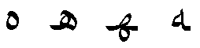
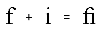
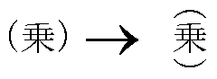
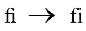
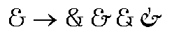
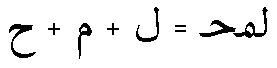
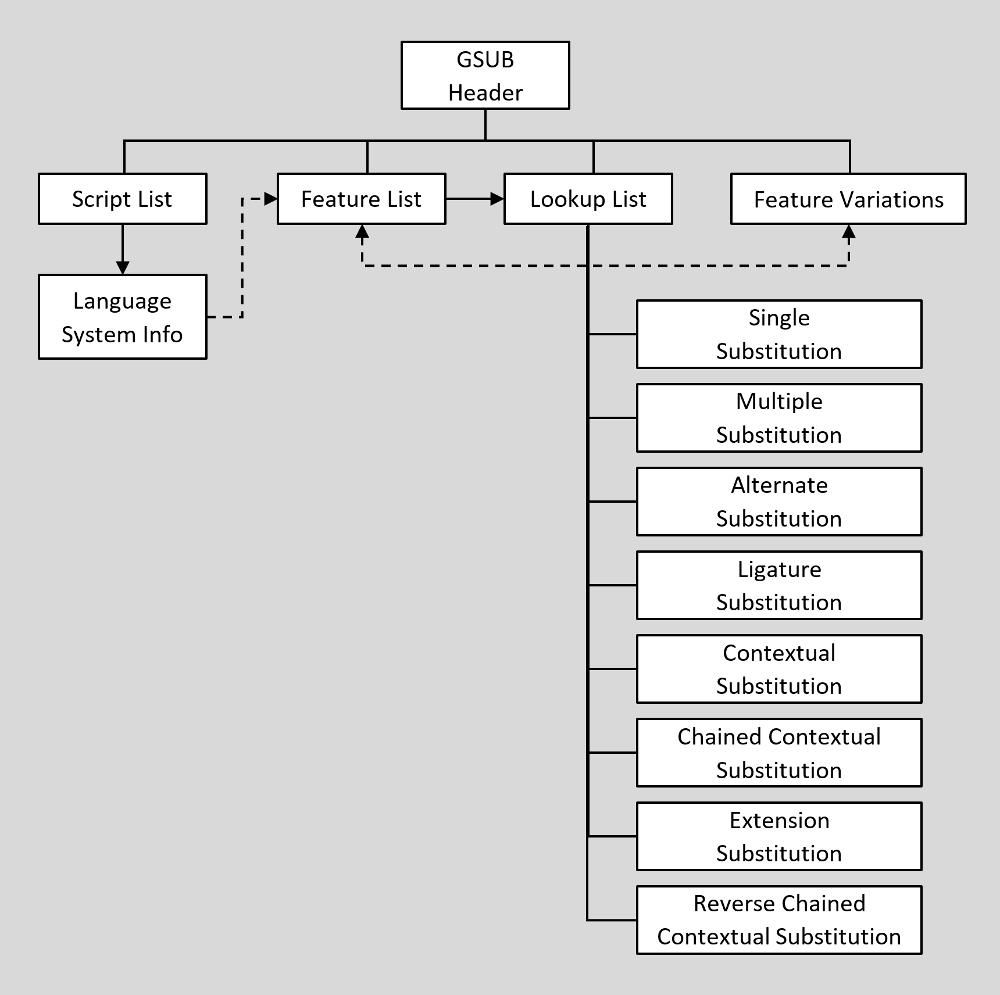

# GSUB — Glyph Substitution Table

## Overview

The Glyph Substitution (GSUB) table provides data for substitution of glyphs for appropriate rendering of scripts, such as cursively-connecting forms in Arabic script, or for advanced typographic effects, such as ligatures.

Many language systems require substitution of alternate glyph forms. For example, in the Arabic script, the glyph shape that depicts a particular character varies according to its position in a word or text string (see Figure 1). In other language systems, glyph substitutes are aesthetic options for the user, such as the use of ligature glyphs in the English language (see Figure 2).

 *Figure 1. Isolated, initial, medial, and final forms of the Arabic character HAH*

 *Figure 2. Two Latin glyphs and their associated ligature*

OpenType fonts use character encoding standards, such as the Unicode Standard, that assumes a distinction between characters and glyphs: text is encoded as sequences of characters, and the ['cmap' table](cmap.md) provides a mapping from that character to a single default glyph. Multiple characters are not directly mapped to a single glyph, as needed for ligatures; and a single character is not mapped directly to multiple glyphs, as may be needed for some complex-script scenarios. The GSUB table provides a way to describe such substitutions, enabling applications to apply such substitutions during text layout and rendering to achieve desired results.

To access substitute glyphs, GSUB maps from the glyph index or indices defined in a 'cmap' subtable to the glyph index or indices of the substitute glyphs. For example, if a font has three alternative forms of an ampersand glyph, the 'cmap' table associates the ampersand’s character code with only one of these glyphs. In GSUB, the indices of the other ampersand glyphs are then referenced from this one default index.

The text-processing client uses the GSUB data to manage glyph substitution actions. GSUB identifies the glyphs that are input to and output from each glyph substitution action, specifies how and where the client uses glyph substitutes, and regulates the order of glyph substitution operations. Any number of substitutions can be defined for each script or language system represented in a font.

The GSUB table supports seven types of glyph substitutions that are widely used in international typography:

- A *single substitution* replaces a single glyph with another single glyph. This is used, for example, to render positional glyph variants in Arabic and vertical text in East Asia (see Figure 3).

   *Figure 3. Alternative forms of parentheses used when positioning Kanji vertically*

- A *multiple substitution* replaces a single glyph with more than one glyph. This is used to specify actions such as ligature decomposition (see Figure 4).

   *Figure 4. Decomposing a Latin ligature glyph into its individual glyph components*

- An *alternate substitution* identifies functionally equivalent but different looking forms of a glyph. These glyphs are often referred to as aesthetic alternatives. For example, a font might have five different glyphs for the ampersand symbol, but one would have a default glyph index in the 'cmap' table. The client could use the default glyph or substitute any of the four alternatives (see Figure 5).

   *Figure 5. Alternative ampersand glyphs in a font*

- A *ligature substitution* replaces several glyph indices with a single glyph index, as when an Arabic ligature glyph replaces a string of separate glyphs (see Figure 6). When a string of glyphs can be replaced with a single ligature glyph, the first glyph is substituted with the ligature. The remaining glyphs in the string are deleted, this *does not* include those glyphs that are skipped as a result of lookup flags.

   *Figure 6. Three Arabic glyphs and their associated ligature glyph*

- *Contextual substitution* is an extension of the above lookup types, describing glyph substitutions in context — that is, a substitution of one or more glyphs within a certain pattern of glyphs. Each substitution describes one or more input glyph sequences and one or more substitutions to be performed on that sequence. Contextual substitutions can be applied to specific glyph sequences, glyph classes, or sets of glyphs.

- *Chained contexts substitution* extends the capabilities of contextual substitution. As with contextual substitution, actions can be performed on one or more glyphs within a pattern of glyphs—the *input sequence*. But the actions can be constrained by chained glyph sequence contexts: a *backtrack* sequence that precedes the input sequence, and a *lookahead* sequence that follows the input sequence. Three formats allow the backtrack, input and lookahead sequence patterns to be described using specific glyphs, glyph classes, or glyph sets.

- *Reverse Chaining contextual single substitution* allows one glyph to be substituted with another by chaining input glyph to a backtrack and/or lookahead sequence. The difference between this and other lookup types is that processing of input glyph sequence goes from end to start.

The GSUB data formats used to implement the different types of substitution include an eighth type, *substitution extension*. This provides a format extension mechanism, allowing reference to subtables using 32-bit offsets rather than 16-bit offsets. It does not provide an additional type of substitution action, however.

## GSUB table and OpenType Font Variations

OpenType Font Variations allow a single font to support many design variations along one or more axes of design variation. For example, a font with weight and width variations might support weights from thin to black, and widths from ultra-condensed to ultra-expanded. For general information on OpenType Font Variations, see the chapter, [OpenType Font Variations Overview](otvaroverview.md).

In a variable font, it may be desirable to have different glyph-substitution actions used for different regions within the font’s variation space. For example, for narrow or heavy instances in which counters become small, it may be desirable to make certain glyph substitutions to use alternate glyphs with certain strokes removed or outlines simplified to allow for larger counters. Such effects can be achieved using a FeatureVariations table within the GSUB table. The FeatureVariations table is described in the chapter, [OpenType Layout Common Table Formats](chapter2.md). See also the [Required Variation Alternates ('rvrn')](features_pt.md#anchor-features_pt-tag-rvrn) feature in the OpenType Layout tag registry.

## GSUB table organization

The GSUB table begins with a header that defines offsets to a ScriptList, a FeatureList, a LookupList, and an optional FeatureVariations table (see Figure 7):

- The [ScriptList](chapter2.md#anchor-chapter2-scriptlist-table) identifies all the scripts and language systems in the font that use glyph substitutes.
- The [FeatureList](chapter2.md#anchor-chapter2-featurelist-table) defines all the glyph substitution features required to render these scripts and language systems.
- The [LookupList](chapter2.md#anchor-chapter2-lookuplist-table) contains all the lookup data needed to implement each glyph substitution feature.
- The [FeatureVariations](chapter2.md#anchor-chapter2-feature-variations) table can be used to substitute alternate sets of lookup tables to use for any given feature under specified conditions. This is currently used only in variable fonts.

For a detailed discussion of ScriptLists, FeatureLists, LookupLists, and FeatureVariation tables, see the chapter, [OpenType Layout Common Table Formats.](chapter2.md)

 *Figure 7. High-level organization of GSUB table*

This organization helps text-processing clients to easily locate the features and lookups that apply to a particular script or language system. To access GSUB information, clients should use the following procedure:

1. Locate the current script in the GSUB ScriptList table.
2. If the language system is known, search the script for the correct LangSys table; otherwise, use the script’s default LangSys table.
3. The LangSys table provides index numbers into the GSUB FeatureList table to access a required feature and a number of additional features.
4. Inspect the featureTag of each feature, and select the feature tables to apply to an input glyph string.
5. If a Feature Variations table is present, evaluate conditions in the Feature Variation table to determine if any of the initially-selected feature tables should be substituted by an alternate feature table.
6. Each feature table provides an array of index numbers into the GSUB LookupList table. Assemble all lookups from the set of chosen features, and apply the lookups in the order given in the LookupList table.

For a detailed description of the Feature Variations table and how it is processed, see the [FeatureVariations table](chapter2.md#anchor-chapter2-feature-variations) section in the OpenType Layout Common Table Formats chapter.

Lookup data is defined in [Lookup tables](chapter2.md#anchor-chapter2-lookup-table), which are defined in the OpenType Layout Common Table Formats chapter. A Lookup table contains one or more Lookup subtables that define the specific conditions, type, and results of a substitution action used to implement a feature. Specific Lookup subtable types are used for glyph substitution actions, and are defined in this chapter. All subtables within a Lookup table must be of the same lookup type, as listed in the following table for the GsubLookupType enumeration:

*GsubLookupType enumeration*

| Value | Type | Description |
| --- | --- | --- |
| 1 | [Single](#anchor-gsub-lookup-type-1-subtable-single-substitution) | Replace one glyph with one glyph |
| 2 | [Multiple](#anchor-gsub-lookup-type-2-subtable-multiple-substitution) | Replace one glyph with more than one glyph |
| 3 | [Alternate](#anchor-gsub-lookup-type-3-subtable-alternate-substitution) | Replace one glyph with one of many glyphs |
| 4 | [Ligature](#anchor-gsub-lookup-type-4-subtable-ligature-substitution) | Replace multiple glyphs with one glyph |
| 5 | [Contextual substitution](#anchor-gsub-lookup-type-5-subtable-contextual-substitution) | Replace one or more glyphs in context |
| 6 | [Chained contexts substitution](#anchor-gsub-lookup-type-6-subtable-chained-contexts-substitution) | Replace one or more glyphs in chained context |
| 7 | [Substitution extension](#anchor-gsub-lookup-type-7-subtable-substitution-subtable-extension) | Extension mechanism for other substitution types |
| 8 | [Reverse chaining context single](#anchor-gsub-lookup-type-8-subtable-reverse-chained-contexts-single-9d8ce094) | Applied in reverse order, replace single glyph in chained contexts |

Each lookup type has one or more subtable formats. The “best” format depends on the type of substitution and the resulting storage efficiency. When glyph information is best presented in more than one format, a single lookup may define more than one subtable, as long as all the subtables are for the same lookup type. For example, within a given lookup, a glyph index array format could best represent one set of target glyphs, whereas a glyph index range format could be better for another set.

A series of substitution operations on the same glyph or string requires multiple lookups, one for each separate action. Each lookup has a different array index in the LookupList table and is applied in the LookupList order. The substitution action of each lookup is applied to the results of previous lookups. Some substitution lookups could “feed” later lookups by producing a glyph sequence that matches the input sequence pattern of a later lookup that would not have matched the original glyph sequence. The opposite is also possible: one substitution lookup produces a glyph sequence that does *not* match the pattern of a later lookup that *would* have matched the original glyph sequence. Thus, the ordering of lookups in the LookupList can be very significant.

During text processing, a client applies a lookup to each glyph in the string before moving to the next lookup. A lookup is finished for a glyph after the client locates the target glyph or glyph context and performs a substitution, if specified. To move to the “next” glyph, the client will skip all the glyphs that participated in the lookup operation: glyphs that were substituted as well as any other glyphs that formed an input sequence context for the operation. Only glyphs in the input sequence are skipped; in the case of chained contexts substitution, the glyphs in the lookahead sequence are not skipped.

The next section of this chapter describes the GSUB header and the subtables defined for each GsubLookupType. [Examples](#anchor-gsub-gsub-structure-examples) at the end of this chapter illustrate the GSUB header and six of the eight LookupTypes, including the three formats available for contextual substitutions (LookupType 5).

## GSUB table structures

### GSUB Header

The GSUB table begins with a header that contains a version number for the table and offsets to three tables: ScriptList, FeatureList, and LookupList. For descriptions of each of these tables, see the chapter, OpenType Layout Common Table Formats. [Example 1](#anchor-gsub-example-1-gsub-header) at the end of this chapter shows a GSUB Header version 1.0 table definition.

*GSUB Header, version 1.0*

| Type | Name | Description |
| --- | --- | --- |
| uint16 | majorVersion | Major version of the GSUB table, = 1. |
| uint16 | minorVersion | Minor version of the GSUB table, = 0. |
| Offset16 | scriptListOffset | Offset to ScriptList table, from beginning of GSUB table. |
| Offset16 | featureListOffset | Offset to FeatureList table, from beginning of GSUB table. |
| Offset16 | lookupListOffset | Offset to LookupList table, from beginning of GSUB table. |

*GSUB Header, version 1.1*

| Type | Name | Description |
| --- | --- | --- |
| uint16 | majorVersion | Major version of the GSUB table, = 1. |
| uint16 | minorVersion | Minor version of the GSUB table, = 1. |
| Offset16 | scriptListOffset | Offset to ScriptList table, from beginning of GSUB table. |
| Offset16 | featureListOffset | Offset to FeatureList table, from beginning of GSUB table. |
| Offset16 | lookupListOffset | Offset to LookupList table, from beginning of GSUB table. |
| Offset32 | featureVariationsOffset | Offset to FeatureVariations table, from beginning of the GSUB table (may be NULL). |

### Lookup type 1 subtable: single substitution

Single substitution (SingleSubst) subtables tell a client to replace a single glyph with another glyph. The subtables can be either of two formats. Both formats require two distinct sets of glyph indices: one that defines input glyphs (specified in the Coverage table), and one that defines the output glyphs. Format 1 requires less space than format 2, but it is less flexible.

**Single substitution format 1**

Format 1 calculates the indices of the output glyphs, which are not explicitly defined in the subtable. To calculate an output glyph index, format 1 adds a constant delta value to the input glyph index. The input and output glyphs do not need to be in continuous glyph ID ranges, but the delta between input glyph IDs and output glyph IDs need to be constant. This format does not use the Coverage index that is returned from the Coverage table.

The SingleSubstFormat1 subtable begins with a format identifier of 1. An offset references a Coverage table that specifies the indices of the input glyphs. The deltaGlyphID is a constant value added to each input glyph index to calculate the index of the corresponding output glyph. Addition of deltaGlyphID is modulo 65536. If the result after adding deltaGlyphID to the input glyph index is less than zero, add 65536 to obtain a valid glyph ID.

[Example 2](#anchor-gsub-example-2-singlesubstformat1-subtable) at the end of this chapter uses format 1 to replace standard numerals with lining numerals.

*SingleSubstFormat1 subtable*

| Type | Name | Description |
| --- | --- | --- |
| uint16 | format | Format identifier: format = 1. |
| Offset16 | coverageOffset | Offset to Coverage table, from beginning of substitution subtable. |
| int16 | deltaGlyphID | Add to original glyph ID to get substitute glyph ID. |

**Single substitution format 2**

Format 2 is more flexible than format 1 but requires more space. It provides an array of output glyph indices (substituteGlyphIDs) explicitly matched to the input glyph indices specified in the Coverage table.

The SingleSubstFormat2 subtable specifies a format identifier, an offset to a Coverage table that defines the input glyph indices, and an array of output glyph indices (substituteGlyphIDs).

The substituteGlyphIDs array must contain the same number of glyph indices as the Coverage table, and the glyphs must be ordered to match the order of corresponding input glyphs in the Coverage table. To locate the corresponding output glyph index in the substituteGlyphIDs array, this format uses the Coverage index returned from the Coverage table.

[Example 3](#anchor-gsub-example-3-singlesubstformat2-subtable) at the end of this chapter uses format 2 to substitute vertically oriented glyphs for horizontally oriented glyphs.

*SingleSubstFormat2 subtable*

| Type | Name | Description |
| --- | --- | --- |
| uint16 | format | Format identifier: format = 2. |
| Offset16 | coverageOffset | Offset to Coverage table, from beginning of substitution subtable. |
| uint16 | glyphCount | Number of glyph IDs in the substituteGlyphIDs array. |
| uint16 | substituteGlyphIDs\[glyphCount\] | Array of substitute glyph IDs — ordered by Coverage index. |

### Lookup type 2 subtable: multiple substitution

A multiple substitution (MultipleSubst) subtable replaces a single glyph with a sequence of glyphs, as when multiple glyphs replace a single ligature. The subtable has a single format.

**Multiple substitution format 1**

The MultipleSubstFormat1 subtable specifies a format identifier, an offset to a Coverage table that defines the input glyph indices, and an array of offsets to Sequence tables that define the output glyph indices. The Sequence table offsets are ordered by the Coverage index of the input glyphs.

For each input glyph listed in the Coverage table, a Sequence table defines the output glyphs. Each Sequence table contains a count of the glyphs in the output glyph sequence and an array of output glyph indices.

> *Note:* The order of the output glyph indices depends on the writing direction of the text. For text written left to right, the left-most glyph will be first glyph in the sequence. Conversely, for text written right to left, the right-most glyph will be first.

The use of multiple substitution for deletion of an input glyph is prohibited. The glyphCount value must always be greater than 0.

[Example 4](#anchor-gsub-example-4-multiplesubstformat1-subtable) at the end of this chapter shows how to replace a single ligature with three glyphs.

*MultipleSubstFormat1 subtable*

| Type | Name | Description |
| --- | --- | --- |
| uint16 | format | Format identifier: format = 1. |
| Offset16 | coverageOffset | Offset to Coverage table, from beginning of substitution subtable. |
| uint16 | sequenceCount | Number of Sequence table offsets in the sequenceOffsets array. |
| Offset16 | sequenceOffsets\[sequenceCount\] | Array of offsets to Sequence tables. Offsets are from beginning of substitution subtable, ordered by Coverage index. |

*Sequence table*

| Type | Name | Description |
| --- | --- | --- |
| uint16 | glyphCount | Number of glyph IDs in the substituteGlyphIDs array. This must always be greater than 0. |
| uint16 | substituteGlyphIDs\[glyphCount\] | String of glyph IDs to substitute. |

### Lookup type 3 subtable: alternate substitution

An alternate substitution (AlternateSubst) subtable identifies any number of aesthetic alternatives from which a user can choose a glyph variant to replace the input glyph. For example, if a font contains four variants of the ampersand symbol, the 'cmap' table will specify the index of one of the four glyphs as the default glyph index, and an AlternateSubst subtable will list the indices of the other three glyphs as alternatives. A text-processing client would then have the option of replacing the default glyph with any of the three alternatives.

The subtable has one format.

**Alternate substitution format 1**

The AlternateSubstFormat1 subtable contains a format identifier, an offset to a Coverage table containing the indices of glyphs with alternative forms, and an array of offsets to AlternateSet tables.

For each glyph in the Coverage table, an AlternateSet subtable contains a count of the alternative glyphs and an array of their glyph indices. Because all the glyphs are functionally equivalent, they can be in any order in the array.

[Example 5](#anchor-gsub-example-5-alternatesubstformat-1-subtable) at the end of this chapter shows how to replace the default ampersand glyph with alternative glyphs.

*AlternateSubstFormat1 subtable*

| Type | Name | Description |
| --- | --- | --- |
| uint16 | format | Format identifier: format = 1. |
| Offset16 | coverageOffset | Offset to Coverage table, from beginning of substitution subtable. |
| uint16 | alternateSetCount | Number of AlternateSet tables |
| Offset16 | alternateSetOffsets\[alternateSetCount\] | Array of offsets to AlternateSet tables. Offsets are from beginning of substitution subtable, ordered by Coverage index. |

*AlternateSet table*

| Type | Name | Description |
| --- | --- | --- |
| uint16 | glyphCount | Number of glyph IDs in the alternateGlyphIDs array. |
| uint16 | alternateGlyphIDs\[glyphCount\] | Array of alternate glyph IDs, in arbitrary order. |

### Lookup type 4 subtable: ligature substitution

A ligature substitution (LigatureSubst) subtable identifies ligature substitutions where a single glyph replaces multiple glyphs. One LigatureSubst subtable can specify any number of ligature substitutions. The subtable has one format.

**Ligature substitution format 1**

The LigatureSubstFormat1 subtable contains a format identifier, a Coverage table offset, and an array of offsets to LigatureSet tables. The Coverage table specifies only the index of the first glyph component of each ligature set.

[Example 6](#anchor-gsub-example-6-ligaturesubstformat1-subtable) at the end of this chapter shows how to replace a string of glyphs with a single ligature.

*LigatureSubstFormat1 subtable*

| Type | Name | Description |
| --- | --- | --- |
| uint16 | format | Format identifier: format = 1. |
| Offset16 | coverageOffset | Offset to Coverage table, from beginning of substitution subtable. |
| uint16 | ligatureSetCount | Number of LigatureSet tables. |
| Offset16 | ligatureSetOffsets\[ligatureSetCount\] | Array of offsets to LigatureSet tables. Offsets are from beginning of substitution subtable, ordered by Coverage index. |

A LigatureSet table, one for each covered glyph, specifies all the ligature sequences that begin with the covered glyph. For example, if the Coverage table lists the glyph index for a lowercase “f,” then a LigatureSet table will define ligature that begin with “f”, such as the “ffl”, “fl”, “ffi”, “fi” and “ff” ligatures. If the Coverage table also lists the glyph index for a lowercase “e”, then a different LigatureSet table will define ligatures that begin with “e”, such as the “etc” ligature.

A LigatureSet table consists of a count of the ligatures that begin with the covered glyph and an array of offsets to Ligature tables, which define the glyphs in each ligature. The order in the Ligature offset array defines the preference for using the ligatures. For example, if the “ffl” ligature is preferable to the “ff” ligature, then the Ligature array would list the offset to the “ffl” Ligature table before the offset to the “ff” Ligature table.

*LigatureSet table*

| Type | Name | Description |
| --- | --- | --- |
| uint16 | ligatureCount | Number of Ligature tables. |
| Offset16 | ligatureOffsets\[LigatureCount\] | Array of offsets to Ligature tables. Offsets are from beginning of LigatureSet table, ordered by preference. |

For each ligature in the set, a Ligature table specifies the glyph ID of the output ligature glyph; a count of the total number of component glyphs in the ligature, including the first component; and an array of glyph IDs for the components. The array starts with the second component glyph in the ligature (input glyph sequence index = 1, componentGlyphIDs array index = 0) because the first component glyph is specified in the Coverage table.

> *Note:* The componentGlyphIDs array lists glyph IDs according to the writing direction — that is, the logical order — of the text. For text written right to left, the right-most glyph will be first. Conversely, for text written left to right, the left-most glyph will be first.

*Ligature table*

| Type | Name | Description |
| --- | --- | --- |
| uint16 | ligatureGlyph | Glyph ID of ligature to substitute. |
| uint16 | componentCount | Number of components in the ligature. |
| uint16 | componentGlyphIDs\[componentCount - 1\] | Array of component glyph IDs — start with the second component, ordered in writing direction. |

### Lookup type 5 subtable: contextual substitution

A contextual substitution subtable describes glyph substitutions in context that replace one or more glyphs within a certain pattern of glyphs.

Contextual substitution subtables can use any of three formats that are common to the GSUB and GPOS tables. These define input sequence patterns to be matched against the text glyph sequence, and then actions to be applied to glyphs within the input sequence. The actions are specified as “nested” lookups, and each is applied to a particular sequence position within the input sequence.

Each sequence position + nested lookup combination is specified in a [SequenceLookupRecord](chapter2.md#anchor-chapter2-sequence-lookup-record). Examples [7](#anchor-gsub-example-7-contextual-substitution-format-1), [8](#anchor-gsub-example-8-contextual-substitution-format-2), and [9](#anchor-gsub-example-9-contextual-substitution-format-3) at the end of this chapter illustrate use of sequence lookup records within the GSUB table.

While the subtable formats are common between the GSUB and GPOS tables, the lookups referenced by sequence lookup records within the GSUB table are referenced by index into the GSUB LookupList table. In this way, actions specified by a GSUB contextual lookup can only be substitutions.

An input sequence pattern is matched against the current glyph sequence before any substitution actions are performed. The substitutions may change the current glyph sequence, but that has no effect on the initial matching operation. For a given lookup subtable, there may be multiple sequence lookup records, and these are processed in the specified order. Each substitution action on the glyph sequence applies to the results from the preceding sequence lookup records. Note in particular that the sequence position index in each sequence lookup record is relative to the glyph sequence as modified by the actions of preceding SequenceLookupRecords.

For example, consider a contextual lookup specifying an input glyph sequence of four glyphs. Suppose that no substitution is performed on the first glyph, but that the middle two glyphs will be replaced with a ligature, and a single glyph will replace the fourth glyph. Suppose also that the actions are listed in that order.

- The first glyph is at sequence position 0. No SequenceLookupRecord is specified for sequence index 0.
- The first SequenceLookupRecord specifies sequence position 1 and gives a LookupList index referencing a ligature substitution lookup. The first glyph specified in the nested lookup will be the glyph at sequence position 1; the second glyph specified in the nested lookup will be the glyph at sequence position 2. After the nested substitution has been performed, there will be three glyphs in the sequence context, not four.
- The last SequenceLookupRecord is defined in terms of the modified sequence context, specifying sequence position 2, not position 3. The nested single-substitution lookup will specify the glyph at position 2 as its input glyph.

**Contextual substitution format 1: simple glyph contexts**

Format 1 defines the context for a glyph substitution as a particular sequence of glyphs. For example, a context could be \<xyz\>, \<holiday\>, \<!?\*#@\>, or any other glyph sequence.

For example, suppose the glyph string \<abc\> is to be replaced with its reverse glyph string \<cba\>. The input context would be defined as the glyph sequence, \<abc\>. Two single-substitution actions can be specified: the “a” at sequence position 0 is substituted by “c”, and the “c” at sequence position 2 is substituted by “a”.

Format 1 contextual substitutions are implemented using a SequenceContextFormat1 table. See [Sequence context format 1: simple glyph contexts](chapter2.md#anchor-chapter2-sequence-context-format-1-simple-glyph-contexts) in the OpenType Layout Common Table Formats chapter for complete details.

[Example 7](#anchor-gsub-example-7-contextual-substitution-format-1) at the end of the chapter uses a SequenceContextFormat1 table to replace a sequence of three glyphs with a sequence preferred for the French language system.

**Contextual substitution format 2: class-based glyph contexts**

Format 2 defines contexts for glyph substitutions as input sequence patterns, with patterns expressed in terms of glyph classes. The glyph classes are defined using a [Class Definition table](chapter2.md#anchor-chapter2-class-definition-table). Several sequence patterns may be specified, with each pattern specifying a class of glyphs for each input sequence position.

For example, suppose that a swash capital glyph should replace each uppercase letter glyph that is preceded by a space glyph and followed by a lowercase letter glyph (a glyph sequence of space - uppercase - lowercase). The set of uppercase glyphs would constitute one glyph class (class 1), the set of lowercase glyphs would constitute a second class (class 2), and the space glyph would constitute a third class (class 3). The input context might be specified as a pattern of one glyph from class 3, followed by one glyph from class 1, followed by one glyph from class 2.

Format 2 contextual substitutions are implemented using a SequenceContextFormat2 table. See [Sequence context format 2: class-based glyph contexts](chapter2.md#anchor-chapter2-sequence-context-format-2-class-based-glyph-contexts) in the OpenType Layout Common Table Formats chapter for complete details.

[Example 8](#anchor-gsub-example-8-contextual-substitution-format-2) at the end of this chapter uses a SequenceContextFormat2 table to substitute Arabic mark glyphs for base glyphs of different heights.

**Contextual substitution format 3: coverage-based glyph contexts**

Format 3 defines a context for glyph substitutions as an input sequence pattern, with the pattern expressed in terms of Coverage tables. A different Coverage table is defined for each sequence position.

Format 3 is like format 2 in that patterns are defined using sets of glyphs. However, with the glyph classes used in format 2, each glyph is in exactly one class. With format 3, any glyph can occur in multiple Coverage tables.

Unlike Formats 1 and 2, however, this format can define only one context.

For example, consider an input context that contains a lowercase glyph (position 0), followed by an uppercase glyph (position 1), either a lowercase or numeral glyph (position 2), and then either a lowercase or uppercase vowel (position 3). This context requires four Coverage tables, one for each position:

- For position 0, the Coverage table lists the set of lowercase glyphs.
- For position 1, the Coverage table lists the set of uppercase glyphs.
- For position 2, the Coverage table lists the set of lowercase and numeral glyphs, a superset of the glyphs defined in the Coverage table for position 0.
- For position 3, the Coverage table lists the set of lowercase and uppercase vowels, a subset of the glyphs defined in the Coverage tables for both positions 0 and 1.

Format 3 contextual substitutions are implemented using a SequenceContextFormat3 table. See [Sequence context format 3: coverage-based glyph contexts](chapter2.md#anchor-chapter2-sequence-context-format-3-coverage-based-glyph-contexts) in the OpenType Layout Common Table Formats chapter for complete details.

[Example 9](#anchor-gsub-example-9-contextual-substitution-format-3) at the end of this chapter uses SequenceContextFormat3 to substitute swash glyphs for two out of three glyphs in a sequence.

### Lookup type 6 subtable: chained contexts substitution

A chained contexts substitution subtable describes glyph substitutions in context with an ability to look back and/or look ahead in the sequence of glyphs. The design of the chained contexts substitution subtable is parallel to that of the contextual substitution subtable, including the availability of three formats. Each format can describe one or more chained backtrack, input, and lookahead sequence combinations, and one or more substitutions for glyphs in each input sequence.

> *Note:* Substitutions can be specified only for the input sequence context, not for backtrack and lookahead sequences.

See the introduction to the [Contextual substitution](#anchor-gsub-lookup-type-5-subtable-contextual-substitution) section for general remarks regarding contextual substitutions, which also apply to chained contexts substitutions.

Note that backtrack sequences are specified in reverse logical order. See the [Chained sequence context format 1](chapter2.md#anchor-chapter2-chained-sequence-context-format-1-simple-glyph-contexts) section in the OpenType Layout Common Table Formats chapter for details regarding chained backtrack, input, and lookahead sequences.

**Chained contexts substitution format 1: simple glyph contexts**

Format 1 defines the context for a glyph substitution as a particular sequence of glyphs. For example, a context could be \<xyz\>, \<holiday\>, \<!?\*#@\>, or any other glyph sequence. Specific glyph sequences are used for input, backtrack or lookahead contexts.

Format 1 chained context substitutions are implemented using a ChainedSequenceContextFormat1 table. See [Chained sequence context format 1: simple glyph contexts](chapter2.md#anchor-chapter2-chained-sequence-context-format-1-simple-glyph-contexts) in the OpenType Layout Common Table Formats chapter for complete details.

**Chained contexts substitution format 2: class-based glyph contexts**

Format 2 defines contexts for glyph substitutions as patterns expressed in terms of glyph classes. The glyph classes are defined using a [Class Definition table](chapter2.md#anchor-chapter2-class-definition-table). Several sequence patterns may be specified, with each pattern specifying a class of glyphs for each sequence position.

To chain contexts, three separate Class Definition tables are used for the backtrack sequence, input sequence, and lookahead sequence.

Format 2 contextual substitutions are implemented using a ChainedSequenceContextFormat2 table. See [Chained sequence context format 2: class-based glyph contexts](chapter2.md#anchor-chapter2-chained-sequence-context-format-2-class-based-glyph-contexts) in the OpenType Layout Common Table Formats chapter for complete details.

**Chained contexts substitution format 3: coverage-based glyph contexts**

Format 3 defines contexts for glyph substitutions as patterns expressed in terms of Coverage tables. A different Coverage table is defined for each position in a sequence. To chain contexts, three separate sets of Coverage tables are used for the backtrack sequence, input sequence, and lookahead sequence.

Format 3 is like format 2 in that patterns are defined using sets of glyphs. However, with the glyph classes used in format 2, each glyph is in exactly one class. With format 3, any glyph can occur in multiple Coverage tables.

Format 3 contextual substitutions are implemented using a ChainedSequenceContextFormat3 table. See [Chained sequence context format 3: coverage-based glyph contexts](chapter2.md#anchor-chapter2-chained-sequence-context-format-3-coverage-based-glyph-contexts) in the OpenType Layout Common Table Formats chapter for complete details.

### Lookup type 7 subtable: substitution subtable extension

This lookup type provides a way to access lookup subtables within the GSUB table using 32-bit offsets. This is needed if the total size of the subtables exceeds the 16-bit limits of the various other offsets in the GSUB table. In this specification, the subtable stored at the 32-bit offset location is termed the “extension” subtable.

This subtable type uses one format.

**Substitution extension format 1**

*SubstExtensionFormat1 subtable*

| Type | Name | Description |
| --- | --- | --- |
| uint16 | format | Format identifier. Set to 1. |
| uint16 | extensionLookupType | Lookup type of subtable referenced by extensionOffset (that is, the extension subtable). |
| Offset32 | extensionOffset | Offset to the extension subtable, of lookup type extensionLookupType, relative to the start of the ExtensionSubstFormat1 subtable. |

The extensionLookupType field must be set to any lookup type other than 7. If a lookup table uses extension subtables, then all of the extension subtables must have the same extensionLookupType. All offsets to extension subtables are set in the usual way—that is, relative to start of the ExtensionSubstFormat1 subtable.

When a layout engine encounters a GSUB type 7 Lookup table, it shall:

- Proceed as though the Lookup table’s lookupType field were set to the extensionLookupType of the subtables.
- Proceed as though each extension subtable referenced by extensionOffset replaced the type 7 subtable that referenced it.

### Lookup type 8 subtable: reverse chained contexts single substitution

The reverse chaining contextual single substitution subtable (ReverseChainSingleSubst) describes single-glyph substitutions in context with an ability to look back and/or look ahead in the sequence of glyphs. The major difference between this and other lookup types is that processing of input glyph sequence goes from end to start.

Compared to chained contexts substitution (lookup subtable type 6), this format is restricted to only a coverage-based subtable format, input sequences can contain only a single glyph, and only single substitutions are allowed on this glyph. This constraint is integrated into the subtable format.

This lookup type is designed specifically for Arabic script writing styles like Nastaliq in which the shape of the glyph is determined by the following glyph, beginning at the last glyph of the “joor”, or set of connected glyphs.

This subtable type uses one format.

**Reverse chained contexts single substitution format 1: coverage-based glyph contexts**

Format 1 defines a chaining context rule as a sequence of Coverage tables. Each position in the sequence may define a different Coverage table for the set of glyphs that matches the context pattern. With format 1, the glyph sets defined in the different Coverage tables may intersect.

Despite reverse order processing, the order of the Coverage tables listed in the Coverage array must be in logical order (follow the writing direction). The backtrack sequence is as illustrated for the [Chained sequence context format 1](chapter2.md#anchor-chapter2-chained-sequence-context-format-1-simple-glyph-contexts) table, in the OpenType Layout Common Table Formats chapter. The input sequence is one glyph located at *i* in the logical string. The backtrack begins at *i* - 1 and increases in offset value as one moves toward the logical beginning of the string. The lookahead sequence begins at *i* + 1 and increases in offset value as one moves toward the logical end of the string. In processing a reverse chaining substitution, *i* begins at the logical end of the string and moves to the beginning.

The subtable contains a Coverage table for the input glyph and Coverage table arrays for backtrack and lookahead sequences. It also contains an array of substitute glyph indices (substituteGlyphIDs), which are substitutions for glyphs in the Coverage table, and a count of glyphs in the substituteGlyphIDs array. The substituteGlyphIDs array must contain the same number of glyph indices as the Coverage table. To locate the corresponding output glyph index in the substituteGlyphIDs array, this format uses the Coverage index returned from the Coverage table.

[Example 10](#anchor-gsub-example-10-reversechainsinglesubstformat1-subtable) at the end of this chapter uses ReverseChainSingleSubstFormat1 to substitute Arabic glyphs with a correct stroke thickness on the left (exit) to match the stroke thickness on the right (entry) of the following glyph (in logical order).

*ReverseChainSingleSubstFormat1 subtable*

| Type | Name | Description |
| --- | --- | --- |
| uint16 | format | Format identifier: format = 1. |
| Offset16 | coverageOffset | Offset to Coverage table, from beginning of substitution subtable. |
| uint16 | backtrackGlyphCount | Number of glyphs in the backtrack sequence. |
| Offset16 | backtrackCoverageOffsets\[backtrackGlyphCount\] | Array of offsets to coverage tables in backtrack sequence, in glyph sequence order. |
| uint16 | lookaheadGlyphCount | Number of glyphs in lookahead sequence. |
| Offset16 | lookaheadCoverageOffsets\[lookaheadGlyphCount\] | Array of offsets to coverage tables in lookahead sequence, in glyph sequence order. |
| uint16 | glyphCount | Number of glyph IDs in the substituteGlyphIDs array. |
| uint16 | substituteGlyphIDs\[glyphCount\] | Array of substitute glyph IDs — ordered by Coverage index. |

## GSUB structure examples

The rest of this chapter describes and illustrates examples of the various GSUB subtables, including each of the three formats available for contextual substitutions. All the examples reflect unique parameters described below, but the samples provide a useful reference for building subtables specific to other situations.

All the examples have three columns showing hex data, source, and comments.

### Example 1: GSUB Header

Example 1 shows a typical [GSUB Header table](#anchor-gsub-gsub-header) definition.

*Example 1*

| Hex Data | Source | Comments |
| --- | --- | --- |
|  | **GSUBHeader**  TheGSUBHeader | GSUBHeader table definition |
| 00010000 | 0x00010000 | major/minor version |
| 000A | TheScriptList | offset to ScriptList table |
| 001E | TheFeatureList | offset to FeatureList table |
| 002C | TheLookupList | offset to LookupList table |

### Example 2: SingleSubstFormat1 subtable

Example 2 illustrates the [SingleSubstFormat1 subtable](#anchor-gsub-SSF1) , which uses ranges to replace single input glyphs with their corresponding output glyphs. The indices of the output glyphs are calculated by adding a constant delta value to the indices of the input glyphs. In this example, the Coverage table has a format identifier of 2 to indicate the range format, which is used because the input glyph indices are in consecutive order in the font. The Coverage table specifies one range that contains a startGlyphID for the “0” (zero) glyph and an endGlyphID for the “9” glyph.

*Example 2*

| Hex Data | Source | Comments |
| --- | --- | --- |
|  | **SingleSubstFormat1**  LiningNumeralSubtable | SingleSubst subtable definition |
| 0001 | 1 | format: calculated output glyph indices |
| 0006 | LiningNumeralCoverage | offset to Coverage table for input glyphs |
| 00C0 | 192 | deltaGlyphID = 192: add to each input glyph index to produce output glyph index |
|  | **CoverageFormat2**  LiningNumeralCoverage | Coverage table definition |
| 0002 | 2 | coverageFormat: ranges |
|  | 1 | rangeCount |
|  | rangeRecords\[0\] |  |
| 004E | 78 | Start glyph ID for numeral zero glyph |
| 0058 | 87 | End glyph ID for numeral nine glyph |
| 0000 | 0 | startCoverageIndex: first CoverageIndex = 0 |

### Example 3: SingleSubstFormat2 subtable

Example 3 uses the [SingleSubstFormat2 subtable](#anchor-gsub-SSF2) for lists to substitute punctuation glyphs in Japanese text that is written vertically. Horizontally oriented parentheses and square brackets (the input glyphs) are replaced with vertically oriented parentheses and square brackets (the output glyphs).

The Coverage table, format 1, identifies each input glyph index. The number of input glyph indices listed in the Coverage table matches the number of output glyph indices listed in the subtable. For correct substitution, the order of the glyph indices in the Coverage table (input glyphs) must match the order in the Substitute array (output glyphs).

*Example 3*

| Hex Data | Source | Comments |
| --- | --- | --- |
|  | **SingleSubstFormat2**  VerticalPunctuationSubtable | SingleSubst subtable definition |
| 0002 | 2 | format: lists |
| 000E | VerticalPunctuationCoverage | offset to Coverage table |
| 0004 | 4 | glyphCount — equals glyphCount in Coverage table |
| 0131 | VerticalOpenBracketGlyph | substituteGlyphIDs\[0\], ordered by Coverage index |
| 0135 | VerticalClosedBracketGlyph | substituteGlyphIDs\[1\] |
| 013E | VerticalOpenParenthesisGlyph | substituteGlyphIDs\[2\] |
| 0143 | VerticalClosedParenthesisGlyph | substituteGlyphIDs\[3\] |
|  | **CoverageFormat1**  VerticalPunctuationCoverage | Coverage table definition |
| 0001 | 1 | coverageFormat: lists |
| 0004 | 4 | glyphCount |
| 003C | HorizontalOpenBracketGlyph | glyphArray\[0\], ordered by glyph ID |
| 0040 | HorizontalClosedBracketGlyph | glyphArray\[1\] |
| 004B | HorizontalOpenParenthesisGlyph | glyphArray\[2\] |
| 004F | HorizontalClosedParenthesisGlyph | glyphArray\[3\] |

### Example 4: MultipleSubstFormat1 subtable

Example 4 uses a [MultipleSubstFormat1 subtable](#anchor-gsub-MSF1) to replace a single “ffi” ligature with three individual glyphs that form the string \<ffi\>. The subtable defines a format identifier of 1, an offset to a Coverage table that specifies the glyph index of the “ffi” ligature (the input glyph), an offset to a Sequence table that specifies the sequence of glyph indices for the \<ffi\> string in its substitute array (the output glyph sequence), and a count of Sequence table offsets.

*Example 4*

| Hex Data | Source | Comments |
| --- | --- | --- |
|  | **MultipleSubstFormat1**  FfiDecompSubtable | MultipleSubst subtable definition |
| 0001 | 1 | format |
| 0008 | FfiDecompCoverage | offset to Coverage table |
| 0001 | 1 | sequenceCount — equals glyphCount in Coverage table |
| 000E | FfiDecompSequence | sequenceOffsets\[0\] (offset to Sequence table 0) |
|  | **CoverageFormat1**  FfiDecompCoverage | Coverage table definition |
| 0001 | 1 | coverageFormat: lists |
| 0001 | 1 | glyphCount |
| 00F1 | ffiGlyphID | ligature glyph |
|  | **Sequence**  FfiDecompSequence | Sequence table definition |
| 0003 | 3 | glyphCount |
| 001A | fGlyphID | first glyph in sequence order |
| 001A | fGlyphID | second glyph |
| 001D | iGlyphID | third glyph |

### Example 5: AlternateSubstFormat 1 subtable

Example 5 uses the [AlternateSubstFormat1 subtable](#anchor-gsub-ASF1) to replace the default ampersand glyph (input glyph) with one of two alternative ampersand glyphs (output glyph).

In this case, the Coverage table specifies the index of a single glyph, the default ampersand, because it is the only glyph covered by this lookup. The AlternateSet table for this covered glyph identifies the alternative glyphs: AltAmpersand1GlyphID and AltAmpersand2GlyphID.

In Example 5, the index position of the AlternateSet table offset in the AlternateSet array is zero (0), which correlates with the index position (also zero) of the default ampersand glyph in the Coverage table.

*Example 5*

| Hex Data | Source | Comments |
| --- | --- | --- |
|  | **AlternateSubstFormat1**  AltAmpersandSubtable | AlternateSubstFormat1 subtable definition |
| 0001 | 1 | format |
| 0008 | AltAmpersandCoverage | offset to Coverage table |
| 0001 | 1 | alternateSetCount — equals glyphCount in Coverage table |
| 000E | AltAmpersandSet | alternateSetOffsets\[0\] (offset to AlternateSet table 0) |
|  | **CoverageFormat1**  AltAmpersandCoverage | Coverage table definition |
| 0001 | 1 | coverageFormat: lists |
| 0001 | 1 | glyphCount |
| 003A | DefaultAmpersandGlyphID | glyphArray\[0\] |
|  | **AlternateSet**  AltAmpersandSet | AlternateSet table definition |
| 0002 | 2 | glyphCount |
| 00C9 | AltAmpersand1GlyphID | alternateGlyphIDs\[0\] — glyphs in arbitrary order |
| 00CA | AltAmpersand2GlyphID | alternateGlyphIDs\[1\] |

### Example 6: LigatureSubstFormat1 subtable

Example 6 shows a [LigatureSubstFormat1 subtable](#anchor-gsub-LSF1) that defines data to replace a string of glyphs with a single ligature glyph. Because a LigatureSubstFormat1 subtable can specify glyph substitutions for more than one ligature, this subtable defines three ligatures: “etc”, “ffi”, and “fi.”

The sample subtable contains a format identifier (4) and an offset to a Coverage table. The Coverage table, which lists an index for each first glyph in the ligatures, lists indices for the “e” and “f” glyphs. The Coverage table range format is used here because the “e” and “f” glyph indices are numbered consecutively.

In the LigatureSubst subtable, ligatureSetCount specifies two LigatureSet tables, one for each covered glyph, and the ligatureSetOffsets array stores offsets to them. In this array, the “e” LigatureSet precedes the “f” LigatureSet, matching the order of the corresponding first-glyph components in the Coverage table.

Each LigatureSet table identifies all ligatures that begin with a covered glyph. The sample LigatureSet table defined for the “e” glyph contains only one ligature, “etc.” A LigatureSet table defined for the “f” glyph contains two ligatures, “ffi” and “fi.”

The sample FLigaturesSet table has offsets to two Ligature tables, one for “ffi” and one for “fi.” The ligatureOffsets array lists the “ffi” Ligature table first to indicate that the “ffi” ligature is preferred to the “fi” ligature.

*Example 6*

| Hex Data | Source | Comments |
| --- | --- | --- |
|  | **LigatureSubstFormat1**  LigaturesSubtable | LigatureSubstFormat1 subtable definition |
| 0001 | 1 | format |
| 000A | LigaturesCoverage | offset to Coverage table |
| 0002 | 2 | ligatureSetCount |
| 0014 | ELigaturesSet | ligatureSetOffsets\[0\] (offset to LigatureSet table 0) — LigatureSet tables in Coverage index order |
| 0020 | FLigaturesSet | ligatureSetOffsets\[1\] |
|  | **CoverageFormat2**  LigaturesCoverage | Coverage table definition |
| 0002 | 2 | coverageFormat: ranges |
| 0001 | 1 | rangeCount |
|  | rangeRecords\[0\] |  |
| 0019 | eGlyphID | Start, first glyph ID |
| 001A | fGlyphID | End, last glyph ID in range |
| 0000 | 0 | startCoverageIndex: coverage index of start glyph ID = 0 |
|  | **LigatureSet**  ELigaturesSet | LigatureSet table definition — all ligatures that start with e |
| 0001 | 1 | ligatureCount |
| 0004 | etcLigature | ligatureOffsets\[0\] (offset to Ligature table 0) |
|  | **Ligature**  etcLigature | Ligature table definition |
| 015B | etcGlyphID | ligatureGlyph — output glyph ID |
| 0003 | 3 | componentCount |
| 0028 | tGlyphID | componentGlyphIDs\[0\] — second component in ligature |
| 0017 | cGlyphID | componentGlyphIDs\[1\] — third component in ligature |
|  | **LigatureSet**  FLigaturesSet | LigatureSet table definition all ligatures start with f |
| 0002 | 2 | ligatureCount |
| 0006 | ffiLigature | ligatureOffsets\[0\] — listed first because ffi ligature is preferred to fi ligature |
| 000E | fiLigature | ligatureOffsets\[1\] |
|  | **Ligature**  ffiLigature | Ligature table definition |
| 00F1 | ffiGlyphID | ligatureGlyph — output glyph ID |
| 0003 | 3 | componentCount |
| 001A | fGlyphID | componentGlyphIDs\[0\] — second component in ligature |
| 001D | iGlyphID | componentGlyphIDs\[1\] — third component in ligature |
|  | **Ligature**  fiLigature | Ligature table definition |
| 00F0 | fiGlyphID | ligatureGlyph — output glyph ID |
| 0002 | 2 | componentCount |
| 001D | iGlyphID | componentGlyphIDs\[0\] — second component in ligature |

### Example 7: Contextual substitution format 1

Example 7 illustrates [format 1 contextual substitution](#anchor-gsub-CSF1), using a [SequenceContextFormat1](chapter2.md#anchor-chapter2-sequence-context-format-1-simple-glyph-contexts) subtable to replace a string of three glyphs with another string. For the French language system, the subtable defines a contextual substitution that replaces the input sequence, space-dash-space, with the output sequence, thin space-dash-thin space.

The contextual substitution, called Dash Lookup in this example, contains one SequenceContextFormat1 subtable called the DashSubtable. The subtable specifies two contexts: a SpaceGlyph followed by a DashGlyph, and a DashGlyph followed by a SpaceGlyph. In each sequence, a single substitution replaces the SpaceGlyph with a ThinSpaceGlyph.

The Coverage table, labeled DashCoverage, lists two glyph IDs for the first glyphs in the SpaceGlyph and DashGlyph sequences. One SequenceRuleSet table is defined for each covered glyph.

SpaceAndDashSubRuleSet lists all the contexts that begin with a SpaceGlyph. It contains an offset to one SequenceRule table (SpaceAndDashSubRule), which specifies two glyphs in the context sequence, the second of which is a DashGlyph. The SequenceRule table contains a SequenceLookupRecord that lists the position in the sequence where the glyph substitution should occur (position 0) and the index of the SpaceToThinSpaceLookup applied there to replace the SpaceGlyph with a ThinSpaceGlyph. DashAndSpaceSubRuleSet lists all the contexts that begin with a DashGlyph. An offset points to a SequenceRule table (DashAndSpaceSubRule), which specifies two glyphs in the context sequence, and the second one is a SpaceGlyph. The SequenceRule table contains a SequenceLookupRecord that lists the position in the sequence where the glyph substitution should occur, and an index to the same lookup used in the SpaceAndDashSubRule. The lookup replaces the SpaceGlyph with a ThinSpaceGlyph.

*Example 7*

| Hex Data | Source | Comments |
| --- | --- | --- |
|  | **SequenceContextFormat1**  DashSubtable | SequenceContextFormat1 subtable definition for Lookup\[0\], DashLookup |
| 0001 | 1 | format |
| 000A | DashCoverage | offset to Coverage table |
| 0002 | 2 | seqRuleSetCount |
| 0012 | SpaceAndDashSubRuleSet | seqRuleSetOffsets\[0\] (offset to SequenceRuleSet table 0) — SequenceRuleSets ordered by Coverage index |
| 0020 | DashAndSpaceSubRuleSet | seqRuleSetOffsets\[1\] |
|  | **CoverageFormat1**  DashCoverage | Coverage table definition |
| 0001 | 1 | coverageFormat: lists |
| 0002 | 2 | glyphCount |
| 0028 | SpaceGlyph | glyphArray\[0\] — glyphs in numeric order |
| 005D | DashGlyph | glyphArray\[1\], dash glyph ID |
|  | **SequenceRuleSet**  SpaceAndDashSubRuleSet | SequenceRuleSet\[0\] table definition |
| 0001 | 1 | seqRuleCount |
| 0004 | SpaceAndDashSubRule | seqRuleOffsets\[0\] (offset to SequenceRule table 0) — SequenceRule tables ordered by preference |
|  | **SequenceRule**  SpaceAndDashSubRule | SequenceRule\[0\] table definition |
| 0002 | 2 | glyphCount — number in input sequence |
| 0001 | 1 | seqLookupCount |
| 005D | DashGlyph | inputSequence\[0\], starting with second glyph — SpaceGlyph, in Coverage table, is first glyph |
|  | seqLookupRecords\[0\] |  |
| 0000 | 0 | sequenceIndex — substitution at first glyph position (0) |
| 0001 | 1 | lookupListIndex — index for SpaceToThinSpaceLookup in LookupList |
|  | **SequenceRuleSet**  DashAndSpaceSubRuleSet | SequenceRuleSet\[1\] table definition |
| 0001 | 1 | seqRuleCount |
| 0004 | DashAndSpaceSubRule | seqRuleOffsets\[0\] (offset to SequenceRule table 0) — SequenceRule tables ordered by preference |
|  | **SequenceRule**  DashAndSpaceSubRule | SequenceRule\[0\] table definition |
| 0002 | 2 | glyphCount — number in the input glyph sequence |
| 0001 | 1 | seqLookupCount |
| 0028 | SpaceGlyph | inputSequence\[0\] — starting with second glyph |
|  | seqLookupRecords\[0\] |  |
| 0001 | 1 | sequenceIndex — substitution at second glyph position (glyph sequence index = 1) |
| 0001 | 1 | lookupListIndex — index for SpaceToThinSpaceLookup |

### Example 8: Contextual substitution format 2

Example 8 illustrates a [format 2 contextual substitution](#anchor-gsub-CSF2) using a [SequenceContextFormat2](chapter2.md#anchor-chapter2-sequence-context-format-2-class-based-glyph-contexts) subtable with glyph classes to replace default mark glyphs with their alternative forms. Glyph alternatives are selected depending upon the height of the base glyph that they combine with; that is, the mark glyph used above a high base glyph differs from the mark glyph above a very high base glyph.

In the example, SetMarksHighSubtable contains a Class Definition table that defines four glyph classes: default mark glyphs (class 1), high base glyphs (class 2), very high base glyphs (class 3), and all remaining glyphs, including medium-height base glyphs. The subtable also contains a Coverage table that lists each base glyph that functions as a first component in a context, ordered by glyph index.

Two ClassSequenceRuleSet tables are defined, one for substituting high marks and one for very high marks. No ClassSequenceRuleSets are specified for class 0 and class 1 glyphs because no contexts begin with glyphs from these classes. The classSeqRuleSetOffsets lists offsets to the ClassSequenceRuleSet tables in class value order, so the offset for ClassSequenceRuleSet for class 2 precedes that for class 3.

Within each ClassSequenceRuleSet, a ClassSequencRule is defined. In SetMarksHighSubClassSet2, corresponding to contexts that begin with a glyph in class 2, the ClassSequenceRule table specifies an input sequence with two glyphs: the first glyph in class 2 (a high glyph), and the second in class 1 (a mark glyph). The SequenceLookupRecord specifies applying SubstituteHighMarkLookup at the second position in the sequence—that is, a high mark glyph will replace the default mark glyph.

In SetMarksVeryHighSubClassSet3, corresponding to contexts that begin with a glyph in class 3, the ClassSequencRule specifies an input sequence with two glyphs: the first in class 3 (a very high glyph), and the second in class 1 (a mark glyph). The SequenceLookupRecord specifies applying SubstituteVeryHighMarkLookup at the second position in the sequence—that is, a very high mark glyph will replace the default mark glyph.

*Example 8*

| Hex Data | Source | Comments |
| --- | --- | --- |
|  | **SequenceContextFormat2**  SetMarksHighSubtable | SequenceContextFormat2 subtable definition |
| 0002 | 2 | format |
| 0010 | SetMarksHighCoverage | offset to Coverage table |
| 001C | SetMarksHighClassDef | offset to Class Def table |
| 0004 | 4 | classSeqRuleSetCount |
| 0000 | NULL | classSeqRuleSetOffsets\[0\] — NULL: no contexts that begin with Class 0 glyphs are defined |
| 0000 | NULL | classSeqRuleSetOffsets\[1\] — no contexts that begin with Class 1 glyphs are defined |
| 0032 | SetMarksHighSubClassSet2 | classSeqRuleSetOffsets\[2\] — offset to ClassSequencRuleSet table for contexts that begin with Class 2 glyphs (high base glyphs) |
| 0040 | SetMarksVeryHighSubClassSet3 | classSeqRuleSetOffsets\[3\] — offset to ClassSequencRuleSet table for contexts that begin with Class 3 glyphs (very high base glyphs) |
|  | **CoverageFormat1**  SetMarksHighCoverage | Coverage table definition |
| 0001 | 1 | coverageFormat: lists |
| 0004 | 4 | glyphCount |
| 0030 | tahGlyphID | glyphArray\[0\], high base glyph |
| 0031 | dhahGlyphID | glyphArray\[1\], high base glyph |
| 0040 | cafGlyphID | glyphArray\[2\], very high base glyph |
| 0041 | gafGlyphID | glyphArray\[3\], very high base glyph |
|  | **ClassDefFormat2**  SetMarksHighClassDef | Class table definition |
| 0002 | 2 | classFormat: ranges |
| 0003 | 3 | classRangeCount |
|  | classRangeRecords\[0\] | ClassRangeRecords ordered by startGlyphID; record for Class 2, high base glyphs |
| 0030 | tahGlyphID | Start, first Glyph ID in range |
| 0031 | dhahGlyphID | End, last Glyph ID in range |
| 0002 | 2 | class: 2 |
|  | classRangeRecords\[1\] | ClassRangeRecord for Class 3, very high base glyphs |
| 0040 | cafGlyphID | Start, first Glyph ID in the range |
| 0041 | gafGlyphID | End, last Glyph ID in the range |
| 0003 | 3 | class: 3  ClassRange\[2\] for Class 1, mark gyphs |
|  | classRangeRecords\[2\] | ClassRangeRecord for Class 1, mark glyphs |
| 00D2 | fathatanDefaultGlyphID | Start, first Glyph ID in range default fathatan mark |
| 00D3 | dammatanDefaultGlyphID | End, last Glyph ID in the range default dammatan mark |
| 0001 | 1 | class: 1 |
|  | **ClassSequencRuleSet**  SetMarksHighSubClassSet2 | ClassSequencRuleSet\[2\] table definition— all contexts that begin with Class 2 glyphs |
| 0001 | 1 | classSeqRuleCount |
| 0004 | SetMarksHighSubClassRule2 | classSeqRuleOffsets\[0\] (offset to ClassSequenceRule table 0) — ClassSequenceRule tables ordered by preference |
|  | **ClassSequenceRule**  SetMarksHighSubClassRule2 | ClassSequenceRule\[0\] table definition, Class 2 glyph (high base) glyph followed by a Class 1 glyph (mark) |
| 0002 | 2 | glyphCount |
| 0001 | 1 | seqLookupCount |
| 0001 | 1 | inputSequence\[0\] — input sequence beginning with the second Class in the input context sequence; Class 1, mark glyphs |
|  | seqLookupRecords\[0\] | seqLookupRecords array in design order |
| 0001 | 1 | sequenceIndex — apply substitution to position 2, a mark |
| 0001 | 1 | lookupListIndex |
|  | **ClassSequencRuleSet**  SetMarksVeryHighSubClassSet3 | ClassSequencRuleSet\[3\] table definition — all contexts that begin with Class 3 glyphs |
| 0001 | 1 | classSeqRuleCount |
| 0004 | SetMarksVeryHighSubClassRule3 | classSeqRuleOffsets\[0\] |
|  | **ClassSequenceRule**  SetMarksVeryHighSubClassRule3 | ClassSequenceRule\[0\] table definition — Class 3 glyph (very high base glyph) followed by a Class 1 glyph (mark) |
| 0002 | 2 | glyphCount |
| 0001 | 1 | seqLookupCount |
| 0001 | 1 | inputSequence\[0\] — input sequence beginning with the second Class in the input context sequence; Class 1, mark glyphs |
|  | seqLookupRecords\[0\] | seqLookupRecords array in design order |
| 0001 | 1 | sequenceIndex — apply substitution to position 2, second glyph class (mark) |
| 0002 | 2 | lookupListIndex |

### Example 9: Contextual substitution format 3

Example 9 illustrates a [format 3 contextual substitution](#anchor-gsub-CSF3), using a [SequenceContextFormat3](chapter2.md#anchor-chapter2-sequence-context-format-3-coverage-based-glyph-contexts) subtable with Coverage tables to describe a context sequence of three lowercase glyphs in the pattern: any ascender or descender glyph in position 0 (zero), any x-height glyph in position 1, and any descender glyph in position 2. The overlapping sets of covered glyphs for positions 0 and 2 make Format 3 better for this context than the class-based Format 2.

In positions 0 and 2, swash versions of the glyphs replace the default glyphs. The contextual-substitution lookup is SwashLookup (LookupList index = 0), and its subtable is SwashSubtable. The SwashSubtable defines three Coverage tables: AscenderDescenderCoverage, XheightCoverage, and DescenderCoverage-one for each glyph position in the context sequence, respectively.

The SwashSubtable also defines two SequenceLookupRecords: one that applies to position 0, and one for position 2. (No substitutions are applied to position 1.) The record for position 0 uses a single substitution lookup called AscDescSwashLookup to replace the current ascender or descender glyph with a swash ascender or descender glyph. The record for position 2 uses a single substitution lookup called DescSwashLookup to replace the current descender glyph with a swash descender glyph.

*Example 9*

| Hex Data | Source | Comments |
| --- | --- | --- |
|  | **SequenceContextFormat3**  SwashSubtable | SequenceContextFormat3 subtable definition |
| 0003 | 3 | format |
| 0003 | 3 | glyphCount — number in input glyph sequence |
| 0002 | 2 | seqLookupCount |
| 0014 | AscenderDescenderCoverage | coverageOffsets\[0\] — offsets to Coverage tables, in context sequence order |
| 0030 | XheightCoverage | coverageOffsets\[1\] |
| 0052 | DescenderCoverage | coverageOffsets\[2\] |
|  | seqLookupRecords\[0\] | SequenceLookupRecords in glyph position order |
| 0000 | 0 | sequenceIndex |
| 0001 | 1 | lookupListIndex — single substitution to output ascender or descender swash |
|  | seqLookupRecords\[1\] |  |
| 0002 | 2 | sequenceIndex |
| 0002 | 2 | lookupListIndex — single substitution to output descender swash |
|  | **CoverageFormat1**  AscenderDescenderCoverage | Coverage table definition |
| 0001 | 1 | coverageFormat: lists |
| 000C | 12 | glyphCount |
| 0033 | bGlyphID | glyphArray\[0\] — glyphs in glyph ID order |
| 0035 | dGlyphID | glyphArray\[1\] |
| 0037 | fGlyphID | glyphArray\[2\] |
| 0038 | gGlyphID | glyphArray\[3\] |
| 0039 | hGlyphID | glyphArray\[4\] |
| 003B | jGlyphID | glyphArray\[5\] |
| 003C | kGlyphID | glyphArray\[6\] |
| 003D | lGlyphID | glyphArray\[7\] |
| 0041 | pGlyphID | glyphArray\[8\] |
| 0042 | qGlyphID | glyphArray\[9\] |
| 0045 | tGlyphID | glyphArray\[10\] |
| 004A | yGlyphID | glyphArray\[11\] |
|  | **CoverageFormat1**  XheightCoverage | Coverage table definition |
| 0001 | 1 | coverageFormat: lists |
| 000F | 15 | glyphCount |
| 0032 | aGlyphID | glyphArray\[0\] |
| 0034 | cGlyphID | glyphArray\[1\] |
| 0036 | eGlyphID | glyphArray\[2\] |
| 003A | iGlyphID | glyphArray\[3\] |
| 003E | mGlyphID | glyphArray\[4\] |
| 003F | nGlyphID | glyphArray\[5\] |
| 0040 | oGlyphID | glyphArray\[6\] |
| 0043 | rGlyphID | glyphArray\[7\] |
| 0044 | sGlyphID | glyphArray\[8\] |
| 0045 | tGlyphID | glyphArray\[9\] |
| 0046 | uGlyphID | glyphArray\[10\] |
| 0047 | vGlyphID | glyphArray\[11\] |
| 0048 | wGlyphID | glyphArray\[12\] |
| 0049 | xGlyphID | glyphArray\[13\] |
| 004B | zGlyphID | GlyphArray\[14\] |
|  | **CoverageFormat1**  DescenderCoverage | Coverage table definition |
| 0001 | 1 | coverageFormat: lists |
| 0005 | 5 | glyphCount |
| 0038 | gGlyphID | glyphArray\[0\] |
| 003B | jGlyphID | glyphArray\[1\] |
| 0041 | pGlyphID | glyphArray\[2\] |
| 0042 | qGlyphID | glyphArray\[3\] |
| 004A | yGlyphID | glyphArray\[4\] |

### Example 10: ReverseChainSingleSubstFormat1 subtable

Example 10 uses a [ReverseChainSingleSubstFormat1 subtable](#anchor-gsub-RCCSF1) to substitute glyphs with a form that has a thick connection to the left (thick exit). This allows the glyph to correctly connect to the letter form to the left of it.

The ThickExitCoverage table is the listing of glyphs to be matched for substitution.

The LookaheadCoverage table, labeled ThickEntryCoverage, lists four glyph IDs for the glyph following a substitution coverage glyph. This lookahead coverage attempts to match the context that will cause the substitution to take place.

The substituteGlyphIDs array provides the glyphs to replace glyphs that correspond in order in the ThickExitCoverage table.

*Example 10*

| Hex Data | Source | Comments |
| --- | --- | --- |
|  | **ReverseChainSingleSubstFormat1**  ThickConnect | ReverseChainSingleSubstFormat1 subtable definition |
| 0001 | 1 | format |
| 0068 | ThickExitCoverage | offset to Coverage table |
| 0000 | 0 | backtrackGlyphCount |
| 0000 | null - not used | backtrackCoverageOffsets\[0\] |
| 0001 | 1 | lookaheadGlyphCount |
| 0026 | ThickEntryCoverage | lookaheadCoverageOffsets\[0\] |
| 000C | 12 | glyphCount |
| 00A7 | BEm2 | substituteGlyphIDs\[0\] — substitute glyphs ordered by Coverage index |
| 00B9 | BEi3 | substituteGlyphIDs\[1\] |
| 00C5 | JIMm3 | substituteGlyphIDs\[2\] |
| 00D4 | JIMi2 | substituteGlyphIDs\[3\] |
| 00EA | SINm2 | substituteGlyphIDs\[4\] |
| 00F2 | SINi2 | substituteGlyphIDs\[5\] |
| 00FD | SADm2 | substituteGlyphIDs\[6\] |
| 010D | SADi2 | substituteGlyphIDs\[7\] |
| 011B | TOEm3 | substituteGlyphIDs\[8\] |
| 012B | TOEi3 | substituteGlyphIDs\[9\] |
| 013B | AINm2 | substituteGlyphIDs\[10\] |
| 0141 | AINi2 | substituteGlyphIDs\[11\] |
|  | **CoverageFormat1**  ThickEntryCoverage | Coverage table definition |
| 0001 | 1 | coverageFormat: lists |
| 001F | 31 | glyphCount |
| 00A5 | ALEFf1 | glyphArray\[0\] — glyphs in glyph ID order |
| 00A9 | BEm4 | glyphArray\[1\] |
| 00AA | BEm5 | glyphArray\[2\] |
| 00E2 | DALf1 | glyphArray\[3\] |
| 0167 | KAFf1 | glyphArray\[4\] |
| 0168 | KAFfs1 | glyphArray\[5\] |
| 0169 | KAFm1 | glyphArray\[6\] |
| 016D | KAFm5 | glyphArray\[7\] |
| 016E | KAFm6 | glyphArray\[8\] |
| 0170 | KAFm8 | glyphArray\[9\] |
| 0183 | GAFf1 | glyphArray\[10\] |
| 0184 | GAFfs1 | glyphArray\[11\] |
| 0185 | GAFm1 | glyphArray\[12\] |
| 0189 | GAFm5 | glyphArray\[13\] |
| 018A | GAFm6 | glyphArray\[14\] |
| 018C | GAFm8 | glyphArray\[15\] |
| 019F | LAMf1 | glyphArray\[16\] |
| 01A0 | LAMm1 | glyphArray\[17\] |
| 01A1 | LAMm2 | glyphArray\[18\] |
| 01A2 | LAMm3 | glyphArray\[19\] |
| 01A3 | LAMm4 | glyphArray\[20\] |
| 01A4 | LAMm5 | glyphArray\[21\] |
| 01A5 | LAMm6 | glyphArray\[22\] |
| 01A6 | LAMm7 | glyphArray\[23\] |
| 01A7 | LAMm8 | glyphArray\[24\] |
| 01A8 | LAMm9 | glyphArray\[25\] |
| 01A9 | LAMm10 | glyphArray\[26\] |
| 01AA | LAMm11 | glyphArray\[27\] |
| 01AB | LAMm12 | glyphArray\[28\] |
| 01AC | LAMm13 | glyphArray\[29\] |
| 01EC | HAYf2 | glyphArray\[30\] |
|  | **CoverageFormat1**  ThickExitCoverage | Coverage table definition |
| 0001 | 1 | coverageFormat: lists |
| 000C | 12 | glyphCount |
| 00A6 | BEm1 | glyphArray\[0\] |
| 00B7 | BEi1 | glyphArray\[1\] |
| 00C3 | JIMm1 | glyphArray\[2\] |
| 00D2 | JIMi1 | glyphArray\[3\] |
| 00E9 | SINm1 | glyphArray\[4\] |
| 00F1 | SINi1 | glyphArray\[5\] |
| 00FC | SADm1 | glyphArray\[6\] |
| 010C | SADi1 | glyphArray\[7\] |
| 0119 | TOEm1 | glyphArray\[8\] |
| 0129 | TOEi1 | glyphArray\[9\] |
| 013A | AINm1 | glyphArray\[10\] |
| 0140 | AINi1 | glyphArray\[11\] |
