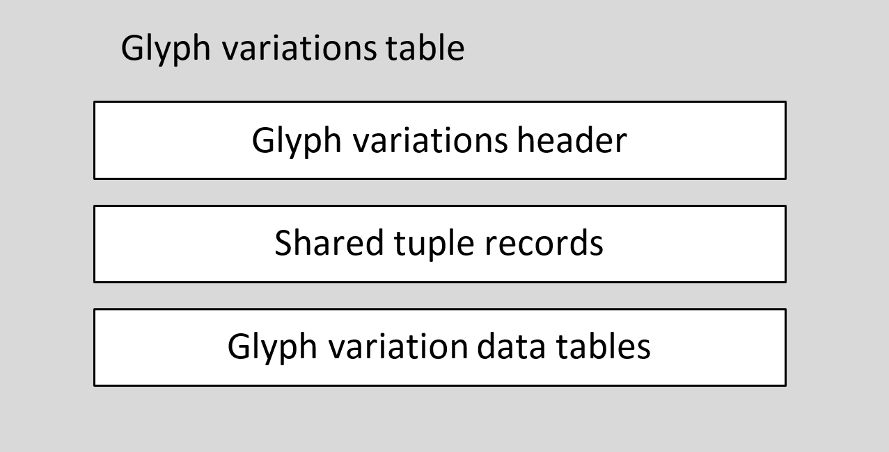
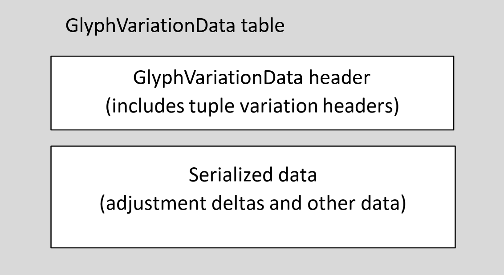
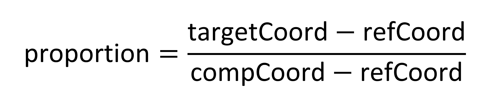
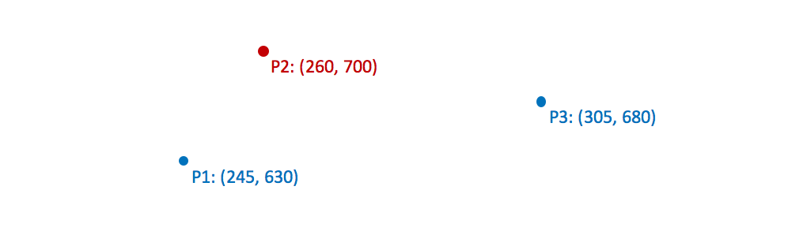
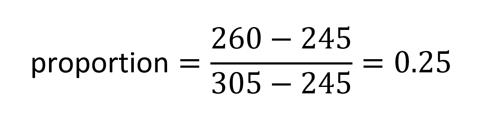
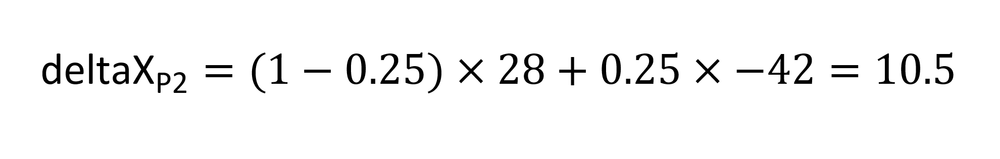

<a id="anchor-gvar-gvar-glyph-variations-table"></a>

# gvar — Glyph Variations Table

OpenType Font Variations allow a font designer to incorporate multiple faces within a font family into a single font resource. In a variable font, the [font variations ('fvar')](fvar.md) table defines a set of design variations supported by the font, and then various tables provide data that specify how different font values, such as X-height or X and Y coordinates for glyph outline points, are adjusted for different variation instances. The glyph variations ('gvar') table provides all of the variation data that describe how TrueType glyph outlines in a 'glyf' table change across the font’s variation space.

For a general overview of OpenType Font Variations, see the chapter, [OpenType Font Variations Overview](otvaroverview.md).

<a id="anchor-gvar-introduction"></a>

## Introduction

The glyph variations table can only be used in combination with TrueType outlines — a [glyph ('glyf')](glyf.md) table — and also in combination with a [font variations ('fvar')](fvar.md) table and other required or optional tables used in variable fonts.

The 'gvar' table contains *glyph variation data* sub-tables with variation data for each glyph in the 'glyf' table. The glyph variation data is a specific variant of the *tuple variation store* format, which is described in detail in the chapter [OpenType Font Variations Common Table Formats](otvarcommonformats.md). Another variant of the tuple variation store is also used in the 'cvar' table. Differences between these and details specific to the 'gvar' table are described in the Common Table Formats chapter.

Variation data is comprised of many adjustment-delta values. These deltas apply to particular target items, such as the X or Y coordinate of some glyph outline point, and are applicable for instances within a particular region of the font’s variation space. The tuple variation store format organizes deltas into groupings by region of applicability, with a different group of data for each region. As glyph outlines often comprise the largest volume of data in a font, the tuple variation store format uses run-length encoding and other optimization mechanisms to provide efficient representation of the variation data.

Each region-specific grouping of data includes data covering all of the outline points for the given glyph. This means that the tuple variation store formats are suited to unpacking and processing delta values for all outline points at once, rather than for random outline points. In most application scenarios, glyph outline processing involves the entire glyph outline at once, so this bias in the format is generally not a particular limitation.

A notable exception, however, is the use of horizontal or vertical glyph metrics in text-layout operations that occur prior to rendering. The TrueType rasterizer dynamically generates “phantom” points for each glyph that represent horizontal and vertical advance widths and side bearings, and the variation data within the 'gvar' table includes data for these phantom points. (See the chapter [Instructing TrueType Glyphs](tt_instructing_glyphs.md#anchor-tt_instructing_glyphs-phantom-points) for more background on phantom points.) Thus, a text-layout implementation could utilize the 'gvar' table to obtain interpolated glyph metrics for a given variation instance. Doing so, however, would require invocation of the rasterizer and processing of data for all outline points of each glyph rather than just the glyph-metric phantom points. As an alternative, the [horizontal metrics variations (HVAR)](hvar.md) and [vertical metrics variations (VVAR)](vvar.md) tables can provide variation data for glyph metrics that can be processed without invoking the rasterizer, and that use different formats that are better suited to processing data for particular items — advances or side bearings for specific glyphs. For this reason, it is recommended that variable fonts include an HVAR table, and also a VVAR table if the font has 'vhea' and 'vmtx' tables to support vertical layout.

<a id="anchor-gvar-glyph-variations-table-format"></a>

## Glyph variations table format

The glyph variations table is comprised of a header followed by GlyphVariationData subtables for each glyph that describe the ways that each glyph is transformed across the font’s variation space.

Each glyph variation data table includes sets of data that reference various regions within the font’s variation space. Each region is defined using one or three tuple records, with a “peak” tuple record required. In many cases, a region referenced by one glyph will also be referenced by many other glyphs. As an optimization, the 'gvar' table allows for a shared set of tuple records that can be referenced by the tuple variation store data for any glyph.

The high-level structure of the 'gvar' table is as follows:

<br>*Figure: High-level organization of 'gvar' table*

The header includes offsets to the start of the shared tuples data, and to the start of the glyph variation data tables.

Each glyph variation data table provides variation data for a particular glyph. These are variable in size. For this reason, the header also includes an array of offsets for each glyph variation data table from the start of the glyph variation data table array. There is one offset corresponding to each glyph ID, plus one extra offset. (Note that the same scheme is also used in the [index to location ('loca')](loca.md) table.) The difference between two consecutive offsets in the array indicates the size of a given table, with an extra offset in the array to indicate the size of the last table. Some sizes derived in this way may be zero, in which case there is no glyph variation data for that particular glyph, and the same outline is used for that glyph ID across the entire variation space.

<a id="anchor-gvar-gvar-header"></a>

## 'gvar' header

The glyph variations table header format is as follows:

<a id="anchor-gvar-gvarHeaderFormat"></a>

*'gvar' header:*

| Type | Name | Description |
| --- | --- | --- |
| <a id="anchor-gvar-majorVersion"></a>uint16 | majorVersion | Major version number of the glyph variations table — set to 1. |
| <a id="anchor-gvar-minorVersion"></a>uint16 | minorVersion | Minor version number of the glyph variations table — set to 0. |
| <a id="anchor-gvar-axisCount"></a>uint16 | axisCount | The number of variation axes for this font. This must be the same number as axisCount in the 'fvar' table. |
| <a id="anchor-gvar-sharedTupleCount"></a>uint16 | sharedTupleCount | The number of shared tuple records. Shared tuple records can be referenced within glyph variation data tables for multiple glyphs, as opposed to other tuple records stored directly within a glyph variation data table. |
| <a id="anchor-gvar-sharedTuplesOffset"></a>Offset32 | sharedTuplesOffset | Offset from the start of this table to the shared tuple records. |
| <a id="anchor-gvar-glyphCount"></a>uint16 | glyphCount | The number of glyphs in this font. This must match the number of glyphs stored elsewhere in the font. |
| <a id="anchor-gvar-flags"></a>uint16 | flags | Bit-field that gives the format of the offset array that follows. If bit 0 is clear, the offsets are uint16; if bit 0 is set, the offsets are uint32. |
| <a id="anchor-gvar-glyphVariationDataOffset"></a>Offset32 | glyphVariationDataArrayOffset | Offset from the start of this table to the array of GlyphVariationData tables. |
| <a id="anchor-gvar-glyphVariationDataOffsets"></a>Offset16 or Offset32 | glyphVariationDataOffsets\[glyphCount + 1\] | Offsets from the start of the GlyphVariationData array to each GlyphVariationData table. |

If the short format (Offset16) is used for offsets, the value stored is the offset divided by 2. Hence, the actual offset for the location of the GlyphVariationData table within the font will be the value stored in the offsets array multiplied by 2.

<a id="anchor-gvar-shared-tuples-array"></a>

## Shared tuples array

The shared tuples array provides a set of variation-space positions that can be referenced by variation data for any glyph. The shared tuples array follows the GlyphVariationData offsets array at the end of the 'gvar' header. This data is simply an array of tuple records, each representing a position in the font’s variation space.

<a id="anchor-gvar-sharedTuplesArray"></a>

*Shared tuples array:*

| Type | Name | Description |
| --- | --- | --- |
| <a id="anchor-gvar-sharedTuples"></a>Tuple | sharedTuples\[sharedTupleCount\] | Array of tuple records shared across all glyph variation data tables. |

Tuple records that are in the shared array or that are contained directly within a given glyph variation data table use 2.14 values to represent normalized coordinate values. See the [Common Table Formats](otvarcommonformats.md#anchor-otvarcommonformats-tuple-records) chapter for details.

<a id="anchor-gvar-the-glyphvariationdata-table-array"></a>

## The GlyphVariationData table array

The GlyphVariationData table array follows the 'gvar' header and shared tuples array. Each GlyphVariationData table describes the variation data for a single glyph in the font.

The glyph variation data table is a specific form of the tuple variation store format, described in the chapter [OpenType Font Variations Common Table Formats](otvarcommonformats.md#anchor-otvarcommonformats-tuple-records). It is comprised of a header, followed by serialized data.

<br>*High-level organization of GlyphVariationData table*

The variation data includes logical groupings of data that apply to different regions of the variation space — *tuple variation data* tables. These logical groupings are stored in two parts: a header, and serialized data. The glyph variation data header includes an array of tuple variation-data headers, each of which is associated with a particular portion of the serialized data.

The serialized data includes adjustment delta values and also packed “point” numbers that identify the points in the glyph outline to which the deltas apply. In the case of a composite glyph, these numbers are component indices rather than point number indices. The serialized data for a given region can include point number data that applies to that specific tuple-variation data, but there can also be a shared set of point number data, stored at the start of the serialized data. Shared point number data can be used in relation to multiple tuple-variation data tables for the given glyph.

The GlyphVariationData header is structured as follows.

<a id="anchor-gvar-gvdHeader"></a>

*GlyphVariationData header:*

| Type | Name | Description |
| --- | --- | --- |
| <a id="anchor-gvar-tupleVariationCount"></a>uint16 | tupleVariationCount | A packed field. The high 4 bits are flags, and the low 12 bits are the number of tuple variation tables for this glyph. The number of tuple variation tables can be any number between 1 and 4095. |
| <a id="anchor-gvar-dataOffset"></a>Offset16 | dataOffset | Offset from the start of the GlyphVariationData table to the serialized data |
| <a id="anchor-gvar-tupleVariationHeaders"></a>TupleVariationHeader | tupleVariationHeaders\[tupleCount\] | Array of tuple variation headers. |

Complete details regarding the tupleVariationCount field and the flags used in that field, the TupleVariationHeader format, and the format of the serialized data are provided in the chapter, [OpenType Font Variations Common Table Formats](otvarcommonformats.md).

<a id="anchor-gvar-processing-the-gvar-table"></a>

## Processing the 'gvar' table

When processing glyph data in a variable font for a particular variation instance, default glyph outline data will be obtained from 'glyf' table, which is combined with the corresponding glyph variation data subtable within the 'gvar' table.

The tuple variation headers within the selected glyph variation data table will each specify a particular region of applicability within the font’s variation space. These will be compared with the coordinates for the selected variation instance to determine which of the tuple-variation data tables are applicable, and to calculate a scalar value for each. These comparisons and scalar calculations are done using normalized-scale coordinate values.

For each of the tuple-variation data tables that are applicable, the point number and delta data will be unpacked and processed. The data for applicable regions can be processed in any order. Derived delta values will correspond to particular point numbers derived from the packed point number data. For a given point number, the computed scalar is applied to the X coordinate and Y coordinate deltas as a coefficient, and then resulting delta adjustments applied to the X and Y coordinates of the point.

There are two aspects of processing that are specific to the 'gvar' table. First, in the case of composite glyphs, point numbers refer either to components or to phantom points. Adjustments of phantom points are handled as for regular points, but adjustment to components are handled differently. Additional information regarding processing of variation data for composite glyphs is provided below.

Secondly, within a given tuple-variation data table, deltas may be provided for all of the glyph’s points (and phantom points), or only for some points. If deltas are provided for only some point numbers in a glyph outline, then delta values for un-referenced points may need to be inferred using interpolation. This is additional processing specific to the 'gvar' table, and is described below.

<a id="anchor-gvar-point-numbers-and-processing-for-composite-glyphs"></a>

## Point numbers and processing for composite glyphs

The general discussion above and in the description of interpolation in the Overview chapter assumes simple glyphs. Certain special considerations apply to composite glyphs.

The variation data for composite glyphs also use packed point number data representing a series of numbers, but the numbers in this case, apart from the last four “phantom” point numbers, refer to the components that make up the glyph rather than to outline points. The glyph components of a composite glyph are assigned these pseudo-point numbers according to the order the components are given in the glyph entry, starting with 0. The four phantom point numbers representing side bearings are still added at the end, as for simple glyphs.

For example, consider a composite glyph for “é” made up of two components: the base glyph “e”, and a glyph for the accent, positioned at a specified offset. Pseudo- and phantom point numbers would be as follows:

| Point number | Element |
| --- | --- |
| 0 | Base glyph |
| 1 | Accent glyph |
| 2 | Left side bearing point |
| 3 | Right side bearing point |
| 4 | Top side bearing point |
| 5 | Bottom side bearing point |

Packed point number data for this glyph could include numbers referencing any or all of these elements.

The adjustment deltas for component glyphs adjust the placement of the component. If a glyph component is not referenced in the packed point numbers, then its position is not adjusted. Each component glyph within a composite will have its own glyph entry that, itself, has its own variation data. The processing of component glyphs must begin with the most deeply-nested, non-composite glyphs.

The position of a component can be represented in one of two ways: directly using X and Y offset values, or indirectly using point numbers in the parent and component glyphs that get aligned. Which method is used is determined by a bit in the flags field of a composite glyph description: if ARGS\_ARE\_XY\_VALUES (bit 1) is set, then X and Y offsets are used; if that bit is clear, then point numbers are used. If the position of a component is represented using X and Y offsets — the ARGS\_ARE\_XY\_VALUES flag is set — then adjustment deltas can be applied to those offsets. However, if the position of a component is represented using point numbers — the ARGS\_ARE\_XY\_VALUES flag is not set — then adjustment deltas have no effect on that component and should not be specified.

In addition to a component’s placement, the composite glyph description can also specify a scale value or a 2 × 2 matrix transformation to be applied to the component. Adjustment deltas do not have any effect on scaling or 2 × 2 transformations applied to a component. The deltas only affect the positioning of the component.

If any component entry in a composite glyph has the USE\_MY\_METRICS flag set, then the hinted glyph metrics for the composite as a whole are taken from that component, rather than using the values given for the composite glyph itself. That is, the positions of phantom points for the composite glyph are set to the hinted positions of the component’s phantom points. If more than one component glyph has this flag set, then the metrics for the composite glyph are taken from the last component that has this flag set. In a variable font, if a component entry has this flag set, then the phantom point positions for the composite glyph are set to the interpolated and hinted positions of the component’s phantom point, and delta values for the composite glyph’s phantom points are not used.

> *Note:* When a composite glyph has a component with the USE\_MY\_METRICS flag set, the 'hmtx' and HVAR data for the composite glyph are used in the same manner in which the 'hmtx' data would be used for a non-variable font. The 'hmtx' and HVAR data should be set to appropriate values for the composite glyph, though the hinted phantom point positions might not exactly match the linearly-scaled metrics obtained from the 'hmtx' and HVAR data.

<a id="anchor-gvar-processForCompositeGlyphs"></a>

The process for transforming a composite glyph is as follows.

> Let **componentCount** be the number of components in the composite glyph. Let **components\[\]** be the component descriptions of a composite glyph (base 0 index), and let **C** be a component entry in a composite glyph description.
>
> Using the standard variation interpolation algorithm, process the variation data for the glyph to obtain net X and Y delta adjustments for each of the components and phantom points.
>
> Apply the net X and Y delta adjustments to the phantom points (p = componentCount to componentCount + 3; note that the phantom point positions may be later overridden by a component):
>
> > For AW and LSB points, apply the net X delta adjustments, and ignore Y deltas.
> >
> > For AH and TSB points, apply the net Y delta adjustments, and ignore X deltas.
>
> For p = 0 to componentCount - 1:
>
> > C = components\[p\]
> >
> > For the glyph at C.glyphIndex, apply the variation interpolation process and run the hinting program.
> >
> > If ARGS\_ARE\_XY\_VALUES is set in C.flags:
> >
> > > Apply net X and Y delta adjustments for index p to the X and Y positioning offsets for C:
> > >
> > > > X position offset = C.argument1 + netAdjustmentX
> > > >
> > > > Y position offset = C.argument2 + netAdjustmentY
> >
> > Else (ARGS\_ARE\_XY\_VALUES is not set):
> >
> > > Ignore any delta adjustments provided for this component.
> >
> > Apply scaling to C as applicable — if positioning offsets are scaled, it is the delta-adjusted offsets that are scaled.
> >
> > If USE\_MY\_METRICS is set in C.flags:
> >
> > > Set the positions of the composite’s phantom points equal to the hinted positions of the phantom points for `C`.
> >
> > Loop (next p)

For example, consider glyph 128 of the Skia font, which is the glyph for “Ä”. The glyph entry has two component entries, both with ARGS\_ARE\_XY\_VALUES set. The advance width in the ['hmtx'](hmtx.md) table is 1358, and the left side bearing from the 'hmtx' table is 16, and xMin is 16. This puts left side bearing and right side bearing phantom points (point indices 2 and 3) at (0, 0) and (1358, 0). Relevant details from the composite glyph description are as follows:

| Component | glyphIndex | argument1 (X offset) | argument2 (Y offset) |
| --- | --- | --- | --- |
| 0 | 65 | 0 | 0 |
| 1 | 315 | 286 | 0 |

Glyph 128 has tuple variation data for various regions within the variation space; three will be considered for this example, with normalized coordinate positions as follows:

| Region | (weight, width) |
| --- | --- |
| R1 | (1,0) |
| R2 | (0,1) |
| R3 | (1,1) |

For this glyph, the variation data for R1 has the following deltas:

|  | pt 0 | pt 1 | pt 2 | pt 3 |
| --- | --- | --- | --- | --- |
| X | 0 | 69 | 58 | 145 |
| Y | 0 | 0 | 0 | 0 |

The data for R2 has the following deltas:

|  | pt 0 | pt 1 | pt 2 | pt 3 |
| --- | --- | --- | --- | --- |
| X | 0 | 53 | 38 | 351 |
| Y | 0 | 0 | 0 | 0 |

The data for R3 has deltas for points 0, 1 and 2 only:

|  | pt 0 | pt 1 | pt 2 | pt 3 |
| --- | --- | --- | --- | --- |
| X | 0 | -8 | -30 |  |
| Y | 0 | 0 | 0 |  |

As all of the Y delta values are zero, there is no adjustment to Y coordinate values.

Now consider a variation instance with coordinates (0.2, 0.7). Variation data for all three of the regions above will have an effect, with scalar values as follow:

| Region | Scaler |
| --- | --- |
| R1 | 0.2 |
| R2 | 0.7 |
| R3 | 0.14 |

The net adjustment to X coordinate values for component offsets and phantom points will be as follows:

| Item | Derived X coordinate adjustment |
| --- | --- |
| Component 1 X offset | 0.2 × 69 + 0.7 × 53 + 0.14 × -8<br> = 49.78 |
| Left side bearing point X coordinate | 0.2 × 58 + 0.7 × 38 + 0.14 × 30<br> = 42.4 |
| Right side bearing point X coordinate | 0.2 × 145 + 0.7 × 351 + 0.14 × 0<br> = 274.7 |

Combining these adjustments with the default values in the 'glyf' entry yields the following:

|  |  |
| --- | --- |
| Component 0 (X, Y) offset | (0,0) |
| Component 1 (X, Y) offset | (286 + 49.78, 0)<br> = (335.78, 0) |
| Left side bearing phantom point | (0 + 42.4, 0)<br> = (42.4, 0) |
| Right side bearing phantom point | (1358 + 274.7, 0)<br> = (1632.7, 0) |

<a id="anchor-gvar-inferred-deltas-for-un-referenced-point-numbers"></a>

## Inferred deltas for un-referenced point numbers

The tuple variation data for a given glyph and region (a given tuple variation data set) may include deltas for all outline points, or for only some. The packed point number data identifies the points for which deltas are provided. If some points are omitted from the list of point numbers, then the data does not explicitly include delta values for them, and deltas may need to be inferred. This is done for a given glyph on a region-by-region basis based on the point numbers specified with each set of tuple variation data.

> *Note:* Inferring of deltas for un-referenced points applies only to simple glyphs, not to composite glyphs.

A single set of point-number data is used for both X- and Y-direction deltas. If a point has explicit deltas, then it has explicit deltas for both X and Y directions. If the point requires inferred deltas, then both X and Y deltas are inferred. The values of inferred X and Y deltas are calculated separately.

The scalar calculated for a given region and variation instance is applied to the inferred deltas to obtain scaled delta adjustments that are applied to the point coordinates, just as for explicit deltas.

The process of calculating inferred variation deltas is somewhat comparable to the TrueType *Interpolate Untouched Points (IUP)* instruction. (See the chapter, [The TrueType Instruction Set](tt_instructions.md#anchor-tt_instructions-interpolate-untouched-points-through-the-outline) for more information regarding the IUP instruction.) Both calculate an adjustment for an unaffected point based on the adjustments to adjacent, affected points. In the case of the IUP instruction, however, the calculated adjustment is based on the position of adjacent points *after other instructions have applied*. In contrast, calculation of inferred variation deltas is based on the *default positions* of points and the unscaled delta values for a given region. It is not impacted by the order in which the tuple-variation data for different regions is processed, and the inferred deltas can be pre-computed before any processing for a specific instance is done. Also, the calculations used for deriving the value of inferred deltas are slightly different from the calculations used for the IUP instruction.

Calculation of inferred deltas is done for a given glyph and a given region on a contour-by-contour basis.

For a given contour, if the point number list does not include any of the points in that contour, then none of the points in the contour are affected and no inferred deltas need to be computed.

If the point number list includes some but not all of the points in a given contour, then inferred deltas must be derived for the points that were not included in the point number list, as follows.

First, for any un-referenced point, identify the nearest points before and after, in point number order, that *are* referenced. Note that the same referenced points will be used for calculating both X and Y inferred deltas. If there is no lower point number from that contour that was referenced, then the highest, referenced point number from that contour is used. Similarly, if no higher point number from that contour was referenced, then the lowest, referenced point number is used.

Once the adjacent, referenced points are identified, then inferred-delta calculation is done separately for X and Y directions.

Next, the (X or Y) grid coordinate values of the adjacent, referenced points are compared. If these coordinates are the same, then the delta values for the adjacent points are compared: if the delta values are the same, then this value is used as the inferred delta for the target, un-referenced point. If the delta values are different, then the inferred delta for the target point is zero.

> *Note:* If exactly one point from the contour is referenced in the point number list, then every point in that contour uses the same X and Y delta values as that point. This follows as a specific case of the above: for all other points that are not referenced, the one referenced point is at once both the preceding adjacent point and the following adjacent point. Hence, the adjacent points have the same coordinate value and the same delta, and therefore the un-referenced points get an inferred delta of the same value.

If the coordinates of the adjacent, referenced points are different, then the coordinate for the same (X or Y) direction of the target point is compared to those coordinates. If the coordinate of the target point is between the coordinates of the adjacent points, then a delta is interpolated, as described below. But if the coordinate of the target point is not between the coordinates of the adjacent points, then the inferred delta is the delta for whichever of the adjacent points is closer in the given direction.

<a id="anchor-gvar-processForInferredDeltas"></a>

The following pseudo-code summarizes the above details.

```
if precedingPoint.coord = followingPoint.coord
{
    if precedingPoint.delta = followingPoint.delta
        targetPoint.delta = precedingPoint.delta
    else
        targetPoint.delta = 0
}
else  /* precedingPoint.coord <> followingPoint.coord */
{
    if targetPoint.coord <= min(precedingPoint.coord, followingPoint.coord)
    {
        if precedingPoint.coord < followingPoint.coord
            targetPoint.delta = precedingPoint.delta
        else  /* followingPoint.coord < precedingPoint.coord */
            targetPoint.delta = followingPoint.delta
    }
    else if targetPoint.coord >= max(precedingPoint.coord, followingPoint.coord)
    {
        if precedingPoint.coord > followingPoint.coord, then
            targetPoint.delta = precedingPoint.delta
        else  /* followingPoint.coord > precedingPoint.coord */
            targetPoint.delta = followingPoint.delta
    }
    else  /* target point coordinate is between adjacent point coordinates */
    {
        /* target point delta is derived from the adjacent point deltas
           using linear interpolation */
    }
}
```

When the coordinates of the two adjacent points are different and the coordinate of the target point is between those coordinates, then a delta for the target point is computed by linear interpolation of the deltas for the two adjacent points. The following describes this calculation for either X or Y direction.

> *Note:* The logical flow of the algorithm to this point implies that the coordinates of the two adjacent points are different. This avoids a division by zero in the following calculations that would otherwise occur.

Select one of the two adjacent points as the reference point, and let the other be the comparison point. It doesn’t matter which is which. Let **refCoord** be the coordinate value for the current direction of the former, and let **compCoord** be the coordinate value for the latter. Let **targetCoord** be the coordinate value for the target, un-referenced point. Calculate a proportion, **proportion**, as follows:



Now let **deltaRef** and **deltaComp** be the unscaled adjustment-delta values in the variation data for the reference and comparison points. The inferred delta for the target point, **deltaTarget**, is calculated as follows:


The following example illustrates the process for obtaining inferred deltas. Suppose P1, P2 and P3 are points in the same contour, with coordinate positions as shown below, and that P1 and P3 are referenced in the point number data while P2 is not.



Note that P1 and P3 have different X and Y coordinates. Also note that, in the X direction, P2 is between the two adjacent points, while in the Y direction it is not. For the Y direction, the inferred delta will be the delta of the closer point, P3.

For the X direction, let P1 be the reference point; P3 is the comparison point. A proportion is calculated:



Now suppose that P1 and P3 have X and Y deltas in the variation data as follows:

| Point | X delta | Y delta |
| --- | --- | --- |
| P1 | +28 | -62 |
| P3 | -42 | -57 |

The inferred X delta for P2, deltaX\_P2, is calculated as follows:



The inferred Y delta for P2 is the value of the Y delta for P3. Thus, the deltas for all three points is obtained:

| Point | X delta | Y delta |
| --- | --- | --- |
| P1 | +28 | -62 |
| P2 | +10.5 | -57 |
| P3 | -42 | -57 |

These delta values can now be used in the interpolation algorithm, with a scalar applied to each based on the region coordinates and the coordinates for the current variation instance.
