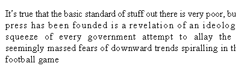
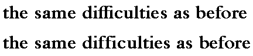
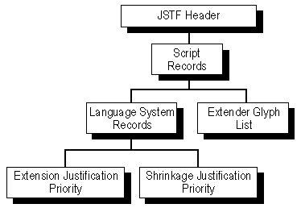

# JSTF — Justification Table

## Overview

The Justification table (JSTF) provides font developers with additional control over glyph substitution and positioning that can be used in layout of justified text. It provides text-processing clients with more options to expand or shrink word and glyph spacing when fitting text into a specified column width.

When justifying text, the text-processing client distributes the characters in each line to completely fill the specified line length. Whether removing space to fit more characters in the line or adding more space to spread the characters, justification can produce large gaps between words, cramped or extended glyph spacing, uneven line break patterns, and other jarring visual effects. For example:

 *Figure 6a. Poorly justified text*

To offset these effects, text-processing clients have used justification algorithms that redistribute the space with a series of glyph spacing adjustments that progress from least to most obvious. Typically, the client will begin by expanding or compressing the space between words. If these changes aren’t enough or look distracting, the client might hyphenate the word at the end of the line or adjust the space between glyphs in one or more lines.

To disguise spacing inconsistencies so they won’t disrupt the flow of text for a reader, the font developer can use the JSTF table to enable or disable individual glyph substitution and positioning actions that apply to specific scripts, language systems, and glyphs in the font.

For instance, a ligature glyph can replace multiple glyphs, shortening the line of text with an unobtrusive, localized adjustment (see Figure 6b). Font-specific positioning changes can be applied to particular glyphs in a text line that combines two or more fonts. Other options include repositioning the individual glyphs in the line, expanding the space between specific pairs of glyphs, and decreasing the spacing within particular glyph sequences.

 *Figure 6b. JSTF shortens the top line of this example by using the “ffi” ligature*

The font designer or developer defines JSTF data as prioritized suggestions. Each suggestion lists the particular actions that the client can use to adjust the line of text. Justification actions may apply to both vertical and horizontal text.

## JSTF table organization

The JSTF table organizes data by script and language system, as do the GSUB and GPOS tables. The JSTF table begins with a header that lists scripts in an array of JstfScriptRecords (see Figure 6c). Each record contains a ScriptTag and an offset to a JstfScript table that contains script and language-specific data:

- A default justification language system table (JstfLangSys) defines script-specific data that applies to the entire script in the absence of any language-specific information.
- A justification language system table stores the justification data for each language system.

 *Figure 6c. High-level organization of JSTF table*

A JstfLangSys table contains a list of justification suggestions. Each suggestion consists of a list of GSUB or GPOS LookupList indices to lookups that may be enabled or disabled to add or remove space in the line of text. In addition, each suggestion can include a set of dedicated justification lookups with maximum adjustment values to extend or shrink the amount of space.

The font developer prioritizes suggestions based on how they affect the appearance and function of the text line, and the client applies the suggestions in that order. Low-numbered (high-priority) suggestions correspond to “least bad” options.

The font developer can also supply a list of extender glyphs for each script, such as kashidas in Arabic. A client may use the extender glyphs in addition to the justification suggestions.

A client begins justifying a line of text only after implementing all selected GSUB and GPOS features for the string. Starting with the lowest-numbered suggestion, the client enables or disables the lookups specified in the JSTF table, reassembles the lookups in the LookupList order, and applies them to each glyph in the string one after another. If the line still is not the correct length, the client processes the next suggestion in ascending order of priority. This continues until the line length meets the justification requirements.

If any JSTF suggestion at any priority level modifies a GSUB or GPOS lookup that was previously applied to the glyph string, then the text processing client must apply the JSTF suggestion to an unmodified version of the glyph string.

A FeatureVariations table may be used in either the GSUB or GPOS table to substitute the lookups triggered by a given feature with an alternate set of lookups based on certain conditions. (Currently, these conditions can pertain only to the use of variable fonts, which are discussed further below.) The actual lookups that were applied for a given feature may be different from the default set of lookups for that feature. When processing a justification suggestion, the list of lookups to check for previous application should be the actual lookups that applied, with any feature variations in effect, not the default lookups. Also, when adding data in the JSTF table to disable GSUB or GPOS lookups, the font developer should consider possible interactions with feature variation tables, such as a need to include such alternate lookups in the set of lookups to disable. Note that this applies only to features and lookups in the GSUB and GPOS table: for lookups contained directly within the JSTF table, there is no analogous feature-variation mechanism.

Later in this chapter, the following tables and records used by the JSTF table for scripts and language systems will be described:

- Script information, including the JstfScript table (plus its associated JstfLangSysRecords) and the ExtenderGlyph table.
- Language system information, including the JstfLangSys table, JstfPriority table (and its associated JstfDataRecord), the JstfModList table, and the JstfMax table.

## JSTF table and OpenType Font Variations

OpenType Font Variations allow a single font to support many design variations along one or more axes of design variation. For example, a font with weight and width variations might support weights from thin to black, and widths from ultra-condensed to ultra-expanded. For general information on OpenType Font Variations, see the chapter, [OpenType Font Variations Overview](otvaroverview.md).

When different variation instances are selected, the design and metrics of individual glyphs change, and the metric characteristics of the font as a whole can also change. As metrics are relevant for justification, the interaction between justification data and variations requires consideration.

As noted above, justification is assumed to be an iterative process in which the application tests different suggestions defined in the font in priority order to find a suggestion that results in a line length that meets application-determined justification requirements. When an instance of a variable font is selected, the line layout will use glyph outlines and metrics that are adjusted for that instance. Thus, the metrics for one variation instance may be different from another, and the text content of a given line after justification may be different if formatted with different variation instances, but the justification processing proceeds in the same manner.

As also noted above, justification suggestions are applied to the results after selected GSUB and GPOS features have been processed. If the GSUB or GPOS table includes a FeatureVariations table, there may be interactions between the effects of the FeatureVariations table and the justification suggestions. See above for additional discussion.

As noted, justification suggestions can make use of GPOS lookups contained within the GPOS table or directly within the JSTF table. GPOS lookup subtables contain X or Y font-unit values that specify modifications to individual glyph positions or metrics. In a variable font, these X and Y values apply to the default instance, and may require adjustment for different variation instances. This is done using variation data with processes similar to those used for glyph outlines and other font data, as described in the chapter, [OpenType Font Variations Overview](otvaroverview.md). Variation data for adjustment of X or Y values in GPOS lookups is stored within an item variation store table located within the [GDEF](gdef.md) table. This is true for lookups in either the GPOS or the JSTF table. The same item variation store is also used for adjustment of values in the GDEF table. See the [GPOS](gpos.md) chapter for additional details regarding variation of GPOS lookup values in variable fonts.

## JSTF table structures

### JSTF Header

The JSTF table begins with a header that contains a version number for the table, a count of the number of scripts used in the font, and an array of script records. Each record contains a script tag (jstfScriptTag) and an offset to a JstfScript table.

Note that the jstfScriptTag values must correspond with the script tags listed in the GSUB and GPOS tables.

Example 1 at the end of this chapter shows a JSTF Header table and JstfScriptRecord.

*JSTF header*

| Type | Name | Description |
| --- | --- | --- |
| uint16 | majorVersion | Major version of the JSTF table, = 1. |
| uint16 | minorVersion | Minor version of the JSTF table, = 0. |
| uint16 | jstfScriptCount | Number of JstfScriptRecords in this table. |
| JstfScriptRecord | jstfScriptRecords\[jstfScriptCount\] | Array of JstfScriptRecords, in alphabetical order by jstfScriptTag. |

*JstfScriptRecord*

| Type | Name | Description |
| --- | --- | --- |
| Tag | jstfScriptTag | 4-byte JstfScript identification. |
| Offset16 | jstfScriptOffset | Offset to JstfScript table, from beginning of JSTF Header. |

### Justification script table

A justification script (JstfScript) table describes the justification information for a single script. It consists of an offset to a table that defines extender glyphs, an offset to a default justification language system table for the script, a count of the language systems that define justification data (jstfLangSysCount), and an array of justification language system records for specific language systems.

If a script uses the same justification information for all language systems, the font developer defines only the default language system table and sets the jstfLangSysCount value to zero (0). However, if any language system has unique justification suggestions, jstfLangSysCount will be a positive value, and the JstfScript table must include an array of justification language system records, one for each language system. Each JstfLangSysRecord contains a language system tag and an offset to a justification language system table. In the jstfLangSysRecords array, records are ordered alphabetically by language system tag.

> *Note:* No JstfLangSysRecord is defined for the default script data; the data is stored in the default JstfLangSys table instead.

Example 2 at the end of the chapter shows a JstfScript table for the Arabic script and a JstfLangSysRecord for the Farsi language system.

*JstfScript table*

| Type | Name | Description |
| --- | --- | --- |
| Offset16 | extenderGlyphOffset | Offset to ExtenderGlyph table, from beginning of JstfScript table (may be NULL). |
| Offset16 | defJstfLangSysOffset | Offset to default JstfLangSys table, from beginning of JstfScript table (may be NULL). |
| uint16 | jstfLangSysCount | Number of JstfLangSysRecords in this table- may be zero (0). |
| JstfLangSysRecord | jstfLangSysRecords\[jstfLangSysCount\] | Array of JstfLangSysRecords, in alphabetical order by JstfLangSysTag. |

*JstfLangSysRecord*

| Type | Name | Description |
| --- | --- | --- |
| Tag | jstfLangSysTag | 4-byte JstfLangSys identifier. |
| Offset16 | jstfLangSysOffset | Offset to JstfLangSys table, from beginning of JstfScript table. |

### Extender glyph table

The extender glyph table (ExtenderGlyph) lists indices of glyphs, such as Arabic kashidas, that a client can insert to extend the length of the line for justification. The table consists of a count of the extender glyphs for the script and an array of extender glyph indices, arranged in increasing numerical order.

Example 2 at the end of this chapter shows an ExtenderGlyph table for Arabic kashida glyphs.

*ExtenderGlyph table*

| Type | Name | Description |
| --- | --- | --- |
| uint16 | glyphCount | Number of extender glyphs in this script. |
| uint16 | extenderGlyphs\[glyphCount\] | Extender glyph IDs — in increasing numerical order. |

### Justification language system table

The justification language system (JstfLangSys) table contains an array of justification suggestions, ordered by priority. A text-processing client doing justification should begin with the suggestion that has a zero (0) priority, and then, as needed, apply suggestions of increasing priority until the text is justified.

The font developer defines the number and the meaning of the priority levels. Each priority level stands alone; its suggestions are not added to the previous levels. The JstfLangSys table consists of a count of the number of priority levels and an array of offsets to justification priority tables (jstfPriorityOffsets), stored in priority order. Example 2 at the end of the chapter shows how to define a JstfLangSys table.

*JstfLangSys table*

| Type | Name | Description |
| --- | --- | --- |
| uint16 | jstfPriorityCount | Number of JstfPriority tables. |
| Offset16 | jstfPriorityOffsets\[jstfPriorityCount\] | Array of offsets to JstfPriority tables, from beginning of JstfLangSys table, in priority order. |

### Justification priority table

A justification priority (JstfPriority) table defines justification suggestions for a single priority level. Each priority level specifies whether to enable or disable GSUB and GPOS lookups or apply text justification lookups to shrink and extend lines of text.

JstfPriority has offsets to four tables with line shrinkage data: two are justification modification tables for enabling and disabling glyph substitution (GSUB) lookups, and two are justification modification tables for enabling and disabling glyph positioning (GPOS) lookups. Offsets to GSUB and GPOS justification modification tables also are defined for line extension.

Example 3 at the end of this chapter demonstrates two JstfPriority tables for two justification suggestions.

*JstfPriority table*

| Type | Name | Description |
| --- | --- | --- |
| Offset16 | gsubShrinkageEnableOffset | Offset to GSUB shrinkage-enable JstfModList table, from beginning of JstfPriority table (may be NULL). |
| Offset16 | gsubShrinkageDisableOffset | Offset to GSUB shrinkage-disable JstfModList table, from beginning of JstfPriority table (may be NULL). |
| Offset16 | gposShrinkageEnableOffset | Offset to GPOS shrinkage-enable JstfModList table, from beginning of JstfPriority table (may be NULL). |
| Offset16 | gposShrinkageDisableOffset | Offset to GPOS shrinkage-disable JstfModList table, from beginning of JstfPriority table (may be NULL). |
| Offset16 | shrinkageJstfMaxOffset | Offset to shrinkage JstfMax table, from beginning of JstfPriority table (may be NULL). |
| Offset16 | gsubExtensionEnableOffset | Offset to GSUB extension-enable JstfModList table, from beginnning of JstfPriority table (may be NULL). |
| Offset16 | gsubExtensionDisableOffset | Offset to GSUB extension-disable JstfModList table, from beginning of JstfPriority table (may be NULL). |
| Offset16 | gposExtensionEnableOffset | Offset to GPOS extension-enable JstfModList table, from beginning of JstfPriority table (may be NULL). |
| Offset16 | gposExtensionDisableOffset | Offset to GPOS extension-disable JstfModList table, from beginning of JstfPriority table (may be NULL). |
| Offset16 | extensionJstfMaxOffset | Offset to extension JstfMax table, from beginning of JstfPriority table (may be NULL). |

### Justification modification list table

A justification modification list table (JstfModList) contains a list of indices into LookupList tables within either the GSUB or GPOS table. JstfModList tables are used within a JstfPriority table to specify GSUB or GPOS lookups that can be either enabled or disabled for the purpose of either extending or shrinking the length of text. The client can enable or disable the lookups to justify text. For example, to increase line length, the client might disable a GSUB ligature substitution.

Each JstfModList table consists of a count of Lookups and an array of lookup indices.

During justification of a line of text, to implement modifications specified for a given priority level, a text-processing client enables or disables the specified lookups in a JstfModList table, reassembles the lookups in the LookupList order, and applies them to each glyph in the string one after another.

If any JSTF suggestion at any priority level modifies a GSUB or GPOS lookup previously applied to the glyph string, then the text-processing client must apply the JSTF suggestion to an unmodified version of the glyph string.

Example 3 at the end of this chapter shows JstfModList tables with data for shrinking and extending text line lengths.

*JstfModList table*

| Type | Name | Description |
| --- | --- | --- |
| uint16 | lookupCount | Number of lookups for this modification. |
| uint16 | lookupIndices\[lookupCount\] | Array of Lookup indices into the GSUB or GPOS LookupList, in increasing numerical order. |

### Justification maximum table

A justification maximum table (JstfMax) consists of an array of offsets to justification lookups. JstfMax lookups typically are located after the JstfMax table in the font definition.

JstfMax tables have the same format as lookup tables and subtables in the GPOS table, but the JstfMax lookups reside in the JSTF table and contain justification data only. The lookup data might specify a single adjustment value for positioning all glyphs in the script, or it might specify more elaborate adjustments, such as different values for different glyphs or special values for specific pairs of glyphs.

All GPOS lookup types except contextual positioning lookups may be defined in a JstfMax table.

JstfMax lookup values are defined in GPOS ValueRecords and may be specified for any advance or placement position, whether horizontal or vertical. These values define the maximum shrinkage or extension allowed per glyph. To justify text, a text-processing client may choose to adjust a glyph’s positioning by any amount from zero (0) to the specified maximum.

Example 4 at the end of this chapter shows a JstfMax table. It defines a justification lookup to change the size of the word space glyph to extend line lengths.

*JstfMax table*

| Type | Name | Description |
| --- | --- | --- |
| uint16 | lookupCount | Number of lookup Indices for this modification. |
| Offset16 | lookupOffsets\[lookupCount\] | Array of offsets to GPOS-type lookup tables, from beginning of JstfMax table, in design order. |

## JSTF structure examples

The rest of this chapter describes examples of all the JSTF table formats. All the examples reflect unique parameters described below, but the samples provide a useful reference for building tables specific to other situations.

The examples have three columns showing hex data, source, and comments.

### Example 1: JSTF Header and JstfScriptRecord

Example 1 demonstrates how a script is defined in the JSTF Header with a JstfScriptRecord that identifies the script and references its JstfScript table.

*Example 1*

| Hex Data | Source | Comments |
| --- | --- | --- |
|  | **JSTFHeader**  TheJSTFHeader | JSTFHeader table definition |
| 00010000 | 0x00010000 | major/minor version |
| 0001 | 1 | jstfScriptCount |
|  | jstfScriptRecords\[0\] |  |
| 74686169 | 'thai' | jstfScriptTag |
| 000C | ThaiScript | offset to JstfScript table |

### Example 2: JstfScript table, ExtenderGlyph table, JstfLangSysRecord, and JstfLangSys table

Example 2 shows a JstfScript table for the Arabic script and the tables it references. The default JstfLangSys table defines justification data to apply to the script in the absence of language-specific information. In the example, the table lists two justification suggestions in priority order.

JstfScript also supplies language-specific justification data for the Farsi language. The JstfLangSysRecord identifies the language and references its JstfLangSys table. The FarsiJstfLangSys lists one suggestion for justifying Farsi text.

The ExtenderGlyph table in JstfScript lists the indices of all the extender glyphs used in the script.

*Example 2*

| Hex Data | Source | Comments |
| --- | --- | --- |
|  | **JstfScript**  ArabicScript | JstfScript table definition |
| 000C | ArabicExtenders | extenderGlyphOffset |
| 0012 | ArabicDefJstfLangSys | offset to default JstfLangSys table |
| 0001 | 1 | jstfLangSysCount |
|  | jstfLangSysRecords\[0\] |  |
| 50455220 | “FAR ” | jstfLangSysTag |
| 0018 | FarsiJstfLangSys | jstfLangSysOffset |
|  | **ExtenderGlyph**  ArabicExtenders | ExtenderGlyph table definition |
| 0002 | 2 | glyphCount |
| 01D3 | TatweelGlyphID | extenderGlyphs\[0\] |
| 01D4 | LongTatweelGlyphID | extenderGlyphs\[1\] |
|  | **JstfLangSys**  ArabicDefJstfLangSys | JstfLangSys table definition |
| 0002 | 2 | jstfPriorityCount |
| 000A | ArabicScriptJstfPriority1 | jstfPriorityOffsets\[0\] |
| 001E | ArabicScriptJstfPriority2 | jstfPriorityOffsets\[1\] |
|  | **JstfLangSys**  FarsiJstfLangSys | JstfLangSys table definition |
| 0001 | 1 | jstfPriorityCount |
| 002C | FarsiLangJstfPriority1 | jstfPriorityOffsets\[0\] |

### Example 3: JstfPriority table and JstfModList table

Example 3 shows the JstfPriority and JstfModList table definitions for two justification suggestions defined in priority order. The first suggestion uses ligature substitution to shrink the lengths of text lines, and it extends line lengths by replacing ligatures with their individual glyph components. Other lookup actions are not recommended at this priority level and are set to NULL. The associated JstfModList tables enable and disable three substitution lookups.

The second suggestion enables glyph kerning to reduce line lengths and disables glyph kerning to extend line lengths. Each action uses three lookups. This suggestion also includes a JstfMax table to extend line lengths, called WordSpaceExpandMax, which is described in Example 4.

*Example 3*

| Hex Data | Source | Comments |
| --- | --- | --- |
|  | **JstfPriority**  USEnglishFirstJstfPriority | JstfPriority table definition |
| 0028 | EnableGSUBLookupsToShrink | gsubShrinkageEnableOffset (offset to GSUB shrinkage-enable JstfModList table) |
| 0000 | NULL | gsubShrinkageDisableOffset |
| 0000 | NULL | gposShrinkageEnableOffset |
| 0000 | NULL | gposShrinkageDisableOffset |
| 0000 | NULL | shrinkageJstfMaxOffset |
| 0000 | NULL | gsubExtensionEnableOffset |
| 0038 | DisableGSUBLookupsToExtend | gsubExtensionDisableOffset |
| 0000 | NULL | gposExtensionEnableOffset |
| 0000 | NULL | gposExtensionDisableOffset |
| 0000 | NULL | extensionJstfMaxOffset |
|  | **JstfPriority**  USEnglishSecondJstfPriority | JstfPriority table definition |
| 0000 | NULL | gsubShrinkageEnableOffset |
| 0000 | NULL | gsubShrinkageDisableOffset |
| 0000 | NULL | gposShrinkageEnableOffset |
| 001C | DisableGPOSLookupsToShrink | gposShrinkageDisableOffset |
| 0000 | NULL | shrinkageJstfMaxOffset |
| 0000 | NULL | gsubExtensionEnableOffset |
| 0000 | NULL | gsubExtensionDisableOffset |
| 002C | EnableGPOSLookupsToExtend | gposExtensionEnableOffset |
| 0000 | NULL | gposExtensionDisableOffset |
| 0000 | NULL | extensionJstfMaxOffset |
|  | **JstfModList**  EnableGSUBLookupsToShrink | JstfModList table definition, enable three ligature substitution lookups |
| 0003 | 3 | lookupCount |
| 002E | 46 | gsubLookupIndices\[0\] |
| 0035 | 53 | gsubLookupIndices\[1\] |
| 0063 | 99 | gsubLookupIndices\[2\] |
|  | **JstfModList**  DisableGPOSLookupsToShrink | JstfModList table definition, disable three tight kerning lookups |
| 0003 | 3 | lookupCount |
| 006C | 108 | gposLookupIndices\[0\] |
| 006E | 110 | gposLookupIndices\[1\] |
| 0070 | 112 | gposLookupIndices\[2\] |
|  | **JstfModList**  DisableGSUBLookupsToExtend | JstfModList table definition, disable three ligature substitution lookups |
| 0003 | 3 | lookupCount |
| 002E | 46 | gsubLookupIndices\[0\] |
| 0035 | 53 | gsubookupIndices\[1\] |
| 0063 | 99 | gsubLookupIndices\[2\] |
|  | **JstfModList**  EnableGPOSLookupsToExtend | JstfModList table definition enable three tight kerning lookups |
| 0003 | 3 | lookupCount |
| 006C | 108 | gposLookupIndices\[0\] |
| 006E | 110 | gposLookupIndices\[1\] |
| 0070 | 112 | gposLookupIndices\[2\] |

### Example 4: JstfMax table

The JstfMax table in Example 4 defines a lookup to expand the advance width of the word space glyph and extend line lengths. The lookup definition is identical to the SinglePos lookup type in the GPOS table although it is enabled only when justifying text. The ValueRecord in the WordSpaceExpand lookup subtable specifies an XAdvance adjustment of 360 units, which is the maximum value the font developer recommends for acceptable text rendering. The text-processing client may implement the lookup using any value between zero and the maximum.

*Example 4*

| Hex Data | Source | Comments |
| --- | --- | --- |
|  | **JstfMax**  WordSpaceExpandMax | JstfMax table definition |
| 0001 | 1 | lookupCount |
| 0004 | WordSpaceExpandLookup | lookupOffsets\[0\] (offset to JSTF Lookup table) |
|  | **Lookup**  WordSpaceExpandLookup | Jstf Lookup table definition |
| 0001 | 1 | lookupType: SinglePos Lookup |
| 0000 | 0x0000 | lookupFlag |
| 0001 | 1 | subTableCount |
| 0008 | WordSpaceExpandSubtable | subtableOffsets\[0\], SinglePos subtable |
|  | **SinglePosFormat1**  WordSpaceExpandSubtable | SinglePos subtable definition |
| 0001 | 1 | format |
| 0008 | WordSpaceCoverage | offset to Coverage table |
| 0004 | 0x0004 | valueFormat: xAdvance only |
| 0168 | 360 | value — xAdvance value in Jstf: this is a max value, expand word space from zero to this amount |
|  | **CoverageFormat1**  WordSpaceCoverage | Coverage table definition |
| 0001 | 1 | format |
| 0001 | 1 | glyphCount |
| 0022 | WordSpaceGlyphID | glyphArray\[0\] |
