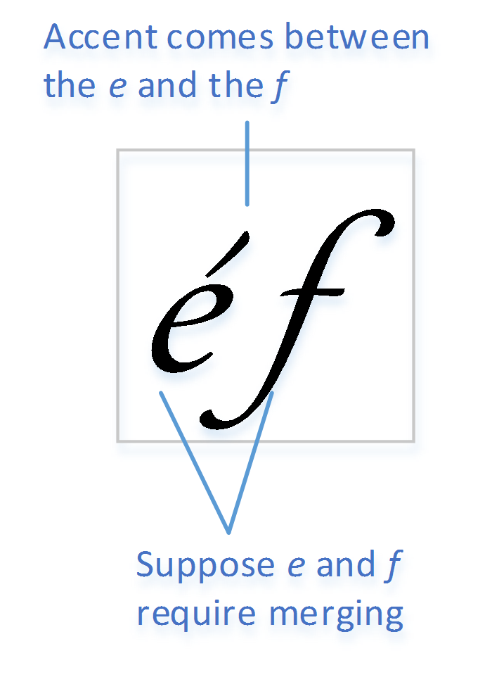

# MERG — Merge Table

The MERG table enables a font to specify whether antialias filtering of glyphs within a glyph run can be performed separately for each glyph, or whether certain glyph pairs or sequences should be composed together—or *merged*—before antialiasing is performed.

When glyphs are composed together after antialiasing has been performed, that can result in rendering artifacts in some cases in which glyphs touch or overlap. (This is true of any per-primitive antialiasing.) Merging glyphs together before antialiasing eliminates those artifacts, but it also adds a significant performance cost. A font can use the MERG table to indicate *specific* glyph pairs or sequences for which pre-antialias merging is required in order to avoid the risk of rendering artifacts, while implicitly declaring that *other* glyph pairs or sequences *do not* require pre-antialias merging.

> *Note:* Hereafter, “merging” will be used to refer to composing of glyphs together prior to antialias filtering.

> *Note:* Some implementations could use caching of glyph-rendering results as a means of performance optimization. If merging of glyph sequences is not required, then the cached renderings can be composed without a need to render glyphs or the glyph sequence again.

The approach used is to give a positive declaration of cases in which merging should be performed. If a MERG table is provided but no declarations are made for any pairs, then the intended interpretation is that no merging is necessary. (Some implementations could still merge glyphs before antialiasing, however.) If no MERG table is provided, then implementations should always merge glyphs before filtering in order to avoid artifacts.

Data is provided for *pairs* of glyph classes. The first and second glyph elements in a pair correspond to logical ordering of glyphs in a run. Since glyphs are processed in logical order but could be presented in visual left-to-right or right-to-left order, it is possible to give separate recommendations for either left-to-right or right-to-left order.

In some cases, it could be necessary to consider interaction of *sequences* of more than two glyphs rather than simply a pair. The data format allows the font developer to specify sequences that need to be treated together in merging; this is explained further below.

Determination of whether or not merging should be done is a design consideration on the part of the font developer. Glyphs could touch or overlap, but there might not be any perceptible artifacts in visual results. If the designer determines that merging for a particular pair or sequence is not needed to provide adequate visual results, then there will be performance benefits from *not declaring that pair or sequence* as requiring merging.

Note that different platforms can support different rendering techniques, and might or might not support the MERG table. On some platforms, glyphs sequences might always be merged before antialiasing is performed, regardless of whether MERG data is provided in the font. Similarly, in some other platforms, glyphs might always be composed *after* antialiasing is performed, regardless of whether MERG data is provided in the font. Font developers should consult developer documentation for the different platforms on which fonts will be used to determine what benefits a MERG table might provide, and should evaluate rendered results on relevant platforms to determine which glyph pairs or sequences should be declared as requiring merging.

To construct a MERG table, the first step is to classify glyphs based on desired merging behavior such that each glyph has an associated *merge class* (represented by a zero-based index). The system of classification and number of classes will depend on the font and the font developer’s discretion, but could take into account such properties as a glyph’s general shape and whether it connects to other glyphs. After assigning glyphs into classes, one then selects a recommended merging behavior for each *pair* of merge classes.

Note that the number of pairs for which data is provided is the square of the number of merge classes. Therefore, the number of merge classes should be as small as possible.

## Grouping of glyphs

In some cases, a sequence of glyphs might need to be treated as a unit for purposes of merging. For example, a glyph for a combining accent might not typographically interact at all with following glyphs, yet it might come in logical order between glyphs that do interact and that could require merging. This is illustrated in the following figure (assume left-to-right visual order).

 *Accent glyph logically between two typographically interacting glyphs*

In this case, the accent and the base “e” glyph can be treated as a unit for purposes of evaluating the required merge behavior with the following “f” glyph. Note that, if merging of the “e” and “f” glyphs is required, then the accent will also need to be included in the sequence that gets antialiased together.

The merge data entries that specify how pairs of glyphs should be handled include values that indicate that the pair of glyphs should be *grouped* together as a unit, without specifying whether merging is required. Whether or not merging is needed will get determined only as this group is compared with other glyphs. In the above figure, the accent is grouped together with the “e” glyph, but whether or not any merging is required will be determined by comparing that combination with the following “f” glyph.

Whenever a pair of glyphs is grouped or merged, then one or the other will be most relevant when the combination is evaluated in relation to the following glyph. In the example above, the required behavior for the “e”-plus-accent combination when it interacts with the following glyph can be determined by the “e”. In a different example, it could be the second of a pair of glyphs that is most relevant for purposes of interaction with subsequent glyphs. Thus, whenever a pair of glyphs is grouped or merged, the data indicates whether the merge class of the sequence takes on the class of the first or the second element of the pair. This is indicated by use of a flag: in the unmarked case (flag is not set), the sequence takes the merge class of the second glyph. But if a *second is subordinate* flag is set, then the sequence takes on the merge class of the first element of the pair.

See the following sections for complete details regarding the merge entry values and how they are processed.

## Table formats

The MERG table is comprised by a header, a set of class-definition tables, and an array of merge-entry data. The format of the header is as follows.

*MergHeader*

| Type | Name | Description |
| --- | --- | --- |
| uint16 | version | Version number of the merge table — set to 0. |
| uint16 | mergeClassCount | The number of merge classes. |
| Offset16 | mergeDataOffset | Offset to the array of merge-entry data. |
| uint16 | classDefCount | The number of class definition tables. |
| Offset16 | offsetToClassDefOffsets | Offset to an array of offsets to class definition tables — in bytes from the start of the MERG table. |

The offsetToClassDefOffsets field provides an offset to the start of an array of offsets. Each element in the array is an offset (Offset16) from the start of the MERG table to a class definition table. The classDefCount field gives the number of elements in the offsets array, and the number of class definition tables.

> *Note:* A given class definition table can be used to assign different glyphs into multiple classes. The number of class definition tables does not determine the number of merge classes. Rather, the mergeClassCount field determines the number of classes that can be referenced by the merge-entry data. Specifically, merge entries are provided for merge classes 0 to mergeClassCount - 1. If any glyph is assigned to a class ID greater than or equal to mergeClassCount, there will be no merge entries for pairs involving that class, which effectively means that merging of that glyph with other glyphs is never required.

The class definition tables use the same formats as are used in OpenType Layout tables. Both ClassDefFormat1 and ClassDefFormat2 may be used. For details on class definition table formats, see the [Class Definition Table](chapter2.md) section of the OpenType Layout Common Table Formats chapter.

> *Note:* A class definition table gives an explicit assignment of glyphs to specific class IDs. Any glyph that is not assigned to a class are implicitly assigned to class zero.

Any given glyph must be assigned to at most one class. Moreover, as the class definition tables are read in order, glyph ID references must be in strictly increasing order. If glyph IDs are given out of order, the MERG table is invalid and is ignored.

The merge-entry data array is a 2D table of entries for glyph-class pairs. Each entry is a uint8 value, and the total size of the data is mergeClassCount^2. The data are organized as mergeClassCount number of rows each having mergeClassCount number of column entries.

*MergeEntry table*

| Type | Name | Description |
| --- | --- | --- |
| MergeEntryRow | mergeEntryRows\[mergeClassCount\] | Array of merge-entry rows. |

*MergeEntryRow record*

| Type | Name | Description |
| --- | --- | --- |
| uint8 | mergeEntries\[mergeClassCount\] | Array of merge entries. |

Each merge entry specifies a behavior for a pair of merge classes: the row index represents the class of the first element, in logical order, and the column index represents the class of the second element.

Each merge entry is a bit field with six flags defined. These describe three different processing behaviors for both left-to-right and right-to-left visual orders. The flags are assigned as follows:

*Merge entry flags*

| Mask | Name | Description |
| --- | --- | --- |
| 0x01 | MERGE\_LTR | Merge glyphs, for LTR visual order. |
| 0x02 | GROUP\_LTR | Group glyphs, for LTR visual order. |
| 0x04 | SECOND\_IS\_SUBORDINATE\_LTR | Second glyph is subordinate to the first glyph, for LTR visual order. |
| 0x08 | Reserved | Flag reserved for future use — set to 0. |
| 0x10 | MERGE\_RTL | Merge glyphs, for RTL visual order. |
| 0x20 | GROUP\_RTL | Group glyphs, for RTL visual order. |
| 0x40 | SECOND\_IS\_SUBORDINATE\_RTL | Second glyph is subordinate to the first glyph, for RTL visual order. |
| 0x80 | Reserved | Flag reserved for future use — set to 0. |

The Merge flags (MergeLTR, MergeRTL) indicate that the pair of items should be merged prior to antialiasing.

The Group flags, described in the previous section, indicate that the pair should be treated as a unit, without indicating whether or not merging is required — that will be determined by evaluating the combination in relation to other glyphs.

The SecondIsSubordinate flags, also described in the previous section, are used only if the Merge or Group flag for the same visual order was set. These indicate whether the class for the merged or grouped sequence should be that of the first or second item of the pair. If a SecondIsSubordinate flag is set but neither the Merge or Group flag for the same visual order was set, then it is ignored.

A detailed description of handling of the Merge, Group and SecondIsSubordinate flags is provided in the following section.

## Processing

The merge entries are used while processing glyphs in a glyph run to determine which sequences of glyphs require merging before antialias filtering is performed. The following description is given in a way that is generic with regard to visual order. So, for instance “the Merge flag” refers to the MergeLTR flag if the visual order is LTR, or to the MergeRTL flag if the visual order is RTL.

In the following description, a *merge group* is a sequence of one or more glyphs that are processed as a unit. In addition to the glyph sequence, a merge group has a boolean *mergeRequired* property that is set by default to *false*. The group also has a *mergeClass* property, that is set as described below.

Merge processing proceeds as follows:

1. **Start:** The start state for the processing algorithm is one in which the current glyph did not need to be merged with a preceding glyph or glyph sequence. (This includes the start of a glyph run.) The current glyph is the start of a new merge group with group.mergeRequired = *false*.

2. Determine the merge class of the current glyph. Set the group.mergeClass to this class ID.

3. **Process next glyph:** Determine the merge class of the next glyph.

4. Using group.mergeClass as a row index and the merge class of the next glyph as a column index, retrieve the merge entry for the given row and column.

5. If the merge entry is zero, or if the merge class for either the current or next glyph was greater or equal to mergeClassCount, then the next glyph does not need to be merged into the current merge sequence. Do not add the next glyph into the merge group, but proceed to step 10.

6. Else, if the merge entry has the Merge flag set, then the next glyph is added to the current merge group, and group.mergeRequired is set to *true*. Proceed to step 8.

7. Else, if the merge entry has the Group flag set, then the next glyph is added to the current merge group. The group.mergeRequired property is not changed. Proceed to step 8.

8. Determine the new merge class for the group:

   1. If the merge entry has the SecondIsSubordinate flag set then the group.mergeClass property is not changed.
   2. Else (the SecondIsSubordinate flag is clear), then set the group.mergeClass property to be the merge class of the next glyph.

9. The merge group has been extended; proceed to the next glyph: next becomes current, and the group properties remain as set in steps 6 – 8. Return to step 3.

10. The merge group is terminated:

    1. If group.mergeRequired is *true*, then merge all of the glyphs in this merge group prior to antialias filtering.
    2. Else (group.mergeRequired is *false*), then merging is not required for any of the glyphs in the merge group.
    3. Proceed to next glyph (next becomes current) and return to the start state, step 1.
