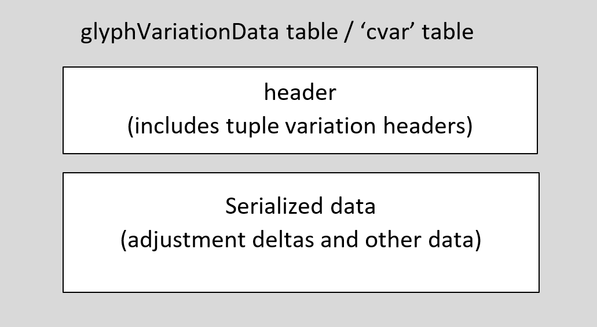
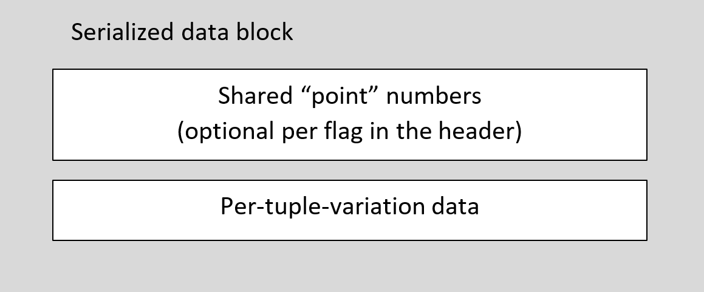
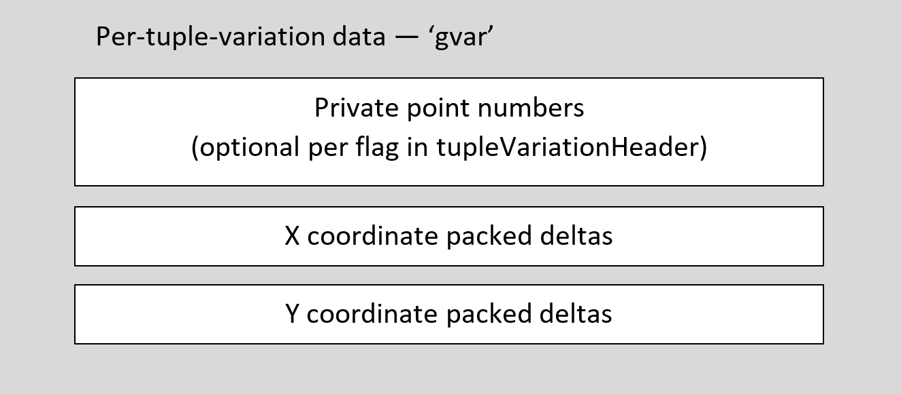
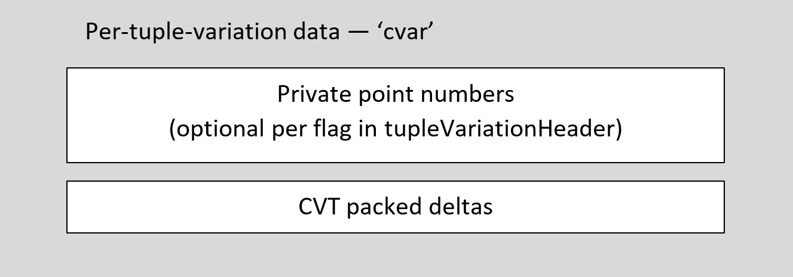
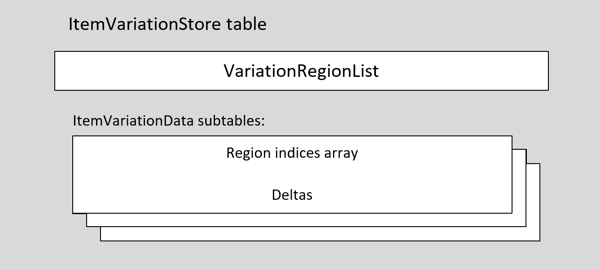

<a id="anchor-otvarcommonformats-opentype-font-variations-common-table-formats"></a>

# OpenType Font Variations Common Table Formats

OpenType Font Variations allow continuous variation along one or more design axes, such as weight or width. An overview of OpenType Font Variations and a specification of the algorithm for interpolating variation instance values is provided in the chapter, [OpenType Font Variations Overview](otvaroverview.md); that chapter should be read first. This chapter documents the formats for variation data that are used in various font tables, such as the ['gvar'](gvar.md) or [MVAR](mvar.md) tables.

<a id="anchor-otvarcommonformats-overview"></a>

## Overview

A font has many different data items found in several different font tables that provide values that are specific to a particular font face. Examples include glyph-specific values, such as the positions of glyph outline points and glyph advance widths, and face-wide values, such as a sub-family name, a weight class, or ascender and descender values. In a variable font, most or all of these values may need to vary for different variation instances. When an application selects a variation instance within the font’s variation space, new values for such items appropriate to that instance need to be derived. This is done using delta adjustment values.

For example, the OS/2 table of a font may provide a default sxHeight value of 970. The MVAR table might provide a delta value of +50 that is used for weight-axis values from the default to the heaviest-supported weight. For a particular instance, the interpolation process might scale that delta with a scalar co-efficient of 0.4, deriving an instance sxHeight value of 990.

These concepts and the interpolation algorithm for deriving instance values are described in detail in the chapter, [OpenType Font Variations Overview](otvaroverview.md).

The variation data for a font consists of a number of delta adjustment values. Each individual delta applies to a particular, target data item; for instance, the X coordinate of a point in a glyph outline, or the font’s sTypoAscender. Each delta is also associated with a specific region within the font’s design variation space over which it is applicable. Thus, a given delta is logically keyed by the target data item and the applicable region.

The variation data for a font consists of a number of delta adjustment values. Each individual delta applies to a particular, target data item; for instance, the X coordinate of a point in a glyph outline, or the font’s sTypoAscender. Each delta is also associated with a specific region within the font’s design variation space over which it is applicable. Thus, a given delta is logically keyed by the target data item and the applicable region.

A variable font includes many deltas. At the highest level, deltas are organized into collections for different target item sets:

- Deltas for positions of points of a ['glyf'](glyf.md) table are stored in a ['gvar'](gvar.md) table.
- Deltas for positions of points of a [CFF2](cff2.md) table are stored within the CFF2 table.
- Deltas for CVT values in the ['cvt '](cvt.md) table are stored in a ['cvar'](cvar.md) table.
- Deltas for glyph metrics in an ['hmtx'](hmtx.md) table are stored in an [HVAR](hvar.md) table; and deltas for glyph metrics in a ['vmtx'](vmtx.md) or [VORG](vorg.md) table are stored in a [VVAR](vvar.md) table.
- Deltas for anchor positions in GPOS lookups and other items used in [GDEF](gdef.md), [GPOS](gpos.md) or [JSTF](jstf.md) tables are stored within variation data contained in the GDEF table.
- Deltas for font-wide metrics and other items from the [OS/2](os2.md), ['hhea'](hhea.md), ['gasp'](gasp.md), ['post'](post.md) or ['vhea'](vhea.md) tables are stored in an [MVAR](mvar.md) table.
- Deltas for values in other tables are stored in the respective table: deltas for baseline metrics in the [BASE](base.md) table and for various items in the [COLR](colr.md) table are stored in each table.

In a variable font, the largest group of deltas are for the positions of glyph outline points. For TrueType outlines in a 'glyf' table, the deltas are stored within the 'gvar' table, with a second level of organization grouping deltas by glyph ID. See the ['gvar'](gvar.md) table specification for details.

Below these higher levels of organization, most variation data is organized in one of two ways. (Variation data for CFF2 outlines is a partial exception — see below.)

- Organize sets of deltas for several target items into groupings by the variation-space region over which they apply. Since regions are defined using n-tuples (or “tuples”), such data sets will be referred to as *tuple variation stores*.
- Organize sets of deltas associated with different regions into groupings by the target items to which they apply. Such data sets will be referred to as *item variation stores*.

The two formats have different ways of representing n-tuples that define regions of applicability, and different ways of associating deltas with target font-data items. The tuple variation store format is optimized for compact representation of glyph outline variation data that is all processed for a given variation instance. The ItemVariationStore format, on the other hand, is designed to allow direct access to variation data for arbitrary target items, allowing more efficient processing in contexts that do not require interpolated values for all items to be computed. (Additional details are provided below.) The 'gvar' and 'cvar' tables use the tuple variation store format, while variation data in most other tables, including the MVAR, HVAR and GDEF tables, use the ItemVariationStore format.

Variation data for CFF2 outlines are handled slightly differently than other cases. The deltas for glyph outline descriptions are interleaved directly within the outline descriptions in the [Compact Font Format 2 (CFF2)](cff2.md) table. But the sets of regions that are associated with the delta sets are defined in an item variation store, contained as a subtable within the CFF2 table.

<a id="anchor-otvarcommonformats-tuple-variation-store"></a>

## Tuple Variation Store

Tuple variation stores are used in the 'gvar' and 'cvar' tables, and organize sets of variation data into groupings, each of which is associated with a region of applicability within the variation space. Within the 'gvar' table, there is a separate variation store for each glyph. Within the 'cvar' table, there is one variation store providing variations for all CVT values.

There is a minor difference in the top-level structure of the store in these two contexts. Within the 'cvar' table, it is the entire 'cvar' table that comprises the specific variation store format, with a header that begins with major/minor version fields. The specific variation store format for glyph-specific data within the 'gvar' table is the *GlyphVariationData* table (one per glyph ID), which does not include any version fields. In other respects, the 'cvar' table and GlyphVariationData table formats are the same. There is also a minor difference in certain data that can occur in a GlyphVariationData table versus a 'cvar' table. Differences between the 'gvar' and 'cvar' tables will be summarized later in this section.

In terms of logical information content, the GlyphVariationData and 'cvar' tables consist of a set of logical, tuple variation data tables, each for a different region of the variation space. In physical layout, however, the logical tuple variation tables are divided into separate parts that get stored separately: a header portion, and a serialized-data portion.

In terms of overall structure, the GlyphVariationData table and the 'cvar' table each begin with a header, which is followed by serialized data. The header includes an array with the tuple variation headers. The serialized data includes deltas and other data that will be explained below.

<br>*Figure: High-level organization of tuple variation stores*

<a id="anchor-otvarcommonformats-tuple-records"></a>

### Tuple Records

The tuple variation store formats reference regions within the font’s variation space using tuple records. A tuple record identifies a position in terms of normalized coordinates, which use F2DOT14 values.

*Tuple record:*

| Type | Name | Description |
| --- | --- | --- |
| F2DOT14 | coordinates\[axisCount\] | Coordinate array specifying a position within the font’s variation space. The number of elements must match the axisCount specified in the 'fvar' table. |

> *Note:* The Tuple record and [UserTuple record](fvar.md#anchor-fvar-instancerecord) (used in the 'fvar' table) both describe a position in the variation space but are distinct: UserTuple uses Fixed values to represent user scale coordinates, while Tuple record uses F2DOT14 values to represent normalized coordinates.

<a id="anchor-otvarcommonformats-tuple-variation-store-header"></a>

### Tuple Variation Store Header

The two variants of a tuple variation store header, the GlyphVariationData table header and the 'cvar' header, are only slightly different. The formats of each are as follows:

*GlyphVariationData header:*

| Type | Name | Description |
| --- | --- | --- |
| uint16 | tupleVariationCount | A packed field. The high 4 bits are flags (see below), and the low 12 bits are the number of tuple variation tables for this glyph. The count can be any number between 1 and 4095. |
| Offset16 | dataOffset | Offset from the start of the GlyphVariationData table to the serialized data. |
| TupleVariationHeader | tupleVariationHeaders\[tupleVariationCount\] | Array of tuple variation headers. |

*'cvar' table header:*

| Type | Name | Description |
| --- | --- | --- |
| uint16 | majorVersion | Major version number of the 'cvar' table — set to 1. |
| uint16 | minorVersion | Minor version number of the 'cvar' table — set to 0. |
| uint16 | tupleVariationCount | A packed field. The high 4 bits are flags (see below), and the low 12 bits are the number of tuple variation tables. The count can be any number between 1 and 4095. |
| Offset16 | dataOffset | Offset from the start of the 'cvar' table to the serialized data. |
| TupleVariationHeader | tupleVariationHeaders\[tupleVariationCount\] | Array of tuple variation headers. |

The tupleVariationCount field contains a packed value that includes flags and the number of logical tuple variation tables — which is also the number of physical tuple variation headers. The format of the tupleVariationCount value is as follows:

| Mask | Name | Description |
| --- | --- | --- |
| 0x8000 | SHARED\_POINT\_NUMBERS | Flag indicating that some or all tuple variation tables reference a shared set of “point” numbers. These shared numbers are represented as packed point number data at the start of the serialized data. |
| 0x7000 | Reserved | Reserved for future use — set to 0. |
| 0x0FFF | COUNT\_MASK | Mask for the low bits to give the number of tuple variation tables. |

If the SHARED\_POINT\_NUMBERS flag is set, then the serialized data following the header begins with packed “point” number data. In the context of a GlyphVariationData table within the 'gvar' table, these identify outline point numbers for which deltas are explicitly provided. In the context of the 'cvar' table, these are interpreted as CVT indices rather than point indices. The format of packed point number data is described below.

<a id="anchor-otvarcommonformats-tuplevariationheader"></a>

### TupleVariationHeader

The GlyphVariationData and 'cvar' header formats include an array of tuple variation headers. The TupleVariationHeader format is as follows.

*TupleVariationHeader:*

| Type | Name | Description |
| --- | --- | --- |
| uint16 | variationDataSize | The size in bytes of the serialized data for this tuple variation table. |
| uint16 | tupleIndex | A packed field. The high 4 bits are flags (see below). The low 12 bits are an index into a shared tuple records array. |
| Tuple | peakTuple | Peak tuple record for this tuple variation table — optional, determined by flags in the tupleIndex value. <br><br> Note that this must always be included in the 'cvar' table. |
| Tuple | intermediateStartTuple | Intermediate start tuple record for this tuple variation table — optional, determined by flags in the tupleIndex value. |
| Tuple | intermediateEndTuple | Intermediate end tuple record for this tuple variation table — optional, determined by flags in the tupleIndex value. |

Note that the size of the TupleVariationHeader is variable, depending on whether peak or intermediate tuple records are included. (See below for more information.)

The variationDataSize value indicates the size of serialized data for the given tuple variation table that is contained in the serialized data. It does not include the size of the TupleVariationHeader.

Every tuple variation table has an associated peak tuple record. Most tuple variation tables use non-intermediate regions, and so require only the peak tuple record to define the region. In the 'cvar' table, there is only one variation store, and so any given region will only need to be referenced once. Within the 'gvar' table, however, there is a GlyphVariationData table for each glyph ID, and so any region may be referenced numerous times; in fact, most regions will be referenced within the GlyphVariationData tables for most glyphs. To provide a more efficient representation, the tuple variation store formats allow for an array of tuple records, stored outside the tuple variation store structures, that can be shared across many tuple variation stores. This is used only within the 'gvar' table; it is not needed or supported in the 'cvar' table. The formats alternately allow for a peak tuple record that is non-shared, specific to the given tuple variation table, to be embedded directly within a TupleVariationHeader. This is optional within the 'gvar' table, but required in the 'cvar' table, which does not use shared peak tuple records.

See the ['gvar'](gvar.md) chapter for details on the representation of shared tuple records within that table.

The tupleIndex field contains a packed value that includes flags and an index into a shared tuple records array (not used in the 'cvar' table). The format of the tupleIndex field is as follows.

*tupleIndex format:*

| Mask | Name | Description |
| --- | --- | --- |
| 0x8000 | EMBEDDED\_PEAK\_TUPLE | Flag indicating that this tuple variation header includes an embedded peak tuple record, immediately after the tupleIndex field. If set, the low 12 bits of the tupleIndex value are ignored. <br><br> Note that this must always be set within the 'cvar' table. |
| 0x4000 | INTERMEDIATE\_REGION | Flag indicating that this tuple variation table applies to an intermediate region within the variation space. If set, the header includes the two intermediate-region, start and end tuple records, immediately after the peak tuple record (if present). |
| 0x2000 | PRIVATE\_POINT\_NUMBERS | Flag indicating that the serialized data for this tuple variation table includes packed “point” number data. If set, this tuple variation table uses that number data; if clear, this tuple variation table uses shared number data found at the start of the serialized data for this glyph variation data or 'cvar' table. |
| 0x1000 | Reserved | Flag reserved for future use — set to 0. |
| 0x0FFF | TUPLE\_INDEX\_MASK | Mask for the low 12 bits to give the shared tuple records index. |

Note that the INTERMEDIATE\_REGION flag is independent of the EMBEDDED\_PEAK\_TUPLE flag or the shared tuple records index. Every tuple variation table has a peak n-tuple indicated either by an embedded tuple record (always true in the 'cvar' table) or by an index into a shared tuple records array (only in the 'gvar' table). An intermediate-region tuple variation table additionally has start and end n-tuples that also get used in the interpolation process; these are always represented using embedded tuple records.

Also note that the PRIVATE\_POINT\_NUMBERS flag is independent of the SHARED\_POINT\_NUMBERS flag in the tupleVariationCount field of the GlyphVariationData or 'cvar' header. A GlyphVariationData or 'cvar' table may have shared point number data used by multiple tuple variation tables, but any given tuple variation table may have private point number data that it uses instead.

As noted, the size of tuple variation headers is variable. The next TupleVariationHeader can be calculated as follows:

```
const TupleVariationHeader*
NextHeader( const TupleVariationHeader* currentHeader, int axisCount )
{
    int bump = 2 * sizeof( uint16 );
    int tupleIndex = currentHeader->tupleIndex;
    if ( tupleIndex & embeddedPeakTuple )
        bump += axisCount * sizeof( F2DOT14 );
    if ( tupleIndex & intermediateRegion )
        bump += 2 * axisCount * sizeof( F2DOT14 );
    return (const TupleVariationHeader*)((char*)currentHeader + bump);
}
```

<a id="anchor-otvarcommonformats-serialized-data"></a>

### Serialized Data

After the GlyphVariationData or 'cvar' header (including the TupleVariationHeader array) is a block of serialized data. The offset to this block of data is provided in the header.

The serialized data block begins with shared “point” number data, followed by the variation data for the tuple variation tables. The shared point number data is optional: it is present if the corresponding flag is set in the tupleVariationCount field of the header. If present, the shared number data is represented as packed point numbers, described below.

<br>*Figure: Organization of serialized data*

The remaining data contains runs of data specific to individual tuple variation tables, in order of the tuple variation headers. Each TupleVariationHeader indicates the data size for the corresponding run of data for that tuple variation table.

The per-tuple-variation-table data optionally begins with private “point” numbers, present if the privatePointNumbers flag is set in the tupleIndex field of the TupleVariationHeader. Private point numbers are represented as packed point numbers, described below.

After the private point number data (if present), the tuple variation data will include packed delta data. The format for packed deltas is given below. Within the 'gvar' table, there are packed deltas for X coordinates, followed by packed deltas for Y coordinates.

<br>*Figure: Organization 'gvar' per-tuple variation data*

Within the 'cvar' table, there is one set of packed deltas.

<br>*Figure: Organization 'cvar' per-tuple variation data*

The data size indicated in the TupleVariationHeader includes the size of the private point number data, if present, plus the size of the packed deltas.

<a id="anchor-otvarcommonformats-packed-point-numbers"></a>

### Packed “Point” Numbers

Tuple variation data specify deltas to be applied to specific items: X and Y coordinates for glyph outline points within the 'gvar' table, and CVT values in the 'cvar' table. For a given glyph, deltas may be provided for any or all of a glyph’s points, including “phantom” points generated within the rasterizer that represent glyph side bearing points. (See the chapter [Instructing TrueType Glyphs](tt_instructing_glyphs.md#anchor-tt_instructing_glyphs-phantom-points) for more background on phantom points.) Similarly, within the 'cvar' table, deltas may be provided for any or all CVTs. The set of glyph points or CVTs for which deltas are provided is specified by packed point numbers.

> *Note:* If a glyph is a composite glyph, then “point” numbers are interpreted as indices for the components that make up the composite glyph. See the 'gvar' table chapter for complete details. Likewise, in the context of the 'cvar' table, “point” numbers are indices for CVT entries.
>
> *Note:* Within the 'gvar' table, if deltas are not provided explicitly for some points, then inferred delta values may need to be calculated — see the 'gvar' table chapter for details. This does not apply to the 'cvar' table, however: if deltas are not provided for some CVT values, then no adjustments are made to those CVTs in connection with the particular tuple variation table.

Packed point numbers are stored as a count followed by one or more runs of point number data.

The count may be stored in one or two bytes. After reading the first byte, the need for a second byte can be determined. The count bytes are processed as follows:

- If the first byte is 0, then a second count byte is not used. This value has a special meaning: the tuple variation data provides deltas for all glyph points (including the “phantom” points), or for all CVTs.
- If the first byte is non-zero and the high bit is clear (value is 1 to 127), then a second count byte is not used. The point count is equal to the value of the first byte.
- If the high bit of the first byte is set, then a second byte is used. The count is read from interpreting the two bytes as a big-endian uint16 value with the high-order bit masked out.

Thus, if the count fits in 7 bits, it is stored in a single byte, with the value 0 having a special interpretation. If the count does not fit in 7 bits, then the count is stored in the first two bytes with the high bit of the first byte set as a flag that is not part of the count — the count uses 15 bits.

For example, a count of 0x00 indicates that deltas are provided for all point numbers / all CVTs, with no additional point number data required; a count of 0x32 indicates that there are a total of 50 point numbers specified; a count of 0x81 0x22 indicates that there are a total of 290 (= 0x0122) point numbers specified.

Point number data runs follow after the count. Each data run begins with a control byte that specifies the number of point numbers defined in the run, and a flag bit indicating the format of the run data. The control byte’s high bit specifies whether the run is represented in 8-bit or 16-bit values. The low 7 bits specify the number of elements in the run minus 1. The format of the control byte is as follows:

| Mask | Name | Description |
| --- | --- | --- |
| 0x80 | POINTS\_ARE\_WORDS | Flag indicating the data type used for point numbers in this run. If set, the point numbers are stored as unsigned 16-bit values (uint16); if clear, the point numbers are stored as unsigned bytes (uint8). |
| 0x7F | POINT\_RUN\_COUNT\_MASK | Mask for the low 7 bits of the control byte to give the number of point number elements, minus 1. |

For example, a control byte of 0x02 indicates that the run has three elements represented as uint8 values; a control byte of 0xD4 indicates that the run has 0x54 + 1 = 85 elements represented as uint16 values.

In the first point run, the first point number is represented directly (that is, as a difference from zero). Each subsequent point number in that run is stored as the difference between it and the previous point number. In subsequent runs, all elements, including the first, represent a difference from the last point number.

Since the values in the packed data are all unsigned, point numbers will be given in increasing order. Since the packed representation can include zero values, it is possible for a given point number to be repeated in the derived point number list. In that case, there will be multiple delta values in the deltas data associated with that point number. All of these deltas must be applied cumulatively to the given point.

<a id="anchor-otvarcommonformats-packed-deltas"></a>

### Packed Deltas

Tuple variation data specify deltas to be applied to glyph point coordinates or to CVT values. As in the case of point number data, deltas are stored in a packed format.

Packed delta data does not include the total number of delta values within the data. Logically, there are deltas for every point number or CVT index specified in the point-number data. Thus, the count of logical deltas is equal to the count of point numbers specified for that tuple variation table. But since the deltas are represented in a packed format, the actual count of stored values is typically less than the logical count. The data is read until the expected logic count of deltas is obtained.

> *Note:* In the 'gvar' table, there will be two logical deltas for each point number: one that applies to the X coordinate, and one that applies to the Y coordinate. Therefore, the total logical delta count is two times the point number count. The packed deltas are arranged with the deltas for X coordinates first, followed by the deltas for Y coordinates.

Packed deltas are stored as a series of runs. Each delta run consists of a control byte followed by the actual delta values of that run. The control byte is a packed value with flags in the high two bits and a count in the low six bits. The flags specify the data size of the delta values in the run. The format of the control byte is as follows:

| Mask | Name | Description |
| --- | --- | --- |
| 0x80 | DELTAS\_ARE\_ZERO | Flag indicating that this run contains no data (no explicit delta values are stored), and that all of the deltas for this run are zero. |
| 0x40 | DELTAS\_ARE\_WORDS | Flag indicating the data type for delta values in the run. If set, the run contains 16-bit signed deltas (int16); if clear, the run contains 8-bit signed deltas (int8). |
| 0x3F | DELTA\_RUN\_COUNT\_MASK | Mask for the low 6 bits to provide the number of delta values in the run, minus one. |

For example, a control byte of 0x03 indicates that there are four 8-bit signed delta values following the control byte; a control byte of 0x40 indicates that there is one 16-bit signed delta value following the control byte; a control byte of 0x94 indicates that there is no additional data for this run, and that the run represents a sequence of 0x14 + 1 = 21 deltas equal to zero.

The following is an example of a block of packed delta data:

> 03 0A 97 00 C6 87 41 10 22 FB 34

This data has three runs: a run of four 8-bit values, a run interpreted as eight zeroes, and a run of two 16-bit values:

> Run 1: 03 0A 97 00 C6
>
> Run 2: 87
>
> Run 3: 41 10 22 FB 34

This packed data would represent the following logical sequence of delta values:

> 10, -105, 0, -58, 0, 0, 0, 0, 0, 0, 0, 0, 4130, -1228

<a id="anchor-otvarcommonformats-processing-tuple-variation-store-data"></a>

### Processing Tuple Variation Store Data

When a variation instance has been selected, an application needs to process the variation store data to derive interpolated values for that instance — interpolated grid coordinates for outline points, or interpolated CVT values. In the case of the 'gvar' table, this will be done glyph-by-glyph as needed. The application can process the TupleVariationHeaders to filter the tuple variation tables that are applicable for the current instance, or to calculate a scalar for each tuple variation table directly. Scalars can then be applied to deltas in each tuple variation table, and the net adjustments applied to the target items.

> *Note:* In the 'cvar' table, there is a logical delta for each CVT index given in the packed point number data. In the 'gvar' table, there are two logical deltas for each point number: one for the point’s X coordinate, and one for the Y coordinate. The delta data is organized with all of the deltas for X coordinates first, followed by deltas for Y coordinates.
>
> *Note:* In the 'gvar' table, if the data for a given glyph lists point numbers for some points in a contour but not others, then delta values for the omitted point numbers must be inferred. See the ['gvar' table](gvar.md) chapter for details.

For details on determining applicability of a given tuple variation table, and on calculation of scalars and net adjustments to target items, see the chapter [OpenType Font Variations Overview](otvaroverview.md).

Because point number and delta data are stored in a packed representation, the data must be processed from the start in order to determine the presence of any particular point number, or to retrieve the delta for a particular item. For this reason, the format is best suited to processing all the data in a given tuple variation table at once rather than processing data for individual target items. In the case of glyph outlines, this is reasonable since there is no common application scenario for interpolating an adjusted position of a single outline point.

The “phantom” points, which provide side-bearing and advance width information, are a possible exception to that generalization, however. (See the chapter, [Instructing TrueType Glyphs](tt_instructing_glyphs.md#anchor-tt_instructing_glyphs-phantom-points) for more background on phantom points.) In particular, some text-layout operations require glyph metrics (advance widths or side bearings) without necessarily requiring glyph outline data. Yet the tuple variation store formats used in the 'gvar' table require that interpolated outlines be computed in order to obtain the interpolated glyph metrics. The [HVAR](hvar.md) table and [VVAR](vvar.md) table provide an alternate way to represent horizontal and vertical glyph metric variation data, and these use the ItemVariationStore format which is specifically designed to be suitable for processing data for particular target items.

<a id="anchor-otvarcommonformats-differences-between-gvar-and-cvar-tables"></a>

### Differences Between 'gvar' and 'cvar' Tables

The following is a summary of key differences between tuple variation stores in the 'gvar' and 'cvar' tables.

- The 'gvar' table is a parent table for tuple variation stores, and contains one tuple variation store (the glyph variation data table) for each glyph ID. In contrast, the entire 'cvar' table is comprised of a single, slightly extended (with version fields) tuple variation store.
- Because the 'gvar' table contains multiple tuple variation stores, sharing of data between tuple variation stores is possible, and is used for shared tuple records. Because the 'cvar' table has a single tuple variation store, no possibility of shared data arises.
- The tupleIndex field of TupleVariationHeader structures within a tuple variation store includes a flag that indicates whether the structure instance includes an embedded peak tuple record. In the 'gvar' table, this is optional. In the 'cvar' table, a peak tuple record is mandatory.
- The serialized data includes packed “point” numbers. In the 'gvar' table, these refer to glyph contour point numbers or, in the case of a composite glyph, to component indices. In the context of the 'cvar' table, these are indices for CVT entries.
- In the 'gvar' table, point numbers cover the points or components defined in a 'glyf' entry plus four additional “phantom” points that represent the glyph’s horizontal and vertical advance and side bearings. (See the chapter, [Instructing TrueType Glyphs](tt_instructing_glyphs.md#anchor-tt_instructing_glyphs-phantom-points) for more background on phantom points.) The last four point numbers for any glyph, including composite glyphs, are for the phantom points.
- In the 'gvar' table, if deltas are not provided for some points and the point indices are not represented in the point number data, then interpolated deltas for those points will in some cases be inferred. This is not done in the 'cvar' table, however.
- In the 'gvar' table, the serialized data for a given region has two logical deltas for each point number: one for the X coordinate, and one for the Y coordinate. Hence the total number of deltas is twice the count of control points. In the 'cvar' table, however, there is only one delta for each point number.

<a id="anchor-otvarcommonformats-item-variation-store"></a>

## Item Variation Store

Item variation stores are used for most variation data other than that used for TrueType glyph outlines, including the variation data in [MVAR](mvar.md), [HVAR](hvar.md), [VVAR](vvar.md), [BASE](base.md), [GDEF](gdef.md) and [COLR](colr.md) tables.

> *Note:* For CFF2 glyph outlines, delta values are interleaved directly within the glyph outline description in the CFF2 table. The sets of regions which are associated with the delta sets are defined in an item variation store, contained as a subtable within the CFF2 table. See the [CFF2](cff2.md) chapter for additional details.

The ItemVariationStore format organizes sets of variation data into groupings by the target items. This makes the formats well-suited to computing interpolated instance values for individual font data items. This is useful for certain text layout operations in which only certain data items are required, such as the advance widths of specific glyphs or anchor positions used in specific GPOS lookup tables.

The different tables that use item variation stores have their own top-level formats. Each will include an offset to an ItemVariationStore table, containing the variation data. This chapter describes the shared formats: the ItemVariationStore and its component structures.

<a id="anchor-otvarcommonformats-associating-target-items-to-variation-data"></a>

### Associating Target Items to Variation Data

Variation data is comprised of delta adjustment values that apply to particular target items. Some mechanism is needed to associate delta values with target items. In the item variation store, a block of delta values has an implicit delta-set index, and separate data outside the item variation store is provided that indicates the delta-set index associated with a given target item. Depending on the parent table in which an item variation store is used, different means are used to provide these associations:

- In the MVAR table, an array of records identifies target data items in various other tables, along with the delta-set index for each respective item.
- In the HVAR and VVAR tables, the target data items are glyph metric arrays in the 'hmtx' and 'vmtx' tables. Mapping subtables in the HVAR and VVAR tables provide the mapping between the target data items and delta-set indices.
- In the COLR table, a mapping subtable is used, as in the HVAR and VVAR tables. Structures that support variable items provide a starting index into the mapping subtable, and use a slice of consecutive mapping entries.
- For the BASE, GDEF, GPOS, and JSTF tables, a target data item is associated with a delta-set index using a related [VariationIndex table](chapter2.md#anchor-chapter2-device-and-variationindex-tables) within the same subtable that contains the target item.

In the COLR, HVAR and VVAR tables, DeltaSetIndexMap tables are used to provide the mapping to delta set indices. Two formats for the DeltaSetIndexMap are defined: format 0 uses a 16-bit count field, and so is limited to 65,535 entries; format 1 uses a 32-bit count field.

*DeltaSetIndexMap format 0:*

| Type | Name | Description |
| --- | --- | --- |
| uint8 | format | DeltaSetIndexMap format: set to 0. |
| uint8 | entryFormat | A packed field that describes the compressed representation of delta-set indices. See details below. |
| uint16 | mapCount | The number of mapping entries. |
| uint8 | mapData\[variable\] | The delta-set index mapping data. See details below. |

*DeltaSetIndexMap format 1:*

| Type | Name | Description |
| --- | --- | --- |
| uint8 | format | DeltaSetIndexMap format: set to 1. |
| uint8 | entryFormat | A packed field that describes the compressed representation of delta-set indices. See details below. |
| uint32 | mapCount | The number of mapping entries. |
| uint8 | mapData\[variable\] | The delta-set index mapping data. See details below. |

> *Note:* In previous versions of this specification, only one format of the DeltaSetIndexMap table was defined, and it began with a single, 16-bit *entryFormat* field. That single 16-bit field has been subdivided into separate 8-bit *format* and *entryFormat* fields. In the prior definition, the high-order byte of the 16-bit field was reserved and set to zero. Thus, format 0 is backward compatible with the definition used in previous versions.

The mapCount field indicates the number of delta-set index mapping entries. The logical entries in the mapData array use a base-zero index. In the context in which a DeltaSetIndexMap table is used, if an index into the mapping array is used that is greater than or equal to mapCount, then the last logical entry of the mapping array is used.

Each mapping entry represents a delta-set outer-level index and inner-level index combination. Logically, each of these indices is a 16-bit, unsigned value. These are represented in a packed format that uses one, two, three or four bytes. The entryFormat field is a packed bitfield that describes the compressed representation used in the mapData field of the given DeltaSetIndexMap table. The format of the entryFormat field is as follows:

*entryFormat field masks:*

| Mask | Name | Description |
| --- | --- | --- |
| 0x0F | INNER\_INDEX\_BIT\_COUNT\_MASK | Mask for the low 4 bits, which give the count of bits minus one that are used in each entry for the inner-level index. |
| 0x30 | MAP\_ENTRY\_SIZE\_MASK | Mask for bits that indicate the size in bytes minus one of each entry. |
| 0xC0 | Reserved | Reserved for future use — set to 0. |

The INNER\_INDEX\_BIT\_COUNT\_MASK and MAP\_ENTRY\_SIZE\_MASK values enable the inner index to range in size from 1 to 16 bits, and the outer index to range in size from 0 to 31 bits, with the combined size determined by the MAP\_ENTRY\_SIZE\_MASK value. The size of each mapping entry is:

> entrySize = ((entryFormat & MAP\_ENTRY\_SIZE\_MASK) \>\> 4) + 1

The mapCount value gives the number of logical entries in the map data array; the total size of the map data array, in bytes, is:

> entrySize \* mapCount

For a given entry, the outer-level and inner-level indices can be obtained as follows:

```
outerIndex = entry >> ((entryFormat & INNER_INDEX_BIT_COUNT_MASK) + 1)

innerIndex = entry & ((1 << ((entryFormat & INNER_INDEX_BIT_COUNT_MASK) + 1)) - 1)
```

For larger sets of variation data, such as may be needed for COLR, HVAR or VVAR tables, optimization of the indices data as well as the delta data may have a significant impact on overall size. Optimizing compilers may need to consider the impact on representation of indices in tandem as it optimizes the item variation store to achieve the best overall results.

<a id="anchor-otvarcommonformats-variation-data"></a>

### Variation Data

The ItemVariationStore table includes a variation region list, which defines the different regions of the font’s variation space for which variation data is defined. It also includes a set of item variation data subtables, each of which provides a portion of the total variation data. Each subtable is associated with some subset of the defined regions, and will include deltas used for one or more target items. Conceptually, the deltas form a two-dimensional array, with delta-set rows that include a delta for each of the regions referenced by that subtable. From this perspective, the delta-set columns correspond to regions.

The following figure illustrates the overall structure of the ItemVariationStore table.

<br>*High-level organization of ItemVariationStore table*

Note that multiple subtables are necessary only if the number of distinct delta-set data exceeds 65,536. Multiple subtables may also be used, however, to provide more compact data representation. There are different ways that the delta data can be made more compact.

First, deltas with a value of zero have no impact on their target items. If there are several delta-set rows that have a zero delta for the same region, then those rows could be moved into a subtable that does not reference that region. As a result, there will be fewer delta values in each row, making the size of data for those rows smaller.

Also, some delta values require 16-bit representations, but some require only 8 bits. For a given subtable, deltas in each row correspond, in order, to the regions that are referenced, but the ordering of regions has no effect. Hence, regions and corresponding deltas within each row can be re-ordered. Thus, regions that require 16-bit delta representations can be ordered together. The ItemVariationData format specifies a count of regions (columns) for which a 16-bit delta representation is used, with the remaining deltas in each row using 8 bits. By reordering columns, the size required for a given delta-set row can potentially be reduced. If a set of rows have similar requirements in regard to which columns have deltas requiring 16-bit versus 8-bit representations, then those rows can be moved into a subtable with a column order that allows a maximal number of deltas using 8-bit rather than 16-bit representations.

Similarly, ItemVariationData subtables can also combine delta values with 32-bit and 16-bit representations. An optimizing compiler can organize deltas into different subtables using 32-bit and 16-bit representations in some, but 16-bit and 8-bit representations in others, with columns re-ordered in each case to provide the most efficient representation of deltas.

Note that there is minimal overhead for each subtable: 10 bytes (6 bytes in the subtable header and 4 bytes for the offset in the parent table) plus 2 bytes for each region that is referenced.

A complete delta-set index involves an outer-level index into the ItemVariationData subtable array, plus an inner-level index to a delta-set row within that subtable. A special meaning is assigned to a delta-set index 0xFFFF/0xFFFF (that is, outer-level and inner-level portions are both 0xFFFF): this is used to indicate that there is no variation data for a given item. Functionally, this would be equivalent to referencing delta-set data consisting of only deltas of 0 for all regions.

<a id="anchor-otvarcommonformats-variation-regions"></a>

### Variation Regions

As noted above, variation data is comprised of delta adjustment values that have effect over particular regions within the font’s variation space. In a tuple variation store (described earlier in this chapter), the deltas are organized into groupings by region of applicability, with each grouping associated with a particular region. In contrast, the ItemVariationStore format organizes deltas into groupings by the target items to which they apply, with each grouping having deltas for several regions. Accordingly, the item variation store uses different formats for describing the regions in which a set of deltas apply.

For a given item variation store, a set of regions is specified using a VariationRegionList.

*VariationRegionList:*

| Type | Name | Description |
| --- | --- | --- |
| uint16 | axisCount | The number of variation axes for this font. This must be the same number as axisCount in the 'fvar' table. |
| uint16 | regionCount | The number of variation region tables in the variation region list. Must be less than 32,768. |
| VariationRegion | variationRegions\[regionCount\] | Array of variation regions. |

The high-order bit of the regionCount field is reserved for future use and must be cleared.

The regions can be in any order. Each region is defined using an array of RegionAxisCoordinates records, one for each axis defined in the 'fvar' table:

*VariationRegion record:*

| Type | Name | Description |
| --- | --- | --- |
| RegionAxisCoordinates | regionAxes\[axisCount\] | Array of region axis coordinates records, in the order of axes given in the 'fvar' table. |

Each RegionAxisCoordinates record provides coordinate values for a region along a single axis:

*RegionAxisCoordinates record:*

| Type | Name | Description |
| --- | --- | --- |
| F2DOT14 | startCoord | The region start coordinate value for the current axis. |
| F2DOT14 | peakCoord | The region peak coordinate value for the current axis. |
| F2DOT14 | endCoord | The region end coordinate value for the current axis. |

The three values must all be within the range -1.0 to +1.0. startCoord must be less than or equal to peakCoord, and peakCoord must be less than or equal to endCoord. The three values must be either all non-positive or all non-negative with one possible exception: if peakCoord is zero, then startCoord can be negative or 0 while endCoord can be positive or zero.

> *Note:* The following guidelines are used for setting the three values in different scenarios:
>
> - In the case of a non-intermediate region for which the given axis should factor into the scalar calculation for the region, either startCoord and peakCoord are set to a negative value (typically, -1.0) and endCoord is set to zero, or startCoord is set to zero and peakCoord and endCoord are set to a positive value (typically +1.0).
> - In the case of an intermediate region for which the given axis should factor into the scalar calculation for the region, startCoord, peakCoord and endCoord are all set to non-positive values or are all set to non-negative values.
> - If the given axis should not factor into the scalar calculation for a region, then this is achieved by setting peakCoord to zero. In this case, startCoord can be any non-positive value, and endCoord can be any non-negative value. It is recommended either that all three be set to zero, or that startCoord be set to -1.0 and endCoord be set to +1.0.

The full algorithm for interpolation of instance values is given in the chapter, [OpenType Font Variations Overview](otvaroverview.md). The logical algorithm involves computing per-axis scalar values for a given region and a given instance. The per-axis scalars for a region are then combined to yield an overall scalar for the region that is then applied to delta adjustment values. Given a selected variation instance, a per-axis scalar can be calculated for each RegionAxisCoordinates record. The overall scalar for a region can be calculated by combining the per-axis scalars for that region.

<a id="anchor-otvarcommonformats-item-variation-store-header-and-item-variation-data-subtables"></a>

### Item Variation Store Header and Item Variation Data Subtables

The item variation store table has a header with the following structure.

*ItemVariationStore table:*

| Type | Name | Description |
| --- | --- | --- |
| uint16 | format | Set to 1 |
| Offset32 | variationRegionListOffset | Offset in bytes from the start of the item variation store to the variation region list. |
| uint16 | itemVariationDataCount | The number of item variation data subtables. |
| Offset32 | itemVariationDataOffsets\[itemVariationDataCount\] | Offsets in bytes from the start of the item variation store to each item variation data subtable. |

The item variation store includes an offset to a variation region list and an array of offsets to item variation data subtables. A NULL offset in the array indicates that there is no item variation data subtable for that index into the array.

> *Note:* Indices into the itemVariationDataOffsets array are stored in parent tables as delta-set “outer” indices with each such index having a corresponding “inner” index. If the outer index points to a NULL offset, then any inner index will be invalid and can be ignored: items associated with this index do not have any variation.

Each item variation data subtable includes deltas for some number of items, and some subset of regions. The regions are indicated by an array of indices into the variation region list.

*ItemVariationData subtable:*

| Type | Name | Description |
| --- | --- | --- |
| uint16 | itemCount | The number of delta sets for distinct items. |
| uint16 | wordDeltaCount | A packed field: the high bit is a flag—see details below. |
| uint16 | regionIndexCount | The number of variation regions referenced. |
| uint16 | regionIndexes\[regionIndexCount\] | Array of indices into the variation region list for the regions referenced by this item variation data table. |
| DeltaSet | deltaSets\[itemCount\] | Delta-set rows. |

The wordDeltaCount field contains a packed value that includes a flag and a “word” delta count. The format of this value is as follows:

| Mask | Name | Description |
| --- | --- | --- |
| 0x8000 | LONG\_WORDS | Flag indicating that “word” deltas are long (int32) |
| 0x7FFF | WORD\_DELTA\_COUNT\_MASK | Count of “word” deltas |

The representation of delta values uses a mix of long types (“words”) and short types. If the LONG\_WORDS flag is set, deltas are represented using a mix of int32 and int16 values. If the flag is not set, deltas are presented using a mix of int16 and int8 values. See the description of the DeltaSet record below for additional details.

The LONG\_WORDS flag should only be used in top-level tables that include 32-bit values that can be variable — currently, only the [COLR](colr.md) table.

The count value indicated by WORD\_DELTA\_COUNT\_MASK is a count of the number of deltas that use the long (“word”) representation, and must be less than or equal to regionIndexCount.

The deltaSets array represents a logical two-dimensional table of delta values with itemCount rows and regionIndexCount columns. Rows in the table provide sets of deltas for particular target items, and columns correspond to regions of the variation space. Each DeltaSet record in the array represents one row of the delta-value table — one delta set.

*DeltaSet record:*

| Type | Name | Description |
| --- | --- | --- |
| int16 and int8<br>*or*<br>int32 and int16 | deltaData​\[regionIndexCount\] | Variation delta values. |

Logically, each DeltaSet record has regionIndexCount number of elements. The elements are represented using long and short types, as described above. These are either int16 and int8, or int32 and int16, according to whether the LONG\_WORDS flag is set. The delta array has a sequence of deltas using the long type followed by a sequence of deltas using the short type. The count of deltas using the long type is derived using WORD\_DELTA\_COUNT\_MASK. The remaining elements use the short type. The length of the data for each row, in bytes, is regionIndexCount + (wordDeltaCount & WORD\_DELTA\_COUNT\_MASK) if the LONG\_WORDS flag is not set, or 2 x that amount if the flag is set.

> *Note:* Delta values are each represented directly. They are not packed as in the tuple variation store.

In general, variation deltas are, logically, signed 16-bit integers, and in most cases, they are applied to signed 16-bit values (FWORDs) or unsigned 16-bit values (UFWORDs). In the COLR table, however, scaled deltas can be applied to F2DOT14 or Fixed items, which are fixed-size floating types.

When applying scaled deltas to an F2DOT14 value, the F2DOT14 value is treated like a 16-bit integer. (In this sense, the delta and the F2DOT14 value can be viewed as integer values in units of 1/16384ths.) In some contexts in which F2DOT14 is used, values may be constrained to a certain range, such as \[0, 1\]. If the context constrains the valid range for values, then any variations by applying deltas are clamped to that range.

Fixed is a 32-bit (16.16) type and, in the general case, requires 32-bit deltas. As described above, the DeltaSet record can accommodate deltas that are, logically, either 16-bit or 32-bit. When scaled deltas are applied to Fixed values, the Fixed value is treated like a 32-bit integer. (In this sense, the delta and the Fixed value can be viewed as integer values in units of 1/65536ths.)

<a id="anchor-otvarcommonformats-processing-item-variation-store-data"></a>

### Processing Item Variation Store Data

When a particular variation instance has been selected, an application needs to process the variation store data associated with particular target items to derive interpolated values for those items and that instance.

To compute the interpolated instance value for a given target item, the application first obtains the delta-set index for that item. It uses the outer-level index portion to select an item variation data subtable within the item variation store, and the inner-level index portion to select a delta-set row within that subtable. The delta set contains one delta for each region referenced by the subtable, in order of the region indices given in the regionIndices array. The application uses the regionIndices array for that subtable to identify applicable regions and to compute a scalar for each of these regions based on the selected instance. Each of the scalars is then applied to the corresponding delta within the delta set to derive a scaled adjustment. The scaled adjustments for the row are then combined to obtain the overall adjustment for the item.

Complete details on the interpolation algorithm logic are provided in the chapter, [OpenType Font Variations Overview](otvaroverview.md).

For a given variation instance, an application will often need to interpolate values for several items that may use deltas in different item variation data subtables. The subtables will reference region definitions in the shared variation region list. When the instance has been selected, applications can pre-compute and cache a scalar for that instance for each region in the region list. Then when processing different target items, the cached scalar array can be used without needing to re-compute region scalars for each target item.
