<a id="anchor-otvaroverview-opentype-font-variations-overview"></a>

# OpenType Font Variations Overview

This chapter of the OpenType Specification provides an overview of OpenType Font Variations, including an introduction to essential concepts, a glossary of terminology, and a specification of key algorithms: coordinate normalization, and interpolation of instance values.

<a id="anchor-otvaroverview-introduction"></a>

## Introduction

OpenType Font Variations allow a font designer to incorporate multiple font faces within a font family into a single font resource. Variable fonts — fonts that use OpenType Font Variations mechanisms — provide great flexibility for content authors and designers while also allowing the font data to be represented in an efficient format.

A variable font allows for continuous variation along some given design axis, such as weight:

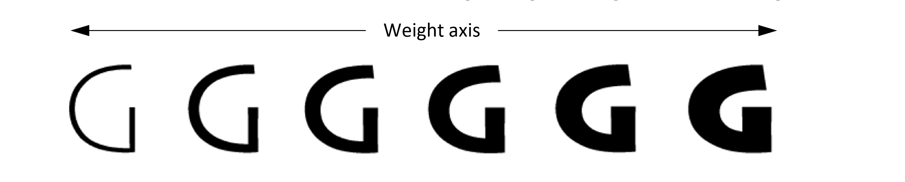<br>*Continuous variation along a design axis*

Conceptually, variable fonts define one or more axes over which design characteristics can vary. Weight is one possible axis of variation, but many different kinds of variation are possible. Variable fonts can combine two or more different axes of variation. For example, the following illustrates a combination of weight and width variation:

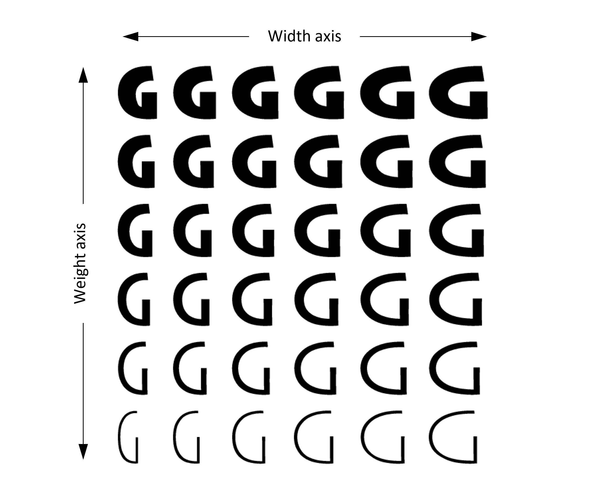<br>*Continuous variation along multiple design axes*

Typically, variable fonts will vary the design of glyph outlines. In general, however, potentially any aspect of the visual appearance may vary. For example, a font could vary line height metrics or appearance of gradients in color glyphs rather than (or in addition to) glyph outlines.

A variable font includes a table, the [font variations ('fvar')](fvar.md) table, that describes the axes of variation used by that font. This table determines how a variable font and its variation parameters will be presented to users and applications. Each axis is defined by a numeric range, using fractional values represented using the Fixed (16.16) data type. Conceptually, this provides a continuous gradient of variation, allowing for a large number of design-variation instances to be selected. Each instance would be designated by a coordinates array within the design-variation space — a specific value along each of the design axes. So, for instance, if a user or application requires small adjustments to width or slightly more pronounced serifs, fine control over such axes of variation is available.

Every axis allows for a continuous range of instance-selection values, and typically there will be continuous variation in appearance for a given axis. In some cases, however, appearance can vary in discrete steps as the axis setting is changed. For example, an axis could trigger substitution to different alternate glyphs for discrete sub-ranges of axis values.

A font designer can pre-define certain instances to have particular names. For example, a font can have continuous variation on a weight axis, but the designer may identify particular variation instances as “Light” or “Semibold”. Named instances can be used for any instance in the supported design-variation space. For example, in a font with weight and width axes, named instances might include “Light”, “Extended”, or “Semibold Condensed”. Details regarding named instances are also included in the font variations table.

Weight and width are commonly-used axes of design variation, but a variable font may use a wide range of other, possible axes of variation. For more information regarding supported axes, see the font variations ('fvar') table chapter.

In addition to a font variations table, a variable font also includes a [style attributes (STAT)](stat.md) table that describes additional details about each axis of variation and about particular values (chosen by the designer) along each axis. These details include descriptor strings for those values, such as “Bold”, “Extended” or “Semi-sans”. For example, a weight/width variable font might support a “Bold Extended” variation, and the STAT table would provide strings for “Bold” and “Extended” corresponding to the particular values along the weight and width axes, respectively. These strings can be used in the creation of font-picker user interfaces. They can also be used for projecting members of a multi-axis font family into different models for font families that assume a limited number of axes of sub-family variation, such as a weight/width/slant model. (See the STAT table chapter for more information.) Because the STAT table identifies values on each axis, software never needs to parse subfamily strings and guess that string tokens such as “Halbfett” refer to a particular value on some axis.

> *Note:* The style attributes table makes it possible for fonts with many design axes to be defined as a single, multi-axis family, yet still have instances across all of those axes supported in older applications that may only recognize a limited set of axes of variation, or a limited number of values on an axis. The host platform, which must support the style attributes table, can translate instances in a multi-axis family into fewer instances in multiple families that older applications will recognize.

As different variation instances of a font are selected, various items of data within a font can be adjusted accordingly. For example, a 'glyf' table can provide the default outline of a given glyph, but the outline can be adjusted in some manner to reflect different design variations. Several other data items besides glyph outlines may also need similar adjustments, including font-wide metrics, CVT values, or anchor positions within glyph-positioning lookup tables. A variable font includes required and optional tables that describe how such items within the font change from default values to different values as needed for different design-variation instances. For example, while a 'glyf' table can provide default outlines for glyphs, a [glyph variations ('gvar')](gvar.md) table would provide corresponding data that describes how each glyph outline changes for different variation instances.

A variable font has a default instance, with axis parameter values set to the defaults defined for each axis in the 'fvar' table. Several tables in the font provide default values for many different data items — such as positions of glyph outline points in the 'glyf' table, or a font-wide ascender distance in the OS/2 table. The default instance of a font uses the default values for such items without any adjustments, and the variation-specific tables are not needed. If the variation-specific tables — 'fvar', 'gvar', MVAR, etc. — were to be removed from the font or ignored, the remaining data would comprise a complete font for the default instance.

Font variation mechanisms for fonts using TrueType outlines were first introduced by Apple in “TrueType GX”. Some of the tables used for OpenType Font Variations have been adapted from Apple’s earlier specifications with some enhancements and revisions. (In particular, there are significant changes in the 'fvar' table specification in regard to both format and data values used, and the 'fmtx' table is not used.) Other extensions have also been created in order to integrate variation mechanisms into OpenType. Implementers may wish to refer to Apple’s specifications for historical insights, but should refer to the OpenType specification as the reference for implementation of OpenType Font Variations.

<a id="anchor-otvaroverview-terminology"></a>

## Terminology

Several terms are useful in discussing OpenType Font Variations and will be used in this specification.

**OpenType Font Variations:** The name of the technology described in this chapter.

**Font face:** A logical collection of glyph data sharing specific design parameters, along with associated metric data, and names or other metadata.

**Font resource:** OpenType data that includes (at least) the minimal set of tables needed to comprise a functional font face.

> *Note:* Within OpenType font files, each [table directory](otff.md#anchor-otff-table-directory) and the tables it references comprise a font resource. A well-formed .OTF or .TTF file includes a single font resource; a well-formed .OTC or .TTC file includes one or more font resources. A font resource without variation-related tables provides data for a single font face. A single font resource that includes variation-related tables can provide data for multiple font faces.

**Font family:** A set of font resources that have a common family name — the same string values for name ID 16 (Typographic Family Name) or name ID 1.

> *Note:* It is assumed that all fonts within a family will share certain design characteristics, but differ in others. The design characteristics that are different potentially might be supported using OpenType Font Variations mechanisms.

**Axis of variation:** A designer-determined variable in a font face design that can be used to derive multiple, variant designs within a family.

**Variable font:** A font resource that supports multiple font faces in a family along designer-defined axes of variation using OpenType Font Variations mechanisms — that is, by means of variation tables and other variation data in tables generally.

**Glyph design grid:** The visual, two-dimensional space in which a font’s glyph outlines are designed.

**Design-variation space:** An abstract, multi-dimensional space defined by the axes of variation used by a font designer when designing a font family. In the context of a variable font, the variation space refers to the n-dimensional space defined by the axes of variation specified in the font’s 'fvar' table.

> *Note:* A variation space can have one or more axes. In a variable font, the variation space is bounded by minimum and maximum values specified in the 'fvar' table. The zero origin has no special significance within a design-variation space. Within a variable font, however, the zero origin (using normalized coordinate scales — defined below) is a marked position since it corresponds to the font face represented directly by the font resource’s name, glyph and metric tables without reference to any variation tables or other variation data.

**Variation data:** Data used in a variable font to describe the way that values for data items in the font are adjusted from default values to alternate values needed for different instances within the variation space.

**Variation tables:** OpenType tables specifically related to Font Variations, including the following:

- [Axis variations ('avar')](avar.md) table
- [CVT (control value table) variations ('cvar')](cvar.md) table
- [Font variations ('fvar')](fvar.md) table
- [Glyph variations ('gvar')](gvar.md) table
- [Horizontal metrics variations (HVAR)](hvar.md) table
- [Metrics variations (MVAR)](mvar.md) table
- [Vertical metrics variations (VVAR)](vvar.md) table

> *Note:* The 'fvar' table describes a font’s variation space, and other variation tables provide variation data to describe how different data items are varied across the font’s variation space. Note that not all of these tables are required in a variable font. Also note that variation data for certain font data items may be contained in other tables not specifically related to Font Variations. In addition, certain tables not specifically related to Font Variations are required in variable fonts. See the section, [Variation data tables and miscellaneous requirements](#anchor-otvaroverview-variation-data-tables-and-miscellaneous-requirements) below for more details.

**Point:** In order to avoid ambiguity, point will be used only to refer to (X, Y) positions within the glyph design grid. When discussing the design-variation space, position will be used to refer to positions within that space.

**Variation instance:** A font face corresponding to a particular position within the variation space of a variable font.

**Named instance:** A variation instance that is specifically defined and assigned a name within the 'fvar' table.

**User coordinate scale:** The numeric scale used to characterize a given axis of variation, and the scale used by applications when selecting instances of a variable font.

> *Note:* Some axes of variation have a prescribed, limited range, expressed in terms of the user scale. When using a particular variable font, the user scale for a given axis is bounded by minimum and maximum specified within the 'fvar' table, and may be a sub-range of the valid range for that axis generally.

**Normalized coordinate scale:** When processing variation data in a variable font to derive values for particular instances, a normalization process is applied to map user-scale values on each axis to a normalized scale applicable within that font that ranges from -1 to 1.

> *Note:* The 'fvar' table specifies user-scale minimum, default and maximum values for each axis. In the normalization process, these get mapped to -1, 0 and 1 respectively, with other values along each axis mapping to intervening points. Mapping of other values is modulated by the 'avar' table, if present. All of the variation data within the font makes reference to axis values or positions within the font’s variation space in terms of normalized-scale values.

**Tuple / N-tuple:** An ordered set of coordinate values used to designate a position within the variation space of a font.

> *Note:* “Tuple” is used here with a meaning that is consistent with conventional usage in computer science and mathematics. In Apple TrueType specifications, “tuple” has been used with a different meaning to refer to sets of variation data associated with a particular region of the font’s design-variation space. In the OpenType specification, “tuple variation data” is used for that meaning, and “n-tuple” is used in many cases so as to avoid confusion with usage in Apple specifications.

**Region:** A sub-space (that is, some portion or subset) of the design-variation space over which a variation adjustment is described.

> *Note:* A region involves all of the axes of the font’s variation space; it is not a “sub-space” in the sense of involving only a subset of axes. In normalized coordinates, regions are always rectilinear: they have straight edges and right-angled corners. Variation data may be defined for up to 65,535 regions in a font’s variation space.

**Master:** A set of source font data that includes complete outline data for a particular font face, used in a font-development workflow.

> *Note:* Some font-development workflows utilize several masters as source data for creating font resources for different faces within a family. Multiple source masters might also be used to create a variable font. Each source master would correspond to a single instance in the variation space, and possibly might correspond to variation data for a particular region in the variable font. Whereas each master includes complete outline data, however, the variable font includes only a single set of complete outline data (in the 'glyf' or CFF2 table), which is complemented with variation data for different regions to represent the full range of instances supported by the font.

**Deltas / Adjustment deltas:** Numeric values in variation data that specify adjustments to default values of data items for particular regions within the variation space or for sub-ranges within a particular axis.

**Delta set:** A set of adjustment deltas associated with a particular region of the variation space.

**Scalars:** Co-efficient values applied to deltas to derive adjustment values needed for a particular variation instance.

**Interpolation:** The process of deriving adjusted values for some font data items, such as the X and Y coordinates of glyph outline points, for a particular variation instance.

<a id="anchor-otvaroverview-variation-space-default-instances-and-adjustment-deltas"></a>

## Variation Space, Default Instances and Adjustment Deltas

A variable font supports one or more axes of variation. Commonly-used axes of variation should be registered, though custom, designer-defined axes can also be used. Each axis has a distinct tag that is used to identify it in the 'fvar' table. See the ['fvar' table specification](fvar.md) for more details about axis tags.

The specification of axes used for a variable font is given in the 'fvar' table, along with minimum, default and maximum values for each axis. This defines a variation space for the font. It is entirely up to the designer what range of design variation is supported for each axis, and how the designs align with the scale for each axis.

For example, a variable font may support a full range of weights from thin to black:

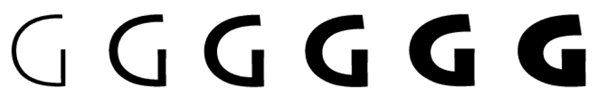<br>*Font A: Thin to black weight variation*

But a designer might also choose to support only a limited weight range:

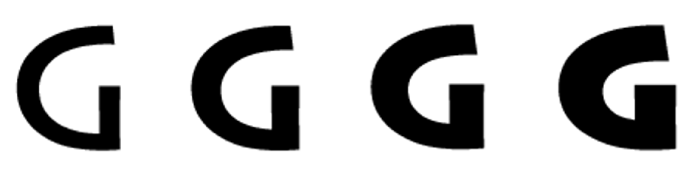<br>*Font B: Regular to black weight variation*

The variable font has a default instance, which corresponds to the position in the variation space with coordinates set to the default values for each axis specified in the 'fvar' table. The default instance uses default values for various data items that are provided directly in non-variations-specific font tables, such as the grid coordinates of outlines points for a glyph in the 'glyf' table.

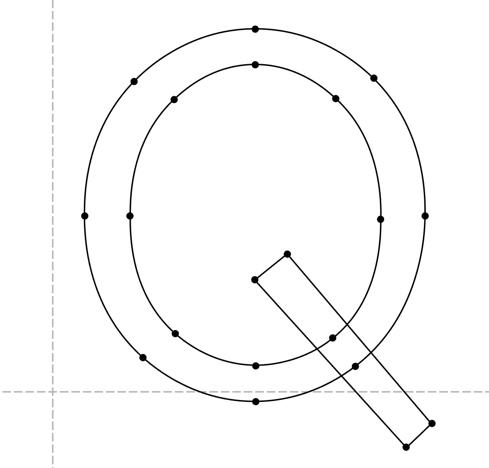<br>*Default glyph outline data in a 'glyf' table entry*

All other instances have non-default coordinate values for one or more axes. These other instances are supported by variation data that provide adjustment deltas for various font data items that produce an adjustment from their default values.

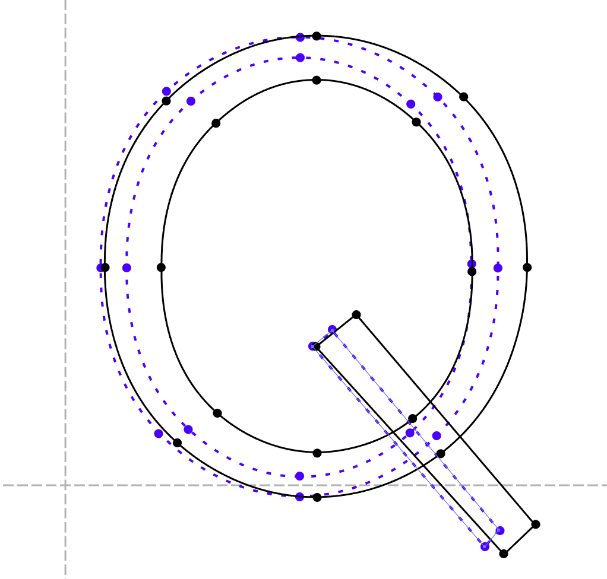<br>*Default glyph outline and adjusted point positions for a non-default instance*

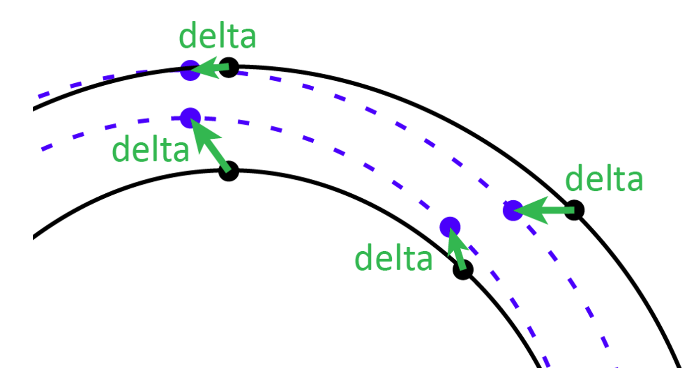<br>*Detail inset showing contour point adjustments*

Typically, deltas are provided for the extremes on each variation axis, though deltas can be provided for other positions in the variation space as well. (See below for more details.) For axis positions between the default and minimum or maximum extreme, other values are interpolated.

The font designer can determine which design is considered the default, and what deltas are provided. For example, a font with thin-to-black weight variation might be implemented with Regular (400) as the default, and Thin (100) and Black (900) as minimum/maximum values. In this case, variation data would include deltas for the Thin extreme and also deltas for the Black extreme.

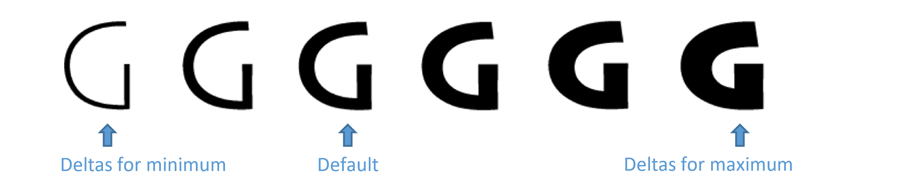<br>*Default near axis mid-point with deltas at minimum and maximum extremes*

But a different font with thin-to-black weight variation might be implemented with Thin as the *default and minimum* value and Black as the maximum. In this case, variation data might include deltas for only the Black extreme.

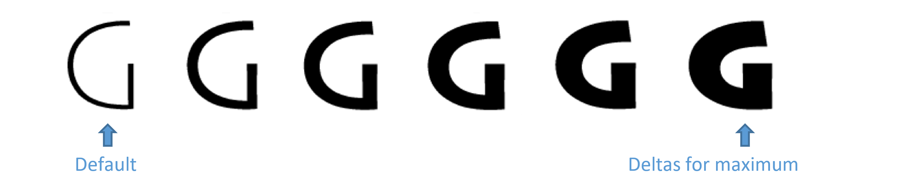<br>*Default at axis minimum with deltas at maximum extreme*

Note that a consideration in the choice of default is desired behavior in legacy applications or platforms that do not support Font Variations: in such software, only the default instance of a variable font will be supported.

A common process for developing a variable font involves the use of multiple, master source fonts. Each master provides complete glyph outline data for designs for a different position within a variation space. For example, a font designer might create fonts for thin and heavy extremes along a weight axis.

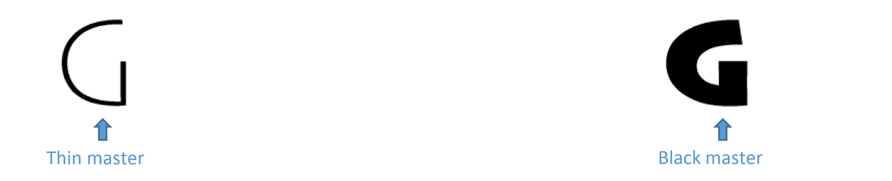<br>*Thin and Black source master outlines for font development workflow*

From these two source masters, font tools can derive a variable font that has complete glyph outlines for a default weight plus deltas for one or more non-default weights, including the minimum or maximum weights.

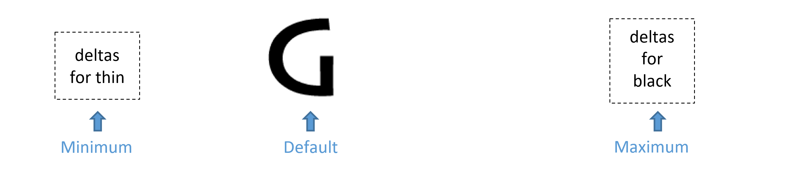<br>*Production variable font with single outline data plus deltas*

Note that each of the source, master fonts has complete outline data for a particular design variant. In contrast, the variable font has complete outlines for only one variation instance, with all other instances derived using the default outlines plus deltas. Each source master may correspond to a region with associated variation data in the variable font, though the relationship between source masters and the sets of variation data within the font will depend on the nature of the designs and on the tools used to produce the variable font.

Also note that a requirement for using multiple, master, font sources to derive a variable font is that corresponding glyph outlines must be point-compatible: they must have the same number of contours and the same number of points in each contour.

<a id="anchor-otvaroverview-coordinate-scales-and-normalization"></a>

## Coordinate Scales and Normalization

Positions within the variation space can be represented as an n-tuple — an ordered list of coordinate values. Examples will be seen below. The coordinate values of an n-tuple may use user-axis scales, or may use normalized scales. The precise relationship between these scales will be described.

*User coordinates* refers to an n-tuple of coordinate values expressed using *user axis scales*. User scales refer to the numeric scales used to describe a variation axis within the 'fvar' table. Each variation axis uses its own numeric scale, as appropriate to the nature of that axis of variation. The scales for registered axis tags are defined as part of the axis tag registration, though different fonts may support different sub-ranges of an axis scale. In this way, the 'fvar' table of a given font defines a particular coordinate system for the variation space of that font that may be unlike that of other fonts.

Whereas the definitions in the 'fvar' table are expressed in user coordinates, the variation data formats used within a variable font use a normalized coordinate system — *normalized coordinates* — in which the minimum, default and maximum values specified for each axis in the 'fvar' table are mapped to -1, 0 and 1, respectively.

For example, the following figure illustrates the user coordinate system of the variation space for a possible font with weight and width axes of variation. Various positions within the design space are indicated, including positions corresponding to the default, minimum and maximum values for each axis defined in the 'fvar' table.

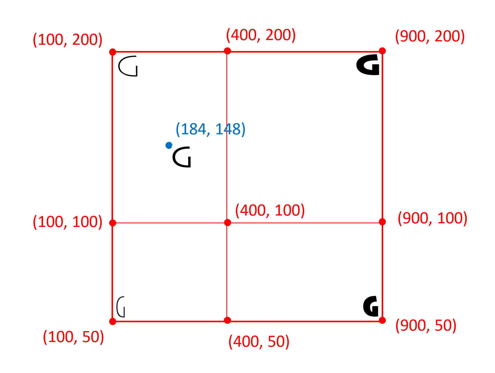

The following figure illustrates the normalized coordinate system for the same positions in the design space:

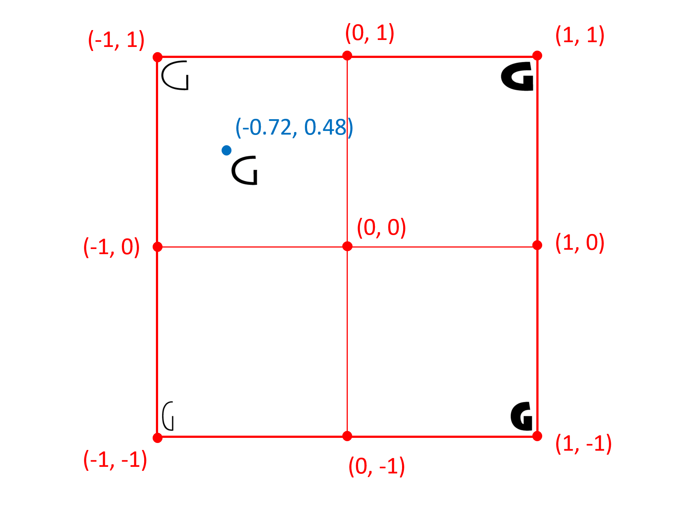

The normalization transformation uses a default transformation followed by a secondary modification of the transformation defined in the ['avar'](avar.md) table, if present. An 'avar' table does not affect the mapping of minimum, default, and maximum values to -1, 0 and 1; it can only affect mapping of intervening values. This is described in more detail below.

The default normalization mapping divides the variation range for each axis into two segments: minimum value to default value, and default value to maximum value. The minimum, default and maximum values are mapped into -1, 0 and 1 respectively. Within each segment, all other values are interpolated linearly, as follows:

1. Let `userValue` be the user-scale coordinate value for a user-selected instance value for a given axis, let `defaultNormalizedValue` be the default normalized instance value, let `axisMin` be the minimum value for the axis specified in the 'fvar' table, etc.

2. Force the user-scale coordinate value to be in range by clamping to the minimum and maximum values:

   ```
   if userValue < axisMin
        userValue = axisMin;
   if userValue > axisMax
        userValue = axisMax;
   ```

3. Interpolate values linearly within the different segments:

   ```
   if (userValue < axisDefault)
   {
       defaultNormalizedValue = -(axisDefault - userValue) / (axisDefault - axisMin);
   }
   else if (userValue > axisDefault)
   {
       defaultNormalizedValue = (userValue - axisDefault) / (axisMax - axisDefault);
   }
   else
   {
       defaultNormalizedValue = 0;
   }
   ```

If an ['avar'](avar.md) table is present, then an additional normalization step is performed for each axis to compute the final normalized value. Within the 'avar' table, AxisValueMap records map default normalized values for an axis to modified normalized values. Pairs of consecutive AxisValueMap records define segments within the range for a given axis. Within a segment, intermediate values are interpreted linearly. Starting with the `defaultNormalizedValue` computed as above, the additional normalization step proceeds as follows:

1. Retrieve the SegmentMaps record for a given axis from the `avar.axisSegmentMaps` array using the index for the axis as defined in the 'fvar' table.

2. Scan the AxisValueMaps records in the `SegmentMaps.axisValueMaps` array to find the first record that has an `AxisValueMaps.fromCoordinate` value greater than or equal to `defaultNormalizedValue`. Designate this record as `endSeg`. (Note that `endSeg` cannot be the first map record, which is for -1.)

3. If `endSeg.fromCoordinate` equals `defaultNormalizedValue`, then set `finalNormalizedValue` to `endSeg.toCoordinate`. Return this value and end.

4. Else `endSeg.fromCoordinate` is strictly greater than `defaultNormalizedValue`): designate the preceding AxisValueMaps record as `startSeg`.

5. `finalNormalizedValue` is computed as follows:

   ```
   ratio = (defaultNormalizedValue - startSeg.fromCoordinate) /
           (endSeg.fromCoordinate - startSeg.fromCoordinate)

   finalNormalizedValue = startSeg.toCoordinate + ratio *
                          (endSeg.toCoordinate - startSeg.toCoordinate)
   ```

See the [Table formats](avar.md#anchor-avar-table-formats) section of the 'avar' table chapter for details on the structures mentioned above.

When processing variation instance coordinates and variation data, the amount of precision used and the handling of rounding can potentially have noticeable impacts on visual results. In order to ensure consistent behavior for a given font across implementations, implementations must observe the following requirements in relation to precision and rounding:

1. The input to normalization must be in 16.16 format. If an application provides an input value represented as either a *float* or *double* data type, the method described below must be used for conversion to 16.16.

2. The math calculations for normalization, specified above, are done in 16.16.

3. After the default normalization calculation is performed, some results may be slightly outside the range \[-1, +1\]. Values must be clamped to this range:

   ```
   if result < -1
       result = -1;
   if result > 1
       result = 1;
   ```

4. If an 'avar' table is present, math calculations are done in 16.16, and results are clamped to the range \[-1, +1\] as above.

5. Convert the final, normalized 16.16 coordinate value to 2.14 by this method: add 0x00000002, and sign-extend shift to the right by 2.

6. The 2.14 result must be stored and returned in certain operations, as described below.

7. For subsequent calculations — calculation of interpolation scalars or accumulation of scaled delta values — the 2.14 representation may be converted to float, 16.16 or other implementation-specific representations. It is recommended that at least 16 fractional bits of precision be maintained, and that any rounding be done at the last point before a value is used.

When converting from float or double data types to 16.16, the following method must be used:

1. Multiply the fractional component by 65536, and round the result to the nearest integer (for fractional values of 0.5 and higher, take the next higher integer; for other fractional values, truncate). Store the result in the low-order word.
2. Move the two’s-complement representation of the integer component into the high-order word.

> *Note:* Apart from conversion of higher-precision representations to 16.16, this specification has no other requirements for instance coordinates, scaled deltas or derived instance values to be rounded. For example, for contour point coordinates after deltas have been applied, a rasterizer implementation can use a high-precision floating type or can round to a lower-precision representation depending on implementation-specific requirements. Different implementations can use different precision for calculation of instance values, resulting in minor visual differences. If data for a font instance is converted or exported to another representation — for example, in dynamic generation of a static font for a given instance — there can be minor differences between the derived static font versus the source variable font with that instance selected.

A normalized value in 2.14 representation must be obtained exactly as specified in steps 1–5 above. In fonts with TrueType instructions, this exact value must be returned by the GET VARIATION instruction. (See [The TrueType Instruction Set](tt_instructions.md).) If a font has OpenType Layout tables in which FeatureVariation tables are used, this exact value must be used when comparing with axis range values specified in a condition table.

<a id="anchor-otvaroverview-avar-normalization-example"></a>

### 'avar' normalization example

The following example illustrates how normalization using 'avar' mappings works.

Suppose that an axis in a font has minimum value of 100, a default of 400, and maximum of 900. And suppose that the instance selected has a user coordinate of 250. By the algorithm described above, the default normalized value will be calculated as follows:

```
defaultNormalizedValue = -(axisDefault - userValue) / (axisDefault - axisMin)
                       = -(400 - 250) / (400 - 100)
                       = -150 / 300
                       = -0.5
```

Suppose also that the font has an 'avar' table with the following mappings (AxisValueMap records) for this axis:

| Record index | fromCoordinate | toCoordinate |
| --- | --- | --- |
| 0 | -1.0 | -1.0 |
| 1 | -0.75 | -0.5 |
| 2 | 0 | 0 |
| 3 | 0.4 | 0.4 |
| 4 | 0.6 | 0.9 |
| 5 | 1.0 | 1.0 |

Given the default normalized value of -0.5, the relevant segment is defined by record 1 and record 2:

- The first record having a `fromCoordinate` greater than or equal to `defaultNormalizedValue` is record index 2. Thus, record 2 is `endSeg`.
- `endSeg.fromCoordinate` is strictly greater than `defaultNormalizedValue`. Thus, the preceding record, record 1, is `startSeg`.

Thus, the final normalized value is computed as follows:

```
ratio = (defaultNormalizedValue - startSeg.fromCoordinate) /
        (endSeg.fromCoordinate - startSeg.fromCoordinate)
        = (-0.5 - (-0.75)) / (0 - (-0.75))
        = 0.3333

finalNormalizedValue = startSeg.toCoordinate + ratio *
                        (endSeg.toCoordinate - startSeg.toCoordinate)
                        = -0.5 + 0.3333 * (0 - (-0.5))
                        = -0.3333
```

The following table shows how several normalized coordinate values would be modified by this 'avar' data:

| Default normalized value | Final normalized value |
| --- | --- |
| -1.0 | -1.0 |
| -0.75 | -0.5 |
| -0.5 | -0.3333 |
| -0.25 | -0.1667 |
| 0 | 0 |
| 0.25 | 0.25 |
| 0.5 | 0.65 |
| 0.75 | 0.9375 |
| 1.0 | 1.0 |

<a id="anchor-otvaroverview-variation-data"></a>

## Variation Data

Variation data provides data that describes variation of particular font values over the variation space. For example, variation data in the 'gvar' table describes how glyph outlines in the 'glyf' table are transformed by specifying how individual points in a glyph outline get moved for different variation instances.

Variation for a given font value is expressed as combinations of deltas that apply to different regions of the variation space, and that are combined in a weighted manner to derive adjustments for instances at different positions in the variation space. Each delta in the variation data is associated with a specific region of the variation space over which it has an effect. The aggregate combination of deltas and their associated regions comprise the variation data. The variation data for different items in a font are stored in different locations. For example, variation data for entries in a 'glyf' table are stored in a 'gvar' table; variation data for certain entries in the OS/2 table is stored in an MVAR table. In the case of outline data in a CFF2 table, variation data is stored within the CFF2 table itself. See the following section below for more details.

As mentioned, each delta value is associated with a particular region of the variation space over which it applies. The effective region for a delta is always rectilinear (in normalized coordinates). Therefore, this region can always be specified by a pair of n-tuples designating positions at diagonal-opposite corners of the region. Within the specified region, variation effects will vary from zero change to some peak change at a particular position within the region. Thus, in the general case, there are three positions that matter: the diagonal-opposite corners that define the extent of the region, and a position at which the peak change occurs.

> *Note:* The figures shown below will use two axes of variation. The concepts and the statements made, however, apply to fonts with any number of axes of variation: regions are always rectilinear, and the diagonal-opposite corners plus a peak are the positions that describe a region.

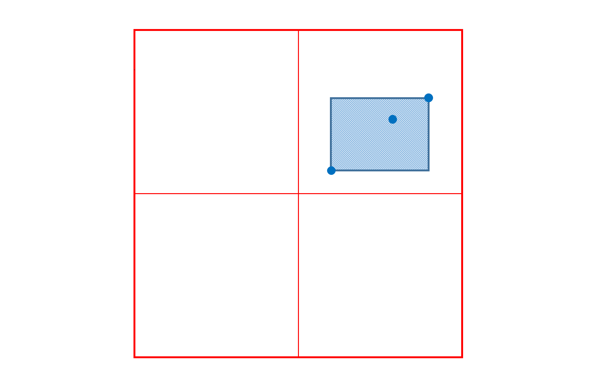

This general case is not the most common in practice. In most cases, there is a need to describe a maximal variation at an outer position of the variation space that diminishes to zero change at the zero origin — the default instance. In this case, then, the zero origin is one of the corner positions for the applicable region, and the peak change occurs at the diagonal-opposite position. For this common case, then, the effective region and peak position can be described using a single n-tuple.

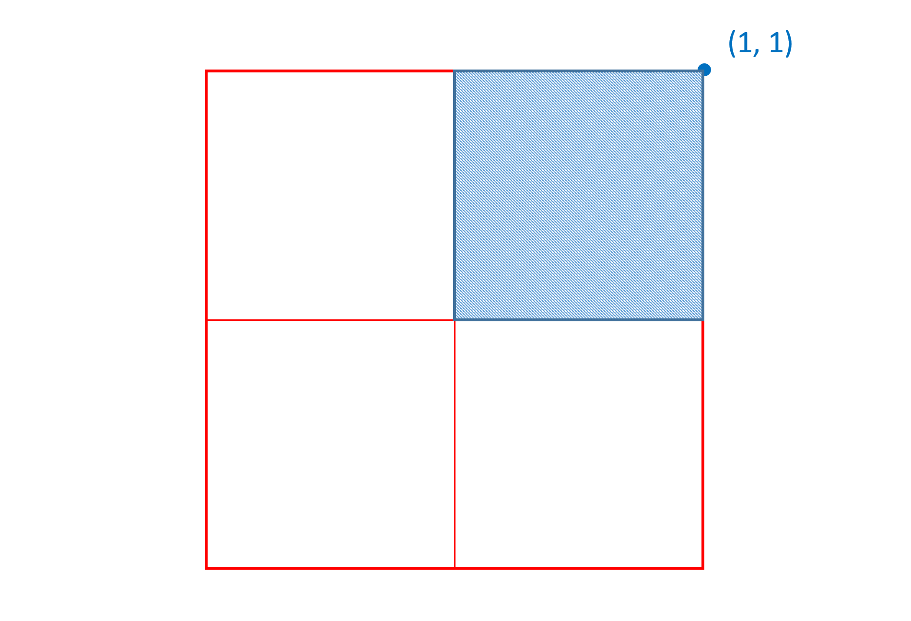

The more general, but less common, case involves arbitrary regions, illustrated earlier; these are referred to as *intermediate* regions. In these cases, the variation data requires three n-tuples: one for the peak-change position, and two for *start* and *end* positions at diagonal-opposite corners.

Delta values in the variation data specify a maximal adjustment for an instance at the peak position. The effects taper off for other instances, falling to zero adjustment for instances outside the region of applicability. When a given variation instance is selected, a scalar value is calculated and applied to a given delta to derive a net adjustment associated with that delta for that instance. These scalars will always be in the range 0 (zero adjustment) to 1 (maximal adjustment). Specific details on this scalar calculation are provided below.

An example will help to explain these concepts. Consider a single-axis font with weight variation. A particular glyph outline defined in the 'glyf' table might have a pair of points (among others) that are on-curve points on opposite sides of a stem. The entry in the 'glyf' table would specify glyph-design-grid coordinates for these points for the default instance of the font, perhaps corresponding to the regular weight:

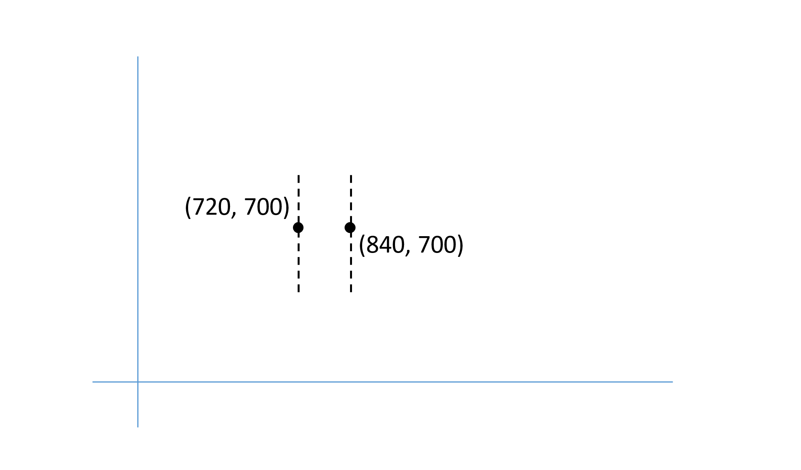

Variation data would be defined for the maximum value on the weight axis, corresponding to 1.0 in the normalized weight scale. This data would provide X and Y deltas for the two contour points to shift their positions as needed for the heaviest-supported weight instance:

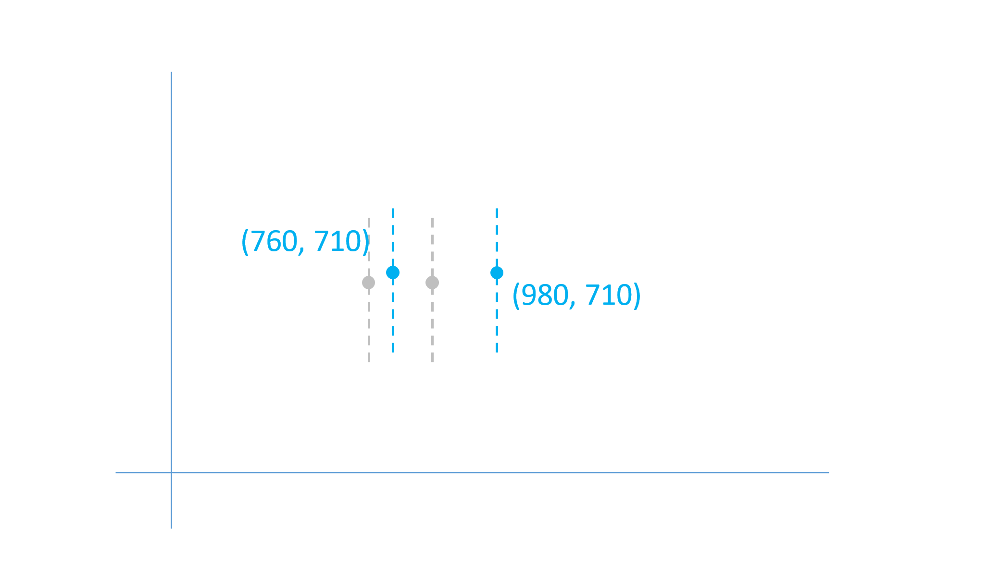

In this example, the first point would have X and Y deltas of +40 and +10, respectively; the second point would have deltas of +140 and +10. These provide a maximal adjustment of the outline points, applied when the user-selected instance is at the maximum weight. For weights between the default and the maximum, such as a normalized weight value of 0.5, the effect is scaled back.

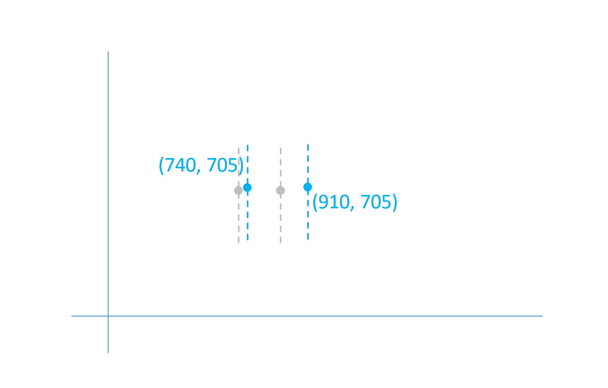

In this case, a scalar co-efficient of 0.5 is applied to the delta values.

The scalar calculation can be thought of as a function that maps each normalized axis value from -1 to 1 onto a scalar range of 0 to 1. Each region that has associated variation data has its own scalar function, and the scalar function is defined precisely by the region description.

For example, in a single-axis font, if a delta is provided for the region from 0 to 1 with the peak effect at 1, the scalar function would be as follows:

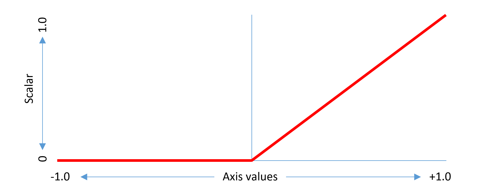

This example considers a non-intermediate region. The same concepts can be generalized to intermediate regions. An intermediate region has start and end axis values between which there is some adjustment effect, and a peak axis value at which the full adjustment effect is applied. The scalar function has a triangular shape within the applicable range, with a value of 1.0 at the peak axis value, 0 at or below the start axis value, and 0 above the end axis value.

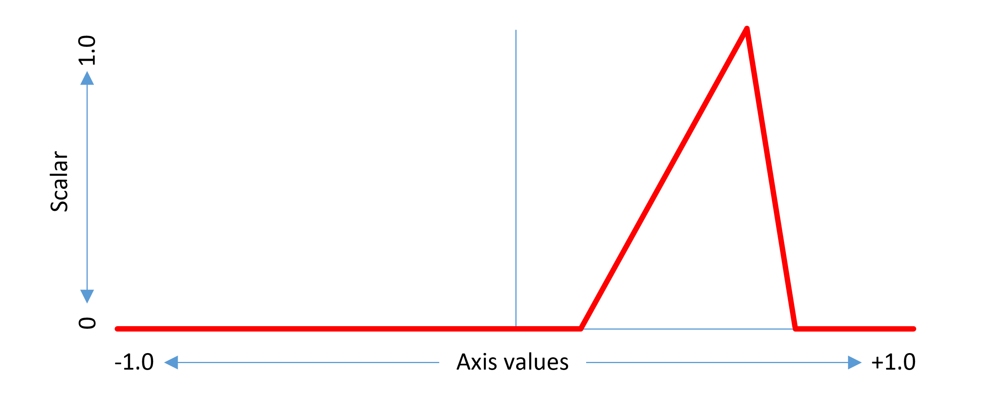

When generalizing to two or more axes, similar concepts apply, but contributions for each axis are combined into an overall effect. Scalars are calculated for each axis, and the per-axis scalars are multiplied together to produce an overall scalar for the given delta and the given instance. For example, the following graph illustrates an approximation of the scalar function for a region in a two-axis font with peak at (1, 1):

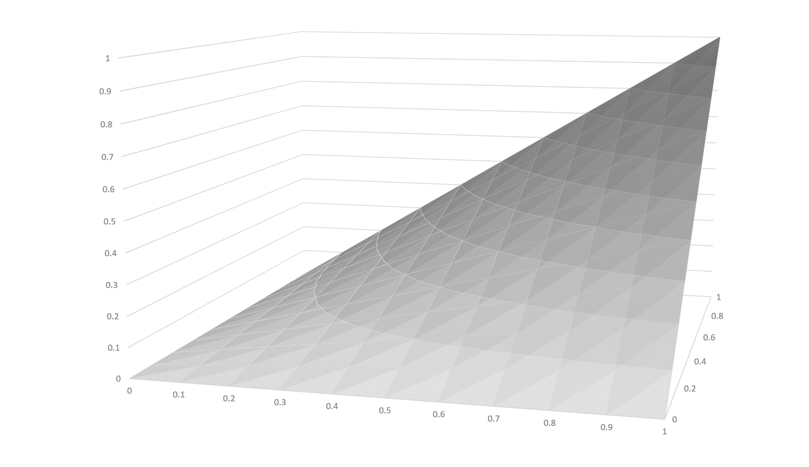

Since the scalar value calculated for each axis is between 0 and 1, the product when scalars for each axis are multiplied together is also between 0 and 1. The maximal adjustment effect for a given delta is obtained only when the instance axis values for all axes align with the peak coordinate values for the region associated with that delta.

The minimum and maximum values specified for an axis in the 'fvar' table determine limits on instances that can be selected by a user. If a user requests an instance with an axis value below the minimum, the minimum value is used; or if an axis value above the maximum is requested, the maximum is used. Thus, when processing variation data for a selected instance, the normalized axis values will always be between -1 and 1.

With that constraint assumed, let us consider the scalar value for a given delta when instance axis values are outside the region of applicability. If the selected instance is out of range on any axis, then the scalar value pertaining to that axis will be 0. As mentioned, per-axis scalars are multiplied together to produce an overall scalar. Thus, if the selected instance is out of range on any axis, then the overall scalar for that delta will be 0, and no adjustment from that delta will be applied.

When a delta is provided for a region defined by n-tuples that have a peak value of 0 for some axis, then that axis does not factor into scalar calculations. This means that the adjustment effect is the same for any value in that axis, if other axis values remain constant. In effect, the region of applicability spans the full range for the zeroed axis. For example, suppose a font has two axes, weight and width, and that deltas are provided for a region from (0, 0) to (1, 0). In this case, the deltas are applicable for any instance value on the second axis (width), so long as the instance value in the first axis (weight) is in range:

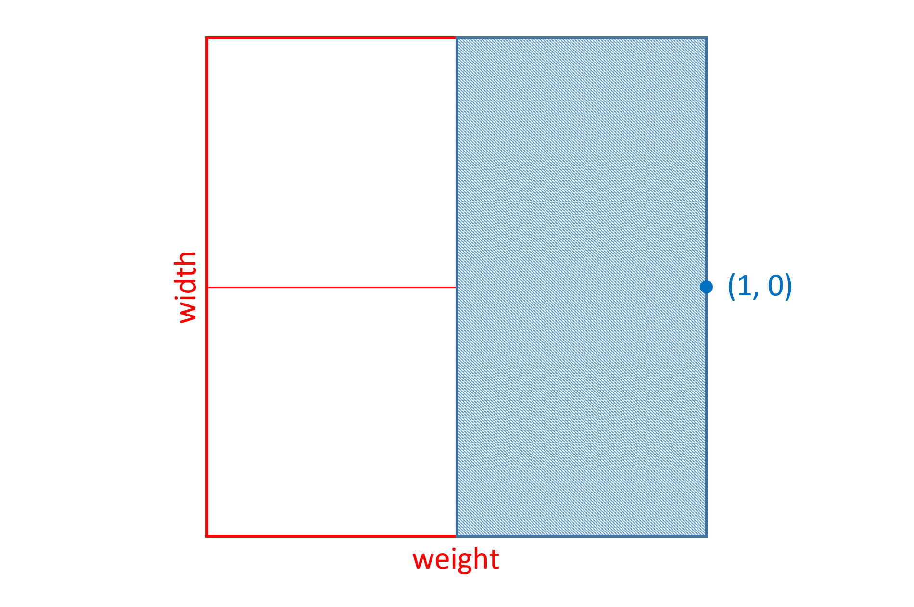

In this case, the scalar function for *the second axis* (width) is, effectively, a constant value of 1, with no effect on the net scalar calculation. The following graphs illustrate the scalar functions for each of the two axes, weight and width, in this example:

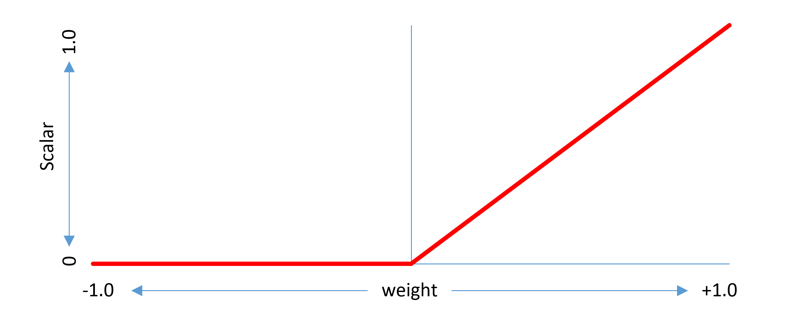 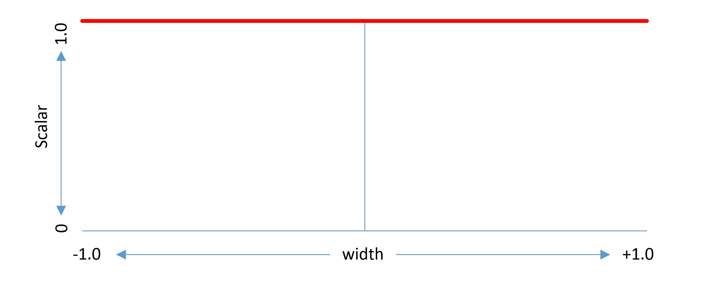

For a given font value, deltas may be provided for several different regions in the variation space. When a particular variation instance is selected, zero, one or many of those deltas may have an effect, according to whether the position of the instance falls within the region of applicability for each delta. Different scalars are calculated for each applicable delta, and the scaled values for applicable deltas are combined to derive a net adjustment.

When creating a single-axis font, deltas will be required for both the minimum and maximum extremes of that axis. (Both extremes, that is, unless one is also the default.) Additional intermediate-region deltas may also be provided. When creating a multi-axis font, deltas would typically be provided for the minimum and maximum extremes on each axis. The following figure illustrates this for a two-axis font:

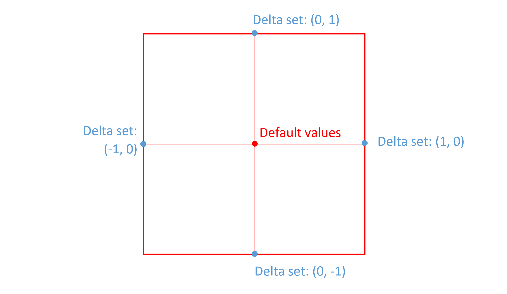<br>*Two-axis font with deltas at minimum/maximum extremes on each axis*

As noted above, when deltas are specified for a region with some axis value being zero, then the deltas apply to all values on that axis. Therefore, for the instance at position (1, 1), deltas for (1, 0) and (0, 1) will both apply. This means that the adjustments for the (1, 0) deltas and the adjustments for the (0, 1) deltas will both be applied to produce a combined effect. If the adjustments made for each axis are entirely independent of the adjustments for the other axis, then the two sets of deltas may be sufficient to provide the intended values for the (1, 1) instance.

Often, however, these two sets of deltas alone will not be sufficient to provide the desired results for all instances, and that additional deltas are required for the (1, 1) position in addition. Generalizing, in a multi-axis font, it will often be the case that at least some deltas are needed for the corner extremes as well as for the axis end points.

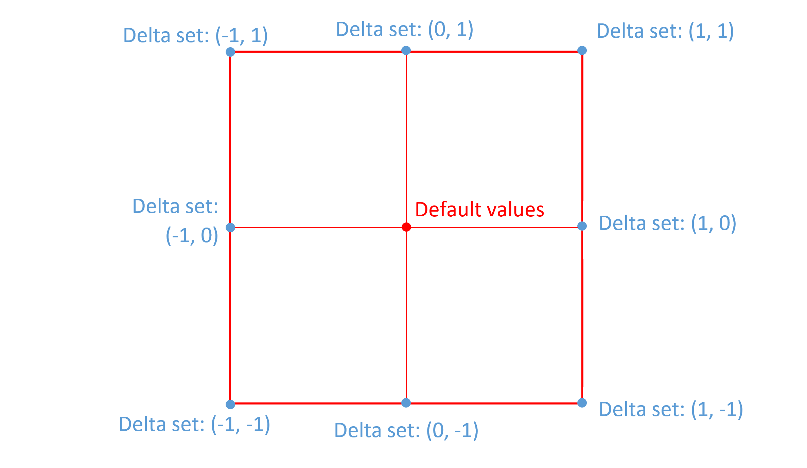<br>*Deltas at minimum/maximum extreme plus extrema-intersection corners*

As noted in the [Variation Space, Default Instances and Adjustment Deltas](#anchor-otvaroverview-variation-space-default-instances-and-adjustment-deltas) section above, the default instance can correspond to the minimum or maximum value on one or more axes. This can allow variations across a variation space to be implemented using fewer regions and associated delta data. The following figures illustrate some additional possibilities for a two-axis font.

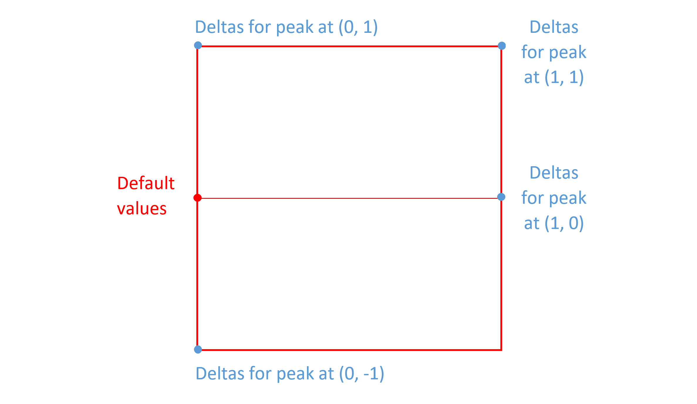<br>*Two-axis font with default at minimum for one axis*

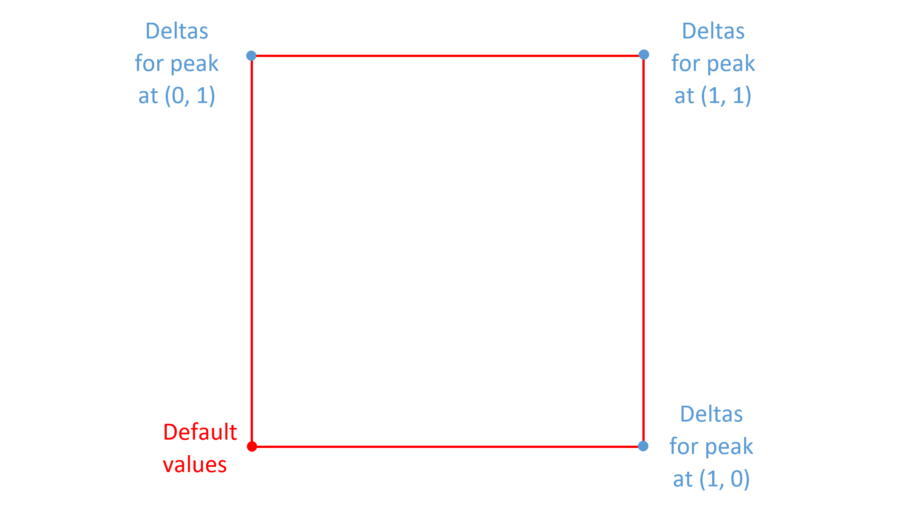<br>*Two-axis font with default at minimum for both axes*

> *Note:* Deltas for corner extremes are optional. Depending upon the needs of a particular font design, deltas can be added for none, some or all of the corner extremes. In the first example above, the design-space corners in the upper left and lower left of the diagram correspond to the minimum and maximum values for one of the axes, and so deltas in those corners are needed to provide variation on that axis. But deltas for the upper right and lower right corners are optional; in this example, supplemental deltas are added only for the upper right corner.

As noted above, an intermediate region provides an axis scalar function with a triangular, or “tooth”, shape. A pair of intermediate regions that barely overlap and that have a sharp incline at the overlap can be used to provide an inflection point along an axis in regard to some variation behavior.

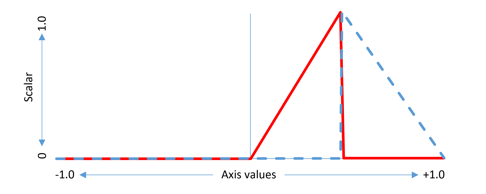

Note that each intermediate region has its own associated delta values, and deltas can be used to give some sharp transition at the overlap point. For example, contour points could suddenly shift to make some element of a glyph’s structure appear or disappear, as illustrated in the following figure.

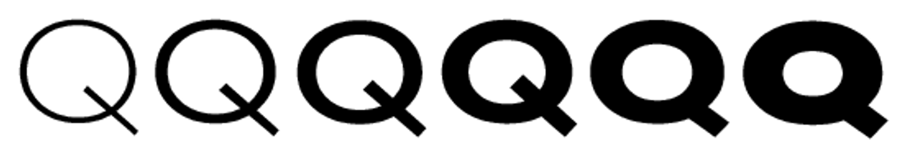<br>*Glyph structure simplified at heavier weights*

> *Note:* When using such techniques, placement of such a transition point along an axis and placement of named instances should be considered together so that sharp transitions do not occur close to a named instance. This will avoid any possibility of inconsistent behavior in different applications when using named instances that might arise due to small discrepancies in processing the numeric values.
>
> *Note:* When using such techniques, it is important to bear in mind that some applications will support selection of arbitrary instances, including those with axis values in the overlapping range, and that, in the overlapping range, scaled deltas for both of the intermediate regions will apply with cumulative effect. Some design iteration may be needed, with small adjustments to delta values or the way that the regions overlap, in order to avoid unexpected or undesired results in the transitional range.
>
> *Note:* The above figure illustrates the use of intermediate regions to implement a “stroke-reduction” effect. Another implementation technique that can be used to change the structure of a glyph for particular variation-axis value ranges is glyph substitution. The OpenType Layout [Required Variation Alternates](features_pt.md#anchor-features_pt-tag-rvrn) feature in combination with a [FeatureVariations](chapter2.md#anchor-chapter2-feature-variations) table within the GSUB table can be used to perform glyph substitutions when a variation instance is selected in some range along one or more axes. This may be an easier and more-easily maintained technique, and is generally recommended for achieving such effects.

The above has provided an overview of the basic concepts involved in variation data: regions of applicability, per-axis and overall scalars, and combined effects of multiple, applicable deltas. A detailed specification of the interpolation process is provided below.

<a id="anchor-otvaroverview-variation-data-tables-and-miscellaneous-requirements"></a>

## Variation Data Tables and Miscellaneous Requirements

The previous section identified X and Y coordinates of glyph outline points as data items that can be adjusted for different variation instances. Many other data items in a font can also be adjusted, including the following:

- Font-wide metric values in the [OS/2](os2.md#anchor-os2-os2-table-and-opentype-font-variations), ['hhea'](hhea.md#anchor-hhea-hhea-table-and-opentype-font-variations), ['vhea'](vhea.md#anchor-vhea-vhea-table-and-opentype-font-variations) or ['post'](post.md#anchor-post-post-table-and-opentype-font-variations) tables.
- Glyph metric values in the ['hmtx'](hmtx.md), ['vmtx'](vmtx.md) or [VORG](vorg.md) tables.
- PPEM ranges in the ['gasp'](gasp.md#anchor-gasp-gasp-table-and-opentype-font-variations) table.
- Anchor positions, and adjustments to glyph positions or advance in the [GPOS](gpos.md#anchor-gpos-gpos-table-and-opentype-font-variations) or [JSTF](jstf.md#anchor-jstf-jstf-table-and-opentype-font-variations) tables.
- X or Y coordinates for ligature caret positions in the [GDEF](gdef.md) table.
- X or Y coordinates for baseline metrics in the [BASE](base.md#anchor-base-base-table-and-opentype-font-variations) table.
- [CVT](cvt.md) values.
- Gradient placement and color stop offsets, color alpha values, and transformations for color glyphs in the [COLR](colr.md) table.

A variable font may contain variation data for any or all of these. The variation data for different items is provided in various tables within a font.

> *Note:* While several data items in a font may require adjustment for different instances, there will be other items that do not change across instances. For example, the font family and unitsPerEm are not impacted by variation. It should be noted in particular, however, that certain values that can potentially be impacted by variations are not supported with variation data. In particular, the xMin, yMin, xMax, yMax, macStyle and lowestRecPPEM fields in the [font header ('head')](head.md) table are not supported by variation data and should only be used in relation to the default instance for the font. Also, variations for values in the [kerning ('kern')](kern.md) table are not supported; variable fonts should handle kerning using the GPOS table.

Two tables are required in all variable fonts:

- A [font variations ('fvar')](fvar.md) table is required to describe the variations supported by the font.
- A [style attributes (STAT)](stat.md) table is required and is used to establish relationships between different fonts belonging to a family and to provide some degree of compatibility with legacy applications by allowing platforms to project variation instances involving many axes into older font-family models that assume a limited set of axes.

A variable font must contain some other variation-related data, according to the ways in which the design varies, but no other specific type of variation-related data is required in all variable fonts.

If a variable font has TrueType outlines in a 'glyf' table, the outline variation data can be provided in the [glyph variations ('gvar')](gvar.md) table. Variation data for CVT values can be provided in the optional [CVT variations ('cvar')](cvar.md) table.

If a variable font has PostScript-style outlines in a [Compact Font Format 2.0 (CFF2)](cff2.md) table, the CFF2 table itself can also contain the associated variation data.

> *Note:* A CFF2 table can be used in non-variable fonts as well as in variable fonts. Also note that variations for outlines using the [Compact Font Format version 1.0 ('CFF ')](cff.md) table are not supported.

The [metrics variations (MVAR)](mvar.md) table is used to provide variation data for various font-wide metrics or other numeric values in the 'gasp', 'hhea', OS/2, 'post' and 'vhea' tables. An MVAR table should be added if adjustments to any of these values are required. Note that it is not required to provide variation data for all of the data items covered by the MVAR table: variation data is optional for all items. If there is no variation data for a given item, the default value applies to all instances.

> *Note:* Apple platforms allow for use of a font metrics ('fmtx') table to specify various font-wide metric values by reference to the X or Y coordinates of contour points for a specified glyph. OpenType Font Variations does not use the font metrics table.

The 'hmtx' and 'vmtx' tables provide horizontal and vertical glyph metrics. Variation data for horizontal and vertical glyph metrics can be provided using the [horizontal metrics variations (HVAR)](hvar.md) and [vertical metrics variations (VVAR)](vvar.md) tables.

In a font with TrueType outlines, the rasterizer combines 'hmtx' and 'vmtx' values with glyph xMin, xMax, yMin and yMax values in the 'glyf' table to generate four “phantom” points that correspond to the glyph horizontal and vertical metric values. (See the chapter [Instructing TrueType Glyphs](tt_instructing_glyphs.md#anchor-tt_instructing_glyphs-phantom-points) for more background on phantom points.) In a variable font, the variation data for a glyph in the 'gvar' table will include adjustment deltas for the glyph’s phantom points. As a result, interpolated glyph metrics for a given instance can be obtained by interpolating the phantom point positions for the instance. This may be costly for some text-layout operations, however. In order to provide the best performance on all platforms, it is recommended that all variable fonts with TrueType outlines include an HVAR table. If the font supports vertical layout and includes 'vhea' and 'vmtx' tables, it is recommended that the font include a VVAR table.

The CFF2 rasterizer does not generate phantom points, and CFF2 variation data will not include adjustment deltas for phantom points. For this reason, in a variable font with CFF2 outlines, 'hmtx' and HVAR tables are required. Similarly, if the font supports vertical layout, then 'vmtx' and VVAR tables are required.

> *Note:* The 'hdmx' and VDMX tables are not used in variable fonts.

If a font has OpenType Layout tables, variation data for values from the GDEF, GPOS or JSTF table will be included, as needed, within the GDEF table. Variation data for the BASE table will be included, as needed, within the BASE table itself.

In some variable fonts, it may be desirable to have different glyph-substitution or glyph-positioning actions used for different regions within the font’s variation space. For example, for narrow-width or heavy-weight instances in which counters become small, it may be desirable to make certain glyph substitutions to use alternate glyphs with certain strokes removed or outlines simplified to allow for larger counters. Such effects can be achieved using a feature variations subtable within either the GSUB or GPOS table. See the chapter [OpenType Layout Common Table Formats](chapter2.md) for more information.

In a color font using the [COLR](colr.md) table, variation data can be included in the COLR table, as needed, for variable items in color glyph descriptions.

In a variable font with TrueType outlines, the left side bearing for each glyph must equal xMin, and bit 1 in the flags field of the 'head' table must be set.

In all variable fonts, bit 5 in the flags field of the 'head' table must be cleared. (On certain platforms, bit 5 affects metrics in vertical layout. Bit 5 must be clear to ensure compatible behavior on all platforms.)

<a id="anchor-otvaroverview-algorithm-for-interpolation-of-instance-values"></a>

## Algorithm for Interpolation of Instance Values

The process of interpolating adjusted values for different variation instances is used for all font data items that require variation — positions of outline glyph points, ascender or other font-wide metrics, etc. The interpolation process involves the following:

- Determining the deltas that are applicable for that instance.
- For each applicable delta, calculating per-axis scalars for that instance, then multiplying the per-axis scalars together to produce an overall scalar for that delta.
- Scaling each applicable delta by the calculated scalar for that delta.
- Combining all of the scaled deltas to produce an overall adjustment.

When processing the 'gvar' table, there is an additional step in calculations, which is to infer delta adjustments for points when deltas are not given explicitly. This applies only to the 'gvar' table, and is described in the ['gvar'](gvar.md) table chapter.

As described earlier, an instance axis value that is outside the region of applicability for a given delta is equivalent to having a per-axis scalar value of zero. Also, having an axis that has no effect in relation to a given delta (the n-tuples have a peak value of zero for that axis) is equivalent to having a per-axis scalar value of one. Thus, determination of applicability and axis interactions can all be combined into a step of deriving an overall scalar.

The description of the interpolation process below will refer to start, peak, and end coordinate values. As described earlier, an intermediate region is described using three n-tuples, two for diagonal-opposite corners (start and end) that specify the extent of the region, and a peak. Non-intermediate regions have one of the corners at the peak and the other corner at the zero origin. In some variation data structures, a non-intermediate region is specified using a single n-tuple, that of the peak. In this case, the start and end coordinates are implicit: one is the same as the peak, and the other is the zero origin.

In order for the definition of a region within variation data to be valid, start, peak and end values must be well ordered. That is, for each axis, the start axis coordinate must be less than or equal to the peak coordinate, and the peak coordinate must be less than or equal to the end. Also, the start and end coordinates must both be non-negative or non-positive — they cannot cross zero.

In the discussion to this point, individual deltas have been described as having an associated region of applicability. Variation data can be organized in different ways. In some cases, as in the 'gvar' table, several deltas corresponding to many target items (all the outline points of a glyph) and a single region of the variation space are organized together. In some other cases, as in the MVAR or CFF2 tables, deltas covering multiple regions are organized together by individual target items. In either case, each individual delta is associated with a particular region of the variation space. The following description of the interpolation process will refer to interpolating a value for an individual item, but when applied to particular contexts such as the 'gvar' table, it should be understood that the same calculations are applied to many different items in parallel.

As described above, the effect of a given delta is modulated by a scalar function ranging from 0 to 1, with a value of 1 for an instance at the peak position of the region associated with that delta. The overall scalar is the product of per-axis scalars, and each per-axis scalar is calculated as a proportion of the proximity of the instance coordinate value to the peak coordinate value relative to the distance of the peak from the edges of the region.

For example, consider an intermediate region (green in the figure below) in a two-axis variation space, with corners at (0.3, 0.15) and (1, 1), and a peak (blue in the figure below) at (0.7, 0.5):

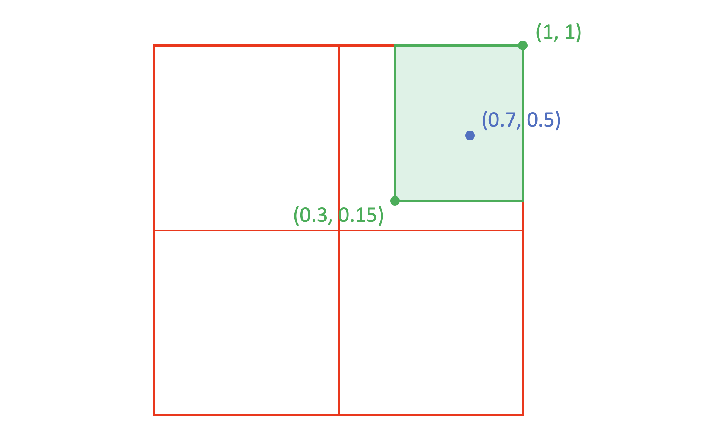

Then consider the instance (red in the figure below) at (0.5, 0.35). The per-axis scalars will be the ratio of the distance of the instance coordinate value from the nearest edge of the region divided by the distance of the peak from that edge:

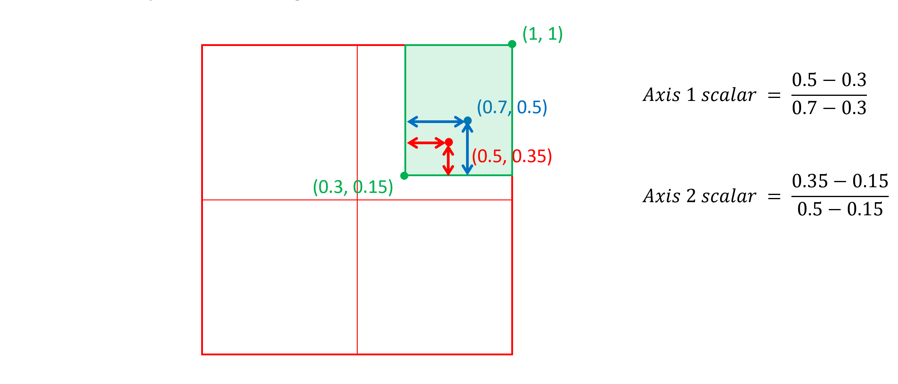

The overall scalar for the instance in relation to this region will be the product of the two axis scalars: 0.5 × 0.571429 = 0.285714.

The detailed algorithm for calculating the interpolated value for a given target item and for a given instance is as follows.

- Let instanceCoords be the normalized instance coordinate n-tuple for the instance, with axis elements instanceCoords\[i\].
- Let Regions be the set of regions for which associated deltas are provided for the given item, and let R be a region within that set.
- Let startCoords, peakCoords and endCoords be the start, peak and end n-tuples for some specified region, R. Let startCoords\[i\], etc. be coordinate values for a given axis.
- Let AS be a per-axis scalar, and let S be an overall scalar for a given region.
- Let delta be the delta value in the variation data associated with a given region, and let scaledDelta be the scaled delta for a given region and instance.
- Let netAdjustment be the accumulated adjustment for the given item.
- Let defaultValue be the default value of the item specified in the font, and let interpolatedValue be the interpolated value of the item for a given instance.

The following pseudo-code provides a specification of the interpolation algorithm:

```csharp
netAdjustment = 0; /* initialize the accumulated adjustment to zero */
(for each R in Regions) /* For each region, calculate a scalar S */
{
    S = 1; /* initialize the overall scalar for the region to one */

    /* for each axis, calculate a per-axis scalar AS */
    (for i = 0; i < axisCount; i++)
    {
        /* If a region definition is not valid in relation to some axis,
        then ignore the axis. For a region to be valid in relation to a
        given axis, it must have a peak that is between the start and
        end values, and the start and end values cannot have different
        signs if the peak is non-zero. (Start and end can have different
        signs if the peak is zero, however: this can be used if an axis is
        to be ignored in the scalar calculation.) */

        if (startCoords[i] > peakCoords[i] || peakCoords[i] > endCoords[i])
            AS = 1;
        else if (startCoords[i] < 0 && endCoords[i] > 0 && peakCoords[i] != 0)
            AS = 1;

        /* Note: for remaining cases, start, peak and end will all be <= 0 or
        will all be >= 0, or else peak will be == 0. */

        /* If the peak is zero for some axis, then ignore the axis. */
        else if (peakCoords[i] == 0)
            AS = 1;

        /* If the instance coordinate is out of range for some axis, then the
        region and its associated deltas are not applicable. */
        else if (instanceCoords[i] < startCoords[i]
                 || instanceCoords[i] > endCoords[i])
            AS = 0;

        /* The region is applicable: calculate a per-axis scalar as a proportion
        of the proximity of the instance to the peak within the region. */
        else
        {
            if (instanceCoords[i] == peakCoords[i])
                AS = 1;
            else if (instanceCoords[i] < peakCoords[i])
            {
                AS = (instanceCoords[i] - startCoords[i])
                     / (peakCoords[i] - startCoords[i]);
            }
            else /* instanceCoords[i] > peakCoords[i] */
            {
                AS = (endCoords[i] - instanceCoords[i])
                     / (endCoords[i] - peakCoords[i]);
            }
        }

        /* The overall scalar is the product of all per-axis scalars.
        Note: the axis scalar and the overall scalar will always be
        >= 0 and <= 1. */
        S = S * AS;
    } /* per-axis loop */

    /* get the scaled delta for this region */
    scaledDelta = S * delta;

    /* accumulate the adjustments from each region */
    netAdjustment = netAdjustment + scaledDelta;
} /* per-region loop */

/* apply the accumulated adjustment to the default to derive the interpolated value */
interpolatedValue = defaultValue + netAdjustment;
```

When scaled deltas are applied to a default value, it is possible that the combined result will be outside the range of the data type used in the font for the default value. For example, the default value could be represented in the font as a 16-bit value, but the instance value after applying deltas might require more bits to represent it. An implementation-determined representation may be used during calculation and for the final result (interpolatedValue). The numeric range used in calculation must be at least that of the data type of the item to which deltas are applied; for example, at least \[-32768, 32767\] when applying scaled deltas to an FWORD value.

Applying scaled variation deltas to a scalar value requires calculations that involve fractional values. In calculation of scalars (S, AS) and of interpolated values (scaledDelta, netAjustment, interpolatedValue), at least 16 fractional bits of precision should be maintained. If required for the internal representation, rounding should be done only when the final result is used, and may retain greater fractional bit-depth than that of the data type of the item to which deltas are applied. See also [Coordinate Scales and Normalization](#anchor-otvaroverview-coordinate-scales-and-normalization), above, for related discussion of precision and rounding.

Depending on the internal representation used, there is a possibility that the result of arithmetic operations when applying deltas could exceed the range supported by the internal representation. The order in which deltas are added is not prescribed, but can also be a factor in whether overflow occurs and, if it does, what the final result could be. If resources permit, applications should allow for larger ranges to avoid the possibility of overflow at any point during calculation, and to ensure that the order in which deltas are applied does not affect the final result. Regardless of the type used in the font representation for the default value, at least 32 significant bits should be used for calculations.

If overflow of the internal representation is inevitable, saturation arithmetic (clamping, rather than wrapping) may be used to mitigate error artifacts. In general, however, behavior on overflow is not defined. For this reason, font developers should take note of situations in which a combination of deltas could exceed the range of the data type of the font data to which the deltas are applied, and anticipate that resulting behavior could be inconsistent in different applications. In particular, font developers should not depend on the overflow behavior of particular applications.

<a id="anchor-otvaroverview-interpolation-example"></a>

## Interpolation Example

The following example illustrates the interpolation process for a particular instance. This example is based on glyph 45 of the Skia font (glyph name “hyphen.oldstyle”), which is the glyph for the character U+002D HYPHEN-MINUS.

> *Note:* The Skia font is included in Apple’s OSX platform. At the time of publication of the OpenType 1.8 specification, existing versions of the Skia font did not conform to the OpenType 1.8 specification as a whole, but the implementation of variation data in the 'gvar' table, which is what is illustrated here, did conform.

The glyph entry in the 'glyf' table has one contour with four points. Based on values for glyph 45 in the 'hmtx' table, “phantom” points are inferred in the rasterizer to represent left and right side-bearings. (For this example, horizontal layout is assumed, and so top and bottom phantom points are ignored.) These phantom points are at (0, 0) and (698, 0). Thus, there are six points requiring interpolation.

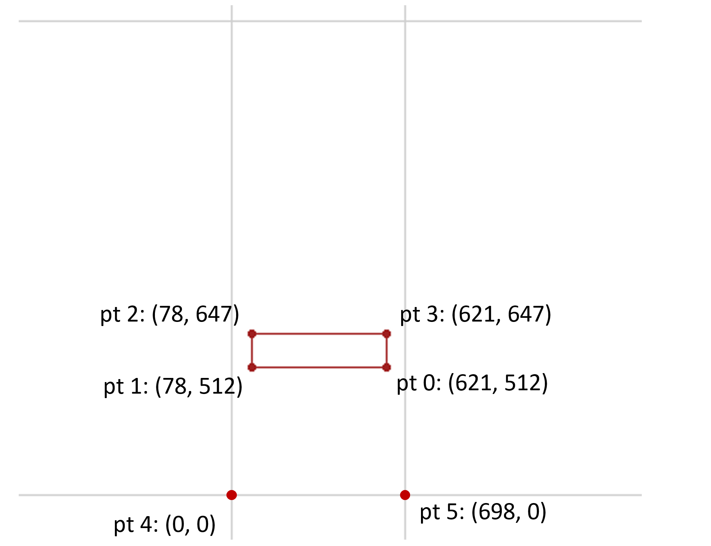

The Skia font has weight and width axes. The variation data for glyph 45 in the 'gvar' table has deltas associated with 8 regions within the weight-width variation space. Three of these will be considered, and will be referred to as R1, R2 and R3. Each of these is a non-intermediate region, and so is defined using a single n-tuple. The n-tuples for each are as follows:

| Region | (weight, width) |
| --- | --- |
| R1 | (1, 0) |
| R2 | (0, 1) |
| R3 | (1, 1) |

The following figures illustrate the range of applicability over the variation space for each of these regions:

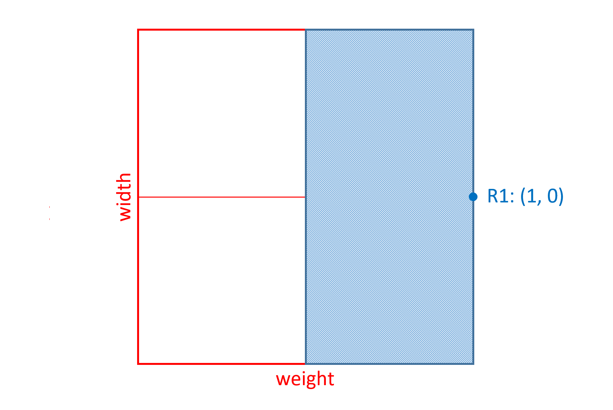

R1 has a zero coordinate value for the width axis, which means that changes in width for the variation instance have no effect on the scalar calculations for this region.

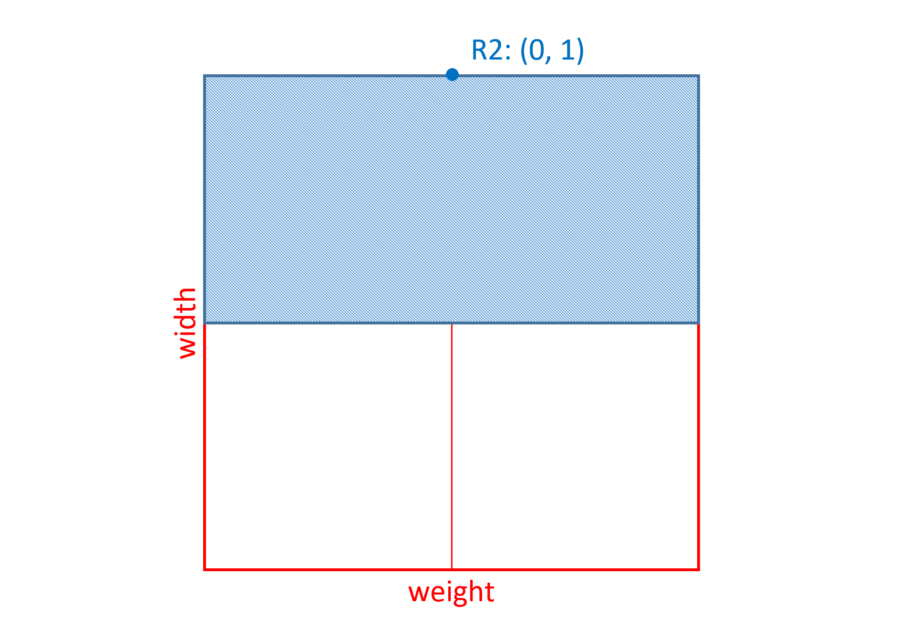

R2 has a zero coordinate value for the weight axis, which means that changes in weight for the variation instance have no effect on the scalar calculations for this region.

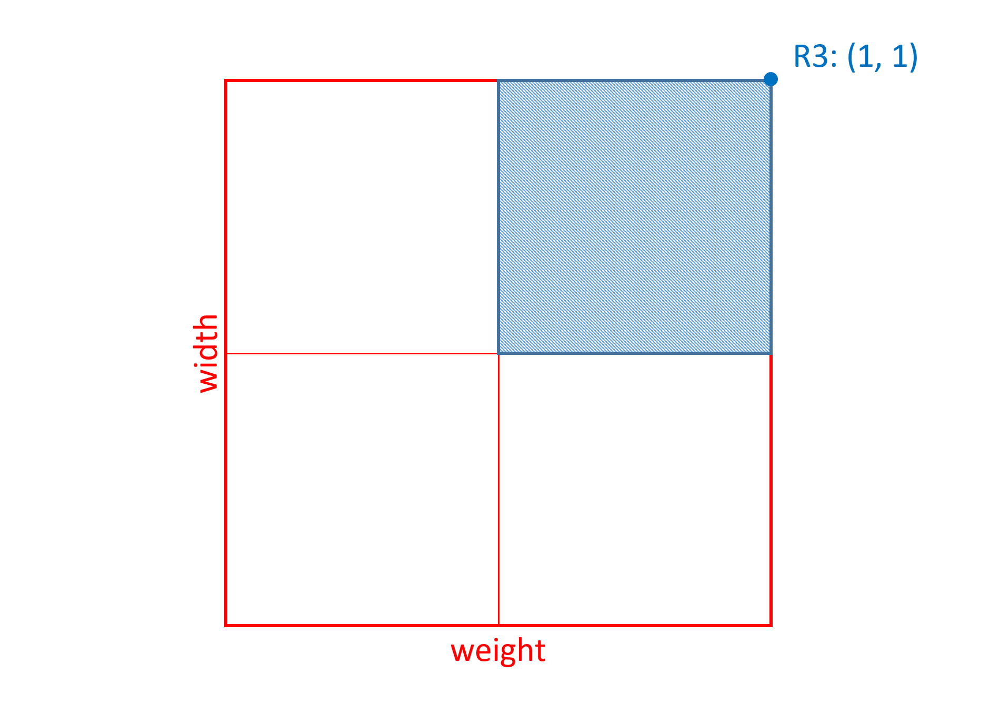

R3 has non-zero coordinate values for both weight and width axes, which means that changes for the variation instance in either weight or width will affect the scalar calculations for this region.

Now consider the delta values specified in the font for each point in association with these three regions. X and Y deltas are specified for each point.

R1 has the following associated deltas:

|  | pt 0 | pt 1 | pt 2 | pt 3 | pt 4 | pt 5 |
| --- | --- | --- | --- | --- | --- | --- |
| X | 234 | -26 | -26 | 234 | 0 | 209 |
| Y | -135 | -135 | 175 | 175 | 0 | 0 |

Applying these deltas to the original point positions, the maximal effect of deltas associated with R1 would be to modify the outline as follows:

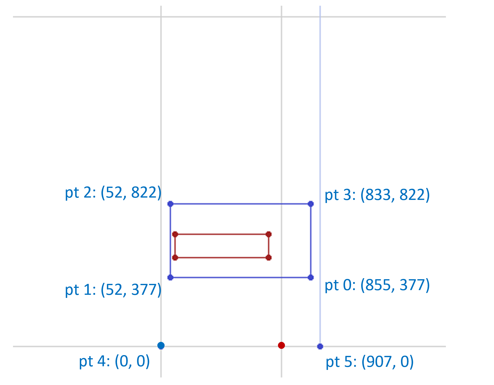

For a variation instance of (1, 0) (heaviest weight, default width), the scalars for other regions would be zero, and so this would be the resulting glyph outline for that instance. Reducing the weight value of the instance would attenuate the extent of the change, with the outline interpolated in between the original outline and this maximal modification of the outline.

Now consider R2: it has the following deltas associated with it:

|  | pt 0 | pt 1 | pt 2 | pt 3 | pt 4 | pt 5 |
| --- | --- | --- | --- | --- | --- | --- |
| X | 165 | 20 | 20 | 165 | 0 | 187 |
| Y | -2 | -2 | 2 | 2 | 0 | 0 |

Applying these deltas to the original point positions, the maximal effect of deltas associated with R2 would be to modify the outline as follows:

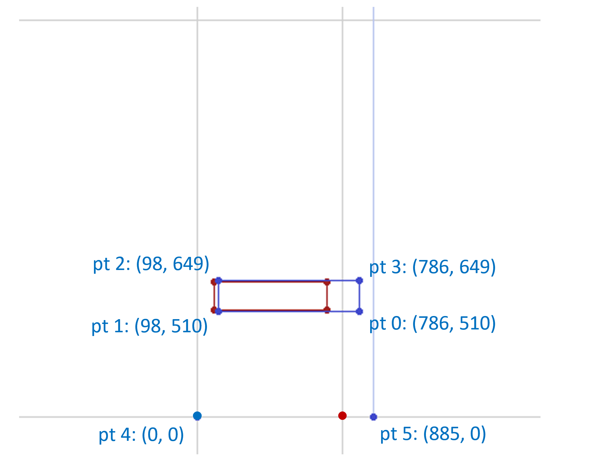

For a variation instance of (0, 1) (regular weight, widest width), the scalars for other regions would be zero, and so this would be the resulting, interpolated glyph outline for that instance.

Now consider R3: it has the following associated deltas:

|  | pt 0 | pt 1 | pt 2 | pt 3 | pt 4 | pt 5 |
| --- | --- | --- | --- | --- | --- | --- |
| X | 0 | 0 | 0 | 0 | 0 | 0 |
| Y | 0 | 0 | 0 | 0 | 0 | 0 |

Since all of the delta values are zero, the data associated with this region has no effect at all on the glyph outline. (In fact, this data is superfluous.)

Now, consider a variation instance of (1, 1) (heaviest weight, widest width). All three regions, R1, R2 and R3, are applicable for this instance. As noted, the variation data associated with R3 will have no effect on the glyph. But the data for regions R1 and R2 would also be applicable for this instance, and their maximal effects would be combined. That is, the X and Y deltas for each point from data associated with both R1 and R2 would be applied to the point X and Y coordinates. This would result in the glyph outline being modified as follows:

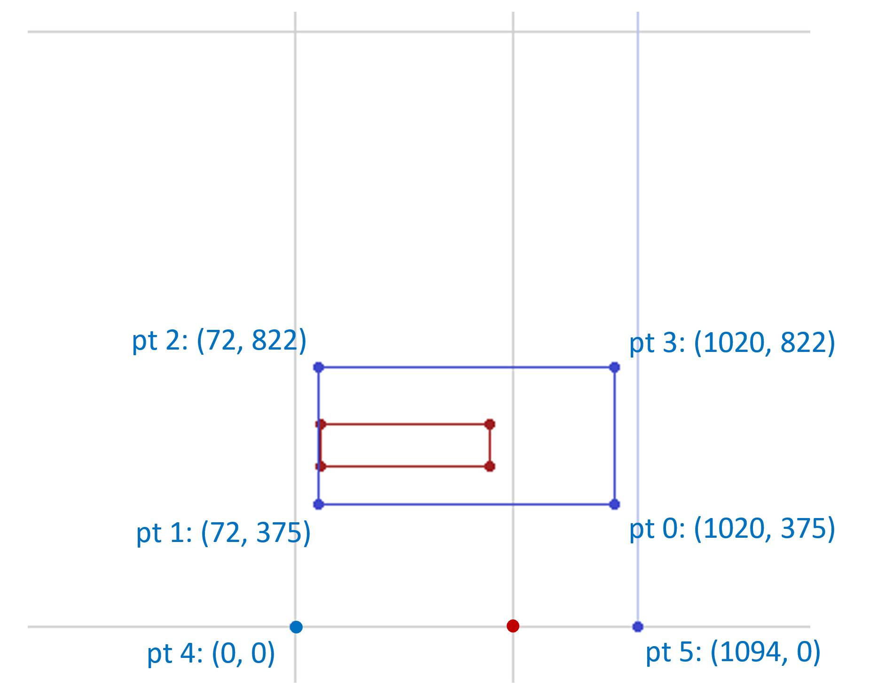

For other variation instances with weight \> 0 and \< 1 and with width \> 0 and \< 1, the data for regions R1 and R2 would both be applied, but scalars for the two regions would vary, resulting in different proportional effects on the outline of the data for each region. For example, consider a variation instance with coordinates (0.2, 0.7) — a slight weight increase and a large width increase. The region scalars for R1 and R2 would be 0.2 and 0.7. Each of these would be applied to the deltas for each region, and the scaled delta values for a given point combined:

|  | pt 0 | pt 1 | pt 2 | pt 3 | pt 4 | pt 5 |
| --- | --- | --- | --- | --- | --- | --- |
| X | 0.2 × 234<br> + 0.7 × 165<br> = 162.3 | 0.2 × -26<br> + 0.7 × 20<br> = 8.8 | 0.2 × -26<br> + 0.7 × 20<br> = 8.8 | 0.2 × 234<br> + 0.7 × 165<br> = 162.3 | 0.2 × 0<br> + 0.7 × 0<br> = 0 | 0.2 × 209<br> + 0.7 × 187<br> = 172.7 |
| Y | 0.2 × -135<br> + 0.7 × -2<br> = -28.4 | 0.2 × -135<br> + 0.7 × -2<br> = -28.4 | 0.2 × 175<br> + 0.7 × 2<br> = 36.4 | 0.2 × 175<br> + 0.7 × 2<br> = 36.4 | 0.2 × 0<br> + 0.7 × 0<br> = 0 | 0.2 × 0<br> + 0.7 × 0<br> = 0 |

This would result in the glyph outline being modified as follows:

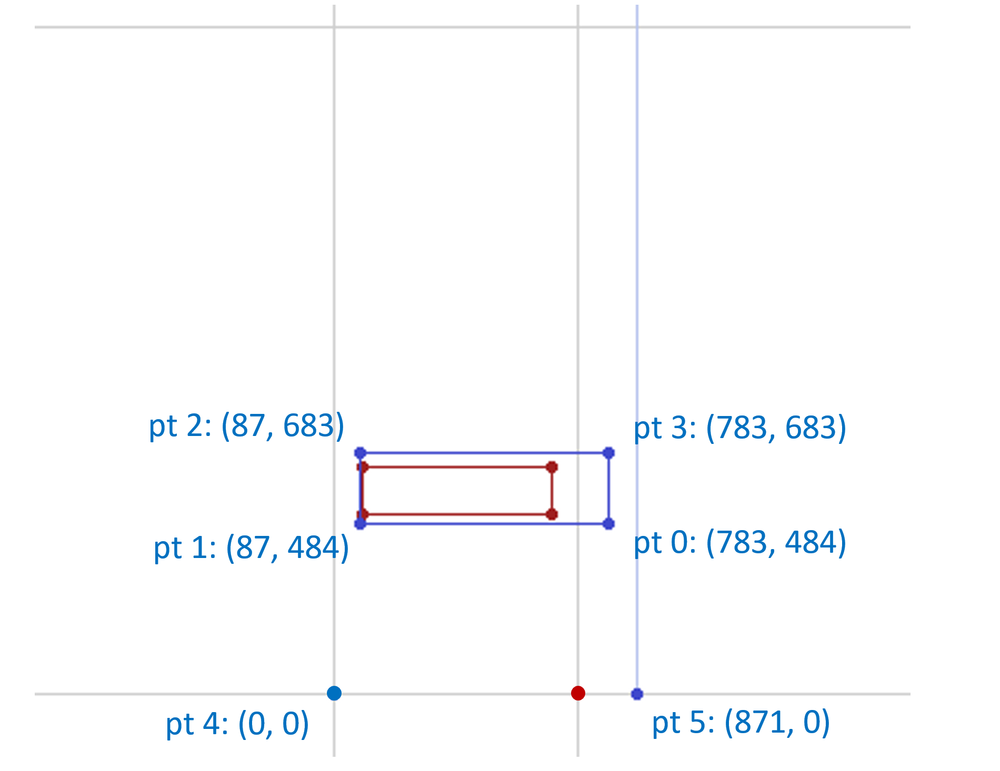

<a id="anchor-otvaroverview-dynamic-generation-of-static-instance-fonts"></a>

## Dynamic Generation of Static Instance Fonts

In certain application workflows, it may be necessary to dynamically generate a static font resource for a particular instance — that is, conventional, non-variation font tables that use interpolated values for a particular instance. This may be needed in order to provide font data to legacy software or data formats that do not understand or support variable fonts, such as legacy printer drivers, or PDF or XPS files with embedded font data.

For example, it may be necessary to process 'glyf' and 'gvar' tables in a variable font to generate a new 'glyf' table that has interpolated outline data for a particular instance; or to process 'hhea' and MVAR tables to generate a new 'hhea' table with data for a particular instance.

Different application scenarios may require more- or less-complete font data, entailing different sets of non-variations-specific font tables that need to be generated. No minimal requirements are specified here. The following points should be noted, however:

- Some scenarios may require use of a PostScript name (name ID 6) in instance font data, with distinct names for each instance that is used. An Adobe technical note provides a specification for Postscript name generation that can be used for instance fonts derived from variable fonts. See [Adobe Technical Note #5902: “PostScript Name Generation for Variation Fonts”](https://adobe-type-tools.github.io/font-tech-notes/pdfs/5902.AdobePSNameGeneration.pdf) .
- For a variable font with CFF2 outlines, some workflows — for example, printing — may require an instance font to be generated with a 'CFF ' table. In such cases, if the variable font has more than one Font DICT in the FontDICTINDEX, then a CID-keyed CFF font should be generated, with an ROS of “Adobe-Identity-0”. If the variable font has one Font DICT in the FontDICTINDEX, then a name-keyed CFF font can be generated if glyph names are supplied in the 'post' table (some legacy workflows look to a glyph name for semantics); otherwise, a CID-keyed CFF can be generated as above. Converting CFF2 CharStrings to Type2 CharStrings would involve re-optimizing the CharString arguments and operators to avoid exceeding the maximum permitted stack depth. Most of the CFF fields removed from the CFF2 specification can be omitted, so that they will inherit the CFF default values. For a summary of differences between CFF2 and CFF, see [Comparison of 'glyf', 'CFF ' and CFF2 tables](glyphformatcomparison.md).
- A variable font that has TrueType outlines may utilize the GET VARIATION instruction to provide current variation axis coordinates to the glyph program. In scenarios that require dynamic generation of instance font data, it should be assumed that this instruction will not be supported. In the process for generating an interpolated 'glyf' table, special treatment of the GET VARIATION instruction will be needed to ensure that the program gets appropriate axis coordinate values for the given instance. For details, see [The TrueType Instruction Set](tt_instructions.md).
