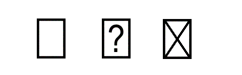

# Recommendations for OpenType Fonts

This chapter outlines recommendations for creating OpenType fonts.

## Mixing Outline Formats

Both Microsoft and Adobe recommend against mixing outline formats within a single font. Choose the format that meets your feature requirements.

## Filenames

OpenType fonts may have the extension .OTF, .TTF, .OTC or .TTC, depending on the type of outlines in the font and the desired backwards compatibility.

- A file containing a single font resource with TrueType outlines should have either .OTF or .TTF extension. The choice between .OTF and .TTF may depend on the desire for backward compatibility on older systems or with previous versions of the font.
- A file containing a single font resource with only CFF outline data (no TrueType outlines) should have an .OTF extension.
- A font collection file (one that contains multiple font resources) should have either .OTC or .TTC as the extension, regardless of whether or not layout tables are present in any of the font resources, and regardless of the kind of outline data used. The .TTC extension may be used for font collection files containing font resources that use CFF outline data if needed for backward compatibility with older software that was not aware of the .OTC extension.
- A variable font that uses OpenType Font Variations mechanisms and associated tables should use the extensions .OTF, .TTF, .OTC or .TTC following the above guidance. If there is a need to provide some indication wihtin a filename that the file contains a variable font, a recommended convention is to append “VF” (with a preceding delimiter character) at the end of the file name (before the extension) — e.g., “Selawik-VF.ttf”.

In all cases, software must determine the kind of outlines present in a font not from the filename extension but from the contents of the file.

## Table Alignment

Some implementations do not assume that tables have four-byte aligned offsets, and some do not validate table checksums. However, there are also implementations that do validate table checksums and that calculate checksums assuming that tables have four-byte aligned offsets with padded zeros. Also, having tables begin at four-byte aligned offsets provides performance benefit when accessing tables, and minimizes potential for erroneous checksum calculation. New fonts are required to align table offsets to multiples of four bytes. However, new software implementations should allow for table lengths that are not a multiple of four when calculating checksums, if checksums are validated.

## Glyph 0: the .notdef glyph

Glyph 0 must be assigned to a .notdef glyph. The .notdef glyph is very important for providing the user feedback that a glyph is not found in the font. This glyph should not be left without an outline as the user will only see what looks like a space if a glyph is missing and not be aware of the active font’s limitation.

It is recommended that the shape of the .notdef glyph be either an empty rectangle, a rectangle with a question mark inside of it, or a rectangle with an “X”. Creative shapes, like swirls or other symbols, may not be recognized by users as indicating that a glyph is missing from the font and is not being displayed at that location.

## BASE Table

The BASE table allows for different scripts in the font to specify different values for the same baseline tag. This situation could arise, for example, when a developer makes a multi-script font by combining glyphs from multiple fonts that use different baseline systems.

However, glyphs from different scripts in this font may not appear correctly aligned relative to each other when used with applications that either don’t support the BASE table or that support it but assume that a particular baseline will not vary across scripts. Furthermore, it is not always possible to determine the script of every glyph in the font, some “weakly-scripted” characters such as punctuation may be used in several scripts, and some glyphs such as ornaments may not have a script at all.

Thus, it is strongly recommended that developers construct their fonts so that all scripts in the BASE table record the same value for a particular baseline if they want their fonts to work as expected in the above situations.

If baselines vary by script, it is strongly recommended that the vendor add a DFLT script entry to the BASE table, which can be used if the script requested by the application is not matched, or if the application does not or cannot determine the script.

## 'cmap' Table

New fonts should use Unicode encoding:

- If the font supports only characters in the Unicode Basic Multilingual Plane (U+0000 to U+FFFF): either platform 3, encoding 1; or platform 0, encoding 3. With either encoding, use a format 4 subtable.
- If the font supports any characters in a Unicode supplementary plane (U+10000 to U+10FFFF): either platform 3, encoding 10; or platform 0, encoding 4. With either encoding, use a format 12 subtable.
- If the font supports Unicode variation sequences: platform 0, encoding 5, with a format 14 subtable. This is in addition to a format 4 or format 12 subtable with encodings as listed above.
- If the font is designed as a font of last resort, using single glyphs for entire Unicode character ranges: platform 0, encoding 6, with a format 13 subtable. A last-resort font should not use any other encodings or subtable formats.

When creating a font to support Unicode supplementary-plane characters, a format 4 subtable can be included, as well as a format 12 subtable, to provide compatibility with older applications might not support a format 12 subtable. This is not required, however. If both are included, either subtable may be used in different contexts, and so the glyph mappings for characters in the range U+0000 to U+FFFF should be identical. The format 12 table should include all BMP and supplementary-plane characters supported by the font. For each subtable, use the encodings indicated above.

## 'cvt ' Table

Should be defined only if required by font instructions.

## 'fpgm' Table

Should be defined only if required by TrueType font instructions.

## 'fvar' Table

The InstanceRecord postScriptNameID field may be required in some applications. For the broadest application compatibility, variable fonts should include this field in all instance records.

## 'glyf' Table

The 'glyf' table contains TrueType outline data, and can be optimized by Agfa MicroType Compression. It is recommended that developers perform this optimization prior to finalizing and adding a digital signature to the font. This is necessary for the creator’s signature to remain valid in embedded OpenType fonts.

## 'hdmx' Table

This table improves the performance of OpenType fonts with TrueType outlines. This table is not necessary at all unless instructions are used to control the “phantom points,” and should be omitted if bits 2 and 4 of the flags field in the 'head' table are zero. (See the 'head' table documentation in Chapter 2.) Microsoft recommends that this table be included for fonts with one or more non-linearly scaled glyphs (i.e., bit 2 or 4 of the 'head' table flags field are set).

Device records should be defined for all sizes from 8 through 14 point, and even point sizes from 16 through 24 point. However, the table requires pixel-per-em sizes, which depend on the horizontal resolution of the output device. The records in 'hdmx' should cover both 96 dpi devices (CGA, EGA, VGA) and 300 dpi devices (laser and ink jet printers).

Thus, 'hdmx' should contain entries for the following pixel sizes (PPEM): 11, 12, 13, 15, 16, 17, 19, 21, 24, 27, 29, 32, 33, 37, 42, 46, 50, 54, 58, 67, 75, 83, 92, 100. These values have been rounded to the nearest pixel. For instance, 12 points at 300 dpi would measure 37.5 pixels, but this is rounded down to 37 for this list.

This will add approximately 9,600 bytes to the font file. However, there will be a significant improvement in speed when an application requests advance widths covered by these device records.

If the font includes an LTSH table, the 'hdmx' values are not needed above the linearity threshold.

## 'head' Table

Although historical usage of the **fontRevision** value is varied, the recommended use of the field is to set it as a Fixed 16.16 value, and to report it rounded and zero-padded to three fractional decimal places. Examples: Decimal 1.5 is set as 0x00018000 and is reported as “1.500”; decimal 1.001 is set as 0x00010041 and is reported as “1.001”. All data required. If the font has been compressed with Agfa MicroType Compression, this must be indicated in the flags field of the 'head' table.

## 'hhea' Table

All data required. It is suggested that monospaced fonts set numberOfHMetrics to three (see 'hmtx').

## 'hmtx' Table

All data required. It is suggested that monospaced fonts have three entries in the numberOfHMetrics field. OpenType fonts that include CFF data must set numberOfHMetrics equal to the number of glyphs in the font and therefore cannot use the “repeat last width” optimization normally available within the 'hmtx' table.

## 'kern' Table

Should contain a single kerning pair subtable (format 0). Windows will not support format 2 (two-dimensional array of kern values by class); nor multiple tables (only the first format 0 table found will be used) nor coverage bits 0 through 4 (i.e. assumes horizontal data, kerning values, no cross stream, and override).

The OpenType specification allows fonts with CFF outlines to express their kerning in a 'kern' table. Many OpenType text layout engines support this. Windows GDI’s OpenType CFF driver, however, ignores the 'kern' table in a CFF OT font when it prepares kerning pairs to report via its pair kerning API.

When a 'kern' table and GPOS table are both present in a font, and an OpenType Layout engine is requested to apply kerning to a run of text of a particular script and language system: (a) If the number of 'kern' feature lookups in the resolved language system in the GPOS table is zero, then the 'kern' table should be applied, followed by any remaining GPOS features requested. (b) If the number of 'kern' feature lookups in the resolved language system in the GPOS table is non-zero, then all GPOS lookups, including the 'kern' lookups, should be applied in the usual way and the 'kern' table data ignored.

If a 'kern' table present but no GPOS table is present in the font, then an OpenType Layout engine should apply the 'kern' table to the text, regardless of the resolved language system of the text.

If compatibility with legacy environments is not a concern, font vendors are encouraged to record kerning in the GPOS table’s 'kern' feature and not in the 'kern' table.

OpenType Font Variations mechanisms do not include any way to represent variation of data within a 'kern' table. Therefore, kerning in a variable should be implemented using the GPOS table.

## 'loca' Table

Local offsets should be 16-bit aligned, in both the short and long formats of this table.

The actual ordering of the glyphs in the font can be optimized based on expected utilization, with the most frequently used glyphs appearing at the beginning of the font file. Additionally, glyphs that are often used together should be grouped together in the file. The will help to minimize the amount of swapping required when the font is loaded into memory.

## LTSH Table

This table improves the performance of OpenType fonts with TrueType outlines. The table should be used if bit 2 or 4 of flags in 'head' is set.

## 'maxp' Table

All data required for a font with TrueType outlines. Fonts with CFF or CFF2 data must only fill the numGlyphs field.

## 'name' Table

Platform and encoding IDs in the 'name' table should be consistent with those in the 'cmap' table. If they are not, the font will not load in Windows. When building a Unicode font for Windows, the platform ID should be 3 and the encoding ID should be 1. When building a symbol font for Windows, the platform ID should be 3 and the encoding ID should be 0, and the referenced string data must be encoded in UTF-16.

Names for the Macintosh platform (platform ID 1) were required on Apple platforms, but are no longer required on modern platforms. Some legacy software, however, may require names platform ID 1, encoding ID 0.

Each set of name records should appear for US English (language ID = 0x0409 for Microsoft records, language ID = 0 for Macintosh records); additional language strings for the Microsoft set of records (platform ID 3) may be added at the discretion of the font vendor.

Remember that, despite references to “first” and “second,” the name record must be stored in sorted order (by platform ID, encoding ID, language ID, name ID). The 'name' table platform/encoding IDs must match the 'cmap' table platform/encoding IDs, which is how Windows knows which name set to use.

### Name strings

We recommend using name IDs 8–12, to identify manufacturer, designer, description, URL of the vendor, and URL of the designer. URLs must contain the protocol of the site for example, http:// or mailto: or ftp://. The OpenType font properties extension can enumerate this information to the users.

The Subfamily string in the 'name' table should be used for variants of weight (ultra light to extra black) and style (oblique/italic or not). So, for example, the full font name of “Helvetica Narrow Italic” should be defined as Family name “Helvetica Narrow” and Subfamily “Italic”. This is so that Windows can group the standard four weights of a font in a reasonable fashion for non-typographically aware applications which only support combinations of “bold” and “italic.”

The Full font name string usually contains a concatenation of strings 1 and 2. If the font is “Regular” as indicated in string 2, then sometimes only the family name contained in string 1 is used for the full font name. In many contexts, the full font name is what will be exposed to users.

In variable fonts, the Typographic Family and Typographic Subfamily names (name IDs 16 and 17) are required. Applications that support OpenType Font Variations will typically present to users the Typographic Family name along with the Typographic Subfamily name or alternative subfamily names for named instances, as specified in the [font variations ('fvar')](fvar.md) table. In some situations, a font vendor may want to make available a variable font as well as some set of non-variable fonts corresponding to the named instances of the variable font. In such situations, the vendor may want to have distinct family names for the family implemented as a variable font and the family implemented using several non-variable fonts. In that case, a suggested convention is to append “VF” at the end of the variable-font family name. Note, however, that this will result in distinct families, and content formatted with the one may not display as intended in some contexts if only the other is available. For example, if a document is formatted using the regular and bold instances of a variable font with family name “Selawik VF” and then the document is viewed in a context in which only the non-variable fonts Selawik Regular and Selawik Bold are available, the viewing application will generally not be able to associate the non-variable fonts available to it with the formatting declarations in the content.

OpenType fonts that include a name with name ID of 6 should include these two names with name ID 6, and characteristics as follows:

1. Platform: 1 \[Macintosh\]; Platform-specific encoding: 0 \[Roman\]; Language: 0 \[English\].
2. Platform: 3 \[Windows\]; Platform-specific encoding: 1 \[Unicode\]; Language: 0x409 \[English (American)\].

Names with name ID 6 other than the above two, if present, may be ignored.

When translated to ASCII, these two name strings must be identical and restricted to the printable ASCII subset, codes 33 through 126, except for the 10 characters: '\[', '\]', '(', ')', '{', '}', '\<', '\>', '/', '%'. Some implementations have a 63-character length limit; however, a 127-character length limit is recommended.

The term “PostScript Name” here means a string identical to the two identical name ID 6 strings described above.

Depending on the particular font format that PostScript language font uses, the invocation method for the PostScript font differs, and the semantics of the resulting PostScript language font differ. The method used to invoke this font depends on the presence of Name ID 20.

If a Name ID 20 is present in this font, then the default assumption should be that the PostScript Name defined by name ID 6 should be used with the PostScript 'composefont' invocation. This PostScript Name is then the name of a PostScript language CIDFont resource which corresponds to the glyphs of the OpenType font. This name is valid to pass, with an appropriate PostScript language CMap reference, and an instance name, to the PostScript language 'composefont' operator.

If no Name ID 20 is present in this font, then the default assumption should be that the PostScript Name defined by name ID 6 should be used with the PostScript 'findfont' invocation, for locating the font in the context of a PostScript interpreter. This PostScript Name is then the name of a PostScript language Font resource which corresponds to the glyphs of the OpenType font. This name is valid to pass to the PostScript language 'findfont' operator. This does not necessarily imply that the resulting font dictionary accepts an /Encoding array, such as when the font referenced is a Type 0 PostScript font.

This specification applies only to data fork OpenType fonts. Macintosh resource-fork TrueType and other Macintosh sfnt-wrapped fonts supply the PostScript font name to be used with the 'findfont' invocation, in order to invoke the font in a PostScript interpreter, in the FOND resource style-mapping table.

Developers may choose to ignore the default usage when appropriate. For example, PostScript printers whose version is earlier than 2015 cannot process CID font resources and a CJK OpenType/CFF-CID font can be downloaded only as a set of Type 1 PostScript fonts. Legacy CJK TrueType fonts, which do not have a Name ID 20, may still be most effectively downloaded as a CID font resource. Definition of the full set of situations in which the defaults should not be followed is outside the scope of this document.

The value held in the name ID 20 string is interpreted as a PostScript font name that is meant to be used with the 'findfont' invocation, in order to invoke the font in a PostScript interpreter.

If the name ID 20 is present in a font, there must be one name ID 20 record for every Macintosh platform 'cmap' subtable in that font. A particular name ID 20 record is associated with the encoding specified by the matching 'cmap' subtable. A name ID 20 record is matched to a 'cmap' subtable when they have the same platform and platform-specific encoding IDs, and corresponding language/version IDs. Name ID 20 records are meant to be used only with Macintosh 'cmap' subtables. The version field for a 'cmap' subtable is one more than the language ID value for the corresponding name ID 20 record, with the exception of the 'cmap' subtable version field 0. This version field, meaning “not language-specific”, corresponds to the language ID value 0xFFFF, or decimal 65535, for the corresponding name ID 20 record.

When translated to ASCII, this name string must be restricted to the printable ASCII subset, codes 33 through 126, except for the 10 characters: '\[', '\]', '(', ')', '{', '}', '\<', '\>', '/', '%'.

This specification applies only to data fork OpenType fonts. Macintosh resource-fork TrueType and other Macintosh sfnt-wrapped fonts supply the PostScript font name to be used with the 'findfont' invocation, in order to invoke the font in a PostScript interpreter, in the FOND resource style-mapping table.

A particular Name ID 20 string always corresponds to a particular Macintosh 'cmap' subtable. However, some host OpenType/TTF fonts also contain a 'post' table, format 4, which provides a mapping from glyph ID to encoding value, and also corresponds to a particular Macintosh 'cmap' subtable. Unfortunately, the 'post' table format 4 contains no provision for identifying which Macintosh 'cmap' subtable it matches, nor for providing more than one mapping. Host fonts which contain a 'post' table format 4, should also contain only a single Macintosh 'cmap' subtable, and a single Name ID 20 string. In the case where there is more than one Macintosh 'cmap' subtable and more than one Name ID 20 string, there is no definition of which one matches the 'post' table format 4.

## 'OS/2' table

### PANOSE values

PANOSE values may improve the user’s experience for font selection in some applications or font management utilities.

If the font is a symbol font, the first byte of the PANOSE value must be set to “Latin Pictorial” (value = 5). The PANOSE evaluation document is on-line at [https://monotype.github.io/panose/](https://monotype.github.io/panose/).

In a variable font that uses OpenType Font Variation mechanisms, there is no way to represent different PANOSE values for different instances supported by the font. The PANOSE values can be set based on the default instance.

### sTypoAscender, sTypoDescender and sTypoLineGap

The sTypoAscender, sTypoDescender and sTypoLineGap fields are used to specify the recommended default line spacing for single-spaced horizontal text. The baseline-to-baseline distance is calculated as follows:

OS/2.sTypoAscender - OS/2.sTypoDescender + OS/2.sTypoLineGap

sTypoAscender should be used to determine an optimal default offset from the top of a text frame to the first baseline. Similarly, sTypoDescender should be used to determine an offset from the last baseline to the bottom of the text frame.

It is often appropriate to set the sTypoAscender and sTypoDescender values such that the distance (sTypoAscender - sTypoDescender) is equal to one em. This is not a requirement, however, and may not be suitable in some situations. For example, if a font is designed for a script that (in horizontal layout) requires greater vertical extent relative to Latin script but also needs to support Latin script, and needs to have the visual size of Latin glyphs be similar to other fonts when set at the same text size, then the (sTypoAscender - sTypoDescender) distance for that font would likely need to be greater than one em.

The sTypoLineGap value will often be set such that the default baseline-to-baseline distance is approximately 120% of the em. For example, in the Minion Pro font family, fonts are designed on a 1000 units-per-em grid, the (sTypoAscender - sTypoDescender) distance is one em, and the sTypoLineGap value is set to 200.

In CJK (Chinese, Japanese, and Korean) fonts, it is permissible for the sTypoDescender and sTypoAscender fields to specify metrics different from the HorizAxis.ideo and HorizAxis.idtp baselines in the BASE table. However, some applications may not read the BASE table at all but simply use the sTypoDescender and sTypoAscender fields to describe the bottom and top edges of the ideographic em-box. If developers want their fonts to work correctly with such applications, they should ensure that any ideographic em-box values in the BASE table describe the same bottom and top edges as the sTypoDescender and sTypoAscender fields. See [OpenType CJK Font Guidelines](#anchor-recom-opentype-cjk-font-guidelines) and [Ideographic Em-Box](baselinetags.md#anchor-baselinetags-ideographic-em-box) for more details.

### usLowerOpticalPointSize and usUpperOpticalPointSize

Use of the [usLowerOpticalPointSize](os2.md) and [usUpperOpticalPointSize](os2.md) fields has been superseded by the STAT table. See [Families with Optical Size Variants](#anchor-recom-families-with-optical-size-variants), below, for more information.

## 'post' Table

OpenType fonts containing CFF outlines use only format 3.0 of the 'post' table. When devising glyph names, font developers may wish to consider conventions provided in the [Adobe Glyph List Specification](https://github.com/adobe-type-tools/agl-specification), which specifies glyph naming conventions for all Unicode characters as well as for glyphs not directly encoded as Unicode characters, such as ligatures or glyphic variants.

Some applications might not implicitly support standard Macintosh glyph names. Any glyph names should be provided explicitly in the font.

## 'prep' Table

Should be defined only if required by the TrueType font instructions.

## VDMX Table

This table improves the performance of OpenType fonts with TrueType outlines. It should be present if hints cause the font to scale non-linearly. If not present, the font is assumed to scale linearly. Clipping may occur if values in this table are absent and font exceeds linear height.

## General Recommendations

## OpenType Font Collections

The process of building TTC files involves paying close attention to the issue of glyph renumbering in a font and the side effects that can result in the 'cmap' table and elsewhere. For fonts with TrueType outlines, the fonts to be merged must also have compatible TrueType instructions — i.e. their pre-programs, function definitions, and control values must not conflict.

## Optimized Table Ordering

OpenType fonts with TrueType outlines are more efficient in the Windows operating system when the tables are ordered as follows (from first to last):

'head', 'hhea', 'maxp', OS/2, 'hmtx', LTSH, VDMX, 'hdmx', 'cmap', 'fpgm', 'prep', 'cvt ', 'loca', 'glyf', 'kern', 'name', 'post', 'gasp', PCLT, DSIG

The initial loading of an OpenType font containing CFF data will be more efficiently handled if the following sfnt table ordering is used within the body of the sfnt (listed from first to last):

'head', 'hhea', 'maxp', OS/2, 'name', 'cmap', 'post', 'CFF ', (other tables, as convenient)

## Non-Standard (Symbol) Fonts

Non-standard fonts such as Symbol or Wingdings(tm) have special requirements for Microsoft platforms. These requirements affect the 'cmap', 'name' and OS/2 tables; the requirements and recommendations for all other tables remain the same.

For the Macintosh, non-standard fonts can continue to use platform ID 1 (Macintosh) and encoding ID 0 (Roman character set). The 'cmap' subtable should use format 0 and follow the standard PostScript character encodings.

For non-standard fonts on Microsoft platforms, however, the 'cmap' and 'name' tables must use platform ID 3 (Microsoft) and encoding ID 0 (Unicode, non-standard character set). Remember that 'name' table encodings should agree with the 'cmap' table. Additionally, the first byte of the PANOSE value in the OS/2 table must be set to ‘Latin Pictorial’ (value = 5).

The 'cmap' subtable (platform 3, encoding 0) must use format 4. The character codes should start at 0xF000, which is in the Private Use Area of Unicode. It is suggested to derive the format 4 encodings by simply adding 0xF000 to the format 0 (Macintosh) encodings.

Under Windows, only the first 224 characters of non-standard fonts will be accessible: a space and up to 223 printing characters. It does not matter where in user space these start, but 0xF020 is suggested. The usFirstCharIndex and usLastCharIndex values in the OS/2 table would be set based on the actual minimum and maximum character indices used.

## Baseline to Baseline Distances

The OS/2 table fields [sTypoAscender](os2.md#anchor-os2-stypoascender), [sTypoDescender](os2.md#anchor-os2-stypodescender), and [sTypoLineGap](os2.md#anchor-os2-stypolinegap) free applications from Macintosh- or Windows-specific metrics which are constrained by backward compatibility requirements. See [above](#anchor-recom-stypoascender-stypodescender-and-stypolinegap) for recommendations regarding those values. The following discussion pertains to the platform-specific metrics.

In early TrueType implementations on Windows and Macintosh platforms, different font values were used for line height metrics:

- Macintosh: the ascender, descender and lineGap values in the ['hhea'](hhea.md) table.
- Windows GDI: the [usWinAscent](os2.md#anchor-os2-uswinascent) and [usWinDescent](os2.md#anchor-os2-uswindescent) values in the OS/2 table.

In the GDI TEXTMETRIC structure, metric values for TrueType fonts were set as follows:

| GDI metric | OpenType metric |
| --- | --- |
| tmHeight | usWinAscent - usWinDescent |
| tmAscent | usWinAscent |
| tmDescent | usWinDescent |
| tmInternalLeading | usWinAscent + usWinDescent - unitsPerEm |
| tmExternalLeading | MAX(0, (hhea.ascender - hhea.descender + hhea.lineGap) - (usWinAscent + usWinDescent)) |

In addition, the usWinAscent and usWinDescent values were used to set a clip rectangle: in on-screen display, any portions of glyphs extending beyond these limits could be clipped.

In addition to these early platform implementations, different applications and text-layout engines (including newer Windows and Macintosh platforms) can use different logic to determine a default baseline-to-baseline distance using the various metric fields in the 'hhea' or OS/2 tables. This has made it challenging for font developers to create fonts with predictable behavior when used in a wide range of applications. The following recommendations might be useful to increase likelihood of consistent behavior in different applications:

- Set sTypoAscender and sTypoDescender such that (sTypoAscender - sTypoDescender) = unitsPerEm.
- Set the USE\_TYPO\_METRICS flag (bit 7) in the [fsSelection](os2.md#anchor-os2-fsselection) field of the OS/2 table.
- Set hhea.ascender = sTypoAscender, hhea.descender = sTypoDescender, and hhea.lineGap = sTypoLineGap.
- Set usWinAscent and usWinDescent such that (usWinAscent + usWinDescent) = (sTypoAscender - sTypoDescender + sTypoLineGap).

The following is alternative guidance that might also be useful:

- Set the USE\_TYPO\_METRICS flag (bit 7) in the fsSelection field of the OS/2 table.
- Set hhea.ascender = usWinAscent = sTypoAscender.
- Set hhea.descender = -usWinDescent = sTypoDescender.
- Set hhea.lineGap and sTypoLineGap to 0.

With either guidance, if the font requires applications to use a larger clipping rectangle, then usWinAscent and usWinDescent values can be set to larger values, though different behavior will be seen in applications that set line spacing using sTypo\* values (as recommended) versus applications that set line spacing using the usWin\* values.

## Style Bits

For backwards compatibility with previous versions of Windows, the macStyle bits in the 'head' table will be used to determine whether or not a font is regular, bold or italic (in the absence of an OS/2 table). This is completely independent of the usWeightClass and PANOSE information in the OS/2 table, the ItalicAngle in the 'post' table, and all other related metrics. If the OS/2 table is present, then the fsSelection bits are used to determine this information.

## Drop-out Control

Drop-out control is needed if there is a difference in bitmaps with dropout control on and off. Two cases where drop-out control is needed are when the font is rotated or when the size of the font is at or below 8 ppem. Do not use SCANCTRL unless needed. SCANCTRL or the drop-out control rasterizer should be avoided for Roman fonts above 8 points per em (ppem) when the font is not under rotation. SCANCTRL should not be used for “stretched” fonts (e.g. fonts displayed at non-square aspect ratios, like that found on an EGA).

## Embedded Bitmaps

Three tables are used to embed bitmaps in OpenType fonts. They are the EBLC table for embedded bitmap locators, the EBDT table for embedded bitmap data, and the EBSC table for embedded bitmap scaling information. OpenType embedded bitmaps are also called “sbits”.

The behavior of sbits within an OpenType font is essentially transparent to the application: an application need not be aware whether the bitmap returned by the rasterizer comes from an sbit or from a scan-converted outline.

The metrics in 'sbit' tables overrule the outline metrics at all sizes where sbits are defined. Fonts with 'hdmx' tables should correct those tables with 'sbit' values.

“Sbit-only” fonts, that is fonts with embedded bitmaps but without outline data, are permitted. Care must be taken to ensure that all required OpenType tables except 'glyf' and 'loca' are present in such a font. Obviously, such fonts will only be able to return glyphs and sizes for which sbits are defined.

1. These metrics are returned as part of the logical font data structure by the GDI CreateLogFont() API.
2. These metrics are returned by the Apple Advanced Typography (AAT) GetFontInfo() API.

## OpenType CJK Font Guidelines

This section provides a checklist of links to various CJK-related sections of the OpenType specification. Some items are requirements; others, recommendations:

1. The ideographic em-box of an OpenType font will be determined as described in the section [Ideographic Em-Box](baselinetags.md) in the Baseline Tags section of the OpenType Layout Tag Registry. Also see the description for [OS/2.sTypoAscender](os2.md) and [OS/2.sTypoDescender](os2.md), and the [BASE table recommendation](#anchor-recom-base-table) section above.
2. CJK font vendors can choose to provide the ideographic character face (ICF) metrics, which applications can use for accurate text alignment. This is described in the section [Ideographic Character Face](baselinetags.md#anchor-baselinetags-ideographic-character-face) in the Baseline Tags section of the OpenType Layout Tag Registry.
3. All OpenType fonts that are used for vertical writing must include a [Vertical Header ('vhea') table](vhea.md) and a [Vertical Metrics ('vmtx') table](vmtx.md). It is strongly recommended that CFF OpenType fonts that are used for vertical writing include a [Vertical Origin (VORG) table](vorg.md).
4. If an OpenType font with CFF outlines is to be used for vertical layout, some legacy platforms may require that a [Vertical Rotation ('vrt2') feature](features_uz.md#anchor-features_uz-tag-vrt2) be present in the Glyph Substitution (GSUB) table. See the Feature Tags section of the OpenType Layout Tag Registry for a description of and further requirements for this feature.
5. See the [Feature Tags](featuretags.md) section of the OpenType Layout Tag Registry for descriptions of currently registered OpenType layout features, such as Alternate Half Widths ('halt') and Traditional Forms ('trad'), that can be specified in the font.

## Stroke Reduction in Variable Fonts

When designing a font family to support a number of variations, there may be cases in which it is desirable to make significant, structural changes to particular glyphs for certain variations. A common example is stroke reduction for heavier weights or narrower widths, simplifying the structure of a glyph so that counters do not become filled and disappear at smaller text sizes. Within a variable font, two techniques might be used to implement a stroke-reduction effect:

- Use a pair of slightly overlapping intermediate regions within the variation data for a glyph in order to introduce deltas for particular contour points that result in the desired structural change and that apply for only problem ranges on one or more axes.
- Use an OpenType Layout [Required Variation Alternates](features_pt.md#anchor-features_pt-tag-rvrn) feature in combination with a [FeatureVariations](chapter2.md#anchor-chapter2-feature-variations) table within the GSUB table to perform a glyph substitution when a variation instance is selected in some range along one or more axes.

While both techniques are possible, it should be noted that the first technique, using overlapping intermediate-regions, can be tricky to implement and may result in unexpected or undesired results if an instance is selected using arbitrary axis values in the range over which the transition occurs. The second technique is recommended as it will generally be easier to implement and maintain, and provides the font designer with better control over behavior near the point of transition.

## Families with Optical Size Variants

In families that have fonts for different optical sizes or in variable fonts that support the optical size ('opsz') design axis, a [STAT](stat.md) table with format 2 axis value tables should be used to indicate text size ranges for which the different optical-size variants or variable-font named instances are recommended. This supersedes the use of the [usLowerOpticalPointSize](os2.md#anchor-os2-usloweropticalpointsize) and [usUpperOpticalPointSize](os2.md#anchor-os2-usupperopticalpointsize) fields in the OS/2 table, and the OpenType Layout ['size'](features_pt.md#anchor-features_pt-tag-size) feature.

When creating an axis value table to correspond to the font or named instance that is intended for the largest text sizes, the upper text size limit should be, effectively, infinity. To represent this in a format 2 axis value table, set the rangeMaxValue to 0x7FFFFFFF.
