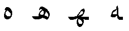
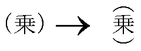
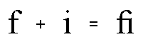
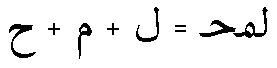
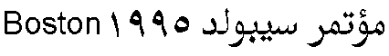
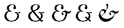
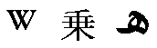
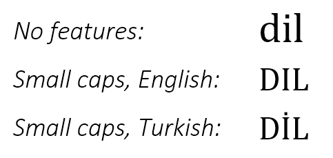
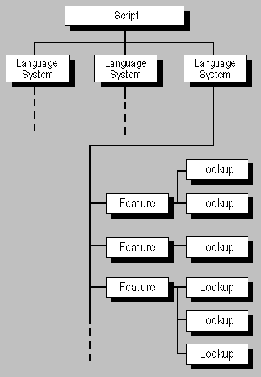

<a id="anchor-ttochap1-opentype-layout-overview"></a>

# OpenType Layout Overview

OpenType Layout tables provide advanced typographic capabilities for high-quality international typography:

- A rich mapping between characters and glyphs, allowing for ligatures, positional forms, alternates, and other substitutions.
- Ability to perform two-dimensional positioning and glyph attachment.
- Explicit script and language information, so a text-processing application can adjust its behavior accordingly.
- An open format that allows font developers to define their own typographical features.

This overview introduces the power and flexibility of the OpenType Layout font model. The OpenType Layout tables are described in more detail in separate sections of the OpenType specification. See [Advanced Typgraphic Tables](otff.md#anchor-otff-advanced-typographic-tables).

Common formats used in different OpenType Layout tables are documented in the [“OpenType Layout Common Table Formats”](chapter2.md) chapter.

Registered OpenType Layout tags for scripts, languages, features and baselines are documented in the chapter [OpenType Layout Tag Registry](ttoreg.md).

<a id="anchor-ttochap1-opentype-layout-at-a-glance"></a>

## OpenType Layout at a glance

OpenType Layout addresses complex typographic requirements for correct display of many different scripts as well as for fine typography in any script.

Using OpenType Layout tables, fonts can support alternative forms of characters and provide data used for accessing them. For example, in Arabic, the shape of a character often varies with the character’s position in a word. As shown in the following figure, the ha character will take any of four shapes, depending on whether it stands alone or whether it falls at the beginning, middle, or end of a word. When performing text layout, a text-processing application evaluates the word-position contexts in which the ha character occurs, and then OpenType Layout data informs the application which glyph to substitute for each context.

<br>*Figure 1a Isolated, initial, medial, and final forms of the Arabic character ha.*

Similarly, OpenType Layout data can be used by an application to substitute the correct forms of characters when text is positioned vertically instead of horizontally, such as with Kanji. For example, Kanji uses alternative forms of parentheses when positioned vertically.

<br>*Figure 1b Alternative forms of parentheses used when positioning Kanji vertically.*

OpenType Layout data also supports the composition and decomposition of ligatures. For example, English, French, and other languages written with Latin script can substitute a single ligature, such as “fi”, for its component glyphs - in this case, “f” and “i”. Conversely, the individual “f” and “i” glyphs could replace the ligature, possibly to give a text-processing application more flexibility when spacing glyphs to fill a line of justified text. Or similarly, many Arabic script glyph sequences may be substituted by a single ligature glyph.

<br>*Figure 1c Two Latin glyphs and their associated ligature.*

<br>*Figure 1d Three Arabic glyphs and their associated ligature.*

Glyph substitution is just one way OpenType Layout extends font capabilities. Fonts containing OpenType Layout tables can also specify how glyphs are to be attached to one another. X and Y coordinates are used to specify the attachment points between glyphs. This functionality can be used to attach diacritical marks to glyphs, as well as to create connected (cursive) text.

OpenType Layout fonts also may contain baseline information that specifies how to position glyphs horizontally or vertically. Because baselines may vary from one script (set of characters) to another, this information is especially useful for aligning text that mixes glyphs from scripts for different languages.

<br>*Figure 1e A line of text, baselines adjusted, mixing Latin and Arabic scripts.*

As much as possible, OpenType Layout tables define only the information that is specific to a particular font. The tables do not try to encode information that remains constant within the conventions of a particular language or the typography of a particular script. Such information that would be replicated across all fonts in a given language belongs in a text-processing application for that language, not in the fonts.

<a id="anchor-ttochap1-opentype-layout-terminology"></a>

## OpenType Layout terminology

The OpenType Layout model is organized around glyphs, scripts, language systems, features, and lookups.

<a id="anchor-ttochap1-characters-versus-glyphs"></a>

### Characters versus glyphs

Users don’t view or print characters: a user views or prints *glyphs*. A character is an abstract entity with a numeric representation in data; a glyph is a visualization of a character. For example, the character CAPITAL LETTER A is visually depicted by the glyph “A” in a font such as Times New Roman Bold. A font contains a collection of glyphs. To retrieve glyphs, the client uses information in the 'cmap' table of the font, which maps the client’s character codes to glyph indices in the table.

Glyphs can also represent combinations of characters and alternative forms of characters: glyphs and characters do not strictly correspond one-to-one. For example, a user might type two characters, which might be better represented with a single ligature glyph. Conversely, the same character might take different forms at the beginning, middle, or end of a word, so a font would need several different glyphs to represent a single character. OpenType Layout fonts contain a table that provides a client with information about possible glyph substitutions.

<br>*Figure 1f Multiple glyphs for the ampersand character.*

<a id="anchor-ttochap1-scripts"></a>

### Scripts

A script is composed of a group of related characters, which may be used by one or more languages. Latin, Arabic, and Thai are examples of scripts. A font may support characters from a single script, or from many scripts. Within an OpenType Layout font, scripts are identified by unique 4-byte *tags*.

<br>*Figure 1g Glyphs in the Latin, Kanji, and Arabic scripts.*

<a id="anchor-ttochap1-language-systems"></a>

### Language systems

Scripts, in turn, can be divided into language systems. For example, the Latin script is used to write English, French, or German, but each language has its own special requirements for text processing. A font developer can choose to provide information that is tailored to the script, to the language system, or to both.

Language systems, unlike scripts, are not necessarily evident when a text-processing client examines the characters being used. To avoid ambiguity, the user or the operating system needs to identify the language system. Otherwise, the client will use the default language-system information provided with each script.

<br>*Figure 1h Differences between the English and Turkish language systems.*

<a id="anchor-ttochap1-features-and-lookups"></a>

### Features and lookups

Features define typographic capabilities of the font, and are the means that applications use to invoke those capabilities. These can include essential capabilities required for display of some scripts, as well as other capabilities for fine typography. A font that supports positioning of diacritical marks will implement a 'mark' feature. A font that supports substitution of vertical glyphs will implement a 'vert' feature.

Lookups are data used to implement the capabilities invoked by features. Lookup tables describe glyph substitution or glyph positioning actions that an application should apply to achieve the desired typographic effect. A feature can be used to refer to a typographic capability in a font-independent way, but lookups provide the font-specific data used to implement that capability.

The OpenType Layout feature model provides flexibility for font developers, allowing them to choose capabilities to support in a font as appropriate for a given design or the requirements of their customers. The model also provides extensibility for future enhancements: on-going innovation can lead to features for new capabilities being defined over time.

<br>*Figure 1i The relationship of scripts, language systems, features, and lookups for substitution and positioning tables.*

<a id="anchor-ttochap1-opentype-layout-tables"></a>

### OpenType Layout tables

OpenType Layout makes use of five tables: GSUB, GPOS, BASE, JSTF, and GDEF. These tables and their formats are discussed in separate chapters. The following paragraphs provide a brief overview.

[GSUB](gsub.md): Contains information about glyph substitutions to handle single glyph substitution, one-to-many substitution (ligature decomposition), aesthetic alternatives, multiple glyph substitution (ligatures), and contextual glyph substitution.

[GPOS](gpos.md): Contains information about X and Y positioning of glyphs to handle single glyph adjustment, adjustment of paired glyphs, cursive attachment, mark attachment, and contextual glyph positioning.

[BASE](base.md): Contains information about baseline offsets on a script-by-script basis.

[JSTF](jstf.md): Contains justification information, including whitespace and Kashida adjustments.

[GDEF](gdef.md): Contains information about all individual glyphs in the font: type (simple glyph, ligature, or combining mark), attachment points (if any), and ligature caret (if a ligature glyph).

The [MATH](math.md) table is an additional advanced layout table containing special metric values and other data required for layout of mathematical expressions and formulas.

Common Table Formats: Several [common table formats](chapter2.md) are used by the OpenType Layout tables.

<a id="anchor-ttochap1-text-processing-with-opentype-layout"></a>

## Text processing with OpenType Layout

A text-processing client follows a standard process to convert the string of characters entered by a user into positioned glyphs. To produce text with OpenType Layout fonts:

1. Using the 'cmap' table in the font, the client converts the character codes into a sequence of glyph indices.
2. Using information in the GSUB table, the client modifies the resulting glyph sequence, substituting positional or vertical glyphs, ligatures, or other alternatives as appropriate.
3. Using positioning information in the GPOS table and baseline offset information in the BASE table, the client then positions the glyphs.
4. Using *design coordinates* the client determines device-independent line breaks. Design coordinates are high-resolution and device independent.
5. Using information in the JSTF table, the client justifies the lines, if the user has specified such alignment.
6. The client rasterizes the line of glyphs and renders the glyphs in *device coordinates* that correspond to the resolution of the output device.

Throughout this process the text-processing client keeps track of the association between the characters of the original string and the glyph indices of the final, rendered text. In addition, the client can save language and script information within the text stream to clearly associate runs in the original text with specific typographical behavior.

<a id="anchor-ttochap1-left-to-right-and-right-to-left-text"></a>

### Left-to-right and right-to-left text

When an OpenType text layout engine applies the Unicode bidi algorithm and gets to the point where mirroring needs to be performed on runs with an even, i.e. left-to-right (LTR), resolved level, it does the following:

1. Glyph-level mirroring:

   Apply feature 'ltrm' to the entire LTR run to substitute mirrored forms.

2. LTR glyph alternates:

   Apply feature 'ltra' to the entire LTR run to finesse glyph selection.

For runs with an odd, i.e. **right-to-left** (RTL), resolved level, the engine does the following:

1. Character-level mirroring:

   ```
   For each character i in the RTL run:
     If it is mapped to character j by the OMPL and cmap(j) is non-zero:
       Use glyph cmap(j) at character i.
   ```

   Here OMPL refers to the [OpenType Mirroring Pairs List](ompl.md), and cmap(*j*) refers to the glyph mapped from code point *j* in the Unicode 'cmap' subtable.

   For example, suppose U+0028, LEFT PARENTHESIS, occurred in the run at resolved level 1. The glyph at that code point in the run will be replaced by cmap(U+0029), since {U+0028, U+0029} is a pair in the OMPL.

2. Glyph-level mirroring:

   The engine applies the ['rtlm'](features_pt.md#anchor-features_pt-tag-rtlm) feature to the entire RTL run. The feature, if present, substitutes mirrored forms for characters other than those covered by the first elements of OMPL pairs (otherwise, it could cancel the effects of character-level mirroring).

   The data contents of the OMPL are identical to the Bidi Mirroring Glyph Property file of Unicode 5.1, and will never be revised. Thus, it will be up to the 'rtlm' feature to provide, if needed, mirrored forms for both (a) Unicode 5.1 code points with the “mirrored” property but no appropriate Unicode 5.1 character mirrors, as well as (b) all future “mirrored” property additions to Unicode, whether or not character mirrors exist for them.

   With such a division of labor between the layout engine and the font, most fonts will not need to include an 'rtlm' feature, since the mirrored forms in their Unicode 'cmap' subtable would be adequate.

3. RTL glyph alternates:

   The engine applies the ['rtla'](features_pt.md#anchor-features_pt-tag-rtla) feature to the entire RTL run. The feature, if present, substitutes variants appropriate for right-to-left text (other than mirrored forms).

In practice, the engine may apply features simultaneously; thus, it is up to the font vendor to ensure that the features’ lookups are ordered to achieve the desired effect of the algorithms described above. The engine may optimize its implementation in various ways, e.g. by taking advantage of the fact that character- and glyph-level mirroring won’t both apply on the same element in the run.

<a id="anchor-ttochap1-opentype-layout-and-font-variations"></a>

## OpenType Layout and Font Variations

OpenType Font Variations allow a single font to support many design variations along one or more axes of variation. For example, a font with weight and width variations might support weights from thin to black, and widths from ultra-condensed to ultra-expanded. For general information on OpenType Font Variations, see the chapter [OpenType Font Variations overview](otvaroverview.md).

Data used to support Font Variations are integrated into the tables used for OpenType Layout. Variation of glyph outlines and metrics across a font’s variation space can impact the design-grid distances that get used in OpenType Layout tables, such as anchor positions used in a GPOS attachment lookup. Data elements in OpenType Layout formats can be associated with variation data that describes how the default value is adjusted for different variation instances.

In some variable fonts, it may be desirable to have different glyph-substitution or glyph-positioning actions used for different regions within the font’s variation space. For example, for narrow or heavy instances in which counters become small, it may be desirable to make certain glyph substitutions to use alternate glyphs with certain strokes removed or outlines simplified to allow for larger counters. Such effects can be achieved using a feature variations table within either the GSUB or GPOS table. The feature variations table is described in the chapter, [OpenType Layout Common Table Formats](chapter2.md). See also the [Required Variation Alternates ('rvrn')](features_pt.md#anchor-features_pt-tag-rvrn) feature in the OpenType Layout tag registry.

Different variation instances of a variable font have the same glyph IDs. For that reason, it might seem possible for lookups to be applied across a glyph sequence in which glyphs are formatted using different variation instances of a variable font. Doing so, however, could lead to unpredictable behaviors since font developers might not have sufficient control over how lookup tables are generated, and it would not be feasible to test the vast number of possible cross-instance interactions. For these reasons, layout processing implementations must treat different variation instances of a variable font as distinct style runs for purposes of OpenType Layout processing.
