<a id="anchor-AATIntro-Start"></a>

# About Apple Advanced Typography Fonts

<a id="anchor-AATIntro-part-1"></a>

## Introduction

Apple's text imaging technology, Apple Advanced Typography (AAT), enables applications to provide users with fonts having special typographical effects, such as cursive connection, ornateness, and complex ligatures. Many of these features are required for scripts other than Roman, such as Arabic or Devanagari.

Apple currently provides support for drawing using AAT fonts via Apple Type Services for Unicode™ Imaging (ATSUI).

This document is intended for font developers who are creating fonts to be used with AAT. This document explains the font tables you include in the `'sfnt'` resource in order for your font to offer special features and effects.

The complete `'sfnt'` resource is not described here. The other tables of the resource are described in the [TrueType font specification](https://developer.apple.com/fonts/TrueType-Reference-Manual/index.html). You may also need *The Unicode Standard: Worldwide Character Encoding*, version 2.0, which is available from Addison-Wesley. See the [Unicode Consortium's web site](http://www.unicode.org/) for more information on Unicode.

Font vendors can create tables that implement different sets of features. Applications can pick and choose your font to determine the features available. The font tables store sets of strings identifying the features that can be presented to the user.

Apple has defined a set of text features in the [AAT Font Feature Registry](https://developer.apple.com/fonts/TrueType-Reference-Manual/RM09/AppendixF.html). Additional features will be added by Apple and by font developers. You may include one or more of these features or create your own text features. Font features that will be supported by your font must be a part of the Registry; to suggest additions to the Registry, contact:

[applefonts@apple.com](mailto:applefonts@apple.com)

<a id="anchor-AATIntro-part-2"></a>

## Characters, Glyphs, and Fonts

Fundamental to understanding text processing is the distinction between characters and glyphs. A *character* is an abstract object having a single and unique semantic or phonetic meaning. A *glyph* represents the visual, graphical appearance of a character. For example, glyphs in different fonts, such as Times Roman or Zapf Chancery, may be used to represent the character "A". Here's an example of a kanji glyph which corresponds to characters in several different languages:

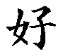

A *font* is a collection of glyphs with some element of design consistency, such as the use of serifs or consistent stroke thickness. Fonts usually incorporate other information, such as which glyphs represent ligatures or contextual forms.

Many glyphs do not have a one-to-one relationship to characters: one or more glyphs may make up a single character (for example, an "i" could be rendered as a dot accent over a dotless "i"), and a single glyph can represent two or more characters ("f" and "i" could be represented by the "fi" ligature). Context may also determine which glyph is used to represent a character. For example, in a cursive font four glyphs may represent the same character: a separate glyph for the character at the beginning, middle, and end of a word; and a glyph for the character in isolation.

Within a font, each glyph is associated with a 16-bit code called its *glyph index*. Different fonts may have different glyph indexes for a given glyph.

A *complex font* contains information associating some glyph indices with certain combinations of characters and rules. For example, information in a font may associate the glyph ID 0x1A01 (which represents the "fi" ligature) with the combination of the two characters 0x0066 (lowercase "f") followed by 0x0069 (lowercase "i"). Any font lacking such associative information is called a *simple font*.

Technically, a simple font is a font that only contains the standard required tables (`'cmap'`, `'glyf'`, `'head'`, `'hhea'`, `'hmtx'`, `'loca'`, `'maxp'`, `'post'`) and possibly the non-layout related optional tables (`'cvt '`, `'fpgm'`, `'hdmx'`, `'prep'`). All TrueType fonts released with Macintosh System 7 are simple fonts.

The glyphs in a complex font can be divided into two classes: *rendering forms*, for which combination rules appear; and *character glyphs*, which have a one-to-one correspondence with character codes. Rendering forms include ligatures, applied marks, and contextual forms; these are discussed further in later sections. In general, only character glyphs contain entries in the font's character-to-glyph mapping table. Other tables in the font are used to generate rendering forms.

<a id="anchor-AATIntro-part-3"></a>

### Character Properties

A character code has an associated set of *character properties*. Some of these have to do with simple character identity: the blank is a whitespace character, whereas an 'A' is not. Others have to do with character direction: Hebrew letters have a right- to-left orientation, whereas roman letters have a left-to-right orientation.

<a id="anchor-AATIntro-part-4"></a>

### String and String Ordering

A *string* is an ordered array of bytes which make up character codes. Some character codes comprise one byte, and others comprise two bytes. The order implicit in this array may be different from the order in which the corresponding glyphs would be displayed (called the *visual order*). A string is an example of *backing store*, which is an ordered repository of character codes. The *backing store order* designates the order in which character codes are stored in, for instance, a document -- that is, before any rendering actions have been performed. Sometimes the term *phonetic order* is used as a synonym for backing store order.

Remember that this ordering within a string reflects raw, simple character codes in phonetic order. In particular, Arabic strings are not presented to an AAT text processor in already reversed order. For instance, in a string of mixed Arabic and English like the one shown in the following figure, the characters appear left to right in the order in which they should appear on the page for the native speaker of that language. Fortunately, all of this bidirectional ordering is handled by ATSUI using the Unicode bidirectional algorithm, so ATSUI clients need not worry themselves about doing bidirectional reordering.

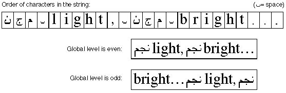

<a id="anchor-AATIntro-part-5"></a>

### Diacritical Marks

*Diacritical marks* are any mark added to a glyph or a combination of glyphs in a particular script that creates a new phonetic value that is different from the unmarked glyph or glyphs. Diacritical marks include accents, umlauts, tildes, cedillas, or dots that signal the presence of vowels (such as in Hebrew or Arabic).

Languages such as Arabic need this feature because there are two forms of the written language: with vowels, for children's books; and without vowels, because adults have learned to read the language without the vowels.

<a id="anchor-AATIntro-part-6"></a>

### Ligatures and Contextual Forms

A *ligature* is a single glyph that represents a combination of two or more individual glyphs. An example is the "fi" ligature in English.

An *accented form* is a special subclass of ligature: a glyph that combines a letter with a diacritical mark. For example, the glyphs "ä" and "ò" are accented forms. Multiple accent marks themselves may be present in a font as *accent ligatures*, as shown in this figure:

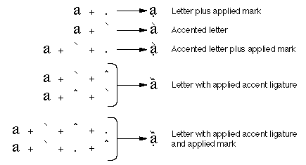

A *contextual form* is an alternate form of a glyph whose use depends on the glyph's placement in a word. In Arabic, for example, characters have different contextual forms according to where they appear (at the beginning, the middle, or the end of a word). The following figure shows the forms of the Arabic letter "ha" that appear alone, at the start, middle, or end in a word. The same character code is used for each case. The information that you provide in the font tables allows the correct glyph to be chosen.

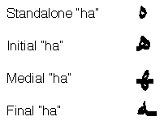

Ligatures are two or more glyphs combined to form a single new glyph, whereas contextual forms are variations on the shape of one glyph. The following figure shows how two fonts might form the "fi" ligature, the first using ligatures, the second using contextual forms. The first "fi" ligature is a single glyph that replaces the regular "f" and "i" glyphs. At the bottom of the following figure, the "i" glyph is changed into a contextual form before it is placed with the "f" glyph to form the "fi" ligature. In this second case, the "fi" ligature is not one stand-alone glyph, but two glyphs, after the "i" has been changed. If the "i" glyph had not followed the "f" glyph, the form would not have been changed.

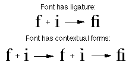

To include ligatures and contextual forms in your font, you should include a [glyph metamorphosis table](mort.md).

<a id="anchor-AATIntro-part-7"></a>

### Noncontextual Forms

A *noncontextual form* is an alternate form of a glyph that can be used anywhere in text, regardless of its context. An example of this might be two or more styles of the number set 0 through 9. You might include one set of numbers which proportional spacing and one set with fixed-width spacing for users who want to create columns of numbers with your font. In the following figure, there are three forms of the number set (although not all from the same font): *lining numbers*, which are numbers with proportional spacing that are about the same height and do not extend below the baseline; *traditional numbers*, which are numbers with proportional spacing that vary in height and position in relation to the baseline; and *fixed-width numbers*, which are appropriate for tabulations.

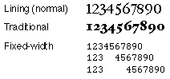

<a id="anchor-AATIntro-part-8"></a>

### Case Substitution

You can also use case substitution, which substitutes uppercase or lowercase noncontextual forms of the glyphs, even though that is not what the user originally chose. This is different from contextual forms because the positions of the glyphs and their meaning do not change. In the following figure, the same set of letters is shown four different ways: the first, with no case substitution; the second, with all the letters translated to their uppercase forms; the third, with all letters translated to their lowercase forms; and the fourth, with all lowercase letters translated to small caps.

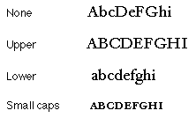

To include noncontextual forms in your font, you need to include a [glyph metamorphosis table](mort.md).

<a id="anchor-AATIntro-part-9"></a>

### Indic Rearrangement

In some Indic-derived languages, the order of certain glyphs is changed even though the script is always read left to right. For example, in Devanagari script a short "i" is printed before the consonant that it logically follows: thus the word "Hindi," when printed in Devanagari is rearranged to "iHndi". In many Southeast Asian languages, vowel markers can appear on all four sides of the consonant that they modify.

Glyphs in the string appear in phonetic or semantic order. In the previous example, the backing store would contain character codes in the order "hindi," not in the order "ihndi."

<a id="anchor-AATIntro-part-10"></a>

### Swash Variants

A *swash* is a variation, often ornamental, of an existing glyph. Both variations of the glyph are present in the font at the same time. The feature name and glyph metamorphosis AAT font tables identify swash variants of existing glyphs. Users can select swash forms via an application at any time.

<a id="anchor-AATIntro-part-11"></a>

#### Fractions

By using the contextual form and swash capabilities, you can provide for the automatic construction of fractions. Because a fraction slash character code is defined in the Macintosh set (code 0xDA), you can set up a font table that, for example, recognizes strings of the type "digits, fraction slash, digits." You can then make several choices, depending on the glyph repertoire -- for example, a "one-half" glyph may be predrawn and in the font. If there is no predrawn form, then you can substitute smaller superscript and subscript digit glyphs, or you can set up a cross-stream kerning table to shift digits relative to the baseline automatically. An example is given in the following figure:

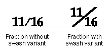

<a id="anchor-AATIntro-part-12"></a>

#### Vertical Substitution of Forms

*Vertical substitution* is a swash variation in which a glyph is replaced by an alternate form in a vertical line. (Note that this substitute glyph is not merely the first glyph rotated but is a stand-alone glyph.) For vertical substitution to work, the vertically rotated forms must exist in the font and must be indicated as such in the font's tables; otherwise, no glyphs are substituted. Default behavior is to perform any such substitutions permitted by the font. The following figure shows how this works:

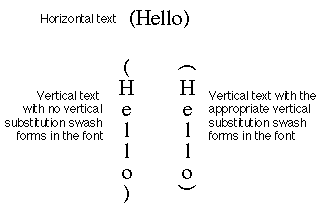

<a id="anchor-AATIntro-part-13"></a>

#### Small Caps

The small caps style is not simply the use of capital letters in a slightly smaller size. Small caps can be specified as a special form of swash variant. If your AAT font contains true small caps glyphs, they can be used in text runs.

<a id="anchor-AATIntro-part-14"></a>

## Text Style Matching

Font families and font styles were once distinct, orthogonal objects. The problem was that this only allowed for a fixed set of styles, such as bold, italic, underline, outline, shadow, condense, and extend.

In contrast, AAT font families can have several different width variants and uniquely named styles such as Antique, Book, Titling, and Caption. Applications can allow users to select runs of text with mixed families and styles and choose a new font family without affecting the styles of the run.

<a id="anchor-AATIntro-Matching"></a>

AAT uses the font tables to interpret the font style information, choose the closest matching font, and algorithmically style the text to fulfill the style request. The next table shows some examples of the text style matching function. The examples show the result of selecting a new font family for an existing old style run to create a "new style run."

```
Existing style run			 New font family		New style run
Times Bold					 Courier				Courier Bold
Times Bold					 Chicago				Chicago+textFace(bold)
Times Bold					 Skia					 Skia+variant(bold)
Skia Italic+variant(bold)		Times					Times Bold Italic
Skia Italic+variant(bold)		Courier				Courier Bold+textface(italic)
Skia Italic+variant(bold)		Chicago				Chicago+textface(bold, italic)
```

To create fonts that support text style matching, you can include a [font descriptors table](fdsc.md).

<a id="anchor-AATIntro-part-15"></a>

## Baselines

The *baseline* of a glyph is a line that defines the position of the glyph with respect to other glyphs. The importance of the baseline is illustrated when different size glyphs are used; in this case the baseline represents a stable place from which glyphs rise and descend proportionally. The following figure shows the common baseline for Roman glyphs:

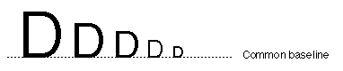

Scripts other than Roman may display related but different behavior: for example, the glyphs in a line of text may descend from the baseline or may be centered on a baseline.

The following baselines are currently supported:

**Roman baseline.**

This defines the alignment used in most Roman-script languages, where most of the glyph is above the baseline, sometimes with portions below it. The baseline is near the bottom of the entire row of glyphs.

**Ideographic centered baseline.**

This defines the behavior of Chinese, Japanese, and Korean ideographic scripts, which are centered on the line height.

**Ideographic low baseline.**

This also defines behavior used in Chinese, Japanese, and Korean, but with the glyphs lowered slightly so that ideographs adjacent to Roman characters descend slightly below the Roman baseline.

**Hanging baseline.**

This defines the alignment used in Devanagari and derived scripts, where most of the glyph is below the baseline.

**Math baseline.**

This defines the alignment used for setting mathematics, where operators such as the minus sign are centered vertically at half the x- height in a font.

When you design your font, you can add definitions of its default baseline and the relative positions of other types of baselines within the font's em- square. The following figure shows a glyph from a font whose primary baseline is the Roman baseline. However, two other baselines are also marked: the hanging baseline and the ideographic centered baseline. If you used this font with text whose dominant baseline was, for instance, the hanging baseline, this font would align itself with the dominant run of text by aligning its hanging baseline with that of the dominant run.

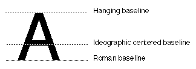

There can be dramatic differences in the general relationships of glyphs with reference to the baseline. The following figure shows three scripts and the relation of different sizes of glyphs to the dominant baseline in each script:

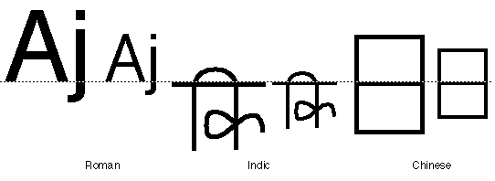

The baselines within a script in the preceding figure match correctly, but the relationship between the Roman, Indic, and Chinese scripts is incorrect. When the user or the application selects a dominant run of text, all fonts reference that run's baselines for their relative positions, no matter what their type, size, or default baseline. In the following figure, the dominant run is the smaller Roman run of text:

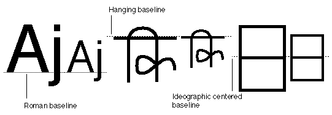

All languages can take advantage of these relative baseline adjustment capabilities. For instance, you could create so-called drop capitals in Roman fonts by specifying a hanging baseline for the run of text, shown in the following figure. Here, the dominant baseline for this text is the Roman baseline for 18-point type. The hanging baseline of the drop capitals aligns with the hanging baseline measurement of the regular text.

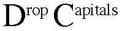

To provide baseline control of your font, you must include a [baseline table](bsln.md).

<a id="anchor-AATIntro-part-16"></a>

## Optical Bounds

Unless you make certain adjustments, glyphs can seem to line up incorrectly at the margins. Two factors contribute to this effect. First, the advance widths of glyphs contain a certain amount of extra whitespace to account for the normal interglyph spacing. This extra whitespace is called the *sidebearings*, split into the left sidebearing and the right sidebearing. This produces certain anomalies, since the actual left sidebearing distance varies with the size of the glyph. For example, if different sizes of the same glyph are flush left, they do not appear to line up correctly, as shown in this figure:

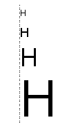

The second problem is that because of certain optical effects, curved lines do not appear to line up properly with straight lines. To remedy this, you can design curved glyphs such as "C" or "S" so that they extend slightly below the baseline, thereby appearing to line up with straight glyphs such as "H", like this:

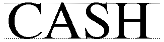

This same optical effect occurs at the extreme edges of lines. In both halves of the following figure, the uppercase "O" glyph is aligned with the uppercase "H" glyphs, in the sense that the leftmost edge of the "H" is even with the left-most edge of the "O." However, without the vertical line to convince the viewer the letters do not appear to align correctly.

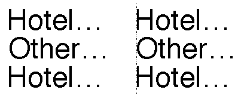

To compensate for these effects, you can use optical alignment information contained in the font tables. You use optical leading and trailing edges when determining the leading and trailing edges of a line of text, whether at tab stops or line starts. These values are obtained from the font as a pair of offsets from the edges of the glyph.

To provide optical bounds control for your font, you can include an [optical bounds table](opbd.md).

<a id="anchor-AATIntro-part-17"></a>

## Kerning

*Kerning* is the fine adjustment to the normal spacing that occurs between two or more glyphs. Kerning does not refer to glyphs that overhang their bounds or to glyphs that extend beyond their leading or trailing edges defined by the character origin and advance width.

You can use information in the font tables to determine how much to increase or decrease the space between two glyphs. This amount can depend on more than just the two adjacent glyphs: it can also depend on preceding or following glyphs. For example, you can kern the first two pairs of glyphs in the following figure, but if you applied the same distances in the third pair, you would have the quotation mark colliding with the top stem of the "F." Your kerning data can compensate for this and provide a different kerning amount in cases like this.

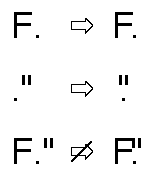

The font tables allow n glyphs to map into n-1 kerning values (that is, interglyph positional shifts). When kerning, the offset between the glyphs is effectively split. The following figure shows where the caret would appear between the two glyphs.

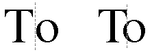

There is another kind of kerning, called *cross-stream kerning*, that allows the automatic movement of glyphs perpendicular to the line orientation of the text. For horizontal text, this means vertically. In the following figure, a hyphen between two uppercase glyphs is raised so that it falls near the midpoint of the height of those glyphs.

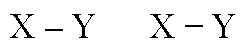

Cross-stream kerning is required for scripts such as Taliq (used in Urdu). It can also assist in the creation of fractions, as described in the section on swash variants. Another Roman font example of cross-stream kerning is shown here: 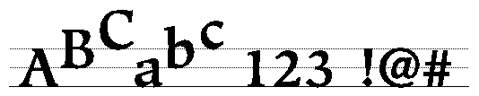

To provide kerning in your font, you need to include a [kerning table](kern.md).

<a id="anchor-AATIntro-part-18"></a>

## Tracking

You can increase or decrease glyph widths by applying a tracking value to a glyph. This value, called the *track number*, specifies whether interglyph spacing is to be decreased or increased. The actual positional shifts are the result of two- dimensional interpolation based on the track number, the text size in points, and the *threshold values* in the font's tracking table. These threshold values are used to permit *nonlinear tracking* amounts: for example, a manufacturer can use four different sets of values for text in these point-size ranges: 8 to 12, 12 to 15, 15 to 36, and over 36.

A track number is a value that specifies the relative tightness or looseness of the interglyph spacing. Positive track numbers result in an increase in the advance width of all glyphs in the font. Negative track numbers result in a decrease in the advance width of all glyphs. Increasing the advance width of glyphs increases the interglyph spacing to provide a relatively loose sequence of glyphs. Decreasing the advance width of glyphs decreases the interglyph spacing to provide a relatively tight sequence of glyphs. Normal tracking, tight tracking, and loose tracking are shown in the following figure:

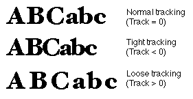

To provide tracking for your font, you must include a [tracking table](trak.md).

<a id="anchor-AATIntro-part-19"></a>

## Justification

*Justification* is the process of typographically stretching or shrinking a line of text to fit within a given horizontal width or vertical height. You can assign portions of line gap to different classes of glyphs, at different priority levels, and you can include facilities for handling complex kashida-like justification. A *kashida* is an extension bar that connects the glyphs of a word that is used by Arabic and cursive Roman.

The following figure shows how the use of kashidas can affect the appearance of a line:

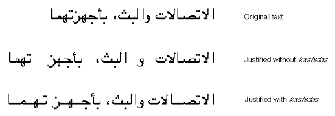

Unlike other models of justification, which are based on a proportional assignment of extra whitespace in a fixed ratio of interword to interglyph (for instance, 9:1 as in the Apple LaserWriter printer), AAT fonts permit the assignment of whitespace at a given priority level until either all the gap is filled or else a maximum specified amount is reached. For this reason, interglyph spacing need not occur as often as it does in proportional models (or even occur at all). If the gap can be filled by interword spacing, it will be, and without the need for interglyph spacing. If you want to use proportional assignment in your font, however, Line Layout permits it.

The AAT justification model allows you to achieve a variety of effects with your font. Here are some possibilities.

**Regular justification**

Usually, typographers don't want to add interglyph spacing unless absolutely necessary. This justification model supports this scheme fully by allowing you to assign different priorities to whitespace glyphs and interglyph glyphs. The whitespace glyphs have the higher priority and are always processed first. Interglyph spacing is considered only if the given gap cannot be filled by whitespace. You can override this by setting a flag in the whitespace glyphs so that whitespace is added only when justifying a line that uses your font.

**Simple one-level kashidas**

You can use a kashida connecting bar instead of whitespace to justify lines of connected script, such as occur in Arabic. Usually kashidas are the only kind of justification used in a line of connected script. You can specify as glyphs of kashida justification priority for lines of such glyphs, with whatever factors are needed and the unlimited bits set.

**Multiple-level kashidas**

Sometimes you may wish to provide for different classes of kashidas on a single line: one set that occupies all the gap up to a certain threshold and another set that takes up the remainder.

The justification table stores justification information for the glyphs of your font and for the font as a whole. You can store both horizontal and vertical adjustments or adjustments for one direction.

The following figure demonstrates how AAT allows you to adjust the priorities of the inter-character and inter-word spacings to achieve justification control. The first line of text has the default settings for interglyph and interword spacing. The second line of text has all justification effects assigned to interword spacing. The last line of text has all justification effects assigned to interglyph spacing.

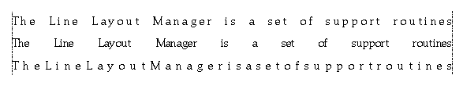

To provide justification in your font, you can include a [justification table](just.md).

<a id="anchor-AATIntro-part-20"></a>

## Vertical Metrics

Vertical metrics for vertical fonts are analogous to horizontal metrics for horizontal fonts. Each glyph must be placed in a horizontal position relative to a common centerline and a vertical placement relative to the previous glyph.

In order to provide vertical control over each glyph, two control points are included in the glyph's outline. One point is included at its vertical origin and one point is included at its vertical advance. This allows instructions to fine-tune each glyph's vertical device metrics.

Vertical metrics are provided for vertical fonts by including a [vertical header table](vhea.md) (tag name: `'vhea'`) and a vertical metrics table (tag name: `'vmtx'`) in the font. The vertical header table contains line spacing metrics analogous to the horizontal header table (tag name: `'hhea'`). The [vertical metrics table](vmtx.md) contains vertical sidebearings and advances analogous to the horizontal metrics table (tag name: `'hmtx'`).

<a id="anchor-AATIntro-part-21"></a>

## Font Variations

Typefaces are defined by specifying a font's family and style. Conventional styles are usually limited to a small set of orthogonal attributes. Typical styles include bold, italic, bold italic, underline, shadow, condensed, and extended. Currently, most font families contain one to four styles. In contrast, AAT allows you to design font families with any number of named styles. Typical style names are regular, bold, demi, black, antique, italic, thin, and ultra condensed. AAT style variations are a mechanism through which you can build high quality styles into the typeface itself. This reduces the dependence on algorithmic styling in the graphics system.

Applications use AAT style variations by passing the font a list of style coordinates that describe the degree of stylizing for each of the font's possible style variations. A style coordinate is a pair of numbers. The tag identifies the style axis and the coordinate specifies how much of that variation to apply. Typical axes are color, width, contrast, and optical size. The following figure shows a style axis for bold. The minimum boldness is on the left and the maximum boldness is on the right. The center glyph is the default level of boldness for this font.

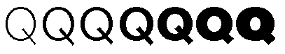

A given style axis in a font has a minimum and maximum coordinate value. The coordinate value simply identifies the point between the minimum and maximum values on the style coordinate. The different styles produced by interpolation along any single style axis is called an *instance*. The range of instances that can be created along any axis is termed the *dynamic range*.

Style coordinates can be combined to allow style variations with two, three, four, or any number of style axes. For instance, you may choose to create a font with a bold and condense axes. The user of the font can then specify any simultaneous combination of boldness and condenseness. An example of a two-dimensional array of capital "G" glyphs for a font with style variations for bold and condense is shown in the next figure. The condense style increases from top to bottom and the bold style increases from left to right. Any of the glyph styles shown or any glyph styles between those shown can be selected by specifying the desired coordinates on the two style axes. The default glyph is shown in gray.

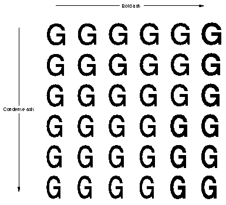

To create fonts with font variations, you can include a font variation table, a glyph variations table, and a control value table (CVT) variations table. This is only required for instructed fonts. The [font variation table](fvar.md) provides global information concerning the style axes included and the coordinates for named locations in the style space. The [glyph variations table](gvar.md) provides all of the data for stylizing a glyph's outlines and metrics. The [control value table (CVT) variations table](cvar.md) provides the data for stylizing the control value table to match the styling done to outlines.

<a id="anchor-AATIntro-part-22"></a>

## Bitmaps

AAT supports both outline and bitmap descriptions of glyphs. Outline glyph descriptions are useful since they can be scaled and transformed. However, bitmap glyph descriptions are useful for very small sizes of glyphs that are difficult to produce using instructed outlines.

To create an AAT bitmap font, you need to include a bitmap location table and a bitmap data table.

The [bitmap location table](bloc.md) (tag name: `'bloc'`) provides information about the availability of bitmaps at requested point sizes in the font. If a bitmap is included in the font, it also tells where the data is located in the bitmap data table. The [bitmap data table](bdat.md) (tag name: `'bmap'`) is a collection of bitmaps for all of the bitmapped glyphs in the font.

<a id="anchor-AATIntro-part-23"></a>

## Accent Attachment

The [accent attachment table](acnt.md) (tag name: `'acnt'`) provides a useful method of combining component glyphs into compound glyphs. Each component can be independently transformed and instructed prior to combination. The resulting combinations can then be transformed and instructed.

<a id="anchor-AATIntro-part-24"></a>

## Features and Settings

The [feature name table](feat.md) (tag name: `'feat'`) allows you to include the font's text features, the settings for each text feature, and the name table indices for common (human-readable) names for the features and settings.

Here are the currently defined feature types:

- all typographic features
- ligatures
- cursive connection
- letter case
- vertical substitution
- rearrangement
- number spacing
- smart swashes
- diacritics
- vertical position
- fractions
- overlapping characters
- typographic extras
- mathematical extras
- ornament sets
- character alternatives
- design complexity
- style options
- character shape
- number case
- character spacing

<a id="anchor-AATIntro-part-25"></a>

## Changes from TrueType 1.0

The TrueType 2.0 scaler released as part of AAT has added functionality to support the increased functionality of AAT. This change in functionality has forced some very minor changes in the interpretation of certain fields in TrueType fonts and the addition of bit flags to some fields. This section describes these changes.

It must be emphasized that old format TrueType fonts will always render correctly on new TrueType scalers, and new format fonts will always render correctly on old scalers. However, optimum functionality occurs when new format fonts are run using the new TrueType 2.0 scaler.

<a id="anchor-AATIntro-part-26"></a>

### `'glyf'` Table

There are two changes connected with the `'glyf'` table, dealing with overlapping contours and compound glyph components under rotation.

<a id="anchor-AATIntro-part-27"></a>

#### Overlapping contours

One addition to the `'glyf'` table is the designation of glyphs with overlapping contours. This is not needed for rendering by TrueType scalers, but is needed when a TrueType font must be converted to a Type 1 Font and rendered on a printer under some Level 2 PostScript implementations.

Since the introduction of the original `'glyf'` format, Level 2 Postscript has been introduced. Some printers that incorporate Level 2 Postscript use an even-odd fill algorithm for Type 1 fonts rather than the non-zero winding number fill that was used in previous PostScript implementations. Therefore, to accurately translate a TrueType font to a Type 1 font for use on the Level 2 printers, glyphs with overlapping contours must be simplified, so it is necessary to know which glyphs have overlapping contours. Glyphs that are not properly flagged will be rendered on these printers with white space holes where the contours overlap.

For simple glyphs, you should set bit 6 of the first Outline Flag byte to 1 if the unhinted glyph outline has overlapping contours or if variation controls or hinting controls can ever cause any of the contours to overlap. Otherwise this bit should be set to 0.

For compound glyphs, you should set bit 10 of the flags word in the first component to 1 if any of the component glyphs can ever have overlapping contours or if the contours of any component can ever overlap the contours of another component in the compound glyph. Otherwise set this bit to 0. Note that bit 4 of this flag word is designated for flagging overlapping contours in some old documentation. This bit is obsolete and is ignored by all scalers.

<a id="anchor-AATIntro-part-28"></a>

#### Compound glyphs with rotated components

If a compound glyph comprises components in which a 2 by 2 transform is applied to the component and the translation of the component is supplied by offset numbers rather than by anchor points, then the offset numbers are multiplied by the scale factor of the transform before translating the component. Furthermore in the TrueType 1.0 scaler, if the transform was a rotation of 45 degrees, the scale factor was multiplied by 2. In the TrueType 2.0 scaler, this special case of 45 degrees no longer causes the scale factor to be multiplied by 2. In other words, components that are rotated 45 degrees and that use numerical offsets for translation will be rendered differently on TrueType 1.0 scalers than on TrueType 2.0 scalers. We recommend that anchor points be used to specify the translation of components that are rotated 45 degrees. Such components will render the same on all scalers.

<a id="anchor-AATIntro-part-29"></a>

### The `'sfnt'` directory

The very first entry in an `'sfnt'` is the font directory. This directory specifies the number of tables in the font, and other font information. The first 4 bytes of the directory were originally designated as the version number of the `'sfnt'`. So current TrueType fonts all have version 1.0 (0x00010000) in these four bytes.

In AAT, the `'sfnt'` format has been extended for use by other scalers in addition to TrueType, (for example, PostScript). Therefore, the first four bytes of the `'sfnt'` are now interpreted to designate the scaler that should be used to render the font. So, TrueType fonts should now have `'true'` (0x74727564) at the beginning of the `'sfnt'`.

<a id="anchor-AATIntro-part-30"></a>

### The `'head'` Table

Four new bits have been defined for the flags field in the `'head'` table for use by the AAT line layout code to optimize performance. One additional bit has been defined for use in vertical fonts, and one bit has been added for the Microsoft implementation of the TrueType scaler. These new bits are described in the following table:

| Mask | Name | Meaning |
| --- | --- | --- |
| 0x0010 | instructionsChangeAdvanceWidths | Used by the Microsoft implementation of the TrueType scaler. |
| 0x0020 | xPositionSpecifiesBaseline | This bit should be set in fonts that are intended to be laid out vertically and in which the glyphs have been drawn such that an x coordinate of 0 corresponds to the desired vertical baseline. |
| 0x0040 | reserved | This bit must be set to zero. |
| 0x0080 | fontRequiresLayout | This bit should be set if rendering from this font is incorrect without the intervention of layout. An example would be an Arabic font, where linguistically incorrect output will result if layout is not involved in the rendering process. |
| 0x0100 | fontHasNormalLayout | This bit should be set if the font contains metamorphosis table effects that happen by default. |
| 0x0200 | fontCanReorder | This bit should be set if the font contains any strong right-to-left glyphs (for a discussion of strong directional properties, see the `'prop'` table chapter). |
| 0x0400 | fontCanRearrange | This bit should be set if the font contains an entry in the metamorphosis table for Indic-style rearrangement. |

<a id="anchor-AATIntro-part-31"></a>

### The `'post'` Table

Composite fonts on Japanese, Chinese or Korean printers only work with character codes. AAT printer drivers only know about glyph index values. The scaler uses the newly defined `'post'` table version 4 to reencode a font that maps to a composite font on a printer. This encoding consists of naming the glyphs by using their character codes. The driver has PostScript code that knows how to take this ASCII string, strip the leading 'a', and convert the rest to hex. The resulting hex is the character code of the glyph. In this manner, the composite fonts on the printer are used.

Any font that maps to a composite font on the printer needs to include a format 4 `'post'` table. The structure of format 4 `'post'` table is as follows: the `postTableHeader` is followed by an array of `uint16` values. An entry for every glyph is required. The index into the array equals the glyph index. The data in the array is the character code that maps to the specified glyph index. The name will be synthesized from this character code by prepending a lower-case ASCII 'a'. If a glyph has no corresponding character in the composite font, then that glyph's entry in this table should be 0xFFFF.
