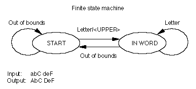
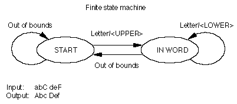
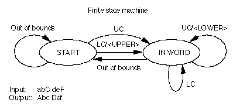
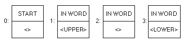
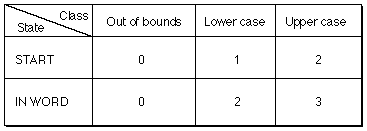

# Apple Advanced Typography Font Tables

This chapter discusses three table components that are used by many of the Apple Advanced Typography (AAT) tables and a section that summarizes all of the AAT tables. In addition, the role of each of the AAT font tables included in this document is summarized.

## Table Components

The three table components that are described in this section are binary searching tables, lookup tables, and state tables. *Binary search tables* contain data that assist in conducting binary searches for information in the table that it resides in. *Lookup tables* map glyph indexes to information without context. *State tables* map glyph indexes to actions with context.

### Binary Searching Tables

So that text processing will take as little time as possible, many of the font tables contain information that speed up the process of searching for the entry associated with a particular glyph index. This information is contained in a *binary search header*, or `BinSrchHeader` structure. The format of a `BinSrchHeader` structure is as follows:

| Type | Name | Description |
| --- | --- | --- |
| uint16 | unitSize | Size of a lookup unit for this search in bytes. |
| uint16 | nUnits | Number of units of the preceding size to be searched. |
| uint16 | searchRange | The value of `unitSize` times the largest power of 2 that is less than or equal to the value of `nUnits`. |
| uint16 | entrySelector | The log base 2 of the largest power of 2 less than or equal to the value of `nUnits`. |
| uint16 | rangeShift | The value of `unitSize` times the difference of the value of `nUnits` minus the largest power of 2 less than or equal to the value of `nUnits`. |

To guarantee that a binary search terminates, you must include one or more special "end of search table" values at the end of the data to be searched. The number of termination values that need to be included is table-specific. The value that indicates binary search termination is 0xFFFF. The presence of this special value makes the search logic as fast as possible, at a fairly minimal cost in extra space in the font table. The binary search header is often used in lookup tables.

Note that the `searchRange`, `entrySelector`, and `rangeShift` fields are redundant. Binary search tables were designed to work efficiently with the processors available in the late 1980s; the inclusion of these three fields allowed the use of a very efficient lookup algorithm on such processors. This optimization is not needed on modern processors and these three fields are no longer used.

### Lookup Tables

Lookup tables provide a way of looking up information about a glyph index.

Some lookup tables do simple array-type lookup. Others involve groupings, allowing you to treat many different glyph indexes in the same way (that is, to look up the same information about them). The top-level description of a lookup table contains a format number and a format-specific header. The format of the Lookup Table header is as follows:

| Type | Name | Description |
| --- | --- | --- |
| uint16 | format | Format of this lookup table. There are five lookup table formats, each with a format number. |
| variable | fsHeader | Format-specific header (each of these is described in the following sections), followed by the actual lookup data. The details of the fsHeader structure are given with the different formats. |

The result of a lookup is referred to in the following descriptions as a *lookup value*. A lookup value is interpreted differently for different types of tables. Each page dealing with specific tables gives information on how to interpret the lookup values specific to that table.

There are five formats of lookup tables:

| Format | Description |
| --- | --- |
| 0 | Simple array format. The lookup data is an array of lookup values, indexed by glyph index. |
| 2 | Segment single format. Each non-overlapping segment has a single lookup value that applies to all glyphs in the segment. A segment is defined as a contiguous range of glyph indexes. |
| 4 | Segment array format. A segment mapping is performed (as with Format 2), but instead of a single lookup value for all the glyphs in the segment, each glyph in the segment gets its own separate lookup value. |
| 6 | Single table format. The lookup data is a sorted list of \<glyph index,lookup value\> pairs. |
| 8 | Trimmed array format. The lookup data is a simple trimmed array indexed by glyph index. |
| 10 | Extended trimmed array format. The lookup data is a simple trimmed array indexed by glyph index. |

#### Simple Array Format 0 Lookup Table

The `fsHeader` field of a Format 0 lookup table presents an array of lookup values, indexed by glyph index. What these values represent depends on the font table for which you are using the lookup table.

#### Segment Single Format 2 Lookup Table

The `fsHeader` field of a Format 2 lookup table divides some portion of the glyph indexes into contiguous ranges or segments. The format of a segment single format 2 lookup table is as follows:

| Type | Name | Description |
| --- | --- | --- |
| BinSrchHeader | binSrchHeader | The units for this binary search are of type LookupSegment, and always have a minimum length of 6. |
| LookupSegment | segments\[\] | The actual segments. These must already be sorted, according to the first word in each one (the last glyph in each segment). |

The format of a Format 2 `LookupSegment` is as follows:

| Type | Name | Description |
| --- | --- | --- |
| uint16 | lastGlyph | Last glyph index in this segment |
| uint16 | firstGlyph | First glyph index in this segment |
| variable | value | The lookup value (only one) |

For a format 2 lookup table, the single lookup value is applied uniformly to all the glyphs in the segment.

#### Segment Array Format 4 Lookup Table

The `fsHeader` field of a Format 4 lookup table divides some portion of the glyph indexes into contiguous ranges or segments. The format of a segment array Format 4 lookup table is as follows:

| Type | Name | Description |
| --- | --- | --- |
| BinSrchHeader | binSrchHeader | The units for this binary search are of type LookupSegment and always have a minimum length of 6. |
| LookupSegment | segments\[\] | The actual segments. These must already be sorted, according to the first word in each one (the last glyph in each segment). |

The format of a Format 4 lookupSegment is as follows:

| Type | Name | Description |
| --- | --- | --- |
| uint16 | lastGlyph | Last glyph index in this segment |
| uint16 | firstGlyph | First glyph index in this segment |
| uint16 | value | A 16-bit offset from the start of the table to the data |

#### Single Table Format 6 Lookup Table

The `fsHeader` field of a Format 6 lookup table stores the lookup data as a sorted list of pairs of a glyph index and its lookup result. The format of a single table Format 6 lookup table is as follows:

| Type | Name | Description |
| --- | --- | --- |
| BinSrchHeader | binSrchHeader | The units for this binary search are of type LookupSingle and always have a minimum length of 4. |
| LookupSingle | entries\[\] | The actual entries, sorted by glyph index. |

The format of a Format 6 `LookupSingle` is as follows:

| Type | Name | Description |
| --- | --- | --- |
| uint16 | glyph | The glyph index |
| variable | value | The lookup value |

#### Trimmed Array Format 8 Lookup Table

The `fsHeader` field of a Format 8 lookup table stores the lookup data as a simple trimmed array indexed by glyph index. It differs from the [Extended Trimmed Array Format 10 Lookup Table](#anchor-Tables-LookupFormat10) in that it lookup values must be two bytes in size.

The format of a trimmed array Format 8 lookup table is as follows:

| Type | Name | Description |
| --- | --- | --- |
| uint16 | firstGlyph | First glyph index included in the trimmed array. |
| uint16 | glyphCount | Total number of glyphs (equivalent to the last glyph minus the value of firstGlyph plus 1). |
| variable | valueArray\[\] | The lookup values (indexed by the glyph index minus the value of firstGlyph). Entries in the value array must be two bytes. |

#### Extended Trimmed Array Format 10 Lookup Table

The `fsHeader` field of a Format 10 lookup table stores the lookup data as a simple trimmed array indexed by glyph index. It differs from the [Trimmed Array Format 8 Lookup Table](#anchor-Tables-LookupFormat8) in that it allows for lookup value sizes other than two bytes.

The format of an extended trimmed array format 10 lookup table is as follows:

| Type | Name | Description |
| --- | --- | --- |
| uint16 | unitSize | Size of a lookup unit for this lookup table in bytes. Allowed values are 1, 2, 4, and 8. |
| uint16 | firstGlyph | First glyph index included in the trimmed array. |
| uint16 | glyphCount | Total number of glyphs (equivalent to the last glyph minus the value of firstGlyph plus 1). |
| variable | valueArray\[\] | The lookup values (indexed by the glyph index minus the value of firstGlyph). |

### State Tables

The following introductory discussion of state tables uses a small number of classes and states to describe the basics concepts. The full set of predefined classes and states used by AAT tables are defined in the [Class Subtable](#anchor-Tables-ClassSubtable) section.

State tables are used in the Justification, Kerning, and Glyph Metamorphosis Tables to provide glyph processing. The basic format of state tables is given in this section. Table-specific state table format data is included in the page describing the specific table.

A *state* is a set of rules for mapping a class of glyphs into a particular *condition*(such as "middle of a word") and an *action* that modifies the stream of glyphs. The finite state machine maintains an index into the state array, called the *current state*. The current state is initialized to a special value, called the *initial state*. The movement within a finite state machine from one state to another is called a *transition*.

AAT tables provide information that support the contextual processing of the glyphs in a line. The line is represented in memory by the glyph array, an array of glyph records, which are stored in display order. Each glyph record contains data about the glyph, including its glyph index. The glyph array is processed by a finite state machine, which takes the glyph ranges as input and may or may not change the input in response to its characteristics.

The finite state machine maps the input glyphs into classes. In terms of text, a class is a collection of glyphs that have some property in common. Examples of classes might be arithmetic digits, letters that form a ligature when the first glyph is "f", and glyphs that separate words. For each glyph in the glyph array, the finite state machine performs an action appropriate to the glyph's class and state.

Each action always results in a change of state and sometimes results in a change of class. The change of state may be from one state to the same state or to a different state. The finite state machine then continues with the next glyph in the glyph array. After processing all glyphs in the glyph array, the finite state machine performs the action in the current state indicated by a special class, called *end of text* or *end of line*.

In order to represent the operations of a finite state machine, a stylized flowchart is useful to show the relationships of the states, classes and actions. States are represented by ovals and actions are represented by arrows. Arrow captions are the classes for which the specified action occurs. Depending on the state and class, an action will either be in the same state (shown by a loop back to that state) or will indicate a change of state (shown by an arrow from one state to another state).

All state table processes begin in the *start state*. This is the initial state of the diagram. Let's look at an example of a finite state machine and its corresponding interpretation in a state table.

If you divided all the glyphs of your font into classes of "letters" (A, B, a, b, and so on) and "out of bounds" (anything that is not a letter), you could devise a finite state machine to capitalize the first letter of every word in a stream of text. The machine begins at the START state and at the beginning of the stream of data. It determines whether the first glyph is a member of the "letter" class or some other class, in which case the glyph is "out of bounds." If the glyph is a letter, then the machine capitalizes the letter and moves to the IN WORD state. If the next glyph is in the "letter" class, the machine stays in the IN WORD state and does nothing. If the glyph is in another class, it is "out of bounds," and the machine goes back to the START state.

Note that this finite state machine would interpret punctuation marks as "out of bounds" and capitalize the next glyph in the sequence. As a result, the word "won't" would be converted to "won'T."

The following figure gives a schematic representation of a finite state machine that capitalizes the first letter in a word.

You could make this finite state machine more complex by specifying the additional rule: make only the first letter of each word uppercase and make all subsequent letters lowercase. You can add a new rule to the IN WORD state that tells the machine to change all glyphs in the "letter" class to their lowercase forms, as shown in the following figure:

However, this finite state machine always changes the first glyph of every word to its uppercase form, regardless of whether it's already uppercase, and it changes the subsequent glyphs of words to lowercase, even if they're already lowercase. You can minimize the work of this finite state machine by adding more classes, such as "uppercase" and "lowercase" (abbreviated as UC and LC in the following figure). When the finite state machine begins in the START state, it moves to the IN WORD state if it encounters a letter, but performs an action only with a member of the "lowercase" class. In the IN WORD state, it cycles through glyphs, changing them if they're members of the "uppercase" class, doing nothing if they're members of the "lowercase" class, and moving back to the START state if they're "out of bounds." In this way, the finite state machine changes only those glyphs that are not appropriate for their place in the word; all others are preserved.

A *state table* representation summarizes and organizes the data used by the finite state machine to specify the classes, states, and actions that the machine can take. The four possible transition and action pairs for the finite state machine described in the preceding figure are shown in the following figure. The first member of the pair is the state that the machine should go to, and the second member is the action, if any, the machine should take. An entry of "\< \>" indicates that the finite state machine should take no action and should return to the current state.

The state table for these pairs creates an array that has all of the possible states (rows) and the possible classes (columns), as shown in the next figure. Depending on the beginning state and the class of glyph, the machine can decide on the appropriate transition and action to take.

The state table data structure is divided into four sections: the state header, the class subtable, the state array, and the entry subtable. The state header contains information about the size of a state and the offsets to the other subtables. The class subtable allows you to divide the glyphs of your font into different classes. The state array describes the order of states in the table. The entry subtable contains the class and state-dependent actions.

Some of these subtables use *per-glyph tables*. These are tables that hold some type of information (such as offsets) about every glyph in the font, correlated to glyph indexes.

A state table starts with a state table header, known as the `StateHeader` data type. The format of the state table header is as follows:

| Type | Name | Description |
| --- | --- | --- |
| uint16 | stateSize | Size of a state, in bytes. The size is limited to 8 bits, although the field is 16 bits for alignment. |
| uint16 | classTable | Byte offset from the beginning of the state table to the class subtable. |
| uint16 | stateArray | Byte offset from the beginning of the state table to the state array. |
| uint16 | entryTable | Byte offset from the beginning of the state table to the entry subtable. |

#### The Class Subtable

The class subtable maps the glyph indexes of your font into classes. The subtable consists of the glyph index of the first glyph, the number of glyphs in the class table, and then an array of the class codes associated with each glyph. To limit the size of the class table, you should design your font so that glyphs processed by a given state table have glyph indexes that are in a small range.

| Type | Name | Description |
| --- | --- | --- |
| uint16 | firstGlyph | Glyph index of the first glyph in the class table. |
| uint16 | nGlyphs | Number of glyphs in class table. |
| uint8 | classArray\[\] | The class codes (indexed by glyph index minus firstGlyph). Class codes range from 0 to the value of stateSize minus 1. |

The first four class codes (0, 1, 2 and 3) are predefined. Subsequent class codes may be defined by the font developer. The class codes and their descriptions are as follows:

| Class Code | Description |
| --- | --- |
| 0 | End of text. This class should not appear in the class array. |
| 1 | Out of bounds. All glyph indexes that are less than firstGlyph, or greater than or equal to firstGlyph plus nGlyphs will automatically be assigned class code 1. Class code 1 may also appear in the class array. |
| 2 | Deleted glyph. Sometimes contextual processing removes a glyph from the glyph array by changing its glyph index to the deleted glyph index, 0xFFFF. This glyph code is automatically assigned class "deleted," which should not appear in the class array. |
| 3 | End of line. This class should not appear in the class array. |
| 4 through (stateSize-1) | Your class codes. Class codes that you may typically use to accommodate the needs of your font include letter, space, and punctuation. For example, a state table may define the letter glyphs as Class 4, the space glyph as Class 6, and the punctuation glyph as Class 7. |

#### The State Array

The state array is actually an array of arrays. Each entry in the state array is itself an array of uint8 values that represent indexes into the Entry Subtable, one for each class code defined by this state table. The first two states are predefined. State 0 is the *start of text state*. State 1 is the *start of line state*. One of these two states will be chosen as the initial state (depending on context) during text processing. All other states are available to the font designer.

#### The Entry Subtable

The entry subtable contains the state table action information. The values in the entry subtable have the following format:

| Type | Name | Description |
| --- | --- | --- |
| uint16 | newState | Byte offset from beginning of state table to the new state |
| uint16 | flags | Table specific |
| variable | glyphOffsets\[\] | Optional offsets to per-glyph tables |

The `newState` value is stored as a byte offset for quick access: the address of the entry table index is the sum of the state table address, `newState`, and the class code. This means that the maximum number of states depends on `stateSize` and the offset of the state array from the beginning of the state table.

The contents of the `flags` field are table specific. See the formats of the individual tables for details.

Some actions, which are defined in the entry subtable, optionally compute a value by using a glyph index as an index into a per-glyph table. The tables contain entries only for those glyphs used as indexes into the table. The offset is a signed word offset from the beginning of the state table to the putative position of the entry for glyph index 0, if it appeared in the table. This allows the address of a particular entry to be computed as:

`(glyph index + offset) * 2 + state table address`

Notice that this means that the offset can be either negative or positive, depending on the smallest glyph index in the table and the beginning of the table relative to the beginning of the state table.

State table headers are embedded in other tables. The class table, state array, and entry tables should follow the embedding table's header, and can be in any order. The class and entry tables must be word aligned. Any per-glyph tables follow the sections of the state table and must be word aligned.

### Extended State Tables:

The original definition of an AAT state table was largely dictated by hardware limitations of the late 1980's, when the TrueType format was first developed. As hardware limitations became less stringent and larger fonts more common, AAT introduced the *extended state table* format, which is now used by most AAT tables.

The extended state table format is very similar to the original state table format. The basic structure, an `STXHeader`, is as follows:

| Type | Name | Description |
| --- | --- | --- |
| uint32 | nClasses | Number of classes, which is the number of 16-bit entry indices in a single line in the state array. |
| uint32 | classTableOffset | Offset from the start of this state table header to the start of the class table. |
| uint32 | stateArrayOffset | Offset from the start of this state table header to the start of the state array. |
| uint32 | entryTableOffset | Offset from the start of this state table header to the start of the entry table. |

Historically the class table had been a tight array of 8-bit values. However, in certain cases (such as Asian fonts) the potential wide separation between glyph indices covered by the same class table has led to much wasted space in the table. Therefore, the class tables in extended state tables are now simply LookupTables, where the looked-up value is a 16-bit class value. Note that a format 8 LookupTable (trimmed array) yields the same results as class array defined in the original state table format.

Another important difference between the original and extended state table is that the entries in the state array are now 16-bit zero-based indices into the entry table, instead of being 8-bit indices. This enormously increases the range and power of state tables using this new format.
