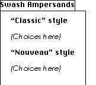
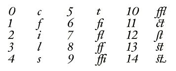

# The `'Zapf'` Table

## General table information

The `'Zapf'` table—named with permission after legendary type designer Hermann Zapf—contains information about the individual glyphs in the font. Conceptually, this information consists of:

- A text string which the glyph represents
- A set of identifiers
- A set of font features
- A set of glyph collections

### The Text String

The text string is the (Unicode) text which the glyph represents. This is to be used when recreating the original text given only the glyph stream. An “a” glyph would simply map to the string \<U+0061\>, whereas a “ct” ligature could map to the string \<U+0063 U+0074\>.

Note that this is *not* a mechanism for associating different characters with the glyph. In general, even if two characters look exactly the same (e.g., Latin ‘A’, Greek ‘Α’ and Cyrillic ‘а’), they should be drawn with different glyphs. Re-using glyphs for different characters may make AAT or OpenType font features work incorrectly, and they make it impossible to unambiguously convert characters to glyph.

### The Identifiers

Within the font itself, glyphs are always identified by their glyph index, and the `'post'` table makes it possible to associate a single name with each glyph with rather severe restrictions on the characters which may be used and the name’s length. The font designer, however, may want to use multiple glyph identifiers while working on the font. They may use the formal PostScript name for the `'post'` table but have alternate names they prefer to use, or want to keep track of the glyph’s CID in different Adobe collections, or even have notes about the glyph. All of these are available in the `'Zapf'` table as glyph identifiers.

### The Font Features

In some situations, it may not be sufficient simply to recreate the original text. One may want to recreate as much of the original document as possible.

For example, consider a document that uses small caps. If trying to rebuild the document from the glyphs, the fact that the small caps feature is being applied is significant. The `'Zapf'` table allows the type designer to associate features with a glyph to capture this information.

### The Glyph Collections

Fonts with rich glyph collections may have multiple glyphs for a certain character. Common examples are lining and proportional numerals, cased and uncased numerals, and small caps. For UI purposes, it’s useful to provide users with information as to which glyphs are available for a given character so that they can, for example, select a particular swash version of a glyph in the middle of a word to make the text look better. It's also useful to generate a set of glyphs used for a particular purpose, such as punctuation, even when they represent different characters.

## Table Format

### Header

The `'Zapf'` table has the following header:

| Type | Name | Description |
| --- | --- | --- |
| `Uint16` | `version` | Set to 2 |
| `Uint16` | `(unused)` | 0 |
| `UInt32` | `extraInfo` | Offset from start of table to start of extra info space (added to `groupOffset` and `featOffset` in `GlyphInfo`) |

The header is immediately followed by a [lookup table](Tables.md#anchor-Tables-LookupTables). Values in the lookup table are `Uint32` offsets from the beginning of the `'Zapf'` table to a `GlyphInfo` structure for the given glyph.

(In version 1 of the `'Zapf'` table, the header is immediately followed by an array of `UInt32` offsets, one for each glyph.)

### The `GlyphInfo` structure

The header is followed immediately by an array of `GlyphInfo` structures. Each entry in this array is of variable size; the offset to a particular `GlyphInfo` is contained in the `offsets[]` array in the header. A `GlyphInfo` structure has the following format:

| Type | Name | Description |
| --- | --- | --- |
| `UInt32` | `groupOffset` | Byte offset from start of `extraInfo` to the `GlyphGroup` or `GlyphGroupOffsetArray` for this glyph, or `0xFFFFFFFF` if none |
| `UInt32` | `featOffset` | Byte offset from start of `extraInfo` to `FeatureInfo` for this glyph, or `0xFFFFFFFF` if none |
| `UInt8` | `flags` | Described below |
| `UInt8` | `num16BitUnicodes` | Described below (may be 0) |
| `UInt16` | `unicodes[]` | Unicode code points for this glyph (see below) |
| `UInt16` | `numGlyphIDs` | Number of `GlyphIdentifiers` that follow (may be 0) |
| `GlyphIdentifier` | `glyphIDs[]` | `GlyphIdentifiers` for this glyph (if any) |
| (`UInt8` | `padding2[1..3]` | If needed, to pad to 32-bit alignment before next `GlyphInfo` in the array) |

The only `GlyphInfo.flags` value available currently is `kIsCanonicalGlyphFlag` (`0x80`), which indicates that this is the "canonical" glyph for the given Unicode string. Prior to version 2 of the `'Zapf'` table, a `flags` `GlyphIdentifier` (`GlyphIdentifier.kind` 127) was used for this purpose.

The `kIsCanonicalGlyphFlag` is set if the glyph in question is the preferred glyph for the given Unicode string. Where the glyph corresponds to a single Unicode character, this bit should be set if and only if the `'cmap'` maps that character to this glyph. The flag, however, can be used for glyphs corresponding to multiple characters. For example, Zapfino has two glyphs for an 'es' ligature, named 'e\_s' and 'e\_s.2'. The flag is set for the 'e\_s' glyph and not the 'e\_s.2' glyph.

The `kIsCanonicalGlyphFlag` can be used to quickly generate a table of Unicode code-points covered by the font. This data can also be derived from the `'cmap'` table, but inasmuch as the `'cmap'` table is optimized to do single lookups, using the `'cmap'` table means running through every defined character in Unicode and checking to see if the `'cmap'` has a mapping for it. Deriving this data from the `'Zapf'` table is much faster.

The `GlyphInfo.num16BitUnicodes` field is the number of `UInt16` values in the following `GlyphInfo.unicodes` array. The array itself contains the unique text string (in UTF-16) this glyph represents. Typically, a glyph will represent at most one character, but to allow for characters outside the BMP and to allow for complex ligatures, we use an actual Unicode string.

Again, this does *not* allow the same glyph to be used for multiple characters. Even if a glyph is used for more than one character (say for a Latin A and Greek Α)—itself never a good idea—the `GlyphInfo.unicodes` array should only include one of them. Including both would indicate that the glyph maps to the character sequence \<U+0040 U+0391\> and not to either the character \<U+0040\> or the character \<U+0391\>.

If `GlyphInfo.num16BitUnicodes` is 0, then the glyph isn’t used to represent actual text. This is true, for example, for glyph 0.

### The `GlyphIdentifier` structure

A `GlyphIdentifier` identifies a glyph, and indicates what kind of identifier it is. It is structured as follows:

| Type | Name | Description |
| --- | --- | --- |
| `UInt8` | `kind` | What kind of identifier this is |
| `UInt8` | `data[]` | Identifier data |

The defined values for the `GlyphIdentifier.kind` field are divided into four ranges:

| kind value | Type | Description |
| --- | --- | --- |
| 0 to 63 | Pascal string | The bytes immediately following the `kind` byte comprise a Pascal string in UTF-8; depending on the value, this name may or may not need to be compliant with Adobe’s guidelines for PostScript glyph names |
| 64 to 126 | 2-byte binary | The bytes immediately following the `kind` byte should be treated as the two bytes (big-endian) of a 16-bit quantity. Note that alignment is not guaranteed, so software reading this value should do it bytewise. The interpretation of the value, whether a direct numeric value, a `'name'` table index, or something else, is controlled by the actual value. See the description below for more details. |
| 127 | 2-byte binary | The bytes immediately following the `kind` byte should be treated as the two bytes (big-endian) of a 16-bit flags field. Note that alignment is not guaranteed, so software reading this value should do it bytewise. This works around the lack of a flags field in the original design of the `GlyphInfo` structure. |
| 128 to 255 | reserved | These values are not yet defined and must not be used. |

Not all these values are currently associated with specific identifier types, but the use of ranges allows parsers to correctly handle `GlyphIdentifier`s even if they don’t know their precise significance.

The currently defined specific values for the `GlyphIdentifier.kind` field are the following:

| Type | Name | Description |
| --- | --- | --- |
| UInt8 | kind | *(UTF-8 Pascal strings)* |
|  |  | 0=Universal PostScript name (that is, a name which complies with all naming conventions) |
|  |  | 1=Apple PostScript name |
|  |  | 2=Adobe (AGL) PostScript name |
|  |  | 3=AFII PostScript name |
|  |  | 4=Character name using Unicode character-naming conventions |
|  |  | *(The following indicate direct binary values)* |
|  |  | 64=CID for Japanese |
|  |  | 65=CID for Traditional Chinese |
|  |  | 66=CID for Simplified Chinese |
|  |  | 67=CID for Korean |
|  |  | *(The following indicate `'name'` table indices)* |
|  |  | 68=Version history note, which allows the designer to keep track of versions of a glyph |
|  |  | 69=Designer's short name, intended to be a short but unique name for the glyph |
|  |  | 70=Designer's long name, intended to be a fuller name, if needed |
|  |  | 71=Designer's usage notes, intended to guide users under what circumstances the glyph was intended to be used (and not used!) |
|  |  | 72=Designer's historical notes, including information on how this glyph arose, and how it fits stylistically in the world of type |
|  |  | *(The following indicates a two-byte flags field)* |
|  |  | 127=Flags |
| (variable) | name | A Pascal string or binary value, depending on the top two bits of the kind, as listed in the above descriptions. |

The Unicode `GlyphIdentifier` should only be used for glyphs corresponding to a single Unicode character. Ordinarily, such names can be inferred entirely from the Unicode Standard. This name might be useful, however, for a designer creating an experimental font for an unencoded script used in the Unicode Private Use Area.

There is currently only one flag defined for the flags `GlyphIdentifier`: namely, `kIsCanonicalGlyph`, 0x8000. This flag should not be used in version 2 of the `'Zapf'` table; the `kIsCanonicalGlyphFlag` in the `GlyphInfo.flags` field should be used instead.

Note there is no requirement that `GlyphIdentifier`s are individually padded for any alignment. Such padding as is used is for the `GlyphInfo` structure as a whole.

### Structures For Groups of Glyphs

When presenting an interface to a user for the selection of particular glyphs, an application would often like to know the set of glyphs in a font which are logically related (or perhaps, those which are related in the designer's eye). In order to accommodate this, the `GlyphGroup` structure gathers together information about related glyphs. A `GlyphGroup` is a collection of `GlyphSubgroup` structures, where each named group has a name (via a `'name'` table index), and a collection of glyph indices in whatever order the designer sees fit to impose. So for instance, a designer whose font contains many different swashes for a given letter could create groups for all the glyphs for that letter, where each group has a name (e.g. "long-tailed," "fat-stemmed," etc.).

The `'Zapf'` table does this by associating each glyph with zero or more glyph groups, each of which, in turn, consists of one or more subgroups. There are three structures used to provide these associations.

#### The GlyphSubgroup structure

The `GlyphSubgroup` is the basic structure for creating a set of glyphs. `GlyphSubgroup`s reside in the `extraInfo` space, and have the following format:

| Type | Name | Description |
| --- | --- | --- |
| `UInt16` | `nameIndex` | Index in the `'name'` table for this group's name; a value of zero indicates no name for this group |
| `UInt16` | `numGlyphs` | Number of glyph indices in this named group; this may be zero, in which case no glyphs will follow and this name is the name for the whole group (this convention is only valid for the first name in a group) |
| `UInt16` | `glyphs[]` | Glyph indices for this group. |

*Note*: There is no requirement that all the glyphs in a `GlyphSubgroup` be used for the same string. A font designer is perfectly free to include a `GlyphSubgroup` for, say, all of the punctuation glyphs in the font.

#### The GlyphGroup structure

The `GlyphGroup` structure is an array of `GlyphSubgroup`s and looks like this:

| Type | Name | Description |
| --- | --- | --- |
| `UInt16` | `numGroups` | The low-order 14 bits specify the count of the number of `GlyphSubgroup`s being defined; they follow this field one after the other. If the top bit is 1, each `GlyphSubgroup` is preceded by a 16-bit flag word. Bit 14 should be 0. |
| (variable) | groups\[\] | The `GlyphSubgroup`s for this `GlyphGroup`. Each group may be preceded by a 16-bit flag (depending on the high bit of the `numGroups` field) |

The following flags are are available for use:

| Mask | Name | Description |
| --- | --- | --- |
| `0x8000` | `isAligned` | If this bit is on, this `GlyphSubgroup` is padded to a 32-bit boundary |
| `0x4000` | `isSubdivided` | If this bit is on, this `GlyphSubgroup` is actually a subdivision of a larger single group. If this bit is off, this group is a unique self-contained group. This bit should be set in those parts of a group which are intended to be used to present a user interface. |
| `0x3FFF` | (reserved) | These bits are not currently defined and must be zero |

#### The GlyphGroupOffsetArray structure

The `GlyphGroupOffsetArray` structure is an array of offsets to `GlyphGroup`s. It looks like this:

| Type | Name | Description |
| --- | --- | --- |
| `UInt16` | `numGroups` | The low-order 14 bits specify the number of offsets to `GlyphGroup`s in the array. Bit 15 should be 0, and bit 14 should be 1. |
| `UInt16` | `padding` | This field is not currently used and should be set to 0. It is present to maintain as far as possible 32-bit alignment within the `'Zapf'` table. |
| `UInt32` | `groupOffsets[]` | Offsets (relative to `extraInfo`) to the `GlyphGroup`s associated with this `GlyphGroupOffsetArray`. The first value in this field indicates the group to be used as the “alternate forms” for the given glyph, as in the Character Palette on OS X. In the case where no group containing this glyph contains the alternate forms for the glyph, the first `groupOffset` should be `0xFFFFFFFF`. |

The `GlyphInfo.groupOffset` for a given glyph points to either a `GlyphGroup` or a `GlyphGroupOffsetArray`. Each begins with a two-byte `numGroups` field, and bit 14 of this field is used to distinguish the two. If bit 14 is clear, this is a `GlyphGroup`. If bit 14 is set, then it’s a `GlyphGroupOffsetArray`.

In general, the `GlyphInfo.groupOffset` should point to a `GlyphGroupOffsetArray` if:

- The glyph belongs to more than one glyph group, or
- You want to explicitly mark the one group to which a glyph belongs as the set of alternate glyphs for the same string

Tool writers may also have each `GlyphInfo.groupOffset` point to a `GlyphGroupOffsetArray` for the sake of cleaner code.

#### Examples

Let's look at a few examples to see how these structures can be used to represent various glyph groupings.

##### A simple group

First, in the simplest case, the font designer wishes to include ten different swash ampersands in a font, and they want to put them together in a single group so the user can choose one. In this example, each ampersand glyph's `GlyphInfo` structure will have the same `groupOffset` value, an offset which will refer to the following `GlyphGroup`:

| Name | Value | Description |
| --- | --- | --- |
| `numGroups` | 0x0001 | This is a `GlyphGroup`. There is only one `GlyphSubgroup` for all ampersands and it is not preceded by a flag word |
| `nameIndex` | 300 | Index into the `'name'` table for this group's name (which would be something like "Swash Ampersands") |
| `nGlyphs` | 10 | Number of glyphs which belong to this group |
| `glyphs[]` | ... | The ten glyph indices for the ampersands |

An application could use this information to present the user with a simple palette of the ten ampersands to choose from.

##### Multiple subgroups within a group

In a slightly more complex example, the designer still has ten swash ampersands and wishes the user to see all ten of them, but grouped into labelled groups, with an overall label, so that a menu would look something like this:

All ten ampersands' `GlyphInfo` structures would still have an offset to the same `GlyphGroup`, which might look like this:

| Name | Value | Description |
| --- | --- | --- |
| `numGroups` | 0x8003 | Bit 14 is clear, so this is a `GlyphGroup`. Bit16 is set, so each `GlyphSubgroup` has a preceding flag field. A total of three `GlyphSubgroup`s follow. |
| `flag` | 0x4000 | This group is one subdivision of a larger group |
| `nameIndex` | 300 | Name index for 'Swash Ampersands' string |
| `nGlyphs` | 0 | When the `nGlyphs` is zero, the `nameIndex` identifies the whole grouping |
| `flag` | 0xC000 | This group is one subdivision of a larger group and is padded to a four-byte boundary |
| `nameIndex` | 301 | Name index for '"Classic" style' string |
| `nGlyphs` | 6 | There are six ampersands in the Classic style |
| `glyphs[]` | ... | Glyph indices for the six ampersands |
|  | 0 | Two bytes of padding |
| `flag` | 0x4000 | This group is one subdivision of a larger group&nbsp; |
| `nameIndex` | 302 | Name index for '"Nouveau" style' string |
| `nGlyphs` | 4 | There are four ampersands in the Nouveau style |
| `glyphs[]` | ... | Glyph indices for the four ampersands |

(Having only one of the three `GlyphSubgroup`s padded to a long boundary is pointless in practice but is included to illustrate the use of the flag.)

##### Glyphs in multiple groups

A yet more complex example deals with a font designer who wishes to have glyphs belong to multiple groups. For example, the ten ampersands of our previous example are to have all the characteristics just described, but they are also to belong to a separate group of all punctuation in the font. Again, each ampersand could have the same `groupOffset` value, referring to this `GlyphGroupOffsetArray` structure:

| Name | Value | Description |
| --- | --- | --- |
| `numGroups` | 0x4002 | This is a `GlyphGroupOffsetArray` structure (bit 14 is set) and there are two offsets within it. |
| `padding` | 0 | Padding word |
| `offset[0]` | … | Offset (relative to `extraInfo`) to the `GlyphGroup` structure for alternate ampersands (as above) |
| `offset[1]` | … | Offset (relative to `extraInfo`) to the `GlyphGroup` structure for punctuation glyphs |

The period glyph would also be a member of the punctuation group, but (unlike the ampersand), it has no alternate glyphs for the user to select. Its `GlyphInfo` structure would contain an offset to a `GlyphGroupOffsetArray` like this:

| Name | Value | Description |
| --- | --- | --- |
| `numGroups` | 0x4002 | This is a `GlyphGroupOffsetArray` structure (bit 14 is set) and there are two offsets within it. |
| `padding` | 0 | Padding word |
| `offset[0]` | `0xFFFFFFFF` | There are no alternate glyphs for the period |
| `offset[1]` | … | Offset (relative to `extraInfo`) to the `GlyphGroup` structure for punctuation glyphs |

The punctuation `GlyphGroup` would look like this:

| Name | Value | Description |
| --- | --- | --- |
| `numGroups` | 0x0001 | One `GlyphSubgroup` follows and is not preceded by a flag word |
| `nameIndex` | 350 | Name index for 'Punctuation' string |
| `nGlyphs` | 40 | There are 40 punctuation glyphs in the following array (this will include our ten ampersands and one period, among others) |
| `glyphs[]` | ... | The glyph indices for all the punctuation (again, including our ten ampersands and one period) |

### The `FeatureInfo` structure

A `FeatureInfo` structure identifies the layout engine inputs which force the appearance of this glyph. In many cases, nothing is specified because the given glyph is the default glyph for the string. An example of this is 'A', where nothing else needs to happen. However, in the case of multiple swashes, line-start or line-end swashes, or contextual forms, more information is needed to let the user know how to get this glyph when a line is being laid out. (Of course, an application could just present the user with a palette of all the glyphs in the font, but that can sometimes be overwhelming!)

One of the interesting problems here is the identification of kinds of context which matter in the choice of certain glyphs.

The format of a `FeatureInfo` is as follows:

| Type | Name | Description |
| --- | --- | --- |
| `UInt16` | `context` | Bitfield identifying the contexts in which this glyph appears. Note more than one bit may be on! A value of zero means context is irrelevant. |
|  |  | 0x0001 = line-initial |
|  |  | 0x0002 = line-medial |
|  |  | 0x0004 = line-final |
|  |  | 0x0008 = word-initial |
|  |  | 0x0010 = word-medial |
|  |  | 0x0020 = word-final |
|  |  | 0x0040 = auto-fraction numerator |
|  |  | 0x0080 = auto-fraction denominator |
| `UInt16` | `nAATFeatures` | Number of \<type,selector\> pairs which follow to select this feature |
| `sfntFontRunFeature` | `features[]` | The \<type,selector\> pairs. (This type is defined in `SFNTTypes.h`, with constants in `SFNTLayoutTypes.h`) |
| `UInt32` | `nOTTags` | Number of 4-byte feature tags which follow to select this feature. |
| `UInt32` | `tags[]` | The array of tags. |

## Example

To help clarify how all this information is represented, let's look at a concrete example. Suppose we have a font with this (somewhat odd) repertoire:

The numbers are the glyph indices, and the images show the actual glyphs. Here is an example 'Zapf' file for this font:

| Offset | Value | Description |
| --- | --- | --- |
| 0 | 0x00010000 | Version 1.0 in fixed notation |
| 4 | 482 | Offset to start of `extraInfo` part |
| *The offsets to the `GlyphInfo` records start here* | <!-- colspan --> | <!-- colspan --> |
| 8 | 68 | Offset to `GlyphInfo` for glyph 0 |
| 12 | 88 | Offset to `GlyphInfo` for glyph 1 |
| 16 | 108 | Offset to `GlyphInfo` for glyph 2 |
| 20 | 128 | Offset to `GlyphInfo` for glyph 3 |
| 24 | 148 | Offset to `GlyphInfo` for glyph 4 |
| 28 | 168 | Offset to `GlyphInfo` for glyph 5 |
| 32 | 188 | Offset to `GlyphInfo` for glyph 6 |
| 36 | 216 | Offset to `GlyphInfo` for glyph 7 |
| 40 | 244 | Offset to `GlyphInfo` for glyph 8 |
| 44 | 272 | Offset to `GlyphInfo` for glyph 9 |
| 48 | 304 | Offset to `GlyphInfo` for glyph 10 |
| 52 | 336 | Offset to `GlyphInfo` for glyph 11 |
| 56 | 364 | Offset to `GlyphInfo` for glyph 12 |
| 60 | 416 | Offset to `GlyphInfo` for glyph 13 |
| 64 | 444 | Offset to `GlyphInfo` for glyph 14 |
| *GlyphInfo for glyph 0 starts here* | <!-- colspan --> | <!-- colspan --> |
| 68 | 0xFFFFFFFF | No GlyphGroup for this glyph |
| 72 | 0xFFFFFFFF | No FeatureInfo for this glyph |
| 76 | 1 | Number of 16-bit Unicode values which follow |
| 78 | 0x0063 | Unicode for 'c' |
| 80 | 1 | Number of `GlyphIdentifier`s which follow |
| 82 | 0 | This is a universal name |
| 84 | 1 | A byte of string length |
| 85 | 'c' | UTF-8 name 'c' |
| 86 | 0 | Two bytes of padding for long alignment |
| *GlyphInfo for glyph 1 starts here* | <!-- colspan --> | <!-- colspan --> |
| 88 | 0xFFFFFFFF | No GlyphGroup for this glyph |
| 92 | 0xFFFFFFFF | No FeatureInfo for this glyph |
| 96 | 1 | Number of 16-bit Unicode values which follow |
| 98 | 0x0066 | Unicode for 'f' |
| 100 | 1 | Number of GlyphIdentifiers which follow |
| 102 | 0 | This is a universal name |
| 104 | 1 | A byte of string length |
| 105 | 'f' | UTF-8 name 'f' |
| 106 | 0 | Two bytes of padding for long alignment |
| *GlyphInfo for glyph 2 starts here* | <!-- colspan --> | <!-- colspan --> |
| 108 | 0xFFFFFFFF | No GlyphGroup for this glyph |
| 112 | 0xFFFFFFFF | No FeatureInfo for this glyph |
| 116 | 1 | Number of 16-bit Unicode values which follow |
| 118 | 0x0069 | Unicode for 'i' |
| 120 | 1 | Number of GlyphIdentifiers which follow |
| 122 | 0 | This is a universal name |
| 124 | 1 | A byte of string length |
| 125 | 'i' | UTF-8 name 'i' |
| 126 | 0 | Two bytes of padding for long alignment |
| *GlyphInfo for glyph 3 starts here* | <!-- colspan --> | <!-- colspan --> |
| 128 | 0xFFFFFFFF | No GlyphGroup for this glyph |
| 132 | 0xFFFFFFFF | No FeatureInfo for this glyph |
| 136 | 1 | Number of 16-bit Unicode values which follow |
| 138 | 0x006C | Unicode for 'l' |
| 140 | 1 | Number of GlyphIdentifiers which follow |
| 142 | 0 | This is a universal name |
| 144 | 1 | A byte of string length |
| 145 | 'l' | UTF-8 name 'l' |
| 146 | 0 | Two bytes of padding for long alignment |
| *GlyphInfo for glyph 4 starts here* | <!-- colspan --> | <!-- colspan --> |
| 148 | 0xFFFFFFFF | No GlyphGroup for this glyph |
| 152 | 0xFFFFFFFF | No FeatureInfo for this glyph |
| 156 | 1 | Number of 16-bit Unicode values which follow |
| 158 | 0x0073 | Unicode for 's' |
| 160 | 1 | Number of GlyphIdentifiers which follow |
| 162 | 0 | This is a universal name |
| 164 | 1 | A byte of string length |
| 165 | 's' | UTF-8 name 's' |
| 166 | 0 | Two bytes of padding for long alignment |
| *GlyphInfo for glyph 5 starts here* | <!-- colspan --> | <!-- colspan --> |
| 168 | 0xFFFFFFFF | No GlyphGroup for this glyph |
| 172 | 0xFFFFFFFF | No FeatureInfo for this glyph |
| 176 | 1 | Number of 16-bit Unicode values which follow |
| 178 | 0x0074 | Unicode for 't' |
| 180 | 1 | Number of GlyphIdentifiers which follow |
| 182 | 0 | This is a universal name |
| 184 | 1 | A byte of string length |
| 185 | 't' | UTF-8 name 't' |
| 186 | 0 | Two bytes of padding for long alignment |
| *GlyphInfo for glyph 6 starts here* | <!-- colspan --> | <!-- colspan --> |
| 188 | 90 | Offset in extra info space to group information for this glyph |
| 192 | 0 | Offset in extra info space to FeatureInfo |
| 196 | 2 | Number of 16-bit Unicode values which follow |
| 198 | 0x0066 | Unicode for 'f' |
| 200 | 0x0069 | Unicode for 'i' (note we don't use the composed 0xFB01 value as it’s intended for compatibility only) |
| 202 | 2 | Number of GlyphIdentifiers which follow |
| 204 | 1 | Apple name follows |
| 205 | 2 | Length of Apple name |
| 206 | 'fi' | UTF-8 name 'fi' |
| 208 | 2 | Adobe name follows |
| 209 | 3 | Length of Adobe name |
| 210 | 'f\_i' | UTF-8 name 'f\_i' |
| 213 | 0 | Three bytes of padding for long alignment |
| *GlyphInfo for glyph 7 starts here* | <!-- colspan --> | <!-- colspan --> |
| 216 | 90 | Offset in extra info space to group information for this glyph |
| 220 | 0 | Offset in extra info space to FeatureInfo |
| 224 | 2 | Number of 16-bit Unicode values which follow |
| 226 | 0x0066 | Unicode for 'f' |
| 228 | 0x006C | Unicode for 'l' (note we don't use the composed 0xFB02 value as it’s intended for compatibility only) |
| 230 | 2 | Number of GlyphIdentifiers which follow |
| 232 | 1 | Apple name follows |
| 233 | 2 | Length of Apple name |
| 234 | 'fl' | UTF-8 name 'fl' |
| 236 | 2 | Adobe name follows |
| 237 | 3 | Length of Adobe name |
| 238 | 'f\_l' | UTF-8 name 'f\_l' |
| 241 | 0 | Three bytes of padding for long alignment |
| *GlyphInfo for glyph 8 starts here* | <!-- colspan --> | <!-- colspan --> |
| 244 | 90 | Offset in extra info space to group information for this glyph |
| 248 | 0 | Offset in extra info space to FeatureInfo |
| 252 | 2 | Number of 16-bit Unicode values which follow |
| 254 | 0x0066 | Unicode for 'f' |
| 256 | 0x0066 | Unicode for 'f' (note we don't use the composed 0xFB00 value as it’s intended for compatibility only) |
| 258 | 2 | Number of GlyphIdentifiers which follow |
| 260 | 1 | Apple name follows |
| 261 | 2 | Length of Apple name |
| 262 | 'ff' | UTF-8 name 'fi' |
| 264 | 2 | Adobe name follows |
| 265 | 3 | Length of Adobe name |
| 266 | 'f\_f' | UTF-8 name 'f\_i' |
| 269 | 0 | Three bytes of padding for long alignment |
| *GlyphInfo for glyph 9 starts here* | <!-- colspan --> | <!-- colspan --> |
| 272 | 90 | Offset in extra info space to group information for this glyph |
| 276 | 0 | Offset in extra info space to FeatureInfo |
| 280 | 3 | Number of 16-bit Unicode values which follow |
| 282 | 0x0066 | Unicode for 'f' |
| 284 | 0x0066 | Unicode for 'f' |
| 286 | 0x0069 | Unicode for 'i' (note we don't use the composed 0xFB03 value as it’s intended for compatibility only) |
| 288 | 2 | Number of GlyphIdentifiers which follow |
| 290 | 1 | Apple name follows |
| 291 | 3 | Length of Apple name |
| 292 | 'ffi' | UTF-8 name 'ffi' |
| 295 | 2 | Adobe name follows |
| 296 | 5 | Length of Adobe name |
| 297 | 'f\_f\_i' | UTF-8 name 'f\_f\_i' |
| 302 | 0 | Two bytes of padding for long alignment |
| *GlyphInfo for glyph 10 starts here* | <!-- colspan --> | <!-- colspan --> |
| 304 | 90 | Offset in extra info space to group information for this glyph |
| 308 | 0 | Offset in extra info space to FeatureInfo |
| 312 | 3 | Number of 16-bit Unicode values which follow |
| 314 | 0x0066 | Unicode for 'f' |
| 316 | 0x0066 | Unicode for 'f' |
| 318 | 0x006C | Unicode for 'l' (note we don't use the composed 0xFB04 value as it’s intended for compatibility only) |
| 320 | 2 | Number of GlyphIdentifiers which follow |
| 322 | 1 | Apple name follows |
| 323 | 3 | Length of Apple name |
| 324 | 'ffl' | UTF-8 name 'ffl' |
| 327 | 2 | Adobe name follows |
| 328 | 5 | Length of Adobe name |
| 329 | 'f\_f\_l' | UTF-8 name 'f\_f\_l' |
| 334 | 0 | Two bytes of padding for long alignment |
| *GlyphInfo for glyph 11 starts here* | <!-- colspan --> | <!-- colspan --> |
| 336 | 90 | Offset in extra info space to group information for this glyph |
| 340 | 10 | Offset in extra info space to FeatureInfo |
| 344 | 2 | Number of 16-bit Unicode values which follow |
| 346 | 0x0063 | Unicode for 'c' |
| 348 | 0x0074 | Unicode for 't' |
| 350 | 2 | Number of GlyphIdentifiers which follow |
| 352 | 1 | Apple name follows |
| 353 | 2 | Length of Apple name |
| 354 | 'ct' | UTF-8 name 'ct' |
| 356 | 2 | Adobe name follows |
| 357 | 3 | Length of Adobe name |
| 358 | 'c\_t' | UTF-8 name 'c\_t' |
| 361 | 0 | Three bytes of padding for long alignment |
| *GlyphInfo for glyph 12 starts here* | <!-- colspan --> | <!-- colspan --> |
| 364 | 80 | Offset to group information for this group |
| 368 | 24 | Offset in extra info space to FeatureInfo |
| 372 | 2 | Number of 16-bit Unicode values which follow |
| 374 | 0x0073 | Unicode for 's' |
| 376 | 0x0074 | Unicode for 't' (note we don't use the composed 0xFB05 value as it’s intended for compatibility only) |
| 378 | 3 | Number of GlyphIdentifiers which follow |
| 380 | 1 | Apple name follows |
| 381 | 10 | Length of Apple name |
| 382 | 'stoldstyle' | UTF-8 name 'stoldstyle' |
| 392 | 2 | Adobe name follows |
| 393 | 12 | Length of Adobe name |
| 394 | 's\_t.oldstyle' | UTF-8 name 's\_t.oldstyle' |
| 406 | 68 | `'name'` table entry follows |
| 407 | 290 | `'name'` table entry for version history |
| 409 | 71 | `'name'` table entry follows |
| 410 | 291 | `'name'` table entry for guide for use |
| 412 | 72 | `'name'` table entry follows |
| 413 | 292 | `'name'` table entry for history of this glyph |
| 415 | 0 | Padding |
| *GlyphInfo for glyph 13 starts here* | <!-- colspan --> | <!-- colspan --> |
| 416 | 80 | Offset to group information for this group |
| 420 | 10 | Offset in extra info space to FeatureInfo |
| 424 | 2 | Number of 16-bit Unicode values which follow |
| 426 | 0x0073 | Unicode for 's' |
| 428 | 0x0074 | Unicode for 't' (note we don't use the composed 0xFB06 value; these Unicodes are always decomposed) |
| 430 | 3 | Number of GlyphIdentifiers which follow |
| 432 | 1 | Apple name follows |
| 433 | 2 | Length of Apple name |
| 434 | 'st' | UTF-8 name 'st' |
| 436 | 2 | Adobe name follows |
| 437 | 3 | Length of Adobe name |
| 438 | 's\_t' | UTF-8 name 's\_t' |
| 441 | 127 | Flags field follows |
| 442 | 0x8000 | This is the default glyph for the 'st' string |
| *GlyphInfo for glyph 14 starts here* | <!-- colspan --> | <!-- colspan --> |
| 444 | 80 | Offset to group information for this group |
| 448 | 44 | Offset in extra info space to FeatureInfo |
| 452 | 2 | Number of 16-bit Unicode values which follow |
| 454 | 0x0073 | Unicode for 's' |
| 456 | 0x0074 | Unicode for 't' |
| 458 | 2 | Number of GlyphIdentifiers which follow |
| 460 | 1 | Apple name follows |
| 461 | 7 | Length of Apple name |
| 462 | 'stfinal' | UTF-8 name 'st' |
| 469 | 2 | Adobe name follows |
| 470 | 9 | Length of Adobe name |
| 471 | 's\_t.final' | UTF-8 name 's\_t.final' |
| 480 | 0 | Two bytes of padding for long alignment |
| *Extra info space* | <!-- colspan --> | <!-- colspan --> |
| *FeatureInfo for common ligatures starts here (offset 0)* | <!-- colspan --> | <!-- colspan --> |
| 482 | 0 | Context is irrelevant for the common ligatures |
| 484 | 1 | One AAT-style \<type,selector\> pair follows |
| 486 | 1 | "Ligature" type |
| 488 | 2 | "Common ligatures on" selector |
| 490 | 0 | No OpenType feature tags follow |
| *FeatureInfo for rare ligatures starts here (offset 10)* | <!-- colspan --> | <!-- colspan --> |
| 492 | 0 | Context is irrelevant for the rare ligatures |
| 494 | 1 | One AAT-style \<type,selector\> pair follows |
| 496 | 1 | "Ligature" type |
| 498 | 4 | "Rare ligatures on" selector |
| 500 | 1 | One OpenType feature follows |
| 502 | 'rlig' | "Rare ligatures" OpenType tag |
| *FeatureInfo for rare oldstyle ligatures starts here (offset 24)* | <!-- colspan --> | <!-- colspan --> |
| 506 | 0x0018 | Context is word-start or word-middle |
| 508 | 2 | Two AAT-style \<type,selector\> pairs follow |
| 510 | 1 | "Ligature" type |
| 512 | 4 | "Rare ligatures on" selector |
| 514 | 8 | "Smart swashes" type |
| 518 | 8 | "Non-final swashes on" selector |
| 520 | 1 | One OpenType feature follows |
| 522 | 'rlig' | "Rare ligatures" OpenType tag |
| *FeatureInfo for rare final swash ligatures starts here (offset 44)* | <!-- colspan --> | <!-- colspan --> |
| 526 | 0x0024 | Context is word-final or line-final |
| 528 | 3 | Two AAT-style \<type,selector\> pairs follow |
| 530 | 1 | "Ligature" type |
| 532 | 4 | "Rare ligatures on" selector |
| 534 | 8 | "Smart swashes" type |
| 536 | 2 | "Word-final swashes on" selector |
| 538 | 8 | "Smart swashes" type |
| 540 | 6 | "Line-final swashes on" selector |
| 542 | 1 | One OpenType feature follows |
| 544 | 'rlig' | "Rare ligatures" OpenType tag |
| *Group information for "st" variants (offset 66)* | <!-- colspan --> | <!-- colspan --> |
| 548 | 0x4002 | This is a GlyphGroupOffsetArray with two entries |
| 552 | 0 | Padding |
| 554 | 0x00000050 | Alternate glyphs group for the "st" glyphs |
| 558 | 0x00000058 | Ligature glyph group |
| *Alternate glyphs for "st" variants (offset 80)* | <!-- colspan --> | <!-- colspan --> |
| 562 | 0x0001 | This is a GlyphGroup containing one GlyphSubgroup and no flags |
| 564 | 0 | No name for this group |
| 566 | 3 | There are three glyphs |
| 568 | 12 | Glyph 12 |
| 570 | 13 | Glyph 13 |
| 572 | 14 | Glyph 14 |
| *Group information for all ligatures (offset 90)* | <!-- colspan --> | <!-- colspan --> |
| 574 | 0x8003 | This is a GlyphGroup containing two GlyphSubgroups with preceding flags |
| 576 | 0x4000 | This group is one subdivision of a larger group |
| 578 | 300 | `'name'` table entry for the "Ligatures" string |
| 580 | 0 | No actual glyphs; this is the name for the entire set of GlyphSubgroups |
| 582 | 0x4000 | This group is one subdivision of a larger group |
| 584 | 301 | `'name'` table entry for the "Common Ligatures" string |
| 586 | 5 | Five glyphs in this GlyphSubgroup |
| 588 | 6 | Glyph 6 (fi) |
| 590 | 7 | Glyph 7 (fl) |
| 592 | 8 | Glyph 8 (ff) |
| 594 | 9 | Glyph 9 (ffi) |
| 596 | 10 | Glyph 10 (ffl) |
| 598 | 0x4000 | This group is one subdivision of a larger group |
| 600 | 302 | `'name'` table entry for the "Rare Ligatures" string |
| 602 | 4 | Four glyphs in this GlyphSubgroup |
| 604 | 11 | Glyph 11 (ct) |
| 606 | 12 | Glyph 13 (slong-t) |
| 608 | 13 | Glyph 13 (st) |
| 610 | 14 | Glyph 14 (s-tswash) |

## Dependencies

The `'Zapf'` table contains a table with potentially an entry for every glyph in the font; this will typically need to be updated whenever the glyph count recorded in the `'maxp'` table changes.
