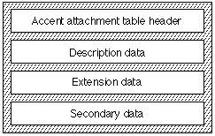

# The `'acnt'` table

## Introduction

The *accent attachment table* (tag name: `'acnt'`) provides a space-efficient method of combining component glyphs into compound glyphs to form accents. Accented glyphs are a very restricted subclass of compound glyphs. Their characteristics are described as follows:

- An accented glyph is formed from one primary component and one or more secondary components.
- Except for the actual outline, all properties of an accented glyph are shared with the primary component or is derivable from the properties of the primary and secondary glyphs. Examples include metrics, kerning values, and postscript names.
- The components cannot be accented glyphs.
- Components must be outlines, not bitmaps.
- Every accented glyph must have a unique glyph index. The glyph indices for the accented glyphs must be contiguous and must begin with an index greater than the highest index for regular glyphs.
- A font cannot have more than 32,768 primary components.
- A font cannot have more than 255 secondary components.
- The only mechanism for positioning of secondary components on primary components is the matching of attachment points.
- A secondary component can have only one attachment point.
- Every different accented glyph must have a unique glyph index and data must be provided to specify how each secondary component is attached to the primary component in each accented glyph.

The accent attachment table requires the following storage space:

- Single accent glyphs: 4 bytes.
- Multiple accent glyphs: 4 bytes + 2 bytes per accent.
- Secondary glyphs: 3 bytes.

## Accent Attachment Table Formats

An accent attachment table consists of a header, description data, extension data, and secondary data. The overall structure of the accent attachment table is shown in the following figure:

The accent attachment table format is as follows:

| Type | Name | Description |
| --- | --- | --- |
| fixed32 | version | Version number of the accent attachment table (0x00010000 for the current version). |
| uint16 | firstAccentGlyphIndex | The first accented glyph index. |
| uint16 | lastAccentGlyphIndex | The last accented glyph index. |
| uint32 | descriptionOffset | Offset in bytes to the description data. |
| uint32 | extensionOffset | Offset in bytes to the extension data. |
| uint32 | secondaryOffset | Offset in bytes to the secondary data. |
| variable | glyphs\[numberOfAccentedGlyphs\] | <!-- colspan --> |
| variable | ext\[numberOfGlyphsWithMoreThan2Components\] | <!-- colspan --> |
| variable | accents\[numberOfSecondaryGlyphs\] | <!-- colspan --> |

### Format 0 description

| Type | Name | Description |
| --- | --- | --- |
| uint1 | description | Value = 0 indicates that there are only two components. |
| uint15 | primaryGlyphIndex | Number of columns of data. |
| uint8 | primaryAttachmentPoint | Primary attachment control point number. |
| uint8 | secondaryInfoIndex | Secondary attachment control point number. |

### Format 1 description

| Type | Name | Description |
| --- | --- | --- |
| uint1 | description | Value = 1 indicates that there are more than two components |
| uint15 | primaryGlyphIndex | Primary glyph index number. |
| uint16 | extensionOffset | Byte offset to the beginning of the extensions subtable. |

### Extension format

| Type | Name | Description |
| --- | --- | --- |
| uint1 | components | Value = 0 indicates that there are more components. Value = 1 indicates that this is the last component. |
| uint7 | secondaryInfoIndex\[numberComponents\] | Secondary information index for the first component. |
| uint8 | primaryAttachmentPoint\[numberComponents\] | Primary attachment control point for the first component. |

### Secondary data format

| Type | Name | Description |
| --- | --- | --- |
| uint16 | secondaryGlyphIndex | Secondary glyph index. A maximum of 255 entries are allowed. |
| uint8 | secondaryGlyphAttachmentNumber | Secondary glyph attachment index number. |

### General comments

Each accented glyph is described by one description entry in the `glyphs` array of this table. If the glyph consists of only a baseform and a single accent, then format 0 is used for the description. It specifies the index of the primary glyph in the 'glyf' table, the point index of the attachment point in the primary glyph, and the index into the secondary data table for the accent. The indexed entry in the secondary data table specifies the index of the accent glyph in the 'glyf' table and the point index of the attachment point in the accent glyph.

If the accented glyph has a baseform and two or more accents, it is described by a format 1 description. This description specifies the index of the primary glyph in the 'glyf' table and a byte offset into the extension subtable (the offset is from the beginning of the extension data). The entry in the extension table specifies any number of accents to be attached to the primary form. Each subentry specified the index into the secondary data for the accent, the point index of the attachment point in the primary glyph, and a flag for whether there are more entries. Accents are added to the primary glyph until a flag value of 1 is encountered, which means this is the last component.

## Availability

The `'acnt'` table is not currently supported on OS X or iOS. Its use is discouraged.
