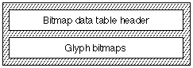
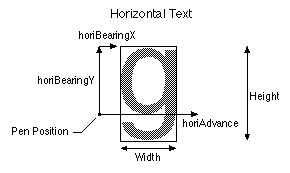
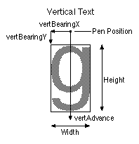

# The `'bdat'` table

## Introduction

The *bitmap data table* (tag name: `'bdat'`) is a very simple structure; a version number followed by data. The data can be in various formats. Some of the formats contain metric information and other formats contain only the image. Some of the data may be compressed and other data may not. The [bitmap location table](bloc.md) contains the information to locate and understand how to interpret the data contained in this table. The association of a particular bitmap with a particular glyph and point size is handled by the bitmap location table. The bitmap location table provides information about the availability of bitmap data in this table at requested sizes and indicates whether or not bitmaps are available. It also gives the offset location into this table for the bitmap data for a particular glyph. For mono-spaced glyphs the bitmap location table contains the metric information.

## Bitmap Data Table Formats

The overall structure of the bitmap data table is shown in the following figure:

The format of the bitmap data table header is as follows:

| Type | Name | Description |
| --- | --- | --- |
| fixed32 | version | Version number of the bitmap data table (0x00020000 for the initial version). |
| variable | glyphbitmap\[numberBitMaps\] | The set of bitmapped glyphs included for this font. Formats are 1, 2, 4, 5, 6, and 7. |

There are six glyph bitmap formats supported by AAT. Some of the formats are designed to handle proportional glyphs, others are more applicable to mono-spaced glyphs. Within a given font, various formats can be used. For example, a kanji font will have the first few hundred glyphs in format 7 (proportional bit) and the next 7000 glyphs in format 5 (monospaced).

The bitmap data format codes are as follows:

| Format | Name | Description |
| --- | --- | --- |
| 1 | [proportionalFormat1](#anchor-bdat-Format1) | Small metrics and byte-aligned images. |
| 2 | [proportionalFormat2](#anchor-bdat-Format2) | Small metrics and bit-aligned images. |
| 3 | (not used) | (not used) |
| 4 | [monoCompressedFormat4](#anchor-bdat-Format4) | Just compressed images, metrics are in the bitmap location table. |
| 5 | [monoFormat5](#anchor-bdat-Format5) | Just bit-aligned images, metrics are in the bitmap location table. |
| 6 | [proportionalByteFormat6](#anchor-bdat-Format6) | Big metrics and byte-aligned images. |
| 7 | [proportionalBitFormat7](#anchor-bdat-Format7) | Big metrics and bit-aligned images. |

Note that four of these formats handle proportional bitmap data.

- Formats 1 and 2 are the same except for the alignment of the bitmap data. Both have small metrics.

- Format 4 is a modified Huffman encoding scheme, and contains metric information and offsets to binary search trees and glyph data.

- Format 5 is a simple format of bit-aligned bitmaps, padded to a byte boundary. All the metric information is in the format 2 index subtable of the bitmap location table. This format is a real space saver for glyphs that share the same metrics (for example, monospaced Chinese, Japanese or Korean glyphs). It is similar to formats 2 and 7, except that no metric information is included, just the bit-packed bitmaps.

  **NOTE**: The data for a Format 5 table most likely will have some white lines above and below some of the glyphs. In other words, the bitmap will not have a tight bounding box around the black bits of the glyph. This is a small price since most of the glyphs should be tight and the savings of being able to share the metrics makes up for extra white pixels. In cases where it doesn't, this format should not be used.

- Formats 6 and 7 are the same except for the alignment of the bitmap data. Both have big metrics.

Most of the formats have metric information in either `bigGlyphMetrics` or `smallGlyphMetrics`. The big metrics contain both horizontal and vertical metrics whereas the small metrics only hold metrics for one direction.

Structure of the `bigGlyphMetrics` is shown in the following table:

| Type | Name | Description |
| --- | --- | --- |
| uint8 | height | Number of rows of data. |
| uint8 | width | Number of columns of data. |
| sint8 | horiBearingX | Distance in pixels from the horizontal origin to the left edge of the bitmap. |
| sint8 | horiBearingY | Distance in pixels from the horizontal origin to the top edge of the bitmap. |
| uint8 | horiAdvance | Horizontal advance width in pixels. |
| sint8 | vertBearingX | Distance in pixels from the vertical origin to the left edge of the bitmap. |
| sint8 | vertBearingY | Distance in pixels from the vertical origin to the top edge of the bitmap. |
| uint8 | vertAdvance | Vertical advance width in pixels. |

Structure of the `smallGlyphMetrics` is shown in the following table:

| Type | Name | Description |
| --- | --- | --- |
| uint8 | height | Number of rows of data. |
| uint8 | width | Number of columns of data. |
| sint8 | bearingX | Distance in pixels from the horizontal origin to the left edge of the bitmap (for horizontal text); or distance in pixels from the vertical origin to the top edge of the bitmap (for vertical text). |
| sint8 | bearingY | Distance in pixels from the horizontal origin to the top edge of the bitmap (for horizontal text); or distance in pixels from the vertical origin to the left edge of the bitmap (for vertical text). |
| uint8 | advance | Horizontal or vertical advance width in pixels. |

The figures below show the meaning of the metrics. Possible values for the 'g' glyph below could be: `horiBearingX` = 2, `horiBearingY` = 11; `horiAdvance` = 12; `vertBearingX` = -3; `vertBearingY` = -2; `vertAdvance` = 20 (note: although the advance is in the -y direction, it is still unsigned since it is a distance and not a direction; the direction of vertical text is assumed top to bottom); `height` = 16; and `width` = 9. Remember that we are dealing with integer metrics.

If you use `smallGlyphMetrics`, you must set the bit in the `bitmapSizeTable.flags` of the bitmap location table to the inform the scaler as to the orientation of the metrics (using `bitmapFlags`).

Format 1 glyph bitmap has the following format:

| Type | Name | Description |
| --- | --- | --- |
| smallGlyphMetrics | smallMetrics | Metric information for the glyph. |
| variable | imageData | Byte-aligned bitmap data. |

Format 2 glyph bitmap has the following format:

| Type | Name | Description |
| --- | --- | --- |
| smallGlyphMetrics | smallMetrics | Metric information for the glyph. |
| variable | imageData | Bit-aligned bitmap data padded to a byte boundary. |

Format 4 glyph bitmap has the following format:

| Type | Name | Description |
| --- | --- | --- |
| uint32 | whiteTreeOffset | Offset to the white tree. |
| uint32 | blackTreeOffset | Offset to the black tree. |
| uint32 | glyphDataOffset | Offset to the glyph data. |
| variable | trees and glyph data | The white tree, black tree, and glyph is found after all of the glyph bitmap 4 data arrays. |

Format 5 glyph bitmap has the following format:

| Type | Name | Description |
| --- | --- | --- |
| variable | imageData | Bit-aligned bitmap data padded to byte boundaries. |

Format 6 glyph bitmap has the following format:

| Type | Name | Description |
| --- | --- | --- |
| bigGlyphMetrics | bigMetrics | Metric information for the glyph. |
| variable | imageData | Byte-aligned bitmap data. |

Format 7 glyph bitmap has the following format:

| Type | Name | Description |
| --- | --- | --- |
| bigGlyphMetrics | bigMetrics | Metric information for the glyph. |
| variable | imageData | Bit-aligned bitmap data. |

## Dependencies

A `'bdat'` table is inextricably connected with the font's [`'bloc'` (bitmap location) table](bloc.md). If one is present, the other must be, too, and a change to one will almost inevitably trigger a change in the other.

As a rule, most font editing tools will probably find it more convenient to read and write the two tables simultaneously rather than treat them separately. This, for example, is done by Apple’s ftxdumperfuser tool.
