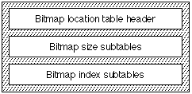
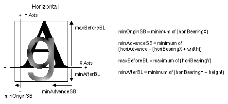
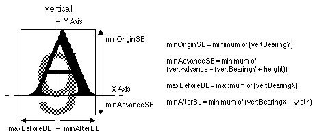

# The `'bloc'` table

## General table information

### Introduction

The *bitmap location table* (tag name: `'bloc'`) provides information about the availability of bitmaps at requested point sizes. If a bitmap is included in the font, it also tells where the data is located in the [bitmap data table](bdat.md). The bitmap location and bitmap data tables support various formats.

While the format theoretically permits some features like sparse glyph sets, implementations may not support these features. It's usually best to check with the software provider to see how much of this (or, indeed, any) table is supported.

---

### Bitmap Location Table Format

The overall structure of the bitmap location table is shown in the following figure:

The header for the bitmap location table is shown in the following table:

| Type | Name | Description |
| --- | --- | --- |
| fixed | version | Version number of the bitmap location table (0x00020000 for the initial version). |
| uint32 | numSizes | The number of bitmapSizeTables in this table. |
| variable | bitmapSizeTable\[numSizes\] | Subtables describing the general characteristics of the bitmapped glyphs in this font. Also contains the indexSubTableArrayOffset. |

Each `bitmapSizeTable` subtable provides information about the global characteristics of a particular set of bitmaps.

**Note:** The sizes must be sorted in ascending order.

The format for the `bitmapSizeTable` (which refers to the `indexSubTableArray`, which in turn refers to an `indexSubTable`) is shown in the following table:

| Type | Name | Description |
| --- | --- | --- |
| uint32 | indexSubTableArrayOffset | Offset to corresponding index subtable array from the beginning of the 'bloc'. |
| uint32 | indexTableSize | Length of corresponding index subtables and array |
| uint32 | numberOfIndexSubTables | Number of index subtables (there is one for each range or format change). |
| uint32 | colorRef | Set to 0, ignore for now. |
| sbitLineMetrics | hori | Horizontal line metrics. |
| sbitLineMetrics | vert | Vertical line metrics. |
| uint16 | startGlyphIndex | Lowest glyph index for this size. |
| uint16 | endGlyphIndex | Highest glyph index for this size. |
| uint8 | ppemX | Target horizontal ppem. |
| uint8 | ppemY | Target vertical ppem. |
| uint8 | bitDepth | Bit depth of the strike. |
| uint8 | flags | See [table](#anchor-bloc-Flags) below; first two bits are for orientation, vertical or horizontal. |

The `indexSubTableArrayOffset` is the offset from the beginning of the `'bloc'` table to the indexSubTableArray. Each strike has one of these arrays to support various formats and discontiguous ranges of bitmaps. This array is described in more detail below.

The `indexTableSize` is the total number of bytes in the index subtable array and the associated index tables.

The `numberOfIndexSubTables` is a count of the index tables for this strike.

The `colorRef` is put in for future enhancements that are not currently supported by the TrueType scaler, but these fields are already in use by other platforms, and are defined as follows.

- If `bitDepth` = 1 and `colorRef` = 0, then the glyphs are 1 bit per pixel. (AAT fonts should only use this set of values).
- If `bitDepth` = *n* and `colorRef` = 0, then the glyphs are black-and-white, but pre-expanded for drawing into that particular bit depth (e.g. a 2, 4, 8, 16, 24-bit screen).
- If `bitDepth` = *n* and `colorRef` = *m*, then these are complex multi-bit glyphs, and the data pointed to by the `colorRef` determines what they mean. These could be color fonts, anti-aliased fonts, grey levels, or anything else. If the `colorRef` is anything but zero, the sfnt must have a `'colr'` table. The `colorRef` is used with this table to get more information on the sbit. A separate table is used (instead of an offset in the `'bloc'` table) since a color table has implications outside of the scope of sbits.

To recap, the `bitDepth` is what it says, the depth of this strike. This is useful for greyscale or color fonts. To maintain compatibility with scalers that will read `sbit` data, the following table shows how the `colorRef` and `bitDepth` values are used:

| bitDepth | colorRef | Meaning |
| --- | --- | --- |
| 1 | 0 | Standard 1-bit font. |
| *n* | 0 | Multi-bit black and white font. |
| *n* | *m* | Color, grayscale, anti-aliased, etc. |

The horizontal and vertical line metrics follow. These contain the ascender, descender and maximum pixel width information. Additionally, the caret information used by AAT Line Layout is included. The slope is used to determine the angle at which the caret is to be drawn and the offset is how many pixels (plus or minus) to move the caret. This is a signed `char` value (and not a `fixed`) since we are dealing with integer metrics. The `minOriginSB`, `minAdvanceSB`, `maxBeforeBL`, and `minAfterBL` values are described below. These values are primarily used by scalers that may need to pre-allocate memory and/or need more metric information to position glyphs. These numbers are not used by the sbit scaler on the Macintosh, but may be used on other platforms.

The global metric information about the strike is kept in a `sbitLineMetrics` record, one for the horizontal metrics and one for the vertical. The format of the `sbitLineMetrics` record is shown in the following table:

| Type | Name | Description |
| --- | --- | --- |
| int8 | ascender | This is the spacing of the line before the baseline. |
| int8 | descender | This is the spacing of the line after the baseline. |
| uint8 | widthMax | Maximum pixel width of glyphs in strike. (Not used by AAT, may be used by other platforms.) |
| int8 | caretSlopeNumerator | Rise of the caret slope, typically set to 1 for non-italic fonts. |
| int8 | caretSlopeDenominator | Run of the caret slope, typically set to 0 for non-italic fonts. |
| int8 | caretOffset | Offset in pixels to move the caret for proper positioning. |
| int8 | minOriginSB | Minimum of horiBearingX (or vertBearingY for a vertical font). |
| int8 | minAdvanceSB | Minimum of horiAdvance - horiBearingX + width (or vertAdvance - vertBearingY + height for a vertical font). (Not used by AAT, may be used by other platforms) |
| int8 | maxBeforeBL | Maximum of horiBearingY (or vertBearingY for a vertical font). (Not used by AAT, may be used by other platforms) |
| int8 | minAfterBL | Minimum of horiBearingY - height (or vertBearingX - width for a vertical font). (Not used by AAT, may be used by other platforms) |
| int16 | pad | Padding to make long aligned. |

An example of the `minOriginSB`, `minAdvanceSB`, `maxBeforeBL`, and `minAfterBL` values for horizontal text is given in the following figure. These values are calculated from the min and max values of the glyph metrics, which come from the [bitmap data table](bdat.md).

The same fields used in vertical text are shown in Figure 20-3.

Most of the formats have metric information in either `bigGlyphMetrics` or `smallGlyphMetrics`. The big metrics contain both horizontal and vertical metrics whereas the small metrics only hold metrics for one direction. The `bitmapSizeTable.flag` field indicates if the small metrics are horizontal or vertical for a given strike (see the following table for the flag values). The scaler makes up fake metrics for the orientation that is not included.

| Mask | Name | Meaning |
| --- | --- | --- |
| 0x01 | flgHorizontal | Small metrics are horizontal for the given strike. |
| 0x02 | flgVertical | Small metrics are vertical for the given strike. |

The index subtable array contains the glyph ranges and offsets to indexes within this table. After determining the strike to use the scaler goes to this array to search for the index that contains the glyph number. When the index is found it will be an offset to an index subtable. The index subtable array is located via the `indexSubTableArrayOffset` in the corresponding `bitmapSizeTable`. The first `indexSubTableArray` is after the last `bitmapSizeTable` entry. Then the index subtables for the strike follow. The next `indexSubTableArray` (if more than one strike exists) and its index subtables are next. Each of the indexes must start on a long boundary; when using format 3, sometimes an extra `uint16` is needed in the offset array for padding. This table then continues with this array and indexes for each strike.

The format of the `indexSubTableArray` is shown in the following table:

| Type | Name | Description |
| --- | --- | --- |
| uint16 | firstGlyphIndex | Index of first glyph in this range. |
| uint16 | lastGlyphIndex | Index of last glyph in this range. |
| uint32 | additionalOffsetToIndexSubtable | Used to reach the indexSubTable; add to indexSubTableArrayOffset to get the offset from the beginning of the 'bloc' table. |

Finally we get to the index subtable. Currently there are two formats of indexes: one for proportional data and one for monospaced data. Whether the data is fixed size or variable size determines which index to use. Note: the format of the `'bdat'` data can be in any format. It is not determined by the index format. The index tells us where the information for a particular glyph starts in the `'bdat'` and how large the data is. The size of the data for the glyph is the difference of `offsetArray`\[*glyphIndex+1*\] - `offsetArray`\[*glyphIndex*\]. The format 1 index subtable is the proportional format index. This will be used for most roman fonts and the first 200 or so glyphs in large Chinese, Japanese or Korean fonts. The `imageFormat` tells us what kind of data is in the [bitmap data table](bdat.md).

Each index subtable provides information about the location of the actual bitmap data for each glyph in the font. The indexSubTables that actually contain the location of the glyph data in the `'bdat'` table come in three formats. Format 1 is for proportionally spaced glyphs. Format 2 is for mono-spaced glyphs. Format 3 is also for proporionally spaced glyphs but uses an array of uint16 instead of uint32 and is thus a compressed form of format one. Each of the indexSubTables have an indexSubHeader. The format of the index subheader is shown in the following table:

| Type | Name | Description |
| --- | --- | --- |
| uint16 | indexFormat | Format number (1 is proportional with 4-byte offset deltas, 2 is monospaced, and 3 is proportional with 2-byte offset deltas). |
| uint16 | imageFormat | Code for the kind of image data. See the description of the `'bdat'` table for the interpretation of this value. |
| uint32 | imageDataOffset | Offset to the base of the image data for this index subtable. |

In format 1 and format 3, data are stored contiguously so that the length of the data for any glyph is given by subtracting the location for the glyph from the location of the next glyph. If the length is zero, then no bitmap is available for that glyph in that bitmap set. The Format 1 bitmap index subtable is shown in the following table:

| Type | Name | Description |
| --- | --- | --- |
| indexSubHeader | header | Header info as described above. |
| uint32 | offsetArray\[\] | offsetArray\[glyphIndex\] + imageDataOffset = start of the bitmap data for the glyph. |

The format 3 index subtable is also a proportional format index. It is just like format 1 except the offsets are shorts instead of longs.

The Format 3 bitmap index subtable is shown in the following table:

| Type | Name | Description |
| --- | --- | --- |
| indexSubHeader | header | Header info as described above. |
| uint16 | offsetArray\[\] | offsetArray\[glyphIndex\] + imageDataOffset = start of the bitmap data for the glyph. |

For monospaced fonts the metrics are the same and only the bitmap changes. For those we use format 2 index subtables. The metrics are not in the bitmap data table, but rather are here in the subTable. Only the actual bitmap data is put in the bitmap data table for these glyphs. The data can be in various formats; byte aligned, bit aligned, compressed, etc. The size of all the bitmap data needed to be read in from the bitmap data table is the `imageSize`. The `imageDataOffset` is the offset into the bitmap data table for the first of this range of glyphs. The rest of the glyphs can easily be found by multiplying the `imageSize` by the difference (*theDesiredGlyphIndex* - *firstGlyphIndexInThisRange*), and then adding the result to the `imageDataOffset` in the header of the index header.

The Format 2 bitmap index subtable is shown in the following table:

| Type | Name | Description |
| --- | --- | --- |
| indexSubHeader | header | Header info as described above. |
| uint32 | imageSize | All the glyphs are of the same size. May be compressed, bit-aligned, or byte-aligned. |
| bigGlyphMetrics | bigMetrics | All the glyphs share the same metrics. |

The metric information for index type 2 glyphs is of type bigGlyphMetrics, which is documented in the [bitmap data table](bdat.md) documentation.

## Platform-specific Information

Embedded bitmaps intended for use with OS X 8.5 and earlier versions of OS X *must* contain one bitmap glyphs for every glyphs in the font. Sparse bitmaps are not allowed on OS X.

The fields `minOriginSB`, `minAdvanceSB`, `maxBeforeBL`, and `minAfterBL` in the `sbitLineMetrics` records are not used on OS X.

## Dependencies

A `'bloc'` table is inextricably connected with the font's [`'bdat'` (bitmap data) table](bdat.md). If one is present, the other must be, too, and a change to one will almost inevitably trigger a change in the other.

As a rule, most font editing tools will probably find it more convenient to read and write the two tables simultaneously rather than treat them separately. This, for example, is done by Apple’s ftxdumperfuser tool.

The number of glyphs in the embedded bitmaps as indicated for the font's individual point sizes must be equal to the number of glyphs in the font as contained in the [`'maxp'` (maximum profile) table](maxp.md).
