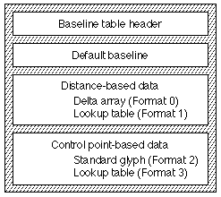
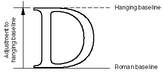
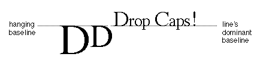
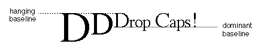
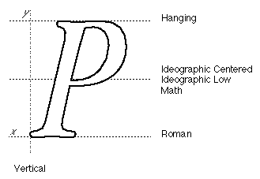
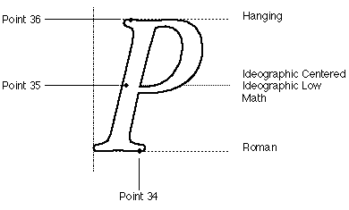
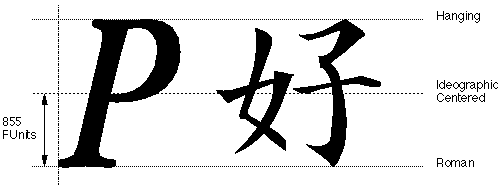

# The `'bsln'` table

## Introduction

The *baseline table* (tag name: `'bsln'`) allows you to design your AAT fonts to accommodate the automatic alignment of text to different baselines. All fonts have a natural baseline defined by the position of each glyph in the font's em-square. AAT fonts may include additional information which identifies other baseline positions to which glyphs may be aligned.

Baseline positions can be included representing a Roman baseline, an ideographic baseline (either centered or lowered), a hanging baseline, and a mathematical baseline.

Two kinds of information are included in a baseline table: baseline positions, which allow the alignment of runs of text; and baseline values, which for each glyph in the font identify which baseline position is its default baseline position. In a font containing glyphs from multiple languages, such as English and Japanese, the baseline values can identify which glyphs belong to which default baseline positions -- the English glyphs to the Roman default baseline, and the Japanese glyphs to the ideographic centered default baseline.

There are 32 pre-defined baseline values. Baselines with values of 0 through 4 should be provided for all horizontal AAT fonts. The remaining values are reserved for future use:

| Value | Description |
| --- | --- |
| 0 | Roman baseline. This defines the alignment used in most Latin script languages, where most of the glyph is above the baseline, with portions (such as descenders) possibly below it. The baseline appears near the bottom of the entire line. |
| 1 | Ideographic centered baseline. This defines the behavior used by Chinese, Japanese and Korean ideographic scripts, which center themselves halfway through the line height. |
| 2 | Ideographic low baseline. This also defines behavior used in Chinese, Japanese and Korean, like the previous value, but with the glyphs lowered slightly so that ideographs that appear adjacent to Latin characters appear to descend slightly below the roman baseline. |
| 3 | Hanging baseline. This defines the alignment used in Devanagari and derived scripts, where most of the bulk of the glyphs are below the baseline, with some portions possibly above it, and where the baseline itself appears near the top of the line. This value is also used for drop capitals. |
| 4 | Math baseline. This defines the alignment used for setting mathematics, where operators like the minus sign need to be centered. It will usually be set at half the x-height in a font. |

## Baseline Table Format

A baseline table consists of a baseline table header, a default baseline, and either a distance-based array (Formats 0 or 1) or a control point-based array (Formats 2 or 3) containing the format-specific baseline data. The font developer must choose between using distance-based data or control point-based data. Only one of these is present in any one font. The overall structure of the baseline table is shown here:

The baseline table format is as follows:

| Type | Name | Description |
| --- | --- | --- |
| fixed32 | version | Version number of the Baseline table (0x00010000 for the current version). |
| uint16 | format | Format of the baseline table. Only one baseline format may be selected for the font. |
| uint16 | defaultBaseline | Default baseline value for all glyphs. This value can be from 0 through 31. |
| variable | parts | Format-specific data. This will be either a Format0Part, a Format1Part, a Format2Part or a Format3Part, depending on the value of the format field. |

There are four defined values for the `format` field of the `'bsln'` table, and associated with each value is a record that contains format-specific data. Baseline tables can have one of the following formats:

| Value | Description |
| --- | --- |
| 0 | Distance-based, no mapping. |
| 1 | Distance-based, with mapping. |
| 2 | Control point-based, no mapping. |
| 3 | Control point-based, with mapping. |

Depending on the value of the format field, the value of the `defaultBaseline` field may apply to all the glyphs of the font (with Formats 0 or 2) or may apply just to those glyphs of the font that do not have specific mapping data (Formats 1 and 3).

Format 1 and Format 3 Baseline tables use [lookup table](Tables.md#anchor-Tables-LookupTables) to associate a baseline value with a particular glyph. This is how to intrepret the lookup value for each of the five lookup table formats:

| Lookup format | Interpretation |
| --- | --- |
| 0 | Array of 16-bit baseline values, one for each glyph in the font. |
| 2 | The value of each lookupSegment is a 16-bit baseline value. |
| 4 | The value of each lookupSegment is a 16-bit offset from the start of the lookup table to an array of 16-bit baseline values, one for each glyph in the segment. |
| 6 | The value of each lookupSingle is a 16-bit baseline value for that glyph. |
| 8 | The valueArray is an array of 16-bit baseline values, one for each glyph in the trimmed array. |

### Format 0 Baseline Table

A format 0 baseline table has a single default baseline value for all glyphs in the font (the `defaultBaseline` field of the header). Baseline positions -- the distances from the natural baseline to a given baseline -- are given in `FUnit` distance units. There is no mapping table associated with this format. There is no lookup table associated with this format. The format-specific part is called a `Format0Part`, and has the following format:

| Type | Name | Description |
| --- | --- | --- |
| int16 | deltas\[\] | These are the FUnit distance deltas from the font's natural baseline to the other baselines used in the font. A total of 32 deltas must be assigned. |

### Format 1 Baseline Table

A format 1 baseline table has a single default baseline designated for all glyphs in the font (the `defaultBaseline` field) and a lookup table that allows different glyphs in the font to have different dominant baselines. Glyphs not covered by the mapping table use the default baseline. The format-specific part is called a `Format1Part`, and has the following format:

| Type | Name | Description |
| --- | --- | --- |
| int16 | deltas\[\] | These are the FUnit distance deltas from the font's natural baseline to the other baselines used in the font. A total of 32 deltas must be assigned. |
| LookupTable | mappingData | Lookup table that maps glyphs to their baseline values. See above for interpretation of the lookup values. |

### Format 2 Baseline Table

A format 2 baseline table designates a single default baseline value for all glyphs in the font. It also designates one particular glyph in the font, called the *standard glyph*, as having a set of control points. After instructions have been applied to this glyph, these control points define the baseline positions. There is no lookup table associated with this format. The format-specific part is called a `Format2Part`, and has the following format:

| Type | Name | Description |
| --- | --- | --- |
| uint16 | stdGlyph | The specific glyph index number in this font that is used to set the baseline values. This is the standard glyph. This glyph must contain a set of control points (whose numbers are contained in the ctlPoints field) that are used to determine baseline distances. |
| uint16 | ctlPoints\[\] | Set of control point numbers, associated with the standard glyph. A value of 0xFFFF means there is no corresponding control point in the standard glyph. A total of 32 control points must be assigned. |

### Format 3 Baseline Table

A format 3 baseline table designates a single default baseline value for all glyphs in the font and a lookup table that allows different glyphs in the font to have different designated default baselines. It also designates one particular glyph in the font called the standard glyph, as having a set of control points that, after hinting, will be used to define the baseline positions. The format-specific part is called a `Format3Part`, and has the following format:

| Type | Name | Description |
| --- | --- | --- |
| uint16 | stdGlyph | Glyph index of the glyph in this font to be used to set the baseline values. This glyph must contain a set of control points (whose numbers are contained in the following field) that determines baseline distances. |
| uint16 | ctlPoints\[\] | Array of 32 control point numbers, associated with the standard glyph. A value of 0xFFFF means there is no corresponding control point in the standard glyph. |
| LookupTable | mappingData | Lookup table that maps glyphs to their baseline values. See above for interpretation of the lookup values. |

## Baseline Table Examples

### Example: Using Baselines

You can use the `'bsln'` table to define multiple baselines within your font. In the following figure, the uppercase glyph "D" sits in the em square. The natural baseline is at y = 0 in font coordinates. In the absence of any other information, different sizes of this glyph render with this line in common -- that is, the pen will always rest on this line. This example uses the distance formats.

The next figure shows that a second baseline, marked as a hanging baseline, has been added to the first. The roman baseline is the same as the font's natural baseline, so the delta between the two is zero. The hanging baseline is above the natural baseline by some distance. In this font's coordinate system, "up" is towards more positive coordinates, so the shift is a positive value.

Let's look at an example of how these distances get applied. In the next figure, the initial text begins with three uppercase D glyphs at different sizes. The user specifies that the first two uppercase D glyphs should have a hanging baseline.

The first step is to resolve all baselines to the line of text's dominant baseline (which, in this example is Roman). In the next figure, the first two uppercase D glyphs are now hanging from the hanging baseline, which is aligned to the main text's baseline.

The final step is shown in the next figure. The hanging baseline of the first two uppercase D glyphs is aligned to the hanging baseline of the main text. The dominant baseline for this run of text remains the Roman baseline.

### Example: Assigning Baseline Delta Values and Control Points

AAT fonts require assignment of delta values or control points in the baseline table for all baselines used in the font. Values may either be distance- based or control point-based. Fonts that use control points retain baseline information on the screen better at small point sizes than fonts using distance-based baseline tables.

#### Distance-Based Formats

Format 0 and 1 baseline tables are distance-based in that they specify baseline delta values in pure FUnits. The delta values are the distances from the natural baseline to the specified baseline. AAT fonts require assignment of delta values in the baseline table for all baselines used in the font.

Consider a glyph of a "P" with an em-square of 1000, an ascender of 932, a decender of -482, and a Roman baseline. A possible assignment of baseline deltas for this glyph and other glyphs is shown in this figure:

The following table summarizes the baseline data for a distance-based baseline table.

| Baseline | Baseline value | Delta value (FUnits) |
| --- | --- | --- |
| Roman | 0 | 0 |
| Ideographic Centered | 1 | 352 |
| Ideographic Low | 2 | 352 |
| Hanging | 3 | 705 |
| Math | 4 | 352 |

#### Control Point-based Formats

Format 2 and 3 baseline tabled are control point-based in that they specify a particular glyph in the font as being the "standard glyph" with a set of control points that, after hinting, are used to define the baselines.

Again, consider a glyph of a "P" with an em-square of 1000, an ascender of 932, a decender of -482, and a Roman dominant baseline. A possible assignment of control points for this standard glyph is shown in this figure:

The following table summarizes the baseline data for a control point-based baseline table.

| Baseline | Baseline value | Control point |
| --- | --- | --- |
| Roman | 0 | 34 |
| Ideographic Centered | 1 | 35 |
| Ideographic Low | 2 | 35 |
| Hanging | 3 | 36 |
| Math | 4 | 35 |

### Example: Format 1 Baseline Table

Perhaps you want to create a baseline table for a font containing mixed kanji and Roman glyphs. All of the Roman glyphs should have the Roman baseline value, and all the kanji glyphs should have the ideographic centered baseline value.

The suppositions made in this example are as follows:

- The Roman glyphs occupy glyph indices 2 through 270, and the kanji glyphs occupy glyph indices 271 through 8200.
- The intrinsic baseline of the kanji glyphs is roman-style (that is, the glyphs sit on the bottom of the em-square).
- There is a difference of 855 FUnits between the roman and ideographic centered baselines.
- The cap height for the roman letters is 1520 FUnits. (In this example, the cap height is equivalent to the hanging baseline measurement.)

The following figure shows the baseline table Format 1 baseline assignments for this example font.

The following table shows how to build a Format 1 baseline table for the example font.

| Offset/length | Value | Name | Comment |
| --- | --- | --- | --- |
| 0/4 | 0x00010000 | version | Version number of the baseline table, in fixed-point format. |
| 4/2 | 1 | format | Format of the baseline table. This baseline table will use the distance-based deltas with lookup tables. |
| 6/2 | 1 | defaultBaseline | The default baseline is the ideographic centered baseline having baseline value&nbsp;= 1. By specifying this value, we only need to include the Roman glyphs in the lookup table. The kanji glyphs are already on the default baseline. |
| (The baseline table's `Format1Part` starts here) | <!-- colspan --> | <!-- colspan --> | <!-- colspan --> |
| 8/2 | 0 | delta | Delta in FUnits from default baseline to Roman baseline (baseline value = 0). |
| 10/2 | 855 | delta | Delta in FUnits from default baseline to ideographic centered baseline (1). |
| 12/2 | 0 | delta | No delta value for ideographic low baseline (2). |
| 14/2 | 1520 | delta | Delta in FUnits from default baseline to hanging baseline (3). |
| 16/56 | 0 | No | delta values for baseline values 4 through 31. |
| (The lookup table of the `Format1Part` starts here) | <!-- colspan --> | <!-- colspan --> | <!-- colspan --> |
| 72/2 | 2 | format | Lookup table Format 2 (means a [segment single](Tables.md#anchor-Tables-LookupFormat2) table format). |
| (The next 5 fields are the lookup table's `BinSrchHeader`) | <!-- colspan --> | <!-- colspan --> | <!-- colspan --> |
| 74/2 | 6 | unitSize | Size of a LookupSegment record (2 bytes for the starting glyph index, 2 bytes for the ending glyph index, and 2 bytes for the baseline value). |
| 76/2 | 1 | nUnits | Number of units of the preceding size to be searched. |
| 78/2 | 6 | searchRange | The unitSize times the largest power of two that is less than or equal to nUnits. |
| 80/2 | 0 | entrySelector | The log base 2 of the largest power of two less than or equal to nUnits. |
| 82/2 | 0 | rangeShift | The unitSize times the difference of nUnits minus the largest power of two less than or equal to nUnits. |
| (First `LookupSegment` for Roman glyphs) | <!-- colspan --> | <!-- colspan --> | <!-- colspan --> |
| 84/2 | 270 | lastGlyph | Ending glyph index for the Roman glyphs. |
| 86/2 | 2 | firstGlyph | Starting glyph index for the Roman glyphs. |
| 88/2 | 0 | value | Roman baseline value = 0 for the Roman glyphs in this range. |
| (Last `LookupSegment`) | <!-- colspan --> | <!-- colspan --> | <!-- colspan --> |
| 90/2 | 0xFFFF | lastGlyph | Special value for the last glyph in the last lookup segment. |
| 92/2 | 0xFFFF | firstGlyph | Special value for the first glyph in the last lookup segment. |
| 94/2 | 0 | value | Termination value. |

### Example: Format 3 Baseline Table

This example uses the same basic setup as previous example of a baseline table Format 1, with the addition of control point information for more accurate placement of baseline shifts. Let's imagine we've designated glyph 22 as the glyph containing the control point information. That glyph will have control point #80 at the Roman baseline, control point #81 at the ideographic centered baseline, and control point #82 at the hanging baseline.

Table 3-9 shows how to build a Format 3 baseline table for the example font.

| Offset/length | Value | Name | Comment |
| --- | --- | --- | --- |
| 0/4 | 0x00010000 | version | Version number of the baseline table, in fixed-point format, is 1.0. |
| 4/2 | 3 | format | A Format 3 baseline table. |
| 6/2 | 1 | defaultBaseline | The default baseline is the ideographic centered baseline. |
| (The baseline table's `Format3Part` starts here) | <!-- colspan --> | <!-- colspan --> | <!-- colspan --> |
| 8/2 | 22 | stdGlyph | Glyph index of the standard glyph, which contains the control point information. |
| 10/2 | 80 | ctlPoint | Control point for Roman baseline in the standard glyph (baseline value 0). |
| 12/2 | 81 | ctlPoint | Control point for ideographic centered baseline in the standard glyph (baseline value 1). |
| 14/2 | 0xFFFF | ctlPoint | This special value means there is no control point for the ideographic low baseline class (baseline value 2). |
| 16/2 | 82 | ctlPoint | Control point for hanging baseline in the standard glyph (baseline value 3). |
| 18/56 | 0xFFFF | ctlPoint | This special value means there are no control points for baseline classes 4 through 31. |
| (The lookup table of the `Format3Part` starts here) | <!-- colspan --> | <!-- colspan --> | <!-- colspan --> |
| 74/2 | 2 | format | Lookup table Format 2 (a [segment single](Tables.md#anchor-Tables-LookupFormat2) table). |
| (The next 5 fields are the lookup table's `BinSrchHeader`) | <!-- colspan --> | <!-- colspan --> | <!-- colspan --> |
| 76/2 | 6 | unitSize | Size of a LookupSegment record (2 bytes for the starting glyph index, 2 bytes for the ending glyph index, and 2 bytes for the baseline value). |
| 78/2 | 1 | nUnits | Number of units of the preceding size to be searched. |
| 80/2 | 6 | searchRange | The unitSize times the largest power of 2 that is less than or equal to nUnits. |
| 82/2 | 0 | entrySelector | The log base 2 of the largest power of two less than or equal to nUnits. |
| 84/2 | 0 | rangeShift | The unitSize times the difference of nUnits minus the largest power of two less than or equal to nUnits. |
| (First `LookupSegment` for Roman glyphs) | <!-- colspan --> | <!-- colspan --> | <!-- colspan --> |
| 86/2 | 270 | lastGlyph | Ending glyph index for the Roman glyphs. |
| 88/2 | 2 | firstGlyph | Starting glyph index for the Roman glyphs. |
| 90/2 | 0 | value | Roman baseline value = 0 for the Roman glyphs in this range. |
| (Last `LookupSegment`) | <!-- colspan --> | <!-- colspan --> | <!-- colspan --> |
| 92/2 | 0xFFFF | lastGlyph | Special value for the last glyph in the last lookup segment. |
| 94/2 | 0xFFFF | firstGlyph | Special value for the first glyph in the last lookup segment. |
| 96/2 | 0 | value | Termination value |
