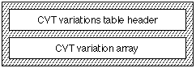

# The `'cvar'` table

## Introduction

The *control value table* (CVT) with tag name `'cvt '` should be provided for all instructed fonts. It contains an indexed list of control values for the font that can be accessed by instructions. Example values are the height of a serif, the width of a serif, and the upper case stem width. Not all outline points that define the glyphs in the font need to be included in the `'cvt '` table. When instructed, key points are moved to the desired point. AAT provides an interpolation to "bring along" the remaining points in the glyph outline.

The *CVT variations table* (tag name: `'cvar'`) allows you to include all of the data required for stylizing the CVT to match the styling done to outlines. This table mirrors the glyph variation table in that it contains the changes needed to create a style for any location in the font's style space. The CVT can thereby reflect the changes in heights and stroke weights that the glyph outlines undergo. This allows the same instructions to operate for all style variations.

- **NOTE**: The material in this chapter only applies to TrueType fonts.

## CVT Variations Table Format

The CVT variations table consists of a CVT variations table header and a CVT variation array. The overall structure of the CVT variations table is shown in the following illustration:

The CVT variations table format is shown in the following table:

| Type | Name | Description |
| --- | --- | --- |
| fixed32 | version | Set to 0x00010000 (1.0). |
| uint16 | tupleCount | Flags in high-order 4 bits, count in low-order 12 bits. |
| uint16 | offsetToData | Offset from start of CVT Variations table to the start of the tuple data. |
| tupleVariation | tuple\[tupleCount\] | Array of tuples. |
| uint8 | pointNumbers\[\] | Packed array of point numbers. |
| uint8 | tupleData\[\] | Packed deltas for each tuple. |

The CVT variation is similar to a [glyph variation](gvar.md). The point number array is interpreted as CVT indices rather than point indices. The deltas in tupleData contain only one array of packed deltas for each tuple, rather than the two arrays (X and Y) in a glyph variation.
