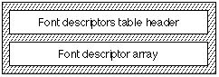

# The `'fdsc'` table

## Introduction

The *font descriptors table* (tag name: `'fdsc'`) allows applications to take an existing run of text and allow the user to specify a new font family for that run of text. A new style run that best preserves the font style information using the new font family will be created by using the style information that you provide.

All fonts should have an `'fdsc'` table to ensure compatibility with applications that support font family conversions.

A standard list of tags has been defined by Apple Computer Inc. These include common descriptors like weight, width, optical size, and many others. Additional font tags can be defined by registering them with Apple.

The `'fdsc'` table contains the descriptive information required to provide font family substitution. The font descriptor array consists of \<tag, value\> pairs. Each pair describes a specific attribute of your font.

The introduction provided some [examples](AATIntro.md#anchor-AATIntro-Matching) of cases in which an application that supports text style matching is used to replace an old style run with a new font family to provide a new style run.

## Font Descriptors Table Format

The font descriptors table consists of a font descriptors table header and a font descriptor array. The overall structure of the font descriptors table is shown in the following figure:

The font descriptors table header format is as follows:

| Type | Name | Description |
| --- | --- | --- |
| fixed32 | version | Version number of the font descriptors table (0x00010000 for the current version). |
| uint32 | descriptorCount | Number of style descriptors that will be included to characterize this font. Each descriptor consists of a \<tag, value\> pair. These pairs are located in the gxFontDescriptor array that follows. |
| gxFontDescriptor | descriptor\[\] | List of tagged-coordinate pairs. |

The format for the font descriptor array is shown in the following table:

| Type | Name | Description |
| --- | --- | --- |
| uint32 | tag | The 4-byte table tag name. |
| fixed32 | value | The value for the descriptor tag. |

The descriptors currently defined are these:

| Name | Tag | Value | Description |
| --- | --- | --- | --- |
| Weight | wght | 1.0 | Percent weight relative to regular weight. |
| Width | wdth | 1.0 | Percent width relative to regular width. |
| Slant | slnt | 0.0 | Angle of slant in degrees, where positive is clockwise from straight up. |
| Optical size | opsz | 12.0 | Point size the font was designed for. |
| Non-alphabetic | nalf | 0 | These values are treated as integers, not fixed32s. 0 means alphabetic, and greater integers mean the font is non-alphabetic (e.g. symbols). |

The non-alphabetic code values are:

| Code | Meaning |
| --- | --- |
| 0 | Alphabetic |
| 1 | Dingbats |
| 2 | Pi characters |
| 3 | Fleurons |
| 4 | Decorative borders |
| 5 | International symbols |
| 6 | Math symbols |

## Font Descriptors Table Example

This example font has two style descriptors. The following table summarizes the font descriptor data for this font.

| Descriptor Tag | Descriptor Value |
| --- | --- |
| 'wght' | +0.8 |
| 'wdth' | +1.0 |

The Font Descriptors Table for this example font is given in this table:

| Offset/length | Value | Name | Comment |
| --- | --- | --- | --- |
| 0/4 | 0x00010000 | version | Version number of the glyph properties table, in fixed-point format. |
| 4/4 | 2 | descriptorCount | Number of style descriptors (\<tag, value\> pairs) used to describe this font is 2. |
| (The font descriptor array follows. There are two style descriptors in the array) | <!-- colspan --> | <!-- colspan --> | <!-- colspan --> |
| 8/4 | 0x77676874 | tag | Descriptor tag is 'wght'. |
| 12/4 | 0x0000CCCC | value | Descriptor value for 'wght' is +0.8. |
| 16/4 | 0x77647468 | tag | Descriptor tag is 'wdth'. |
| 20/4 | 0x00010000 | value | Descriptor value for 'wdth' is +1.0. |
