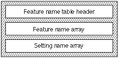

# The `'feat'` table

## General table information

## Introduction

Thefeature name table(tag name: `'feat'`) allows you to include the font's text features, the settings for each text feature, and the name table indices for common (human-readable) names for the features and settings.

Apple has defined a standard set of text features. You may include one or more of these or create your own text features. Font features that will be supported by your font must be part of the [Font Feature Registry](https://developer.apple.com/fonts/TrueType-Reference-Manual/RM09/AppendixF.html) maintained by Apple Inc. You can suggest additions to this registry by emailing:

applefonts@apple.com

## Feature Name Table Format

The feature name table consists of a feature name table header, feature name array, setting name array, and feature set records. The overall structure of the feature name table is shown in the following figure:

The format of the feature name table header is as follows:

| Type | Name | Description |
| --- | --- | --- |
| fixed32 | version | Version number of the feature name table (0x00010000 for the current version). |
| uint16 | featureNameCount | The number of entries in the feature name array. |
| uint16 | (none) | Reserved (set to zero). |
| uint32 | (none) | Reserved (set to zero). |
| FeatureName | names\[featureNameCount\] | The feature name array. |

The feature name array follows the feature name header. The feature name array is sorted by feature type. A featureName record specifies the feature ID, the name table index for the feature's name, and the offset in bytes to the feature's name in the name table. The format of the feature name array is as follows:

| Type | Name | Description |
| --- | --- | --- |
| uint16 | feature | Feature type. |
| uint16 | nSettings | The number of records in the setting name array. |
| uint32 | settingTable | Offset in bytes from the beginning of this table to this feature's setting name array. The actual type of record this offset refers to will depend on the exclusivity value, as described below. |
| uint16 | featureFlags | Single-bit flags associated with the feature type. |
| int16 | nameIndex | The name table index for the feature's name. This index has values greater than 255 and less than 32768. |

The `featureFlags` field contains single-bit flags associated with the feature type. The flags and their interpretations are shown in the following table:

| Mask value | Interpretation |
| --- | --- |
| 0x8000 | Exclusive settings. If set, the feature settings are mutually exclusive. |
| 0x4000 | If clear, then the setting with an index of 0 in the setting name array for this feature should be taken as the default for the feature (if one is required). If set, then bits 0-15 of this `featureFlags` field contain the index of the setting which is to be taken as the default. |
| 0x3F00 | Unused, must be set to 0. |
| 0x00FF | If bits 30 and 31 are set, then these sixteen bits indicate the index of the setting in the setting name array for this feature which should be taken as the default. |

The setting name array follows the feature name array. The format of the setting name array is as follows:

| Type | Name | Description |
| --- | --- | --- |
| uint16 | setting | The setting. |
| int16 | nameIndex | The name table index for the setting's name. The nameIndex must be greater than 255 and less than 32768. |

For feature types that don't have exclusive settings, there will always be a pair of values. One value turns a selector on and a second value turns the selector off. The on setting must be even and the off setting must be one greater than the corresponding on setting. The off setting is therefore always odd. As a result, only the on setting should have an entry in the setting name array.

The setting name arrays must follow the feature name arrays. Each setting name array is sorted by setting. However, the setting name arrays can be arranged in any order.

## Features and Settings

All features and settings used in your font should be registered in the [Font Feature Registry](https://developer.apple.com/fonts/Registry/index.html). Please see that document for the current set of feature and selector constants.

## Default Feature Settings

If a feature is marked as being “exclusive” in the `featureFlags` field (bit 31 is set), then one of its settings will correspond to the state of the glyph array when no setting is applied at all.

For example, the Letter Case feature (ID 3) has six selectors defined (upper- and lower-case, all caps, all lower-case, small caps, initial caps, initial caps with small caps). When no selector is applied to the text for the letter case feature, then the text will appear with mixed upper- and lower-case, just as it would if the explicit upper and lower-case selector were applied.

This is important because a menu or other UI element needs to be able to indicate which selector is "on" when no selector is being applied.

Which selector will be equivalent to the default behavior can usually (but not always) be deduced from the contents of the [`'morx'` table](morx.md). In order to deal with situations where this is not the case, bits 30 and 0-16 of the `featureFlags` field can be used to determine what selector should be treated as the default. If bit 31 is clear (and the feature is therefore marked as "non-exclusive"), then the value of these bits is ignored. If bit 31 is set, and bit 30 is clear, then the first selector for this feature—that is, the one with index 0 in its settings name array—is the default. If both bits 31 and 30 are set, then bits 0-16 contain the index in the settings name array of the default feature.

## Features and Language Codes

The feature type 39 is used in conjunction with the [`'ltag'` table](ltag.md) to provide for language-specific glyphs. It must always be flagged as an exclusive feature.

For feature type 39, a selector value of 0 means, as elsewhere “no change,” and will generally be used for language-independent glyphs (such as general Cyrillic). Other selector values are *one more than* an index into the [`'ltag'` table](ltag.md) and can be used to indicate switching to a set of language-specific glyphs (such as for Serbian). See the documentation for the [`'ltag'` table](ltag.md) for details.

Note that it is up to the font designer to decide what glyphs are language-independent and which are language-specific.

## Feature Name Table Example

This example font has four features that are listed in the name table at offsets to be specified in this feature name table. Table 17-26 summarizes the feature name data to be included for this font.

| Text feature | Feature | Setting | Setting value |
| --- | --- | --- | --- |
| All typographic features | 0 | On | 0 |
| Ligatures | 1 | Common on | 2 |
| Letter case | 3 | Upper and Lower | 0 |
| Letter case | 3 | Small caps | 3 |
| Letter case | 3 | Initial caps | 4 |
| Number spacing | 6 | Monospaced | 0 |
| Number spacing | 6 | Proportional | 1 |

The feature name table for this example font is as follows:

| Offset/length | Value | Name | Comment |
| --- | --- | --- | --- |
| 0/4 | 0x00010000 | version | Version number of the feature name table, in fixed-point format. |
| 4/2 | 4 | featureNameCount | The number of features in this feature name table is 4. |
| 6/2 | 0 | (reserved) | Reserved, must be zero. |
| 8/4 | 0 | (reserved) | Reserved, must be zero. |
| (The `featureName` array starts here. The first feature is "all typographic features," feature 0) | <!-- colspan --> | <!-- colspan --> | <!-- colspan --> |
| 12/2 | 0 | feature | Feature code is 0. |
| 14/2 | 1 | nSettings | There is 1 setting for feature 0. |
| 16/4 | 60 | settingTable | Offset from the beginning of this table to the setting name array for feature 0 is 60 bytes. |
| 20/2 | 0 | featureFlags | Zero means non-exclusive settings. |
| 22/2 | 260 | nameIndex | The name table index for this feature's name. |
| (The second `featureName` starts here. The second feature is "ligatures," feature 1) | <!-- colspan --> | <!-- colspan --> | <!-- colspan --> |
| 24/2 | 1 | feature | Feature code is 1. |
| 26/2 | 1 | nSettings | There is 1 setting for feature 1. |
| 28/4 | 64 | settingTable | Offset in bytes from the beginning of this table to this feature's setting name array. |
| 32/2 | 0 | featureFlags | Zero means non-exclusive settings. |
| 34/2 | 256 | nameIndex | The name table index for this feature's name. |
| (The third `featureName` record starts here. The third feature is "letter case," feature 3) | <!-- colspan --> | <!-- colspan --> | <!-- colspan --> |
| 36/2 | 3 | feature | Feature code is 3. |
| 38/2 | 3 | nSettings | There are 3 settings for feature 3. These are 0, 3, and 4. |
| 40/4 | 68 | settingTable | Offset in bytes from the beginning of this table to this feature's setting name array. |
| 44/2 | 0x8000 | featureFlags | High bit on means this feature has mutually exclusive settings; since bits 30 is clear, the first setting (upper- and lower-case) is the default. |
| 46/2 | 262 | nameIndex | The name table index for this feature's name. |
| (The fourth and last `featureName` starts here. The fourth feature is "number spacing," feature 6) | <!-- colspan --> | <!-- colspan --> | <!-- colspan --> |
| 48/2 | 6 | feature | Feature code is 6 |
| 50/2 | 1 | nSettings | There is 1 setting for feature 6. |
| 52/4 | 80 | settingTable | Offset in bytes from the beginning of this table to this feature's setting name array. |
| 56/2 | 0xC001 | featureFlags | High bit on means this feature has mutually exclusive settings. Bit 30 is set, so bits 0-16 contain the index of the default setting for this feature, in this case setting index 1 (value 1, proportional numerals). |
| 58/2 | 258 | nameIndex | The name table index for this feature's name. |
| (The `settingName` array follows; the first setting array is for the "all typographic features" feature) | <!-- colspan --> | <!-- colspan --> | <!-- colspan --> |
| 60/2 | 0 | setting | Setting value 0 (on). |
| 62/2 | 261 | nameIndex | The name table index for this feature setting's name. |
| (The second `settingName` array is for the "ligature" feature) | <!-- colspan --> | <!-- colspan --> | <!-- colspan --> |
| 64/2 | 2 | setting | Setting value 2 (common ligs on). |
| 66/2 | 257 | nameIndex | The name table index for this feature setting's name. |
| (The third `settingName` array is for the "letter case" feature) | <!-- colspan --> | <!-- colspan --> | <!-- colspan --> |
| 68/2 | 0 | setting | Setting value 0 (upper and lower case). |
| 70/2 | 268 | nameIndex | The name table index for this feature setting's name. |
| 72/2 | 3 | setting | Setting value 3 (small caps). |
| 74/2 | 264 | nameIndex | The name table index for this feature setting's name. |
| 76/2 | 4 | setting | Setting value 4 (initial caps). |
| 78/2 | 265 | nameIndex | The name table index for this feature setting's name. |
| (The fourth `settingName` array is for the "number case" feature) | <!-- colspan --> | <!-- colspan --> | <!-- colspan --> |
| 80/2 | 0 | setting | Setting value 0 (monospaced). |
| 82/2 | 259 | nameIndex | The name table index for this feature setting's name. |
| 84/2 | 1 | setting | Setting value 1 (proportional). |
| 86/2 | 260 | nameIndex | The name table index for this feature setting's name. |

---

## Dependencies

The `'feat'` table is intimately connected with the [Extended Glyph Metamorphosis (`'morx'`) Table](morx.md). An edit to the one will usually entail an edit to the other. Note, in paticular, that any default setting identified by bits 0-15 and 30 of the `featureFlags` field should be consistent with what can be determined from the `'morx'` table.
