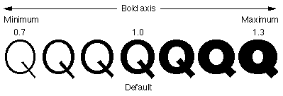
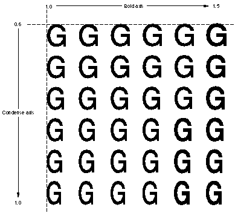
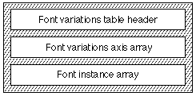

# The `'fvar'` table

## General table information

Apple Advanced Typography variations allow the font designer to build high quality styles into the typeface itself. This reduces the dependence on algorithmic styling in the graphics system. To include variations in your font, you must include the font variations table. If you are building a TrueType font, you will also need a [glyph variations table](gvar.md).

The *font variations table* (tag name: `'fvar'`) defines the global information concerning which variation axes are included in your font and any named coordinates in the variation space, called instances. An instance provides the application with a short list of "pre-chosen" coordinates to offer the user.

The next figure shows a capital 'Q' glyph drawn at various points along the 'wght' axis. Since the minimum and maximum values have been defined as +0.7 and +1.3, respectively, the specification of a style coordinate of 1.0 refers to the style of the center 'Q.'

Multiple axes can be combined. For example, you may want to create a 'wght' axis and a 'wdth' axis. The user can then select any combination of weight and width, such as 75% bold and 50% condensed. The next figure shows an example of a two-axis font variation in which the weight axis has a minimum value of 1.0 and maximum of 1.5 and the width axis has a minimum of 0.6 and a maximum of 1.0.

## Variation Axis Tags

A set of "standard" axis tags has been defined by Apple. Other tags may be defined, but should be registered with Apple DTS (Developer Technical Support).

| Tag | Name | Default | Description |
| --- | --- | --- | --- |
| 'wght' | Weight | 1.0 | Used for making a font range from light to black. |
| 'wdth' | Width | 1.0 | Used for fonts ranging from narrow to wide. |
| 'slnt' | Slant | 0.0 | Specifies the angle (in degrees) of italic slant. |
| 'opsz' | Optical Size | 12.0 | Specifies the optical point size. |

All real numbers like 1.0 and 12.0 are actually stored as 16.16 fixed point numbers, so 1.0 is really 0x10000 and 12.0 is really 0xC0000.

## Font Variations Table Format

The font variations table consists of a font variations table header, followed by the list of variations axis records, followed by the list of instance records. The overall structure of this table is shown in the following figure:

The format of the font variations table header is shown in the following table:

| Type | Name | Description |
| --- | --- | --- |
| uint16 | majorVersion | Set to 1. |
| uint16 | minorVersion | Set to 0. |
| uint16 | offsetToData | Offset in bytes from the beginning of the table to the beginning of the first axis data. |
| uint16 | countSizePairs | Axis + instance = 2. |
| uint16 | axisCount | The number of style axes in this font. |
| uint16 | axisSize | The number of bytes in each gxFontVariationAxis record. Set to 20 bytes. |
| uint16 | instanceCount | The number of named instances for the font found in the sfntInstance array. |
| uint16 | instanceSize | The number of bytes in each sfntInstance. See below. |
| sfntVariationAxis | axis\[axisCount\] | The font variation axis array. |
| sfntInstance | instance\[instanceCount\] | The instance array. |

Note: The `countSizePairs` is currently 2 to indicate two count-size pairs follow: the axis count-size pair, and the offset count-size pair. Future versions of the `"fvar"` table may increase this number.

The `instanceSize` will have one of two values: `2 × sizeof(uint16_t) + axisCount × sizeof(Fixed)`, or `3 × sizeof(uint16_t) + axisCount × sizeof(Fixed)`. If the latter, then the axis coordinates in each `sfntInstance` are followed by a [`'name'` table](name.md) entry for the PostScript name associated with that instance. See below.

The format for the `sfntVariationAxis` array is as follows:

| Type | Name | Description |
| --- | --- | --- |
| uint32 | axisTag | Axis name. |
| fixed32 | minValue | The minimum style coordinate for the axis. |
| fixed32 | defaultValue | The default style coordinate for the axis. |
| fixed32 | maxValue | The maximum style coordinate for the axis. |
| uint16 | flags | Set to zero. |
| uint16 | nameID | The designation in the 'name' table. |

Each axis contains a tag with a registered name. Each axis is defined by its minimum value and maximum value. This is the dynamic range of the axis. A default value is also defined. The `nameID` specifies the name to be used in application style menus and font pickers. The `nameID` must be greater than 255 and less than 32768.

The `sfntInstance` array is a list of named coordinates. For example, it may be desirable to define and name specific coordinates for bold, demi, condensed, demi-condensed, or other appropriate styles.

The format of the `sfntInstance` array is shown in the following table:

| Type | Name | Description |
| --- | --- | --- |
| uint16 | nameID | The name of the defined instance coordinate. Similar to the nameID in the variation axis record, this identifies a name in the font's 'name' table. |
| uint16 | flags | Set to zero. |
| fixed32 | coord\[axisCount\] | This is the coordinate of the defined instance. |
| uint16 | psNameID | (Optional) The PostScript name of the defined instance coordinate. Similar to the nameID above, this identifies a name in the font's 'name' table. The corresponding 'name' table entry should be a valid PostScript name. |

## Font Variations Table Example

This example font has two variation axes. This table summarizes the font variation data to be included for this font:

| Axis Tag | Min Value | Default Value | Maximum Value | NameID |
| --- | --- | --- | --- | --- |
| 'wght' | 0.5 | 1.0 | 2.0 | 256 |
| 'wdth' | 0.5 | 1.0 | 2.0 | 257 |

The font variation table for this example font is given in the following table. The flags for both axes are 0.

| Offset/length | Value | Name | Comment |
| --- | --- | --- | --- |
| 0/4 | 0x00010000 | version | Version number of the font variation table, in fixed-point format. |
| 4/2 | 20 | offsetToData | Offset from the beginning of the table to the beginning of the first axis data is 20 bytes. |
| 6/2 | 2 | countSizePairs | Set to 2. |
| 8/2 | 2 | axisCount | There are two axes in this font variation. |
| 10/2 | 20 | axisSize | Each gxFontVariation axis description requires 20 bytes. |
| 12/2 | 3 | instanceCount | There are three named instances. |
| 14/2 | 12 | instanceSize | Each sfntInstance requires 12 bytes. There are no PostScript names associated with the instances. |
| (The first [`sfntVariationAxis`](#anchor-fvar-sfntVariationAxis) follows) | <!-- colspan --> | <!-- colspan --> | <!-- colspan --> |
| 16/4 | 0x77676874 | axisTag | The axis tag in ASCII is 'wght'. |
| 20/4 | 0x00008000 | minValue | The minimum coordinate value defined for this axis is 0.5. |
| 24/4 | 0x00010000 | defaultValue | The default instance coordinate value defined for this axis is 1.0. |
| 28/4 | 0x00020000 | maxValue | The maximum value defined for this axis is 2.0. |
| 32/2 | 0x0000 | flag | No flag is set. |
| 34/2 | 256 | nameID | The nameID value in the name table. |
| (The second [`sfntVariationAxis`](#anchor-fvar-sfntVariationAxis) follows) | <!-- colspan --> | <!-- colspan --> | <!-- colspan --> |
| 36/4 | 0x77647468 | axisTag | The axis tag in ASCII is 'wdth'. |
| 40/4 | 0x00008000 | minValue | The minimum coordinate value defined for this axis is 0.5. |
| 44/4 | 0x00010000 | defaultValue | The default instance coordinate value defined for this axis is 1.0. |
| 48/4 | 0x00020000 | maxValue | The maximum value defined for this axis is 2.0. |
| 52/2 | 0x0000 | flag | No flag is set. |
| 54/2 | 257 | nameID | The nameID designation in the name table. |
| (The [`sfntInstance`](#anchor-fvar-sfntInstance) array follows) | <!-- colspan --> | <!-- colspan --> | <!-- colspan --> |
| 56/2 | 258 | nameID\[1\] | The nameID designation in the name table for the first instance. |
| 58/2 | 0 | flags | Set to zero. |
| 60/4 | 0x00008000 | coordinate\[1\] | Coordinate of the first instance along the first axis. |
| 64/4 | 0x00010000 | coordinate\[1\] | Coordinate of the first instance along the second axis. |
| 68/2 | 259 | nameID\[2\] | The nameID designation in the name table for the second instance. |
| 70/2 | 0 | flags | Set to zero. |
| 72/4 | 0x00020000 | coordinate\[2\] | Coordinate of the second instance along the first axis. |
| 76/4 | 0x00018000 | coordinate\[2\] | Coordinate of the second instance along the second axis. |
| 80/2 | 260 | nameID\[3\] | The nameID designation in the name table for the first instance. |
| 82/2 | 0 | flags | Set to zero. |
| 84/4 | 0x00020000 | coordinate\[3\] | Coordinate of the third instance along the first axis. |
| 88/4 | 0x00008000 | coordinate\[3\] | Coordinate of the third instance along the second axis. |

## Dependencies

The `'fvar'` table should have the same number of axes as the [`'gvar'` table](gvar.md). The name references should correspond to the correct entries in the [`'name'` table](name.md).
