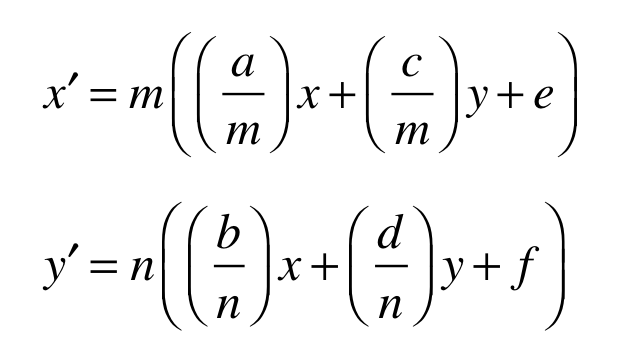

<a id="anchor-glyf-glyf"></a>

# The `'glyf'` table

The `'glyf'` table contains the data that defines the appearance of the glyphs in the font. This includes specification of the points that describe the contours that make up a glyph outline and the instructions that grid-fit that glyph. The `'glyf'` table supports the definition of simple glyphs and compound glyphs, that is, glyphs that are made up of other glyphs.

The number of glyphs in the font is restricted only by the value stated in the `'head'` table. The order in which glyphs are placed in a font is arbitrary.

Note that a font *must* have at least two glyphs, and that glyph index 0 *must*have an outline. See [Glyph Mappings](https://developer.apple.com/fonts/TrueType-Reference-Manual/RM07/appendixB.html) for details.

<a id="anchor-glyf-part-1"></a>

## Glyph data

Table 14 documents the format for glyph definitions. A zero or positive number of contours signals a simple glyph. If the number of contours is less than zero, the glyph is made up of components. If a glyph has zero contours, it need not have any glyph data. If the glyph is made up of components, it is recommended that the value -1 be used in this field.

The minimum and maximum x and y values for the coordinate data in the glyph follow and together define the glyph's bounding box. This is the bounding box for the original glyph outline before any grid-fitting has taken place.

**Table 14**: Glyph description

| Type | Name | Description |
| --- | --- | --- |
| int16 | numberOfContours | If the number of contours is positive or zero, it is a single glyph;<br> If the number of contours less than zero, the glyph is compound |
| FWord | xMin | Minimum x for coordinate data |
| FWord | yMin | Minimum y for coordinate data |
| FWord | xMax | Maximum x for coordinate data |
| FWord | yMax | Maximum y for coordinate data |
| (here follow the data for the simple or compound glyph) | <!-- colspan --> | <!-- colspan --> |

<a id="anchor-glyf-part-2"></a>

### Simple glyphs

Table 15 specifies the format of a simple glyph. A more detailed description of glyph outline requirements is given in [Digitizing Letterform Designs](https://developer.apple.com/fonts/TrueType-Reference-Manual/RM01/Chap1.html).

**Table 15**: Simple glyph definition

| Type | Name | Description |
| --- | --- | --- |
| uint16 | endPtsOfContours\[n\] | Array of last points of each contour; n is the number of contours; array entries are point indices |
| uint16 | instructionLength | Total number of bytes needed for instructions |
| uint8 | instructions\[instructionLength\] | Array of instructions for this glyph |
| uint8 | flags\[variable\] | Array of flags |
| uint8 or int16 | xCoordinates\[\] | Array of x-coordinates; the first is relative to (0,0), others are relative to previous point |
| uint8 or int16 | yCoordinates\[\] | Array of y-coordinates; the first is relative to (0,0), others are relative to previous point |

Each entry in the flags array is a byte in size. The meanings associated with each bit in that byte are given in Table 16 below.

**Table 16**: Outline flags

| Flags | Bit (0 is lsb) | Description |
| --- | --- | --- |
| On Curve | 0 | If set, the point is on the curve;<br> Otherwise, it is off the curve. |
| x-Short Vector | 1 | If set, the corresponding x-coordinate is 1 byte long;<br> Otherwise, the corresponding x-coordinate is 2 bytes long |
| y-Short Vector | 2 | If set, the corresponding y-coordinate is 1 byte long;<br> Otherwise, the corresponding y-coordinate is 2 bytes long |
| Repeat | 3 | If set, the next byte specifies the number of additional times this set of flags is to be repeated. In this way, the number of flags listed can be smaller than the number of points in a character. |
| This x is same (Positive x-Short vector) | 4 | This flag has one of two meanings, depending on how the x-Short Vector flag is set.<br> If the x-Short Vector bit is set, this bit describes the sign of the value, with a value of 1 equalling positive and a zero value negative.<br> If the x-short Vector bit is not set, and this bit is set, then the current x-coordinate is the same as the previous x-coordinate.<br> If the x-short Vector bit is not set, and this bit is not set, the current x-coordinate is a signed 16-bit delta vector. In this case, the delta vector is the change in x |
| This y is same (Positive y-Short vector) | 5 | This flag has one of two meanings, depending on how the y-Short Vector flag is set.<br> If the y-Short Vector bit is set, this bit describes the sign of the value, with a value of 1 equalling positive and a zero value negative.<br> If the y-short Vector bit is not set, and this bit is set, then the current y-coordinate is the same as the previous y-coordinate.<br> If the y-short Vector bit is not set, and this bit is not set, the current y-coordinate is a signed 16-bit delta vector. In this case, the delta vector is the change in y |
| Reserved | 6 - 7 | Set to zero |

<a id="anchor-glyf-COMPOUNDGLYPHS"></a>

### Compound glyphs

Compound glyphs are glyphs made up of two or more component glyphs. A compound glyph description begins like a simple glyph description with four words describing the bounding box. It is followed by n component glyph parts. Each component glyph parts consists of a flag entry, two offset entries and from one to four transformation entries.

The format for describing each component glyph in a compound glyph is documented in Table 17. The meanings associated with the flags in the first entry are given in Table 18.

**Table 17**: Component glyph part description

| Type | Name | Description |
| --- | --- | --- |
| uint16 | flags | Component flag |
| uint16 | glyphIndex | Glyph index of component |
| int16, uint16, int8 or uint8 | argument1 | X-offset for component or point number; type depends on bits 0 and 1 in component flags |
| int16, uint16, int8 or uint8 | argument2 | Y-offset for component or point number type depends on bits 0 and 1 in component flags |
| transformation option | <!-- colspan --> | One of the transformation options from Table 19 |

**Table 18**: Component flags

| Flags | Bit | Description |
| --- | --- | --- |
| ARG\_1\_AND\_2\_ARE\_WORDS | 0 | If set, the arguments are words;<br> If not set, they are bytes. |
| ARGS\_ARE\_XY\_VALUES | 1 | If set, the arguments are xy values;<br> If not set, they are points. |
| ROUND\_XY\_TO\_GRID | 2 | If set, round the xy values to grid;<br> if not set do not round xy values to grid (relevant only to bit 1 is set) |
| WE\_HAVE\_A\_SCALE | 3 | If set, there is a simple scale for the component.<br> If not set, scale is 1.0. |
| (this bit is obsolete) | 4 | (obsolete; set to zero) |
| MORE\_COMPONENTS | 5 | If set, at least one additional glyph follows this one. |
| WE\_HAVE\_AN\_X\_AND\_Y\_SCALE | 6 | If set the x direction will use a different scale than the y direction. |
| WE\_HAVE\_A\_TWO\_BY\_TWO | 7 | If set there is a 2-by-2 transformation that will be used to scale the component. |
| WE\_HAVE\_INSTRUCTIONS | 8 | If set, instructions for the component character follow the last component. |
| USE\_MY\_METRICS | 9 | Use metrics from this component for the compound glyph. |
| OVERLAP\_COMPOUND | 10 | If set, the components of this compound glyph overlap. |

**Table 19**: Transformation Options

| Transformation Option | Meaning |
| --- | --- |
| transformation entry #1 | scale (same for x and y) |
| transformation entry #2 | x-scale |
| <!-- rowspan --> | y-scale |
| transformation entry #3 | xscale |
| <!-- rowspan --> | scale01 |
| <!-- rowspan --> | scale10 |
| <!-- rowspan --> | yscale |

The glyph data in a compound glyph differs from that of a simple glyph, consisting of descriptions of each of the components followed by any instructions for the compound glyph as a whole.

The glyph index describes the location of the jth component glyph.

The transformation entries determine the values of an affine transformation applied to the component prior to its being incorporated into the parent glyph. Given the component matrix \[a b c d e f\], the transformation applied to the component is:



The values of a, b, c, and d are obtained as shown in Table 19a. The values of e and f are obtained as shown in the following pseudo-code below:

```
if (ARG_1AND_2_ARE_WORDS && ARGS_ARE_XY_VALUES)
	1st short contains the value of e
	2nd short contains the value of f
else if (!ARG_1AND_2_ARE_WORDS && ARGS_ARE_XY_VALUES)
	1st byte contains the value of e
	2nd byte contains the value of f
else if (ARG_1AND_2_ARE_WORDS && !ARGS_ARE_XY_VALUES)
	1st short contains the index of matching point in compound being constructed
	2nd short contains index of matching point in component
else if (!ARG_1AND_2_ARE_WORDS && !ARGS_ARE_XY_VALUES)
	1st byte containing index of matching point in compound being constructed
	2nd byte containing index of matching point in component
```

Finally, m and n are calculated as follows:

First, let m₀ = max(|a|, |b|) and n₀ = max(|c|, |d|).

If |(|a|-|c|)| ≤ ³³/₆₅₅₃₆, then m = 2m₀; otherwise, m = m₀.

Similarly, if |(|b|-|d|)| ≤ ³³/₆₅₅₃₆, then n = 2n₀; otherwise, n = n₀

The linear transformation data is derived as shown in Table 19a.

**Important**

If e and f are specified directly as offsets rather than as point indices to be matched, then the correct values of the offsets depend on the transformation components. For example, if a general scale factor of one-half is applied to the component, this scale factor is also applied to the values of e and f before they are used to offset the component. Note also, that when the component is rotated by a multiple of 45 degrees, the scale factors are doubled. For these reasons, it is much easier to specify offsets through the use of anchor point and matching points than directly through offset values.

**Table 19a**: Linear transformation

| WE\_HAVE\_A\_SCALE | WE\_HAVE\_AN\_X\_AND\_Y\_SCALE | WE\_HAVE\_A\_TWO\_BY\_TWO | a | b | c | d |
| --- | --- | --- | --- | --- | --- | --- |
| 0 | 0 | 0 | 1.0 | 0.0 | 0.0 | 1.0 |
| 1 | 0 | 0 | 1st short | 0.0 | 0.0 | 1st short |
| 0 | 1 | 0 | 1st short | 0.0 | 0.0 | 2nd short |
| 0 | 0 | 1 | 1st short | 2nd short | 3rd short | 4th short |

The numbers stored as shorts are treated as signed fixed binary point numbers with one bit to the left of the binary point and 14 to the right.

The application of the transformations and instructions can be thought of as occurring in the following order:

For each component

- Apply the local transformation, if any
- Apply the global transformation (e.g. point size, resolution)
- Gridfit the outline
- Apply the translation from offsets or anchor points

Gridfit the compound glyph if there are instructions
