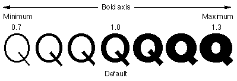
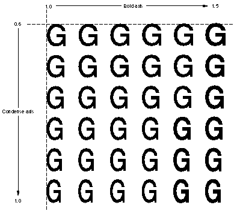
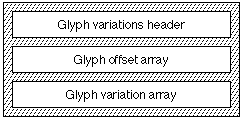

<a id="anchor-gvar-gvar"></a>

# The `'gvar'` table

<a id="anchor-gvar-part-1"></a>

## General table information

Apple Advanced Typography style variations allow the font designer to build high quality styles into the typeface itself. This reduces the dependence on algorithmic styling in the graphics system. To include font variations in your font, you must also include the [font variations table](fvar.md).

The *glyph variations table* (tag name: `'gvar'`) allows you to include all of the data required for stylizing the glyphs in your font.

- **NOTE**: The material in this chapter only applies to TrueType fonts; Type 1 fonts with variations (i.e. Multiple Master fonts) encode their glyph variation data differently. Consult Adobe's documentation on Type 1 Multiple Master fonts for further information.

Conceptually, variation fonts define *axes* over which font characteristics can vary. Thus, in the figure below, we see the Q glyph from Skia drawn at various points along the `'wght'` axis. Since the minimum and maximum values have been defined as +0.7 and +1.3, respectively, the specification of a style coordinate of 1.0 refers to the style of the center 'Q.'



Multiple axes can be combined within a single font. For example, you may want to create a `'wght'` axis and a `'wdth'` axis. The user can then select any combination of weight and width, such as 75% bold and 50% condensed. The next figure shows an example of a two-axis font variation in which the weight axis has a minimum value of 1.0 and maximum of 1.5 and the width axis has a minimum of 0.6 and a maximum of 1.0.



Data for how these axes are presented to the user is contained in the [font variations table](fvar.md). The glyph variations table contains data which is used to determine the outline for a glyph given a combination of settings for the various axes.

This is done by using *tuples*. The terminology is derived from mathematics, but its meaning there (an n-tuple is defined as an ordered list of `n` numbers) may not illuminate its use in the `'gvar'` table. For a variation font, a *tuple* is a list of deltas applied to the points in a glyph found in the [`'glyf'` table](glyf.md). The results determine the actual coordinates of the points on the outline for the glyph as it is to be rendered. Hinting can then be applied to this modified outline. The hints themselves can vary for the glyph; this is controlled by the [`'cvar'` table](cvar.md).

Each tuple is associated with a set of coordinates, one for each axis. These coordinates determine whether or not the tuple is applied and supply a multiplier applied to the deltas. The glyph's shape can therefore vary smoothly as the user adjusts the settings for the axes.

So that a glyph can vary in its dimensions as well as its shape, tuples have entries for each point in the glyph plus entries for four "phantom points," which represent the glyph's side-bearings. These phantom points are, in order, the left-side phantom point, the right-side phantom point, the top phantom point, and the bottom phantom point.

<a id="anchor-gvar-part-2"></a>

## Structure of the `'gvar'` table

Conceptually, the `'gvar'` table is very straightforward. Its apparent complexity is the result of the techniques used to compress the data.

For each glyph in the font, the `'gvar'` table stores a set of tuples. (This set may be empty.) The tuples have coordinates, one per axis. Optionally, they also have intermediate coordinates; if they do, there is one per axis. The tuple also has a list of points it moves, and the deltas for those points.

<a id="anchor-gvar-part-3"></a>

### Header

The glyph variations table consists of a glyph variations table header, glyph offset array, glyph style coordinate array, and glyph variations array. The overall structure of the glyph variations table is shown in the following figure:



The glyph variations table header format is shown in this table:

| Type | Name | Description |
| --- | --- | --- |
| uint16 | version | Version number of the glyph variations table (1 for the current version). |
| uint16 | reserved | Currently unused; set to 0. |
| uint16 | axisCount | The number of style axes for this font. This must be the same number as `axisCount` in the `'fvar'` table. |
| uint16 | sharedCoordCount | The number of shared coordinates. |
| uint32 | offsetToCoord | Byte offset from the beginning of this table to the list of shared style coordinates. |
| uint16 | glyphCount | The number of glyphs in this font; this should match the number of the glyphs store elsewhere in the font. |
| uint16 | flags | Bit-field that gives the format of the offset array that follows. If the flag is 0, the type is uint16. If the flag is 1, the type is unit 32. |
| uint32 | offsetToData | Byte offset from the beginning of this table to the first glyph `glyphVariationData`. |
| uint16 or uint32 | offset\[glyphCount+1\] | Byte offsets from the beginning of the `glyphVariationData` array to the `glyphVariationData` for each glyph in the font. The format of this field is set by the flags field. |

The shared coordinates pointed to by the `globalCoordCount` are a space-saving mechanism. Instead of storing its own coordinates, a tuple can instead have an index into the global coordinate space.

The number of bytes occupied by the global coordinates can be found using the expression `offsetToData - offsetToCoord`. This size should be equal to `globalCoordCount * axisCount * sizeof(shortFrac)`. That is, there are `globalCoord` `shortFrac`&s for each axis in the font.

If the flag bitfield is set to 1, the offsets to the per-glyph data four bytes in size. If the flag bit-field is set to 0, the offsets are two bytes.

The offset array follows the glyph variation header. The offset array gives the offset from the beginning of the `glyphVariationData` array. This data specifies where each glyph variation begins. The variation data is the same order as the glyph order. This allows the length of a particular glyph variation to be computed by subtracting the offset of the next variation from the current one. This means that there must be `glyphCount` + 1 entries in the offset array.

<a id="anchor-gvar-part-4"></a>

### Coordinates

Tuple coordiantes are used by CoreText to determine which tuples apply given the user's settings for the variation axes.

The first step in this process is normalizing the setting for a given axis; that is, mapping the value from the range defined by the `'fvar'` table to the range `[-1, 1]`. (Note that this is exactly the range of values which can be represented by a `shortFrac`.)

The default mapping is to do this so that the minimum value for the axis maps to -1, the default value to 0, and the maximum value to 1. Values between two of these three key values are mapped linearly to the range `[-1, 0)` (if less than the default) or the range `(0, 1]` (if more than the default). This linear mapping can be refined via the `'avar'` table.

To use Skia as an example, Skia has two axes, weight and width. The weight axis has the range `[0.48, 3.2]` defined in the `'fvar'` table, with a default value of 1.0. The width axis has the range `[0.62, 1.3]` and the default value of 1.0.

If the user sets the weight to 0.5, this is normalized to ( 1.0 - 0.5 ) / ( 1.0 - 0.48 ) = -0.96. If the user sets the weight to 1.25, this is normalized to ( 1.25 - 1.0 ) / ( 3.2 - 1.0 ) = 0.11.

If a tuple's coordinate for a given axis is 0, then the normalized setting of that axis is ignored when determining whether or not to apply that tuple.

Otherwise, tuple is applied if and only if the current normalized setting for each axis is between the coordinate for that axis and 0 (inclusive).

For each axis (except the ignored ones), a scalar is calculated linearly. So if the normalized setting is 0.5 and the coordinate 1, the scalar is 0.5. The product of all the scalars for non-ignored axes is the scalar for the tuple. For each point the tuple moves, the deltas are multiplied by the tuple's scalar and then added to the point's position. The end result is the point's *actual* position for drawing the glyph.

<a id="anchor-gvar-part-5"></a>

### The `glyphVariationData` structure

The `glyphVariationData` array follows the glyph variation offset array. The data for each glyph is structured as follows:

| Type | Name | Description |
| --- | --- | --- |
| uint16 | tupleCount | A packed field. The high 4 bits are flags and the low 12 bits are the number of tuples for this glyph. The number of tuples can be any number between 1 and 4095. |
| uint16 | offsetToData | Byte offset from the beginning of the `glyphVariationData` to the serialized glyph data (see below). |
| tuple | tuple\[tupleCount\] | The tuple array. |

The `tupleCount` is a packed field comprising a flag and the number of tuples. The format of the `tupleCount` field is shown here:

| Value | Name | Description |
| --- | --- | --- |
| 0x8000 | tuples\_share\_point\_numbers | Flag indicating that some or all tuples reference a common set of packed point numbers that follow. |
| 0x7000 | reserved\_tuple\_count\_flags | Flags reserved for future use. |
| 0x0FFF | tuple\_count\_mask | Mask using the low bits to give the tuple count. |

Currently, the only flag bit supported is 0x8000, `tuples_share_point_numbers`. This means that all of the tuples reference a common set of packed point numbers that follow immediately after the tuple array.

<a id="anchor-gvar-part-6"></a>

### The `tupleHeader` structure

The glyph variation data header is followed by a series of tuples. Each tuple begins with a tuple header. The format of the tuple header is as follows:

| Type | Name | Description |
| --- | --- | --- |
| uint16 | tupleSize | The size in bytes of serialized data for this tuple. |
| uint16 | tupleIndex | A packed field. The high 4 bits are flags. The interpretation of these flags is provided in Table 14-5. The low 12 bits are an index into the global tuple coordinates. |
| shortFrac | embeddedCoord\[\] | Embedded coordinate tuples, if any. |
| shortFrac | intermediateCoord\[\] | Intermediate coordinate tuples, if any. |

The `tupleSize` field is *not* the size of the full tuple variation data for this tuple. Rather, it refers to the number of bytes used by this tuple within the glyph's serialized data. The next tuple data can actually be calculated using code something like the following:

```
const FTTupleHeader_gvar*
NextTupleVariation( const FTTupleHeader_gvar* iTupleVar, int iAxisCount )
{
		 int tBump = sizeof( FTTupleHeader_gvar ); /* four bytes == two * sizeof( UInt16 ) */
		 int tTupleIndex = iTupleVar->tupleIndex;
		 if ( tTupleIndex & embedded_tuple_coord )
				 tBump += iAxisCount * sizeof( shortFrac );
		 if ( tTupleIndex & intermediate_tuple )
				 tBump += 2 * iAxisCount * sizeof( shortFrac );
		 return (const FTTupleHeader_gvar*)((char*)iTupleVar + tBump);
}
```

The `tupleIndex` is a packed field consisting of a flag and an index mask into the array of global tuple coordinates. The tupleIndex field format is described in the following table:

| Value | Name | Description |
| --- | --- | --- |
| 0x8000 | embedded\_tuple\_coord | Flag indicating that the coordinate for this tuple follows immediately after the tupleIndex. The low 12 bits of the tupleIndex are ignored. |
| 0x4000 | intermediate\_tuple | Flag indicating that this is an intermediate tuple. The two coordinates following the tupleIndex (and the optional embedded coordinate) specify the domain for this tuple. |
| 0x2000 | private\_point\_numbers | Flag indicating that the preceding tuple data for this tuple is a set of packed point numbers that this tuple operates on. If this bit is clear, this tuple uses shared point numbers. |
| 0x1000 | reserved\_tuple\_index\_flag | Flag reserved for future use. |
| 0x0FFF | tuple\_index\_mask | Mask using the low bits to give the tuple index. |

<a id="anchor-gvar-part-7"></a>

### Serialized data

After the coordinate data for the glyph's tuples is a block of serialized data. This data contains the points the tuples operate on and their deltas.

If the `tuples_share_point_numbers` flag is set, the serialized data begins with a packed set of point numbers which are used by *all* the glyph's tuples. The format for packed point numbers is below.

The remaining serialized data contains information specific to the individual tuples (in order). Since the `tupleHeader` contains the number of bytes of serialized data the tuple uses, it isn't necessary to parse the serialized data for tuples which aren't applied.

If the `tuples_share_point_numbers` is clear, then each tuple's serialized data begins with the packed list of points the tuple operates on. This is followed by the packed deltas for the points' x-coordinates, and then the packed deltas for the points' y-coordinates.

<a id="anchor-gvar-part-8"></a>

### Packed Point Numbers

Point numbers are stored as a count followed by the first point number. Each subsequent point is stored as the difference between it and the previous point number. The data is packed into runs of bytes and words.

If the count will fit in 7 bits, the point count is packed into a byte. If the count will not fit in 7 bits, it is stored in 2 bytes, with the high bit of the first byte set. If count = 0, every point on the glyph is used and no data follows. If count is nonzero, a series of runs of bytes and words follows. In this case each run begins with a control byte. The control byte's high bit specifies whether the run is bytes or words and the low 7 bits specify the number of elements in the run minus 1.

The packed point count flag format is as follows:

| Mask | Name | Description |
| --- | --- | --- |
| 0x80 | points\_are\_words | Flag indicating that the point number run is a word. |
| 0x7F | point\_run\_count\_mask | Mask indicating that the low 7 bits are the number of elements minus 1. |

<a id="anchor-gvar-part-9"></a>

### Packed Deltas

The packed delta data does *not* include the number of deltas to follow. This is because the packed delta data contains one delta per point. Otherwise, the delta packing technique is similar to that used by the points. Deltas are stored as a series of runs. Each run is a control byte followed by the actual deltas. The control byte specifies the size of the data in the run in the high two bits, and the number of deltas in the low six bits.

The packed tuple delta field formats are shown in the following table. Note that if neither the 0x80 or 0x40 flags are set, then the run contains signed byte deltas.

| Mask | Name | Description |
| --- | --- | --- |
| 0x80 | deltas\_are\_zero | Flag indicating that this run contains no data. This means that all of the deltas in this run are zero, so no explicit deltas are stored. |
| 0x40 | deltas\_are\_words | Flag indicating that the run contains 16-bit signed deltas. |
| 0x3F | delta\_run\_count\_mask | Flag and mask using the low 6 bits to provide the number of deltas in the run minus 1. |

<a id="anchor-gvar-part-10"></a>

### Point Numbers for Component Glyph Variations

The foregoing discussion applies to simple glyphs. Component glyph variations are structured similarly. The difference is that simple glyphs are defined by points and component glyphs are defined by other glyphs. Component glyph variations describe how the position of each component specified by offsets changes and how the metrics of the parent composite glyph change. These changes are represented by fake point numbers. One fake point number is assigned to each component and then 4 more are assigned for the final glyph's metrics.

Consider the component glyph 'é'. If the accent was specified using anchor points, then there would be no use for variation data. The accent can be repositioned by moving the attachment points in either the base glyph or the accent. However, if the accent was specified by an offset, the variation data could be used to describe how its position changes.

The fake point number assignment and the delta assignments for the example component glyph are as follows:

| Fake point number | Delta assignments |
| --- | --- |
| 0 | Base glyph. |
| 1 | Accent glyph. |
| 2 | Left side bearing metric point. |
| 3 | Right side bearing metric point. |
| 4 | Top side bearing metric point. |
| 5 | Bottom side bearing metric point. |

<a id="anchor-gvar-part-11"></a>

## Examples

As an example, consider Skia, the variation font that ships with OS X. It begins with a header:

| Value | Name | Description |
| --- | --- | --- |
| 1 | version | Table version number |
| 0 | reserved | Currently unused; set to 0. |
| 2 | axisCount | The font has two axes; detailed information about them is found in the `'fvar'` table. |
| 8 | globalCoordCount | There are eight shared coordinates. |
| 00000954 | offsetToCoord | Byte offset from the beginning of this table to the shared coordinates. |
| 591 | glyphCount | The number of glyphs in this font. |
| 1 | flags | Offsets to `glyphVariationData`s are four bytes. |
| 00000974 | offsetToData | Byte offset from the beginning of this table to the first glyph `glyphVariationData`. |

The header implies that 32 bytes (0x0974 - 0x0954 = 0x0020 = 32) used by shared coordinates. Each shared coordinate consists of two `shortFrac`, one per axis, and each `shortFrac` is two bytes in size. Since there are eight shared coordinates, we would expect them to require 8 x 2 x 2 = 32 bytes to store, so this number is correct.

The first five offsets to `glyphVariationData`s are:

| Offset | Glyph |
| --- | --- |
| 00000000 | Offset to data for the `.notdef` glyph (glyph 0) |
| 00000000 | Offset to data for the `.null` glyph (glyph 1) |
| 00000000 | Offset to data for the `nonmarkingreturn` glyph (glyph 2) |
| 00000050 | Offset to data for the `space` glyph (glyph 3) |
| 00000009E | Offset to data for the `empty.1` glyph (glyph 4) |

From this, we can tell that the first two glyphs have no variation data at all. Glyph three has 80 bytes of variation data (0x0050 - 0x0000), and the space glyph has 78 bytes (0x009E - 0x0050).

Initially, it may be surprising that glyphs with no visual appearance have variation data. Remember, however, that each glyph has four "dummy" points indicating how its metrics change. Even non-printing glyphs might need to vary their metrics.

Next we have thirty-two bytes for our eight shared coordinates:

```
4000 0000
C000 0000
0000 4000
0000 C000
C000 C000
4000 C000
4000 4000
C000 4000
```

According to the `'fvar'` table, the first axis is the weight axis (`'wght'`) and the second axis the width axis (`'wdth'`). Converting from `shortFrac`s to floats, this gives us our eight coordinates:

| Weight | Width |
| --- | --- |
| 1.0 | 0.0 |
| -1.0 | 0.0 |
| 0.0 | 1.0 |
| 0.0 | -1.0 |
| -1.0 | -1.0 |
| 1.0 | -1.0 |
| 1.0 | 1.0 |
| -1.0 | 1.0 |

<a id="anchor-gvar-part-12"></a>

### Glyph data

Let's look at the data for some specific glyphs. Let's start with with the glyph for "I", glyph number 73.

The `glyphVariationData` array has an offset of `00006B68` for glyph 73 and an offset of `00006C76` for glyph 74. Glyph 73 therefore has `0x6C76 - 0x6B68`, or 270 bytes of data.

We add `0x00006B68` to the header's `offsetToData` field (`0x00000974`) to get the offset to the data for I (`0x000074DC`) and get the next 270 bytes:

```
 0008 0024 0033 2000 0015 2001 001B 2002
 0024 2003 0015 2004 0026 2007 000D 2006
 001A 2005 0040 0101 0181 8043 FF7E FF7E
 FF7E FF7E 0081 4501 0101 0301 0401 0401
 0401 0280 4000 8281 8104 3A5A 3E43 2081
 040E 4015 457C 8300 0D9E F3F2 F0F0 F0F0
 F39E A0A1 A1A1 9F80 0091 8191 000D 0A0A
 090A 0A0A 0A0A 0A0A 0A0A 0A0B 8000 1581
 8100 C489 00C4 8300 0D80 9998 9696 9696
 9980 8283 8383 8180 40FF 1881 8104 E6F9
 1021 0281 04E8 E5EB 4DDA 8300 0DCE D3D4
 D3D3 D3D5 D2CE CCCD CDCD CD80 00A1 8191
 000D 0703 0402 0202 0303 0707 0808 0807
 8000 0981 8100 2840 00A4 0224 2466 8104
 08FA FAFA 2883 0082 02FF FFFF 8302 0101
 0184 9100 8006 0708 0808 080A 0780 03FE
 FFFF FF81 0008 8182 02EE EEEE 8B6D 00
```

The first word tells us that we have eight tuples which follow, and that this glyph's variation data doesn't use shared points (`tuples_share_point_numbers` is clear). The data for this tuple comes `0x0024` == 36 bytes in. Since the header takes up four bytes, and the minimum size for a tuple is four bytes, we can infer from this that each tuple take up exactly four bytes.

The eight tuples have data as follows:

```
 0033 2000
 0015 2001
 001B 2002
 0024 2003
 0015 2004
 0026 2007
 000D 2006
 001A 2005
```

We note that all eight tuples have the `private_point_numbers` flag set, so all eight have their point numbers embedded in the glyph variation data. (Of course, we expected that, since the glyph variation header indicates that there are no shared point numbers.)

For the record, the tuples claim to use a total of 233 bytes. Add this to the 36 bytes for the header and tuples, and we get 269 bytes. The remaining byte is padding.

The first tuple will use 51 bytes of serialized data. Its `private_point_numbers` is set, so its serialized data includes its points. Its `embedded_tuple_coord` flag is clear, so the bottom 12 bits give an index into the shared coordinates, namely 0, so its coordinates are (`'wght'`: 1.0, `'wdth'`: 0.0). In essence, what this means is that this tuple is only used if the weight variation is greater than the default value.

The 51 bytes of serialized data are:

```
00 40 01 01 01 81 80 43 FF 7E FF 7E FF 7E FF 7E 00 81 45 01 01 01 03 01 04 01 04 01 04 01 02 80 40 00 82 81 81 04 3A 5A 3E 43 20 81 04 0E 40 15 45 7C 83
```

The point numbers start at the beginning of the serialized array for the tuple. Our first byte is 00, which is the special value meaning "all the points for the glyph." (In this case, that's points 0 through 13, plus the four phantom points, 14 through 17.)

The remaining 50 bytes of data for this tuple are the deltas. Each of the eighteen points will require two deltas, an x-delta and a y-delta. The eighteen x-deltas come first.

Our first byte of x-delta data is `0x40`. The top two bits are flags, and the remainder is one less than the number of deltas in the run. We therefore have a run of one delta, which is a word in size (the flag `deltas_are_words` is set). The delta is thus `0x0101`, or 257 (the deltas are signed integers). The next byte is `0x01`, meaning two short deltas, namely `0x81` and `0x80`, respectively. Next is `0x43`, which means four long deltas (`FF7E FF7E FF7E FF7E`), then `00` for one short delta (`81`), then `45` for six long deltas (`0101 0103 0104 0104 0104 0102`), then `0x80` for one zero delta, then `0x40` one long delta (`0082`), then `0x81` for two zero deltas. Those are the x-deltas, and (if you're keeping track) there really are eighteen of them.

The y-deltas parse similarly: `0x81` for two zero deltas, `0x04` for five one-byte deltas (`3A 5A 3E 43 20`), `0x81` for two zero deltas, `0x04` for five one-byte deltas (`0E 40 15 45 7C`), and then `0x83` for four zero-byte deltas, a total of eighteen.

The deltas are all `int16`'s in em-units as defined by the font.

In the XML format used by ftxdumperfuser, the overall data for this one tuple is:

```
<tuple size="51" index="0" embeddedTupleCoordinates="false" intermediateTuple="false" privatePointNumbers="true" >
	<tupleCoordinate axisRefID="0" axisTag="wght" value="1" />
	<tupleCoordinate axisRefID="1" axisTag="wdth" value="0" />
	<tuplePoint number="0" xDelta="257" yDelta="0" />
	<tuplePoint number="1" xDelta="129" yDelta="58" />
	<tuplePoint number="2" xDelta="128" yDelta="90" />
	<tuplePoint number="3" xDelta="-130" yDelta="62" />
	<tuplePoint number="4" xDelta="-130" yDelta="67" />
	<tuplePoint number="5" xDelta="-130" yDelta="32" />
	<tuplePoint number="6" xDelta="-130" yDelta="0" />
	<tuplePoint number="7" xDelta="129" yDelta="14" />
	<tuplePoint number="8" xDelta="257" yDelta="64" />
	<tuplePoint number="9" xDelta="259" yDelta="21" />
	<tuplePoint number="10" xDelta="260" yDelta="69" />
	<tuplePoint number="11" xDelta="260" yDelta="124" />
	<tuplePoint number="12" xDelta="260" yDelta="0" />
	<tuplePoint number="13" xDelta="258" yDelta="0" />
	<tuplePoint number="14" xDelta="0" yDelta="0" />
	<tuplePoint number="15" xDelta="130" yDelta="0" />
	<tuplePoint number="16" xDelta="0" yDelta="0" />
	<tuplePoint number="17" xDelta="0" yDelta="0" />
</tuple>
```

<a id="anchor-gvar-part-13"></a>

## Dependencies

The `'gvar'` table should have the same number of axes as the [`'fvar'` table](fvar.md). The glyph and glyph point indices should be the same as in the [`'glyf'` table](glyf.md).
