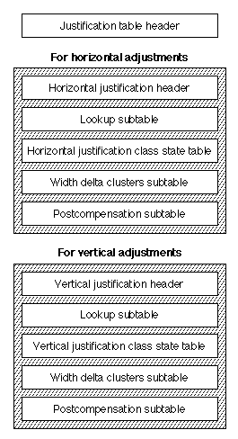
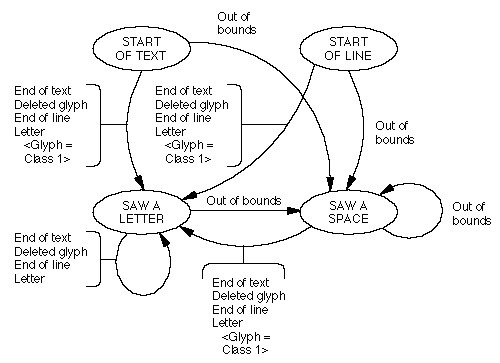
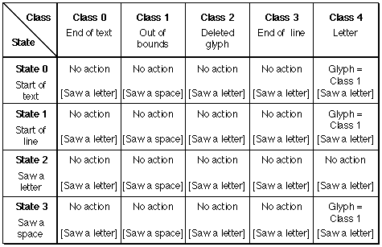

# The `'just'` table

## General table information

## Introduction

The *justification table* (tag name: `'just'`) allows you to design your AAT fonts to accommodate special justification functions. Justification is the process of typographically stretching or shrinking a line of text to fit within a given height or width. A line of text is a collection of glyphs and each glyph on the line is associated with left and right (or top and bottom) width delta factors, a justification category, and a justification priority.

There are many different options you can choose to control justification of text in your font, including the following:

- Separate justification factors for the left-side and the right-side of any glyph.
- Different sets of justification factors to be used in cases where the line needs to loosen as well as cases where the line needs to tighten.
- Kashida glyphs, which are glyphs that are used to connect other glyphs in connected scripts (such as Arabic or cursive roman).
- Control over the order in which glyphs participate in the justification process.
- Selection of certain glyphs to be "unlimited" so that they always soak up all remaining gap during justification.
- Contextual, state table-based designation of justification behaviors, so that the identical glyph might behave quite differently in different contexts.
- Having glyphs change shape to fill up gap (copyfitting), either by simply stretching, or by using the font variation mechanism.
- Ability to undo ligatures back into their component parts if too much white space is being added during justification.

The *width delta factors* are fractional measurements by which the glyph can expand or contract on each side. (For some scripts, the sides of a glyph are on the left and right; for others, they are the top and bottom.) You determine the width delta factors as a distance, measured in points, relative to a one point glyph. In order to calculate the value of the width delta factor for the glyph at a larger point size, multiply this distance by that point size. For example, a width delta factor value of 2.5 for the right-side grow factor means that 2.5 points of white space may be added to the right side of the glyph at size one point. For example, if a 12-point glyph had a right-side growth width delta factor of 2.5, 30 points of white space could be added to the right side of the glyph. Some glyphs are also designated as *unlimited*, meaning they take up all available gap on a line. For example, if you never want interglyph spacing added, then the whitespace glyph or glyphs can be designated as unlimited.

The *justification category* allows the set of width delta factors used with a glyph to vary at different places on the line. For example, a glyph may exhibit different behavior according to whether it occurred at the beginning or end of a word. Allowing glyphs to have different width delta factors at different places on a line or in a word is especially important in non-roman languages such as Arabic. You include a justification category state table in order to assign the appropriate justification category to the glyph.

The *justification priority* identifies the stage at which a glyph starts to participate in the justification process. The four priorities are:

- Kashida priority. This is the highest priority during justification. Any glyphs having this priority are handled first. This priority is used primarily in Arabic, where it identifies glyphs that are to be extended using kashida extender bars, rather than by adding whitespace.
- Whitespace priority. This is the next highest priority. You should give whitespace glyphs (as identified in the [glyph properties table](prop.md)) this priority.
- Inter-glyph priority. This priority should be used for any remaining glyphs. Glyphs at this priority participate in the justification process later than glyphs of the previous two priorities.
- Null priority. This priority is not normally included in fonts; rather, it is used by applications to override justification priorities when text is laid out and so should not be used for any actual glyphs in the font.

The justification table stores justification information for the glyphs of your font and for the font as a whole. You can store both horizontal and vertical adjustments or adjustments for one direction.

## Justification Table Format

The justification table is shown in Figure 4-1. The table begins with an overall table header that points to the separate horizontal and vertical justification headers. Each of these headers points to the subtables that contain the information needed in order to justify the font in either the horizontal or vertical direction.

Figure 4-1 The justification table

The top level of the justification table has the version number of the table, the format number of the justification table, and the offsets to the horizontal and vertical justification tables. The top-level format of the justification table is shown in Table 4-1.

| Type | Name | Description |
| --- | --- | --- |
| Fixed | version | Version number of the justification table (0x00010000 for the current version). |
| UInt16 | format | Format of the justification table (set to 0). |
| UInt16 | horizOffset | Byte offset from the start of the justification table to the header for tables that contain justification information for horizontal text. If you are not including this information, store 0. |
| UInt16 | vertOffset | Byte offset from the start of the justification table to the header for tables that contain justification information for vertical text. If you are not including this information, store 0. |

You can store separate tables for information about how your font handles horizontal justification as opposed to vertical justification. The `horizOffset` and `vertOffset` fields of the header point to direction-specific justification headers of type `JustificationHeader`. These direction-specific justification header contains offsets to tables that describe data your font needs during the justification process: justification category, the width delta factors of the font, and the postcompensation subtable, an optional table allows you to specify justification behavior that your font can display under specific circumstances. The format of the `JustificationHeader` is shown in the following table:

| Type | Name | Description |
| --- | --- | --- |
| UInt16 | justClassTableOffset | Offset to the justification category state table. |
| UInt16 | wdcTableOffset | Offset from start of justification table to start of the subtable containing the width delta factors for the glyphs in your font. |
| UInt16 | pcTableOffset | Offset from start of justification table to start of postcompensation subtable (set to zero if none). |
| variable | lookupTable | Lookup table associating glyphs with width delta clusters. See the description of Width Delta Clusters table for details on how to interpret the lookup values. |
| variable | widthDeltaClusters | The width delta clusters table. |
| variable | postcompTable | The postcompensation subtable, if present in the font. |

### The justification category State Table

The justification category [state table](Tables.md#anchor-Tables-StateTables) allows you to associate a glyph with a justification category that depends on the context of the glyph. The state table has the following format:

| Type | Name | Description |
| --- | --- | --- |
| [MorphSubtableHeader](mort.md#anchor-mort-MorphSubtableHeader) | morphHeader | Metamorphosis-style subtable header. |
| [StateHeader](Tables.md#anchor-Tables-StateHeader) | stHeader | The justification insertion state table header |

For this state table, the entries in the entry subtable comprise only the `newState` field and the `flags` field; there are no values in the `glyphOffsets` array. The interpretation of the `flags` field for this state table are given in the following table:

| Mask value | Name | Interpretation |
| --- | --- | --- |
| 0x8000 | setMark | If set, make the current glyph the marked glyph. |
| 0x4000 | dontAdvance | If set, don't advance to the next glyph before going to the new state. |
| 0x3F80 | markCategory | The justification category for the marked glyph if nonzero. |
| 0x007F | currentCategory | The justification category for the current glyph if nonzero. |

The justification category is a 7-bit value that allows the set of factors used with that glyph to vary at different places on the line. As a line is being analyzed, each glyph is assigned a justification category given the glyph index and context. In this way, you can provide subtle differences in the justification behavior of the same glyph. For example, a lowercase 'e' at the end of a word can behave differently from one at the beginning or in the middle of the word. This justification category is then matched to a width delta record, which contains the limits of the glyph to grow and shrink.

If the justification category fields (`markCategory` and `currentCategory`) are non zero, they are used to set the justification category of the corresponding glyph. If the `setMark` flag is set, the position of the current glyph in the glyph array is remembered, making it the marked glyph.

### The Width Delta Clusters Table

The width delta factors for justification categoryes are stored in *width delta clusters*. Each cluster contains a number of *width delta pairs*. Each pair maps a justification category to a *width delta record*, which contains information about the limits that you set on the ability of glyphs in that justification category to grow and shrink.

A [lookup table](Tables.md#anchor-Tables-LookupTables) is used to find the width delta cluster associated with a particular glyph. This is how to interpret the lookup value for each of the five lookup table formats:

| Lookup table format | Interpretation |
| --- | --- |
| 0 | Array of 16-bit offsets, one for each glyph in the font. Each offset is from the start of the Width Delta Clusters table to the particular width delta cluster for that glyph. |
| 2 | The value of each lookupSegment is a 16-bit offset from the start of the Width Delta Clusters table to the particular width delta cluster for the glyphs in that segment. |
| 4 | The value of each lookupSegment is a 16-bit offset from the start of the lookup table to an array of 16-bit offsets, one for each glyph in the segment. Each offset is from the start of the Width Delta Clusters table to the particular width delta clust |
| 6 | The value of each lookupSingle is a 16-bit offset from the start of the Width Delta Clusters table to the particular width delta cluster for that glyph. |
| 8 | The valueArray is an array of 16-bit offsets, one for each glyph in the trimmed array. Each offset is from the start of the Width Delta Clusters table to the particular width delta cluster for that glyph. |

A width delta cluster, represented by a `WidthDeltaCluster` record, is a collection of one or more width delta pairs, sorted by the value of its `justClass` field, beginning at 0. The cluster must start on a longword boundary. The format of the width delta cluster is as follows:

| Type | Name | Description |
| --- | --- | --- |
| UInt32 | count | Number of width delta pair records that follow. |
| WidthDeltaPair | wdPairs | The width delta pairs records |

A width delta pair, represented by a `WidthDeltaPair` record, associates a justification category with a width delta record. The format of the width delta pair is as follows:

| Type | Name | Description |
| --- | --- | --- |
| UInt32 | justClass | The justification category associated with the wdRecord field. Only 7 bits of this field are used. (The other bits are used as padding to guarantee longword alignment of the following record). |
| JustWidthDeltaEntry | wdRecord | The actual width delta record. |

You use a width delta record (of type `JustWidthDeltaEntry`) to store information about the grow and shrink factors allotted to this class of glyphs. The record's format is as follows:

| Type | Name | Description |
| --- | --- | --- |
| Fixed | beforeGrowLimit | The ratio by which the advance width of the glyph is permitted to grow on the left or top side. |
| Fixed | beforeShrinkLimit | The ratio by which the advance width of the glyph is permitted to shrink on the left or top side. |
| Fixed | afterGrowLimit | The ratio by which the advance width of the glyph is permitted to grow on the right or bottom side. |
| Fixed | afterShrinkLimit | The ratio by which the advance width of the glyph is at most permitted to shrink on the right or bottom side. |
| UInt16 | growFlags | Flags controlling the grow case. |
| UInt16 | shrinkFlags | Flags controlling the shrink case. |

The growFlags and shrinkFlags bits mask values are as follows:

| Mask value | Interpretation |
| --- | --- |
| 0xE000 | Reserved. You should set these bits to zero. |
| 0x1000 | The glyph can take unlimited gap. When this glyph participates in the justification process, it and any other glyphs on the line having this bit set absorb all the remaining gap. |
| 0x0FF0 | Reserved. You should set these bits to zero. |
| 0x000F | The justification priority of the glyph. |

The justification priority of the glyph controls when this glyph enters into the justification process. The lower this value is, the earlier a glyph begins to participate. The justification priorities are described in this table:

| Priority | Meaning |
| --- | --- |
| 0 | Kashida priority. This is the highest priority during justification. |
| 1 | Whitespace priority. Any whitespace glyphs (as identified in the glyph properties table) will get this priority. |
| 2 | Inter-character priority. Give this to any remaining glyphs. |
| 3 | Null priority. You should set this priority for glyphs that only participate in justification after the above priorities. Normally all glyphs have one of the previous three values. If you don't want a glyph to participate in justification, and you don't want to set its factors to zero, you may instead assign it to the null priority. |

### The Postcompensation Subtable

You can specify alternate glyph behaviors under certain conditions. For instance, you can specify that ligatures should break into their component parts when too much space is being added to a justified line. These alternate behaviors are called *postcompensation actions* and are stored in the postcompensation subtable. You can map one or several glyph indexes in your font to a single type of postcompensation action record. You do not have to map all glyph indexes to an action. The postcompensation subtable, which contains these actions, is optional in your font.

The format of the postcompensations table is as follows:

| Type | Name | Description |
| --- | --- | --- |
| variable | pcLookupTable | Lookup table associating glyphs with postcompensation action records. See below for details on how to interpret the lookup values. |
| variable | pcActionRecords | Actions records whose offsets are contained in the previous lookup table. |

A lookup table is used to find the postocmpensation action record associated with a particular glyph. Note that for this table a lookup value of 0 is interpreted as meaning that no postcompensation action should be performed for that glyph. This is how to interpret the lookup value for each of the 5 lookup table formats:

| Lookup table format | Interpretation |
| --- | --- |
| 0 | Array of 16-bit offsets, one for each glyph in the font. Each offset is from the start of the Postcompensation lookup table to the particular postcompensation action record for that glyph. |
| 2 | The value of each lookupSegment is a 16-bit offset from the start of the Postcompensation lookup table to the particular postcompensation action record for the glyphs in that segment. |
| 4 | The value of each lookupSegment is a 16-bit offset from the start of the lookup table to an array of 16-bit offsets, one for each glyph in the segment. Each offset is from the start of the Postcompensation lookup table to the particular postcompensation action record for that glyph. |
| 6 | The value of each lookupSingle is a 16-bit offset from the start of the Postcompensation lookup table to the particular postcompensation action record for that glyph. |
| 8 | The valueArray is an array of 16-bit offsets, one for each glyph in the trimmed array. Each offset is from the start of the Postcompensation lookup table to the particular postcompensation action record for that glyph. |

The PostcompensationAction record has the following format:

| Type | Name | Description |
| --- | --- | --- |
| UInt32 | actionCount | Number of ActionSubrecord records in the following array. |
| ActionSubrecord | actSubrecord\[\] | Array of ActionSubrecord records. |

An ActionSubrecord has the following format:

| Type | Name | Description |
| --- | --- | --- |
| UInt16 | actionClass | The JustClass value associated with this ActionSubrecord. |
| UInt16 | actionType | The type of postcompensation action. |
| UInt32 | actionLength | Length of this ActionSubrecord record, which must be a multiple of 4. |
| variable | actionData | Data. The format of this data depends on the value of the actionType field. |
| variable | padding | Extra bytes, if needed, to guarantee that the length of this ActionSubrecord is a multiple of 4. |

The following table shows the action types that are supported:

| Action Type | Description |
| --- | --- |
| 0 | Decomposition action. |
| 1 | Unconditional add glyph action. |
| 2 | Conditional add glyph action. |
| 3 | Stretch glyph action. |
| 4 | Ductile glyph action. |
| 5 | Repeated add glyph action. |

#### Decomposition Action

Ligatures may be broken into their component pieces if the amount of extra interglyph space added by the justification process is too large. The *distance factor* is the ratio of growth you want with respect to the glyph at 1 point size. The amount of extra interglyph space is determined by the distance factor. For example, if the upper limit for growth at 0.5, then a 12-point ligature is decomposed if it has to add more than 6 points of whitespace.

The format of the `actionData` field of the `ActionSubrecord` record for this type of postcompensation action is given in the following table:

| Type | Name | Description |
| --- | --- | --- |
| fixed | lowerLimit | If the distance factor is less than this value, then the ligature is decomposed. |
| fixed | upperLimit | If the distance factor is greater than this value, then the ligature is decomposed. |
| UInt16 | order | Numerical order in which this ligature will be decomposed; you may want infrequent ligatures to decompose before more frequent ones. The ligatures on the line of text will decompose in increasing value of this field. |
| UInt16 | decomposedCount | Number of 16-bit glyph indexes that follow; the ligature will be decomposed into these glyphs. |
| UInt16 | glyphs\[\] | Array of decomposed glyphs. |

#### Unconditional Add Glyph Action

If the advance width of a glyph is growing, then a specified single glyph—such as a simple horizontal kashida—is added after this glyph.

The `actionData` portion of the `ActionSubrecord` has the following format for `actionType` value of 1:

| Type | Name | Description |
| --- | --- | --- |
| UInt16 | addGlyph | Glyph that should be added if the distance factor is growing. |

#### Conditional Add Glyph Action

An `actionType` of 2 is a conditional add glyph action. This action has two effects. First, as in the unconditional add glyph action, an extra glyph is added after the glyph (instead of whitespace) in the grow case. However, rather than always adding this extra glyph, a test is performed against a specified factor. If the amount of extra space to be added is less than this factor then this action is exactly like the unconditional add glyph action.

If, however, the amount of extra space added is greater than or equal to the factor, then in addition to adding the specified extra glyph, the original glyph itself is to be changed into a different glyph. This is useful, for example, in Arabic, where certain letterforms that occur at the ends of words (for example, a final nun) change to special wider forms if much extra space is to be added to the line.

The format for the `actionData` portion of the `ActionSubrecord` for this actionType is as follows:

| Type | Name | Description |
| --- | --- | --- |
| fixed | substThreshold | Distance growth factor (in ems) at which this glyph is replaced and the growth factor recalculated. |
| UInt16 | addGlyph | Glyph to be added as kashida. If this value is 0xFFFF, no extra glyph will be added. Note that generally when a glyph is added, justification will need to be redone. |
| UInt16 | substGlyph | Glyph to be substituted for this glyph if the growth factor equals or exceeds the value of substThreshold. |

#### Stretch Glyph Action

An `actionType` 3 is a stretch glyph action. No extra glyph is inserted; rather, a stretch factor is applied to an existing glyph instead of adding whitespace to it. For example, you could point to a hyphen as being a glyph that could stretch to take up all the white space in a line of text.

There is no `actionData` portion of the `ActionSubrecord` for `actionType` of 3; no data should be present.

*Stretch glyph actions are not supported in CoreText. Their use should be avoided.*

#### Ductile Glyph Action

An `actionType` of 4 is a ductile glyph action. This causes the actual shape of the glyph to change by the use of a font variations mechanism. The `actionData` portion of the `ActionSubrecord` for actionType 4 is as follows:

| Type | Name | Description |
| --- | --- | --- |
| UInt32 | variationAxis | The 4-byte tag identifying the ductile axis. This would normally be 0x64756374 ('duct'), but you may use any axis the font contains. |
| Fixed | minimumLimit | The lowest value for the ductility axis that still yields an acceptable appearance. Normally this will be 1.0. |
| Fixed | noStretchValue | This is the default value that corresponds to no change in appearance. Normally, this will be 1.0. |
| Fixed | maximumLimit | The highest value for the ductility axis that still yields an acceptable appearance. |

*Ductile glyph actions are not supported in CoreText. Their use should be avoided.*

#### Repeated Add Glyph Action

If the advance width of a glyph is growing, then a specified single glyph—such as a simple horizontal kashida—is added after this glyph. If necessary, it is added more than once in order to fill the gap.

The `actionData` portion of the `ActionSubrecord` has the following format for `actionType` value of 5:

| Type | Name | Description |
| --- | --- | --- |
| UInt16 | flags | Currently unused; set to 0. |
| UInt16 | glyph | Glyph that should be added if the distance factor is growing. |

## Justification Table Examples

### Example: Simple Justification Table

Consider a simple example of a Roman font containing the usual repertoire of glyphs. In this example, there is a set of justification factors for the space character, and a different set of factors for other characters. This is not a cursive font, so there are no glyphs of kashida priority. Also, no glyphs are handled specially, so the only justification category used is zero. For purposes of this example, imagine that glyph 2 is the space glyph, and glyphs 3 through 275 constitute the non-whitespace glyphs in the font. There is no postcompensation subtable in this justification table.

The justification table for this example font is as follows:

| Offset/length | Value | Name | Comment |
| --- | --- | --- | --- |
| 0/4 | 0x00010000 | version | Version number of the justification table in fixed- point format. Version is 1.0. |
| 4/2 | 0 | format | The justification table format. |
| 6/2 | 10 | horizOffset | Byte offset to start of horizontal JustificationHeader subtable. |
| 8/2 | 0 | vertOffset | Byte offset to start of vertical JustificationHeader subtable. A value of 0 means there is no vertical subtable. |
| (The horizontal `JustificationHeader` starts here) | <!-- colspan --> | <!-- colspan --> | <!-- colspan --> |
| 10/2 | 0 | justClassTableOffset | Byte offset to the justification category state table. A value of 0 means that every glyph has a justClass value of zero. |
| 12/2 | 48 | wdcTableOffset | Byte offset to start of width delta clusters. |
| 14/2 | 0 | pcTableOffset | Byte offset to the start of postcompensation subtable. A value of 0 means there is no postcompensation subtable. |
| (The lookup table starts here) | <!-- colspan --> | <!-- colspan --> | <!-- colspan --> |
| 16/2 | 2 | format | Lookup table format 2 (segment single table format). |
| (The next 5 fields are the `BinSrchHeader`) | <!-- colspan --> | <!-- colspan --> | <!-- colspan --> |
| 18/2 | 6 | unitSize | Size of a LookupSegment record (2 bytes for the starting glyph index, 2 bytes for the ending glyph index, and 2 bytes for the offset to the width delta cluster record). |
| 20/2 | 2 | nUnits | Number of units of the preceding size to be searched. |
| 22/2 | 12 | searchRange | The unitSize times the largest power of two that is less than or equal to nUnits. |
| 24/2 | 1 | entrySelector | The log base 2 of the largest power of two less than or equal to nUnits. |
| 26/2 | 0 | rangeShift | The unitSize times the difference of nUnits minus the largest power of two less than or equal to nUnits. |
| (The first `LookupSegment` starts here) | <!-- colspan --> | <!-- colspan --> | <!-- colspan --> |
| 28/2 | 2 | lastGlyph | Ending glyph index in this first segment (space glyph). |
| 30/2 | 2 | firstGlyph | Starting glyph index in this segment (space glyph). |
| 32/2 | 0 | value | Byte offset from start of the table of WidthDeltaClusters records (offset 48) to the first WidthDeltaCluster record (also offset 48). |
| (The second `LookupSegment` starts here) | <!-- colspan --> | <!-- colspan --> | <!-- colspan --> |
| 34/2 | 275 | lastGlyph | Ending glyph index in this second segment (non- whitespace). |
| 36/2 | 3 | firstGlyph | Starting glyph index in this second segment (non- whitespace). |
| 38/2 | 28 | value | Offset in bytes from the start of the table of WidthDeltaClusters records (offset 48) to the second WidthDeltaCluster record (offset 76). |
| (The last `LookupSegment` starts here) | <!-- colspan --> | <!-- colspan --> | <!-- colspan --> |
| 40/2 | 0xFFFF | lastGlyph | Special value for the last glyph in the last lookup segment. |
| 42/2 | 0xFFFF | firstGlyph | Special value for the first glyph in the last lookup segment. |
| 44/2 | 0 | value | Byte offset from start of the table of WidthDeltaClusters records to this specific WidthDeltaCluster record. |
| 46/2 | 0 | padding | Padding to guarantee that the WidthDeltaCluster table that follows this field starts on a longword boundary (multiple of 4). |
| (`WidthDeltaCluster` records start here) | <!-- colspan --> | <!-- colspan --> | <!-- colspan --> |
| 48/4 | 1 | count | Number of justification categoryes and JustWidthDeltaEntry pairs that follow. |
| 52/4 | 0 | justClass | The justification category is zero. |
| 56/4 | 0x00008000 | beforeGrowLimit | The maximum number of ems that the glyph can grow on the left side is one-half em. |
| 60/4 | 0xFFFFF500 | beforeShrinklimit | The number of ems that the glyph can shrink on the left side is roughly -0.043 em. |
| 64/4 | 0x00008000 | afterGrowLimit | The maximum number of ems that the glyph can grow on the right side is one-half em. |
| 68/4 | 0xFFFFF500 | afterShrinkLimit | The number of ems that the glyph can shrink on the right side is roughly -0.043 em. |
| 72/2 | 0x0001 | growFlags | Whitespace priority. |
| 74/2 | 0x0001 | shrinkFlags | Whitespace priority. |
| 76/4 | 1 | count | Number of justification categoryes and JustWidthDeltaEntry pairs that follow. |
| 80/4 | 0 | justClass | The justification category is zero. |
| 84/4 | 0x00002500 | beforeGrowLimit | The maximum number of ems that the glyph can grow on the left side is roughly 0.14 em. |
| 88/4 | 0xFFFFF500 | beforeShrinklimit | The number of ems that the glyph can shrink on the left side is roughly -0.043 em. |
| 92/4 | 0x00002500 | afterGrowLimit | The maximum number of ems that the glyph can grow on the right side is roughly 0.14 em. |
| 96/4 | 0xFFFFF500 | afterShrinkLimit | The number of ems that the glyph can shrink on the right side is roughly -0.043 em. |
| 100/2 | 0x0002 | growFlags | Inter-character priority. |
| 102/2 | 0x0002 | shrinkFlags | Inter-character priority. |

### Example: Complex Justification Table (with Postcompensation and justification category State Tables)

A more complex example is an Arabic font to which you want to add kashida capabilities. The kashida glyph that is used in this example is glyph number 226. This example also uses the following glyph assignments: 2 is whitespace, 3 to 225 are regular glyphs, and 226 is the kashida. For simplicity, this font uses a state table that assigns justification category 1 to the first glyph in each word (which, in this example, is actually the glyph on the left hand side of the word, instead of the right hand side), and justification category 0 to all other glyphs.

The lookup table for the postcompensation subtable doesn't need to list each separate glyph to which a kashida might be attached. By matching all glyphs, you can rely on the `justClass` value to filter out only those glyphs that the kashida action will affect.

Remember: the action occurs in three different places here:

1. The kashida-capable glyph is contextually identified by the justification category table.
2. The actual advance width stretch factors are specified as unlimited for the glyph with the kashida.
3. Given these unlimited advance width growth factors, the postcompensation subtable catches these glyphs and adds kashidas of the appropriate width.

The following figure shows the justification table finite state machine for this example font. There are four states. They are 'start of text', 'start of line', 'saw a letter' and 'saw a space' states. Note that when the finite state machine is in the 'start of text', 'start of line', or 'saw a space' state and encounters a letter (assigned glyph Class 4), the glyph is converted to a glyph having justification category 1.

The next figure shows the justification state table for this example font. The four states (rows) and five classes (columns) are shown. Each cell of the array contains the action (top) and the next state (bottom). The next state is bounded by brackets.

Note that the 'start of text,' 'start of line,' and 'saw a space' states are identical, since there is no distinction between these three states for this font. The following table summarizes the classes, class names, entry numbers, next states, and actions for these three states.

| Class | Class Name | Entry Number | Next State | Action |
| --- | --- | --- | --- | --- |
| 0 | End of Text | 1 | Saw a letter | No action. |
| 1 | Out of Bounds | 2 | Saw a space | No action. |
| 2 | Deleted Glyph | 1 | Saw a letter | No action. |
| 3 | End of Line | 1 | Saw a letter | No action. |
| 4 | Letter | 0 | Saw a letter | Current glyph is justification category 1. |

The following table lists the classes, class names, entry numbers, next states, and actions for the 'saw a letter' state.

| Class | Class Name | Entry Number | Next State | Action |
| --- | --- | --- | --- | --- |
| 0 | End of Text | 1 | Saw a letter | No action. |
| 1 | Out of Bounds | 2 | Saw a space | No action. |
| 2 | Deleted Glyph | 1 | Saw a letter | No action. |
| 3 | End of Line | 1 | Saw a letter | No action. |
| 4 | Letter | 1 | Saw a letter | No action. |

Here is the justification table (which is 444 bytes long) for this example font:

| Offset/length | Value | Name | Comment |
| --- | --- | --- | --- |
| 0/4 | 0x00010000 | version | Version number of the justification table, in fixed- point format |
| 4/2 | 0 | format | The justification table format value. |
| 6/2 | 10 | horizOffset | Byte offset to start of the horizontal JustificationHeader subtable |
| 8/2 | 0 | vertOffset | Byte offset to start of the vertical JustificationHeader subtable. A value of 0 means there is no vertical subtable. |
| (The horizontal JustificationHeader subtable starts here) | <!-- colspan --> | <!-- colspan --> | <!-- colspan --> |
| 10/2 | 168 | justClassTableOffset | Byte offset from start of the 'just' table to the start of the class state table. |
| 12/2 | 48 | wdcTableOffset | Byte offset from start of the 'just' table to the start of the width delta clusters table. |
| 14/2 | 128 | pcTableOffset | Byte offset from start of the 'just' table to the start of the postcompensation table. |
| (The lookup table mapping glyphs to `WidthDeltaCluster` table offsets starts here) | <!-- colspan --> | <!-- colspan --> | <!-- colspan --> |
| 16/2 | 2 | format | Lookup table format 2 (segment single format). |
| 18/2 | 6 | unitSize | Size of a LookupSegment record (2 bytes for the starting glyph index, 2 bytes for the ending glyph index, and 2 bytes for the offset to the width delta cluster record). |
| 20/2 | 2 | nUnits | Number of units in the lookup table (one for whitespace, and one for both kashida and intercharacter glyphs, which are only distringuished by their justification category values). |
| 22/2 | 12 | searchRange | The unitSize times the largest power of two that is less than or equal to nUnits. |
| 24/2 | 1 | entrySelector | The log (base 2) of the largest power of two that is less than or equal to nUnits. |
| 26/2 | 0 | rangeShift | The unitSize times the difference of nUnits minus the largest power of two that is less than or equal to nUnits. |
| (The first `LookupSegment` starts here) | <!-- colspan --> | <!-- colspan --> | <!-- colspan --> |
| 28/2 | 2 | lastGlyph | Ending glyph index in this segment (index of the space glyph). |
| 30/2 | 2 | firstGlyph | Starting glyph index in this segment (index of the space glyph). |
| 32/2 | 0 | value | Offset from start of WidthDeltaClusters table to the cluster for this range of glyphs (i.e. the space glyph). |
| (The second `LookupSegment` starts here) | <!-- colspan --> | <!-- colspan --> | <!-- colspan --> |
| 34/2 | 226 | lastGlyph | Ending glyph index in this segment. |
| 36/2 | 3 | firstGlyph | Starting glyph index in this segment. |
| 38/2 | 28 | value | Offset from start of WidthDeltaClusters table to the cluster for this range of glyphs (i.e. all the other glyphs). |
| (Special guardian `LookupSegment` always goes last) | <!-- colspan --> | <!-- colspan --> | <!-- colspan --> |
| 40/2 | 0xFFFF | lastGlyph | Special guardian. |
| 42/2 | 0xFFFF | firstGlyph | Special guardian. |
| 44/2 | 0 | value | Special guardian. |
| (Pad to longword, since all subtables in the `'just'` table must always be longword aligned) | <!-- colspan --> | <!-- colspan --> | <!-- colspan --> |
| 46/2 | 0 | (none) | Padding. |
| (The first cluster of the `WidthDeltaClusters` table starts here) | <!-- colspan --> | <!-- colspan --> | <!-- colspan --> |
| 48/4 | 1 | count | Number of \<justification category, JustWidthDeltaEntry\> pairs contained in this cluster. |
| (The first pair of the first cluster starts here) | <!-- colspan --> | <!-- colspan --> | <!-- colspan --> |
| 52/4 | 0 | justClass | Use this pair for justClass 0. |
| 56/4 | 0x00008000 | beforeGrowLimit | The most by which a glyph can grow on the left-hand side is 0.5 em. |
| 60/4 | 0xFFFFF500 | beforeShrinkLimit | The most by which a glyph can shrink on the left-hand side is roughly 0.043 em. Note that shrink factors are always negative. |
| 64/4 | 0x00008000 | afterGrowLimit | The most by which a glyph can grow on the right-hand side is 0.5 em. |
| 68/4 | 0xFFFFF500 | afterShrinkLimit | The most by which a glyph can shrink on the right-hand side is roughly 0.043 em. Note that shrink factors are always negative. |
| 72/2 | 0x0001 | growFlags | Grow-case priority is whitespace, with no other flags set. |
| 74/2 | 0x0001 | shrinkFlags | Shrink-case priority is whitespace, with no other flags set. |
| (The second cluster of the `WidthDeltaClusters` table starts here) | <!-- colspan --> | <!-- colspan --> | <!-- colspan --> |
| 76/4 | 2 | count | Number of \<justification category, JustWidthDeltaEntry\> pairs contained in this cluster. |
| (The first pair of the second cluster starts here) | <!-- colspan --> | <!-- colspan --> | <!-- colspan --> |
| 80/4 | 0 | justClass | Use this pair for justClass 0. |
| 84/4 | 0x00002500 | beforeGrowLimit | The most by which a glyph can grow on the left-hand side is roughly 0.14 em. |
| 88/4 | 0xFFFFF500 | beforeShrinklimit | The most by which a glyph can shrink on the left-hand side is roughly 0.043 em. Note that shrink factors are always negative. |
| 92/4 | 0x00002500 | afterGrowLimit | The most by which a glyph can grow on the right-hand side is roughly 0.14 em. |
| 96/4 | 0xFFFFF500 | afterShrinkLimit | The most by which a glyph can shrink on the right-hand side is roughly 0.043 em. Note that shrink factors are always negative. |
| 100/2 | 0x0002 | growFlags | Grow-case priority is intercharacter, with no other flags set. |
| 102/2 | 0x0002 | shrinkFlags | Grow-case priority is intercharacter, with no other flags set. |
| (The second pair of the second cluster starts here) | <!-- colspan --> | <!-- colspan --> | <!-- colspan --> |
| 104/4 | 1 | justClass | Use this pair for justClass 1. |
| 108/4 | 0x00002500 | beforeGrowLimit | The most by which a glyph can grow on the left-hand side is roughly 0.14 em. |
| 112/4 | 0xFFFFF500 | beforeShrinklimit | The most by which a glyph can shrink on the left-hand side is roughly 0.043 em. Note that shrink factors are always negative. |
| 116/4 | 0x00002500 | afterGrowLimit | The most by which a glyph can grow on the right-hand side is roughly 0.14 em. |
| 120/4 | 0xFFFFF500 | afterShrinkLimit | The most by which a glyph can shrink on the right-hand side is roughly 0.043 em. Note that shrink factors are always negative. |
| 124/2 | 0x1000 | growFlags | Grow-case priority is kashida, and the unlimited flag is set. |
| 126/2 | 0x0002 | shrinkFlags | Grow-case priority is intercharacter, with no other flags set. |
| (The postcompensation subtable starts here with the lookup table.  Note that we're already longword aligned, so no padding is needed) | <!-- colspan --> | <!-- colspan --> | <!-- colspan --> |
| 128/2 | 2 | format | Lookup table format 2 (segment single format). |
| 130/2 | 6 | unitSize | Size of a LookupSegment record (2 bytes for the starting glyph index, 2 bytes for the ending glyph index, and 2 bytes for the offset to the PostcompensationAction record). |
| 132/2 | 1 | nUnits | Number of units of the preceding size to be searched. |
| 134/2 | 6 | searchRange | The unitSize times the largest power of two that is less than or equal to nUnits. |
| 136/2 | 0 | entrySelector | The log base 2 of the largest power of two less than or equal to nUnits. |
| 138/2 | 0 | rangeShift | The unitSize times the difference of nUnits minus the largest power of two less than or equal to nUnits. |
| (The only `LookupSegment` starts here) | <!-- colspan --> | <!-- colspan --> | <!-- colspan --> |
| 140/2 | 226 | lastGlyph | Ending glyph index in this first segment (non-whitespace glyphs). |
| 142/2 | 2 | firstGlyph | Starting glyph index in this first segment (non-whitespace glyphs). |
| 144/2 | 24 | value | Byte offset from start of the postcompensation table (offset 128) to the postcompensation action record for glyphs 2 through 226 (offset 152). |
| (Special guardian `LookupSegment` always goes last) | <!-- colspan --> | <!-- colspan --> | <!-- colspan --> |
| 146/2 | 0xFFFF | lastGlyph | Special guardian. |
| 148/2 | 0xFFFF | firstGlyph | Special guardian. |
| 150/2 | 0 | value | Special guardian. |
| (The `PostcompensationAction` record starts here) | <!-- colspan --> | <!-- colspan --> | <!-- colspan --> |
| 152/4 | 1 | actionCount | Number of ActionSubrecords that follow. |
| (The `ActionSubrecord` starts here) | <!-- colspan --> | <!-- colspan --> | <!-- colspan --> |
| 156/2 | 1 | actionClass | The JustClass value associated with the following ActionSubrecord. |
| 158/2 | 1 | actionType | The actionType is unconditional add glyph. |
| 160/4 | 12 | actionLength | Length of this ActionSubrecord. |
| 164/2 | 226 | actionData | The glyph to be added is the kashida glyph. |
| 166/2 | 0 | padding | Padding to guarantee longword alignment (must be a multiple of 4). |
| (The justification category state table starts here with the metamorphosis subtable header) | <!-- colspan --> | <!-- colspan --> | <!-- colspan --> |
| 168/2 | 276 | length | Length of this justification category state table (including this metamorphosis subtable header). |
| 170/2 | 0 | coverage | Process glyphs in ascending order. The 0x4000 bit is the only one interpreted for the justification table. |
| 172/4 | 0 | subFeatureFlags | Ignored for justification tables. |
| (The `StateHeader` starts here) | <!-- colspan --> | <!-- colspan --> | <!-- colspan --> |
| 176/2 | 5 | stateSize | This reflects the four fixed classes (end of text, out of bounds and deleted glyph, and end of line) and one that we're adding (letter). |
| 178/2 | 8 | classTable | Byte offset from the start of the state table header to the class table. |
| 180/2 | 236 | stateArray | Byte offset from the start of the state table header to the state array. |
| 182/2 | 256 | entryTable | Byte offset from the start of the state table header to the entry table. |
| 184/2 | 3 | firstGlyph | Glyph index of the first glyph in the class table. |
| 186/2 | 223 | nGlyphs | Count (takes us up through glyph 225). |
| 188/223 | 0x040404... | classarray\[\] | 223 bytes each containing the value 4. This is the class for letters. Note that the whitespace glyph is not included in the range; that means it will get class 1. Class 1 is 'out of bounds.' |
| 411/1 | 0x00 | padding | Padding to guarantee longword alignment (must be a multiple of 4). |
| 412/5 | 1,2,1,1,0 | state | 0 'Start of text' state. For classes 'end of text,' 'deleted glyph,' and 'end of line' use entry #1. For class 'letter,' use entry #0. For class 'out of bounds' (i. e. space), use entry #2. |
| 417/5 | 1,2,1,1,0 | state | 1 'Start of line' state. Same as 'start of text' state. |
| 422/5 | 1,2,1,1,1 | state | 2 'Saw a letter' state. For all classes except 'out of bounds,' use entry #1. For class 'out of bounds' use entry #2. |
| 427/5 | 1,2,1,1,0 | state | 3 'Saw a space' state. Same effect as 'start of text' state. |
| 432/2 | 246 | entry | Offset to 'saw a letter' state. |
| 434/2 | 0x0001 | action | Action is to set justification category of current glyph to 1. |
| 436/2 | 246 | entry | Offset to 'saw a letter' state. |
| 438/2 | 0 | action | No action is taken. |
| 440/2 | 251 | entry | Offset to 'saw a letter' state. |
| 442/2 | 0 | action | No action is taken. |
