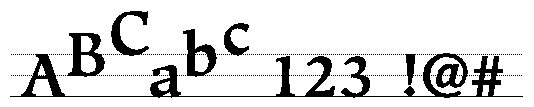
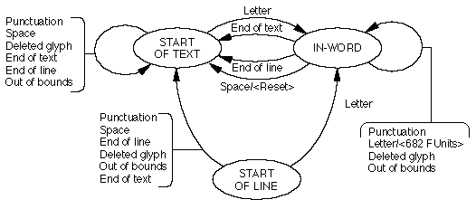
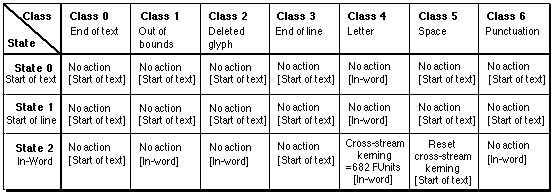

# The `'kern'` table

## General table information

The `'kern'` table contains the values that adjust the intercharacter spacing for glyphs in a font. It can have multiple subtables in varied formats that can contain information for vertical or horizontal text. Kerning values are used to adjust intercharacter spacing.

Kerning can be parallel to the flow of text or perpendicular to the flow of text, or both. For example, if perpendicular kerning is specified and if text is normally written horizontally, kerning will be up or down.

Four kerning formats are currently defined, formats 0 through 3. The file format specification allows for additional formats to be defined for further use. Formats 4 and up are reserved for future use.

Each subtable can be in one of the four formats specified below, and can contain information for vertical or horizontal text. A font can have multiple `'kern'` subtables but since the adjustments made by these tables are additive, the order of the subtables containing kerning values is not important.

The kerning table has a header, which contains the format number, the number of subtables present, and the subtables themselves. The header format is shown in Table 25.

**IMPORTANT NOTE!**

Previous versions of the `'kern'` table defined both the *version* and *nTables* fields in the header as `UInt16` values and not `UInt32` values. Use of the older format on OS X is discouraged (although AAT can sense an old kerning table and still make correct use of it). Microsoft Windows still uses the older format for the `'kern'` table and will not recognize the newer one. Fonts targeted for OS X only should use the new format; fonts targeted for both OS X and Windows should use the old format.

**Table 25**: `'kern'` header

| Type | Name | Description |
| --- | --- | --- |
| fixed32 | version | The version number of the kerning table (0x00010000 for the current version). |
| uint32 | nTables | The number of subtables included in the kerning table. |

Kerning subtables also have a header that is used to identify the format of the subtable and the kind of information it contains. The subtable header is documented in Table 26.

**Table 26**: `'kern'` subtable header

| Type | Name | Description |
| --- | --- | --- |
| uint32 | length | The length of this subtable in bytes, including this header. |
| uint16 | coverage | Circumstances under which this table is used. See below for description. |
| uint16 | tupleIndex | The tuple index (used for variations fonts). This value specifies which tuple this subtable covers. |

The subtable coverage field is divided into the subfields given in below. The sizes are in bits.

**Table 27**: coverage

| Mask value | Name | Description |
| --- | --- | --- |
| 0x8000 | kernVertical | Set if table has vertical kerning values. |
| 0x4000 | kernCrossStream | Set if table has cross-stream kerning values. |
| 0x2000 | kernVariation | Set if table has variation kerning values. |
| 0x1F00 | kernUnusedBits | Set to 0. |
| 0x00FF | kernFormatMask | Set the format of this subtable (0-3 currently defined). |

A mask value of 0x4000 indicates that cross-stream kerning is to be invoked. If text is normally written horizontally, kerning will be vertical. If kerning values are positive, the text will be kerned up. If they are negative, the text will be kerned down. If text is normally written vertically, kerning will be horizontal. If kerning values are positive, the text will be kerned to the right. If they are negative, the text will be kerned to the left.

## Kerning subtable formats

The format-specific kerning subtables follow the kerning subtable header. The following sections give the details of Kerning Table Formats 0, 1, 2, and 3. Formats 4 through 255 are reserved for future use. The following kerning formats are currently defined:

- Format 0 is an ordered list of kerning pairs
- Format 1 is a state table for contextual kerning of up to eight glyphs
- Format 2 is a simple two-dimensional array of kerning values and a class subtable
- Format 3 is a compact form of Format 2

### Format 0 Kerning Subtable (Ordered List of Kerning Pairs)

Format 0 kerning subtables store kerning information as sorted lists of kerning pairs and values. Using information stored in the kerning subtable header, you can execute an efficient binary search of these lists.

A binary search is most efficiently coded if the search range is a power of two, so that the search range can be reduced by half by shifting instead of dividing. In general, the number of kerning pairs, `nPairs`, will not be a power of two. The value `searchRange` should be the largest power of two less than or equal to `nPairs`. The number of pairs not covered by `searchRange` (that is, `nPairs - searchRange`) is the value `rangeShift`.

Before the binary search loop is made, you need to determine whether the desired kerning pair is in the `searchRange` portion of the list. If it is, the binary search starts at the beginning of the list of kerning pairs. If it isn't, the search starts `rangeShift` bytes from the beginning of the list. This will be an entry boundary. The number of iterations made through the list of kerning pairs is determined by the value of `entrySelector`, which is calculated as the base 2 log of the largest power of two less than or equal to the value of `nPairs`.

Although this ordered list format is compact and easy to generate, the binary search loop requires `entrySelector` iterations in order to search.

This table gives the format of the Format 0 kerning subtable:

**Table 28**: `'kern'` format 0

| Type | Name | Description |
| --- | --- | --- |
| uint16 | nPairs | The number of kerning pairs in this subtable. |
| uint16 | searchRange | The largest power of two less than or equal to the value of nPairs, multiplied by the size in bytes of an entry in the subtable. |
| uint16 | entrySelector | This is calculated as log2 of the largest power of two less than or equal to the value of nPairs. This value indicates how many iterations of the search loop have to be made. For example, in a list of eight items, there would be three iterations of the loop. |
| uint16 | rangeShift | The value of nPairs minus the largest power of two less than or equal to nPairs. This is multiplied by the size in bytes of an entry in the table. |

The list of kerning pairs and values follow the last field in the preceding table. The format for the Format 0 kerning pairs and values is as follows:

**Table 29**: `'kern'` format 0 kerning pairs and values

| Type | Name | Description |
| --- | --- | --- |
| uint16 | left | The glyph index for the lefthand glyph in the kerning pair. |
| uint16 | right | The glyph index for the righthand glyph in the kerning pair. |
| sint16 | value | The kerning value in FUnits for the left and right pair in FUnits. If this value is greater than zero, the glyphs are moved apart. If this value is less than zero, the glyphs are moved together. |

The left (high order word) and right (low order word) halves of the kerning pair make an unsigned 32-bit number, which is then used to order the kerning pairs numerically.

The table needs to end with an entry for a left-hand glyph of 0xFFFF, a right-hand glyph of 0xFFFF, and a kerning value of 0.

### Format 1 Kerning Subtable (State Table for Contextual Kerning)

Format 1 kerning tables contain a format specific header and a state table to allow kerning of up to eight glyphs at once. The format specific header for a Format 1 kerning table is as follows:

| Type | Name | Description |
| --- | --- | --- |
| StateHeader | stHeader | The contextual kerning state table header. |
| uint16 | valueTable | Offset in bytes from the beginning of the subtable to the beginning of the kerning table. |

The actions in a contextual kerning subtable contain a table-specific flag field. The flags and their descriptions follow:

| Mask value | Interpretation |
| --- | --- |
| 0x8000 | Push: if set, push this glyph on the kerning stack. |
| 0x4000 | If set, don't advance to the next glyph before going to the new state. |
| 0x3FFF | ValueOffset: byte offset from the beginning of the subtable to the value table for the glyphs on the kerning stack. |

If the push flag is set, the position of the current glyph in the glyph array will be pushed onto a stack of up to eight glyphs, called thekerning stack. If the `valueOffset` is nonzero, it points to a value table. The value table is a list of FUnit kerning values. Each pops one glyph from the kerning stack and applies the kerning value to it. The end of the list is marked by an odd value whose exact interpretation is determined by the `coverage` field in the subtable header.

Because the `stateTableOffset` in the state table header is (strictly speaking) redundant, some 'kern' tables use it to record an initial state where that should not be StartOfText. To determine if this is done, calculate what the `stateTableOffset` should be. If it's different from the actual `stateTableOffset`, use it as the initial state.

### Format 2 Kerning Table (Simple n x m Array of Kerning Values)

Format 2 kerning subtables store kerning information in a two-dimensional array of kerning values. The glyphs are mapped to classes, using a different mapping for left-hand and right-hand glyphs. This allows glyphs that have similar left-hand or right-hand shapes to be handled together (e.g., accented forms of a letter).

Each row in the array represents one left-hand glyph class, each column represents one right-hand glyph class, and each cell contains a kerning value. Row and column 0 should indicate glyphs that do not kern and contain all zeros.

The right-hand class values are stored pre-multiplied by the number of bytes in a single kerning value (i.e., two). The left-hand class values are stored pre-multiplied by the number of bytes in one row and offset by the offset of the array from the start of the subtable. This eliminates the need to multiply the row and column values together to determine the location of the kerning value. The array can be indexed by completing the left-hand and right-hand class mappings, adding the class values to the address of the subtable, and fetching the kerning value to which the new address points.

The header of the format 2 simple array header subtable is as follows:

**Table 30**: simple array header

| Type | Name | Description |
| --- | --- | --- |
| uint16 | rowWidth | The width, in bytes, of a row in the subtable. |
| uint16 | leftOffsetTable | Offset from beginning of this subtable to the left-hand offset table. |
| uint16 | rightOffsetTable | Offset from beginning of this subtable to right-hand offset table. |
| uint16 | array | Offset from beginning of this subtable to the start of the kerning array. |

The class subtable header shown in the following table follows the simple array header subtable.

**Table 31**: class table header

| Type | Name | Description |
| --- | --- | --- |
| uint16 | firstGlyph | First glyph in class range. |
| uint16 | nGlyphs | Number of glyph in class range. |
| UInt16 | offsets\[nGlyphs\] | The offsets array for all of the glyphs in the range. |

The default left-hand offset for glyphs not within the range of the left-hand offset table is the kerning array offset from the subtable header. Values within the left-hand offset table should not be less than the kerning array offset. The default right-hand ofset for glyphs not within the range of the right-hand offset table is 0.

To find the kerning value, first calculate the offset for the left-hand glyph, then add it to the offset for the right-hand glyph. This sum is an offset from the beginning of the kerning subtable to the SInt16 kerning value for the pair.

### Format 3 Kerning Table (Simple n x m Array of Kerning Indices)

Format 3 kerning subtables store indices to kerning information in a two- dimensional array. The glyphs are mapped to classes, similar to format 2, using a different mapping for lefthand and righthand glyphs.

To find the kerning value for a pair of glyphs, each glyph is first mapped through either the left or right hand class mapping. This gives index values for each glyph. These values are then used to index into the two-dimension array of kerning indices by multiplying the left class by the number of right hand classes and then adding the right class. The value in the array at this position is, in turn, an index into the list of kerning values.

The header of the format 3 simple array header subtable is as follows:

| Type | Name | Description |
| --- | --- | --- |
| uint16 | glyphCount | The number of glyphs in this font. |
| uint8 | kernValueCount | The number of kerning values. |
| uint8 | leftClassCount | The number of left-hand classes. |
| uint8 | rightClassCount | The number of right-hand classes. |
| uint8 | flags | Set to zero (reserved for future use). |

Immediately following the header described above are four variable length arrays, described in the following table:

| Type | Name | Description |
| --- | --- | --- |
| FWord | kernValue\[kernValueCount\] | The kerning values. |
| uint8 | leftClass\[glyphCount\] | The left-hand classes. |
| uint8 | rightClass\[glyphCount\] | The right-hand classes |
| uint8 | kernIndex\[leftClassCount \* rightClassCount\] | The indices into the kernValue array. |

Suppose you have two glyphs, L and R, and you wish to determine the kerning value. You can do so using this pseudo-expression: `value = kernValue[kernIndex[leftClass[L] * rightClassCount + rightClass[R]]].`

This format is faster to evaluate than Format 2, and can be smaller, depending on the number of classes. One downside to this format is that it only supports up to 256 lefthand classes, 256 righthand classes, and 256 kerning values. If your font exceeds these values, you should use Format 2 instead.

## Kerning Table Example

Here is an example of a Format 1 kerning table that demonstrates cross- stream kerning. The rule set for this font follows:

- This font has 2048 FUnits per em-square.
- All upper and lower case glyphs are to have vertical cross-stream kerning. The cross-stream increment will be 683 FUnits. This corresponds to 683/2048, or 0.3 em per glyph.
- Punctuation glyphs are not to undergo cross-stream kerning and are to remain on the horizontal axis of the previous glyph.
- The space glyph resets the cross-stream vertical spacing to the baseline value.

In order to create a kerning table that meets these requirements, you assign all upper and lower case letter glyphs to Class 4, the space glyph to Class 5, and the punctuation glyphs to Class 6.

This figure shows a text run sample of the cross-streaming text from the example font:

The next figure shows the kerning table finite state machine for this example font. There are three states. They are 'start of text,' 'in-word,' and 'start of line.' When the finite state machine is in the 'in-word' state, glyph classes of punctuation, deleted glyph, and out of bounds result in no change of state and no-action, whereas letters result in cross-stream kerning of 682 FUnits. Note that the space glyph results in a change of state from 'in-word' to 'start of text' and an action of 'reset' the text run to the original baseline.

The next figure shows the kerning state table for this example font. The three states (rows) and seven classes (columns) are shown. Each cell of the array contains the action (top) and the next state (bottom). The next state is bounded by brackets.

Note that the start of text and start of line states are identical since there is no distinction between these two states for this font. This table summarizes the classes, class names, entry numbers, new states and actions for these two states.

| Class | Class Name | Entry | Next State | Action |
| --- | --- | --- | --- | --- |
| 0 | End-of-text | 2 | Start-of-text | No action. |
| 1 | Out-of-bounds | 0 | Start-of-text | No action. |
| 2 | Deleted-glyph | 0 | Start-of-text | No action. |
| 3 | End-of-line | 2 | Start-of-text | No action. |
| 4 | Letter | 1 | In-word | No action. |
| 5 | Space | 0 | Start-of-text | No action. |
| 6 | Punctuation | 0 | Start-of-text | No action. |

This table lists the classes, class names, entry numbers, new states and actions for the 'in-word' state.

| Class | Class Name | Entry | Next State | Action |
| --- | --- | --- | --- | --- |
| 0 | End-of-text | 2 | Start-of-text | No action. |
| 1 | Out-of-bounds | 3 | In-word | No action. |
| 2 | Deleted-glyph | 3 | In-word | No action. |
| 3 | End-of-line | 2 | Start-of-text | No action. |
| 4 | Letter | 4 | In-word | Cross-kern by 682 FUnits. |
| 5 | Space | 5 | Start-of-text | Reset cross-stream kerning. |
| 6 | Punctuation | 1 | In-word | No action. |

The kerning table for this example font is as follows:

| Offset/length | Value | Name | Comment |
| --- | --- | --- | --- |
| 0/4 | 0x00010000 | version | Version number of the kerning table, in fixed-point format. |
| 4/4 | 1 | nTables | The number of subtables in this kerning table is 1. |
| 8/4 | 288 | length | The length of this subtable is 288 bytes (total table length minus above header). |
| 12/2 | 0x4001 | coverage | The 0x4000 mask indicates that the kerning table is for cross- streaming. The 0x1 at the unit bit indicates that the kerning table is format 1. This table therefore will use a state table to allow n-way contextual kerning. |
| 14/2 | 0 | index | The tuple index is 0. This table does not include variation kerning values. |
| (The Format 1 kerning state table header starts here) | <!-- colspan --> | <!-- colspan --> | <!-- colspan --> |
| 16/2 | 7 | stateSize | There are seven classes defined for this table. |
| 18/2 | 10 | classTable | Offset from the beginning of the state table at offset 16 to the beginning of the class subtable is 16 + 10 = 26 bytes. |
| 20/2 | 228 | stateArray | Offset from the beginning of the state table to the beginning of the state array is 16 + 228 = 260 bytes |
| 22/2 | 250 | entryTable | Offset from the beginning of the state table to the beginning of the entry subtable is 16 + 250 = 244 bytes |
| 24/2 | 274 | valueOffset | Offset from the beginning of the state table to the beginning of the state table values is 16 + 274 = 290 bytes. |
| (The class subtable is next) | <!-- colspan --> | <!-- colspan --> | <!-- colspan --> |
| 26/2 | 3 | firstGlyph | The first glyph is glyph 3. |
| 28/2 | 212 | nGlyphs | The number of glyphs with assigned classes is 212. This ranges from glyphs 3 to 215. |
| (The class array follows) | <!-- colspan --> | <!-- colspan --> | <!-- colspan --> |
| 30/1 | 5 | classArray\[0\] | The first glyph in the array, the space glyph in this font has a of class 5. When the state is in word, this class resets cross streaming. |
| 31/1 | 6 | classArray\[1\] | This is a punctuation glyph with a class of 6. When the state is in word, this class of glyphs does not undergo cross-stream kerning. |
| (14 punctuation glyphs follow. All are class 6 and are not shown here) | <!-- colspan --> | <!-- colspan --> | <!-- colspan --> |
| 46/1 | 1 | classArray\[16\] | This is a number glyph with a class of 1. This class is out of bounds and does not undergo cross-stream kerning. |
| (The balance of the 212 glyphs included in the class array follow with their respective classes and are not shown here. All glyphs in the font that are not included in this array are automatically assigned to Class 1, which indicates out of bounds.)  (The last glyph in the array follows) | <!-- colspan --> | <!-- colspan --> | <!-- colspan --> |
| 242/1 | 4 | classArray\[211\] | This is the last glyph in the array of 212 glyphs. |
| 243/1 | 0x00 | padding | This is padding to return to long word alignment. |
| (The state array starts here) | <!-- colspan --> | <!-- colspan --> | <!-- colspan --> |
| 244/7 | 2,0,0,2,1,0,0 | stateArray | This is the initial state, 'start of text' state, state 0. |
| 251/7 | 2,0,0,2,1,0,0 | stateArray | This is the 'start of line' state, state 1. |
| 258/7 | 2,3,3,2,4,5,1 | stateArray | This is the 'in word' state, state 2. |
| 265/1 | 0 | padding | This padding is to return to longword alignment. |
| (The entry table starts here, with entry #0) | <!-- colspan --> | <!-- colspan --> | <!-- colspan --> |
| 266/2 | 228 | newState | Offset from the beginning of state table to the new state is 228 bytes. Total offset from the beginning of this table is 16 + 228 = 244 bytes, state 0. |
| 268/2 | 0x8112 | flags | 0x8000 flag indicates to push this glyph onto the kerning stack. Offset from the beginning of state table to the action is 0x112 = 274 bytes. Total offset from the beginning of this table is 16 + 274 = 290 bytes. |
| (Entry #1) | <!-- colspan --> | <!-- colspan --> | <!-- colspan --> |
| 270/2 | 242 | newState | Offset from the beginning of state table to the new state is 242 bytes. Total offset from the beginning of this table is 16 + 242 = 258, state 2. |
| 272/2 | 0x8112 | flags | 0x8000 flag indicates to push this glyph onto the kerning stack. Offset from the beginning of state table to the action is 0x112 = 274 bytes. Total offset from the beginning of this table is 16 + 274 = 290 bytes. |
| (Entry #2) | <!-- colspan --> | <!-- colspan --> | <!-- colspan --> |
| 274/2 | 228 | newState | Offset from the beginning of state table to the new state is 228 bytes. Total offset from the beginning of this table is 16 + 228 = 244 bytes, state 0. |
| 276/2 | 0x0000 | flags | No action. |
| (Entry #3) | <!-- colspan --> | <!-- colspan --> | <!-- colspan --> |
| 278/2 | 242 | newState | Offset from the beginning of state table to the new state is 242 bytes. Total offset from the beginning of this table is 16 + 242 = 258 bytes, state 2. |
| 280/2 | 0x0000 | flags | No action. |
| (Entry #4) | <!-- colspan --> | <!-- colspan --> | <!-- colspan --> |
| 282/2 | 242 | entry | Offset from the beginning of state table to the new state is 242 bytes. Total offset from the beginning of this table is 16 + 242 = 258 bytes, state 2. |
| 284/2 | 0x8114 | action | 0x8000 flag indicates to push this glyph onto the kerning stack. Offset from the beginning of state table to the action is 0x114 = 276 bytes. Total offset from the beginning of this table is 16 + 276 = 292 bytes. |
| (Entry #5) | <!-- colspan --> | <!-- colspan --> | <!-- colspan --> |
| 286/2 | 228 | entry | Offset from the beginning of state table to the new state is 228. Total offset from the beginning of this table is 16 + 228 = 244 bytes, state 0. |
| 288/2 | 0x8116 | action | 0x8000 flag indicates to push this glyph onto the kerning stack. Offset from the beginning of state table to the action is 0x116 = 278 bytes. Total offset from the beginning of this table is 16 + 278 = 294 bytes. |
| (The actions follow) | <!-- colspan --> | <!-- colspan --> | <!-- colspan --> |
| 290/2 | 0x0001 | action | Kerning value of 0. End of List. |
| 292/2 | 683 | action | Cross-stream kerning value = 683 FUnits for glyphs with class = 4. End of List. |
| 294/2 | 0x8001 | action | 0x8000 flag indicates reset cross-stream kerning. The low order bit is a flag indicating 'End of List.' Each entry is a list of values. |

## Platform-specific Information

Previous versions of the `'kern'` table defined both the *version* and *nTables* fields in the header as `UInt16` values and not `UInt32` values. Use of the older format on OS X is discouraged (although AAT can sense an old kerning table and still make correct use of it). Microsoft Windows still uses the older format for the `'kern'` table and will not recognize the newer one. Fonts targeted for OS X only should use the new format; fonts targeted for both OS X and Windows should use the old format.

## Dependencies

The `'kern'` table refers to glyphs by their glyph index. These values should not exceed the number of glyphs for the font as contained in [the maximum profile (`'maxp'`) table.](maxp.md)
