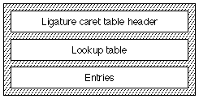
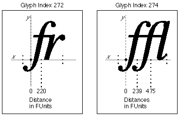
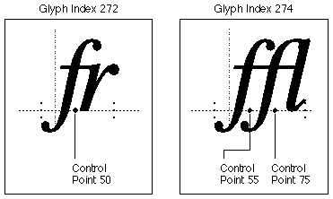

<a id="anchor-lcar-lcar"></a>

# The `'lcar'` table

<a id="anchor-lcar-part-1"></a>

## Introduction

The *ligature caret table* (tag name: `'lcar'`) allows you to design your AAT fonts with division points inside of some or all of the ligatures. This allows you to specify how a ligature is to be divided by an application. Without the ligature caret table specification, an application may use an even n-way split resulting in an undesirable ligature division.

Consider a 'wi' ligature. The 'w' portion of the ligature is wide and the 'i' portion of the ligature is relatively narrow. If an application split the ligature evenly, the caret would be too close to the 'w' rather than properly spaced between the two parts of the glyph. The ligature caret table allows you to correctly specify the split point to ensure that the appearance of the line will be optimal.

<a id="anchor-lcar-part-2"></a>

## Ligature Caret Table Format

The overall structure of the ligature caret table consists of a ligature caret table header, lookup table, and the actual ligature caret entries, as shown in the following figure:



The ligature caret table header format is as follows:

| Type | Name | Description |
| --- | --- | --- |
| fixed32 | version | Version number of the ligature caret table (0x00010000 for the initial version). |
| uint16 | format | Format of the ligature caret table. Format 0 indicates distance and Format 1 indicates control point, as described below. |
| variable | lookup | data Lookup table associating glyphs with LigCaretClassEntry records. See below for details on how to interpret the lookup values. |

A lookup table is used to find the `LigCaretClassEntry` record associated with a particular glyph. This is how to interpret the lookup value for each of the 5 lookup table formats:

| Lookup format | Interpretation |
| --- | --- |
| 0 | Array of 16-bit offsets, one for each glyph in the font. Each offset is from the start of the Ligature Caret table to the particular LigCaretClassEntry record for that glyph. |
| 2 | The value of each lookupSegment is a 16-bit offset from the start of the Ligature Caret table to the particular LigCaretClassEntry record for the glyphs in that segment. |
| 4 | The value of each lookupSegment is a 16-bit offset to an array of 16-bit offsets from the start of the Ligature Caret table to the LigCaretClassEntry record for each glyph in the segment. |
| 6 | The value of each lookupSingle is a 16-bit offset from the start of the Ligature Caret table to the particular LigCaretClassEntry record for that glyph. |
| 8 | The valueArray is an array of 16-bit offsets, one for each glyph in the trimmed array. Each offset is from the start of the Ligature Caret table to the particular LigCaretClassEntry record for that glyph. |

Each entry in the lookup table is an offset to a record of type `LigCaretClassEntry` and is for one specific ligature glyph. The entry contains the number of values associated with the glyph, followed by the split point values themselves. Note that the number of values will, in general, be one less than the number of characters composing the ligature.

The format of the `LigCaretClassEntry` records is as follows:

| Type | Name | Description |
| --- | --- | --- |
| uint16 | count | Number of entries in the partials array. |
| int16 | partials\[count\] | Single values. |

The format field contains the format type of the current table. There are two possible formats of ligature caret tables:

| Format | Description |
| --- | --- |
| 0 | Distance. The value (or values) associated with a particular glyph is or are FUnit values, representing a position along the baseline through which a subdivision is made orthogonally to the baseline. |
| 1 | Control point. The value (or values) associated with a particular glyph are control point numbers, through which a subdivision is made orthogonally to the baseline. |

Format 0 distances are specified along the baseline from x = 0 to the ligature division point. If multiple division points are to be included, each division must be specified relative to x = 0. For example, the distance of the division point for the ligature 'fr' may be x = 221 FUnits and the distance of the division points for the ligature 'ffi' may be x = 240 FUnits for the 'ff' and x = 483 FUnits for the 'fi', respectively.

Format 1 division points are specified by the number of the specified control point along the baseline. If the control point is above or below the baseline, the division point is taken as the orthogonal projection of the control point to the baseline. This point it then used exactly the same as a Format 0 distance to specify the division point. Control points are specified in the `'glyf'` table.

The Format 1 control point format provides an additional level of control over that of Format 0. Control points can be hinted to change their locations to improve the appearance of small pixels-per-em glyphs. This correction is not possible with Format 0 distances.

<a id="anchor-lcar-part-3"></a>

## Ligature Caret Table Examples

<a id="anchor-lcar-part-4"></a>

### Example: Format 0 Ligature Caret Table

For this example, the font contains 'fr' and 'ffl' ligatures in a roman font. The glyph index for the 'fr' ligature is 272, and the distance into the glyph for the division point is x = 220 FUnits. The glyph index for the 'ffl' ligature is 274. The distance into glyph 274 for the 'ff' division point is x = 239 FUnits. The distance into glyph 274 for the 'fl' division point is x = 475 FUnits. The division points for the two ligatures are shown in the following figure:



The following table summarizes the ligature caret data:

```
Glyph Index	 Division Points	 Ligature	 Distance
	272				1			 fr			220
	274				2			 ffl
									(ff)			 239
									(fl)			 475
```

The following table shows how to build a Format 0 ligature caret table for the example font:

bytes for the glyph index, and 2 bytes for the offset from the start of this ligature caret table).

| Offset/length | Value | Name | Comment |
| --- | --- | --- | --- |
| 0/4 | 0x00010000 | version | Version number of the ligature caret table, in fixed-point format. |
| 4/2 | 0 | format | Format of the ligature caret table. This table will use Format 0 indicating that the division points are specified distances. |
| (A [Format 6 lookup table](Tables.md#anchor-Tables-LookupFormat6) starts here) | <!-- colspan --> | <!-- colspan --> | <!-- colspan --> |
| 6/2 | 6 | format | Lookup table Format 6 (single table format). |
| (The next five fields are the lookup table's [BinSrchHeader](Tables.md#anchor-Tables-BinSrchHeader)) | <!-- colspan --> | <!-- colspan --> | <!-- colspan --> |
| 8/2 | 4 | unitSize | Size of a LookupSingle record (2 16-bit words) |
| 10/2 | 2 | nUnits | Number of units of the preceding unitSize to be searched. There are 2 ligatures to be included in the table. |
| 12/2 | 8 | searchRange | The unitSize times the largest power of two that is less than or equal to nUnits. |
| 14/2 | 1 | entrySelector | The log base 2 of the largest power of two less than or equal to nUnits. |
| 16/2 | 0 | rangeShift | The unitSize times the difference of nUnits minus the largest power of two less than or equal to nUnits. |
| (The LookupSingle record entries start here) | <!-- colspan --> | <!-- colspan --> | <!-- colspan --> |
| 18/2 | 272 | glyph | Glyph index for the 'fr' ligature. |
| 20/2 | 30 | value | Offset of LigCaretClassEntry record for the 'fr' ligature. |
| 22/2 | 274 | glyph | Glyph index for the 'ffl' ligature. |
| 24/2 | 34 | value | Offset of LigCaretClassEntry record for the 'ffl' ligature. |
| 26/2 | 0xFFFF | glyph | Special guardian value. |
| 28/2 | 0 | value | Special guardian value. |
| (The `LigCaretClassEntry` records start here) | <!-- colspan --> | <!-- colspan --> | <!-- colspan --> |
| 30/2 | 1 | count | The number of internal ligatures. The 'fr' ligature has 1 internal ligature caret place. |
| 32/2 | 220 | partial | The FUnit distance for the division point of the 'fr' ligature. |
| 34/2 | 2 | count | The number of internal ligatures. The 'ffl' ligature has 2 internal ligature caret places. |
| 36/2 | 239 | partial | The FUnit distance for the 'ff' division of the 'ffl' ligature. |
| 38/2 | 475 | partial | The FUnit distance for the 'fl' division of the 'ffl' ligature. |

<a id="anchor-lcar-part-5"></a>

### Example: Format 1 Ligature Caret Table

For this Format 1 ligature caret table example, the font again contains the 'fr' and 'ffl' ligatures in a roman font. The glyph index for the 'fr' ligature is 272 and the control point for the division point is 50. The glyph index for the 'ffl' ligature is 274. The control point for the 'ff' division point is 55. The control point for the 'fl' division point is 75. The caret places for the two ligatures are shown in Figure 5-3.



The following table summarizes the ligature caret data.

```
Glyph Index	 Division Points	 Ligature	 Control Point
	272				1			 fr			50
	274				2			 ffl
									(ff)			 55
									(fl)			 75
```

| Offset/length | Value | Name | Comment |
| --- | --- | --- | --- |
| 0/4 | 0x00010000 | version | Version number of the ligature caret table, in fixed-point format. |
| 4/2 | 1 | format | Format of the ligature caret table. This table will use Format 1 indicating that the division points are control points. |
| (A [Format 6 lookup table](Tables.md#anchor-Tables-LookupFormat6) starts here) | <!-- colspan --> | <!-- colspan --> | <!-- colspan --> |
| 6/2 | 6 | format | Lookup table Format 6 (single table format). |
| (The next five fields are the lookup table's [BinSrchHeader](Tables.md#anchor-Tables-BinSrchHeader)) | <!-- colspan --> | <!-- colspan --> | <!-- colspan --> |
| 8/2 | 4 | unitSize | Size of a LookupSingle record (2 bytes for the glyph index, and 2 bytes for the offset from the start of this ligature caret table). |
| 10/2 | 2 | nUnits | Number of units of the preceding unitSize to be searched. There are 2 ligatures to be included in the table. |
| 12/2 | 8 | searchRange | The unitSize times the largest power of two that is less than or equal to nUnits. |
| 14/2 | 1 | entrySelector | The log base 2 of the largest power of two less than or equal to nUnits. |
| 16/2 | 0 | rangeShift | The unitSize times the difference of nUnits minus the largest power of two less than or equal to nUnits. |
| (The `LookupSingle` record entries start here) | <!-- colspan --> | <!-- colspan --> | <!-- colspan --> |
| 18/2 | 272 | glyph | Glyph index for the 'fr' ligature. |
| 20/2 | 30 | value | Offset of LigCaretClassEntry record for the 'fr' ligature. |
| 22/2 | 274 | glyph | Glyph index for the 'ffl' ligature. |
| 24/2 | 34 | value | Offset of LigCaretClassEntry record for the 'ffl' ligature. |
| 26/2 | 0xFFFF | glyph | Special guardian value. |
| 28/2 | 0 | value | Special guardian value. |
| (The `LigCaretClassEntry` records start here) | <!-- colspan --> | <!-- colspan --> | <!-- colspan --> |
| 30/2 | 1 | count | The number of internal ligatures. The 'fr' ligature has 1 internal ligature caret place. |
| 32/2 | 50 | partial | The control point for the division point of the 'fr' ligature. |
| 34/2 | 2 | count | The number of internal ligatures. The 'ffl' ligature has 2 internal ligature caret places. |
| 36/2 | 55 | partial | The control point for the 'ff' division of the 'ffl' ligature. |
| 38/2 | 75 | partial | The control point for the 'fl' division of the 'ffl' ligature. |
