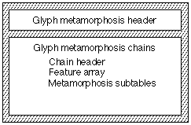
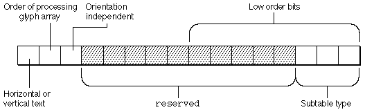
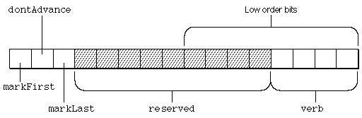
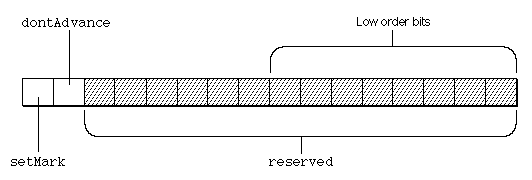
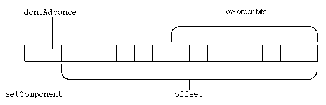
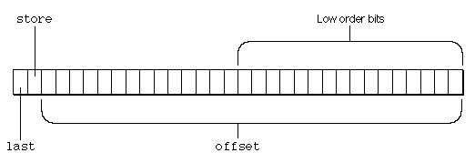
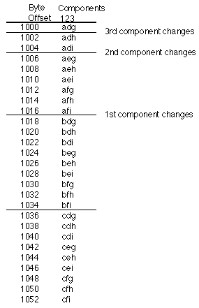
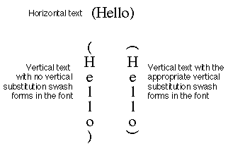

# The `'mort'` table

## WARNING

*The `'mort'` table is deprecated. It is supported on OS X but not iOS, and Apple font tools no longer will generate `'mort'`. New and udpated fonts should use `'morx'` tables.*

## Introduction

The glyph metamorphosis table(tag name: `'mort'`) allows you to specify a set of transformations that can apply to the glyphs of your font. These transformations, calledtext features, are essential for writing systems such as Arabic or Hindi that require changes to glyphs and words depending on context. Text features are also useful for writing systems, such as Roman, that can use effects such as ligatures and cursive connections to enhance the appearance of text.

Apple has defined a standard set of text features. You may include one or more of these or create your own text features. Font features that will be supported by your font must be part of the Font Feature Registry maintained by Apple Computer, Inc. Some of the feature types that have been registered follow:

- Ligatures
- Cursive connection
- Letter case
- Vertical substitution
- Linguistic rearrangement
- Number spacing
- Smart swashes
- Diacritics
- Vertical Position
- Fractions
- Overlapping characters
- Typographic extras
- Mathematical extras
- Ornament sets
- Character alternatives
- Design complexity
- Style options
- Character shape
- Number case
- Letter spacing

## Glyph Metamorphosis Table Format

The glyph metamorphosis table consists of a header followed by one or more metamorphosis chains. Eachmetamorphosis chaincontains a chain header, feature table array, and metamorphosis subtables. Eachmetamorphosis subtablecontains a subtable header and format-specific subtables. The overall structure of a glyph metamorphosis table is shown in this figure:

The glyph metamorphosis table header specifies the current version and the number of metamorphosis chains provided in the table. The format of the glyph metamorphosis table header is:

| Type | Name | Description |
| --- | --- | --- |
| fixed32 | version | Version number of the glyph metamorphosis table (0x00010000 for the current version). |
| uint32 | nChains | Number of metamorphosis chains contained in this table. |

One or more glyph metamorphosis chains follow the table header. Each metamorphosis chain starts on a longword boundary. Padding must be added between chains to ensure that the next chain starts at a byte offset evenly divisible by 4. Each chain contains a chain header, feature table arrays, and metamorphosis subtables. The metamorphosis subtables specify a set of atomic transformations. When these transformations are applied to the glyph array in proper order, the text is processed to provide the specified text features.

The format of the chain header is:

| Type | Name | Description |
| --- | --- | --- |
| uint32 | defaultFlags | The default sub-feature flags for this chain. |
| uint32 | chainLength | The length of the chain in bytes, including this header. |
| uint16 | nFeatureEntries | The number of entries in the chain's feature subtable. |
| uint16 | nSubtables | The number of subtables in the chain. |

A single metamorphosis chain is usually sufficient, unless the font's features cannot be specified with 32 sub-features. The chain's header is followed by the feature table, which is an array of feature entries. The number of entries in the feature table is given by the value of the `nFeatureEntries` field in the chain's header.

### Feature Table

The feature tableis used to compute the sub-feature flags for a list of requested features and settings.

The format of the feature table is:

| Type | Name | Description |
| --- | --- | --- |
| uint16 | featureType | The type of feature. |
| uint16 | featureSetting | The feature's setting. |
| uint32 | enableFlags | Flags for the settings that this feature and setting enables. |
| uint32 | disableFlags | Complement of flags for the settings that this feature and setting disable. |

During text processing, the following sequence takes place.

1. The result is initialized to the chain's `defaultFlags`.
2. The entries in the feature table are processed in order. If the setting is in the requested list, the result is ANDed with the entry's `disableFlags` and ORed with the entry's `enableFlags`. If the setting is not in the requested list, the result will be the chain's `defaultFlags`. The `defaultFlags` specify sub-features that will happen in the absence of any user specification.
3. When the request is finished, the result contains the sub-feature flags corresponding to the list of requested features.

The order of entries in the requested feature list is arbitrary. However, the order of entries in the feature table is important. Entries that are located later in the feature table take precedence over earlier entries. This is necessary because only the font designer knows the relationship between the features and the subfeatures.

Each feature table must end with an entry for the Enable Glyph Effects feature with the setting `enableEffectOffSelector`. This turns off all subfeature flags for the chain. Enable and disable flags for the last entry in the feature table are:

| Enable flag | Disable flag |
| --- | --- |
| 0x00000000 | 0x00000000 (complement of 0xFFFFFFFF) |

### Metamorphosis Subtables

After the feature table come the metamorphosis subtables. These chain subtables describe the atomic transformations that make up the chain's sub-features. These transformations are the heart of the glyph metamorphosis table. Each metamorphosis chain subtable consists of a subtable header followed by one or more metamorphosis subtables. The subtable types are given in the following table:

| Subtable type | Description |
| --- | --- |
| 0 | Indic-style rearrangement. |
| 1 | Contextual glyph substitution. |
| 2 | Ligature substitution. |
| 3 | (Reserved) |
| 4 | Non-contextual glyph substitution. |
| 5 | Contextual glyph insertion |

The common subtable header is followed by a subheader. The format of the subheader varies according to the subtable type.

A chain's subtables must have lengths that are multiples of 4 bytes. If subtable lengths are not multiples of 4 bytes, you should add padding spaces at the end.

Although each atomic transformation has its own format, each subtable begins with a common header, called a `MorphSubtableHeader`, which has this format:

| Type | Name | Description |
| --- | --- | --- |
| uint16 | length | Length of subtable in bytes, including this header. |
| uint16 | coverage | Coverage flags and atomic transformation type. |
| uint32 | subFeatureFlags | Flags for the settings that this subtable describes. |

The bits in the coverage field have the interpretation shown in the following table and figure:

| Mask value | Interpretation |
| --- | --- |
| 0x8000 | If set to 1, this subtable should be applied only to vertical text. If set to 0, this subtable should be applied only to horizontal text. Note that the 0x2000 bit can change how this bit gets interpreted. |
| 0x4000 | If set to 1, this subtable should process the glyph array in descending order. If set to 0, this subtable should process the glyph array in ascending order. |
| 0x2000 | If set to 1, this subtable should be applied irrespective of the state of the 0x8000 bit. This allows you to make subtables that will be executed irrespective of the orientation of the text. If this bit is 0, the 0x8000 bit is interpreted as described above. Support for this bit is available starting with GX 1.1; earlier versions of the software will ignore it. |
| 0x1FF8 | These bits are reserved and must be set to 0. |
| 0x0007 | These bits specify the subtable type (using the constants listed above). |

The `subFeatureFlags` field of the chain subtable header has a bit set for each sub-feature whose transformation requires the atomic transformation specified by the subtable. After a user request, feature subtables are searched to determine which tables are needed. Then, the result is compared with this field. If any bits are common and are non-zero, the table is enabled.

For example, if the result is 0x00010001 and the `subFeatureFlags` field of this subtable contains 0x00000001, this table is enabled.

#### Indic Rearrangement Subtable

An Indic-style rearrangement action specifies a rearrangement of the order of a contiguous range of glyphs in the glyph array.

The format of the Indic rearrangement subtable is shown in the following figure. Note that the whole subtable is just a [state table](Tables.md#anchor-Tables-StateTables).

| Type | Name | Description |
| --- | --- | --- |
| [StateHeader](Tables.md#anchor-Tables-StateHeader) | stHeader | The Indic rearrangement state table header. |

The actions in an Indic rearrangement subtable use no per-glyph tables. The table-specific flags in the flags field of the entry subtable have the following format:

| Mask value | Name | Interpretation |
| --- | --- | --- |
| 0x8000 | markFirst | If set, make the current glyph the first glyph to be rearranged. |
| 0x4000 | dontAdvance | If set, don't advance to the next glyph before going to the new state. |
| 0x2000 | markLast | If set, make the current glyph the last glyph to be rearranged. |
| 0x1FF0 | reserved | These bits are reserved and should be set to 0. |
| 0x000F | verb | The type of rearrangement specified. |

The positions of the bits in the flags binary field are shown in the following figure:

The following table shows the rearrangement verb atomic transformations. The uppercase letters 'A', 'B', 'C', and 'D' represent individual glyphs, and 'x' represents an arbitrary sequence of glyphs. You use the `markFirst` and `markLast` flags to remember the array of glyphs to be rearranged. The first and last glyph values are set before the rearrangement specified by the value of the verb field is applied.

| Verb | Results |
| --- | --- |
| 0 | no change |
| 1 | Ax =\> xA |
| 2 | xD =\> Dx |
| 3 | AxD =\> DxA |
| 4 | ABx =\> xAB |
| 5 | ABx =\> xBA |
| 6 | xCD =\> CDx |
| 7 | xCD =\> DCx |
| 8 | AxCD =\> CDxA |
| 9 | AxCD =\> DCxA |
| 10 | ABxD =\> DxAB |
| 11 | ABxD =\> DxBA |
| 12 | ABxCD =\> CDxAB |
| 13 | ABxCD =\> CDxBA |
| 14 | ABxCD =\> DCxAB |
| 15 | ABxCD =\> DCxBA |

#### Contextual Glyph Substitution Subtable

Contextual glyph substitution is the substitution of other glyphs for both the glyph at the current position in the glyph array and an earlier glyph in the glyph array, called themarkedglyph. The substitution is done using per-glyph tables calledsubstitution tables. If the `setMark` flag is set, the current glyph is made the marked glyph after the substitutions are made.

You could use the contextual glyph substitution subtable to create simple ligatures, such as 'fi' and 'Æ,' or for unusual substitutions such as: % + zero = per-mille. If you want to create ligatures that are more complex than two-character ligatures from the separate characters, you should use the ligature substitution subtable. However, if the font contains component ligatures with glyph indices, then more complex ligatures can be formed using contextual glyph substitution. For example, if the 'ff' ligature is in the font, then the 'ffi' ligature can be formed using a contextual substitution subtable.

The format of the contextual glyph substitution subtable is as follows.

| Type | Name | Description |
| --- | --- | --- |
| [StateHeader](Tables.md#anchor-Tables-StateHeader) | stHeader | The contextual glyph substitution state table header |
| uint16 | substitutionTable | Byte offset from the beginning of the state subtable to the beginning of the substitution tables. |

The actions in a contextual glyph substitution subtable have table- specific flags and two offsets to per-glyph tables (for a total of 4 16-bit words). The format of these actions is as follows:

| Type | Name | Description |
| --- | --- | --- |
| uint16 | newState | Byte offset from the beginning of the state table to the new state. |
| uint16 | flags | Table-specific flags. |
| uint16 | markOffset | Word offset from the beginning of the state subtable to the substitution table for the marked glyph. |
| uint16 | currentOffset | Word offset from the beginning of the state subtable to the substitution table for the current glyph. |

The following figure shows the positions of the bits in the flags binary field of the contextual glyph substitution subtable.

The format of the table-specific `flags` field is as follows:

| Mask value | Name | Interpretation |
| --- | --- | --- |
| 0x8000 | setMark | If set, make the current glyph the marked glyph. |
| 0x4000 | dontAdvance | If set, don't advance to the next glyph before going to the new state. |
| 0x3FFF | reserved | These bits are reserved and should be set to 0. |

#### Ligature Substitution Subtable

The ligature substitution subtable specifies the substitution of a ligature glyph for a set of component glyphs. For example, you can specify that when the glyphs 'f,' 'f,' and 'i' are placed next to one another, the separate glyphs will be replaced by the ligature glyph 'ffi.' If you want to create simple two-character ligatures, you should use the contextual substitution subtable rather than the ligature substitution table, which is designed for more complex ligature formations (although you may certainly use the ligature substitution subtable for two-glyph ligatures, if you wish).

The format of the ligature substitution subtable is as follows:

| Type | Name | Description |
| --- | --- | --- |
| [StateHeader](Tables.md#anchor-Tables-StateHeader) | stHeader | The ligature substitution state table header. |
| uint16 | ligActionTable | Byte offset from the beginning of the state table to the ligature action lists. |
| uint16 | componentTable | Byte offset from the beginning of the state table to the component offset tables. |
| uint16 | ligatureTable | Byte offset from the beginning of the state table to the beginning of the ligature tables. |

The format of the flag field of the ligature substitution subtable actions is shown in the following figure. There are no per-glyph substitutions.

The ligature action list specifies how to use the component glyphs to construct a word offset into a table of ligature glyph indices. The table is sorted by components; that is, first by the first component, then by the second component, and so on.

The ligature component stack is 16 deep. This means that a ligature can be formed using a maximum of 16 components. If the value of the `offset` field is non-zero, it gives the offset to a list of 32-bit ligature actions. The `offset` field, which is the offset to the ligature action list, is a table-specific flag field. Its format is shown in the following table (and the above illustration):

| Mask value | Name | Interpretation |
| --- | --- | --- |
| 0x8000 | setComponent | If set, AAT should make the current glyph a ligature component. |
| 0x4000 | dontAdvance | If set, AAT should not advance to the next glyph before moving to the new state. |
| 0x3FFF | offset | Byte offset from beginning of subtable to the ligature action list. This value must be a multiple of 4. |

The ligature action list must be long aligned. One entry in this list is shown in the following figure:

The mask values of the ligature action list are given in the following table:

| Mask value | Name | Interpretation |
| --- | --- | --- |
| 0x80000000 | last | If set, this is the last action in the list and implies store. |
| 0x40000000 | store | If set, substitute the ligature for the marked glyph. |
| 0x3FFFFFFF | offset | Word offset from beginning of state table to component offset table. |

Usually a ligature action list forms only one ligature, so the `store` flag is not set for any entry. Multiple ligatures may be formed by setting the `store` flag on intermediate entries in the action list. The only limit is that the component stack can hold only 16 components.

The offset into the ligature table is computed as the sum of the offsets for each component. One offset needs to include the offset to the ligature table.

Each entry in the ligature action list contains the offset to a per-glyph table that gives the offset for the corresponding component. Given an offset to the first ligature in the table starting with a particular set of components, the component offset table for the next component would contain the relative offsets to the first ligature containing the particular component.

As each entry in the action list is processed, the corresponding component is popped from the stack. If the `store` and `last` flags in the entry are clear, the component glyph is replaced by the deleted glyph index; if the `store` or `last` flag is set, the accumulated offset is used to fetch the glyph index for the ligature, which replaces the component glyph. You can form an n-component ligature by replacing the component glyphs with the ligature glyph followed by n-1 deleted glyphs. For example, if you use the ligature substitution subtable to form the 'ffi' ligature, you begin with 'f', 'f', and 'i' and end up with 'ffi' and two deleted glyphs.

When the entire ligature action list has been processed, the position of each ligature glyph in the glyph array is pushed onto the component stack again so that the ligatures can be used as components of other ligatures. For example, an 'ff' ligature can be used in an 'ffi' ligature.

For example, the next figure shows a ligature table for a fictional set of ligatures composed of 'a,' 'b,' or 'c' followed by 'd,' 'e,' or 'f' followed by 'g,' 'h,' or 'i'. Keep in mind that what you should actually store in the ligature table at the various offsets is the glyph index for the ligature, and not the data for the ligature itself.

The offset into the ligature table is computed as the sum of the offsets for each component. Each entry in the ligature action list contains the offset to a per-glyph table that gives the offset in bytes for the corresponding component.

Once you know the glyphs that make up a particular ligature, you can construct a component offset table for calculating the offsets to the glyph index for that ligature. Using the ligature table in the previous figure, you can construct the table for the offsets for the components of the various ligatures.

Given an offset to the first ligature in the table starting with a particular set of components, the component offset table for the next component would contain the relative offsets to the first ligature containing the particular component. The offset into the ligature table is computed as the sum of the offsets for each component. Each entry in the ligature action list contains the offset to a per-glyph table which gives the offset for the corresponding component. The glyph offsets for this example are shown in the following table:

| Glyph | Offset |
| --- | --- |
| a | 1000 |
| b | 1018 |
| c | 1036 |
| d | 0 |
| e | 6 |
| f | 12 |
| g | 0 |
| h | 2 |
| i | 4 |

Using this table, you find that the relative offsets for 'bfh' is 1018 + 12 + 2 = 1032, and the relative offset for 'aei' is 1000 + 6 + 4 = 1010. This byte offset is relative to the beginning of the ligature table.

To produce an offset relative to the beginning of the state subtable, you need to add the offset of the ligature table to the values of one of the component offset tables.

#### Non-contextual Glyph Substitution Subtable

The non-contextual glyph substitution subtable is a [lookup table](Tables.md#anchor-Tables-LookupTables) that maps a single glyph index into another glyph index. The format of the non-contextual glyph substitution subtable is given in the following table:

| Type | Name | Description |
| --- | --- | --- |
| LookupTable | table | The noncontextual glyph substitution table |

#### Glyph Insertion Subtable

A new kind of metamorphosis subtable, one that implements insertion actions, is available starting with GX 1.1. This subtable permits extra glyphs (which have no corresponding characters in the backing store) to be inserted into a layout shape. There are two kinds of insertion actions available:

Kashida-like insertion actions, where one or more glyphs are appended to a particular glyph, and are selected with that glyph. An example is Pig Latin, where the "ay" or "way" are inserted after the relevant letters. During justification, the width of the "baseform" will be augmented by the width of the all the insertions, and the caret split will encompass the whole grouping. This is very similar to how kashidas currently work (hence the name).

Split-vowel-like insertion actions, where glyphs are appended to a given glyph (as in the kashida-like case), but where the inserted glyph(s) do not select with that glyph, but rather with some other glyph. Burmese split vowels are an example of this kind of insertion.

A single subtable can mix and match these kinds of actions as needed.

The subtable consists solely of a state table (similar to the Indic rearrangement subtable). The actions are 8 bytes long, as follows:

| Type | Name | Description |
| --- | --- | --- |
| uint16 | newState | Byte offset from the beginning of the state table to the new state. |
| uint16 | flags | The action flags (defined below). |
| uint16 | currentInsertList | Byte offset from the beginning of the state table to the list of 16-bit glyphcodes to be inserted at the current glyph (or none if zero). The number of glyphs to be inserted is contained in the currentInsertCount field in the flags (see below). |
| uint16 | markedInsertList | Byte offset from the beginning of the state table to the list of 16-bit glyphcodes to be inserted at the marked glyph (or none if zero). The number of glyphs to be inserted is contained in the markedInsertCount field in the flags (see below). |

The flag bits are interpreted as follows:

| Mask value | Name | Interpretation |
| --- | --- | --- |
| 0x8000 | setMark | If set, mark the current glyph. |
| 0x4000 | dontAdvance | If set, don't advance to the next glyph before going to the new state. |
| 0x2000 | currentIsKashidaLike | If set, and the currentInsertList is nonzero, then the specified glyph list will be inserted as a kashida-like insertion, either before or after the current glyph (depending on the state of the currentInsertBefore flag). If clear, and the currentInsertList is nonzero, then the specified glyph list will be inserted as a split-vowel-like insertion, either before or after the current glyph (depending on the state of the currentInsertBefore flag). |
| 0x1000 | markedIsKashidaLike | If set, and the markedInsertList is nonzero, then the specified glyph list will be inserted as a kashida-like insertion, either before or after the marked glyph (depending on the state of the markedInsertBefore flag). If clear, and the markedInsertList is nonzero, then the specified glyph list will be inserted as a split-vowel-like insertion, either before or after the marked glyph (depending on the state of the markedInsertBefore flag). |
| 0x0800 | currentInsertBefore | If set, specifies that insertions are to be made to the left of the current glyph. If clear, they're made to the right of the current glyph. |
| 0x0400 | markedInsertBefore | If set, specifies that insertions are to be made to the left of the marked glyph. If clear, they're made to the right of the marked glyph. |
| 0x03E0 | currentInsertCount | This 5-bit field is treated as a count of the number of glyphs to insert at the current position. Since zero means no insertions, the largest number of insertions at any given current location is 31 glyphs. |
| 0x001F | markedInsertCount | This 5-bit field is treated as a count of the number of glyphs to insert at the marked position. Since zero means no insertions, the largest number of insertions at any given marked location is 31 glyphs. |

##### Special split-vowel considerations

The connection between the two pieces of a split vowel is established via the distance from the current to the marked glyph. For example, say a split vowel character occurs after a consonant, and once encountered, the first part of the split vowel should be inserted before that consonant. In building the insertion subtable to do this, you would set a mark at every candidate consonant. Then, if a split vowel is indeed encountered after the consonant, it would have the `markedIsKashidaLike` flag off and the `markedInsertBefore` flag on. The split vowel piece would then be inserted before the consonant, and AAT will establish the connection between the two pieces, such that a selection of one piece, say, will result in both pieces being highlighted (because they are both associated with the same character offset, namely the offset of the vowel character that came after the consonant).

Alternatively, in this example, you could set the subtable to process in reverse order (using the appropriate bit in the `coverage` field), and then the vowel would be the first thing encountered, so your subtable would be set up to mark the vowel, and then after moving to the consonant, do the insertion before the current glyph (i.e. before the consonant). Either of these methods works; the choice of which is most suited for a given font is left to the font designer.

## Glyph Metamorphosis Table Examples

### Example: Non-contextual Glyph Substitution

Let's create a Roman font that accommodates horizontal and vertical text. We will specifically address the problem that occurs when horizontal text with opening and closing parentheses is used vertically. When the text is horizontal, our font should use the horizontal opening and closing parentheses (glyph indices 11 and 12, respectively). When the text is vertical, our font should use the vertical opening and closing parentheses (glyph indices 135 and 136, respectively).

This figure shows a sample of text produced with this example font.

To accommodate this design, our font must contain the features and settings given in the following table. This will require one glyph metamorphosis chain composed of three feature subtables and a metamorphosis subtable. The constants associated with particular feature types and selectors (such as 4 for vertical substitution) are located in the current edition of the Font Feature Registry.

| Feature | Setting | Enable flag | Disable flag |
| --- | --- | --- | --- |
| Vertical substitution | On | 0x00000001 | 0xFFFFFFFF |
| Vertical substitution | Off | 0x00000000 | 0xFFFFFFFE |
| Glyph effects | Off | 0x00000000 | 0x00000000 |

The glyph metamorphosis table for this example font is this:

| Offset/length | Value | Name | Comment |
| --- | --- | --- | --- |
| 0/4 | 0x00010000 | version | Version number of the glyph metamorphosis table, in fixed- point format. |
| 4/4 | 1 | nChains | Number of metamorphosis chains contained in this table is 1. |
| (The single metamorphosis chain follows) | <!-- colspan --> | <!-- colspan --> | <!-- colspan --> |
| 8/4 | 1 | defaultFlags | Default setting flag for this chain is 1. |
| 12/4 | 80 | chainLength | Chain length is 88 - 8 = 80 bytes. |
| 16/2 | 3 | nFeatureEntries | Number of entries in the chain's feature subtable is 3. |
| 18/2 | 1 | nSubtables | The number of feature subtables in this chain is 1. |
| (The first of three entries in the feature subtable array follows) | <!-- colspan --> | <!-- colspan --> | <!-- colspan --> |
| 20/2 | 4 | featureType | Feature type is vertical substitution. |
| 22/2 | 0 | featureSetting | Feature setting is on. |
| 24/4 | 0x00000001 | enableFlags | Enable flag. |
| 28/4 | 0xFFFFFFFF | disableFlags | Disable flag. |
| (The second of three entries in the feature subtable array follows) | <!-- colspan --> | <!-- colspan --> | <!-- colspan --> |
| 32/2 | 4 | featureType | Feature type is vertical substitution. |
| 34/2 | 1 | featureSetting | Feature setting is off. |
| 36/4 | 0x00000000 | enableFlags | Enable flag. |
| 40/4 | 0xFFFFFFFE | disableFlags | Disable flag. |
| (The third of three entries in the feature subtable array follows) | <!-- colspan --> | <!-- colspan --> | <!-- colspan --> |
| 44/2 | 0 | featureType | Feature type is glyph effects. |
| 46/2 | 1 | featureSetting | Feature setting is off. |
| 48/4 | 0x00000000 | enableFlags | Last enableFlags field of the feature subtable must contain 0x00000000. |
| 52/4 | 0x00000000 | disableFlags | Last disableFlags field of the feature subtable must contain 0x00000000. |
| (The chain subtable follows) | <!-- colspan --> | <!-- colspan --> | <!-- colspan --> |
| 56/2 | 32 | length | Length of the chain subtable is 88 - 56 = 32 bytes. |
| 58/2 | 0x8004 | coverage | 0x8000 value indicates that this subtable should be applied only to horizontal text. The 0x0004 value indicates that the chain subtable type is for non-contextual glyph substitution. |
| 60/4 | 0x00000001 | subFeatureFlags | Subfeature type is contextual glyph substitution. |
| (The non-contextual glyph substitution [lookup table](Tables.md#anchor-Tables-LookupTables) follows) | <!-- colspan --> | <!-- colspan --> | <!-- colspan --> |
| 64/2 | 6 | format | Lookup table format 6 (single table format). |
| 66/2 | 4 | unitSize | Size of a LookupSingle record (2 bytes for the glyph index, and 2 bytes for the offset from the start of this ligature caret table). |
| 68/2 | 2 | nUnits | Number of units of the preceding unitSize to be searched. There are two glyphs to be included in the table. |
| 70/2 | 8 | searchRange | The unitSize times the largest power of two that is less than or equal to nUnits. |
| 72/2 | 1 | entrySelector | The log base 2 of the largest power of two less than or equal to nUnits. |
| 74/2 | 0 | rangeShift | The unitSize times the difference of nUnits minus the largest power of two less than or equal to nUnits. |
| (The [LookupSingle](Tables.md#anchor-Tables-LookupSingle) record entries start here) | <!-- colspan --> | <!-- colspan --> | <!-- colspan --> |
| 76/2 | 11 | glyphIndex | Glyph index for the opening horizontal parenthesis '(' is 11. |
| 78/2 | 135 | glyphIndex | Glyph index for the opening vertical parenthesis is 135. |
| 80/2 | 12 | glyphIndex | Glyph index for the closing horizontal parenthesis ')' is 12. |
| 82/2 | 136 | glyphIndex | Glyph index for the closing vertical parenthesis is 136. |
| (This is the special guardian LookupSingle record) | <!-- colspan --> | <!-- colspan --> | <!-- colspan --> |
| 84/2 | 0xFFFF | glyph | Guardian value. |
| 86/2 | 0 | value | Guardian value. |

### Example: Hierarchical Ligature Tables

Suppose you want to set up a font with all four settings of the ligature formation text feature: mandatory, normal, optional, and suppress. Because this text feature shares subfeatures, you can describe these subfeatures on the same chain.

When a subtable is enabled, it activates the subtables beneath it in the hierarchy. Therefore, you can have each subtable describe a different set of ligatures. For example, in this font the Mandatory subtable describes the 'fi' and 'fl' ligatures, the normal subtable describes the 'æ' and 'œ' ligatures, and the optional subtable describes the 'Æ' and 'Œ' ligatures. Whenever the user selects the normal ligatures of this font, the ligatures of the mandatory and normal subtables are available. When the user selects optional ligatures, the ligatures of the mandatory, normal, and optional subtables are available. The suppress subtable cancels the use of all ligatures.

This table describes the feature subtable entries for these subtables:

| Setting | Enable flags | Disable flags |
| --- | --- | --- |
| Mandatory | 0x00000001 | 0xFFFFFFF9 (complement of 0x00000006) |
| Normal | 0x00000003 | 0xFFFFFFFB (complement of 0x00000004) |
| Optional | 0x00000007 | 0xFFFFFFFF (complement of 0x00000000) |
| Suppress | 0x00000000 | 0xFFFFFFF8 (complement of 0x00000007) |

The enable flags of the mandatory setting are only for that subtable, and its disable flags deactivate the normal and optional tables. The enable flags of the normal setting activate both the normal and mandatory tables, and its disable flags disable only the optional table. The enable flags of the optional table activate all tables, and its disable flags do not disable any table. The enable flags of the suppress table do not enable any table, and its disable flags deactivate all tables.

For example, if you use the feature table in the above table, there are three subtables: one with `subFeatureFlags` set to 0x00000001 for the mandatory ligatures, one with `subFeatureFlags` set to 0x00000002 for the normal ligatures that aren't mandatory, and one with `subFeatureFlags` set to 0x00000004 for optional ligatures that are neither mandatory or normal. Thus, the mandatory subtable is applied if the ligature formation setting is mandatory, normal, or optional; the normal subtable is applied if the ligature formation setting is normal or optional, and the optional subtable is applied if the ligature formation setting is optional.

### Example: Stand-Alone Ligature Tables

In the previous example, each setting of the ligature formation text feature builds on the contents of the previous ligature subtable. A request for optional ligatures means that three subtables are applied.

However, if you make each ligature subtable independent of the others, only one subtable is applied when the user requests a particular type of ligature. Although you have to duplicate the ligature information (putting the glyph codes to create the 'fi' ligature into every table, for instance), table access is faster because only one table is used. You can setup the feature subtable so that a request for one ligature formation subtable disables all other ligature subtables, such as in the following table:

| Setting | Enable flags | Disable flags |
| --- | --- | --- |
| Mandatory | 0x00000001 | 0xFFFFFFF9 (complement of 0x00000006) |
| Normal | 0x00000002 | 0xFFFFFFFA (complement of 0x00000005) |
| Optional | 0x00000004 | 0xFFFFFFFC (complement of 0x00000003) |
| Suppress | 0x00000000 | 0xFFFFFFF8 (complement of 0x00000007) |

Any ligature formation request results in the setting of a single subfeature flag for the requested setting with the highest precedence.

Again, there are three subtables: one with the `subFeatureFlags` field of its subtable header set to 0x00000001 for the mandatory ligatures; one with `subFeatureFlags` set to 0x00000002 for the mandatory and normal ligatures; and one with `subFeatureFlags` set to 0x00000004 for mandatory, normal, and optional ligatures.

The normal and optional subtables are more complex (because the normal subtable duplicates the ligatures in the mandatory subtable and the optional subtable duplicates the ligatures in the normal subtable), but at most one subtable is applied to the glyph array, which takes less time than applying three subtables.

You can also use this feature table with the subtables from the example by changing their `subFeatureFlags` to 0x00000007, 0x00000006, and 0x00000004, respectively.

## Platform-specific Information

The `'mort'` table is not supported on any version of iOS. It is supported on all versions of OS X, but its use is strongly discouraged. If a font has both a `'mort'` table and a [`'morx'` (extended metamorphosis)](morx.md) table, the `'mort'` table is ignored.

## Tools

`'mort'` tables are dumped (but not fused) by ftxdumperfuser. Dumping to both MIF and ATIF is supported. ftxenhancer does not generate `'mort'` tables.
