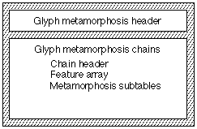
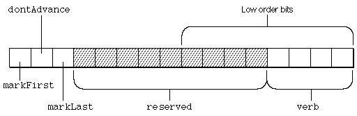
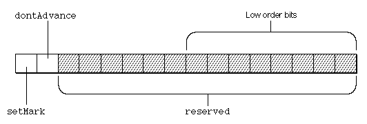

# The `'morx'` Table

## Introduction

The extended glyph metamorphosis table (tag name: `'morx'`) allows you to specify a set of transformations that can apply to the glyphs of your font. These transformations, called text features, are essential for writing systems such as Arabic or Hindi that require changes to glyphs and words depending on context. Text features are also useful for writing systems, such as Roman, that can use effects such as ligatures and cursive connections to enhance the appearance of text.

Apple has defined a standard set of text features. You may include one or more of these or create your own text features. Font features that will be supported by your font must be part of the Font Feature Registry maintained by Apple Inc. Some of the feature types that have been registered follow:

- Ligatures
- Cursive connection
- Letter case
- Vertical substitution
- Linguistic rearrangement
- Number spacing
- Smart swashes
- Diacritics
- Vertical Position
- Fractions
- Overlapping characters
- Typographic extras
- Mathematical extras
- Ornament sets
- Character alternatives
- Design complexity
- Style options
- Character shape
- Number case
- Letter spacing

## Table Format

The extended glyph metamorphosis table consists of a header followed by one or more metamorphosis chains. Each metamorphosis chain contains a chain header, feature table array, and metamorphosis subtables. Each metamorphosis subtable contains a subtable header and format-specific subtables. The overall structure of an extended glyph metamorphosis table is shown below:

The extended glyph metamorphosis table header specifies the current version and the number of metamorphosis chains provided in the table. The format of the extended glyph metamorphosis table header is:

### Table header:

| Type | Name | Description |
| --- | --- | --- |
| uint16 | version | Version number of the extended glyph metamorphosis table (either 2 or 3) |
| uint16 | unused | Set to 0 |
| uint32 | nChains | Number of metamorphosis chains contained in this table. |

This header is followed by the chains. Each chain starts with the chain header:

| Type | Name | Description |
| --- | --- | --- |
| uint32 | defaultFlags | The default specification for subtables. |
| uint32 | chainLength | Total byte count, including this header; must be a multiple of 4. |
| uint32 | nFeatureEntries | Number of feature subtable entries. |
| uint32 | nSubtables | The number of subtables in the chain. |

If the `'morx'` table version is 3 or greater, then the last subtable in the chain is followed by a `subtableGlyphCoverageArray`, as described below.

### Feature Table

The feature table is used to compute the sub-feature flags for a list of requested features and settings.

The format of the feature table is:

| Type | Name | Description |
| --- | --- | --- |
| uint16 | featureType | The type of feature. |
| uint16 | featureSetting | The feature's setting (aka selector) |
| uint32 | enableFlags | Flags for the settings that this feature and setting enables. |
| uint32 | disableFlags | Complement of flags for the settings that this feature and setting disable. |

During text processing, the following sequence takes place.

1. The result is initialized to the chain's `defaultFlags`.
2. The entries in the feature table are processed in order. If the setting is in the requested list, the result is ANDed with the entry's `disableFlags` and ORed with the entry's `enableFlags`. If the setting is not in the requested list, the result will be the chain's `defaultFlags`. The `defaultFlags` specify sub-features that will happen in the absence of any user specification.
3. When the request is finished, the result contains the sub-feature flags corresponding to the list of requested features.

The order of entries in the requested feature list is arbitrary. However, the order of entries in the feature table is important. Entries that are located later in the feature table take precedence over earlier entries. This is necessary because only the font designer knows the relationship between the features and the subfeatures.

Each feature table must end with an entry for the Enable Glyph Effects feature with the setting `enableEffectOffSelector`. This turns off all subfeature flags for the chain. Enable and disable flags for the last entry in the feature table are:

| Enable flag | Disable flag |
| --- | --- |
| 0x00000000 | 0x00000000 (complement of 0xFFFFFFFF) |

### Features and Language Codes

The feature type 39 is used in conjunction with the [`'ltag'` table](ltag.md) to provide for language-specific glyphs. It must always be flagged as an exclusive feature.

For feature type 39, a selector value of 0 means, as elsewhere “no change,” and will generally be used for language-independent glyphs (such as general Cyrillic). Other selector values are *one more than* an index into the [`'ltag'` table](ltag.md) and can be used to indicate switching to a set of language-specific glyphs (such as for Serbian). See the documentation for the [`'ltag'` table](ltag.md) for details.

Note that it is up to the font designer to decide what glyphs are language-independent and which are language-specific.

### Subtable Glyph Coverage Tables

A subtable glyph coverage table is used to determine whether or not a particular glyph in the font is relevant to a given subtable. Its format is as follows:

| Type | Name | Description |
| --- | --- | --- |
| uint32 | subtableOffsets\[\] | Array of offsets from the beginning of the subtable glyph coverage table to the glyph coverage bitfield for a given subtable; there is one offset for each subtable in the chain |
| uint8 | coverageBitfields\[\] | The individual coverage bitfields |

Each coverage bitfield is `(numGlyphs + CHAR_BIT - 1) / CHAR_BIT` bytes in size, padded to a four-byte boundary.

To determine if a particular glyph is covered by the subtable, calculate `coverageBitfield[glyph/CHAR_BIT] & (1 << (glyph & (CHAR_BIT-1)))`. If this is non-zero, the glyph is covered.

And offset of 0 in the `subtableOffsets` array indicate that the specific subtable does not have a coverage bitfield.

In practice, for a given run of text, a coverage bitfield is generated for the glyphs in that run. That bitfield is then ANDed with the coverage bitfield for each subtable. If the result is zero, then none of the glyphs in the run is used by the subtable and the subtable may be skipped.

It is generally best that the coverage bitfield include as few glyphs as possible, so as to maximize the probability of CoreText's skipping the subtable. For example, in a ligature subtable which forms "ff", "fi", and "fl" ligatures, it would be sufficient for the subtable's coverage bitfield to include only the "f" glyph. This way, when laying out the text, "Indicate locale," CoreText would be able to skip the subtable, despite the presence of both "i" and "l".

### Metamorphosis Subtables

After the feature subtable come the actual subtables, a total of nSubtables of them. Each one starts with a subtable header in this format:

| Type | Name | Description |
| --- | --- | --- |
| uint32 | length | Total subtable length, including this header. |
| uint32 | coverage | Coverage flags and subtable type. |
| uint32 | subFeatureFlags | The 32-bit mask identifying which subtable this is (the subtable being executed if the AND of this value and the processed defaultFlags is nonzero) |

The `subFeatureFlags` field of the chain subtable header has a bit set for each sub-feature whose transformation requires the atomic transformation specified by the subtable. After a user request, feature subtables are searched to determine which tables are needed. Then, the result is compared with this field. If any bits are common and are non-zero, the table is enabled.

For example, if the result is 0x00010001 and the `subFeatureFlags` field of this subtable contains 0x00000001, this table is enabled.

The coverage value is interpreted in the following way:

| Mask value | Interpretation |
| --- | --- |
| 0x80000000 | If set, this subtable will only be applied to vertical text. If clear, this subtable will only be applied to horizontal text. |
| 0x40000000 | If set, this subtable will process glyphs in descending order. If clear, it will process the glyphs in ascending order. |
| 0x20000000 | If set, this subtable will be applied to both horizontal and vertical text (i.e. the state of bit 0x80000000 is ignored). |
| 0x10000000 | If set, this subtable will process glyphs in logical order (or reverse logical order, depending on the value of bit 0x80000000). |
| 0x0FFFFF00 | Reserved, set to zero. |
| 0x000000FF | Subtable type; see following table. |

Normally, when a `'morx'` table is processed, the Unicode bidi algorithm has already been run and the glyph stream is in layout order—the order in which the glyphs will be rendered, which is always left-to-right or top-to-bottom. This is in opposition to logical order, which is the order of the original characters in the text. For left-to-right text, such as English, logical and layout order are the same. For right-to-left text, such as Arabic, they are opposite.

Bits 28 and 30 of the coverage field control the order in which glyphs are processed when the subtable is run by the layout engine. Bit 28 is used to indicate if the glyph processing direction is the same as logical order or layout order. Bit 30 is used to indicate whether glyphs are processed forwards or backwards within that order.

| Bit 30 | Bit 28 | Interpretation for Horizontal Text |
| --- | --- | --- |
| 0 | 0 | The subtable is processed in layout order (the same order as the glyphs, which is always left-to-right). |
| 1 | 0 | The subtable is processed in reverse layout order (the order opposite that of the glyphs, which is always right-to-left). |
| 0 | 1 | The subtable is processed in logical order (the same order as the characters, which may be left-to-right or right-to-left). |
| 1 | 1 | The subtable is processed in reverse logical order (the order opposite that of the characters, which may be right-to-left or left-to-right). |

The subtable types are defined as follows:

| Subtable type | Description |
| --- | --- |
| 0 | Rearrangement subtable. |
| 1 | Contextual subtable. |
| 2 | Ligature subtable. |
| 3 | (Reserved) |
| 4 | Noncontextual (“swash”) subtable. |
| 5 | Insertion subtable |

---

The remainder of this section discusses changes to each of the specific subtable types. As a reminder, the entries in the entry table refer to new states not by byte offset but rather by a zero-based 16-bit index. This allows full coverage of even the largest state array we might imagine, subject to the current 16-bit glyph index limitation.

#### Indic Rearrangement Subtable

An Indic-style rearrangement action specifies a rearrangement of the order of a contiguous range of glyphs in the glyph array.

The format of the Indic rearrangement subtable is shown in the following figure. Note that the whole subtable is just a [state table](Tables.md#anchor-Tables-StateTables).

| Type | Name | Description |
| --- | --- | --- |
| [STXHeader](Tables.md#anchor-Tables-ExtendedStateHeader) | stxHeader | The Indic rearrangement state table header. |

The actions in an Indic rearrangement subtable use no per-glyph tables. The table-specific flags in the flags field of the entry subtable have the following format:

| Mask value | Name | Interpretation |
| --- | --- | --- |
| 0x8000 | markFirst | If set, make the current glyph the first glyph to be rearranged. |
| 0x4000 | dontAdvance | If set, don't advance to the next glyph before going to the new state. This means that the glyph index doesn't change, even if the glyph at that index has changed. |
| 0x2000 | markLast | If set, make the current glyph the last glyph to be rearranged. |
| 0x1FF0 | reserved | These bits are reserved and should be set to 0. |
| 0x000F | verb | The type of rearrangement specified. |

The positions of the bits in the flags binary field are shown in the following figure:

The following table shows the rearrangement verb atomic transformations. The uppercase letters 'A', 'B', 'C', and 'D' represent individual glyphs, and 'x' represents an arbitrary sequence of glyphs. You use the `markFirst` and `markLast` flags to remember the array of glyphs to be rearranged. The first and last glyph values are set before the rearrangement specified by the value of the verb field is applied.

| Verb | Results |
| --- | --- |
| 0 | no change |
| 1 | Ax =\> xA |
| 2 | xD =\> Dx |
| 3 | AxD =\> DxA |
| 4 | ABx =\> xAB |
| 5 | ABx =\> xBA |
| 6 | xCD =\> CDx |
| 7 | xCD =\> DCx |
| 8 | AxCD =\> CDxA |
| 9 | AxCD =\> DCxA |
| 10 | ABxD =\> DxAB |
| 11 | ABxD =\> DxBA |
| 12 | ABxCD =\> CDxAB |
| 13 | ABxCD =\> CDxBA |
| 14 | ABxCD =\> DCxAB |
| 15 | ABxCD =\> DCxBA |

#### Contextual Glyph Substitution Subtable

Contextual glyph substitution is the substitution of other glyphs for both the glyph at the current position in the glyph array and an earlier glyph in the glyph array, called the marked glyph. The substitution is done using per-glyph tables called substitution tables. If the `setMark` flag is set, the current glyph is made the marked glyph after the substitutions are made.

Contextual glyph substitutions are heavily used in Middle Eastern and South Asian scripts. They are rarely required by European scripts but could still be used, for example, for the archaic substitution of a long-s for a lower-case s in the middle of a word, such as *metamorphoſis*. 

The format of the contextual glyph substitution subtable is as follows.

| Type | Name | Description |
| --- | --- | --- |
| [STXHeader](Tables.md#anchor-Tables-StateHeader) | stxHeader | The contextual glyph substitution state table header |
| uint32 | substitutionTable | Byte offset from the beginning of the state subtable to the beginning of the substitution tables. |

The actions in a contextual glyph substitution subtable have table- specific flags and two offsets to per-glyph tables (for a total of 4 16-bit words). The format of these actions is as follows:

| Type | Name | Description |
| --- | --- | --- |
| uint16 | newState | Zero-based index to the new state |
| uint16 | flags | Table-specific flags. |
| uint16 | markIndex | Index of the substitution table for the marked glyph (use 0xFFFF for none)  |
| uint16 | currentIndex | Index of the substitution table for the current glyph (use 0xFFFF for none) |

The following figure shows the positions of the bits in the flags binary field of the contextual glyph substitution subtable.

The format of the table-specific `flags` field is as follows:

| Mask value | Name | Interpretation |
| --- | --- | --- |
| 0x8000 | setMark | If set, make the current glyph the marked glyph. |
| 0x4000 | dontAdvance | If set, don't advance to the next glyph before going to the new state. |
| 0x3FFF | reserved | These bits are reserved and should be set to 0. |

The glyph substitution table is a set of LookupTables. A glyph whose action indicates a substitution should happen will specify the index of one of these LookupTables. That glyphcode will be put through the specified LookupTable in order to ascertain the new glyphcode.

In order to speed up the process of locating the LookupTable being indexed, the very start of the per-glyph lookup tables is an array of `UInt32` offsets from the start of the per-glyph lookup table space (whose offset itself is the `UInt32` after the *entryTableOffset*, as described above). The *markIndex* or *currentIndex* is thus used to first look up the offset in this table, and that offset then allows immediate access to the LookupTable, which is then used to look up the glyphcode.

Note that nowhere is there specified the number of LookupTables. Since this number is an artifact of the font production process, and is not needed by the runtime metamorphosis software, there was no need to include it explicitly.

An example of a `‘morx’` contextual substitution table is included in the Examples section, later in this document.

#### *Ligature subtables*

Ligature subtables are used to form ligatures, such as fi and fl. They can also be used to convert a base glyph followed by a number of nonspacing glyphs into a precomposed accented form, such as turning e + acute into é.  

After the standard subtable header, the ligature subtable starts off with an extended state table header:

| Type | Name | Description |
| --- | --- | --- |
| STXHeader | stateHeader | Extended state table header, as described above. |
| UInt32 | ligActionOffset | Byte offset from stateHeader to the start of the ligature action table. |
| UInt32 | componentOffset | Byte offset from stateHeader to the start of the component table. |
| UInt32 | ligatureOffset | Byte offset from stateHeader to the start of the actual ligature lists. |

The state header is then followed by each of the 7 state table pieces, as specified by their offsets. They may be in any order; for discussion here and in the examples section, we will assume the pieces are in the same order as their offset fields in the state table header.

The class table is just a LookupTable, as described above.

The state array is a two dimensional array of UInt16 indices into the entry table. The rows of the state array correspond to states, and the columns to the classes (the four fixed classes plus the ones specific to this table, for a total of nClasses).

The entry table for a ligature subtable has three UInt16s per entry:

| Type | Name | Description |
| --- | --- | --- |
| UInt16 | nextStateIndex | Row index in the state array for the state which will be used by the next glyph. |
| UInt16 | entryFlags | Flags. |
| UInt16 | ligActionIndex | Index to the first ligActionTable entry for processing this group, if indicated by the flags. |

The flags use the following bits:

| Mask value | Name | Interpretation |
| --- | --- | --- |
| 0x8000 | setComponent | Push this glyph onto the component stack for eventual processing. |
| 0x4000 | dontAdvance | Leave the glyph pointer at this glyph for the next iteration. |
| 0x2000 | performAction | use the ligActionIndex to process a ligature group. |
| 0x3FFF | N/A | Reserved; set to zero.  |

The ligature action table is next. The choice of where to start in the table is made by index, not offset, as described above. Glyphs which were pushed onto the stack by the entry table flags are popped off in reverse order and acted upon as indicated by the ligature action value. The format of a ligature action is a UInt32, broken up as follows:

| Mask value | Name | Interpretation |
| --- | --- | --- |
| 0x80000000 | last | This is the last action in the list. This also implies storage. |
| 0x40000000 | store | Store the ligature at the current cumulated index in the ligature table in place of the marked (i.e. currently-popped) glyph. |
| 0x3FFFFFFF | offset | A 30-bit value which is sign-extended to 32-bits and added to the glyph ID, resulting in an index into the component table. |

If this seems confusing, please see the examples section for an illustration of how this all works.

The component table is an array of `UInt16` values which, once looked up as described above, are added together to obtain an index (not an offset!) into the final piece, the actual ligature list.

The ligature list itself is an array of output UInt16 ligatures.

#### Non-contextual Glyph Substitution Subtable

The non-contextual glyph substitution subtable is a [lookup table](Tables.md#anchor-Tables-LookupTables) that maps a single glyph index into another glyph index. The format of the non-contextual glyph substitution subtable is given in the following table:

| Type | Name | Description |
| --- | --- | --- |
| LookupTable | table | The noncontextual glyph substitution table |

#### Glyph Insertion Subtable

This subtable permits extra glyphs (which have no corresponding characters in the backing store) to be inserted into a layout shape. There are two kinds of insertion actions available:

Kashida-like insertion actions, where one or more glyphs are appended to a particular glyph, and are selected with that glyph. An example is Pig Latin, where the "ay" or "way" are inserted after the relevant letters. During justification, the width of the "baseform" will be augmented by the width of the all the insertions, and the caret split will encompass the whole grouping. This is very similar to how kashidas currently work (hence the name).

Split-vowel-like insertion actions, where glyphs are appended to a given glyph (as in the kashida-like case), but where the inserted glyph(s) do not select with that glyph, but rather with some other glyph. Burmese split vowels are an example of this kind of insertion.

A single subtable can mix and match these kinds of actions as needed.

The subtable consists of an extended state table followed by an array of insertion actions.

| Type | Name | Description |
| --- | --- | --- |
| STXHeader | stateHeader | Extended state table header |
| UInt32 | insertionActionOffset | Byte offset from stateHeader to the start of the insertion glyph table. |

The actions are 8 bytes long, as follows:

| Type | Name | Description |
| --- | --- | --- |
| uint16 | newState | Zero-based index of the new state. |
| uint16 | flags | The action flags (defined below). |
| uint16 | currentInsertIndex | Zero-based index into the insertion glyph table. The number of glyphs to be inserted is contained in the currentInsertCount field in the flags (see below).&nbsp; A value of 0xFFFF indicates no insertion is to be done.  |
| uint16 | markedInsertIndex | Zero-based index into the insertion glyph table. The number of glyphs to be inserted is contained in the markedInsertCount field in the flags (see below).&nbsp; A value of 0xFFFF indicates no insertion is to be done. |

The flag bits are interpreted as follows:

| Mask value | Name | Interpretation |
| --- | --- | --- |
| 0x8000 | setMark | If set, mark the current glyph. |
| 0x4000 | dontAdvance | If set, don't update the glyph index before going to the new state. This does *not* mean that the glyph pointed to is the same one as before. If you've made insertions immediately downstream of the current glyph, the next glyph processed would in fact be the first one inserted. |
| 0x2000 | currentIsKashidaLike | If set, and the currentInsertList is nonzero, then the specified glyph list will be inserted as a kashida-like insertion, either before or after the current glyph (depending on the state of the currentInsertBefore flag). If clear, and the currentInsertList is nonzero, then the specified glyph list will be inserted as a split-vowel-like insertion, either before or after the current glyph (depending on the state of the currentInsertBefore flag). |
| 0x1000 | markedIsKashidaLike | If set, and the markedInsertList is nonzero, then the specified glyph list will be inserted as a kashida-like insertion, either before or after the marked glyph (depending on the state of the markedInsertBefore flag). If clear, and the markedInsertList is nonzero, then the specified glyph list will be inserted as a split-vowel-like insertion, either before or after the marked glyph (depending on the state of the markedInsertBefore flag). |
| 0x0800 | currentInsertBefore | If set, specifies that insertions are to be made to the left of the current glyph. If clear, they're made to the right of the current glyph. |
| 0x0400 | markedInsertBefore | If set, specifies that insertions are to be made to the left of the marked glyph. If clear, they're made to the right of the marked glyph. |
| 0x03E0 | currentInsertCount | This 5-bit field is treated as a count of the number of glyphs to insert at the current position. Since zero means no insertions, the largest number of insertions at any given current location is 31 glyphs. |
| 0x001F | markedInsertCount | This 5-bit field is treated as a count of the number of glyphs to insert at the marked position. Since zero means no insertions, the largest number of insertions at any given marked location is 31 glyphs. |

##### Special split-vowel considerations

The connection between the two pieces of a split vowel is established via the distance from the current to the marked glyph. For example, say a split vowel character occurs after a consonant, and once encountered, the first part of the split vowel should be inserted before that consonant. In building the insertion subtable to do this, you would set a mark at every candidate consonant. Then, if a split vowel is indeed encountered after the consonant, it would have the `markedIsKashidaLike` flag off and the `markedInsertBefore` flag on. The split vowel piece would then be inserted before the consonant, and ATSUI will establish the connection between the two pieces, such that a selection of one piece, say, will result in both pieces being highlighted (because they are both associated with the same character offset, namely the offset of the vowel character that came after the consonant).

Alternatively, in this example, you could set the subtable to process in reverse order (using the appropriate bit in the `coverage` field), and then the vowel would be the first thing encountered, so your subtable would be set up to mark the vowel, and then after moving to the consonant, do the insertion before the current glyph (i.e. before the consonant). Either of these methods works; the choice of which is most suited for a given font is left to the font designer.

### Lookup tables in a `'morx'`:

The `'morx'`table makes extensive use of lookup tables to indicate glyph substitutions. In order to make these tables smaller, it is sometimes desirable to have these tables include a lookup value for a glyph which is not intended to change. In such cases, the lookup table should use the value 0, and `'morx'` table parsers should interpret a value of 0 returned from a table lookup to mean "do nothing" or "make no substitution." This does mean it is impossible to explicitly replace any glyph with glyph 0 via a `'morx'` table.

---

### Examples

*In order to help clarify how the various subtables look, here are some examples.*

#### *1. A contextual substitution table*

*Suppose I have some swash glyphs which I wish to encode in a feature. For input glyphs 50, 51, 201 and 202 I wish to map to swash glyphs 600, 601, 602 and 900, provided the input glyph is preceded by glyph 80. This contextual table would look like this:*

| Offset | Value | Description |
| --- | --- | --- |
| 0 | 5 | Number of classes |
| 4 | 20 | Byte offset to class lookup table |
| 8 | 56 | Byte offset to state array |
| 12 | 92 | Byte offset to entry table |
| 16 | xxx | 16 xxx Byte offset to per-glyph table |

*\*\*\* The class lookup table starts here \*\*\**

| Offset | Value | Description |
| --- | --- | --- |
| 20 | 6 | Lookup table format 6 (single) |
| 22 | 4 | Unit size (4 bytes) |
| 24 | 5 | Number of units |
| 26 | 16 | Search range |
| 28 | 2 | Entry selector |
| 30 | 4 | Range shift |
| 32 | 50,4 | Input glyph 50 maps to class 4 |
| 36 | 51,4 | Input glyph 51 maps to class 4 |
| 40 | 80,5 | Input glyph 80 maps to class 5 |
| 44 | 201,4 | Input glyph 201 maps to class 4 |
| 48 | 202,4 | Input glyph 202 maps to class 4 |
| 52 | -1,1 | Guard at end (not counted in nUnits) |

*\*\*\* The state array starts here \*\*\**

| Offset | Value | Description |
| --- | --- | --- |
| 56 | 0 0 0 0 0 1 | The entry table indices for the first row of the state array (start of text), indexed by class |
| 68 | 0 0 0 0 0 1 | The entry table indices for the second row of the state array (start of line), indexed by class |
| 80 | 0 0 0 0 2 1 | The entry table indices for the final row of the state array (saw80 state) |

*\*\*\* The entry table starts here \*\*\**

| Offset | Value | Description |
| --- | --- | --- |
| 92 | 0 | Entry 0: goto state row 0 |
| 94 | 0 | Entry 0: no flags |
| 96 | -1 | Entry 0: no mark substitution |
| 98 | -1 | Entry 0: no current substitution |
| 100 | 2 | Entry 1: goto state row 2 (saw 80) |
| 102 | 0 | Entry 1: no flags |
| 104 | -1 | Entry 1: no mark substitution |
| 106 | -1 | Entry 1: no current substitution |
| 108 | 0 | Entry 2: goto state row 0 |
| 110 | 0 | Entry 2: no flags |
| 112 | -1 | Entry 2: no mark substitution |
| 114 | 0 | Entry 2: Use per-glyph lookup 0 |

*\*\*\* The per-glyph lookup tables start here, pad to UInt32 if needed \*\*\**

| Offset | Value | Description |
| --- | --- | --- |
| 116 | 4 | Offset from this point to start of per-glyph lookup 0 |

*\*\*\* Per-glyph lookup 0 starts here \*\*\**

| Offset | Value | Description |
| --- | --- | --- |
| 120 | 6 | Lookup table format 6 (single) |
| 122 | 4 | Unit size (4 bytes) |
| 124 | 4 | Number of units |
| 126 | 16 | Search range |
| 128 | 2 | Entry selector |
| 130 | 0 | Range shift |
| 132 | 50, 600 | Input glyph 50 maps to glyph 600 |
| 136 | 51, 601 | Input glyph 51 maps to glyph 601 |
| 144 | 201, 602 | Input glyph 201 maps to glyph 602 |
| 148 | 202, 900 | Input glyph 202 maps to 900 |
| 152 | -1, 1 | Guard at end (not counted in nUnits) |

---

#### *2. A ligature table*

*Suppose I have this group of ligatures in a font:*

*adf, adg, adh, adi, aef, aeg, aeh, aei glyphs 1000 – 1007*

*bdf, bdg, bdh, bdi, bef, beg, beh, bei glyphs 1008 – 1015*

*cdf, cdg, cdh, cdi, cef, ceg, ceh, cei glyphs 1500 – 1506 and 1511*

*Notice that the ligatures have ‘a’, ‘b’ or ‘c’ as their first elements, ‘d’ or ‘e’ as their second, and ‘f’, ‘g’, ‘h’ or ‘i’ as their third. Let’s suppose that ‘a’ is glyph 20, ‘b’ glyph 21, and so on through ‘i’ at glyph 28. Let’s see what a ligature subtable to encode these ligatures would look like, starting with the state table header:*

| Offset | Value | Description |
| --- | --- | --- |
| 0 | 7 | Number of classes |
| 4 | 28 | Byte offset to class lookup table |
| 8 | 64 | Byte offset to state array |
| 12 | 120 | Byte offset to entry table |
| 16 | 144 | Byte offset to ligature actions |
| 20 | 156 | Byte offset to component base |
| 24 | 174 | Byte offset to ligature list base |

*\*\*\* The class lookup table starts here \*\*\**

| Offset | Value | Description |
| --- | --- | --- |
| 28 | 2 | Lookup table format 2 (segment single) |
| 30 | 6 | Unit size (6 bytes) |
| 32 | 3 | Number of units |
| 34 | 12 | Search range |
| 36 | 1 | Entry selector |
| 38 | 6 | Range shift |
| 40 | 22, 20, 4 | First segment, mapping glyphs 20 through 22 (‘a’ through ‘c’) to class 4 |
| 46 | 24, 23, 5 | Second segment, mapping glyph 23 and 24 (‘d’ and ‘e’) to class 5 |
| 52 | 24, 23, 5 | Third segment, mapping glyphs 25 through 28 (‘f’ through ‘i’) to class 6 |
| 58 | -1, -1, 1 | Special guard segment (not counted in nUnits above, note!) |

*\*\*\* The state array starts here \*\*\**

| Offset | Value | Description |
| --- | --- | --- |
| 64 | 0 0 0 0 1 0 0 | The entry table indices for the first row of the state array (start of text), indexed by class |
| 78 | 0 0 0 0 1 0 0 | The entry table indices for the second row of the state array (start of line), indexed by class |
| 92 | 0 0 0 0 1 2 0 | The entry table indices for the third row of the state array (the “saw a, b, or c” state), indexed by class |
| 106 | 0 0 0 0 1 2 3 | The entry table indices for the last row of the state array (the “saw a, b, or c followed by d or e” state), indexed by class |

*\*\*\* The entry table starts here \*\*\**

| Offset | Value | Description |
| --- | --- | --- |
| 120 | 0 | Entry 0: goto state row 0 |
| 122 | 0 | Entry 0: no flags |
| 124 | 0 | Entry 0: no 0x2000 flag, so ignore |
| 126 | 2 | Entry 1: goto state row 2 |
| 128 | 0x8000 | Entry 1: set a component |
| 130 | 0 | Entry 1: no 0x2000 flag, so ignore |
| 132 | 3 | Entry 2: goto state row 3 |
| 134 | 0x8000 | Entry 2: set a component |
| 136 | 0 | Entry 2: no 0x2000 flag, so ignore |
| 138 | 0 | Entry 3: goto state row 0 |
| 140 | 0xA000 | Entry 3: set component and act |
| 142 | 0 | Entry 3: Start at ligActions\[0\] |

*\*\*\* The ligature actions table starts here \*\*\**

| Offset | Value | Description |
| --- | --- | --- |
| 144 | 0x3FFFFFE7 | Action 0, part 1: since ‘f’, ‘g’, ‘h’ or ‘i’ are first popped, add their glyph indices to sign extended lower 30 bits, which is -25. So ‘f’ (glyph 25) plus -25 yields component entry 0; ‘g’ yields 1; ‘h’ yields 2; and ‘i’ yields 3 |
| 148 | 0x3FFFFFED | Action 0, part 2: since ‘d’ or ‘e’ are second popped, add their glyph indices to sign-extended lower 30 bits, which is -19. So ‘d’ (glyph 23) plus -19 yields component entry 4; and ‘e’ yields 5 |
| 152 | 0xBFFFFFF2 | Action 0, part 3 (last part): since ‘a’, ‘b’ or ‘c’ are last popped, add their glyph indices to sign-extended lower 30 bits, which is -14. So ‘a’ (glyph 20) plus -14 yields component entry 6; ‘b’ yields 7; and ‘c’ yields 8 |

*\*\*\* The component table starts here \*\*\**

| Offset | Value | Description |
| --- | --- | --- |
| 156 | 0 | component entry 0 |
| 158 | 1 | component entry 1 |
| 160 | 2 | component entry 2 |
| 162 | 3 | component entry 3 |
| 164 | 0 | component entry 4 |
| 166 | 4 | component entry 5 |
| 168 | 0 | component entry 6 |
| 170 | 8 | component entry 7 |
| 172 | 16 | component entry 8 |

*\*\*\* The ligature table starts here \*\*\**

| Offset | Value | Description |
| --- | --- | --- |
| 174 | 1000 | ligature list\[0\] -- ‘adf’ |
| 176 | 1001 | ligature list\[1\] -- ‘adg’ |
| 178 | 1002 | ligature list\[2\] -- ‘adh’ |
| 180 | 1003 | ligature list\[3\] -- ‘adi’ |
| 182 | 1004 | ligature list\[4\] -- ‘aef’ |
| 184 | 1005 | ligature list\[5\] -- ‘aeg’ |
| 186 | 1006 | ligature list\[6\] -- ‘aeh’ |
| 188 | 1007 | ligature list\[7\] -- ‘aei’ |
| 190 | 1008 | ligature list\[8\] -- ‘bdf’ |
| 192 | 1009 | ligature list\[9\] -- ‘bdg’ |
| 194 | 1010 | ligature list\[10\] -- ‘bdh’ |
| 196 | 1011 | ligature list\[11\] -- ‘bdi’ |
| 198 | 1012 | ligature list\[12\] -- ‘bef’ |
| 200 | 1013 | ligature list\[13\] -- ‘beg’ |
| 202 | 1014 | ligature list\[14\] -- ‘beh’ |
| 204 | 1015 | ligature list\[15\] -- ‘bei’ |
| 206 | 1500 | ligature list\[16\] -- ‘cdf’ |
| 208 | 1501 | ligature list\[17\] -- ‘cdg’ |
| 210 | 1502 | ligature list\[18\] -- ‘cdh’ |
| 212 | 1503 | ligature list\[19\] -- ‘cdi’ |
| 214 | 1504 | ligature list\[20\] -- ‘cef’ |
| 216 | 1505 | ligature list\[21\] -- ‘ceg’ |
| 218 | 1506 | ligature list\[22\] -- ‘ceh’ |
| 220 | 1511 | ligature list\[23\] -- ‘cei’ |

## Platform-specific Information

The `'morx'` table version 2 is supported in all versions of OS X and iOS.

The `'morx'` table version 2 is supported in OS X 10.10 or later and in iOS 8.0 or later.

Support for bit 28 of the subtable coverage field is planned for future releases of OS X and iOS.
