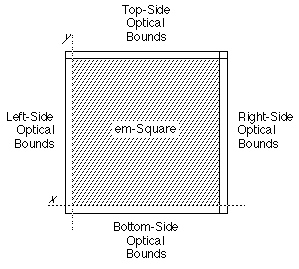
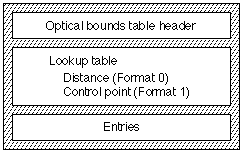
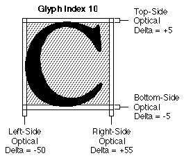
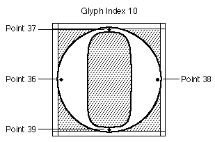

# The `'opbd'` table

## Introduction

The *optical bounds table* (tag name: `'opbd'`) allows you to design AAT fonts that contains information identifying the optical edges of glyphs. This information is used to make the edges of lines of text line up in a more visually pleasing way. This optical boundary information is used only at the edges of a line, not at points within a line.

For each glyph that has optical edge information, there are four numbers in this table, specifying values for the left, top, right and bottom optical edges. These values designate the amounts by which the glyph should be moved in order to align its optical edge.

The sign conventions are the same as the sign conventions for the font's coordinate system. For example, a left side delta of -50 units associated with an uppercase 'C' means that for those lines that start with that uppercase 'C' glyphs, the glyph is to be shifted by 50 units to the left. Negative values indicate that the glyph should be moved left or down; positive values indicate that the glyph should be moved right or up.

This figure shows the optical bounds of a glyph:

## Optical Bounds Table Format

The overall structure of the optical bounds table consists of an optical bounds table header, a lookup table, and the actual optical bounds entries, as shown in the following figure:

Optical bounds tables may have one of the following two formats:

| Table Format | Description |
| --- | --- |
| 0 | Distance. The delta values associated with a glyph are in FUnits. Distance delta values are specified for the left- side, top-side, right-side, and bottom-side optical edges for each glyph having optical edges in the font. Delta values of zero are used to indicate that a side does not have an optical bound. |
| 1 | Control point. You specify the locations of the glyph's optical edges by control points. The control point designates the position within the glyph that should be aligned with the edge of the line of text. Control point numbers are specified for the left-side, top-side, right- side, and bottom-side optical edges for each glyph having optical edges in the font. The special value -1 indicates that you've specified no optical edge control point for a given edge. |

The control point optical bounds Format 1 provides an additional level of control over that of Format 0. Control points can be hinted to change their locations to improve the appearance of small pixels-per-em glyphs. This correction is not possible with Format 0 distances. Control points are defined in the `'glyf'` table.

The optical bounds table format is as follows:

| Type | Name | Description |
| --- | --- | --- |
| fixed32 | version | Version number of the optical bounds table (0x00010000 for the current version). |
| uint16 | format | Format of the optical bounds table. Format 0 indicates distance and Format 1 indicates control point. |
| (variable) | lookup data | Lookup table associating glyphs with the four int16 values for the left-side, top-side, right-side, and bottom-side optical bounds. |

A [lookup table](Tables.md#anchor-Tables-LookupTables) is used to find the four int16 optical bounds values associated with the particular glyph. The value of each `lookupSegment` is always a 16-bit offset from the start of the Optical Bounds table to the record containing the four int16 values for the glyphs in that segment.

## Optical Bounds Table Examples

### Example: Format 0 Optical Bounds Table

Let's look at a roman font that provides optical edge data for rounded letters. There is optical bounds data for two glyphs, uppercase 'C' (glyph index 10 for this font) and uppercase 'A' (glyph index 43). There is a top-side amount for the uppercase 'A' glyph, since this font should look nice for vertical text as well as horizontal text. The following figure shows the optical bounds for glyph index 10.

The following table summarizes the optical bounds data for glyph indexes 10 and 43.

| Glyph index | Side | Delta FUnits |
| --- | --- | --- |
| 10 | Left | -50 |
| 10 | Top | +5 |
| 10 | Right | +55 |
| 10 | Bottom | -5 |
| 43 | Left | -10 |
| 43 | Top | +15 |
| 43 | Right | 0 |
| 43 | Bottom | 0 |

The following table shows how to build a Format 0 optical bounds table for the example font.

| Offset/length | Value | Name | Comment |
| --- | --- | --- | --- |
| 0/4 | 0x00010000 | version | Version number of the optical bounds table, in fixed-point format. |
| 4/2 | 0 | format | Format of the optical bounds table. This table will use Format 0 indicating that the optical bounds will be distance values. |
| (A [Format 6 lookup table](Tables.md#anchor-Tables-LookupFormat6) starts here) | <!-- colspan --> | <!-- colspan --> | <!-- colspan --> |
| 6/2 | 6 | format | Lookup table Format 6 (single table format, described in Chapter 2). |
| (The next five fields are the lookup table's [BinSrchHeader](Tables.md#anchor-Tables-BinSrchHeader)) | <!-- colspan --> | <!-- colspan --> | <!-- colspan --> |
| 8/2 | 4 | unitSize | Size of a LookupSingle record (2 bytes for the glyph index, and 2 bytes for the offset). |
| 10/2 | 2 | nUnits | Number of units of the preceding unitSize to be searched. There are 2 glyphs to be included in the table. |
| 12/2 | 8 | searchRange | The unitSize times the largest power of two that is less than or equal to nUnits. |
| 14/2 | 1 | entrySelector | The log base 2 of the largest power of two less than or equal to nUnits. |
| 16/2 | 0 | rangeShift | The unitSize times the difference of nUnits minus the largest power of two less than or equal to nUnits. |
| (The `LookupSingle` record entries start here) | <!-- colspan --> | <!-- colspan --> | <!-- colspan --> |
| 18/2 | 10 | glyph | Glyph index for uppercase 'C'. |
| 20/2 | 30 | value | Offset to optical bounds for glyph index 10. |
| 22/2 | 43 | glyph | Glyph index for uppercase 'A'. |
| 24/2 | 38 | value | Offset to optical bounds for glyph index 43. |
| 26/2 | 0xFFFF | glyph | Special guardian entry. |
| 28/2 | 0 | value | Special guardian entry. |
| (The following are the delta values for glyph index 10) | <!-- colspan --> | <!-- colspan --> | <!-- colspan --> |
| 30/2 | -50 | value | Delta value for the left-side optical edge. |
| 32/2 | +5 | value | Delta value for the top-side optical edge. |
| 34/2 | +55 | value | Delta value for the right-side optical edge. |
| 36/2 | -5 | value | Delta value for the bottom-side optical edge. |
| (The following are the delta values for glyph index 43) | <!-- colspan --> | <!-- colspan --> | <!-- colspan --> |
| 38/2 | -10 | value | Delta value for the left-side optical edge. |
| 40/2 | +15 | value | Delta value for the top-side optical edge. |
| 42/2 | 0 | value | Delta value for the right-side optical edge -- none for this glyph. |
| 44/2 | 0 | value | Delta value for the bottom-side optical edge -- none for this glyph. |

### Example: Format 1 Optical Bounds Table

For this example, the optical edges of an uppercase 'O' and 'A' glyphs are specified via control points rather than via actual distances. Note the special value of '-1' means that no optical information is included for the side. Control points are defined in the `'glyf'` table.

The following table summarizes the optical bounds data for glyph index 10.

| Glyph index | Side | Control Point |
| --- | --- | --- |
| 10 | Left | 36 |
| 10 | Top | 37 |
| 10 | Right | 38 |
| 10 | Bottom | 39 |
| 43 | Left | 32 |
| 43 | Top | 41 |
| 43 | Right | -1 |
| 43 | Bottom | -1 |

The following table shows how to build a Format 1 optical bounds table for the example font.

| Offset/length | Value | Name | Comment |
| --- | --- | --- | --- |
| 0/4 | 0x00010000 | version | Version number of the optical bounds table, in fixed-point format. |
| 4/2 | 1 | format | Format of the optical bounds table. This table will use Format 1 indicating that the optical bounds will be control points. |
| (A [Format 6 lookup table](Tables.md#anchor-Tables-LookupFormat6) starts here) | <!-- colspan --> | <!-- colspan --> | <!-- colspan --> |
| 6/2 | 6 | format | Lookup table Format 6 (single table format, described in Chapter 2). |
| (The next five fields are the lookup table's [BinSrchHeader](Tables.md#anchor-Tables-BinSrchHeader)) | <!-- colspan --> | <!-- colspan --> | <!-- colspan --> |
| 8/2 | 4 | unitSize | Size of a LookupSingle record (2 bytes for the glyph index, and 2 bytes for the offset). |
| 10/2 | 2 | nUnits | Number of units of the preceding unitSize to be searched. There are 2 glyphs to be included in the table. |
| 12/2 | 8 | searchRange | The unitSize times the largest power of two that is less than or equal to nUnits. |
| 14/2 | 1 | entrySelector | The log base 2 of the largest power of two less than or equal to nUnits. |
| 16/2 | 0 | rangeShift | The unitSize times the difference of nUnits minus the largest power of two less than or equal to nUnits. |
| (The `LookupSingle` record entries start here) | <!-- colspan --> | <!-- colspan --> | <!-- colspan --> |
| 18/2 | 10 | glyph | Glyph index for uppercase 'C'. |
| 20/2 | 30 | value | Offset to optical bounds for glyph index 10. |
| 22/2 | 43 | glyph | Glyph index for uppercase 'A'. |
| 24/2 | 38 | value | Offset to optical bounds for glyph index 43. |
| 26/2 | 0xFFFF | glyph | Special guardian entry. |
| 28/2 | 0 | value | Special guardian entry. |
| (The following are the control points for glyph index 10) | <!-- colspan --> | <!-- colspan --> | <!-- colspan --> |
| 30/2 | 36 | value | Delta value for the left-side optical edge. |
| 32/2 | 37 | value | Delta value for the top-side optical edge. |
| 34/2 | 38 | value | Delta value for the right-side optical edge. |
| 36/2 | 39 | value | Delta value for the bottom-side optical edge. |
| (The following are the control points for glyph index 43) | <!-- colspan --> | <!-- colspan --> | <!-- colspan --> |
| 38/2 | 32 | value | Delta value for the left-side optical edge. |
| 40/2 | 41 | value | Delta value for the top-side optical edge. |
| 42/2 | -1 | value | Delta value for the right-side optical edge -- none for this glyph. |
| 44/2 | -1 | value | Delta value for the bottom-side optical edge -- none for this glyph. |
