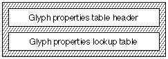

# The `'prop'` table

## General table information

## Introduction

The *glyph properties table*(tag name: `'prop'`) allows you to create Apple Advanced Typography (AAT) fonts with different properties associated with each glyph. Properties that are currently supported are the following:

- Non-spacing marks. These are non-spacing glyphs that are positioned with reference to a preceding base character. Examples include floating glyphs, such as diacritics, accents, and marks.
- Hanging glyphs. These glyphs hang off of the left or right edge of horizontal lines of text or hang off the top or bottom of vertical lines of text.
- Directional paired glyphs. These glyphs are left-to-right and right-to-left line dependent. An example is bracketing glyphs, such as parentheses, square brackets, and curly brackets.
- Attachment on right. These glyphs physically attach to the glyphs placed to their right. This information is used during justification to guarantee no extra space, ideal or device, is added between glyphs which are thus attached.

All Unicode characters possess directionality. Characters that have left-to-right and right-to-left directionality are called *strong types*. Characters of strong types are called strong directional characters. The directional types associated with numbers are called *weak types*. The characters of those types are called weak directional characters. A *neutral character* can be written either right-to-left or left-to-right, depending upon the context of the line.

See *[The Unicode Standard: Worldwide Character Encoding](http://www.unicode.org/)* for additional information concerning properties and directionality.

## Glyph Properties Table Format

The glyph properties table consists of a glyph properties table header and a glyph properties lookup table. The overall structure of the glyph properties table is shown in the following figure:

There have been three versions of the glyph properties table since its inception. The versions are summarized in the following table:

| Version | Description |
| --- | --- |
| 1.0 | Initial version, supporting floaters, hanging punctuation, symmetric swapping, and 12 basic Unicode directional properties. |
| 2.0 | Released with MacOS system 8.5, this version adds support for the "attaches on right" bit. |
| 3.0 | This is the version currently used on OS X and iOS; it adds support for the additional directional properties defined in Unicode 3.0. |

The format of the glyph properties table is as follows:

| Type | Name | Description |
| --- | --- | --- |
| fixed32 | version | Version number of the glyph properties table. See table above for what each version means. |
| uint16 | format | Format of the glyph properties table, set to 0 if no lookup data is present; set to 1 if lookup data is present. |
| uint16 | default properties | Default properties applied to a glyph if that glyph is not present in the lookup table. |
| variable | lookup data | Lookup table associating glyphs with their properties. See below for details on how to interpret the lookup values. |

A lookup table is used to find the 16-bit property value associated with the particular glyph. This is how to interpret the lookup for each of the 5 lookup table formats:

| Lookup table format | Interpretation |
| --- | --- |
| 0 | Array of 16-bit property values, one for each glyph in the font. |
| 2 | The value of each lookupSegment is a 16-bit property value for all of the glyphs in that segment. |
| 4 | The value of each lookupSegment is a 16-bit offset from the start of the lookup table to an array of 16-bit property values, one for each glyph in the segment. |
| 6 | The value of each lookupSingle is the 16-bit property value for that glyph. |
| 8 | The valueArray is an array of 16-bit property values, one for each glyph in the trimmed array. |

A single glyph property is 16 bits long. Glyph property bit masks and their descriptions are shown in the following table:

| Mask | Interpretation |
| --- | --- |
| 0x8000 | This glyph is a floater (for example a floating accent or vowel mark). NOTE: It is very important that this bit only be set for glyphs that have a zero advance width. |
| 0x4000 | This glyph can hang off the left edge of a horizontal line or the top edge of a vertical line. |
| 0x2000 | This glyph can hang off the right edge of a horizontal line or the bottom edge of a vertical line. |
| 0x1000 | If this property bit is on, and the glyph ends up in a right-to- left directional grouping, then the complementary bracketing glyph should be substituted for this glyph. |
| 0x0F00 | These four bits give the offset to the complementary bracketing glyph (or zero if this glyph has no such complementary bracketing glyph). |
| 0x0080 | This glyph always attaches to the glyph appearing physically to the right of it. Note that this bit was added in version 2.0; it is invalid to set it in a version 1.0 glyph properties table. |
| 0x0060 | These two bits must be set to zero. This mask is reserved for future properties. |
| 0x001F | These five bits contain the glyph's directionality class. Note that in versions of Unicode prior to 3.0, only four of these bits are actually used. |

The Unicode reordering algorithm treats characters such as '(' and ')' as open and closed parentheses, rather than as left and right parentheses. This means that the glyphs used to render these bracketing characters will depend upon the final resolved direction of the text, as shown in the following table:

| Directionality | Open/Closed | Bracketing Glyphs |
| --- | --- | --- |
| left-to-right | Open | (, \[, { |
| left-to-right | Closed | ), \], } |
| right-to-left | Open | ), \], } |
| right-to-left | Closed | (, \[, { |

In order to accommodate the bi-directionality of bracketing glyphs, the `'cmap'` table should always change bracketing characters in glyphs corresponding to their 'natural' direction. Therefore, when one of the two brackets is used, the complementary glyph must be identified to the AAT rendering system. This is accomplished by the use of the 0x1F00 bits. If the glyph is a bracketing glyph, then 0x0F00 bits are treated as a 4-bit signed offset to the glyph index of the corresponding glyph. The 0x1000 bit is used to determine whether the glyph at that specified offset is a right-to-left or left-to-right version of the glyph.

For example, in a Roman font, the order of parenthesis glyphs is usually '(' followed by ')'. The glyph index may be 11 for the '(' glyph and 12 for the ')' glyph. The property masks, 0x1F00, for the '(' glyph would then be 0x1100 for the ')' glyph and 0x1F00 for the ')' glyph. The 0x1100 mask for glyph index="11" indicates that the corresponding glyph is right-to-left and the glyph index offset is +1, glyph index="11" + 1="12." The 0x1F00 mask indicates that the corresponding glyph is also right-to-left and the glyph index offset to it is -1, glyph index="12" - 1="11."

If there are one or more glyphs between the '(' and the ')' in the glyph index, then the this information is conveyed through the mask values. For example, if the glyph indexes were 11 and 13 for the respective parentheses glyphs, property mask 0x1F00 for the '(' glyph would be 0x1200 for the ')' glyph and 0x1E00 for the ')' glyph. The 0x1200 mask indicates that the corresponding glyph is also right-to-left and the glyph index offset is +2, glyph index="11" + 2="13." The 0x1E00 mask indicates that the corresponding glyph is also right-to-left and the glyph index offset to it is -2, glyph index="13" - 2="11."

The Apple Advanced Typography system currently supports the following directionality classes:

| Type | Class(decimal) | Description |
| --- | --- | --- |
| Strong | 0 | Strong (left-to-right) |
| Strong | 1 | Strong (right-to-left, non-Arabic) |
| Strong | 2 | Arabic letters (right-to-left) |
| Weak | 3 | European number |
| Weak | 4 | European number separator |
| Weak | 5 | European number terminator |
| Weak | 6 | Arabic number |
| Weak | 7 | Common number separator |
| Neutral | 8 | Block separator |
| Neutral | 9 | Segment separator |
| Neutral | 10 | Whitespace |
| Neutral | 11 | Other neutrals |
| Neutral | 12 through 31 | Reserved (some are actually defined in Unicode 3.0) |

NOTE: additional properties have been defined in Unicode 3.0. If these properties are used, make sure the version of this table is set to 3.0 or higher!

Any of the [lookup table](Tables.md#anchor-Tables-LookupTables) formats can be used. If the glyphs share similar properties, Format 2 may be appropriate. If only a few glyphs differ from the default, Format 6 may be preferred. If the number of segments will be large, Formats 0 or 8 may be selected.

## Glyph Properties Table Examples

### Example Font with Hebrew and Roman Characters

This example font will contain both Hebrew and Roman characters. Bidirectional features for this font need to be included to accommodate the fact that the Roman glyphs will be left-to-right and Hebrew glyphs will be right-to-left.

The definition of the default property as being either left-to-right or right-to-left is arbitrary. Specifying the directionality class as 0 defines the default properties of this font as strong left-to-right. This will be fine for the Roman glyphs, but we will need to provide a lookup table that defines the Hebrew glyphs as having right-to- left directionality. Specifying the directionality class as 1 for the Hebrew glyphs defines their non-default properties as strong right-to-left (non-Arabic).

Because many of the glyphs in this font share similar properties, we'll use a format 2 single segment lookup table for the non-default glyphs. We will use two segments, each with its own set of properties. The segments will be contiguous ranges of glyph indices in which all glyphs in the segment will have a single lookup value designating the properties of the segment. Glyph properties data for this font is summarized in the following table:

| Glyphs | Glyph index | Directionality class | Mask value |
| --- | --- | --- | --- |
| Roman | 3-149 | 0 | Not required for the default class. |
| Hebrew | 150-225 | 1 | 1 (dec), 0x0001, Segment 2 |
| Whitespace | 2 | 10 | 10 (dec), 0x000A, Segment 1 |

The glyph properties table for this example font is as follows:

| Offset/length | Value | Name | Comment |
| --- | --- | --- | --- |
| 0/4 | 0x00030000 | version | Version number of the glyph properties table, in fixed-point format. |
| 4/2 | 1 | format | Format of the glyph properties table is 1. Lookup data is present. |
| 6/2 | 0 | default properties | Default properties are left-to-right directionality and non-whitespace; glyphs cannot hang off either end of a line or be floaters. |
| (The [format 2 lookup table](Tables.md#anchor-Tables-LookupFormat2) starts here) | <!-- colspan --> | <!-- colspan --> | <!-- colspan --> |
| 8/2 | 2 | format | Lookup table format 2 (segment single format). |
| (The next five fields are the lookup table's [BinSrchHeader](Tables.md#anchor-Tables-BinSrchHeader)) | <!-- colspan --> | <!-- colspan --> | <!-- colspan --> |
| 10/2 | 6 | unitSize | Size of a LookupSegment: 2 bytes for the starting glyph index, 2 bytes for the ending glyph index, and 2 bytes for the glyph properties value. |
| 12/2 | 2 | nUnits | Number of entries of the preceding unitSize to be searched. There are 2 properties to be included in the lookup table. |
| 14/2 | 12 | searchRange | The unitSize times the largest power of two that is less than or equal to nUnits. |
| 16/2 | 1 | entrySelector | The log base 2 of the largest power of two less than or equal to nUnits. |
| 18/2 | 0 | rangeShift | The unitSize times the difference of nUnits minus the largest power of two less than or equal to nUnits. |
| (The `LookupSegment` entries start here; the first lookup segment follows) | <!-- colspan --> | <!-- colspan --> | <!-- colspan --> |
| 20/2 | 2 | lastGlyph | Glyph index for whitespace. This is the last glyph index in this segment. |
| 22/2 | 2 | firstGlyph | Glyph index for whitespace. This is the first glyph index in this segment. |
| 24/2 | 0x000A | value | Properties for glyph index 2. Directionality class 10 (whitespace, neutral). |
| (The second `LookupSegment` follows) | <!-- colspan --> | <!-- colspan --> | <!-- colspan --> |
| 26/2 | 225 | lastGlyph | Ending glyph index for Hebrew glyphs. This is the last glyph index in this segment. |
| 28/2 | 150 | firstGlyph | Starting glyph index for Hebrew glyphs. This is the first glyph index in this segment. |
| 30/2 | 0x0001 | value | Properties for glyph index 150 through 225 (right-to-left). |

### Example Font with Roman Characters

This example font contains 98 Roman glyphs, covering the glyphs needed for 7-bit ASCII. The glyph properties data for this example font is as follows:

| Segment | Glyph index | Glyph | Props | Directionality class |
| --- | --- | --- | --- | --- |
| 0 | 3 | space | 0x000A | Whitespace (10) |
| 1 | 4 | ! | 0x000B | Other neutrals (11) |
| 2 | 5 | " | 0x600B | Other neutrals (11) |
| 3 | 6-8 | # $ % | 0x0005 | European number terminator (5) |
| 4 | 9 | & | 0x0000 | Strong (left-to-right) (0) |
| 5 | 10 | ' | 0x600B | Other neutrals (11) |
| 6 | 11 | ( | 0x110B | Other neutrals (11) |
| 7 | 12 | ) | 0x1F0B | Other neutrals (11) |
| 8 | 13 | \* | 0x000B | Other neutrals (11) |
| 9 | 14 | + | 0x0005 | European number terminator (5) |
| 10 | 15 | , | 0x0007 | Common number separator (7) |
| 11 | 16 | ? | 0x0005 | European number terminator (5) |
| 12 | 17-18 | . / | 0x0004 | European number separator (4) |
| 13 | 19-28 | 0-9 | 0x0003 | European number (3) |
| 14 | 29 | : | 0x0007 | Common number separator (7) |
| 15 | 30 | ; | 0x000B | Other neutrals (11) |
| 16 | 31 | \< | 0x120B | Other neutrals (11) |
| 17 | 32 | = | 0x000B | Other neutrals (11) |
| 18 | 33 | \> | 0x1E0B | Other neutrals (11) |
| 19 | 34-35 | ? @ | 0x000B | Other neutrals (11) |
| 20 | 36-61 | A-Z | 0x0000 | Strong (left-to-right) (0) |
| 21 | 62 | \[ | 0x120B | Other neutrals (11) |
| 22 | 63 | \\ | 0x000B | Other neutrals (11) |
| 23 | 64 | \] | 0x1E0B | Other neutrals (11) |
| 24 | 65-93 | ^ \_ \` and a-z | 0x0000 | Strong (left-to-right) (0) |
| 25 | 94 | { | 0x120B | Other neutrals (11) |
| 26 | 95 | \| | 0x000B | Other neutrals (11) |
| 27 | 96 | } | 0x1E0B | Other neutrals (11) |
| 28 | 97 | ~ | 0x000B | Other neutrals (11) |

The glyph properties table for this example font is given in the following table:

| Offset/length | Value | Name | Comment |
| --- | --- | --- | --- |
| 0/4 | 0x00030000 | version | Version number of the glyph properties table, in fixed-point format. |
| 4/2 | 1 | format | Table format is 1, meaning lookup data is present. |
| 6/2 | 0 | default | Default properties are left-to-right directionality and non-whitespace; glyphs cannot hang off either end of a line or be floaters. |
| (The [format 8 lookup table](Tables.md#anchor-Tables-LookupFormat8) starts here) | <!-- colspan --> | <!-- colspan --> | <!-- colspan --> |
| 8/2 | 8 | format | Lookup table format 8 (trimmed array). |
| 10/2 | 3 | firstGlyph | First glyph for which we include values in the trimmed array. |
| 12/2 | 95 | glyphCount | Number of glyphs in the trimmed array. |
| (The actual properties follow here, one 16-bit word for each glyph from 3 through 97) | <!-- colspan --> | <!-- colspan --> | <!-- colspan --> |
| 14/2 | 0x000A | valueArray\[0\] | Glyph 3 is whitespace. |
| 16/2 | 0x000B | valueArray\[1\] | Glyph 4 is other neutral. |
| 18/2 | 0x600B | valueArray\[2\] | Glyph 5 is other neutral, and is also a hanging punctuation glyph that can hang from either side. |
| 20/2 | 0x0005 | valueArray\[3\] | Glyph 6 is a European number terminator. |
| 22/2 | 0x0005 | valueArray\[4\] | Glyph 7 is a European number terminator. |
| 24/2 | 0x0005 | valueArray\[5\] | Glyph 8 is a European number terminator. |
| 26/2 | 0x0000 | valueArray\[6\] | Glyph 9 is left-to-right. |
| 28/2 | 0x600B | valueArray\[7\] | Glyph 10 is other neutral, and is also a hanging punctuation glyph that can hang from either side. |
| 30/2 | 0x110B | valueArray\[8\] | Glyph 11 is other neutral, and has a bracketing glyph at an offset of +1. |
| 32/2 | 0x1F0B | valueArray\[9\] | Glyph 12 is other neutral, and has a bracketing glyph at an offset of -1. |
| 34/2 | 0x000B | valueArray\[10\] | Glyph 13 is other neutral. |
| 36/2 | 0x0005 | valueArray\[11\] | Glyph 14 is a European number terminator. |
| 38/2 | 0x0007 | valueArray\[12\] | Glyph 15 is a Common number terminator. |
| 40/2 | 0x0005 | valueArray\[13\] | Glyph 16 is a European number terminator. |
| 42/2 | 0x0004 | valueArray\[14\] | Glyph 17 is a European number separator. |
| 44/2 | 0x0004 | valueArray\[15\] | Glyph 18 is a European number separator. |
| 46/2 | 0x0003 | valueArray\[16\] | Glyph 19 is a European number. |
| 48/2 | 0x0003 | valueArray\[17\] | Glyph 20 is a European number. |
| 50/2 | 0x0003 | valueArray\[18\] | Glyph 21 is a European number. |
| 52/2 | 0x0003 | valueArray\[19\] | Glyph 22 is a European number. |
| 54/2 | 0x0003 | valueArray\[20\] | Glyph 23 is a European number. |
| 56/2 | 0x0003 | valueArray\[21\] | Glyph 24 is a European number. |
| 58/2 | 0x0003 | valueArray\[22\] | Glyph 25 is a European number. |
| 60/2 | 0x0003 | valueArray\[23\] | Glyph 26 is a European number. |
| 62/2 | 0x0003 | valueArray\[24\] | Glyph 27 is a European number. |
| 64/2 | 0x0003 | valueArray\[25\] | Glyph 28 is a European number. |
| 66/2 | 0x0007 | valueArray\[26\] | Glyph 29 is a Common number terminator. |
| 68/2 | 0x000B | valueArray\[27\] | Glyph 30 is other neutral. |
| 70/2 | 0x120B | valueArray\[28\] | Glyph 31 is other neutral, and has a bracketing glyph at an offset of +2. |
| 72/2 | 0x000B | valueArray\[29\] | Glyph 32 is other neutral. |
| 74/2 | 0x1E0B | valueArray\[30\] | Glyph 33 is other neutral, and has a bracketing glyph at an offset of -2. |
| 76/2 | 0x000B | valueArray\[31\] | Glyph 34 is other neutral. |
| 78/2 | 0x000B | valueArray\[32\] | Glyph 35 is other neutral. |
| 80/2 | 0x0000 | valueArray\[33\] | Glyph 36 is left-to-right. |
| 82/2 | 0x0000 | valueArray\[34\] | Glyph 37 is left-to-right. |
| 84/2 | 0x0000 | valueArray\[35\] | Glyph 38 is left-to-right. |
| 86/2 | 0x0000 | valueArray\[36\] | Glyph 39 is left-to-right. |
| 88/2 | 0x0000 | valueArray\[37\] | Glyph 40 is left-to-right. |
| 90/2 | 0x0000 | valueArray\[38\] | Glyph 41 is left-to-right. |
| 92/2 | 0x0000 | valueArray\[39\] | Glyph 42 is left-to-right. |
| 94/2 | 0x0000 | valueArray\[40\] | Glyph 43 is left-to-right. |
| 96/2 | 0x0000 | valueArray\[41\] | Glyph 44 is left-to-right. |
| 98/2 | 0x0000 | valueArray\[42\] | Glyph 45 is left-to-right. |
| 100/2 | 0x0000 | valueArray\[43\] | Glyph 46 is left-to-right. |
| 102/2 | 0x0000 | valueArray\[44\] | Glyph 47 is left-to-right. |
| 104/2 | 0x0000 | valueArray\[45\] | Glyph 48 is left-to-right. |
| 106/2 | 0x0000 | valueArray\[46\] | Glyph 49 is left-to-right. |
| 108/2 | 0x0000 | valueArray\[47\] | Glyph 50 is left-to-right. |
| 110/2 | 0x0000 | valueArray\[48\] | Glyph 51 is left-to-right. |
| 112/2 | 0x0000 | valueArray\[49\] | Glyph 52 is left-to-right. |
| 114/2 | 0x0000 | valueArray\[50\] | Glyph 53 is left-to-right. |
| 116/2 | 0x0000 | valueArray\[51\] | Glyph 54 is left-to-right. |
| 118/2 | 0x0000 | valueArray\[52\] | Glyph 55 is left-to-right. |
| 120/2 | 0x0000 | valueArray\[53\] | Glyph 56 is left-to-right. |
| 122/2 | 0x0000 | valueArray\[54\] | Glyph 57 is left-to-right. |
| 124/2 | 0x0000 | valueArray\[55\] | Glyph 58 is left-to-right. |
| 126/2 | 0x0000 | valueArray\[56\] | Glyph 59 is left-to-right. |
| 128/2 | 0x0000 | valueArray\[57\] | Glyph 60 is left-to-right. |
| 130/2 | 0x0000 | valueArray\[58\] | Glyph 61 is left-to-right. |
| 132/2 | 0x120B | valueArray\[59\] | Glyph 62 is other neutral, and has a bracketing glyph at an offset of +2. |
| 134/2 | 0x000B | valueArray\[60\] | Glyph 63 is other neutral. |
| 136/2 | 0x1E0B | valueArray\[61\] | Glyph 64 is other neutral, and has a bracketing glyph at an offset of -2. |
| 138/2 | 0x0000 | valueArray\[62\] | Glyph 65 is left-to-right. |
| 140/2 | 0x0000 | valueArray\[63\] | Glyph 66 is left-to-right. |
| 142/2 | 0x0000 | valueArray\[64\] | Glyph 67 is left-to-right. |
| 144/2 | 0x0000 | valueArray\[65\] | Glyph 68 is left-to-right. |
| 146/2 | 0x0000 | valueArray\[66\] | Glyph 69 is left-to-right. |
| 148/2 | 0x0000 | valueArray\[67\] | Glyph 70 is left-to-right. |
| 150/2 | 0x0000 | valueArray\[68\] | Glyph 71 is left-to-right. |
| 152/2 | 0x0000 | valueArray\[69\] | Glyph 72 is left-to-right. |
| 154/2 | 0x0000 | valueArray\[70\] | Glyph 73 is left-to-right. |
| 156/2 | 0x0000 | valueArray\[71\] | Glyph 74 is left-to-right. |
| 158/2 | 0x0000 | valueArray\[72\] | Glyph 75 is left-to-right. |
| 160/2 | 0x0000 | valueArray\[73\] | Glyph 76 is left-to-right. |
| 162/2 | 0x0000 | valueArray\[74\] | Glyph 77 is left-to-right. |
| 164/2 | 0x0000 | valueArray\[75\] | Glyph 78 is left-to-right. |
| 166/2 | 0x0000 | valueArray\[76\] | Glyph 79 is left-to-right. |
| 168/2 | 0x0000 | valueArray\[77\] | Glyph 80 is left-to-right. |
| 170/2 | 0x0000 | valueArray\[78\] | Glyph 81 is left-to-right. |
| 172/2 | 0x0000 | valueArray\[79\] | Glyph 82 is left-to-right. |
| 174/2 | 0x0000 | valueArray\[80\] | Glyph 83 is left-to-right. |
| 176/2 | 0x0000 | valueArray\[81\] | Glyph 84 is left-to-right. |
| 178/2 | 0x0000 | valueArray\[82\] | Glyph 85 is left-to-right. |
| 180/2 | 0x0000 | valueArray\[83\] | Glyph 86 is left-to-right. |
| 182/2 | 0x0000 | valueArray\[84\] | Glyph 87 is left-to-right. |
| 184/2 | 0x0000 | valueArray\[85\] | Glyph 88 is left-to-right. |
| 186/2 | 0x0000 | valueArray\[86\] | Glyph 89 is left-to-right. |
| 188/2 | 0x0000 | valueArray\[87\] | Glyph 90 is left-to-right. |
| 190/2 | 0x0000 | valueArray\[88\] | Glyph 91 is left-to-right. |
| 192/2 | 0x0000 | valueArray\[89\] | Glyph 92 is left-to-right. |
| 194/2 | 0x0000 | valueArray\[90\] | Glyph 93 is left-to-right. |
| 196/2 | 0x120B | valueArray\[91\] | Glyph 94 is other neutral, and has a bracketing glyph at an offset of +2. |
| 198/2 | 0x000B | valueArray\[92\] | Glyph 95 is other neutral. |
| 200/2 | 0x1E0B | valueArray\[93\] | Glyph 96 is other neutral, and has a bracketing glyph at an offset of -2. |
| 202/2 | 0x000B | valueArray\[94\] | Glyph 97 is other neutral. |

## Platform-specific Information

CoreText currently derives directionality and related property information from the Unicode properties database. It uses the `'prop'` table when determining bidi mirrored glyphs and, when optical alignment is enabled, hanging glyphs. Support in justification for `'prop'` table floaters may be available in future OS releases.

## Dependencies

The `'prop'` table sites glyph indices, which must not exceed the glyph index limits found in the [maximum profile table](maxp.md).
