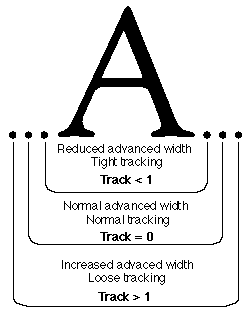
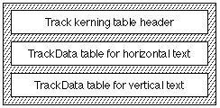

# The `'trak'` table

## Introduction

The *tracking table* (tag: `'trak'`) allows you to design AAT fonts which allow adjustment to normal interglyph spacing. The spacing is based on the font size and the track number. The user or application selects the font size and track number and the correct amount of interglyph space for each glyph in the font is calculated and applied to the text. The information you specify in the tracking table is used to calculate the proper amount of spacing for all glyph sizes of your font.

Tracking is similar to [kerning](kern.md). Tracking controls the amount of spacing by performing a calculation that uses point size and a specified track number to determine interglyph spacing adjustment. The same adjustment is applied to all glyphs in the font. In contrast, kerning considers the identity of two or more neighboring glyphs to select pre-determined interglyph spacing adjustment values.

The following figure shows how tracking makes adjustments to a glyph's advanced width to achieve tight, normal, and loose text, depending upon the track value.

The amount of reduction or increase in the advanced width is determined by the use of per-size track values stored in the tracking table. If the point size and track number required are stored, these values are used. If the point size and track number required are not found in the tracking table, interpolation or extrapolation is performed to determine the adjustment to the advance width that is required for the font size and tracking number specified.

The per-size track values are specified in the table in FUnits. For a font that has 2048 units per em, an FUnit value of 10 is 10/2048 = 4.88E-3 ems. During tracking, the stored or calculated FUnit value in ems is multiplied by the point size and added to the advance widths of each glyph. If the value is negative, the advance width is decreased. If the value is positive, the advance width is increased.

The tracking table you create should have per-size tracking values for track numbers -1, 0, and +1 at a minimum of two font sizes. Additional font sizes can also be included in the table. Tracking numbers are arbitrary, but the values -1, 0, and +1 should be used to indicate loose, normal, and tight tracking, respectively.

The tracking table allows you to cross-reference a descriptive phrase related to each track number that you include in the table. These non-functional phrases are included in the name table (tag name `'name'`). These phrases are included as `nameIDs` for `nameRecord[count]`, where `count` is the sequential order number of the name records. The tracking table provides a cross-reference to the `count` value in the name table. A possible name for track sizes -1, 0 and -1 may be loose, normal, and tight. Similar phrases may also be used to describe the characteristics of your font. See the example that follows for further clarification.

## Tracking Table Format

The overall structure of the tracking table consists of a tracking header, track data table for horizontal text and track data table for vertical text, as shown in the following figure. Since offsets are provided to the horizontal and vertical tables, their order is arbitrary.

The overall tracking table format is as follows:

| Type | Name | Description |
| --- | --- | --- |
| fixed | version | Version number of the tracking table (0x00010000 for the current version). |
| uint16 | format | Format of the tracking table (set to 0). |
| uint16 | horizOffset | Offset from start of tracking table to TrackData for horizontal text (or 0 if none). |
| uint16 | vertOffset | Offset from start of tracking table to TrackData for vertical text (or 0 if none). |
| uint16 | reserved | Reserved. Set to 0. |
| TrackData | horizData | TrackData for horizontal text (if present). |
| TrackData | vertData | TrackData for vertical text (if present). |

The `TrackData` table format (which must be longword aligned) is shown in the following table:

| Type | Name | Description |
| --- | --- | --- |
| uint16 | nTracks | Number of separate tracks included in this table. |
| uint16 | nSizes | Number of point sizes included in this table. |
| uint32 | sizeTableOffset | Offset from start of the tracking table to the start of the size subtable. |
| trackTableEntry | trackTable\[\] | Array\[nTracks\] of TrackTableEntry records. |
| fixed32 | sizeTable\[\] | Array\[nSizes\] of size values. |

The trackTableEntry format is as follows:

| Type | Name | Description |
| --- | --- | --- |
| fixed32 | track | Track value for this record. |
| uint16 | nameIndex | The 'name' table index for this track (a short word or phrase like "loose" or "very tight"). NameIndex has a value greater than 255 and less than 32768. |
| uint16 | offset | Offset from start of tracking table to per-size tracking values for this track. |

## Tracking Table Example

Here is an example of a tracking table that has three tracks (normal at 0, tight at -1, and loose at +1). Per-size tracking values are specified for 12-point and 24- point text for each track. The data for this example is summarized in the following table:

| Track | Font size | FUnits |
| --- | --- | --- |
| -1 | 12 | -15 |
| -1 | 24 | -7 |
| 0 | 12 | 0 |
| 0 | 24 | 0 |
| +1 | 12 | 50 |
| +1 | 24 | 20 |

The tracking table for this example is as follows:

| Offset/length | Value | Name | Comment |
| --- | --- | --- | --- |
| 0/4 | 0x00010000 | version | Version number of the tracking table, in fixed-point format. |
| 4/2 | 0 | format | Format 0 is the only format defined at this time. |
| 6/2 | 12 | horizOffset | Offset to TrackData for horizontal text. |
| 8/2 | 0 | vertOffset | Offset to TrackData for vertical text (a value of 0 means none) |
| 10/2 | 0 | (pad | word) Padding to ensure the following. TrackData table is longword aligned. |
| (The `TrackData` for horizontal text is next) | <!-- colspan --> | <!-- colspan --> | <!-- colspan --> |
| 12/2 | 3 | nTracks | Number of tracks included. |
| 14/2 | 2 | nSizes | Number of font sizes for each track. |
| 16/4 | 44 | sizeTableOffset | Offset of the size subtable. |
| (The three sorted `TrackTableEntry` records follow) | <!-- colspan --> | <!-- colspan --> | <!-- colspan --> |
| 20/4 | 0xFFFF0000 | track | Fixed-point representation of -1 (first of three tracks). |
| 24/2 | 256 | nameIndex | The 'name' table index for the descriptive string "tight." |
| 26/2 | 52 | offset | Offset of the two per-size tracking values for track number -1. |
| 28/4 | 0x00000000 | track | Fixed-point representation of 0 (second of three tracks). |
| 32/2 | 258 | nameIndex | The 'name' table index for the descriptive string "normal." |
| 34/2 | 60 | offset | Offset of the two per-size tracking values for track number 0. |
| 38/4 | 0x00010000 | track | Fixed-point representation of +1 (third of three tracks). |
| 40/2 | 257 | nameIndex | The 'name' table index for the descriptive string "loose." |
| 42/2 | 56 | offset | Offset of the two per-size tracking values for track number +1. |
| (The size subtable \[i.e. the `sizeTable` array\] is next) | <!-- colspan --> | <!-- colspan --> | <!-- colspan --> |
| 44/4 | 0x000C0000 | sizeTable\[1\] | Fixed-point representation of 12 points. |
| 48/4 | 0x00180000 | sizeTable\[2\] | Fixed-point representation of 24 points. |
| (The per-size tracking values whose offsets were included in the `TrackTableEntry` records are included last) | <!-- colspan --> | <!-- colspan --> | <!-- colspan --> |
| 52/2 | -15 | value | FUnits of tight tracking at 12-point. |
| 54/2 | -7 | value | FUnits of tight tracking at 24-point. |
| 56/2 | 50 | value | FUnits of loose tracking at 12-point. |
| 58/2 | 20 | value | FUnits of loose tracking at 24-point. |
| 60/2 | 0 | value | FUnits of normal tracking at 12-point. |
| 62/2 | 0 | value | FUnits of normal tracking at 24-point. |
