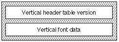

# The `'vhea'` table

## General table information

The *vertical header* table (tag name: `'vhea'`) contains information needed for vertical fonts. The glyphs of vertical fonts are written either top to bottom or bottom to top. This table contains information that is general to the font as a whole. Information that pertains to specific glyphs is given in the [vertical metrics table](vmtx.md) (tag name: `'vmtx'`).

Data in the vertical header table must be consistent with data that appears in the vertical metrics table. The advance height and top side bearing values in the vertical metrics table must correspond with the maximum advance height and minimum bottom side bearing values in the vertical header table.

- **NOTE**: The material in this chapter only applies to TrueType fonts.

## Vertical Header Table Format

The vertical header table consists of the vertical header table version followed by vertical font data. The overall structure of the vertical header table is shown in the following figure:

The vertical header table format is as follows:

| Type | Name | Description |
| --- | --- | --- |
| fixed32 | version | Version number of the Vertical Header Table (0x00011000 for the current version). |
| int16 | vertTypoAscender | The vertical typographic ascender for this font. It is the distance in FUnits from the vertical center baseline to the right of the design space. This will usually be set to half the horizontal advance of full-width glyphs. For example, if the full width is 1000 FUnits, this field will be set to 500. |
| int16 | vertTypoDescender | The vertical typographic descender for this font. It is the distance in FUnits from the vertical center baseline to the left of the design space. This will usually be set to half the horizontal advance of full-width glyphs. For example, if the full width is 1000 FUnits, this field will be set to -500. |
| int16 | vertTypoLineGap | The vertical typographic line gap for this font. |
| int16 | advanceHeightMax | The maximum advance height measurement in FUnits found in the font. This value must be consistent with the entries in the vertical metrics table. |
| int16 | minTopSideBearing | The minimum top side bearing measurement in FUnits found in the font, in FUnits. This value must be consistent with the entries in the vertical metrics table. |
| int16 | minBottomSideBearing | The minimum bottom side bearing measurement in FUnits found in the font, in FUnits. This value must be consistent with the entries in the vertical metrics table. |
| int16 | yMaxExtent | This is defined as the value of the minTopSideBearing field added to the result of the value of the yMin field subtracted from the value of the yMax field. |
| int16 | caretSlopeRise | The value of the caretSlopeRise field divided by the value of the caretSlopeRun field determines the slope of the caret. A value of 0 for the rise and a value of 1 for the run specifies a horizontal caret. A value of 1 for the rise and a value of 0 for the run specifies a vertical caret. A value between 0 for the rise and 1 for the run is desirable for fonts whose glyphs are oblique or italic. For a vertical font, a horizontal caret is best. |
| int16 | caretSlopeRun | See the caretSlopeRise field. Value = 0 for non-slanted fonts. |
| int16 | caretOffset | The amount by which the highlight on a slanted glyph needs to be shifted away from the glyph in order to produce the best appearance. Set value equal to 0 for non-slanted fonts. |
| int16 | reserved | Set to 0. |
| int16 | reserved | Set to 0. |
| int16 | reserved | Set to 0. |
| int16 | reserved | Set to 0. |
| int16 | metricDataFormat | Set to 0. |
| uint16 | numOfLongVerMetrics | Number of advance heights in the Vertical Metrics table. |

## Vertical Header Table Example

The following table shows an example of a Vertical Header Table for a vertical font.

| Offset/length | Value | Name | Comment |
| --- | --- | --- | --- |
| 0/4 | 0x00010000 | version | Version number of the vertical header table, in fixed-point format. |
| 4/2 | 1024 | vertTypoAscender | Half the em-square height. |
| 6/2 | -1024 | vertTypoDescender | Minus half the em-square height |
| 8/2 | 0 | vertTypoLineGap | Typographic line gap is 0 FUnits. |
| 10/2 | 2079 | advanceHeightMax | The maximum advance height measurement found in the font is 2079 FUnits. |
| 12/2 | -342 | minTopSideBearing | The minimum top side bearing measurement found in the font is -342 FUnits. |
| 14/2 | -333 | minBottomSideBearing | The minimum bottom side bearing measurement found in the font is -333 FUnits. |
| 16/2 | 2036 | yMaxExtent | The minTopSideBearing field added to the result of the value of the yMin field subtracted from the value of the yMax field is 2036. |
| 18/2 | 0 | caretSlopeRise | A caret slope rise of 0 and a caret slope of 1 indicate a horizontal caret for a vertical font. |
| 20/2 | 1 | caretSlopeRun | A caret slope rise of 0 and a caret slope of 1 indicate a horizontal caret for a vertical font. |
| 22/2 | 0 | caretOffset | Value set to 0 for non- slanted fonts. |
| 24/4 | 0 | reserved | Set to 0. |
| 26/2 | 0 | reserved | Set to 0. |
| 28/2 | 0 | reserved | Set to 0. |
| 30/2 | 0 | reserved | Set to 0. |
| 32/2 | 0 | metricDataFormat | Set to 0. |
| 34/2 | 258 | numOfLongVerMetrics | Number of advance heights in the Vertical Metrics table is 258. |

An application can determine the recommended line spacing for single-spaced vertical text for an OpenType font by the following expression:

vhea.vertTypoAscender - vhea.vertTypoDescender + vhea.vertTypoLineGap

The application can use this value as the default vertical line spacing.

## Dependencies

The [vertical metrics table](vmtx.md) uses information in the vertical header table's numOfLongVerMetrics field. This number must be no greater than the total number of glyphs in a font, defined in the [maximum profile table](maxp.md "'maxp' table").
