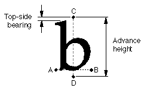
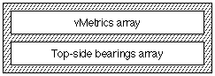

# The `'vmtx'` table

## Introduction

The *vertical metrics table* (tag name: `'vmtx'`) allows you to specify the vertical spacing for each glyph in an AAT vertical font. This table consists of either one or two arrays that contain metric information -- the advance heights and top-side bearings -- for the vertical layout of each of the glyphs in the font. The vertical metrics coordinate system is shown in the following figure:

- **NOTE**: The material in this chapter only applies to TrueType fonts.

AAT vertical fonts require both a [vertical header table](vhea.md) (tag name: `'vhea'`) and a vertical metrics table. The vertical header table contains information that is general to the font as a whole. The vertical metrics table contains information that pertains to specific glyphs.

## Vertical Metrics Table Format

The overall structure of the vertical metrics table consists of the two arrays shown in the following figure. This table does not have a header, but does require that the number of glyphs included in the two arrays equal the total number of glyphs in the font. A short version of the table may be used to accommodate fonts in which all advance heights are equal.

The `vMetrics` array contains two values for each entry. These are the advance height and the top-side bearing for each glyph included in the array.

The number of entries in the `vMetrics` array is determined by the value of the `numOfLongVerMetrics` field of the [vertical header table](vhea.md).

In monospaced fonts, such as Courier or kanji, all glyphs have the same advance height. If the font is monospaced, only one entry need be in the first array, but that one entry is required.

The format of an entry in the vertical metrics array is as follows:

| Type | Name | Description |
| --- | --- | --- |
| uint16 | advanceHeight | The advance height of the glyph. Signed integer in FUnits. |
| int16 | topSideBearing | The top side bearing of the glyph. Signed integer in FUnits |

The second array is optional and generally is used for a run of monospaced glyphs in the font. Only one such run is allowed per font, and it must be located at the end of the font. This array contains the top-side bearings of glyphs not represented in the first array, and you must assume that all the glyphs in this array have the same advance height as the last entry in the `vMetrics` array. All entries in this array are therefore monospaced.

The number of entries in this array is calculated by subtracting the value of `numOfLongVerMetrics` from the number of glyphs in the font. The sum of glyphs represented in the first array plus the glyphs represented in the second array therefore equals the number of glyphs in the font. The format of the top side bearing array is as follows:

| Type | Name | Description |
| --- | --- | --- |
| int16 | topSideBearing\[\] | The top side bearing of the glyph. Signed integer in FUnits |

## Vertical Metrics Table Example

This example font has 258 glyphs and the value of `numOfLongVerMetrics` in the vertical header table is 258. The number of \<advance height, top-side bearing\> pairs in the `vMetrics` Array is therefore 258.

The number of entries in the top-side bearing array is given by the number of glyphs (258) minus `numOfLongVerMetrics` (258). For this example, this corresponds to 258 - 258 = 0; therefore, there aren't any entries in the second array.

Each entry in the `vMetrics` array is 2 bytes long. Since there are 2 entries per glyph and 258 glyphs, the size of this vertical metrics table is 2 \* 2 \* 258 = 1032 bytes.

A sample of the vertical metric table data for this font is shown in the following table.

| Glyph index | Advance height | Top-side bearing |
| --- | --- | --- |
| 0 | 1673 | 102 |
| 1 | 204 | 102 |
| 2 | 204 | 102 |
| ... | ... | ... |
| 257 | 1716 | 102 |

The following table shows the vertical metrics table for this example font.

| Offset/length | Value | Name | Comment |
| --- | --- | --- | --- |
| 0/2 | 1673 | advanceHeight\[1\] | The advance height of glyph index 1. |
| 2/2 | 102 | topSideBearing\[1\] | The top-side bearing of glyph index 1. |
| 4/2 | 204 | advanceHeight\[2\] | The advance height of glyph index 2. |
| 6/2 | 102 | topSideBearing\[2\] | The top-side bearing of glyph index 2. |
| 8/2 | 204 | advanceHeight\[3\] | The advance height of glyph index 3. |
| 10/2 | 102 | topSideBearing\[3\] | The top-side bearing of glyph index 3. |
| (The array continues for glyphs 4 to 257. This part of the array is not shown here) | <!-- colspan --> | <!-- colspan --> | <!-- colspan --> |
| 1028/2 | 1716 | advanceHeight\[258\] | The advance height of glyph index 258. |
| 1030/2 | 102 | topSideBearing\[258\] | The top-side bearing of glyph index 258. This is the last glyph in the font. |
